# Chapter 7: Anatomy, Physiology, and Medical Terminology — Concept Maps

## Chapter overview

### Structure, function and clinical reasoning

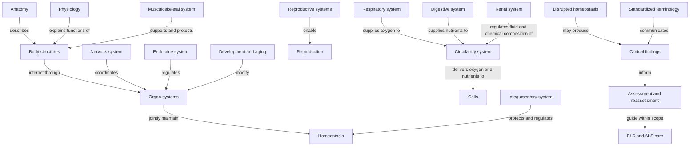

## Medical terminology and anatomical orientation

### Word construction and clinical communication

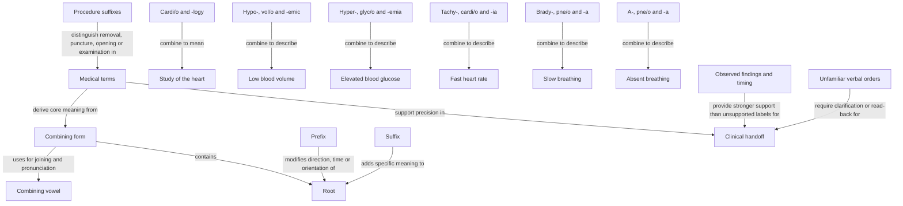

### Anatomical planes and directional relationships

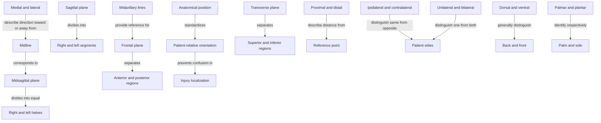

### Landmarks, cavities and clinical localization

```mermaid
flowchart TD
    N01["Sternum"]
    N02["Manubrium, body and xiphoid"]
    N03["Angle of Louis"]
    N04["Manubrium and sternal body"]
    N05["Costal margin"]
    N06["Rib cage"]
    N07["Intercostal spaces"]
    N08["Ribs"]
    N09["Midclavicular, sternal and axillary lines"]
    N10["Chest localization"]
    N11["Scapula and spinal landmarks"]
    N12["Posterior localization"]
    N13["Bony landmarks and named regions"]
    N14["Injury localization"]
    N15["Breath sound and wound reporting"]
    N16["Standardized electrode landmarks"]
    N17["Accurate ECG acquisition"]
    N18["Misplaced electrodes"]
    N19["ECG tracing"]
    N20["ECG acquisition by authorized EMT"]
    N21["ALS or clinician interpretation"]
    N22["Cranial cavity"]
    N23["Brain"]
    N24["Vertebral canal"]
    N25["Spinal cord"]
    N26["Diaphragm"]
    N27["Thoracic and abdominal cavities"]
    N28["Abdominal and pelvic cavities"]
    N29["Abdominopelvic cavity"]
    N30["Umbilical reference lines"]
    N31["Abdominal quadrants"]
    N32["RUQ"]
    N33["Liver and gallbladder"]
    N34["LUQ"]
    N35["Spleen and stomach"]
    N36["RLQ"]
    N37["Appendix"]
    N38["Lower quadrants"]
    N39["Bowel, ureters and reproductive organs"]
    N40["Midline pelvis"]
    N41["Bladder and sex-specific organs"]
    N42["Quadrant tenderness"]
    N43["Internal injury"]
    N44["Solid organ or vascular injury"]
    N45["Occult hemorrhage"]
    N46["Hollow organ injury"]
    N47["Serious internal injury"]

    N01 -->|consists of| N02
    N03 -->|joins| N04
    N05 -->|marks inferior edge of| N06
    N07 -->|lie between| N08
    N09 -->|standardize| N10
    N11 -->|standardize| N12
    N13 -->|support| N14
    N10 -->|supports| N15
    N16 -->|support| N17
    N18 -->|may mimic disease on| N19
    N20 -->|differs from| N21
    N22 -->|houses| N23
    N24 -->|houses| N25
    N26 -->|separates| N27
    N28 -->|form| N29
    N30 -->|define| N31
    N32 -->|contains much of| N33
    N34 -->|contains| N35
    N36 -->|contains| N37
    N38 -->|contain portions of| N39
    N40 -->|contains| N41
    N42 -->|helps localize but does not prove| N43
    N44 -->|may cause| N45
    N46 -->|may also cause| N47
```

### Patient positioning and physiological tradeoffs

```mermaid
flowchart TD
    N01["Supine position"]
    N02["Back"]
    N03["Prone position"]
    N04["Abdomen"]
    N05["Lateral recumbent position"]
    N06["Airway"]
    N07["Chest compression in lateral position"]
    N08["Ventilation"]
    N09["Prolonged pressure"]
    N10["Local circulation"]
    N11["Fowler position"]
    N12["Upright positioning"]
    N13["Semi-Fowler position"]
    N14["Work of breathing"]
    N15["Supine positioning"]
    N16["Hypoperfusion"]
    N17["Trendelenburg position"]
    N18["Respiratory or intracranial risk"]
    N19["Temporary leg elevation"]
    N20["Nontraumatic shock"]
    N21["Suspected spinal injury"]
    N22["Position changes"]
    N23["Airway, breathing and perfusion"]
    N24["Patient positioning"]

    N01 -->|places patient on| N02
    N03 -->|places patient on| N04
    N05 -->|can facilitate monitoring of| N06
    N07 -->|may impair| N08
    N09 -->|may impair| N10
    N11 -->|elevates torso 45 to 60 degrees in| N12
    N13 -->|elevates torso less than 45 degrees in| N12
    N12 -->|may reduce| N14
    N15 -->|may be better tolerated during| N16
    N17 -->|may compress diaphragm and increase| N18
    N19 -->|may offer limited transient benefit in selected| N20
    N21 -->|limits| N22
    N23 -->|guide repeated evaluation of| N24
```

No universal 30-minute side-switch rule; do not roll a suspected spinal injury solely because a timer expires. Trendelenburg and routine leg elevation in trauma are not recommended. Ventilation and resuscitation take priority when indicated.

## Musculoskeletal system

### Skeletal framework, protection and blood production

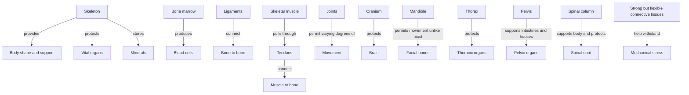

### Skull, spine and neurological injury

```mermaid
flowchart TD
    N01["Interlocking cranial bones"]
    N02["Brain"]
    N03["Intracranial bleeding or swelling"]
    N04["Intracranial pressure"]
    N05["Rigid cranium"]
    N06["Cerebral perfusion"]
    N07["Reduced cerebral perfusion"]
    N08["Consciousness"]
    N09["Hypoxemia and hypotension"]
    N10["Secondary brain injury"]
    N11["EMT airway and ventilation support"]
    N12["Serial mental status and pupils"]
    N13["Evolving brain injury"]
    N14["33 vertebrae"]
    N15["Spinal column"]
    N16["Intervertebral disks"]
    N17["Vertebrae"]
    N18["Twisting or improper lifting"]
    N19["Cervical, thoracic, lumbar, sacral and coccygeal regions"]
    N20["Thoracic vertebrae"]
    N21["Ribs"]
    N22["Fused sacrum"]
    N23["Pelvis"]
    N24["Spinal cord injury"]
    N25["Motor and sensory function"]
    N26["High cervical injury"]
    N27["Diaphragm and sympathetic function"]
    N28["Sympathetic dysfunction"]
    N29["Neurogenic shock"]
    N30["Spine mechanism and serial neurological findings"]
    N31["Protocol-directed SMR"]

    N01 -->|form rigid enclosure for| N02
    N03 -->|increases| N04
    N05 -->|limits accommodation of| N03
    N04 -->|may compromise| N06
    N07 -->|may impair| N08
    N09 -->|compound| N10
    N11 -->|helps limit| N10
    N12 -->|help detect| N13
    N14 -->|form| N15
    N16 -->|absorb shock between| N17
    N18 -->|may damage| N16
    N19 -->|subdivide| N15
    N20 -->|anchor| N21
    N22 -->|forms posterior wall of| N23
    N24 -->|may impair distal| N25
    N26 -->|may impair| N27
    N28 -->|may contribute to| N29
    N30 -->|inform| N31
```

Pain absence or an intact neurologic exam does not clear the spine. Hemorrhage remains a consideration in hypotensive trauma. The source does not substantiate the lumbar mobility comparison; do not use it to exclude injury.

### Thorax, pelvis and extremity structure

```mermaid
flowchart TD
    N01["Thoracic spine"]
    N02["12 rib pairs"]
    N03["True ribs 1 to 7"]
    N04["Sternum"]
    N05["False ribs 8 to 10"]
    N06["Floating ribs 11 and 12"]
    N07["Ilium, pubis and ischium"]
    N08["Pelvis"]
    N09["Acetabulum"]
    N10["Hip joint"]
    N11["Distal femur and proximal tibia"]
    N12["Knee joint"]
    N13["Patella"]
    N14["Tibia"]
    N15["Medial malleolus"]
    N16["Fibula"]
    N17["Lateral malleolus"]
    N18["Tarsals, metatarsals and phalanges"]
    N19["Foot"]
    N20["Clavicle and scapula"]
    N21["Shoulder girdle"]
    N22["Humeral head and shallow scapular socket"]
    N23["Shoulder joint"]
    N24["Broad shoulder mobility"]
    N25["Dislocation"]
    N26["Humerus, radius and ulna"]
    N27["Elbow"]
    N28["Olecranon of ulna"]
    N29["Radius"]
    N30["Forearm"]
    N31["Ulna"]
    N32["Carpals, metacarpals and phalanges"]
    N33["Hand and wrist"]

    N01 -->|anchors posteriorly| N02
    N03 -->|attach directly by cartilage to| N04
    N05 -->|attach indirectly to| N04
    N06 -->|lack anterior attachment to| N04
    N07 -->|form part of| N08
    N09 -->|receives femoral head to form| N10
    N11 -->|form| N12
    N13 -->|protects anteriorly| N12
    N14 -->|bears weight and forms| N15
    N16 -->|forms| N17
    N18 -->|provide framework of| N19
    N20 -->|form| N21
    N22 -->|permit broad movement at| N23
    N24 -->|contributes to susceptibility to| N25
    N26 -->|articulate at| N27
    N28 -->|forms prominence of| N27
    N29 -->|lies on thumb side of| N30
    N31 -->|lies on little-finger side of| N30
    N32 -->|provide framework of| N33
```

### Joint structure and movement

```mermaid
flowchart TD
    N01["Joints"]
    N02["Mobility"]
    N03["Skull plates"]
    N04["Immovable joints"]
    N05["Vertebral articulations"]
    N06["Limited mobility"]
    N07["Synovial joints"]
    N08["Free movement"]
    N09["Articular cartilage, synovial membrane and ligaments"]
    N10["Ball-and-socket joints"]
    N11["Hip and shoulder"]
    N12["Hinge joints"]
    N13["Elbow, knee and ankle"]
    N14["Pivot joints"]
    N15["C1 to C2 and radioulnar joints"]
    N16["Gliding joints"]
    N17["Small hand and foot bones"]
    N18["Saddle joint"]
    N19["Thumb carpometacarpal joint"]
    N20["Condyloid joint"]
    N21["Wrist"]
    N22["Flexion and extension"]
    N23["Joint angle"]
    N24["Abduction and adduction"]
    N25["Midline"]
    N26["Circumduction"]
    N27["Flexion, extension, abduction and adduction"]
    N28["Radioulnar pivot joints"]
    N29["Pronation and supination"]
    N30["Painful or deformed joint"]
    N31["Distal circulation, sensation and movement"]

    N01 -->|vary in| N02
    N03 -->|exemplify| N04
    N05 -->|exemplify| N06
    N07 -->|permit| N08
    N09 -->|support| N07
    N10 -->|permit broad motion at| N11
    N12 -->|primarily permit flexion and extension at| N13
    N14 -->|permit rotation at| N15
    N16 -->|permit sliding between| N17
    N18 -->|permits motion in perpendicular planes at| N19
    N20 -->|permits two-direction motion without full rotation at| N21
    N22 -->|decrease or increase| N23
    N24 -->|move away from or toward| N25
    N26 -->|combines| N27
    N28 -->|enable| N29
    N30 -->|warrants assessment of| N31
```

The source corrects its own traditional ankle saddle and wrist pivot examples. Do not force painful range of motion.

### Muscle contraction and systemic function

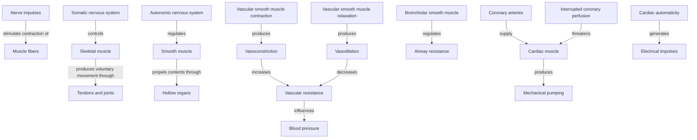

### Fracture, bleeding and coordinated care

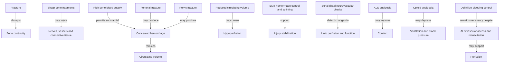

The chapter illustrates possible losses of 1–2 L from a femoral fracture and up to an entire circulating volume from pelvic injury; these are not patient-specific estimates. Avoid procedural delays to definitive care.

## Respiratory system

### Upper airway, swallowing and airway protection

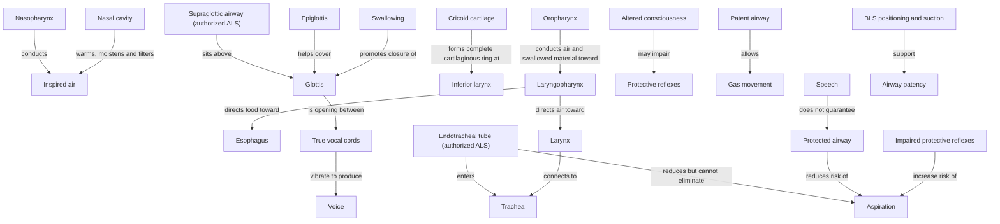

### Lower airway, pleura and gas exchange surface

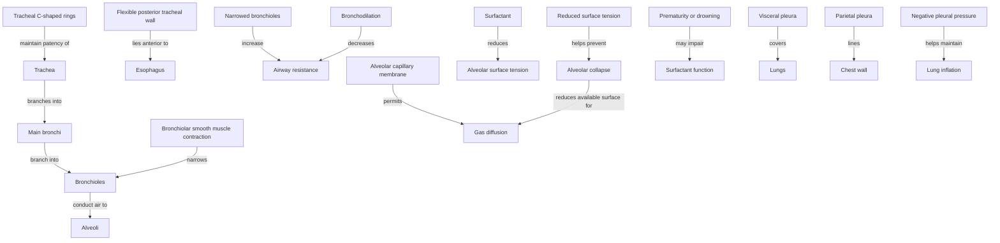

### Ventilation mechanics and respiratory muscle control

```mermaid
flowchart TD
    N01["Phrenic nerve C3 to C5"]
    N02["Diaphragm"]
    N03["High cervical cord injury"]
    N04["Diaphragm activation"]
    N05["Diaphragm and intercostal contraction"]
    N06["Thoracic cavity"]
    N07["Thoracic expansion"]
    N08["Intrathoracic pressure"]
    N09["Lower intrathoracic pressure"]
    N10["Spontaneous inspiration"]
    N11["Diaphragm and intercostal relaxation"]
    N12["Thoracic volume"]
    N13["Reduced thoracic volume"]
    N14["Passive expiration"]
    N15["Respiratory rate"]
    N16["Minute ventilation = rate × tidal volume"]
    N17["Tidal volume"]
    N18["Dead space"]
    N19["Rapid shallow breathing"]
    N20["Effective alveolar ventilation"]
    N21["Loss of spontaneous ventilation"]
    N22["Assisted ventilation"]
    N23["Bag-mask ventilation (BLS)"]
    N24["Positive pressure"]
    N25["Mechanical ventilation (ALS)"]
    N26["Excessive positive pressure"]
    N27["Venous return"]
    N28["Reduced venous return"]
    N29["Hypotension"]
    N30["Excessive pressure or volume"]
    N31["Lung injury"]

    N01 -->|stimulates| N02
    N03 -->|may disrupt| N04
    N05 -->|expand| N06
    N07 -->|lowers| N08
    N09 -->|draws air inward during| N10
    N11 -->|reduces| N12
    N13 -->|drives| N14
    N15 -->|combines with tidal volume to determine| N16
    N17 -->|combines with respiratory rate to determine| N16
    N18 -->|reduces effective portion of| N16
    N19 -->|may reduce| N20
    N21 -->|requires when indicated| N22
    N23 -->|uses| N24
    N25 -->|uses| N24
    N26 -->|can reduce| N27
    N28 -->|may worsen| N29
    N30 -->|may cause| N31
```

### Gas exchange and acid-base regulation

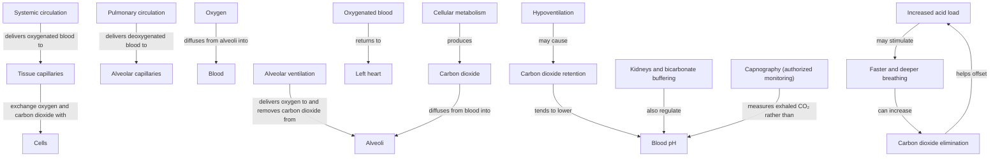

### Respiratory distress, failure and monitoring

```mermaid
flowchart TD
    N01["Adequate rate and tidal volume"]
    N02["Effective ventilation"]
    N03["Respiratory effort, chest movement and breath sounds"]
    N04["Retractions, flaring and accessory muscle use"]
    N05["Increased work of breathing"]
    N06["Head bobbing and declining effort"]
    N07["Respiratory fatigue"]
    N08["Ventilatory failure"]
    N09["Agonal gasps"]
    N10["Normal breathing"]
    N11["Cardiac arrest"]
    N12["Pulse oximetry"]
    N13["Hemoglobin oxygen saturation"]
    N14["Low perfusion, motion, temperature and pigmentation"]
    N15["Normal saturation"]
    N16["Hypoventilation"]
    N17["Waveform capnography"]
    N18["Exhaled CO₂ and respiratory pattern"]
    N19["Ventilation, metabolism and pulmonary blood flow"]
    N20["Leaks and sampling problems"]
    N21["Sudden waveform loss"]
    N22["Patient, airway and circuit"]
    N23["BLS bag-mask ventilation"]
    N24["Inadequate ventilation"]
    N25["CPAP when authorized"]
    N26["Spontaneous breathing"]
    N27["ALS airway escalation"]
    N28["BLS support and reassessment"]

    N01 -->|jointly support| N02
    N03 -->|help assess| N02
    N04 -->|may indicate| N05
    N06 -->|may indicate| N07
    N07 -->|may progress to| N08
    N09 -->|are not evidence of| N10
    N09 -->|warrant assessment for| N11
    N12 -->|estimates| N13
    N14 -->|can affect accuracy of| N12
    N15 -->|does not exclude| N16
    N17 -->|provides information about| N18
    N19 -->|influence| N17
    N20 -->|can distort| N17
    N21 -->|warrants evaluation of| N22
    N23 -->|supports| N24
    N25 -->|requires appropriate selection and| N26
    N27 -->|does not replace| N28
```

Age-specific reference rates are not universal treatment thresholds. Oxygenation and ventilation require separate assessment; CPAP is not a substitute for ventilation in apnea.

## Circulatory system

### Pulmonary and systemic circulation

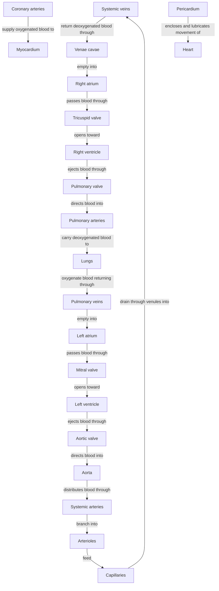

Arteries and veins are defined by direction of flow relative to the heart, not oxygen content.

### Cardiac electrical activation and mechanical pumping

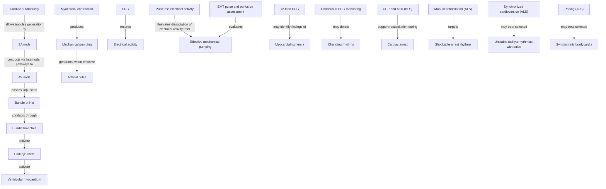

### Vascular structure, pulse and blood composition

```mermaid
flowchart TD
    N01["Arteries"]
    N02["Heart"]
    N03["Veins"]
    N04["Venous valves"]
    N05["Venous backflow"]
    N06["Capillary single-layer endothelium"]
    N07["Gas, nutrient and waste exchange"]
    N08["Left ventricular contraction"]
    N09["Arterial pressure wave"]
    N10["Palpable pulse"]
    N11["Carotid and femoral arteries"]
    N12["Central pulses"]
    N13["Radial, brachial, dorsalis pedis and posterior tibial arteries"]
    N14["Peripheral pulses"]
    N15["Brachial artery"]
    N16["Blood pressure and infant pulse assessment"]
    N17["Apical contraction"]
    N18["Effective perfusion"]
    N19["Red blood cells"]
    N20["Hemoglobin"]
    N21["Oxygen and some carbon dioxide"]
    N22["Plasma"]
    N23["Cells, nutrients, wastes and dissolved gases"]
    N24["White blood cells"]
    N25["Immune defense"]
    N26["Platelets and clotting factors"]
    N27["Hemostasis"]
    N28["Albumin"]
    N29["Vascular space"]
    N30["Peripheral IV or IO (authorized AEMT or paramedic)"]
    N31["Access-site swelling, leakage or dislodgement"]
    N32["Authorized clinician"]

    N01 -->|conduct blood away from| N02
    N03 -->|return blood toward| N02
    N04 -->|help prevent| N05
    N06 -->|facilitates| N07
    N08 -->|generates| N09
    N09 -->|is assessed as| N10
    N11 -->|provide sites for| N12
    N13 -->|provide sites for| N14
    N15 -->|provides site for| N16
    N17 -->|does not alone establish| N18
    N19 -->|contain| N20
    N20 -->|transports| N21
    N22 -->|transports| N23
    N24 -->|support| N25
    N26 -->|promote| N27
    N28 -->|helps retain water in| N29
    N30 -->|provides route into| N29
    N31 -->|warrants communication to| N32
```

Access is a route, not a treatment. EMTs do not manipulate lines or infusions unless authorized.

### Cardiac output, vascular tone and blood pressure

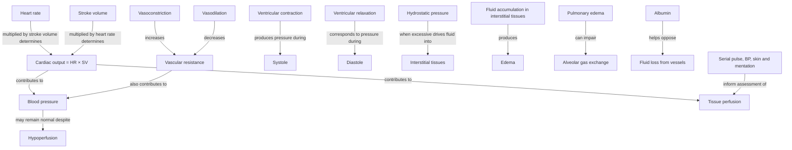

Systolic and diastolic pressures are influenced by multiple variables, not isolated measures of pump effectiveness and vessel diameter.

### Shock mechanisms and cause-specific support

```mermaid
flowchart TD
    N01["Hemorrhage"]
    N02["Circulating volume"]
    N03["Reduced circulating volume"]
    N04["Hypovolemic shock"]
    N05["Sepsis or anaphylaxis"]
    N06["Distributive shock"]
    N07["Pump failure"]
    N08["Cardiogenic shock"]
    N09["Tension pneumothorax"]
    N10["Obstructive shock"]
    N11["Tissue perfusion"]
    N12["Hypoperfusion"]
    N13["Weak pulses, altered mentation or cool skin"]
    N14["Compensation"]
    N15["Blood pressure"]
    N16["BLS hemorrhage control"]
    N17["ALS fluids or blood products"]
    N18["Excessive fluid"]
    N19["ALS vasopressors"]
    N20["ALS cause-specific intervention"]
    N21["Serial clinical findings"]
    N22["Cause-specific resuscitation"]

    N01 -->|reduces| N02
    N03 -->|underlies| N04
    N05 -->|may produce abnormal vascular tone in| N06
    N07 -->|reduces forward flow in| N08
    N09 -->|can mechanically impede circulation in| N10
    N04 -->|reduces| N11
    N06 -->|reduces| N11
    N08 -->|reduces| N11
    N10 -->|reduces| N11
    N12 -->|may manifest as| N13
    N14 -->|may temporarily maintain| N15
    N16 -->|addresses accessible| N01
    N17 -->|may support circulation in selected| N04
    N18 -->|may worsen pulmonary congestion in| N08
    N19 -->|may support vascular tone in selected| N06
    N20 -->|may address| N10
    N21 -->|inform selection and reassessment of| N22
```

Fluids, blood and vasopressors are not interchangeable. Scope, underlying cause, resources and protocol govern their use.

### Oxygen content, carbon dioxide transport and metabolism

```mermaid
flowchart TD
    N01["Hemoglobin"]
    N02["Oxygenated blood"]
    N03["Dissolved oxygen"]
    N04["Blood oxygen content"]
    N05["Hemoglobin concentration"]
    N06["SpO₂"]
    N07["Anemia or hemorrhage"]
    N08["Normal SpO₂"]
    N09["Carbon monoxide"]
    N10["Tissue oxygen delivery"]
    N11["Blood flow"]
    N12["Oxygen and glucose availability"]
    N13["Aerobic metabolism"]
    N14["Cellular energy"]
    N15["Inadequate oxygen availability"]
    N16["Anaerobic metabolism"]
    N17["Acid accumulation"]
    N18["Cellular metabolism"]
    N19["Carbon dioxide"]
    N20["Bicarbonate"]
    N21["Hemoglobin and dissolved plasma"]
    N22["Bicarbonate conversion in lungs"]
    N23["Lactate elevation"]
    N24["Hypoperfusion"]

    N01 -->|carries most blood oxygen in| N02
    N03 -->|contributes a small fraction to| N04
    N05 -->|influences| N04
    N06 -->|estimates fraction of occupied sites on| N01
    N07 -->|may reduce| N04
    N08 -->|does not establish adequate| N04
    N09 -->|may falsely reassure on| N06
    N04 -->|together with blood flow determines| N10
    N11 -->|together with oxygen content determines| N10
    N12 -->|support| N13
    N13 -->|produces abundant| N14
    N15 -->|may promote| N16
    N16 -->|produces limited energy and contributes to| N17
    N18 -->|produces| N19
    N19 -->|is transported mainly as| N20
    N19 -->|is also carried by| N21
    N22 -->|supports elimination of| N19
    N23 -->|may reflect but does not prove| N24
```

The source gives approximate oxygen transport proportions of 97% hemoglobin-bound and 3% dissolved; CO₂ transport is about 70% bicarbonate, 23% hemoglobin-bound and 7% dissolved. These vary with physiology.

### Clinical integration: penetrating trauma

```mermaid
flowchart TD
    N01["Penetrating neck, chest and abdominal wounds"]
    N02["Airway, ventilation, vessels and organs"]
    N03["Internal vessel or organ injury"]
    N04["Concealed hemorrhage"]
    N05["Pleural injury"]
    N06["Ventilation or circulation"]
    N07["Hypoperfusion"]
    N08["Weak rapid radial pulse, cool clammy skin and hypotension"]
    N09["Ability to scream"]
    N10["EMT bleeding control"]
    N11["Accessible external hemorrhage"]
    N12["EMT airway and chest injury care"]
    N13["Airway and ventilation threats"]
    N14["ALS clinical evaluation"]
    N15["Hemorrhagic and obstructive shock"]
    N16["ALS resuscitation"]
    N17["Definitive hemorrhage control"]
    N18["Wound locations and serial vital signs"]
    N19["Trauma handoff"]
    N20["Prompt trauma transport"]
    N21["Definitive care"]
    N22["Reassessment of breathing, perfusion and bleeding"]
    N23["Clinical deterioration"]

    N01 -->|may threaten| N02
    N03 -->|may produce| N04
    N05 -->|may impair| N06
    N04 -->|may produce| N07
    N08 -->|raise concern for| N07
    N09 -->|does not exclude| N07
    N10 -->|addresses| N11
    N12 -->|addresses| N13
    N14 -->|may distinguish| N15
    N16 -->|does not replace| N17
    N18 -->|inform| N19
    N20 -->|supports access to| N21
    N22 -->|detects| N23
```

## Nervous system

### Neural organization and regulation

```mermaid
flowchart TD
    N01["Central nervous system"]
    N02["Brain and spinal cord"]
    N03["Meninges and CSF"]
    N04["Cerebrum"]
    N05["Thought, speech, sensation and voluntary motion"]
    N06["Cerebellum"]
    N07["Balance and muscle activity"]
    N08["Brainstem"]
    N09["Midbrain, pons and medulla"]
    N10["Medulla"]
    N11["Breathing, heart function and vascular tone"]
    N12["Spinal cord"]
    N13["Brain and body"]
    N14["Peripheral nervous system"]
    N15["Afferent nerves"]
    N16["Efferent nerves"]
    N17["Somatic nervous system"]
    N18["Skeletal muscle"]
    N19["Autonomic nervous system"]
    N20["Smooth muscle and glands"]
    N21["Blood-brain barrier"]
    N22["Brain"]
    N23["Brain function"]
    N24["Oxygen and glucose"]

    N01 -->|consists of| N02
    N03 -->|protect and cushion| N02
    N04 -->|supports| N05
    N06 -->|coordinates| N07
    N08 -->|contains| N09
    N10 -->|contains centers regulating| N11
    N12 -->|conducts impulses between| N13
    N14 -->|connects body with| N01
    N15 -->|carry sensory signals toward| N01
    N16 -->|carry motor signals away from| N01
    N17 -->|controls| N18
    N19 -->|regulates| N20
    N21 -->|selectively regulates entry into| N22
    N23 -->|depends on continuous delivery of| N24
```

### Consciousness, altered mental status and assessment

```mermaid
flowchart TD
    N01["Reticular activating system"]
    N02["Consciousness"]
    N03["At least one functioning cerebral hemisphere"]
    N04["RAS dysfunction"]
    N05["Unconsciousness"]
    N06["Bilateral hemispheric dysfunction"]
    N07["Hypoxia and shock"]
    N08["Brain function"]
    N09["Hypoglycemia"]
    N10["Stroke, seizure and drugs"]
    N11["Disrupted brain function"]
    N12["Altered mental status"]
    N13["Airway protective reflexes"]
    N14["AVPU or GCS and serial findings"]
    N15["Focal deficits and last known well"]
    N16["Stroke evaluation"]
    N17["Authorized glucose measurement"]
    N18["Field stroke scales"]
    N19["Ischemic versus hemorrhagic stroke"]
    N20["BLS airway protection"]
    N21["Impaired protective reflexes"]
    N22["ALS targeted medication"]
    N23["Reversible causes"]
    N24["Witness history and changing findings"]
    N25["Clinical reasoning and destination"]

    N01 -->|provides arousal needed for| N02
    N03 -->|is also required for| N02
    N04 -->|may cause| N05
    N06 -->|may cause| N05
    N07 -->|can disrupt| N08
    N09 -->|can disrupt| N08
    N10 -->|can disrupt| N08
    N11 -->|may manifest as| N12
    N12 -->|may impair| N13
    N14 -->|help characterize| N12
    N15 -->|inform| N16
    N17 -->|helps evaluate| N09
    N18 -->|cannot distinguish reliably| N19
    N20 -->|addresses| N21
    N22 -->|may address selected| N23
    N24 -->|inform| N25
```

### Autonomic stress response and compensation

```mermaid
flowchart TD
    N01["Trauma, blood loss or fright"]
    N02["Sympathetic response"]
    N03["Sympathetic neural activation"]
    N04["Heart rate and vascular tone"]
    N05["Adrenal catecholamine release"]
    N06["Bronchodilation and pupil dilation"]
    N07["Gastric secretion and salivation"]
    N08["Sympathetic cholinergic fibers"]
    N09["Sweating"]
    N10["Peripheral vasoconstriction"]
    N11["Pale cool skin"]
    N12["Clammy skin"]
    N13["Heart rate and vascular tone changes"]
    N14["Blood pressure during stress"]
    N15["Parasympathetic activity"]
    N16["Heart rate"]
    N17["Bronchoconstriction and pupil constriction"]
    N18["Resting function"]

    N01 -->|activate| N02
    N03 -->|rapidly increases| N04
    N05 -->|helps sustain| N02
    N02 -->|promotes| N06
    N02 -->|reduces| N07
    N08 -->|stimulate| N09
    N10 -->|may produce| N11
    N09 -->|may produce| N12
    N13 -->|may help maintain| N14
    N15 -->|generally slows| N16
    N15 -->|promotes| N07
    N15 -->|promotes| N17
    N15 -->|supports return toward| N18
```

Autonomic effects depend on the organ and receptor; broad descriptions of parasympathetic vasodilation are not universal.

## Endocrine system

### Hormonal regulation and organ-system dependencies

```mermaid
flowchart TD
    N01["Ductless endocrine glands"]
    N02["Bloodstream"]
    N03["Hormones"]
    N04["Target organ function"]
    N05["Pituitary gland"]
    N06["Growth and endocrine regulation"]
    N07["Pineal gland"]
    N08["Circadian rhythm"]
    N09["Thyroid gland"]
    N10["Metabolism and development"]
    N11["Parathyroid glands"]
    N12["Calcium and phosphorus balance"]
    N13["Thymus"]
    N14["Immune maturation"]
    N15["Adrenal glands"]
    N16["Salt, water and stress regulation"]
    N17["Adrenal medulla"]
    N18["Epinephrine and norepinephrine"]
    N19["Pancreatic islets"]
    N20["Insulin and glucagon"]
    N21["Insulin"]
    N22["Cells"]
    N23["Glucagon"]
    N24["Blood glucose"]
    N25["Cellular metabolism"]
    N26["Ovaries and testes"]
    N27["Reproduction and sex characteristics"]

    N01 -->|secrete into| N02
    N02 -->|transports| N03
    N03 -->|regulate| N04
    N05 -->|coordinates multiple aspects of| N06
    N07 -->|secretes melatonin to regulate| N08
    N09 -->|regulates| N10
    N11 -->|regulate| N12
    N13 -->|secretes thymosin supporting| N14
    N15 -->|contribute to| N16
    N17 -->|releases| N18
    N19 -->|produce| N20
    N21 -->|promotes glucose uptake into| N22
    N23 -->|raises| N24
    N24 -->|supports| N25
    N26 -->|produce hormones regulating| N27
```

### Adrenergic receptors and therapeutic mechanisms

```mermaid
flowchart TD
    N01["Epinephrine"]
    N02["Alpha-1, alpha-2, beta-1 and beta-2 receptors"]
    N03["Norepinephrine"]
    N04["Alpha receptors"]
    N05["Beta-1 receptors"]
    N06["Alpha-1 receptor activation"]
    N07["Vascular smooth muscle"]
    N08["Vascular smooth muscle contraction"]
    N09["Vascular tone"]
    N10["Alpha-2 receptor activation"]
    N11["Norepinephrine release"]
    N12["Beta-1 receptor activation"]
    N13["Heart rate, contractility and conduction"]
    N14["Beta-2 receptor activation"]
    N15["Bronchiolar smooth muscle"]
    N16["Bronchiolar smooth muscle relaxation"]
    N17["Airway resistance"]
    N18["Anaphylaxis"]
    N19["Vasodilation and bronchoconstriction"]
    N20["Epinephrine (protocol-dependent BLS or ALS)"]
    N21["Albuterol (protocol-dependent BLS or ALS)"]
    N22["Beta-2 receptors"]
    N23["Upper airway obstruction"]
    N24["Albuterol"]
    N25["Tremor and tachycardia"]
    N26["Norepinephrine (authorized paramedic)"]
    N27["Vascular tone in selected shock"]
    N28["Hemorrhage control"]
    N29["Respiratory and hemodynamic reassessment"]
    N30["Medication response"]

    N01 -->|activates| N02
    N03 -->|has strong activity at| N04
    N03 -->|also has meaningful activity at| N05
    N06 -->|contracts| N07
    N08 -->|increases| N09
    N10 -->|commonly limits presynaptic| N11
    N12 -->|increases| N13
    N14 -->|relaxes| N15
    N16 -->|reduces| N17
    N18 -->|may produce| N19
    N20 -->|counteracts| N19
    N21 -->|predominantly stimulates| N22
    N21 -->|does not relieve| N23
    N24 -->|may cause| N25
    N26 -->|may support| N27
    N26 -->|does not replace| N28
    N29 -->|evaluates| N30
```

Sweating is primarily sympathetic cholinergic, not a direct alpha-1 effect. Norepinephrine has little beta-2 activity; medication indication, route and authorization matter.

## Integumentary system

### Skin structure, barrier and thermal regulation

```mermaid
flowchart TD
    N01["Epidermis"]
    N02["Protective barrier"]
    N03["Melanin"]
    N04["Skin pigmentation"]
    N05["Dermis"]
    N06["Strength and elasticity"]
    N07["Vessels, follicles, glands and nerves"]
    N08["Subcutaneous tissue"]
    N09["Fatty connective tissue"]
    N10["Sweat glands"]
    N11["Temperature regulation"]
    N12["Skin sensory receptors"]
    N13["Touch, pain, pressure and temperature"]
    N14["Skin"]
    N15["Water and electrolyte balance"]
    N16["Nails, hair and sebaceous glands"]
    N17["Deep or extensive burns"]
    N18["Temperature and fluid regulation"]
    N19["Burn edema"]
    N20["Circumferential burns"]
    N21["Distal neurovascular assessment"]
    N22["Limb circulation and function"]
    N23["BLS burn protection and warmth"]
    N24["Tissue injury and heat loss"]
    N25["ALS analgesia and fluid evaluation"]
    N26["Burn extent and clinical condition"]

    N01 -->|provides outer| N02
    N03 -->|contributes to| N04
    N05 -->|provides| N06
    N05 -->|contains| N07
    N08 -->|provides variable| N09
    N10 -->|support| N11
    N12 -->|detect| N13
    N14 -->|helps regulate| N15
    N16 -->|are accessory structures of| N14
    N17 -->|disrupt| N02
    N17 -->|impair| N18
    N19 -->|may constrain distal circulation in| N20
    N21 -->|detects changes in| N22
    N23 -->|reduce further| N24
    N25 -->|depend on| N26
```

### Clinical integration: burns and progressive airway risk

```mermaid
flowchart TD
    N01["Fuel ignition"]
    N02["Thermal injury"]
    N03["Scene hazard assessment"]
    N04["Fuel burn patient"]
    N05["Full-thickness circumferential arm burn"]
    N06["Distal circulation compromise"]
    N07["Facial burns with oral swelling"]
    N08["Evolving upper airway obstruction"]
    N09["Singed nasal hair alone"]
    N10["Oral swelling"]
    N11["Normal initial speech and breath sounds"]
    N12["Voice, stridor, work of breathing and mentation"]
    N13["Fowler positioning"]
    N14["Breathing and comfort"]
    N15["BLS suction and bag-mask preparation"]
    N16["Airway deterioration"]
    N17["ALS airway evaluation"]
    N18["Potential loss of airway"]
    N19["Burn depth, extent and suspected inhalation injury"]
    N20["Burn-center consultation"]
    N21["Ordinary SpO₂"]
    N22["Carbon monoxide poisoning"]
    N23["Exposure history"]
    N24["Anatomical location and burn extent"]
    N25["Handoff and PCR"]
    N26["Serial airway and distal circulation assessment"]
    N27["Clinical deterioration"]

    N01 -->|produces| N02
    N03 -->|precedes approach to| N04
    N05 -->|raises concern for| N06
    N07 -->|raise concern for| N08
    N09 -->|is less direct evidence than| N10
    N11 -->|do not exclude| N08
    N12 -->|help monitor| N08
    N13 -->|may facilitate| N14
    N15 -->|supports readiness for| N16
    N17 -->|balances intervention risk against| N18
    N19 -->|inform| N20
    N21 -->|cannot exclude| N22
    N23 -->|helps assess likelihood of| N22
    N24 -->|support precise| N25
    N26 -->|detects| N27
```

Do not infer CO poisoning from outdoor flash exposure alone. Oxygen decisions depend on findings and exposure.

## Digestive and renal systems

### Digestion, absorption and metabolic supply

```mermaid
flowchart TD
    N01["Mouth and saliva"]
    N02["Food"]
    N03["Esophagus"]
    N04["Stomach"]
    N05["Gastric juices and acid"]
    N06["Peristalsis"]
    N07["Alimentary tract"]
    N08["Pancreatic enzymes"]
    N09["Fats, starches and proteins"]
    N10["Liver"]
    N11["Bile"]
    N12["Gallbladder"]
    N13["Small intestine"]
    N14["Nutrients"]
    N15["Carbohydrates"]
    N16["Glucose"]
    N17["Fats"]
    N18["Fatty acids"]
    N19["Proteins"]
    N20["Amino acids"]
    N21["Bloodstream"]
    N22["Cellular energy production"]
    N23["Large intestine"]
    N24["Stool"]
    N25["Rectum and anus"]
    N26["Plasma and clotting components"]
    N27["Substances"]
    N28["Pancreatic islets"]
    N29["Insulin and glucagon"]
    N30["Spleen"]
    N31["Immune function"]

    N01 -->|begin mechanical and chemical breakdown of| N02
    N03 -->|transports food to| N04
    N05 -->|contribute to digestion in| N04
    N06 -->|moves contents through| N07
    N08 -->|digest| N09
    N10 -->|produces| N11
    N12 -->|stores and releases| N11
    N11 -->|supports digestion of fats in| N13
    N13 -->|completes digestion and absorbs| N14
    N15 -->|are broken down to| N16
    N17 -->|are broken down to| N18
    N19 -->|are broken down to| N20
    N14 -->|enter| N21
    N16 -->|supports| N22
    N23 -->|absorbs water and forms| N24
    N25 -->|permit elimination of| N24
    N10 -->|stores glucose and produces| N26
    N10 -->|helps metabolize or detoxify| N27
    N28 -->|regulate glucose via| N29
    N30 -->|filters blood and supports| N31
```

Spleen is anatomically abdominal but not a digestive organ.

### Gastrointestinal disturbances and systemic effects

```mermaid
flowchart TD
    N01["Vomiting and diarrhea"]
    N02["Circulating volume"]
    N03["Electrolyte balance"]
    N04["Gastrointestinal bleeding"]
    N05["Occult blood loss"]
    N06["Hypoperfusion"]
    N07["Liver disease and anticoagulant history"]
    N08["Bleeding risk"]
    N09["Blood in vomit or stool"]
    N10["Vomiting"]
    N11["Aspiration"]
    N12["BLS airway protection and reassessment"]
    N13["Aspiration risk and deterioration"]
    N14["ALS vascular access"]
    N15["Volume depletion"]
    N16["Ondansetron (authorized ALS)"]
    N17["5-HT3 serotonin receptors"]
    N18["Nausea"]
    N19["QT prolongation"]
    N20["Nausea relief"]
    N21["Serious abdominal pathology"]

    N01 -->|may reduce| N02
    N01 -->|may disturb| N03
    N04 -->|may cause| N05
    N05 -->|may cause| N06
    N07 -->|inform assessment of| N08
    N09 -->|may indicate| N04
    N10 -->|creates risk of| N11
    N12 -->|address| N13
    N14 -->|may support treatment of| N15
    N16 -->|antagonizes| N17
    N16 -->|may relieve| N18
    N16 -->|may increase risk of| N19
    N20 -->|does not exclude| N21
```

### Renal filtration, homeostasis and cardiac consequences

```mermaid
flowchart TD
    N01["Kidneys"]
    N02["Urine"]
    N03["Ureters"]
    N04["Bladder"]
    N05["Urethra"]
    N06["Fluid and electrolyte balance"]
    N07["Blood pressure and acid-base balance"]
    N08["Red blood cell production"]
    N09["Renal failure or missed dialysis"]
    N10["Fluid overload"]
    N11["Hyperkalemia"]
    N12["Cardiac conduction"]
    N13["Breathing"]
    N14["ALS ECG"]
    N15["Normal ECG"]
    N16["Laboratory testing"]
    N17["Dialysis schedule, access location and symptoms"]
    N18["ALS and hospital evaluation"]
    N19["Dialysis fistula"]
    N20["Local policy"]

    N01 -->|filter blood and produce| N02
    N03 -->|transport urine to| N04
    N04 -->|stores| N02
    N05 -->|eliminates| N02
    N01 -->|regulate| N06
    N01 -->|help regulate| N07
    N01 -->|support| N08
    N09 -->|may produce| N10
    N09 -->|may produce| N11
    N11 -->|may disturb| N12
    N10 -->|may compromise| N13
    N14 -->|may identify changes in| N12
    N15 -->|cannot reliably exclude| N11
    N16 -->|helps establish| N11
    N17 -->|inform| N18
    N19 -->|should be protected from routine access and BP measurement per| N20
```

## Reproductive systems

### Reproduction, organ function and development

```mermaid
flowchart TD
    N01["Testes"]
    N02["Sperm and testosterone"]
    N03["Epididymis"]
    N04["Sperm"]
    N05["Vas deferens"]
    N06["Accessory male glands"]
    N07["Semen"]
    N08["Penis"]
    N09["Ovaries"]
    N10["Ova, estrogen and progesterone"]
    N11["Fallopian tubes"]
    N12["Uterus"]
    N13["Sperm and ovum"]
    N14["Fertilized ovum"]
    N15["Embryo"]
    N16["Fetus"]
    N17["Vagina"]
    N18["Birth canal"]
    N19["Vulva"]
    N20["Vaginal opening and urinary meatus"]
    N21["Breasts"]
    N22["Newborn"]

    N01 -->|produce| N02
    N03 -->|stores| N04
    N05 -->|transports| N04
    N06 -->|contribute fluid to| N07
    N08 -->|delivers| N07
    N09 -->|produce| N10
    N11 -->|transport ova toward| N12
    N13 -->|may unite to form| N14
    N14 -->|develops into| N15
    N15 -->|develops into| N16
    N12 -->|supports development of| N16
    N17 -->|receives semen and forms| N18
    N19 -->|protects| N20
    N21 -->|produce milk for| N22
```

### Pregnancy, circulation and obstetric emergencies

```mermaid
flowchart TD
    N01["Enlarging uterus in later pregnancy"]
    N02["Supine positioning"]
    N03["Vessel compression"]
    N04["Circulation"]
    N05["Appropriate positioning or uterine displacement"]
    N06["Abdominal pain and bleeding"]
    N07["Ectopic pregnancy or other obstetric emergency"]
    N08["Inadequate uterine contraction"]
    N09["Postpartum hemorrhage"]
    N10["Hypoperfusion"]
    N11["Authorized ALS uterotonics"]
    N12["Uterine contraction"]
    N13["Authorized paramedic magnesium sulfate"]
    N14["Eclamptic seizures"]
    N15["Gestational age, bleeding, contractions and delivery times"]
    N16["Obstetric handoff"]
    N17["Maternal and newborn status"]
    N18["Transport or imminent delivery care"]

    N01 -->|may compress major vessels during| N02
    N03 -->|may compromise| N04
    N05 -->|may relieve| N03
    N06 -->|may indicate| N07
    N08 -->|may contribute to| N09
    N09 -->|may cause| N10
    N11 -->|may address inadequate| N12
    N13 -->|may treat| N14
    N15 -->|inform| N16
    N17 -->|guide| N18
```

Positioning and interventions depend on trauma, resuscitation considerations and local authorization.

## Pediatric anatomy and physiology

### Development and airway alignment

```mermaid
flowchart TD
    N01["Developmental anatomy"]
    N02["Adult assessment and care principles"]
    N03["Special health care needs"]
    N04["Caregiver baseline information"]
    N05["Small mouth and proportionally large tongue"]
    N06["Upper airway obstruction"]
    N07["Narrow trachea"]
    N08["Airway swelling"]
    N09["Pliable trachea and cricoid"]
    N10["Compression and malalignment"]
    N11["Hyperflexion or hyperextension"]
    N12["Pressure beneath chin"]
    N13["Tongue into pharynx"]
    N14["Large occiput"]
    N15["Supine infant"]
    N16["Individualized shoulder padding"]
    N17["Neutral airway and spinal alignment"]
    N18["Infant nasal breathing preference"]
    N19["Nasal obstruction"]
    N20["Higher laryngeal structures and poor alignment"]
    N21["Aspiration risk"]
    N22["Age-appropriate positioning and suction"]
    N23["Airway patency"]
    N24["Age-appropriate bag-mask equipment"]
    N25["Effective ventilation"]

    N01 -->|requires modifications to| N02
    N03 -->|increase importance of| N04
    N05 -->|increase risk of| N06
    N07 -->|increases impact of| N08
    N09 -->|increase susceptibility to| N10
    N11 -->|may cause| N06
    N12 -->|may displace| N13
    N14 -->|promotes neck flexion in| N15
    N16 -->|may improve| N17
    N18 -->|increases impact of| N19
    N20 -->|may contribute to| N21
    N22 -->|support| N23
    N24 -->|supports| N25
```

Traditional cricoid-is-narrowest and obligate nasal breathing rules are qualified by the source: glottic dimensions may be narrower, and infants can sometimes breathe orally. Avoid using the age rule to select an advanced airway size. Newborn tracheal diameter of about 4–5 mm versus adult 20 mm illustrates vulnerability, not sizing guidance.

### Pediatric chest mechanics and respiratory deterioration

```mermaid
flowchart TD
    N01["Pliable ribs"]
    N02["Thoracic organs"]
    N03["Blunt chest trauma"]
    N04["Rib fracture"]
    N05["Horizontal ribs"]
    N06["Chest expansion"]
    N07["Limited chest expansion"]
    N08["Diaphragm"]
    N09["Diaphragm dependence"]
    N10["Abdominal breathing"]
    N11["Immature accessory muscles"]
    N12["Retractions during distress"]
    N13["Compliant chest wall and small airways"]
    N14["Lung collapse"]
    N15["Grunting or laryngeal braking"]
    N16["Increased work of breathing"]
    N17["Diaphragm fatigue"]
    N18["Declining respiratory effort"]
    N19["Respiratory failure"]
    N20["Poor air movement, lethargy or bradycardia"]
    N21["Apnea with color change"]
    N22["Transport"]
    N23["Fragile lungs"]
    N24["Contusion and pressure injury"]
    N25["Excessive ventilation pressure or volume"]
    N26["Pressure injury"]
    N27["BLS age-appropriate bag-mask ventilation"]
    N28["Inadequate ventilation"]
    N29["ALS airway management"]
    N30["Effective bag-mask ventilation"]
    N31["Weight in kilograms and age"]
    N32["Equipment and authorized ALS care"]

    N01 -->|reduce skeletal protection of| N02
    N03 -->|may injure organs without| N04
    N05 -->|limit leverage for| N06
    N07 -->|increases dependence on| N08
    N09 -->|explains normal infant| N10
    N11 -->|contribute to early| N12
    N13 -->|predispose to| N14
    N15 -->|helps maintain expiratory pressure against| N14
    N16 -->|increases oxygen consumption and promotes| N17
    N17 -->|may cause| N18
    N18 -->|may indicate| N19
    N20 -->|raise concern for| N19
    N21 -->|warrants urgent evaluation and| N22
    N23 -->|are susceptible to| N24
    N25 -->|may produce| N26
    N27 -->|supports| N28
    N29 -->|is not automatically superior to| N30
    N31 -->|inform| N32
```

Rate alone does not determine adequacy: 60 breaths/min can be near normal in a young infant; a falling rate can indicate exhaustion. Assess appearance, effort, air movement and trends.

### Pediatric circulation and compensated shock

```mermaid
flowchart TD
    N01["Smaller circulating blood volume"]
    N02["Blood loss"]
    N03["Infant and young child limited contractile reserve"]
    N04["Heart rate for cardiac output"]
    N05["Fear, fever, anxiety and activity"]
    N06["Heart rate"]
    N07["Hypoxia and hypovolemia"]
    N08["Peripheral vasoconstriction"]
    N09["Vascular resistance"]
    N10["Heart rate and vascular resistance responses"]
    N11["Blood pressure despite hypoperfusion"]
    N12["Cool mottled extremities"]
    N13["Cold exposure"]
    N14["Failure of compensation"]
    N15["Hypotension"]
    N16["Severe hypoxia"]
    N17["Bradycardia"]
    N18["Bradycardia in pediatric hypoxia"]
    N19["Oxygenation and ventilation"]
    N20["BLS hemorrhage control"]
    N21["ALS IV or IO and resuscitation"]
    N22["Cause of circulatory compromise"]
    N23["Serial pulse, refill, mentation and BP"]
    N24["Perfusion"]

    N01 -->|increases relative impact of| N02
    N03 -->|increases dependence on| N04
    N05 -->|may increase| N06
    N07 -->|may also increase| N06
    N08 -->|helps maintain| N09
    N10 -->|may preserve| N11
    N08 -->|may cause| N12
    N13 -->|may also cause| N12
    N14 -->|may produce sudden| N15
    N16 -->|may cause| N17
    N18 -->|highlights importance of| N19
    N20 -->|reduces ongoing| N02
    N21 -->|depend on| N22
    N23 -->|inform assessment of| N24
```

The chapter's greater-than-30% blood-loss estimate is not an intervention trigger. Normal BP does not exclude pediatric shock. The textbook distinguishes newborn bradycardia from later hypoxic bradycardia in older children; do not use a rigid sequence to exclude hypoxia.

### Pediatric trauma and neurologic vulnerability

```mermaid
flowchart TD
    N01["Proportionally large head"]
    N02["Head injury in falls"]
    N03["Immature head control"]
    N04["Head support during movement"]
    N05["Incomplete skull fusion"]
    N06["Fontanelles"]
    N07["Acute intracranial swelling"]
    N08["Brain compression"]
    N09["Declining mental status"]
    N10["Fontanelle appearance"]
    N11["Dehydration or raised ICP"]
    N12["Reduced tears and fewer wet diapers"]
    N13["Dehydration"]
    N14["Less developed abdominal muscles"]
    N15["Internal abdominal injury"]
    N16["More exposed liver and spleen"]
    N17["Flexible bones"]
    N18["Greenstick fractures"]
    N19["Developing motor coordination"]
    N20["Falls"]
    N21["Mechanism and serial findings"]
    N22["Injury assessment"]

    N01 -->|increases risk of| N02
    N03 -->|requires| N04
    N05 -->|creates| N06
    N07 -->|can still cause| N08
    N08 -->|may manifest as| N09
    N10 -->|is an unreliable isolated indicator of| N11
    N12 -->|may indicate| N13
    N14 -->|increase vulnerability to| N15
    N16 -->|increase vulnerability to| N15
    N17 -->|may produce| N18
    N19 -->|contributes to| N20
    N21 -->|guide| N22
```

### Pediatric metabolism and thermal reserve

```mermaid
flowchart TD
    N01["Higher metabolic rate"]
    N02["Oxygen and glucose"]
    N03["Apnea or hypoventilation"]
    N04["Oxygen delivery"]
    N05["High oxygen demand"]
    N06["Hypoxic brain injury"]
    N07["Carbon monoxide exposure"]
    N08["Limited glucose stores and immature hepatic release"]
    N09["Hypoglycemia"]
    N10["High metabolic glucose demand"]
    N11["Diabetes"]
    N12["Seizure, limpness or abnormal breathing"]
    N13["Authorized glucose measurement"]
    N14["Oral glucose (when authorized)"]
    N15["Safe swallowing"]
    N16["IV dextrose (authorized ALS)"]
    N17["Glucose"]
    N18["Glucagon (protocol-dependent)"]
    N19["Hepatic glucose stores"]
    N20["Depleted hepatic glucose stores"]
    N21["Serial behavior, breathing and glucose"]
    N22["Treatment response and recurrence"]
    N23["High surface area relative to mass"]
    N24["Heat loss"]
    N25["Thin skin and little subcutaneous tissue"]
    N26["Thermal insulation"]
    N27["Immature hypothalamic regulation"]
    N28["Temperature instability"]
    N29["Protection from environmental extremes"]
    N30["Hypothermia"]

    N01 -->|increases demand for| N02
    N03 -->|threatens| N04
    N05 -->|increases vulnerability to| N06
    N07 -->|can impair| N04
    N08 -->|increase risk of| N09
    N10 -->|increases risk of| N09
    N11 -->|may increase risk of| N09
    N09 -->|may manifest as| N12
    N13 -->|helps evaluate| N09
    N14 -->|requires| N15
    N16 -->|directly supplies| N17
    N18 -->|mobilizes| N19
    N20 -->|may limit response to| N18
    N21 -->|help assess| N22
    N23 -->|increases| N24
    N25 -->|reduce| N26
    N27 -->|increases risk of| N28
    N29 -->|reduces risk of| N30
```

## Geriatric anatomy and physiology

### Aging, physiologic reserve and clinical presentation

```mermaid
flowchart TD
    N01["Normal aging"]
    N02["Physiologic reserve"]
    N03["Reduced physiologic reserve"]
    N04["Acute illness or injury"]
    N05["Chronic disease"]
    N06["Polypharmacy"]
    N07["Clinical presentation"]
    N08["Reduced immune defense"]
    N09["Infection"]
    N10["Absent fever"]
    N11["Altered sensation and medication effects"]
    N12["Typical emergency findings"]
    N13["Low-energy mechanisms"]
    N14["Significant injury"]
    N15["Caregiver and patient history"]
    N16["Baseline cognition, mobility and vital signs"]
    N17["Medication and anticoagulant history"]
    N18["Clinical risk assessment"]
    N19["New confusion"]
    N20["Baseline comparison and serial reassessment"]
    N21["Acute deterioration"]
    N22["Growing older population"]
    N23["Age-adapted EMS assessment"]

    N01 -->|may reduce| N02
    N03 -->|limits compensation during| N04
    N05 -->|can further reduce| N02
    N06 -->|may modify| N07
    N08 -->|may increase susceptibility to| N09
    N10 -->|does not exclude| N09
    N11 -->|may mask| N12
    N13 -->|may still cause| N14
    N15 -->|establishes| N16
    N17 -->|informs| N18
    N19 -->|requires evaluation rather than attribution to| N01
    N20 -->|help identify| N21
    N22 -->|increases importance of| N23
```

The supplied demographic counts and projections are historical textbook estimates; normal aging is not synonymous with disease.

### Aging cardiovascular mechanics and compensation

```mermaid
flowchart TD
    N01["Valve calcification and degeneration"]
    N02["Stenosis or regurgitation"]
    N03["Stenosis"]
    N04["Forward blood flow"]
    N05["Mitral regurgitation"]
    N06["Left atrium and pulmonary circulation"]
    N07["Pulmonary pressure elevation"]
    N08["Pulmonary edema"]
    N09["Fibrotic or thickened myocardium"]
    N10["Stroke volume"]
    N11["Reduced stroke volume"]
    N12["Cardiac output"]
    N13["Fewer pacemaker cells and reduced catecholamine response"]
    N14["Heart rate compensation"]
    N15["Beta-blockers"]
    N16["Conduction degeneration"]
    N17["Dysrhythmias"]
    N18["Weak or irregular pulse"]
    N19["Arterial stiffening"]
    N20["Systolic blood pressure and cardiac workload"]
    N21["Reduced baroreceptor sensitivity"]
    N22["Postural BP regulation"]
    N23["Impaired postural BP regulation"]
    N24["Orthostatic hypotension"]
    N25["Syncope and falls"]
    N26["Reduced cardiac reserve"]
    N27["Fluid resuscitation decisions"]
    N28["ALS ECG, lung findings and perfusion trends"]
    N29["Pump failure and volume depletion"]

    N01 -->|may produce| N02
    N03 -->|restricts| N04
    N05 -->|may increase pressure in| N06
    N07 -->|may contribute to| N08
    N09 -->|may reduce| N10
    N11 -->|may reduce| N12
    N13 -->|limit| N14
    N15 -->|may blunt| N14
    N16 -->|may cause| N17
    N17 -->|may manifest as| N18
    N19 -->|may increase| N20
    N21 -->|impairs| N22
    N23 -->|may cause| N24
    N24 -->|may contribute to| N25
    N26 -->|complicates| N27
    N28 -->|help distinguish| N29
```

Resting heart rate is not universally elevated in older adults. Do not provoke standing in an unstable or fall-prone patient to measure orthostatic vitals.

### Aging respiratory reserve and infection risk

```mermaid
flowchart TD
    N01["Weaker respiratory muscles"]
    N02["Ventilatory reserve"]
    N03["Stiffer rib cage"]
    N04["Chest expansion"]
    N05["Reduced alveolar surface area"]
    N06["Gas diffusion"]
    N07["Reduced chemoreceptor sensitivity"]
    N08["Hypoxia and hypercapnia"]
    N09["Small airway changes"]
    N10["Air trapping and reduced airflow"]
    N11["COPD, pneumonia or shock"]
    N12["Limited respiratory reserve"]
    N13["Weakened cough and ciliary clearance"]
    N14["Airway defense"]
    N15["Reduced mucus antibody protection"]
    N16["Dehydration"]
    N17["Impaired airway clearance"]
    N18["Impaired airway defense"]
    N19["Respiratory infection"]
    N20["Supplemental oxygen"]
    N21["Hypoventilation"]
    N22["Noninvasive support (authorized ALS)"]
    N23["Airway protection, BP and tolerance"]
    N24["Home oxygen or CPAP history and serial findings"]
    N25["Assessment of respiratory change"]

    N01 -->|reduce| N02
    N03 -->|limits| N04
    N05 -->|impairs| N06
    N07 -->|blunts detection of| N08
    N09 -->|may contribute to| N10
    N11 -->|may worsen| N12
    N13 -->|reduce| N14
    N15 -->|reduces| N14
    N16 -->|may compound| N17
    N18 -->|increases susceptibility to| N19
    N19 -->|can overwhelm| N12
    N20 -->|does not correct| N21
    N22 -->|requires consideration of| N23
    N24 -->|inform| N25
```

### Aging neurological and sensory changes

```mermaid
flowchart TD
    N01["Reduced brain mass"]
    N02["CSF"]
    N03["Neuronal degeneration"]
    N04["Reflexes and position sense"]
    N05["Regulatory center changes"]
    N06["Thirst, temperature and cardiorespiratory responses"]
    N07["Declining sensory function"]
    N08["Hazard recognition"]
    N09["Cataracts"]
    N10["Retina"]
    N11["Glaucoma"]
    N12["Optic nerve"]
    N13["Macular degeneration"]
    N14["Central vision"]
    N15["Retinal detachment"]
    N16["Retinal light processing"]
    N17["Reduced vision"]
    N18["Falls and medication errors"]
    N19["Presbycusis"]
    N20["High-frequency sounds"]
    N21["Background noise"]
    N22["Communication difficulty"]
    N23["Working hearing aids and clear speech"]
    N24["Communication"]
    N25["Neuropathy"]
    N26["Pain perception and motor function"]
    N27["Reduced pain perception"]
    N28["Injury or myocardial ischemia"]
    N29["Acute weakness, dyspnea or syncope"]
    N30["Acute coronary syndrome"]
    N31["Anticoagulant use and head impact"]
    N32["Occult head injury"]
    N33["Acute cognitive change"]
    N34["Reversible or urgent causes"]

    N01 -->|increases space occupied by| N02
    N03 -->|may impair| N04
    N05 -->|may impair| N06
    N07 -->|may impair| N08
    N09 -->|obstruct light reaching| N10
    N11 -->|can damage| N12
    N13 -->|impairs| N14
    N15 -->|disrupts| N16
    N17 -->|contributes to| N18
    N19 -->|particularly reduces perception of| N20
    N21 -->|may worsen| N22
    N23 -->|support| N24
    N25 -->|may impair| N26
    N27 -->|may mask| N28
    N29 -->|may warrant evaluation for| N30
    N31 -->|increase concern for| N32
    N33 -->|warrants assessment for| N34
```

### Aging gastrointestinal, endocrine and nutritional changes

```mermaid
flowchart TD
    N01["Impaired swallowing"]
    N02["Aspiration risk"]
    N03["Reduced taste, smell and salivation"]
    N04["Food intake"]
    N05["Tooth loss"]
    N06["Chewing"]
    N07["Reduced food intake"]
    N08["Malnutrition"]
    N09["Reduced esophageal motility and sphincter tone"]
    N10["Reflux"]
    N11["Reduced gastric acid"]
    N12["Food breakdown"]
    N13["Small intestine lining changes"]
    N14["Nutrient absorption"]
    N15["Reduced nutrient absorption"]
    N16["Slower colonic motility"]
    N17["Constipation or fecal impaction"]
    N18["Rectal sphincter degeneration"]
    N19["Bowel control"]
    N20["Reduced hepatic function and blood flow"]
    N21["Drug metabolism"]
    N22["Reduced insulin responsiveness"]
    N23["Glucose intolerance and type 2 diabetes"]
    N24["Altered renin, aldosterone and natriuretic hormone regulation"]
    N25["Fluid balance and BP"]
    N26["Altered vasopressor hormones and receptor responses"]
    N27["BP dysregulation"]
    N28["Altered thyroid hormone metabolism"]
    N29["Temperature and heart rate"]

    N01 -->|may increase| N02
    N03 -->|may reduce| N04
    N05 -->|may impair| N06
    N07 -->|contributes to| N08
    N09 -->|may contribute to| N10
    N11 -->|may impair| N12
    N13 -->|may impair| N14
    N15 -->|contributes to| N08
    N16 -->|may cause| N17
    N18 -->|may impair| N19
    N20 -->|may slow| N21
    N22 -->|increases risk of| N23
    N24 -->|may disturb| N25
    N26 -->|may contribute to| N27
    N28 -->|may influence| N29
```

### Aging musculoskeletal and skin integrity

```mermaid
flowchart TD
    N01["Mineral loss"]
    N02["Osteoporosis"]
    N03["Fracture risk"]
    N04["Reduced skeletal muscle mass"]
    N05["Weakness and poor balance"]
    N06["Poor balance"]
    N07["Fall risk"]
    N08["Sensory and reflex decline"]
    N09["Joint cartilage and ligament changes"]
    N10["Pain and limited motion"]
    N11["Fractures and immobility"]
    N12["Further illness"]
    N13["Disk narrowing and spinal curvature"]
    N14["Kyphosis"]
    N15["Spinal motion restriction"]
    N16["Padding and approved equipment"]
    N17["Subcutaneous tissue loss and weaker skin attachment"]
    N18["Fragile thin skin"]
    N19["Tears and pressure injury"]
    N20["Slower cell replacement"]
    N21["Wound healing"]
    N22["Reduced sweating and sensory changes"]
    N23["Thermoregulation"]
    N24["Impaired thermoregulation"]
    N25["Hypothermia and hyperthermia"]
    N26["BLS padding, skin protection and exposure control"]
    N27["Preventable injury"]

    N01 -->|contributes to| N02
    N02 -->|increases| N03
    N04 -->|causes| N05
    N06 -->|increases| N07
    N08 -->|also increases| N07
    N09 -->|may produce| N10
    N11 -->|may contribute to| N12
    N13 -->|contribute to| N14
    N14 -->|requires individualized alignment during| N15
    N16 -->|reduce movement and pressure injury during| N15
    N17 -->|produce| N18
    N18 -->|increases risk of| N19
    N20 -->|delays| N21
    N22 -->|impair| N23
    N24 -->|increases risk of| N25
    N26 -->|reduce| N27
```

Do not force kyphotic patients flat. Long backboards are not routinely required for continued transport.

### Aging renal reserve, medications and treatment monitoring

```mermaid
flowchart TD
    N01["Nephron loss"]
    N02["Filtration surface area"]
    N03["Reduced renal blood flow"]
    N04["Renal filtration"]
    N05["Reduced renal filtration"]
    N06["Renal reserve"]
    N07["Acute illness or injury"]
    N08["Renal dysfunction"]
    N09["Fluid and electrolyte balance"]
    N10["Reduced renal elimination"]
    N11["Medication effects"]
    N12["Reduced hepatic metabolism"]
    N13["Altered receptor response"]
    N14["Poor vision and motor skills"]
    N15["Medication administration errors"]
    N16["Polypharmacy"]
    N17["Medication exposure history"]
    N18["Long-acting diabetes medications"]
    N19["Recurrent hypoglycemia"]
    N20["Infusion pump"]
    N21["Delivery rate"]
    N22["Clinical appropriateness of treatment"]
    N23["ALS fluid and medication adjustment"]
    N24["Response and protocol"]
    N25["EMT reporting of swelling, dyspnea, mentation or alarms"]
    N26["Treatment reassessment"]

    N01 -->|reduces| N02
    N03 -->|reduces| N04
    N05 -->|limits| N06
    N07 -->|may overwhelm| N06
    N08 -->|may disturb| N09
    N10 -->|may prolong| N11
    N12 -->|may prolong| N11
    N13 -->|may modify| N11
    N14 -->|increase risk of| N15
    N16 -->|increases complexity of| N17
    N18 -->|may contribute to| N19
    N20 -->|controls| N21
    N20 -->|cannot determine| N22
    N23 -->|depends on| N24
    N25 -->|supports| N26
```

EMTs do not adjust infusions or medications unless authorized.

## Cross-system clinical integration

### Oxygen delivery, perfusion and consciousness

```mermaid
flowchart TD
    N01["Patent airway"]
    N02["Ventilation"]
    N03["Effective alveolar ventilation"]
    N04["Alveolar gas exchange"]
    N05["Pulmonary perfusion"]
    N06["Blood oxygen content"]
    N07["Hemoglobin concentration"]
    N08["Cardiac output"]
    N09["Tissue blood flow"]
    N10["Tissue oxygen delivery"]
    N11["Digestive and endocrine function"]
    N12["Glucose"]
    N13["Aerobic metabolism"]
    N14["Brain function"]
    N15["Impaired brain function"]
    N16["Airway protective reflexes"]
    N17["Impaired airway protective reflexes"]
    N18["Aspiration"]
    N19["BLS assessment and support"]
    N20["Ventilation and circulation"]
    N21["ALS monitoring and cause-specific care"]

    N01 -->|permits| N02
    N03 -->|supports| N04
    N05 -->|also supports| N04
    N04 -->|supports| N06
    N07 -->|influences| N06
    N08 -->|contributes to| N09
    N09 -->|combines with oxygen content to determine| N10
    N06 -->|combines with blood flow to determine| N10
    N11 -->|support availability of| N12
    N10 -->|supports| N13
    N12 -->|also supports| N13
    N13 -->|supports| N14
    N15 -->|may weaken| N16
    N17 -->|increase risk of| N18
    N18 -->|may impair| N04
    N19 -->|addresses threats to| N20
    N21 -->|supplement| N19
```

### Physiological reserve across the lifespan

```mermaid
flowchart TD
    N01["Infant airway geometry"]
    N02["Obstruction"]
    N03["Pediatric metabolic demand"]
    N04["Inadequate oxygen delivery"]
    N05["Pediatric limited contractile reserve"]
    N06["Heart rate compensation"]
    N07["Pediatric temperature regulation immaturity"]
    N08["Heat loss"]
    N09["Older adult cardiopulmonary changes"]
    N10["Cardiopulmonary reserve"]
    N11["Older adult renal and hepatic changes"]
    N12["Medication clearance"]
    N13["Older adult neurological and sensory changes"]
    N14["Emergency findings"]
    N15["Older adult skin and muscle changes"]
    N16["Injury and temperature extremes"]
    N17["Age-related physiology"]
    N18["Vital signs and clinical findings"]
    N19["Caregiver or patient baseline"]
    N20["Serial reassessment"]
    N21["Compensation and clinical status"]
    N22["Age-adapted BLS support"]
    N23["Physiological needs"]
    N24["Authorized ALS care"]

    N01 -->|increases susceptibility to| N02
    N03 -->|accelerates consequences of| N04
    N05 -->|increases reliance on| N06
    N07 -->|increases risk of| N08
    N09 -->|reduce| N10
    N11 -->|alter| N12
    N13 -->|may mask| N14
    N15 -->|increase vulnerability to| N16
    N17 -->|influences interpretation of| N18
    N19 -->|helps interpret| N18
    N20 -->|detects changes in| N21
    N22 -->|responds to| N23
    N24 -->|accounts for| N23
```

### Scope, clinical reasoning and continuity of care

```mermaid
flowchart TD
    N01["Anatomy and physiology"]
    N02["Clinical observations"]
    N03["Working clinical impression"]
    N04["Management considerations"]
    N05["State law, training and credentialing"]
    N06["Authorized scope"]
    N07["Medical direction and agency protocols"]
    N08["National models and scientific evidence"]
    N09["Local protocols"]
    N10["EMT, AEMT and paramedic practices"]
    N11["EMT assessment, ventilation, CPR and bleeding control"]
    N12["ALS care"]
    N13["Authorized AEMT access and selected treatments"]
    N14["BLS care"]
    N15["Authorized paramedic monitoring and advanced interventions"]
    N16["Equipment preparation or tracing acquisition"]
    N17["Advanced interpretation or intervention"]
    N18["Partner presence"]
    N19["Individual authorization"]
    N20["Serial reassessment"]
    N21["Patient response"]
    N22["Precise anatomical terminology and intervention timing"]
    N23["Handoff and documentation"]
    N24["Continuity of care"]

    N01 -->|explain mechanisms behind| N02
    N02 -->|support but do not always establish| N03
    N03 -->|informs| N04
    N05 -->|limit| N06
    N07 -->|guide| N06
    N08 -->|inform| N09
    N06 -->|defines permitted| N10
    N11 -->|remain foundational during| N12
    N13 -->|supplement| N14
    N15 -->|supplement| N14
    N16 -->|is distinct from| N17
    N18 -->|does not expand| N19
    N20 -->|evaluates| N21
    N21 -->|informs revision of| N03
    N22 -->|support| N23
    N23 -->|support| N24
```

These relationships are educational, not a mandatory clinical sequence or substitute for local protocol. Knowledge does not equal authorization.

