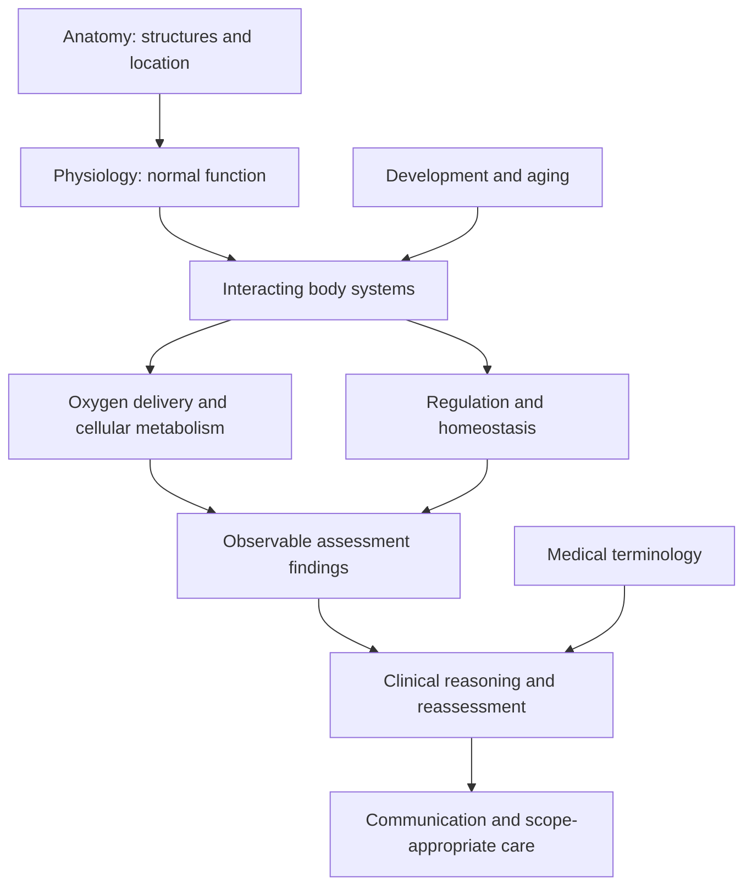
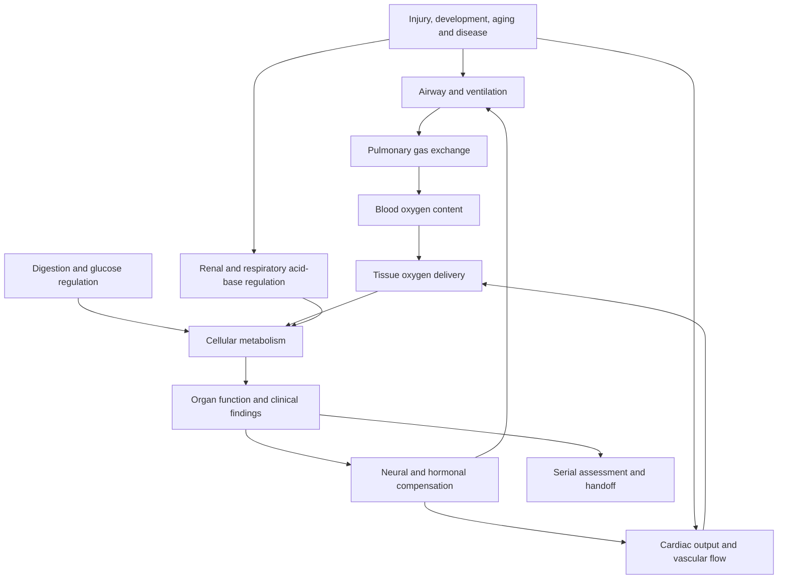

# Chapter 7: Anatomy, Physiology, and Medical Terminology — PQ4RS

## Preview

Anatomy explains how the body is constructed; physiology explains how those structures work. Medical terminology gives EMS clinicians a shared language for describing what they observe. Together, these disciplines provide the foundation for recognizing abnormal function, anticipating deterioration, and communicating care.

The chapter begins with medical word construction: combining forms identify the underlying structure or concept, while prefixes and suffixes refine its meaning. Recognizing recurring word parts allows unfamiliar terminology to be decoded and connected to anatomy, physiological changes and clinical procedures.

The chapter progresses from anatomical orientation and the body's supporting structures to the systems responsible for oxygen delivery, regulation, protection, nutrition, waste removal and reproduction. It then considers how development and aging change the same physiological processes and their clinical presentation.

A central theme is that apparently normal findings in one system do not guarantee normal function elsewhere: a patent airway does not guarantee ventilation, a normal oxygen saturation does not guarantee tissue oxygen delivery, and a normal blood pressure does not guarantee perfusion.

## Question

**Q01.** How do anatomy, physiology and standardized medical terminology work together during patient assessment and handoff, and how can recurring word parts help you interpret unfamiliar clinical language?

**Q02.** How do the musculoskeletal system and anatomical landmarks support movement, protection and recognition of concealed injury?

**Q03.** How do airway patency, ventilation, respiration, oxygenation and perfusion differ, and why must they function together?

**Q04.** How do the heart, blood vessels and blood components sustain cellular metabolism, and how can compensation conceal circulatory failure?

**Q05.** How do the nervous and endocrine systems coordinate responses to injury, illness and altered consciousness?

**Q06.** How do the skin, digestive, renal and reproductive systems contribute to homeostasis or introduce distinctive emergency risks?

**Q07.** Why can pediatric and geriatric patients present differently from typical adults with the same underlying physiological problem?

**Q08.** How does knowledge of normal physiology help an EMT contribute to ALS care without exceeding scope?

## Read

### Foundations of Anatomy, Physiology, and Clinical Communication

Anatomy describes the structure of the body and the relationships of its parts; physiology describes how the living body and its parts function. Knowledge of both enables EMTs to recognize normal function and potentially life-threatening deviations, understand signs and symptoms, identify affected systems, and anticipate the reasons for and effects of treatment. Because body systems interact and change with age, anatomy and physiology guide which areas to assess in adult, pediatric, and geriatric patients.

Accurate medical terminology and standardized anatomical descriptions allow clinicians to communicate the location, direction, extent and nature of illness or injury concisely in written and oral reports. These are the substantive expectations of the National EMS Education Standards for anatomy and physiology and medical terminology.

#### Scope of clinical practice

- **EMT:** Foundational assessment, airway positioning, suction, bag-mask ventilation, CPR/AED, hemorrhage control, and authorized medications or monitoring remain central throughout care.
- **AEMT:** Generally adds selected vascular access, fluids, medications and airway adjuncts; capabilities differ by jurisdiction.
- **Paramedic:** Generally has broader medication, ECG interpretation, manual electrical therapy and advanced airway capabilities. Drug-assisted airway management, blood products and other specialized practices require separate system authorization where offered.

National models describe levels of practice; scientific evidence supports clinical recommendations, guidelines inform local protocols, and laws, training, credentialing and medical direction determine actual authorization. Preparing equipment or acquiring a tracing is not the same as performing or interpreting an intervention. Never assume a partner's presence expands your scope. [Scope][scope] · [Model guidelines][model]

### Medical Terminology and Word Construction

#### Clinical and professional use

* **Definition:** The specialized language used in all fields of medicine.
* **Why It Matters for EMTs:**
  * Enables effective communication with other members of the health care team.
  * Assists in understanding terminology in textbooks, classroom lectures, continuing education sessions, and future medical education.
  * Helps develop a more professional and competent presentation.

#### Medical Words and Word Parts

* Medical words are constructed from **three kinds of word parts**: **combining forms**, **suffixes**, and **prefixes**.

Medical words can be decoded by identifying their recognizable word parts and combining their meanings.

* **Study Strategy:** Learn the individual prefixes, combining forms, and suffixes rather than memorizing every complete medical word. Break unfamiliar words into recognizable parts and consult a medical terminology text or dictionary when needed.

> [!TIP]
> **ALS Connection — Translating terminology into a handoff**
>
> Use precise observations rather than unsupported diagnostic labels. For example, “new right-sided weakness, speech difficulty, last known well 14:20” is more actionable than “possible CVA” alone. “Tachypneic with shallow breaths and declining alertness” communicates a ventilation concern better than “hypoxic” without supporting data. Include baseline, interventions, times, response and unresolved threats. Read back unfamiliar verbal orders or terms rather than assuming meaning. [Stroke 2026][stroke] · [Scope][scope]

##### Combining Form

* The **foundation** of every medical word; gives the word its essential meaning.
* **Two Parts:**
  * **Root:** Contains the core medical meaning.
  * **Combining vowel:** Usually **`o`** (sometimes **`a`**, **`e`**, or **`i`**); joins the root to another word part and makes the whole word pronounceable.
* **Formatting Rule:** Always ends with a hyphen to show it is a word part, not a complete word (e.g., `cardi/o-`). The hyphen—and sometimes the combining vowel—is deleted when joined with other word parts.
* **Construction Examples:**
  * `cardi/o-` (heart) + `-logy` (study of) = **`cardiology`** (study of the heart)
  * `peri-` (around) + `cardi/o-` (heart) + `-um` (structure) = **`pericardium`** (structure that surrounds the heart)
  * `my/o-` (muscle) + `cardi/o-` (heart) + `-al` (pertaining to) = **`myocardial`** (pertaining to heart muscle)
* **Other combining-form examples:** `pulmon/o-` (lungs), `angi/o-` (blood vessels), `bronch/o-` (bronchi of the lower airway), `cerebr/o-` (cerebrum of the brain).

##### Suffix

* A word part added to the **end** of a combining form that modifies or gives additional/specific meaning.
* **Construction Examples:**
  * `bronch/o-` (bronchus) + `-itis` (inflammation of) = **`bronchitis`** (inflammation of the bronchi or of the lower airway)
  * `hepat/o-` (liver) + `-ic` (pertaining to) = **`hepatic`** (pertaining to the liver)
  * **Multiple Combining Forms:** `laryng/o-` (larynx) + `trache/o-` (trachea) + `bronch/o-` (bronchus) + `-itis` (inflammation of) = **`laryngotracheobronchitis`** (inflammation of the larynx, trachea, and bronchi)
* **Shared-Meaning Adjective Suffixes:** **`-ac`**, **`-al`**, **`-ary`**, **`-eal`**, **`-ic`**, and **`-ous`** all mean **"pertaining to"** and typically turn the word into an adjective.

##### Prefix

* A word part that comes **before** a combining form; modifies the combining form(s), often indicating **direction, time, or orientation**.
* **Construction Example:**
  * `endo-` (within) + `trache/o-` (trachea) + `-al` (pertaining to) = **`endotracheal`** (pertaining to something within the trachea, e.g., an endotracheal tube)

#### Worked Examples of Medical Word Construction

* **`hypovolemic`** = `hypo-` (below normal) + `vol/o-` (volume) + `-emic` (pertaining to the blood) -> *Pertaining to a below-normal volume of blood*
* **`hyperglycemia`** = `hyper-` (above normal) + `glyc/o-` (glucose, sugar) + `-emia` (condition of the blood) -> *Condition of an above-normal blood glucose (sugar) level*
* **`apnea`** = `a-` (without, no) + `pne/o-` (breathing) + `-a` (condition) -> *Condition of no breathing (absence of breathing)*
* **`tachycardia`** = `tachy-` (fast) + `cardi/o-` (heart) + `-ia` (condition) -> *Condition of a fast heart rate*
* **`bradypnea`** = `brady-` (slow) + `pne/o-` (breathing) + `-a` (condition) -> *Condition of a slow breathing rate*

Word parts can also distinguish procedures and processes: `-centesis` denotes puncturing (thoracentesis involves puncture and drainage of the pleural space), `-ectomy` denotes removal (tonsillectomy), `-ostomy` denotes creation of an opening (tracheostomy), `-scope` denotes an examination instrument (laryngoscope), and `-scopy` denotes examination with an instrument (colonoscopy). `-lysis` denotes breakdown or loosening, as in glycogenolysis, the breakdown of glycogen to form glucose. These examples illustrate how terminology describes clinical processes rather than merely naming structures.

#### Common Combining Forms (Table 7-2)
* **`abdomin/o-`** — abdomen
* **`acous/o-`** — hearing, sound
* **`acr/o-`** — extremity, highest part
* **`aden/o-`** — gland
* **`adip/o-`** — fat
* **`albin/o-`** — white
* **`alg/o-`** — pain
* **`all/o-`** — other, strange
* **`andr/o-`** — male
* **`angi/o-`** — blood vessel
* **`aort/o-`** — aorta
* **`arter/o-`** — artery
* **`arthr/o-`** — joint
* **`articul/o-`** — joint
* **`audi/o-`** — hearing
* **`aur/i-`** — ear
* **`auscult/o-`** — listen
* **`bi/o-`** — life
* **`blephar/o-`** — eyelid
* **`brachi/o-`** — arm
* **`bronch/o-`** — bronchus
* **`bucc/o-`** — cheek
* **`burs/o-`** — pouch or sac, bursa
* **`calcane/o-`** — heel
* **`carcin/o-`** — cancer
* **`cardi/o-`** — heart
* **`carp/o-`** — wrist
* **`caus/o-`** — burn
* **`cephal/o-`** — head
* **`cervic/o-`** — neck, cervix
* **`chol/e-`** — bile
* **`chondr/o-`** — cartilage
* **`chrom/o-`** — color
* **`cili/o-`** — hairlike structure
* **`cis/o-`** — cut
* **`cleid/o-`** — collarbone (clavicle)
* **`cochle/o-`** — cochlea of the inner ear
* **`cor/o-`** — pupil
* **`coron/o-`** — encircling structure (like the vessels that encircle and supply the heart)
* **`corpor/o-`** — body
* **`cost/o-`** — rib
* **`cry/o-`** — cold
* **`cubit/o-`** — elbow
* **`cyan/o-`** — blue
* **`cyst/o-`** — bladder, cyst
* **`dent/i-`** — tooth
* **`derm/a-`** — skin
* **`digit/o-`** — finger or toe
* **`edem/o-`** — swelling
* **`embryon/o-`** — fetus
* **`enter/o-`** — intestines
* **`erythr/o-`** — red
* **`esthes/o-`** — sensation
* **`eti/o-`** — cause
* **`febr/o-`** — fever
* **`fibr/o-`** — fiber
* **`flex/o-`** — bend
* **`fract/o-`** — break up
* **`gastr/o-`** — stomach
* **`gnos/o-`** — knowledge
* **`gynec/o-`** — female
* **`hem/o-`** — blood
* **`hepat/o-`** — liver
* **`heter/o-`** — other, different
* **`home/o-`** — same
* **`humer/o-`** — upper arm
* **`hydr/o-`** — water
* **`hyster/o-`** — womb, uterus
* **`idi/o-`** — unknown, individual
* **`inguin/o-`** — groin
* **`lact/i-`** — milk
* **`later/o-`** — side
* **`leuk/o-`** — white
* **`ligat/o-`** — tie, bind
* **`lith/o-`** — stone
* **`medi/o-`** — middle
* **`meg/a-`** — large
* **`melan/o-`, `melen/o-`** — black
* **`men/o-`** — monthly
* **`morb/o-`** — disease
* **`mort/o-`** — death
* **`myel/o-`** — bone marrow, spinal cord
* **`my/o-`** — muscle
* **`nephr/o-`** — kidney
* **`neur/o-`** — nerve
* **`noct/o-`** — night
* **`ocul/o-`** — eye
* **`odont/o-`** — tooth
* **`o/o-`, `ov/i-`** — egg
* **`ophthalm/o-`** — eye
* **`orch/o-`** — testis
* **`osse/o-`, `oste/o-`** — bone
* **`ot/o-`** — ear
* **`palpat/o-`** — touch, feel
* **`par/o-`** — birth
* **`pariet/o-`** — wall of a cavity
* **`path/o-`** — disease
* **`ped/o-`** — child
* **`percuss/o-`** — strike, tap
* **`phag/o-`** — eat, swallow
* **`phot/o-`** — light
* **`placent/o-`** — placenta
* **`pleur/o-`** — pleura (lung membrane)
* **`pne/o-`** — breathe
* **`pneum/o-`** — lung, air
* **`pod/o-`** — foot
* **`psych/o-`** — mind
* **`purul/o-`, `pyl/o-`** — pus
* **`pyel/o-`** — pelvis (including pelvis of the kidney)
* **`pyret/o-`** — fever
* **`ren/o-`** — kidney
* **`reticul/o-`** — network
* **`retin/o-`** — retina of the eye
* **`rhin/o-`** — nose
* **`rub/o-`** — red
* **`salping/o-`** — fallopian tube
* **`sang/o-`** — blood
* **`scler/o-`** — hard
* **`seb/o-`** — sebum (oil)
* **`sect/o-`** — cut
* **`sept/o-`** — wall
* **`ser/o-`** — serum
* **`sinus/o-`** — cavity or hollow, sinus
* **`somat/o-`** — body
* **`sphincter/o-`** — sphincter muscle
* **`spir/o-`** — coil, breathe
* **`stern/o-`** — sternum
* **`steth/o-`** — chest
* **`sthen/o-`** — strength
* **`stom/o-`** — opening, mouth
* **`tact/o-`** — touch
* **`tars/o-`** — ankle
* **`tele/o-`** — distance
* **`tempor/o-`** — time, temple of the head
* **`tendon/o-`** — tendon
* **`tetr/a-`** — four
* **`tom/o-`** — cut
* **`toxic/o-`** — poison
* **`trache/o-`** — trachea
* **`trich/o-`** — hair
* **`urin/o-`** — urine
* **`vagin/o-`** — female genital canal
* **`vertebr/o-`** — vertebra
* **`viscer/o-`** — viscera (internal organs)
* **`viscos/o-`** — thick
* **`vol/o-`** — volume
* **`xen/o-`** — foreign
* **`xer/o-`** — dry

#### Common Prefixes (Table 7-3)
* **`a-`, `an-`** (without, lack of) — *apnea* (without breath), *asthenia* (lack of strength, weakness), *anemia* (lack of blood)
* **`ab-`** (away from) — *abnormal* (away from the normal)
* **`acr-`** (pertaining to extremity) — *acromegaly* (enlargement of the bones of the distal parts)
* **`ad-`** (to, toward) — *adhesion* (something stuck to)
* **`ante-`** (before, forward) — *antenatal* (occurring or formed before birth)
* **`anti-`** (against, opposed to) — *antipyretic* (against fever)
* **`auto-`** (self) — *autointoxication* (poisoning by a toxin generated within the body)
* **`bi-`** (two) — *bilateral* (two-sided)
* **`brady-`** (slow) — *bradycardia* (slow heartbeat)
* **`circum-`** (around, about) — *circumflex* (winding around)
* **`contra-`** (against, opposite) — *contralateral* (on the opposite side)
* **`di-`** (twice, double) — *diplopia* (double vision)
* **`dia-`** (through, completely) — *diagnosis* (knowing completely)
* **`dys-`** (with pain or difficulty) — *dyspnea* (difficulty breathing)
* **`e-`, `ex-`** (from, out of) — *excise* (to cut out or remove completely or surgically)
* **`ecto-`** (out from) — *ectopic* (out of place)
* **`em-`** (in) — *empyema* (pus in the chest)
* **`endo-`** (within) — *endometrium* (within the uterus)
* **`epi-`** (upon, on) — *epidermis* (outer layer of skin)
* **`eu-`** (normal, good) — *eupnea* (normal breathing)
* **`exo-`** (outside) — *exogenous* (produced outside the body)
* **`extra-`** (outside, in addition) — *extrasystole* (premature contraction of the heart)
* **`hemi-`** (half) — *hemiplegia* (paralysis of one side of the body)
* **`hyper-`** (excessive, above normal) — *hyperplasia* (excessive formation)
* **`hypo-`** (deficient, below normal) — *hypotension* (low blood pressure)
* **`in-`** (not) — *inferior* (beneath or lower)
* **`infra-`** (below) — *infrascapular* (below the scapula)
* **`inter-`** (between) — *intercostal* (between the ribs)
* **`iso-`** (equal) — *isotonic* (having equal tension)
* **`para-`** (by the side of) — *parathyroid* (beside the thyroid)
* **`per-`** (through) — *percutaneous* (through the skin)
* **`peri-`** (around) — *pericardium* (fibroserous sac surrounding the heart)
* **`poly-`** (many) — *polycystic* (containing many cysts)
* **`post-`** (after, behind) — *postpartum* (after childbirth)
* **`pro-`** (before) — *prognosis* (forecast of the outcome of a disease)
* **`quadri-`** (four) — *quadrant* (quarter of an area)
* **`retro-`** (backward) — *retroflexion* (bending backward)
* **`semi-`** (half) — *semiflexion* (partial flexion)
* **`sub-`** (below, less than) — *subacute* (moderately sharp)
* **`supra-`** (above) — *supraclavicular* (above the clavicles)
* **`sym-`** (with, together) — *symphysis* (growing together)
* **`tachy-`** (fast) — *tachycardia* (fast heartbeat)
* **`trans-`** (across) — *transfusion* (pouring across)
* **`tri-`** (three) — *tricuspid* (have three cusps)
* **`uni-`** (one) — *unilateral* (one-sided)

#### Common Suffixes (Table 7-4)
* **`-a`** (condition of) — *dyspnea* (condition of difficulty in breathing)
* **`-ac`** (pertaining to) — *insomniac* (pertaining to insomnia, or lack of sleep)
* **`-al`** (pertaining to) — *carpal* (pertaining to the wrist)
* **`-algia`** (pertaining to pain) — *neuralgia* (pain along a nerve)
* **`-ary`** (pertaining to) — *coronary* (pertaining to the blood vessels that supply the heart muscle)
* **`-blast`** (germ of immature cell) — *myeloblast* (bone marrow cell)
* **`-cele`** (tumor, hernia) — *enterocele* (hernia of the intestine)
* **`-centesis`** (puncturing) — *thoracentesis* (puncture and draining of the pleural space)
* **`-cyte`** (cell) — *leukocyte* (white cell)
* **`-eal`** (pertaining to) — *tracheal* (pertaining to the trachea)
* **`-ectomy`** (a cutting out) — *tonsillectomy* (excision of the tonsils)
* **`-emia`** (condition of the blood) — *hypoxemia* (condition of low blood oxygen)
* **`-emic`** (pertaining to the blood) — *hyperglycemic* (pertaining to high blood sugar)
* **`-gram`** (record or picture) — *electrocardiogram* (electronic picture of heart activity)
* **`-ic`** (pertaining to) — *psychic* (pertaining to the mind)
* **`-itis`** (inflammation) — *bursitis* (inflammation of the bursae)
* **`-logy`** (study of) — *ophthalmology* (study of the eye)
* **`-lysis`** (destruction or loosening) — *glycogenolysis* (breakdown of glycogen to form glucose)
* **`-meter`** (measuring instrument) — *oximeter* (instrument that measures blood oxygen saturation)
* **`-oma`** (tumor, swelling) — *neuroma* (tumor of a nerve)
* **`-osis`** (condition of) — *psychosis* (a mental disorder)
* **`-ostomy`** (creation of an opening) — *tracheostomy* (artificial opening into the trachea)
* **`-ous`** (pertaining to) — *fibrous* (pertaining to fiber)
* **`-pathy`** (disease) — *neuropathy* (disease of the nervous system)
* **`-plasty`** (surgical repair of, tying of) — *nephroplasty* (suturing of a kidney)
* **`-ptosis`** (falling, drooping) — *enteroptosis* (falling of the intestine)
* **`-rrhagia`** (excessive flow, bursting forth) — *hemorrhage* (heavy flowing of blood)
* **`-rrhea`** (flowing or discharge) — *rhinorrhea* (runny nose)
* **`-scope`** (instrument for examination) — *laryngoscope* (instrument for visualization of the larynx)
* **`-scopy`** (examination with an instrument) — *colonoscopy* (instrumental examination of the colon)
* **`-stasis`** (standing still) — *homeostasis* (remaining the same)
* **`-taxia`** (order, coordination) — *ataxia* (failure of muscle coordination)

### Anatomical Orientation and Body Regions

* **Anatomical Position:** The standard reference position assumed unless otherwise indicated—patient standing erect, facing forward, arms down at sides, palms facing forward.

#### Anatomical Planes and Reference Lines

* **Sagittal (Median) Plane:** Vertical lengthwise plane dividing the body into right and left segments (not necessarily equal).
  * **Midsagittal Plane:** Divides the body into two **equal** right and left halves.
* **Frontal (Coronal) Plane:** Divides the body into front (anterior) and back (posterior) halves.
* **Transverse (Horizontal / Axial) Plane:** Parallel with the ground; divides the body into upper (superior) and lower (inferior) halves.
* **Midline:** Imaginary vertical line from the top of the head through the nose and navel to the ground between the legs; corresponds with the **midsagittal plane**.
* **Midaxillary Line:** Imaginary vertical line (in profile) from the center of the armpit down to the ankle. A side-to-side vertical line connecting both midaxillary lines forms the **frontal plane**, dividing the body into the **anterior plane** (front) and **posterior plane** (back).
* **Transverse Line:** Imaginary horizontal line through the waist. Extending front-to-back forms the **transverse plane**, dividing the body into the **superior plane** (above the waist) and **inferior plane** (below the waist).

#### Directional Terms

* **Anterior / Posterior:** Toward the front / toward the back.
* **Superior / Inferior:** Toward the head (above point of reference) / toward the feet (below point of reference).
* **Dorsal / Ventral:** Toward the back or spine (also dorsum of hand/foot) / toward the front or belly (abdomen).
* **Medial / Lateral:** Toward the midline (center) / away from the midline (left or right).
  * *Related Terms:* **Bilateral** (both sides), **unilateral** (one side), **ipsilateral** (same side), **contralateral** (opposite side).
* **Proximal / Distal:** Near the point of reference / far (distant) from the point of reference.
* **Right / Left:** Always refers to the **patient's** right and left (opposite of the viewer when facing the patient).
* **Midclavicular / Midaxillary:** Center of each collarbone (**midclavicular line** extends down the anterior thorax) / center of the armpit (**midaxillary line** extends to the ankle).
* **Plantar / Palmar:** Sole of the foot / palm of the hand.

#### Patient Positions

* **Supine:** Lying face up on the back.
* **Prone:** Lying face down on the stomach.
* **Lateral Recumbent / Recovery Position:**
  * Lying on the left or right side (upper arm tucked under head, lower arm extended).
  * *Precautions:* Position so you can easily monitor the airway; avoid excessive pressure on the chest that could impair breathing; turn the patient to the opposite side if kept in this position for **more than 30 minutes** to prevent impaired blood flow to the lower arm.
* **Fowler's Position:** Lying on the back with the upper body elevated at a **45° to 60° angle**.
* **Semi-Fowler's Position:** Lying on the back with the upper body elevated at an angle **less than 45°**.
* **Trendelenburg Position:** Lying on the back with legs elevated higher than the head and body on an inclined plane (head down, legs up).
  * *Clinical Update:* **No longer recommended for shock**—gravity pushes abdominal organs against the diaphragm (impairing breathing) and may increase intracranial pressure in head-injured patients.
* **Shock Position (historical):** Lying on the back with only the feet and legs elevated approximately **12 inches**.
  * *Clinical Update:* **No longer recommended for shock** (no evidence of effectiveness) and **contraindicated in suspected spinal injury**. May still be used for a simple faint (syncopal episode) or vasodilation causing decreased blood pressure.

> [!CAUTION]
> **Clinical clarification — Positioning is physiology, not a fixed rule**
>
> Upright positioning can reduce the work of breathing; a supine position may be better tolerated in hypoperfusion. The 2024 AHA/Red Cross first-aid guidance allows temporary leg elevation in selected nontraumatic shock situations, but evidence of benefit is limited and transient. This differs from the chapter's categorical statement; it does not justify Trendelenburg or routine leg elevation in trauma. The fixed 30-minute side-switch instruction is not a universal contemporary EMS rule. Reassess airway, breathing, pressure areas and perfusion; do not roll a patient with suspected spine injury solely because a timer expired. If breathing becomes inadequate, prioritize ventilation or resuscitation as indicated. [First aid][firstaid] · [SMR][smr]

#### Body Regions and External Landmarks

##### Regions of the Body

* **Head & Neck:** Cranial region (upper head), occipital region (back of head), cervical region (neck).
* **Anterior Torso / Trunk:** Thoracic region (chest), umbilical region (belly button), inguinal region (pelvis), genital region (crotch).
* **Posterior Torso / Trunk:** Inferior angle of scapula (inner lower point of shoulder blade), lumbar region (lower back), flank (hips), iliac crest (meeting of hips and buttocks), sacral region (base of spine), buttocks.
* **Upper Extremity:** Arm (upper arm), cubital region (elbow), forearm (lower arm).
* **Lower Extremity:** Thigh / femoral region (upper leg), popliteal region (behind the knee), leg (lower leg), plantar aspect of foot (bottom of foot), dorsum of foot (top of foot).

##### Anterior Chest Landmarks

* **Midsternal line:** Center vertical line through the sternum.
* **Trachea:** Throat region.
* **Suprasternal notch:** Depression between the trachea and clavicle.
* **Manubrium:** Upper portion of the sternum, connected to the body of the sternum by the **Angle of Louis**.
* **Sternum:** Breastbone.
* **Xiphoid process:** Lower tip of the sternum.
* **Costal margin:** Lower edge of the ribcage.
* **Intercostal space:** Area between the ribs.
* **Acromion:** Edge of the scapula at the shoulder.
* **Clavicle:** Collarbone.
* **Anterior axillary line:** Vertical line along the coronal plane at the front of the armpit/body.

##### Posterior Chest Landmarks

* **Midspinal line:** Center vertical line through the spine.
* **Midscapular line:** Vertical line through the scapula.
* **Scapula:** Shoulder blade (with **inferior angle of scapula** at its bottom tip).
* **Spinous process:** Posterior bony protrusion from a vertebra.

##### Lateral Chest Landmarks

* **Anterior axillary line:** Front edge of the axilla.
* **Midaxillary line:** Center of the axilla.
* **Posterior axillary line:** Back edge of the axilla.

##### Topographic Anatomy

* **Anterior Skeletal Landmarks:** Cranium (forehead), eye orbit (eye socket), temporomandibular joint (connects jaw to skull), maxilla (upper jawbone), mandible (lower jawbone), clavicle, humerus (upper arm bone), sternum, xiphoid process, radial shaft and ulnar shaft (forearm bones), femur (upper leg bone), greater trochanter (outer top of femur), symphysis pubis, patella (kneecap), tibia (medial lower leg bone), fibula (lateral lower leg bone), malleolus (protruding ankle bone).
* **Posterior Landmarks:** Mastoid process (back of skull behind the ear), scapula, iliac crest, coccyx (tailbone), thigh, leg, foot, calcaneus (heel bone).
* **Internal Organs (Solid vs. Hollow):**
  * *Solid organs:* Lung, heart, liver, spleen, pancreas, kidney.
  * *Hollow organs:* Gallbladder, stomach, bladder, small intestine, large intestine.
  * *Airway landmark:* Larynx (voice box).

> [!NOTE]
> **ALS Connection — Chest landmarks and diagnostic equipment**
>
> A 12-lead ECG records electrical activity from multiple perspectives using electrodes placed on standardized landmarks. Misplaced leads can distort the tracing and imitate disease. The EMT may locate landmarks, prepare skin, help position the patient or acquire a tracing if authorized; the paramedic or receiving clinician interprets it in context. Report chest wounds and breath sounds using patient-side orientation and precise axillary or intercostal landmarks. These landmarks also help ALS clinicians communicate about suspected pleural pathology and advanced procedures; recognition does not authorize invasive chest procedures. [ACS guideline][acs] · [Scope][scope]

#### Body Cavities

* **Cranial cavity:** Houses the brain.
* **Spinal cavity:** The source describes this as housing the spine; its more detailed spinal section identifies the spinal cord as the structure housed within the vertebral column.
* **Thoracic cavity:** Upper chest.
* **Diaphragm:** Muscle separating the thoracic and abdominal cavities (center chest).
* **Abdominal cavity:** Upper belly.
* **Pelvic cavity:** Pelvis.
* **Abdominopelvic cavity:** Combined lower belly and pelvis.

#### Abdominal Quadrants

*Divided by imaginary horizontal and vertical lines intersecting at the **umbilicus (navel)**:*

* **Right Upper Quadrant (RUQ):** Majority of liver, right kidney, colon, small portion of pancreas, gallbladder, small intestines.
* **Left Upper Quadrant (LUQ):** Small portion of liver, spleen, left kidney, stomach, colon, majority of pancreas, small intestines.
* **Right Lower Quadrant (RLQ):** Colon, small intestines, right ureter, appendix, right ovary and right fallopian tube (females).
* **Left Lower Quadrant (LLQ):** Colon, small intestines, left ureter, left ovary and left fallopian tube (females).
* **Midline Area:** Bladder, uterus (females), prostate (males).

> [!NOTE]
> **ALS Connection — Abdominal findings and occult hemorrhage**
>
> Quadrant tenderness, guarding, distention, mechanism, and evolving vital signs help identify concern for internal injury, but pain location does not prove which organ is injured. Blood loss from a solid organ or vascular injury may occur without external bleeding; hollow-organ injury can also be serious. AEMT/paramedic vascular access may support resuscitation where appropriate, but it cannot repair internal bleeding. Report mechanism, location, perfusion and changes; arrange timely trauma evaluation rather than delaying for procedures. [Field triage][triage] · [Model guidelines][model]

### Human Body Systems

The chapter identifies ten major systems: musculoskeletal, respiratory, circulatory, nervous, endocrine, integumentary, digestive, urinary (renal), and the male and female reproductive systems.

### The Musculoskeletal System

* Consists of the bony framework (skeleton), **ligaments** (connect bone to bone), layers of muscles, **tendons** (connect muscle to bone), and other connective tissues.
* Must be strong (support/protection), jointed (motion), and flexible (withstand stress).

#### The Skeletal System

* **Four Functions:**
  1. Giving the body its shape
  2. Protecting vital internal organs
  3. Allowing for movement
  4. Storing minerals and producing blood cells
* **Six Basic Components:** Skull, spinal column, thorax, pelvis, upper extremities, and lower extremities. The source describes these components individually but does not explicitly classify them into axial and appendicular divisions.
* **Bone Classifications:** Long, short, flat, or irregular.
* **Anterior Skeleton, top to bottom:** Skull, maxilla, mandible, cervical vertebrae, scapula, sternum, humerus, ribs, thoracic vertebrae (T11), lumbar vertebrae (L4), ulna, radius, ilium, sacrum, coccyx, pubis, carpals, metacarpals, hand phalanges, ischium, femur, patella, tibia, fibula, tarsals, metatarsals, foot phalanges.

##### The Skull

* Rests atop the spinal column; houses and protects the brain; divided into the **cranium** and **face**.
* **Cranium:** Forms the top, back, sides, and forehead using flat interlocking bones: **occipital**, **two parietal**, **two temporal**, and **frontal**.
  * *Structure:* Thick, tough outer layer; thinner, more brittle inner layer.
  * *Pathophysiology Pearl:* Because the cranium cannot expand, bleeding and swelling compress brain tissue, increasing intracranial pressure and causing malfunction, unresponsiveness, or death. Bony projections/ridges on the anterior and inferior inner surfaces commonly lacerate the brain.
* **Face:** 14 bones between brow and chin (**13 immovable/interlocking** + **1 movable**):
  * *Immovable:* **Orbits** (eye sockets), **nasal bones** (bridge/bed of nose), **maxillae** (fused upper jaw), **zygomatic bones** (cheekbones).
  * *Movable:* **Mandible** (lower jaw)—horseshoe-shaped, largest and strongest facial bone, moves freely on hinge joints.

> [!NOTE]
> **ALS Connection — Brain injury and secondary insults**
>
> A head injury may increase intracranial pressure and compromise cerebral perfusion. Hypoxemia and hypotension can compound injury. ALS clinicians may use capnography during ventilation and evaluate hemodynamic support; advanced airway placement itself can worsen both problems if physiology is not protected. EMT priorities are airway patency, effective ventilation when needed, baseline and serial mental status, pupils, vital signs and prompt transport. A normal initial conversation does not exclude evolving injury. [Trauma airway][traumaair]

##### The Spinal Column (Vertebral Column)

* Principal support system of the body; composed of **33 irregularly shaped vertebrae** bound by strong ligaments, housing the spinal cord.
* **Textbook assessment distinction:** Spinal **cord** damage may produce **loss of sensation or movement distal** to the injury; the chapter describes spinal **column (vertebrae)** injury as usually producing **only pain**. This is not a reliable exclusion rule; see the clinical clarification below.
* **Intervertebral Disks:** Fluid-filled pads of tough elastic cartilage between vertebrae acting as shock absorbers; highly susceptible to twisting, grinding, or improper lifting injuries.
* **Five Divisions (superficial to deep):**
  1. **Cervical spine (C1–C7):** Neck; 7 vertebrae; **most prone to injury**.
  2. **Thoracic spine (T1–T12):** Upper back; 12 vertebrae; 12 pairs of ribs attach posteriorly for support.
  3. **Lumbar spine (L1–L5):** Lower back; 5 vertebrae; **least mobile** (most lower-back injuries involve muscles, not vertebrae).
  4. **Sacral spine / Sacrum (S1–S5):** 5 fused vertebrae forming the rigid posterior wall of the pelvis.
  5. **Coccyx (tailbone):** 4 fused vertebrae without typical vertebral protrusions.

> [!WARNING]
> **Clinical clarification — Spine pain and neurologic findings**
>
> A vertebral injury can occur without pain, and an initially intact neurologic exam does not clear the spine. High cervical injury can impair the diaphragm and sympathetic pathways. Hypotension with an unexpectedly slow pulse may raise concern for neurogenic shock, but hemorrhage must still be considered. Report motor and sensory findings, mechanism and trends; use protocol-directed spinal motion restriction (SMR), not routine prolonged rigid backboard transport. Do not force alignment against pain or resistance. [SMR][smr] · [Trauma airway][traumaair]

##### The Thorax (Chest)

* Composed of the ribs, **sternum** (breastbone), and thoracic spine.
* **Ribs (24 total / 12 pairs):** Semiflexible arches attached posteriorly to T1–T12:
  * *True ribs (pairs 1–7):* Attach directly to the sternum via cartilage.
  * *False ribs (pairs 8–12):* Pairs 8–10 attach to the ribs above via cartilage; pairs 11–12 (**floating ribs**) have no anterior attachment to the sternum.
* **Sternum:** Flat anterior chest bone with three parts: **manubrium** (superior; clavicles attach here), **body** (middle; ribs attach here), and **xiphoid process** (inferior tip).

##### The Pelvis

* Doughnut-shaped structure (includes sacrum and coccyx) forming the floor of the abdominal cavity; supports intestines and houses the **bladder, rectum, and internal reproductive organs**.
* **Key Bones:** **Iliac crests** (lateral "wings"), **pubis** (anterior/inferior), **ischium** (posterior/inferior).

##### The Lower Extremities

* **Hip Joint:** Pelvic socket (**acetabulum**) + rounded head of the **femur** (thighbone).
* **Knee Joint:** Hinged joint (angular movement only) formed by distal femur and proximal tibia; protected anteriorly by the triangular **patella** (kneecap).
* **Lower Leg:**
  * **Tibia (shin):** Anterior/medial weight-bearing bone; distal end forms the **medial malleolus** of the ankle.
  * **Fibula:** Lateral bone parallel to tibia; distal end forms the **lateral malleolus**.
* **Foot:** **Tarsals** (proximal foot, including the **calcaneus** / heel bone), **5 metatarsals** (body of foot), and **14 phalanges** (2 in big toe, 3 in each other toe).

##### The Upper Extremities

* **Shoulder Girdle:** **Clavicle** (collarbone) + **scapula** (shoulder blade); tip is the **acromion**.
* **Arm:** **Humerus** (largest upper extremity bone); head fits into shallow scapular cup forming a ball-and-socket joint (**most freely movable and easily dislocated joint in the body**).
* **Elbow & Forearm:** Hinged joint formed by distal humerus + proximal **radius** (lateral, thumb side; upper two-thirds sheathed in muscle, lower third forms most of wrist joint) and **ulna** (medial, little-finger side; palpable along length; **olecranon** forms bony prominence of elbow).
* **Wrist & Hand:** **8 carpals** (wrist), **metacarpals** (hand structural strength), and **phalanges** (3 per finger, 2 per thumb).

##### The Joints

* Place where one bone connects to another: **immovable** (skull plates), **slightly movable** (vertebrae), and **freely movable** (hip, elbow, knee).
* **Seven Joint Movements:**
  * **Flexion:** Bending toward the body / decreasing angle.
  * **Extension:** Straightening away from the body / increasing angle.
  * **Abduction:** Movement away from the midline.
  * **Adduction:** Movement toward the midline.
  * **Circumduction:** Combination of the four above (conical / 360° movement, e.g., shoulder).
  * **Pronation:** Turning forearm so palm faces backward.
  * **Supination:** Turning forearm so palm faces forward.
* **Six Types of Freely Movable Joints (two bones meeting at a joint cavity with synovial membrane, articular cartilage, and wrapping ligaments):**
  1. **Ball-and-socket:** Widest range of motion (flexion, extension, abduction, adduction, rotation); e.g., **shoulders, hips**.
  2. **Hinged:** Flexion and extension along one plane; e.g., **elbow** (forward), **knee** (backward), **fingers**.
  3. **Pivot:** Turning/rotating motion on same plane; e.g., **C1–C2 (head/neck)**, **wrist**.
  4. **Gliding:** Simplest movement, one bone sliding across another; e.g., **small bones of hands and feet**.
  5. **Saddle:** Limited movements along perpendicular planes; e.g., **ankle**.
  6. **Condyloid:** Modified ball-and-socket allowing limited motion in two directions (up/down, side-to-side, no full rotation); e.g., **wrist**.

> [!CAUTION]
> **Clinical clarification — Joint classification**
>
> The thumb carpometacarpal joint is a classic saddle joint; the talocrural ankle is principally a hinge joint, and forearm pronation/supination occurs at radioulnar pivot joints rather than the wrist proper. The chapter's ankle and wrist examples are retained for comparison. In the field, describe deformity, distal circulation, sensation and movement rather than attempting to demonstrate a painful joint's full range. [Joint anatomy][joints]

##### Bone Injury

* **Fracture:** Loss of continuity in bone structure; sharp fragments can injure nerves, vessels, and connective tissue.
* **Internal Bleeding Risk:** Bones are living tissue with a rich arterial/venous network extending through compact bone, marrow cavity, and spongy bone.
  * **Fractured femur:** Can lose **1,000 to 2,000 mL** of blood.
  * **Pelvic fracture:** Can lose the patient's **entire blood volume (~5 L, or 70–80 mL/kg)** into the pelvic cavity -> severe shock.

> [!IMPORTANT]
> **ALS Connection — Fractures, bleeding and analgesia**
>
> A femoral or pelvic fracture can produce major concealed blood loss; the chapter's volumes illustrate potential severity rather than predicted losses in a specific patient. EMT hemorrhage control, appropriate splinting, warmth and serial distal neurovascular checks support ALS care. Paramedic analgesia may improve comfort, but opioids can impair ventilation and lower blood pressure; report baseline and post-treatment breathing, alertness and perfusion. Vascular access or resuscitation may be considered without postponing definitive hemorrhage control. [Field triage][triage] · [Model guidelines][model]

> [!CAUTION]
> The chapter’s classification of the lumbar spine as the least mobile region and its simplified descriptions of joint motion are textbook statements. The supplied material does not independently substantiate the lumbar mobility comparison; do not use it to exclude injury.

#### The Muscular System

* Muscle cells (**fibers**) contract (shorten and thicken) when stimulated by nerve impulses.
* **Major Skeletal Muscles, top to bottom:** Masseter (jaw), sternocleidomastoid (neck), deltoid (shoulder), pectoralis major (chest), triceps (posterior upper arm), biceps (anterior upper arm), rectus abdominis (central abdomen), external oblique (lateral abdomen), sartorius (lateral upper to medial thigh), adductor femoris (medial upper thigh), quadriceps femoris (anterior/medial upper leg), vastus medialis (medial lower thigh to knee), gastrocnemius (calf), tibialis anterior (shin).
* **Three Types of Muscle:**
  1. **Skeletal (Voluntary) Muscle:** Controlled consciously by brain/nervous system; thick, spaced fibers; attached to bone by tendons (or skin/cartilage/organs); broad/flat in trunk, long/spindle-shaped in extremities.
  2. **Smooth (Involuntary) Muscle:** Tapered fibers wound together; automatic rhythmic, wavelike movements; found in walls of tubelike organs, ducts, respiratory tract, intestines, urinary system, and blood vessels.
     * *Vessel Control:* **Vasoconstriction** decreases vessel diameter -> increases resistance -> **increases pressure**. **Vasodilation** increases vessel diameter -> decreases resistance -> **decreases pressure**.
  3. **Cardiac Muscle:** Found only in the heart; striated like skeletal muscle but involuntary like smooth muscle in a unique cellular meshwork; exhibits **automaticity** (generates electrical impulses on its own even if disconnected from the CNS); supplied by **coronary arteries** and cannot tolerate even brief interruptions in blood supply.

### The Respiratory System

#### Functions

* The chapter states that brain cells begin to die in about **5 minutes** if oxygen is cut off. This is an approximate teaching figure, not a time to wait before intervention.
* **Four Basic Functions:**
  1. **Respiration:** Gas exchange—moving $O_2$ and $CO_2$ across membranes (alveoli, capillaries, cells).
  2. **Ventilation:** Mechanical movement of air in and out of the lungs via chest pressure changes.
  3. **Oxygenation & $CO_2$ Removal:** Diffusion of $O_2$ from high to low concentration into cells for metabolism, and removal of $CO_2$.
  4. **Acid–Base Balance Buffer:** One of three regulators (alongside kidneys and the bicarbonate buffer system); increased body acid triggers faster/deeper respirations to exhale excess $CO_2$ and lower acid load.

> [!NOTE]
> **ALS Connection — Ventilation, oxygenation and acid–base balance**
>
> Minute ventilation = respiratory rate × tidal volume; alveolar ventilation also accounts for dead space (air that does not participate in gas exchange). Rapid shallow breathing can therefore be ineffective. Carbon dioxide retention from hypoventilation tends to lower pH; deep rapid breathing in metabolic acidosis may be compensatory rather than simply anxiety. ALS waveform capnography measures exhaled CO₂ and its pattern, not blood pH; blood gases and laboratory data may be needed at the hospital. Report respiratory depth, effort, mental status and change over time. [Gas exchange][gas] · [Airway physiology][airway]

#### Structures: The Airway

* **Upper Airway** *(ends at the **cricoid cartilage**)*:
  * **Nares (nostrils) & Nasal Cavity:** Warms, moistens, and filters air over mucous membranes; extends from nares to the distal end of the **conchae** (3 bony ridges on sides of nasal cavity).
  * **Mouth & Oral Cavity**
  * **Pharynx:** Extends from soft palate to superior esophagus; three parts:
    * *Nasopharynx:* Posterior conchae to soft palate; passes air only, but shares opening with laryngopharynx (vomit/blood can travel into/out of nose or be aspirated).
    * *Oropharynx:* Behind soft palate down to epiglottis; passes air, food, and drink.
    * *Laryngopharynx (Hypopharynx):* Hyoid bone at base of tongue to openings of esophagus and larynx; diverts air to larynx and food/liquid to esophagus.
  * **Larynx:** Anterior throat from laryngopharynx to trachea; cartilage hardens with age.
    * *Thyroid cartilage:* Large anterior cartilage (**Adam's apple**).
    * *Cricoid cartilage:* Most inferior cartilage; **only complete circumferential cartilaginous ring**; connects to trachea.
    * *Vocal cords:* Superior **false vocal cords** (vestibular folds) and inferior **true vocal cords** (vocal folds; vibrate to produce sound; inflammation = laryngitis). Space between true vocal cords = **glottis (glottic opening)**.
    * *Epiglottis:* Flexible cartilage flap attached to thyroid cartilage; tips posteriorly during swallowing to cover the glottic opening while vocal cords also close (protective reflex against choking/drowning).
    * *Aspiration:* Occurs when altered mental status/unresponsiveness relaxes upper airway muscles and impairs protective reflexes, allowing liquid/blood/vomit into the larynx, trachea, and alveoli.
* **Lower Airway:**
  * **Trachea (windpipe):** Distal larynx down to **T5**; reinforced anteriorly/laterally by **15–20 C-shaped cartilaginous rings**; posterior wall has no cartilage (flexible ligament + **trachealis muscle**); esophagus lies immediately posterior.
  * **Bronchi & Bronchioles:** Trachea splits into two main bronchi -> subdivide into bronchioles lined with smooth muscle:
    * *Bronchoconstriction:* Smooth muscle contracts -> smaller diameter -> higher resistance -> harder to breathe.
    * *Bronchodilation:* Smooth muscle relaxes -> wider diameter -> lower resistance -> easier to breathe.
  * **Alveoli & Respiratory Membrane:** Tiny air sacs surrounded by capillaries where thin-walled gas diffusion occurs.
  * **Surfactant:** Fat/protein fluid lining alveoli that reduces surface tension and prevents lung collapse (deficient in **premature infants**; washed out in **drowning**).
* **Lungs & Pleura:**
  * **Visceral pleura:** Thin layer covering outer surface of the lungs.
  * **Parietal pleura:** Thicker, elastic layer lining the internal chest wall.
  * **Pleural cavity:** Tiny negative-pressure space between the two layers keeping lungs inflated.
* **Diaphragm:** Powerful, dome-shaped breathing muscle separating thoracic and abdominal cavities.

> [!NOTE]
> **ALS Connection — Airway patency versus protection**
>
> A patent airway permits gas movement; a protected airway reduces aspiration risk. A patient may speak yet be losing protective reflexes or developing swelling. BLS positioning, suction and effective bag-mask ventilation can be lifesaving and may avoid or bridge invasive management. A supraglottic airway sits above the glottis; an endotracheal tube enters the trachea and provides greater protection against gross aspiration, not a guarantee. AEMT supraglottic airway use and paramedic intubation depend on authorization. Prepare suction, oxygen, backup bag-mask equipment and monitor changes while the authorized clinician manages the airway. [Airway physiology][airway] · [Scope][scope]

#### Mechanics of Ventilation & Physiology of Respiration

* **Inhalation:** Diaphragm contracts (moves down/outward) and **intercostal muscles** contract (pull ribs up/outward) -> thoracic cavity expands -> **negative intrathoracic pressure** pulls air in.
* **Exhalation:** Diaphragm and intercostals relax -> thoracic cavity shrinks -> **positive pressure** pushes air out.
* **Effort Split:** Diaphragm = **60–70%**; intercostal muscles = **30–40%**.
* **Pathophysiology Pearl:** The **phrenic nerve** exits the spinal cord between **C3 and C5** to stimulate the diaphragm; the chapter describes high cervical spinal cord injury as eliminating spontaneous breathing (intercostal nerves exit lower thoracic vertebrae) and requiring artificial ventilation when spontaneous breathing is lost.
* **Gas Exchange:**
  * *Alveolar/Capillary Exchange:* Deoxygenated blood from right heart enters pulmonary capillary -> $O_2$ diffuses from alveolus to RBCs, $CO_2$ diffuses from blood to alveolus to be exhaled -> oxygenated blood returns to left heart.
  * *Capillary/Cell Exchange:* Oxygenated blood enters capillary from arteriole -> $O_2$ moves into cells, $CO_2$ moves from cells into capillary -> deoxygenated blood exits via venule to vein.

> [!IMPORTANT]
> **ALS Connection — Positive pressure and the circulation**
>
> Spontaneous inspiration draws air inward by lowering thoracic pressure; bag-mask ventilation and mechanical ventilation push air inward with positive pressure. Excessive pressure or ventilation can impair venous return and contribute to hypotension or lung injury. In shock, the patient may be particularly vulnerable to this effect. Continuous waveform capnography helps confirm and monitor an advanced airway and assess ventilation; sudden waveform loss warrants immediate evaluation of the patient, airway and circuit. EMTs continue assessing chest rise, breath sounds, mask seal and perfusion within scope. [Airway physiology][airway] · [Trauma airway][traumaair]

#### Adequate vs. Inadequate Breathing

* **Adequate Breathing:** Requires **both** adequate **respiratory rate** and adequate **tidal volume ($V_T$)** (chest wall moves outward **~1 inch** in average adult), regular rhythm, clear breath sounds, and effortless work.
  * *Normal Respiratory Rates:* Adults **8–24/min** (avg **12–20**); Elderly **20–22/min**; Children **18–37/min**; Infants **30–60/min**.
* **Signs of potentially inadequate breathing (assess adequacy and provide ventilation when indicated):**
  * Rate too slow or too fast; irregular pattern
  * Diminished/absent breath sounds; unequal or shallow chest expansion
  * Pale or bluish (cyanotic), cool, clammy skin/mucous membranes
  * Accessory muscle use / retractions (supraclavicular, intercostal, subcostal, neck muscles)
  * Nasal flaring (especially children)
  * **"Seesaw" breathing** in infants (chest and abdomen move in opposite directions)
  * **Head bobbing** (up on inhalation, down on exhalation -> severe respiratory fatigue)
  * **Agonal respirations** (occasional gasping breaths just before death)
  * **Grunting** (especially newborns, at end of inspiration or start of exhalation)

> [!WARNING]
> **ALS Connection — Distress, failure and monitoring**
>
> The chapter's respiratory ranges are textbook reference values, not independent intervention thresholds. Assess age, depth, effort, alertness, chest movement and trajectory. A tiring patient whose rate falls may be deteriorating. Agonal gasps are not normal breathing: assess for cardiac arrest and initiate BLS resuscitation when indicated. [Adult BLS][bls] · [PALS][pals]
>
> - **Pulse oximetry (SpO₂):** Estimates hemoglobin oxygen saturation, not ventilation or tissue oxygen delivery. Motion, low perfusion, temperature and skin pigmentation can impair accuracy. A normal value on oxygen does not exclude hypoventilation. [FDA][fda]
> - **Waveform capnography (EtCO₂):** Measures CO₂ at the end of exhalation and displays a respiratory waveform. Ventilation, metabolism, pulmonary blood flow, leaks and sampling problems influence readings. An obstructive waveform may support bronchospasm but does not establish a diagnosis. [Airway physiology][airway]
> - **ALS escalation:** Depending on cause and severity, an authorized clinician may consider bronchodilators, noninvasive positive pressure or advanced airway management. CPAP requires adequate spontaneous breathing and appropriate patient selection; it is not a substitute for ventilation in apnea. Keep BLS support and reassessment going. [Model guidelines][model]

### The Circulatory System

#### Overview & Functions

* Closed system of the **heart**, **blood vessels**, and **blood**.
* **Six Functions:** Perfusion of cells ($O_2$/nutrients in, $CO_2$/wastes out), blood transport for gas exchange, blood reservoir, acid–base buffering medium, immune cell delivery, and clotting/temperature regulation.

#### The Heart

* Fist-sized muscular pump in the thoracic cavity between lungs (~2/3 left of midline; **apex** just above diaphragm); enclosed in the fluid-lubricated, double-walled **pericardium**.
* **Four Chambers & Blood Flow:**
  * Deoxygenated blood from body enters **superior & inferior venae cavae** -> **right atrium** -> **tricuspid valve** -> **right ventricle** -> **pulmonary valve** -> **pulmonary arteries** -> lungs.
  * Oxygenated blood returns via **pulmonary veins** -> **left atrium** -> **mitral (bicuspid) valve** -> **left ventricle** -> **aortic valve** -> **aorta** -> body.
* **Cardiac Conduction System:** Electrical impulse causes **myocardium** (middle muscle layer) to contract:
  1. **Sinoatrial (SA) node** (pacemaker) -> internodal pathways
  2. **Atrioventricular (AV) node**
  3. **Bundle of His** (atrioventricular bundle)
  4. **Bundle branches** (in interventricular septum)
  5. **Purkinje fibers** (in ventricular myocardium)

> [!NOTE]
> **ALS Connection — Electrical activity versus mechanical pumping**
>
> An ECG reflects electrical activation, not proof of cardiac output. Organized activity can occur without a palpable pulse (pulseless electrical activity, or PEA); ECG appearance alone cannot establish perfusion. A 12-lead tracing can help identify myocardial ischemia and guide destination decisions, while continuous monitoring may identify changing rhythms. Paramedics may consider manual defibrillation for shockable arrest rhythms, synchronized cardioversion for selected unstable tachyarrhythmias with a pulse, or pacing for selected symptomatic bradycardia. EMT priorities remain pulse and perfusion assessment, CPR/AED when indicated, minimizing interruptions, and reporting symptoms and onset. [Adult ALS][als] · [ACS guideline][acs]

#### Blood Vessels

* **Arteries** *(carry blood **away** from heart; all carry oxygenated blood EXCEPT **pulmonary arteries**)*:
  * **Aorta:** Main trunk from heart; divides into iliac arteries around navel.
  * **Coronary arteries:** Right and left coronary arteries (plus anterior descending branch) supplying the heart muscle itself.
  * **Carotid:** Neck (brain/head); **Femoral:** Groin/thigh; **Dorsalis pedis:** Top of foot (big-toe side); **Posterior tibial:** Posterior to medial malleolus; **Brachial:** Antecubital region / medial upper arm (BP and infant pulse); **Radial:** Wrist proximal to thumb (standard pulse).
* **Arterioles:** Smallest arteries; feed capillaries.
* **Capillaries:** Microscopic single-layer endothelium vessels connecting arterioles to venules; site of all gas, nutrient, and waste exchange.
* **Venules:** Smallest veins draining capillaries.
* **Veins** *(carry blood **back** to heart; all carry deoxygenated blood EXCEPT **pulmonary veins**)*:
  * *Pathophysiology Pearl:* Unlike arteries, **veins have valves** to prevent backflow.
  * **Superior & inferior venae cavae:** Return deoxygenated blood to right atrium.

> [!NOTE]
> **ALS Connection — Vascular access and venous return**
>
> Peripheral IV access provides a route into the circulation; intraosseous (IO) access reaches the vascular marrow space when appropriate. An AEMT or paramedic may establish access under local authorization. Access is not a treatment by itself and is not always necessary. Watch for new swelling, discomfort, leakage or dislodgement and tell the clinician; do not manipulate the line or infusion unless permitted. [Scope][scope] · [Adult ALS][als]

#### Composition of Blood

* **Red Blood Cells (RBCs):** Contain **hemoglobin** (in cytosol) that binds and carries $O_2$ and $CO_2$ at separate sites.
* **White Blood Cells (WBCs):** Immune defense against infection.
* **Platelets & Clotting Factors:** Form blood clots to stop bleeding.
* **Plasma:** Liquid portion carrying cells, nutrients, wastes, tiny amount of $O_2$, and larger amount of $CO_2$.
  * *Pathophysiology Pearl:* Plasma contains large **albumin** molecules that help keep water from leaking out of vessels.

#### Physiology of Circulation

* **Pulse:** Pressure wave of blood propelled by left ventricular contraction felt where an artery crosses bone.
  * *Central:* Carotid, femoral.
  * *Peripheral:* Radial, brachial, posterior tibial, dorsalis pedis.
  * *Apical:* Felt over left chest; reflects mechanical heart contraction only—does **not** measure blood volume or pumping effectiveness (may still be felt during severe blood loss when radial/carotid pulses are weak or absent).
* **Blood Pressure:**
  * **Systolic BP:** Pressure during left ventricular contraction (measures pumping effectiveness).
  * **Diastolic BP:** Pressure at rest between contractions (measures arterial resistance/vessel diameter: constriction increases diastolic BP; dilation decreases it).
* **Hydrostatic Pressure & Edema:** Force of blood pressure/volume inside vessel walls; excessive pressure forces water out through capillary walls into tissues (**edema**). In the lungs, fluid between alveoli and capillaries impairs gas exchange.
* **Perfusion vs. Hypoperfusion:**
  * **Perfusion:** Adequate delivery of $O_2$/glucose/nutrients to cells and removal of $CO_2$/wastes.
  * **Hypoperfusion (Shock):** Insufficient supply of $O_2$/nutrients and inadequate waste removal due to poor circulation.

##### ALS Connection: Cardiac Output, Blood Pressure, and Types of Shock

Cardiac output = heart rate × stroke volume. Blood pressure reflects flow and vascular resistance, so normal pressure can coexist with reduced tissue perfusion. Systolic and diastolic pressures are influenced by multiple factors, not isolated measures of pump strength and vessel diameter.

| Physiologic problem | Example | Why ALS may evaluate further |
| --- | --- | --- |
| Hypovolemic | Hemorrhage | Loss of circulating volume; bleeding control and appropriate resuscitation |
| Distributive | Sepsis or anaphylaxis | Abnormal vascular tone; cause-directed treatment and perfusion support |
| Cardiogenic | Pump failure | Poor forward flow; excessive fluid can worsen pulmonary congestion |
| Obstructive | Tension pneumothorax | Mechanical impediment to circulation; cause-specific treatment |

Fluid, blood products or vasopressors may be considered by appropriately authorized clinicians according to cause, resources and protocol. They are not interchangeable; large crystalloid volumes may be harmful in certain hemorrhagic or cardiogenic states. Report serial BP, pulse quality, mentation, skin and breathing; a falling trend or worsening mental status matters even before hypotension. [Model guidelines][model] · [Trauma airway][traumaair]

#### Gas Transport & Cell Metabolism

* **Oxygen Transport:** **97%** bound to hemoglobin; **3%** dissolved in plasma (insufficient for survival alone).
* **Carbon Dioxide Transport:** **70%** as **bicarbonate** (formed inside RBC with water, circulates in plasma, reverses in lungs); **23%** attached to hemoglobin (separate site from $O_2$); **7%** dissolved in plasma.
* **Aerobic Metabolism ("with oxygen"):** Glucose + adequate $O_2$ -> **large amounts of energy** + harmless by-products (water, heat, $CO_2$).
* **Anaerobic Metabolism ("without oxygen"):** Glucose without $O_2$ -> **very little energy** + **acid** buildup.
  * *Clinical Warning:* A quiet, calm trauma patient may be in poor perfusion lacking the cellular energy to yell—assess them **before** a screaming patient who clearly has enough $O_2$/glucose to produce energy.

> [!CAUTION]
> **Clinical clarification — Oxygen content and cellular metabolism**
>
> The gas transport percentages are approximations that vary with physiology. Saturation is the proportion of available hemoglobin binding sites occupied by oxygen, not the total amount of oxygen carried. An anemic or hemorrhaging patient may have normal SpO₂ despite reduced oxygen content. Carbon monoxide can also make ordinary pulse oximetry falsely reassuring. Tissue delivery requires blood flow as well as oxygen content. Lactate can rise with poor perfusion but also for other reasons; it is not a stand-alone shock test. Quietness or screaming does not establish triage priority: assess immediate threats objectively in every patient. [Gas transport][transport] · [CDC CO][co] · [Field triage][triage]

#### Clinical Example: Penetrating Trauma and Hypoperfusion

A 23-year-old man has penetrating wounds to the neck, right anterior chest and abdomen. He is screaming in pain, has a respiratory rate of **28/min**, a weak rapid radial pulse, pale, cool, clammy skin and a BP of **88/68 mmHg**. These are case-specific observations, not universal intervention thresholds.

The hypotension, tachypnea, poor peripheral pulse quality and cool clammy skin are concerning for hypoperfusion despite the patient's ability to scream. Neck, thoracic and abdominal wounds may threaten the airway, ventilation, major vessels or organs. Do not assume a specific internal injury from the external wound.

- **EMT:** Control accessible life-threatening bleeding, address airway and ventilation threats, apply protocol-directed chest injury care, prevent heat loss, and expedite transport to the appropriate trauma facility. Give serial vital signs and wound locations to the ALS partner.
- **ALS:** May assess for obstructive or hemorrhagic shock, obtain vascular access, consider appropriate resuscitation or treatment for suspected tension pneumothorax, and coordinate trauma activation. Advanced procedures do not replace immediate bleeding control or surgical care. Do not delay definitive care for nonessential procedures.
- **Reassessment:** Track respiratory effort and bilateral breath sounds, pulse quality, mental status, bleeding and BP; promptly communicate new changes.

[Field triage][triage] · [Trauma airway][traumaair] · [Model guidelines][model]

### The Nervous System

#### Basic Functions

1. Controlling and maintaining consciousness and awareness
2. Transmitting sensory stimuli to the brain
3. Controlling motor function (voluntary and involuntary movement)
4. Controlling body functions via the autonomic nervous system

#### Structural Divisions

* **Central Nervous System (CNS):** Brain + spinal cord, enclosed by three protective membranes (**meninges**) and cushioned by **cerebrospinal fluid (CSF)**.
  * **Brain (~3 lbs):** Rich blood supply, high $O_2$ need, **does not store glucose** (requires constant supply).
    * *Cerebrum:* Outermost, largest part; controls sensation, thought, speech, associative memory, and conscious motion.
    * *Cerebellum ("small brain"):* Posterior/inferior cranium; coordinates muscle activity, balance, and partial muscle contraction.
    * *Brainstem:* Contains mesencephalon (midbrain), **pons** (bridge), and **medulla oblongata** (houses the **respiratory center**, **cardiac center**, and **vasomotor center** for BP/vessel tone).
    * *Pathophysiology Pearl:* The **blood–brain barrier** is a specialized capillary network allowing only select substances (like glucose) into the brain.
  * **Spinal Cord (~18 inches):** Extension of brainstem conducting nerve impulses.
* **Peripheral Nervous System (PNS):** Nerves outside brain/spinal cord.
  * **Afferent nerves:** Carry **sensory** info from body -> CNS.
  * **Efferent nerves:** Carry **motor** info from CNS -> body (e.g., reflexive withdrawal of a finger from a candle flame).

#### Functional Divisions

* **Voluntary (Somatic) Nervous System:** Controls skeletal (voluntary) muscles.
* **Autonomic Nervous System:** Automatic control of smooth muscles and glands; two opposing divisions:
  * **Sympathetic ("fight-or-flight"):** Activated by stressors (trauma, blood loss, fright) -> decreases gastric juices and saliva, increases sweat, secretes epinephrine, constricts most blood vessels, increases heart rate, dilates bronchioles, dilates pupils.
  * **Parasympathetic:** Returns body to normal / depresses function -> increases gastric juices and saliva, dilates most blood vessels, decreases heart rate, constricts bronchioles, constricts pupils.
  * *Pathophysiology Pearl:* Injury triggers an immediate nerve-based sympathetic response, followed within minutes by sustained hormonal release of **epinephrine and norepinephrine**.

#### Consciousness & Unconsciousness

* Controlled by the **cerebral hemispheres** (right and left sides of cerebrum) and the **reticular activating system (RAS)** (nerve network in the brainstem acting as the "wake/sleep" or "on/off" center).
* **Conscious:** Requires an intact **RAS + at least one cerebral hemisphere**.
* **Unconscious:** Occurs if **either the RAS OR both cerebral hemispheres** are damaged/dysfunctional.

> [!NOTE]
> **ALS Connection — Altered consciousness and neurologic assessment**
>
> Hypoxia, hypoglycemia, stroke, seizures, drugs and shock can all disrupt brain function. An EMT's baseline AVPU/GCS as trained, focal findings, last-known-well time, glucose if authorized, witness history and serial changes help distinguish possibilities. ALS may evaluate reversible causes and administer targeted medication, but a field stroke scale cannot determine ischemic versus hemorrhagic stroke. Protect the airway, avoid oral intake when swallowing is unsafe, and follow regional stroke routing; do not delay transport for nonessential testing. [Stroke 2026][stroke] · [Model guidelines][model]

### The Endocrine System

* Ductless glands that secrete **hormones** directly into the bloodstream to regulate body functions:
  * **Pineal gland** (brain, superior/posterior to thalamus): Produces **melatonin** (regulates circadian rhythm; inhibits reproductive system).
  * **Pituitary gland** (base of brain): **"Master gland"**—regulates growth, thyroid, parathyroid, pancreas, gonads, fatty acid/protein metabolism, blood sugar, and urinary excretion.
  * **Thyroid gland** (anterior neck): Regulates metabolism, growth/development, and nervous system activity.
  * **Parathyroid glands** (behind thyroid): Regulate calcium and phosphorus metabolism in bones/blood.
  * **Thymus gland** (neck, superior to heart): Secretes **thymosin** (immune system development/maturation).
  * **Adrenal glands** (atop kidneys; cortex + medulla): Secrete **epinephrine** and **norepinephrine**, postpone muscle fatigue, increase sugar storage, control kidney function, and regulate salt/water metabolism.
  * **Pancreas / Islets of Langerhans** (between kidneys/below stomach): Produce **insulin** (allows glucose into cells) and **glucagon** (raises blood glucose).
  * **Gonads** (ovaries in lower abdomen, testes in genital area): Govern reproduction and sex characteristics.

#### Epinephrine & Norepinephrine Receptor Effects

* **$\alpha_1$ (Alpha-1):** Causes **vasoconstriction** (shunts blood from skin to core -> **pale, cool skin**) and stimulates sweat glands (**moist/clammy skin**).
* **$\alpha_2$ (Alpha-2):** Regulates the release of $\alpha_1$.
* **$\beta_1$ (Beta-1):** Affects the **heart**—increases heart rate, increases force of contraction, and speeds electrical conduction.
* **$\beta_2$ (Beta-2):** Causes **smooth muscle dilation**, especially in **bronchioles** and some blood vessels.
* **Hormone Profiles:**
  * **Epinephrine (adrenaline):** Activates **all four** ($\alpha_1, \alpha_2, \beta_1, \beta_2$); used in severe allergic reactions to reverse vasodilation and bronchoconstriction.
  * **Norepinephrine:** Primarily **$\alpha_1$ and $\alpha_2$** (trace $\beta_1/\beta_2$) -> effects mainly seen in blood vessels and skin (pale, cool, clammy).

> [!CAUTION]
> **Clinical clarification — Adrenergic receptors and medication effects**
>
> Alpha-1 causes vascular smooth-muscle contraction; alpha-2 commonly limits presynaptic norepinephrine release (not release of alpha-1 itself). Sweating is primarily mediated by sympathetic cholinergic fibers, not direct alpha-1 stimulation. Norepinephrine has clinically meaningful beta-1 activity as well as strong alpha effects, with relatively little beta-2 effect. [Autonomic physiology][autonomic]
>
> **ALS medication connections:** Epinephrine is an adrenergic agonist used under distinct protocols for anaphylaxis and resuscitation; it can increase heart rate and vascular tone and relax bronchial muscle. Albuterol is a predominantly beta-2 agonist that can relieve bronchospasm but not upper-airway obstruction; tremor and tachycardia may occur. Norepinephrine is a vasopressor used by some paramedic systems for selected shock states, not a substitute for hemorrhage control. Report breathing, pulse, BP and clinical response. Some epinephrine and albuterol uses are BLS-authorized; routes and indications matter. [Scope][scope] · [Model guidelines][model] · [Adult ALS][als]

### The Integumentary System (Skin)

* **Four Functions:** Protects from environment/bacteria, regulates body temperature, serves as sensory receptor (heat, cold, touch, pain, pressure), and aids water/electrolyte (sodium, chloride) regulation.
* **Three Layers (superficial to deep):**
  1. **Epidermis:** Outermost layer (4 cell layers; outer 2 are dying/dead sloughed cells; deepest layers contain **melanin** pigment); contains sensory receptors and sweat pores.
  2. **Dermis:** Much thicker dense connective tissue giving elasticity/strength; contains blood vessels, hair follicles/shafts, arrector pili muscles, sweat glands, sebaceous (oil) glands, and sensory nerves.
  3. **Subcutaneous Layer:** Fatty connective tissue beneath dermis containing nerves, veins, arteries, and sweat glands; thickness varies (thin on eyelids, thick on abdomen/buttocks).
* **Four Accessory Structures:** Nails, hair, sweat glands, and oil glands.

> [!NOTE]
> **ALS Connection — Burns, barrier loss and circulation**
>
> Deep or extensive burns may disrupt the protective barrier, temperature regulation and fluid balance. Circumferential burns can constrain circulation as edema develops. Monitor distal pulses, sensation and movement, protect burned tissue and prevent hypothermia. An authorized ALS provider may evaluate analgesia, vascular access and fluid needs based on burn extent and clinical condition; a normal early BP does not rule out later deterioration. [Burn referral][burn] · [Model guidelines][model]

#### Clinical Example: Fuel Burn, Skin Injury and Progressive Airway Risk

A 38-year-old woman was burned when model airplane fuel ignited during refueling. She is found sitting about 15 feet from the smoldering aircraft. Park the ambulance clear of traffic, assess hazards, and verify that the fire is extinguished and fuel and aircraft no longer pose a threat before approaching.

* **Patient Assessment:**
  * *General Impression & Primary Assessment (case-specific):* Extreme pain from burns to her right arm and right side of her head. Responds appropriately with her name and describes what happened. Airway and breathing are adequate. In this example the team assesses circulation and starts **oxygen therapy** before proceeding with secondary assessment and care.
  * *Injury Examination:*
    * **Right arm:** Entire right arm from the **elbow to the fingertips** is severely charred from the burning fuel.
    * **Head & airway:** Minor but extensive burns involving the right side of the face and singeing of the hair; **swelling of the mucous membranes in the mouth** and **singeing of nasal hair** (closely monitor mouth and upper airway due to serious airway/breathing risk).
  * *Secondary Assessment:*
    * Pupils equal and reactive to light; no other head or neck injuries noted.
    * Breath sounds equal bilaterally; patient denies shortness of breath.
    * Full-body inspection reveals no other burns; pulses present in all extremities; moves extremities well.
    * History consistent with burn injury; no other significant medical history.
  * *Vitals & Treatment:*
    * Blood pressure and heart rate are both slightly high; respiratory rate and depth are normal.
    * Gently apply **sterile burn sheets** to injury sites and help the patient relax.
    * Position on the wheeled stretcher in **Fowler's position** (comfortable and helps her breathe easily).
  * *Reassessment (En Route):* Reassess mental status (remains alert), airway, respiration, circulation, vital signs, and ensure burn sheets continue protecting the burned skin.
* **Communication and Documentation:**
  * *En Route Radio Report (Anatomical Terminology):*
    * **Arm:** **Full-thickness burn** (through all layers of the skin) originating at the **right elbow joint**, extending **inferiorly and circumferentially** to the **distal fingers**.
    * **Head/Face:** **Superficial burn** involving the **right cranium and face**, specifically the **lateral aspect of the right mandible, maxilla, and zygomatic arch**.
  * *Medical Direction Reminder:* Emergency physician reminds you to stay alert for possible **airway compromise from upper airway swelling** due to the facial burns.
  * **Handoff:** Patient arrives alert with severe pain but not in severe respiratory distress; deliver verbal report to ED staff, transfer to hospital bed, complete PCR using accurate anatomical terminology, .

> [!IMPORTANT]
> **ALS Connection — Applying the burn case**
>
> Oral swelling is a more direct warning of potential airway compromise than singed hair alone; early normal speech and oxygenation do not exclude progression. An ALS clinician may evaluate the need for advanced airway management before swelling worsens, balancing procedural risk against the danger of losing the airway. The EMT can prepare suction and bag-mask equipment, reassess voice, stridor, work of breathing, mental status and distal circulation, and coordinate early receiving-facility notification. Deep burns and suspected inhalation injury warrant burn-center consultation or transfer consideration. Oxygen decisions depend on findings and exposure (ordinary SpO₂ cannot exclude CO poisoning); do not automatically assume CO poisoning from an outdoor flash burn. [Burn referral][burn] · [CDC CO][co] · [Trauma airway][traumaair]

### The Digestive System

* Composed of the **alimentary tract** and **accessory organs**; ingests/carries food for absorption and eliminates waste.
* **Major Organs:**
  * **Mouth & Salivary Glands:** Mechanical chewing + saliva begins breaking down food.
  * **Esophagus:** Flexible tube posterior to trachea carrying food to stomach.
  * **Stomach:** Large hollow main digestive organ; secretes gastric juices/acid to convert food for absorption.
  * **Pancreas:** Flat solid organ inferior/posterior to stomach; secretes pancreatic juices (digest fats, starches, proteins) and insulin (islets of Langerhans).
  * **Liver:** Largest solid abdominal organ (RUQ, beneath diaphragm); produces **bile** (fat digestion), stores sugars, produces immune/clotting/plasma components, and detoxifies digestive toxins.
  * **Spleen:** Solid organ in LUQ; **no digestive function**—filters blood, serves as emergency **blood reservoir** during hemorrhage, and supports immune system.
  * **Gallbladder:** Hollow pouch on bile duct; stores bile and contracts to release it into small intestine for fat digestion.
  * **Small Intestine (duodenum, jejunum, ileum):** Completes digestion and absorbs nutrients into bloodstream.
  * **Large Intestine (Colon):** Absorbs water from unabsorbed waste -> forms stool passed through rectum and anus.
* **Two Digestive Processes:**
  * *Mechanical:* Chewing, swallowing, **peristalsis** (rhythmic movement), and **defecation**.
  * *Chemical:* Enzymes break down **carbohydrates -> glucose**, **fats -> fatty acids**, and **proteins -> amino acids**.

> [!NOTE]
> **ALS Connection — Digestive disorders, bleeding and medication effects**
>
> Vomiting or diarrhea can reduce volume and disturb electrolytes; gastrointestinal bleeding can produce shock without a visible external wound. Ask about blood in vomit or stool, onset, intake, anticoagulants and liver disease. ALS may assess perfusion, obtain vascular access or consider antiemetic therapy such as ondansetron (a serotonin 5-HT3 antagonist); some patients have risk of QT prolongation. Relief of nausea does not exclude a dangerous abdominal cause. Continue airway protection, reassessment and transport. [Model guidelines][model]

### The Urinary (Renal) System

* Filters and excretes blood wastes, maintains water/chemical balance, helps regulate **blood pressure**, aids **RBC production**, and maintains **acid–base balance**.
* **Components:**
  * **Two kidneys** (medial abdomen): Filter blood and produce urine.
  * **Two ureters:** Transport urine from kidneys to bladder.
  * **One urinary bladder** (pelvis): Stores urine.
  * **One urethra:** Carries urine out of the body (differs structurally in males vs. females).

> [!NOTE]
> **ALS Connection — Renal function, potassium and cardiac monitoring**
>
> Kidneys regulate potassium, fluid and acid–base status. Missed dialysis or renal failure may produce fluid overload or hyperkalemia, which can disturb cardiac conduction. A paramedic may obtain an ECG and consider protocol-specific therapy; an ECG cannot reliably exclude hyperkalemia, and laboratory testing is usually needed. Report dialysis schedule, access location, symptoms, respiratory findings and medication history. Avoid using a dialysis fistula for routine access or BP measurement when possible; follow local policy. [Model guidelines][model] · [Adult ALS][als]

### The Reproductive System

* Male **sperm** + female **ovum** = fertilized ovum -> **embryo** -> **fetus** -> newborn.
* **Male Reproductive System:**
  * **Two testes** (produce sperm and **testosterone**), **epididymis** (stores sperm), **vas deferens** (transports sperm to urethra), accessory glands (**seminal vesicles, bulbourethral gland, prostate gland**—secrete semen fluid), and **penis** (delivers semen).
* **Female Reproductive System:**
  * **Two ovaries** (produce ova and **estrogen/progesterone**), **two fallopian tubes** (transport ovum to uterus), **uterus** (site of fetal development), **vagina** (receives semen; birth canal), **external genitals / vulva** (protects vaginal orifice and urinary meatus), and **breasts** (produce milk).

> [!NOTE]
> **ALS Connection — Pregnancy and obstetric emergencies**
>
> Pregnancy changes circulation and anatomy; in later pregnancy the uterus can compress major vessels when supine. Positioning or uterine displacement may help in appropriate contexts, with trauma and resuscitation considerations. Abdominal pain and bleeding can signal ectopic pregnancy or other obstetric emergencies; postpartum bleeding may reflect inadequate uterine contraction. ALS may consider vascular access and protocol-authorized uterotonics or other resuscitation measures; paramedic magnesium sulfate may be considered for eclamptic seizures. Record gestational age, bleeding, contractions, delivery times and maternal/newborn status; prioritize transport or imminent delivery care as appropriate. [First aid][firstaid] · [Model guidelines][model]

### Pediatric Anatomy and Physiology

#### Developmental considerations

* Most pediatric emergencies are managed similarly to adult emergencies, with specific modifications based on anatomic and physiologic development.
* **Children with Special Health Care Needs:** Anatomic and physiologic differences may vary significantly from the norm—**using the caretaker to help with the assessment is critical**.
* **Primary Focus:** The most significant anatomic and physiologic differences typically concern the **airway**.

Children have faster baseline heart and respiratory rates, lower blood pressure, smaller blood volume, and a greater risk of dehydration. Mottled extremities can reflect cold exposure because of immature temperature control, rather than necessarily indicating poor perfusion. The tracheal and esophageal openings are closer together. The relatively large head, small airway and unstable temperature regulation affect assessment and management.

#### Airway Anatomy and Alignment

* **Small mouth and nose; proportionally larger tongue** relative to mouth size:
  * Easily occludes the airway in a child with altered mental status.
  * Leaves very little room for airway swelling.
* **Narrower tracheal diameter:**
  * Newborn trachea is approximately **4 to 5 mm** (~one-third the diameter of a dime, or the size of a straw) vs. **20 mm** in an adult.
  * Injury/inflammation (e.g., inhaling steam or toxic fumes) causes life-threatening swelling **faster and with less exposure** than in an adult.
* **More pliable trachea and less rigid cricoid cartilage:**
  * Tracheal rings are underdeveloped (except the first tracheal ring).
  * Pressure on the soft cricoid cartilage may obstruct the airway. A folded towel approximately **1 inch thick** under the shoulders may help maintain appropriate alignment (sniffing position); adjust to the individual child.
  * Can lead to partial or complete airway occlusion when the neck is **hyperextended or hyperflexed**, or when infants work hard to breathe.
* **Soft tissue under the chin:**
  * Pressure here (such as during a chin-lift or jaw-thrust maneuver) easily displaces the tongue back into the pharynx, causing airway obstruction.
* **Nasal breathing preference (newborns and infants; traditionally described as obligate nose breathing):**
  * Prefer breathing through the nose and do **not** automatically open their mouths when secretions, blood, or other substances obstruct the nose.
  * Obstructed or inflamed nares from infection can rapidly cause respiratory distress.
* **Traditional textbook description of the narrowest part of the upper airway:** Located at the **cricoid cartilage** (not the vocal cords as in adults) until approximately **6 years of age**.
* **Higher epiglottis:** Positioned much higher in the airway than in adults, leading to a **higher incidence of aspiration**, especially when the neck is hyperextended.

> [!CAUTION]
> **Clinical clarification — The pediatric airway**
>
> Infants strongly prefer nasal breathing but are not invariably unable to breathe orally. The traditional cricoid-is-narrowest rule is debated: imaging studies have found narrower glottic dimensions, while the cricoid is a relatively unyielding ring with practical significance for tube fit. This literature comes largely from anesthesiology, not field outcomes. The key EMT lesson is to maintain age-appropriate alignment, avoid compressing soft tissues and recognize obstruction early. Do not choose advanced airway sizes from the chapter's age rule. [Pediatric airway review][pedair] · [PALS][pals]

#### Head

* **Proportionally larger head:**
  * Predisposes children to head injuries in falls, motor vehicle crashes, and other trauma.
  * **Large occiput (back of head):** Causes the neck to flex forward when supine on a flat surface.
  * **Airway/Spinal Alignment Fix:** Place a small amount of **padding behind the shoulders** to keep the head straight and maintain neutral alignment of the airway and cervical spine.
    * Without shoulder padding, the head may tilt forward when supine.
    * Appropriate shoulder padding helps maintain neutral alignment.
  * Padding is necessary until the body proportionately catches up at approximately **8 to 9 years of age** (adult dimensions reached at about **age 10**).
* **Head support:** Infants younger than **6–7 months** typically cannot fully support their own heads—always support a baby's head when picking them up.
* **Fontanelles ("soft spots"):** Incomplete closure of skull plates; do **not** press on or poke into the fontanelle:
  * **Anterior fontanelle:** Typically closes between **12 and 18 months** of age.
  * **Posterior fontanelle:** Closes by **3 months** of age.
* **Prehospital Fontanelle Assessment Limitations:**
  * Assessing whether a fontanelle is sunken (dehydration) or bulging (increased intracranial pressure) is **not accurate** and is difficult in the prehospital setting.
  * *Increased ICP:* More important to recognize a **decreased mental status**. (Although the skull is not fully fused, **acute** swelling over hours to days cannot be accommodated by the **dura**, resulting in brain compression.)
  * *Dehydration:* More important to recognize **tachycardia**, **mottling**, and caregiver reports of **decreased tear production and urination (fewer wet diapers)**.

#### Chest and Lungs

* **More pliable ribs:**
  * Rib cage cannot protect internal organs as effectively.
  * Decreases likelihood of rib fractures, but **increases likelihood of internal organ damage** from blunt chest trauma.
* **More horizontal ribs (less rounded):**
  * Provides little leverage to increase anterior-posterior chest diameter and air volume.
  * Forces heavy reliance on the **diaphragm** to compensate for increased breathing demands.
* **More fragile lung tissue:**
  * Higher incidence of **pulmonary contusion** with blunt chest trauma and **pneumothorax** with positive pressure ventilation.
* **Minimal chest movement:**
  * Due to rib immaturity and flexibility, it is **normal for the abdomen to rise with inhalation and fall with exhalation**.
* **Underdeveloped chest muscles (used as accessory muscles):**
  * Leads to **early retractions** in respiratory distress:
    * *Mild respiratory distress:* **Intercostal** retractions (between the ribs).
    * *More severe respiratory distress:* **Suprasternal** (above sternum), **supraclavicular** (above clavicles), and **sternal** retractions.
* **Lung collapse & "grunting":**
  * Compliant chest wall + smaller airways + diaphragm dependence make infants' lungs prone to collapse.
  * With airway swelling/secretions from infection, infants **"grunt"** by closing their vocal cords (**"laryngeal braking"**) and bearing down abdominally at the end of inspiration to maintain positive pressure and prevent lung collapse—this is **exhausting**.

> [!NOTE]
> **ALS Connection — Pediatric respiratory mechanics and equipment**
>
> A child may compensate with tachypnea and retractions before tiring. Falling effort, altered interaction, poor air movement or bradycardia are particularly concerning. Effective age-appropriate bag-mask ventilation remains a central intervention; ALS airway placement is not automatically superior. Prepare appropriately sized equipment, obtain measured or estimated weight in kilograms using approved tools, and report the source of the weight. Avoid excessive pressure and volume, and reassess chest rise and perfusion. [PALS][pals] · [Airway physiology][airway]

#### Respiratory System

* **Textbook respiratory-rate threshold:** The chapter lists **60 breaths/min or greater** in children as inadequate breathing; the clinical clarification below explains why this is not universal.
  * A **decreasing respiratory rate** may indicate **respiratory failure**.
* **Apnea episodes:** Infants may have brief episodes of apnea in response to stress (parents may report the infant stopped breathing briefly and turned blue)—a concerning sign prompting **rapid transport**.
* **Faster, shallower baseline breathing:** Infants and children **under 5 years** breathe **2 to 3 times faster** than adults, with shallower breaths (less volume and pressure needed to ventilate).
* **Diaphragm fatigue:**
  * Infant diaphragm muscles fatigue easily; working hard to breathe consumes oxygen needed by other organs.
  * A lethargic or overly tired infant showing a **lack of "attitude" or normal behavior** is **extremely ill** and needs advanced care immediately.

> [!WARNING]
> **Clinical clarification — Pediatric respiratory rates**
>
> A rate of 60/min is not a universal threshold for inadequate breathing: normal ranges vary markedly by age, and a young infant can have a rate near that value. Conversely, an exhausted child may have a much lower rate and still be in respiratory failure. Assess appearance, work of breathing, air movement, skin color and oxygenation, and support ventilation based on adequacy rather than rate alone. [PALS][pals]

#### Cardiovascular System

* **Heart rate triggers:** Increases in response to **fear, fever, anxiety, hypoxia, activity, and hypovolemia**.
* **Bradycardia & hypoxia:**
  * In **infants and children:** Bradycardia is a **late response** to hypoxia.
  * In **newborns:** Bradycardia is the **initial response** to hypoxia.
* **Smaller circulating blood volume:** Stop any bleeding as quickly as possible—a comparatively small blood loss in an adult is a **major hemorrhage** in a child.
* **Delayed, sudden hypotension:**
  * Hypotension usually does **not** develop until **greater than 30% of blood volume** has been lost.
  * Onset of hypotension is **sudden** when compensation fails.
* **Limited cardiac contractility:**
  * Unlike adults (who compensate via heart rate, contractility, and vasoconstriction), infants and young children **cannot** significantly increase the strength of cardiac contraction.
  * Compensation relies primarily on **increasing heart rate** and **peripheral vasoconstriction** (increasing systemic vascular resistance), evidenced by **skin mottling and cool extremities**.
  * Blood pressure remains based on **cardiac output** and **systemic vascular resistance**.

> [!NOTE]
> **ALS Connection — Pediatric compensated shock and bradycardia**
>
> Children may preserve BP until advanced shock; the quoted percentage of blood loss is an approximation, not a trigger for care. Severe hypoxia can cause bradycardia, so oxygenation and ventilation are central to pediatric resuscitation. An AEMT/paramedic may consider IV/IO access and cause-specific resuscitation. Fluid decisions differ in hemorrhage, dehydration and myocardial dysfunction. Report age, weight, pulse quality, capillary refill, mental status, work of breathing and repeated vitals. [PALS][pals]

#### Abdomen

* **Less developed abdominal musculature:** Increases likelihood of internal organ damage from blunt abdominal trauma.
* **Exposed liver and spleen:** Until **puberty**, the liver and spleen are more exposed and less protected by the ribs in the abdominal cavity.

#### Extremities

* **Greenstick fractures:** Children's extremity bones fracture more often by **bending and splintering**.
* **Motor development:** Progresses from **head to toes** (the head is one of the first things an infant controls); lack of coordination leads to frequent injuries from falls.

#### Metabolic Rate

* **Faster metabolic rate (even at rest):**
  * Cells use **oxygen and glucose 2 to 3 times faster** than adults.
  * Apnea, hypoventilation, or poor oxygenation are much more dangerous and cause **CNS damage faster**.
  * Explains why pediatric patients show signs/symptoms of **carbon monoxide poisoning earlier** than adults.
* **High risk for acute hypoglycemia** due to any of four factors:
  1. Poor glucose stores
  2. Inability to stimulate glucose release from an immature liver
  3. Increased metabolic rate consuming large quantities of glucose
  4. Known history of diabetes
* **Signs/Symptoms of Pediatric Hypoglycemia:** Twitching, seizures, limpness, eye rolling, apnea, or irregular respirations.
  * Onset is **rapid** and requires **rapid intervention** to prevent cerebral injury.

> [!NOTE]
> **ALS Connection — Glucose and pediatric metabolic reserve**
>
> A child with poor intake, seizure or altered behavior may have hypoglycemia, but similar findings can have other causes. Glucose measurement where authorized helps direct care. Oral glucose requires safe swallowing; IV dextrose supplies glucose directly and glucagon mobilizes hepatic glucose stores, which may be limited in depleted patients. These medications and routes depend on provider level and protocol. Reassess glucose if authorized, behavior, breathing and recurrence of symptoms. [Model guidelines][model]

#### Skin and Body Surface Area

* **Large body surface area (BSA) relative to body mass:** Makes children much more susceptible to **hypothermia** in cold environments; protect them carefully from environmental extremes.
* **Thinner, more delicate skin & less subcutaneous tissue:**
  * Combined with a **poorly developed hypothalamus** in newborns, this leads to temperature regulation problems and a higher incidence of **hypothermia** in newborns, infants, and young children.

### Geriatric Anatomy and Physiology

#### Demographics & EMS Call Volume

* **Fastest-Growing Population:** People over **age 65** are the fastest-growing segment of the U.S. population.
* **U.S. Census Bureau Statistics:**
  * **2019:** Approximately **54.1 million** older adults (65 years of age or older) living in the United States, comprising approximately **16%** of the total population.
  * **2040 (Projected):** Estimated **81 million** older adults, comprising approximately **22%** of the population.
* **Impact on EMS:**
  * Many EMS calls today already involve geriatric patients.
  * **By 2030 (Projected):** Estimated that **more than 50%** of EMS calls will be for elderly patients.
  * EMTs must understand the characteristics of geriatric patients and how to tailor assessment and treatment to their special needs.

#### Clinical Considerations & Altered Presentation

* **Increased Vulnerability:** Elderly patients differ from younger counterparts and are at **greater risk for nearly all types of injuries and illnesses**.
* **Physiologic Changes:** Present with different signs and symptoms due to the **changing physiology** of geriatric body systems.
* **Comorbidities & Polypharmacy:** Geriatric patients often have **one or more coexisting long-term conditions** that may require **multiple medications**.
* **Assessment Challenge:** All of these factors combined can **mask or change the presentation** of the current emergency problem.

> [!TIP]
> **ALS Connection — Geriatric assessment and baseline function**
>
> Ask the patient or caregiver what is normal for cognition, mobility, breathing and BP; establish what changed and when. Obtain the medication list, recent doses, allergies and anticoagulant use. Older adults may have important injuries after low-energy mechanisms and atypical presentations. The chapter's demographic counts and projections are historical textbook figures, not updated population estimates. [Field triage][triage] · [Model guidelines][model]

#### Physiologic Reserve and Normal Aging

* **Normal Aging Onset:** Changes in cellular, organ, and system functioning typically begin at approximately **age 30**. Diet, exercise, and health care may slow aging, but cannot stop it entirely.
* **Chronic vs. Acute Illness:**
  * **Chronic:** Long-term or progressing gradually; people are living longer with multiple chronic diseases in varying stages of development.
  * **Acute:** Severe, with rapid onset; fewer physiologic reserves in the aging body contribute to acute medical and traumatic emergencies.
* **Key Principle:** Illness is common among the elderly, but **not** an inevitable part of aging. Normal physiologic aging changes are not caused by disease, but any disease or injury will worsen—or be made worse by—these changes.

Reduced immune defenses and an often absent fever can make infection less apparent. Clinical depression and altered mental status are common concerns, but acute mental-status changes require assessment rather than attribution to age.

#### The Cardiovascular System

* **Valve Degeneration:** Calcium is progressively deposited in areas of deterioration, especially around heart valves:
  * **Stenosis:** Narrowing of the valve opening -> restricts blood flow through the heart -> can prevent the heart from meeting body demands.
  * **Regurgitation:** Backward flow of blood when a valve fails to seal; more common with the **bicuspid (mitral) valve** than the tricuspid valve -> blood backs up into the left atrium and lungs -> **pulmonary edema**.
* **Cardiac Hypertrophy:** Fibrous tissue replaces muscle tissue -> heart walls thicken *without* increasing atrial or ventricular chamber size -> decreased **stroke volume** (less blood held/ejected per beat) -> decreased **cardiac output** (blood ejected per minute) -> reduced compensatory efficiency during stress, illness, or injury.
* **Heart Rate Limitations:**
  * Older patients generally have **higher resting heart rates** to meet normal demands, but **less capability to raise their rate** during activity, stress, or illness.
  * *Pathophysiology Pearl:* Fewer electrical conducting (**"pacemaker"**) cells and reduced responsiveness to **catecholamines** prevent the heart from increasing rate when greater cardiac output is needed.
  * *Assessment Tip:* Even during physiologic stress (infection, shock, respiratory distress), an older patient's heart cannot achieve the same maximum heart rate as a younger patient.
* **Dysrhythmias:** Irregular myocardial contractions secondary to electrical disturbances; can be critical or fatal.
  * *Pathophysiology Pearl:* General deterioration of the heart's conduction system impairs initiation and propagation of normal electrical impulses.
  * *Assessment Tip:* Conduction failure causes irregular rate, rhythm, or contraction force -> pulse may feel **weak, irregular, or absent**.
* **Vascular & Blood Pressure Regulation:**
  * Arteries lose elasticity and harden (**arteriosclerosis**) -> stiffer arteries -> increased resistance against which the heart must pump -> **rising systolic blood pressure**.
  * **Drop in baroreceptor sensitivity:** Baroreceptors (pressure sensors in the **aortic arch** and **carotid bodies** that signal the brainstem) become less sensitive -> harder to regulate BP -> **orthostatic (postural) hypotension** (drop in systolic BP and elevation in HR when moving from lying to standing).

> [!NOTE]
> **ALS Connection — Aging cardiovascular reserve**
>
> A beta-blocker may blunt tachycardia, and conduction disease or a pacemaker can alter pulse responses. Older adults do not universally have a higher resting heart rate. Valve dysfunction and reduced cardiac reserve may make fluid resuscitation more complex. ALS may compare ECG, lung findings and hemodynamic trends to distinguish possible pump failure from volume depletion. Do not provoke standing in an unstable or fall-prone patient to obtain orthostatic vitals; report baseline medications, weakness, syncope and changing perfusion. [ACS guideline][acs] · [Model guidelines][model]

#### The Respiratory System

* **Chest Wall & Alveoli:**
  * Decreased size and strength of respiratory muscles; **calcium deposits** where ribs join the sternum make the rib cage **less pliable**.
  * New alveoli are generated until about **age 20**; in the elderly, alveolar surfaces progressively decrease -> **declining $O_2$ and $CO_2$ diffusion** across the alveolar membrane.
* **Chemoreceptor Decline:** Chemoreceptors in the **aortic arch, carotid bodies, and brainstem surface** become less sensitive -> relative inability to detect **hypoxia** (low $O_2$) or **hypercapnia** (high $CO_2$).
* **Airflow Changes:**
  * Decreased number and strength of smooth muscle fibers supporting smaller airways (**bronchioles**) -> **turbulent airflow**, diminished airflow to terminal alveoli on inspiration, and **air trapping** on exhalation.
  * Airflow velocity slowly diminishes after **age 30** and is worsened by **COPD**, stress, shock, or pneumonia.
* **Reduced Defense Against Infection:**
  * Weakened, less readily triggered **cough reflex**; less effective **cilia** moving mucus/particles out; reduced protective **antibody** secretion in nasal/airway mucus.
  * Combined with common **dehydration**, this increases susceptibility to **pneumonia** and other lung infections.

> [!NOTE]
> **ALS Connection — Reduced respiratory reserve**
>
> Older patients with chronic lung disease, infection or heart failure may deteriorate with subtle signs. Oxygenation and ventilation are distinct; oxygen alone will not correct hypoventilation. ALS may consider noninvasive support when appropriate, but airway protection, blood pressure and tolerance matter. Report baseline home oxygen or CPAP use, breath sounds, accessory muscle use, mental status and response to BLS care. [Airway physiology][airway] · [Model guidelines][model]

#### The Neurologic System

* **Structural Brain Changes:**
  * Decreased brain mass and weight -> increased **cerebrospinal fluid (CSF)** filling extra skull space.
  * Degenerating neurons accumulate waste products, forming abnormal **plaques and tangles** -> impaired overall brain function.
* **Neuron Degeneration & Reflexes:**
  * Neurons begin degenerating as early as the **mid-20s** -> slowed reflexes, impaired perception of body position, and unsteadiness (combined with musculoskeletal changes, drives high fall risk).
* **Regulatory Center Decline:** Brainstem and regulatory changes alter perception of **hunger and thirst** and impair regulation of **breathing rate/depth, heart rate, blood pressure, and core body temperature** during stress.
* **Sensory Perception Decline:** Diminished auditory, visual, olfactory (smell), touch, pain, hot/cold, and body position senses.
  * *Vision:* Decreased **visual acuity** (clarity), **visual accommodation** (focusing at varying distances), color discrimination, night/dark vision, and tear production (eye irritation); contributes to falls and medication dosage errors.
  * **Common Age-Related Eye Diseases:**
    * **Cataracts:** Clouding (opacity) of the eye's lens, obstructing light from reaching the **retina**.
    * **Glaucoma:** **Second leading cause of blindness** in the U.S.; increased intraocular pressure damages the optic nerve.
    * **Macular degeneration:** Impairs vision in the **center of the visual field** (reading, recognizing faces), though peripheral vision may remain intact.
    * **Retinal detachment:** Retina separates from supportive tissue behind it, preventing conversion of light to nerve impulses (local or complete vision loss/blindness).
  * *Assessment Tip:* Diminished vision and hearing (separately or combined) frequently lead to falls, motor vehicle crashes, and other injuries.
* **Hearing — Presbycusis:**
  * Age-related hearing loss: **progressive, bilateral, and symmetrical**, most marked at **higher frequencies**; difficulty differentiating close vs. background noise.
  * *Communication Tip:* Verify the patient is wearing their **hearing aid** and that it is **turned on**; **do not talk loudly** (causes distortion).
* **Neuropathy:**
  * Derangement or abnormal function of motor, sensory, and autonomic nerve tracts (**diffuse** affecting many tracts, or **focal** affecting a single nerve).
  * *Findings:* Pain, numbness, tingling, swelling, muscle weakness, or **absent pain perception**.
  * *Clinical Impact:* Can mask classic emergency presentations—e.g., diabetic patients may have a **silent myocardial infarction** without chest pain; many diabetics develop **peripheral neuropathy** affecting hands and feet.

> [!NOTE]
> **ALS Connection — Baseline cognition, falls and silent ischemia**
>
> Do not assume new confusion is dementia or absence of pain means no injury. An acute change warrants assessment for oxygenation, glucose, stroke, infection, trauma and medication effects as appropriate. Anticoagulants and head impact should be communicated early, even when external injury seems minor. An older patient with weakness, dyspnea or syncope may warrant evaluation for acute coronary syndrome despite no chest pain. [Field triage][triage] · [ACS guideline][acs] · [Stroke 2026][stroke]

#### The Gastrointestinal System

* **Upper GI & Intake:**
  * Swallowing may be impaired.
  * Reduced taste and smell -> less food enjoyment -> irregular eating and **malnutrition**.
  * Mouth deterioration and periodontal disease -> gum loss and **tooth loss**; decreased **salivary flow**.
  * Decreased esophageal smooth muscle contractions and loss of tone between esophagus and stomach -> **chronic heartburn** (acid reflux).
  * Decreased **hydrochloric acid** in the stomach -> less efficient food breakdown.
* **Liver:** Decreases in size, weight, function, hepatic enzymes, and blood flow -> impaired digestion and **reduced drug metabolism**.
* **Lower GI:**
  * Slowed **peristalsis** throughout the GI tract.
  * Degeneration of **small intestine** lining -> poor nutrient absorption -> **malnutrition**.
  * Diminished **large intestine** contractions -> **constipation and fecal impaction**.
  * Degeneration of **rectal sphincter muscle** -> loss of bowel control.

#### The Endocrine System

* **Altered Hormone Levels & Target Organ Response:**
  * Decreased insulin effectiveness / receptor responsiveness -> mild carbohydrate intolerance, minimal increase in fasting blood glucose, and higher risk of **type 2 diabetes**.
  * Increased **vasopressor hormones** (norepinephrine, vasopressin) -> **hypertension**.
  * Deranged fluid-balance hormones (**renin, aldosterone**) and increased **atrial natriuretic hormone (ANH)** (from atrial muscle; regulates water, sodium, potassium, fat) -> **fluid imbalance** (retention or dehydration) and BP changes.
  * Decreased target organ response to **beta (sympathetic) stimulation** in heart and vascular smooth muscle -> contributes to **hypertension and orthostatic hypotension**.
  * Decreased metabolism of **thyroxine** and reduced conversion to **triiodothyronine** (most powerful thyroid hormone) -> affects body temperature, growth, and heart rate.

> [!NOTE]
> **ALS Connection — Medication effects in older adults**
>
> Reduced renal elimination, hepatic metabolism and altered receptor responses can increase or prolong drug effects. Hypoglycemia may recur after treatment, particularly with certain long-acting diabetes medications. Give ALS a reliable medication history and report worsening sedation, hypotension or respiratory changes after treatment. Do not independently adjust prescribed or EMS medications. [Model guidelines][model]

#### The Musculoskeletal System

* Osteoarthritis is common.
* **Osteoporosis:** Loss of bone minerals -> brittle bones, high fracture risk, and slowed healing (resultant injury/immobility can lead to illness and death).
* **Kyphosis:** Narrowing of intervertebral disks causes characteristic spinal curvature (seen in **2 out of 3 elderly patients**, most pronounced in **thoracic vertebrae**); complicates **spine motion restriction (SMR)**—requires additional padding to fill voids on a backboard .
* **Joints & Muscle Mass:**
  * Thinning articular cartilage, thickening synovial fluid, and weakening ligaments -> reduced range of motion, pain, and increased joint injury risk.
  * Progressive loss of **skeletal muscle mass** -> general weakness, worsening balance, and higher risk of falls and slow-healing fractures.

> [!CAUTION]
> **Clinical clarification — Kyphosis and spinal motion restriction**
>
> Respect the patient's usual spinal curvature and avoid forcing a flat position. Use padding and approved transport equipment to minimize movement and pressure injury. A long backboard may assist extrication but is not routinely necessary for continued transport; select SMR according to assessment and protocol. [SMR][smr]

#### The Renal System

* **Structural & Functional Decline:**
  * Loss of **nephrons** reduces kidney weight by approximately **one-third** -> decreased filtration surface area.
  * Cardiovascular changes reduce **renal blood flow** -> less blood filtered per minute.
* **Clinical Consequences:**
  * Kidney malfunction/injury causes secondary **fluid and electrolyte imbalances**.
  * High risk of **drug toxicity** (e.g., antibiotics) when drugs are taken in excess or too frequently, as liver metabolism and kidney filtration are reduced.
  * May meet daily baseline demands, but **acute illness or injury can trigger renal failure**.
* **Assessment Tip (Toxicologic Emergency Risk Factors):** Diminished kidney function, altered GI absorption, altered liver function, poor eyesight, medication noncompliance, **polypharmacy**, loss of **blood–brain barrier** integrity, and poor motor skills.

> [!NOTE]
> **ALS Connection — Renal reserve and infusions**
>
> In older patients, kidney impairment can complicate electrolyte balance and fluid treatment. An infusion pump controls delivery rate but cannot determine whether a medication or fluid is clinically appropriate. A paramedic may adjust treatment based on response and protocol; an EMT can report swelling at the access site, new dyspnea, mental status changes and monitor alarms without altering settings unless authorized. [Scope][scope] · [Model guidelines][model]

#### The Integumentary System (Skin)

* **Structural Changes:**
  * Skin becomes **thinner** due to deterioration of the **subcutaneous layer** and reduced attachment tissue between the **dermis** and **epidermis**.
  * Slower cell replacement -> **slow wound healing** and slow skin regeneration.
* **Functional Impacts:**
  * **Less perspiration** and dulled sense of touch.
  * Prone to **sores and tearing injuries** -> weakened protective barrier against microorganisms.
  * Impaired **thermoregulation** -> increased risk of both **hypothermia and hyperthermia**.

> [!TIP]
> **ALS Connection — Skin and temperature**
>
> Thin skin can tear during movement or adhesive removal, and impaired thermoregulation increases exposure risk. Minimize unnecessary exposure, pad pressure points, protect fragile skin and reassess temperature when indicated. Report baseline wounds and new injuries, and help prepare monitoring electrodes without compromising skin integrity. [First aid][firstaid]

## Reflect

### Medical words as compressed clinical information

Rather than memorizing every complete term independently, recognize the shared components and the information that changes when one component is replaced.

| Relationship | Examples from the chapter | Clinical meaning |
| --- | --- | --- |
| Same structure, different rate | Tachycardia / bradycardia | Fast versus slow heart rate |
| Same function, different disturbance | Apnea / bradypnea / dyspnea / eupnea | Absent, slow, difficult or normal breathing; rate and difficulty are distinct observations |
| Same anatomical area, different relationship | Endotracheal / tracheal / tracheostomy | Within the trachea, pertaining to it, or an artificial opening into it |
| Same anatomical reference, different direction | Intercostal / infrascapular / supraclavicular | Between ribs, below the scapula, or above the clavicles |
| Different structures, shared suffix | Bronchitis / bursitis | Inflammation of different structures |

These comparisons illustrate the chapter's word-construction strategy. A decoded term helps identify what is being described, but does not establish the cause, severity or appropriate treatment. The table glosses in Read are word-part learning aids; they should not be treated as complete clinical diagnostic definitions.

### Structure determines vulnerability

A structure that is useful under normal conditions may become a liability during illness or injury. The rigid skull protects the brain but cannot readily accommodate acute swelling. The flexible pediatric rib cage permits movement but may transmit traumatic force to underlying organs without fracturing. A narrow pediatric airway has little room for edema. These relationships explain why external appearances can underestimate internal injury.

### A chain of physiological dependencies

| Link | Function | Consequence when impaired |
| --- | --- | --- |
| Airway and ventilation | Deliver air to the alveoli and remove exhaled gas | Obstruction or shallow breathing reduces effective ventilation |
| Alveolar–capillary membrane | Exchange oxygen and carbon dioxide | Fluid, collapse or injury can interfere with exchange |
| Blood and circulation | Carry gases and deliver blood to tissue | Hemorrhage or pump failure can limit delivery despite adequate oxygen saturation |
| Cellular metabolism | Use oxygen and glucose to generate energy | Inadequate oxygen delivery can increase reliance on anaerobic metabolism |
| Nervous, endocrine and renal regulation | Coordinate compensation, fluid balance and pH | Reduced reserve or disrupted regulation can worsen dysfunction |

This is a conceptual interpretation of the chapter: ventilation, saturation, blood flow and cellular energy are related, but they are not interchangeable measurements. The same patient may have abnormalities at several links.

### Compensation, reserve and misleading reassurance

Sympathetic activation and hormone release may sustain pressure during blood loss. A child may rely heavily on increased heart rate and vasoconstriction until compensation fails, while an older adult may have a limited rate response because of aging, medications or conduction disease. A normal value is therefore best understood in context: is it consistent with the rest of the examination, and is the patient maintaining it at increasing physiological cost?

### Clinical reflection

**F01.** A patient has a normal SpO₂ reading on supplemental oxygen but is becoming less alert and breathing shallowly. Explain why the monitor cannot resolve the concern and how BLS and ALS assessment complement one another.

**F02.** Compare the chapter’s penetrating-trauma and fuel-burn cases. Why does the ability to speak or scream not eliminate the need for urgent reassessment?

**F03.** Why might an infant and an older adult both deteriorate with relatively subtle initial findings, even though their physiology differs?

**F04.** A handoff describes a patient as tachypneic and hypotensive with shallow respirations and declining alertness. Explain how the word parts help interpret the description, why tachypnea does not establish adequate ventilation, and what objective observations should accompany the terminology.

## Recite

### Clinical language and orientation

**R01.** Distinguish anatomy from physiology; explain how an EMT’s scope differs from AEMT and paramedic scope, including what does and does not authorize advanced care.

**R02.** Reconstruct the three medical word parts and decode pericardium, laryngotracheobronchitis, hypovolemic, hyperglycemia, apnea, tachycardia and bradypnea. Distinguish -centesis, -ectomy, -ostomy, -scope, -scopy and -lysis.

**R02a.** Without looking at Table 7-2, reconstruct the combining forms for the following structures and functions: heart, blood vessel, artery, blood, lung or air, breathing, trachea, pleura, nerve, muscle, bone, joint, skin, stomach, intestine, liver and kidney. Identify the two meanings of `myel/o-` and give alternative forms for eye, ear and kidney.

**R02b.** Recall the combining forms for listening, touching or feeling, tapping, pain, sensation, fever, swelling, blue, red, white, water, poison and volume. Explain how these word parts connect to patient assessment and descriptions of physiological changes.

**R02c.** Reconstruct the prefix contrasts for absent/normal/difficult breathing, fast/slow, above/below normal, away from/toward, within/outside, above/below an anatomical landmark, before/after and one/two sides. Explain the meaning of hemiplegia, contralateral, percutaneous, intercostal and pericardium.

**R02d.** Use Table 7-4 from memory to distinguish suffixes for inflammation, disease, pain, tumor or swelling, a blood condition, pertaining to blood, a cell, excessive flow, discharge, a record or picture, a measuring instrument, surgical repair, drooping and coordination. Decode bursitis, neuropathy, neuralgia, neuroma, hypoxemia, hyperglycemic, leukocyte, hemorrhage, rhinorrhea, electrocardiogram, oximeter, nephroplasty, enteroptosis and ataxia.

**R02e.** Construct or decode the terms antipyretic, supraclavicular, infrascapular, endometrium, epidermis, postpartum, polycystic, tricuspid, ophthalmology, glycogenolysis and homeostasis. Identify the recognizable word parts and explain how their meanings help you understand the complete terms. Then choose a few less familiar entries from each of Tables 7-2 through 7-4 and retrieve their meanings in both directions before checking the original lists in Read.

**R03.** Describe anatomical position and the sagittal, midsagittal, frontal and transverse planes. Explain patient-side orientation and the paired terms anterior/posterior, superior/inferior, medial/lateral, proximal/distal, dorsal/ventral, palmar/plantar, ipsilateral/contralateral and unilateral/bilateral.

**R04.** Describe supine, prone, lateral recumbent, Fowler’s, semi-Fowler’s, Trendelenburg and historical shock positioning. Recall the source angles and leg elevation, and explain why positioning is individualized.

**R05.** Locate the sternum’s three parts, Angle of Louis, costal margin, intercostal spaces, clavicle, acromion, scapula and axillary/midclavicular reference lines. Explain their relevance to injury reports and ECG acquisition.

**R06.** Reconstruct the body cavities and abdominal quadrants, naming representative contents and explaining why quadrant tenderness does not identify a specific injured organ.

### Musculoskeletal system

**R07.** Name the four skeletal functions, six basic components, four bone classes, and the connective tissues linking bones and muscles.

**R08.** Describe the cranium and facial bones, explain raised intracranial pressure, and recall the vertebral counts and the limitations of pain or neurologic findings for spinal injury.

**R09.** Describe the thorax, pelvis and major bones of the upper and lower limbs, including true, false and floating ribs and the distal ankle landmarks.

**R10.** Name the seven joint movements and six freely movable joint types; explain the corrected ankle, thumb and forearm examples.

**R11.** Compare skeletal, smooth and cardiac muscle. Explain vessel diameter changes, automaticity and why a femoral or pelvic fracture can threaten perfusion. Recall the approximate source blood-loss values.

### Respiratory system

**R12.** Trace air from the nares to alveoli. Identify the three pharyngeal divisions, glottis, epiglottis, thyroid/cricoid cartilages, tracheal structure, bronchioles, pleura and surfactant.

**R13.** Explain inspiration, expiration, diaphragm and intercostal contributions, the phrenic nerve roots and positive-pressure ventilation’s circulatory effects.

**R14.** Trace oxygen and carbon dioxide at both gas-exchange interfaces. Recall minute ventilation and explain why fast, shallow breathing may not produce adequate alveolar ventilation or pH regulation.

**R15.** Recall the chapter’s adult, elderly, child and infant respiratory-rate references and identify signs of inadequate breathing. Explain why agonal gasps, falling effort and an isolated rate require caution.

**R16.** Contrast patent versus protected airway, pulse oximetry versus waveform capnography, and CPAP versus assisted ventilation. Describe the EMT’s contribution during ALS airway care.

### Circulation and cellular metabolism

**R17.** Trace blood through all four chambers, valves and major pulmonary/systemic vessels; reconstruct the cardiac conduction sequence.

**R18.** Distinguish arteries, arterioles, capillaries, venules and veins; identify central and peripheral pulse sites and the roles of red cells, white cells, platelets, plasma and albumin.

**R19.** Explain systolic and diastolic pressure, hydrostatic edema, perfusion and the cardiac output formula. Compare hypovolemic, distributive, cardiogenic and obstructive shock.

**R20.** Recall the source oxygen and carbon dioxide transport percentages and compare aerobic and anaerobic metabolism. Why can anemia, hemorrhage or carbon monoxide produce misleading oxygen-saturation findings?

**R21.** Using the penetrating-trauma case, interpret the RR 28/min, BP 88/68 mmHg, weak rapid radial pulse and cool clammy skin. Describe priorities without presuming an exact internal injury.

### Regulation and remaining systems

**R22.** Describe CNS and PNS structures, the functions of cerebrum, cerebellum and brainstem, afferent/efferent pathways, somatic/autonomic divisions and the requirements for consciousness.

**R23.** Compare sympathetic and parasympathetic effects; explain alpha-1, alpha-2, beta-1 and beta-2 effects using the chapter’s clinical corrections rather than the simplified receptor list.

**R24.** Identify the major endocrine glands and connect insulin, glucagon, adrenal hormones, thyroid and parathyroid function to regulation.

**R25.** Name the skin’s four functions, three described layers and accessory structures. Apply them to the fuel-burn case, including distal circulation and progressive airway risk.

**R26.** Trace food through the digestive tract; distinguish mechanical/chemical digestion and the functions of liver, pancreas, gallbladder and spleen.

**R27.** Trace urine formation and passage; explain renal contributions to blood pressure, RBC production, electrolytes and acid–base balance, including why missed dialysis can affect breathing or cardiac conduction.

**R28.** Identify male and female reproductive structures and explain the chapter’s pregnancy-related circulatory and obstetric concerns.

### Pediatric and geriatric integration

**R29.** Reconstruct pediatric airway differences, including newborn tracheal diameter, head/shoulder alignment and the qualifications concerning nasal breathing and cricoid anatomy.

**R30.** Recall infant head support and fontanelle timelines, pediatric chest-wall features, retraction patterns and why normal abdominal breathing differs from seesaw movement.

**R31.** Explain pediatric respiratory fatigue, hypoxic bradycardia, compensatory circulation, delayed hypotension and hypoglycemia. Recall the chapter’s approximate rates, metabolic demand and blood-loss teaching figures and their limits.

**R32.** Explain why pediatric abdominal trauma, greenstick fractures, motor development and temperature control require age-adjusted assessment.

**R33.** Explain normal aging versus disease, physiological reserve, comorbidity and polypharmacy. Identify the source’s demographic estimates as historical rather than current statistics.

**R34.** Contrast geriatric cardiovascular and respiratory changes with adult baseline function; explain why weak compensation and a blunted rate response may be clinically important.

**R35.** Describe geriatric neurologic and sensory changes, including presbycusis, neuropathy and eye disorders. Explain implications for falls, communication and silent ischemia.

**R36.** Connect aging-related GI, endocrine, musculoskeletal, renal and skin changes to medication effects, falls, hydration, heat loss and patient movement.

## Review

### Guiding questions

**Q01.** Anatomy localizes structures and injuries; physiology explains their functional significance; terminology communicates patient-side location, extent, findings and changes. Combining forms identify the underlying meaning, while prefixes and suffixes modify it. Recognizing common word parts helps decode unfamiliar language without memorizing every word independently. Objective observations and times are more useful than unsupported diagnostic labels.

**Q02.** Bones, joints, muscles and connective tissue permit movement while supporting and protecting organs. Landmarks identify structures and injury locations. Fractures, particularly of the pelvis or femur, can damage vessels and cause serious concealed hemorrhage.

**Q03.** Patency allows airflow; ventilation moves air; respiration exchanges gases; oxygenation supplies oxygen to blood and tissues; perfusion delivers oxygen and nutrients through circulation. A defect at any link can impair cellular metabolism despite apparently adequate function at another link.

**Q04.** The heart generates flow, vessels distribute it and blood transports gases and nutrients. Heart rate, contractility and vascular tone influence circulation. Compensatory changes can maintain pressure temporarily despite impaired tissue delivery; reassess pulse quality, mental status, skin and trends.

**Q05.** Neural pathways sense changes and rapidly regulate motor and autonomic activity; hormones sustain and modify responses, including vascular tone, cardiac activity and glucose availability. Consciousness depends on the RAS and cerebral function, which can be disrupted by systemic or neurologic problems.

**Q06.** Skin protects and regulates temperature and fluid loss; digestion supplies nutrients and the liver supports metabolism and clotting; kidneys regulate fluid, electrolytes, acid–base status and waste; reproduction introduces pregnancy-related circulatory and obstetric risks. Failure in these systems may affect other systems.

**Q07.** Children have developing airways, high metabolic demands, smaller blood volume and different compensatory capacity. Older adults may have reduced reserve, altered sensory or regulatory responses, comorbidities and medication effects. Both require age-appropriate assessment and serial findings rather than rigid adult thresholds.

**Q08.** It supports recognition of threats, effective BLS interventions, equipment preparation, precise reporting and monitoring treatment response. Advanced procedures and medications require authorization, and neither equipment nor an ALS partner expands an EMT’s scope. Definitive care and reassessment remain essential.

### Reflection feedback

**F01.** SpO₂ estimates hemoglobin saturation rather than ventilation, oxygen content or tissue delivery. Shallow breaths may reduce alveolar ventilation and cause CO₂ retention even with a reassuring saturation. Assess airway, depth, chest rise, effort, mentation and perfusion; support ventilation when indicated. ALS capnography may add information, but readings depend on ventilation, pulmonary blood flow and equipment factors.

**F02.** The trauma patient has evidence of hypoperfusion despite screaming, with weak pulse, tachypnea, hypotension and cool clammy skin. The burn patient initially speaks normally but has oral swelling and potential progressive obstruction, plus circumferential injury. In both, observed function at one instant does not exclude evolving failure. BLS care and transport continue while ALS evaluates cause-specific threats.

**F03.** The infant has high oxygen and glucose requirements, small airway and blood volume and limited compensatory options. The older adult may have reduced organ reserve, blunted responses, altered sensation and medication effects. In both, baseline behavior, caregiver information, serial findings and evidence of inadequate function are more informative than isolated textbook thresholds.

**F04.** `tachy-` means fast and `pne/o-` means breathing; `hypo-` indicates below normal, as in hypotension (low blood pressure). These describe findings rather than their causes. Rapid shallow breathing may produce inadequate alveolar ventilation despite a high rate. Report measured respiratory rate and depth, chest rise, effort, alertness, blood pressure, pulse quality, perfusion, trends, interventions and response. Use appropriate airway and ventilation assessment rather than inferring adequacy from the term alone.

### Retrieval answers

**R01.** Anatomy is structure; physiology is function. EMT care centers on assessment, airway/ventilation, CPR/AED, bleeding control and authorized medications or monitoring. AEMTs may add selected access, fluids, medications and adjuncts; paramedics have broader medication, ECG, electrical and airway capabilities. Law, training, credentialing, protocols and medical direction determine authorization; partner presence and equipment preparation do not.

**R02.** Combining form = root plus combining vowel, usually o; prefix modifies before the root; suffix modifies after it. Respectively: structure around heart; inflammation of larynx, trachea and bronchi; pertaining to low blood volume; high blood glucose; absent breathing; fast heart rate; slow breathing. Suffixes mean puncture, removal, creation of opening, examination instrument, examination with instrument, and breakdown/loosening.

**R02a.** In order: `cardi/o-`, `angi/o-`, `arter/o-`, `hem/o-` or `sang/o-`, `pneum/o-`, `pne/o-`, `trache/o-`, `pleur/o-`, `neur/o-`, `my/o-`, `osse/o-` or `oste/o-`, `arthr/o-` or `articul/o-`, `derm/a-`, `gastr/o-`, `enter/o-`, `hepat/o-`, `nephr/o-` or `ren/o-`. The source also gives `pulmon/o-` for lungs. `myel/o-` may refer to bone marrow or spinal cord; the surrounding term provides context. Eye: `ocul/o-`, `ophthalm/o-`; ear: `aur/i-`, `ot/o-`; kidney: `nephr/o-`, `ren/o-`.

**R02b.** `auscult/o-` = listen; `palpat/o-` = touch or feel; `percuss/o-` = strike or tap; `alg/o-` = pain; `esthes/o-` = sensation; `febr/o-` or `pyret/o-` = fever; `edem/o-` = swelling; `cyan/o-` = blue; `erythr/o-` or `rub/o-` = red; `albin/o-` or `leuk/o-` = white; `hydr/o-` = water; `toxic/o-` = poison; `vol/o-` = volume. These roots connect the language of assessment (listening, touching and tapping) with clinical observations and concepts such as pain, swelling, color and fluid volume.

**R02c.** `a-/an-`, `eu-`, `dys-` = without, normal, difficulty or pain; `tachy-/brady-` = fast/slow; `hyper-/hypo-` = above/below normal; `ab-/ad-` = away from/toward; `endo-/exo-` = within/outside (the source also lists `extra-` for outside or in addition); `supra-/infra-` = above/below; `ante-/post-` = before/after; `uni-/bi-` = one/two. Hemiplegia means paralysis of one side, contralateral means on the opposite side, percutaneous means through the skin, intercostal means between the ribs, and pericardium identifies the sac around the heart.

**R02d.** In order:

| Suffix | Meaning in the source | Example and interpretation |
| --- | --- | --- |
| `-itis` | Inflammation | Bursitis: inflammation of the bursae |
| `-pathy` | Disease | Neuropathy: disease of the nervous system |
| `-algia` | Pain | Neuralgia: pain along a nerve |
| `-oma` | Tumor or swelling | Neuroma: tumor of a nerve |
| `-emia` | Condition of the blood | Hypoxemia: low blood oxygen |
| `-emic` | Pertaining to blood | Hyperglycemic: pertaining to high blood sugar |
| `-cyte` | Cell | Leukocyte: white cell |
| `-rrhagia` | Excessive flow | Hemorrhage: heavy bleeding |
| `-rrhea` | Flow or discharge | Rhinorrhea: runny nose |
| `-gram` | Record or picture | Electrocardiogram: record of cardiac electrical activity |
| `-meter` | Measuring instrument | Oximeter: instrument measuring oxygen saturation |
| `-plasty` | Surgical repair | Nephroplasty: surgical repair of the kidney (the source example specifies suturing) |
| `-ptosis` | Falling or drooping | Enteroptosis: falling of the intestine |
| `-taxia` | Order or coordination | Ataxia: impaired muscle coordination |

**R02e.** Antipyretic: `anti-` against + fever (`pyret/o-`); supraclavicular: above the clavicles; infrascapular: below the scapula; endometrium: within the uterus; epidermis: outer layer of skin; postpartum: after childbirth; polycystic: containing many cysts (`poly-`, `cyst/o-`); tricuspid: having three cusps; ophthalmology: study of the eye (`ophthalm/o-`, `-logy`); glycogenolysis: breakdown of glycogen (`-lysis`); homeostasis: maintaining stability (`home/o-`, `-stasis`). The recognizable spatial, numerical and process modifiers narrow the meaning of the word. For the self-selected entries, Tables 7-2, 7-3 and 7-4 in Read are the complete source-based answer reference; check both word-part-to-meaning and meaning-to-word-part recall.

**R03.** Anatomical position: upright, facing forward, arms at sides, palms forward. Sagittal divides right/left; midsagittal equal halves; frontal front/back; transverse upper/lower. Right/left are the patient’s. The paired terms refer to front/back, headward/footward, toward/away from midline, near/far from reference, back/front, palm/sole, same/opposite side, and one/both sides.

**R04.** Supine face up; prone face down; lateral on side; Fowler’s upper body 45–60°; semi-Fowler’s less than 45°. Trendelenburg tilts head down; historical shock position elevates legs about 12 inches. Trendelenburg is not recommended for shock; selected nontraumatic leg elevation may have limited transient benefit. Consider airway, breathing, perfusion and spinal injury; the textbook 30-minute side-switch is not universal.

**R05.** Manubrium is superior, body central, xiphoid inferior; Angle of Louis joins manubrium and body. Costal margin is lower rib edge; intercostal spaces lie between ribs. Clavicle is collarbone, acromion shoulder tip, scapula shoulder blade. Axillary lines run through front, middle and back of axilla; midclavicular runs down from clavicle midpoint. Accurate landmarks support reproducible wound descriptions and authorized ECG acquisition; placement errors distort tracings.

**R06.** Cranial cavity contains brain; vertebral canal contains cord; thorax lies above diaphragm, abdomen below, pelvis inferiorly; abdomen and pelvis form the abdominopelvic cavity. RUQ: liver/gallbladder/right kidney; LUQ: spleen/stomach/left kidney/pancreas; RLQ: appendix/right ureter and reproductive structures; LLQ: left ureter and reproductive structures; intestines span quadrants. Bladder, uterus or prostate are midline. Location guides concern but does not prove organ injury.

**R07.** Shape, protection, movement, mineral storage/blood cell production. Skull, spinal column, thorax, pelvis, upper and lower extremities. Long, short, flat, irregular. Ligaments join bone to bone; tendons join muscle to bone.

**R08.** Cranium includes occipital, parietal, temporal and frontal bones; face has 14 bones, with the mandible movable. Bleeding/swelling in the rigid skull compresses brain tissue. Spine: 7 cervical, 12 thoracic, 5 lumbar, 5 fused sacral, 4 fused coccygeal (33 total). Neither absent pain nor initially intact motor/sensory function excludes injury; use protocol-directed SMR.

**R09.** Thorax: sternum, thoracic spine, 12 rib pairs; 1–7 attach directly, 8–10 indirectly, 11–12 float. Pelvis: ilium, pubis, ischium, sacrum/coccyx. Upper limb: clavicle/scapula, humerus, radius/ulna, 8 carpals, metacarpals, phalanges. Lower limb: femur, patella, tibia/fibula, tarsals including calcaneus, 5 metatarsals and 14 phalanges. Tibia forms medial malleolus; fibula lateral.

**R10.** Flexion, extension, abduction, adduction, circumduction, pronation, supination. Ball-and-socket, hinge, pivot, gliding, saddle, condyloid. Classic saddle = thumb carpometacarpal; talocrural ankle principally hinge; radioulnar pivot joints permit pronation/supination. Do not test painful range simply to demonstrate classification.

**R11.** Skeletal is mainly voluntary; smooth is involuntary in tubular organs and vessels; cardiac is striated, involuntary and has automaticity. Vasoconstriction increases resistance and dilation decreases it; actual pressure also depends on flow and other factors. Cardiac muscle requires coronary perfusion. Femur fracture may lose 1–2 L; pelvic fracture may conceal very large losses, potentially an entire blood volume (~5 L or 70–80 mL/kg in the source). These illustrate severity, not a patient-specific prediction.

**R12.** Nares/nasal cavity or mouth → pharynx (nasopharynx, oropharynx, laryngopharynx) → larynx → trachea → bronchi → bronchioles → alveoli. Glottis is opening between true vocal folds; epiglottis assists protection during swallowing. Thyroid cartilage is anterior; cricoid forms complete ring. Trachea has 15–20 C-shaped rings; bronchioles have smooth muscle. Visceral pleura covers lung; parietal lines chest; pleural space supports inflation. Surfactant lowers surface tension.

**R13.** Inspiration: diaphragm/intercostals contract, thoracic volume increases and pressure falls. Relaxation reverses the changes during exhalation. Source effort estimates: diaphragm 60–70%, intercostals 30–40%; phrenic nerve C3–C5. High cervical injury can impair breathing. Excessive positive pressure may reduce venous return and cause hypotension or lung injury.

**R14.** Oxygen moves from alveoli into pulmonary blood then from systemic blood to cells; CO₂ moves in reverse. Minute ventilation = rate × tidal volume. Dead space reduces the fraction reaching gas-exchanging alveoli. CO₂ retention tends to reduce pH; increased ventilation can compensate for metabolic acidosis. Kidneys and bicarbonate buffering also regulate acid–base status.

**R15.** Adult 8–24/min (average 12–20), elderly 20–22, children 18–37, infants 30–60: textbook references only. Assess depth, rhythm, effort, chest expansion, breath sounds, color, retractions, nasal flaring, seesaw movement, head bobbing, grunting and alertness. Falling effort may reflect fatigue; agonal gasps are not normal and require arrest assessment and indicated resuscitation.

**R16.** Patency permits airflow; protection reduces aspiration risk. SpO₂ estimates saturation; capnography measures exhaled CO₂ and waveform, influenced by ventilation, perfusion and equipment. CPAP requires appropriate spontaneous breathing; apnea requires ventilation, not CPAP. EMTs position, suction, ventilate with bag-mask when indicated, prepare equipment, assess chest rise and perfusion, and communicate changes within scope.

**R17.** Venae cavae → right atrium → tricuspid → right ventricle → pulmonary valve → pulmonary arteries → lungs → pulmonary veins → left atrium → mitral → left ventricle → aortic valve → aorta. Conduction: SA node → AV node → bundle of His → bundle branches → Purkinje fibers. Electrical activity does not guarantee mechanical perfusion.

**R18.** Arteries carry away, veins return; pulmonary vessels are exceptions to usual oxygenation patterns. Arterioles feed capillaries, which exchange substances; venules drain them. Central: carotid/femoral; peripheral: radial, brachial, posterior tibial, dorsalis pedis. RBC hemoglobin transports gases; WBCs defend; platelets/clotting factors clot; plasma carries cells and solutes; albumin helps retain water intravascularly.

**R19.** Systolic occurs during ventricular contraction; diastolic between contractions; both reflect interacting factors. Hydrostatic pressure can drive fluid into tissue; pulmonary edema impairs exchange. Perfusion supplies oxygen/nutrients and removes wastes. CO = HR × stroke volume. Shock mechanisms: volume loss, abnormal distribution/tone, pump failure and mechanical obstruction. Treatments differ; pressure alone is not adequate assessment.

**R20.** Source approximations: O₂ 97% bound to hemoglobin, 3% dissolved; CO₂ 70% bicarbonate, 23% hemoglobin-bound, 7% dissolved. Aerobic metabolism produces abundant energy with water, heat and CO₂; anaerobic metabolism yields little energy and acid accumulation. Saturation is not oxygen content; reduced hemoglobin or flow can reduce delivery, and ordinary pulse oximetry may be falsely reassuring with CO.

**R21.** Findings together suggest hypoperfusion despite shouting. Assess airway and ventilation threats, control accessible severe bleeding, provide protocol-directed chest care, prevent heat loss and expedite trauma transport. ALS may evaluate hemorrhagic or obstructive causes and consider authorized treatment; serial breath sounds, pulse, mentation, BP and bleeding guide reassessment.

**R22.** CNS = brain and spinal cord with meninges and CSF; PNS = nerves outside CNS. Cerebrum supports sensation, thought, speech and voluntary motion; cerebellum coordinates movement/balance; brainstem includes midbrain, pons and medulla with vital regulatory centers. Afferent sensory input goes to CNS; efferent motor output leaves. Somatic controls skeletal muscle; autonomic regulates automatic functions. Consciousness requires functioning RAS and at least one cerebral hemisphere in the source model.

**R23.** Sympathetic stress responses include tachycardia, vascular constriction, bronchodilation, pupil dilation, reduced digestive secretion and sweating; parasympathetic responses support resting functions. Alpha-1 constricts vascular smooth muscle; alpha-2 commonly limits presynaptic norepinephrine release; beta-1 increases cardiac activity; beta-2 relaxes bronchial smooth muscle. Sweating is primarily sympathetic cholinergic. Norepinephrine has meaningful beta-1 as well as strong alpha activity; epinephrine acts across these receptors.

**R24.** Pineal (melatonin), pituitary (multiple regulatory functions), thyroid (metabolism/growth), parathyroids (calcium/phosphorus), thymus (immune maturation), adrenals (stress and salt/water regulation), pancreatic islets (insulin supports glucose uptake; glucagon raises glucose), gonads (reproduction/sex characteristics). Hormones circulate to regulate distant functions.

**R25.** Protection, temperature regulation, sensation, water/electrolyte regulation. Epidermis, dermis, subcutaneous layer; nails, hair, sweat and oil glands. The circumferential arm burn threatens distal perfusion as swelling develops; oral swelling raises concern for progressive airway compromise. Reassess voice, breathing, alertness and distal circulation, protect tissue, prevent heat loss and coordinate appropriate burn evaluation.

**R26.** Mouth → esophagus → stomach → small intestine (duodenum, jejunum, ileum) → colon → rectum/anus. Mechanical: chewing, swallowing, peristalsis, defecation; chemical: enzymes reduce carbohydrates to glucose, fats to fatty acids and proteins to amino acids. Liver produces bile, stores sugar, supports clotting/plasma components and detoxification; pancreas secretes digestive juices and insulin; gallbladder stores bile; spleen filters blood and supports immunity, not digestion.

**R27.** Kidneys filter blood and produce urine → ureters → bladder → urethra. Renal function supports fluid, waste, pressure, RBC and acid–base regulation. Failure may produce fluid overload and potassium disturbance; ECG cannot reliably exclude hyperkalemia. Report dialysis history, access, symptoms and respiratory findings; avoid routine fistula use when possible under local policy.

**R28.** Male: testes, epididymis, vas deferens, seminal vesicles, bulbourethral/prostate glands and penis. Female: ovaries, fallopian tubes, uterus, vagina, vulva and breasts. Fertilization proceeds from ovum/sperm to embryo and fetus. Later pregnancy may compress major vessels supine; pain/bleeding may indicate obstetric emergency, and postpartum hemorrhage may reflect inadequate uterine contraction. Positioning, transport and ALS treatment depend on context and authorization.

**R29.** Newborn trachea ~4–5 mm vs adult ~20 mm. Large tongue, narrow pliable airway, higher epiglottis and large occiput increase obstruction or alignment challenges. Shoulder padding (~1 inch in source, adjusted individually) may prevent flexion; avoid soft-tissue compression and extremes of neck movement. Infants strongly prefer nasal breathing but can breathe orally; the traditional cricoid rule through ~6 years is debated.

**R30.** Head support typically needed under 6–7 months; anterior fontanelle closes 12–18 months, posterior by 3 months. Source shoulder-padding age estimate ~8–9 years, adult proportions ~10; individualize. Pliable ribs can conceal internal injury, horizontal ribs increase diaphragm dependence. Intercostal retractions may occur early; suprasternal/supraclavicular/sternal retractions suggest greater distress. Normal abdomen rises on inspiration; seesaw is opposite chest/abdomen motion. Fontanelle assessment alone is unreliable.

**R31.** Under 5, breathing is described as 2–3 times adult rate and shallower; oxygen/glucose use 2–3 times faster. The 60/min cutoff is not universal. Tiring children may slow respirations; hypoxic bradycardia is concerning (source describes earlier response in newborns, late in older infants/children). Limited contractility favors rate and vasoconstriction; hypotension may occur late, source >30% blood loss approximation only. Poor stores, immature hepatic release, high demand and diabetes predispose to hypoglycemia; altered behavior, seizures or apnea require assessment and rapid care.

**R32.** Less developed abdominal muscle and exposed liver/spleen before puberty increase internal injury risk. Flexible bones may bend/splinter. Motor control develops head to toe; falls are common with limited coordination. Larger surface area relative to mass, thin skin and immature hypothalamic control favor heat loss; protect from extremes and obtain caregiver baseline.

**R33.** Normal aging reduces reserve and may alter presentation, but disease is not inevitable. Chronic disease and multiple medications can mask or change acute symptoms. Historical estimates: 54.1 million age 65+ in 2019 (~16%); 2040 projection 81 million (~22%); 2030 EMS projection >50% elderly calls. These are retained textbook figures, not independently updated.

**R34.** Reduced cardiac reserve/conduction response, arterial stiffness and reduced baroreceptor sensitivity may affect output and BP. Beta-blockers or pacemakers can change rate responses; higher resting rate is not universal. Chest stiffness, weaker muscles, reduced gas-exchange surface, chemoreceptor responsiveness, airflow and cough defenses reduce respiratory reserve. Subtle changes may signal serious illness; oxygen alone cannot correct hypoventilation.

**R35.** Reduced brain mass, slower reflexes, regulatory and sensory changes increase risk. Presbycusis is bilateral symmetrical high-frequency hearing decline; verify hearing aid and avoid shouting. Neuropathy may reduce pain and mask injury or MI. Cataracts cloud lens; glaucoma damages optic nerve; macular degeneration affects central vision; retinal detachment separates retina. Acute confusion is not normal aging; compare baseline and investigate threats.

**R36.** Reduced intake/absorption, liver metabolism and renal filtration can affect nutrition, fluid and drug clearance; altered insulin/hormone response may affect glucose/BP. Osteoporosis, kyphosis, joint and muscle changes increase fall and fracture risks; respect usual spinal curvature and pad appropriately. Thin skin, reduced sweating and slower repair increase tearing and temperature risk. Report medications, baseline and changing findings; do not adjust drugs or infusion settings outside authorization.

### Significant distinctions to retain

- A patent airway is not necessarily protected; oxygenation is not ventilation; saturation is not oxygen content or tissue delivery.
- Electrical cardiac activity and a normal blood pressure do not independently establish perfusion.
- Textbook respiratory rates, blood-loss estimates and age landmarks are reference values, not universal treatment thresholds.
- The source's historical positioning, joint and pediatric airway statements must be read together with the clinical clarifications; the corrected adrenergic receptor explanations take precedence over the simplified list.
- Absence of pain, a normal initial neurologic examination or a patient's ability to speak does not exclude major injury.
- ALS awareness and preparation do not confer authority to perform advanced interventions.

## Synthesize

### From a body system to a patient

The chapter is best integrated around **cellular function and the ability to maintain it under stress**. Airway structures and respiratory muscles permit ventilation; pulmonary capillaries exchange gases; the heart, blood and vessels distribute oxygen and nutrients. Digestion and endocrine regulation make glucose available, while the respiratory and renal systems help maintain the chemical environment required for metabolism. The nervous and endocrine systems coordinate responses when these processes are threatened. Skin and the musculoskeletal system protect the body, support motion and influence heat balance, injury patterns and concealed bleeding.

### The same mechanism can produce different presentations

| Physiological threat | Pediatric considerations | Geriatric considerations |
| --- | --- | --- |
| Airway narrowing or impaired ventilation | Small airway, high metabolic demand, rapid fatigue | Reduced respiratory reserve, weaker cough and altered baseline function |
| Inadequate circulation | Smaller circulating volume, rate-dependent compensation, late hypotension | Blunted rate response, vascular stiffness, medication and conduction effects |
| Injury and tissue damage | Pliable ribs and less protected abdominal organs | Fragile bones and skin; neuropathy may mask pain |
| Disrupted glucose, fluid or temperature regulation | Limited stores and high demand; increased surface area relative to mass | Altered renal, endocrine and sensory regulation; polypharmacy |

Age changes the interpretation of findings, not the underlying requirement for adequate cellular oxygen delivery and metabolism. In either group, a single normal vital sign can conceal deterioration.

### Integrated clinical reasoning

In the chapter's trauma case, anatomy identifies the neck, chest and abdomen as regions with possible airway, circulatory and organ injury. Physiology connects the weak radial pulse, hypotension and clammy skin to impaired perfusion. In the burn case, the skin injury and circumferential damage raise concern for barrier loss and distal circulation, while oral swelling raises a separate evolving airway threat. Neither case is resolved by the patient's ability to speak.

The practical sequence is to identify affected structures, determine which essential functions are threatened, interpret observations in the context of compensation and age, provide authorized care, and reassess. Precise anatomical terminology makes those observations actionable for the next clinician. Word construction provides the same bridge from language to physiology: for example, recognizing `hypo-` and `vol/o-` helps interpret hypovolemia as reduced volume, which connects to the chapter's explanation of hemorrhage, impaired circulation and threatened cellular oxygen delivery. The term supports reasoning, but objective findings and trends establish the clinical concern. Advanced monitoring or treatment can extend assessment and support, but it does not replace effective BLS, timely transport or definitive care.

> [!IMPORTANT]
> The unifying clinical principle is to assess **function, not merely appearance or a number**. A structure may be intact yet dysfunctional, compensation may conceal an emergency, and an intervention may improve one measurement without resolving the underlying problem.

## References

- Susan Turley, *Medical Language* (Upper Saddle River, NJ: Pearson Prentice Hall, 2007). Source of the medical word-part explanations and examples.

Source document’s recorded reference check: November 26, 2026 (not independently reverified for this outline). The official NASEMSO index still listed version 3 (March 2022) when checked; development of version 4 was identified, but a published replacement was not verified. AHA 2025 resuscitation guidance and the 2026 stroke update were used where relevant. Position statements and anatomy reviews are not all formal evidence-graded guidelines; pediatric airway research is mainly hospital-based. The supplemental clinical notes are not a comprehensive medical fact-check of every original claim. Local protocols and individual authorization were not reviewed.

- [NHTSA. National EMS Scope of Practice Model (2019, incorporating August 2021 change notices).](https://nasemso.org/content.aspx?club_id=157064&module_id=701418&page_id=22)
- [NASEMSO. National Model EMS Clinical Guidelines, version 3 (March 2022); official index.](https://nasemso.org/content.aspx?module_id=701974&page_id=22)
- [AHA/American Red Cross. 2024 Guidelines for First Aid.](https://cpr.heart.org/en/resuscitation-science/2024-first-aid-guidelines)
- [NAEMSP/ACS-COT/ACEP. Spinal Motion Restriction in the Trauma Patient (2018), joint position statement.](https://naemsp.org/position-statement/spinal-motion-restriction-in-the-trauma-patient/)
- [ACC/AHA/ACEP/NAEMSP/SCAI. 2025 Guideline for the Management of Patients With Acute Coronary Syndromes.](https://professional.heart.org/en/science-news/2025-guideline-for-the-management-of-patients-with-acute-coronary-syndromes/)
- [ACS. National Guideline for the Field Triage of Injured Patients, 2021 (published 2022).](https://pmc.ncbi.nlm.nih.gov/articles/PMC9323557/)
- [NAEMSP. Prehospital Trauma Airway Management (2022), position statement and resource document.](https://doi.org/10.1080/10903127.2021.1994069)
- [OpenStax. Anatomy and Physiology, section 9.4: Synovial Joints (2013).](https://openstax.org/books/anatomy-and-physiology/pages/9-4-synovial-joints)
- [OpenStax. Anatomy and Physiology 2e, section 22.4: Gas Exchange (2022).](https://openstax.org/books/anatomy-and-physiology-2e/pages/22-4-gas-exchange)
- [NAEMSP. Optimizing Physiology During Prehospital Airway Management (2022), position statement and resource document.](https://doi.org/10.1080/10903127.2021.1992056)
- [AHA. 2025 Adult Basic Life Support guidelines.](https://cpr.heart.org/en/resuscitation-science/cpr-and-ecc-guidelines/adult-basic-life-support)
- [AHA/AAP. 2025 Pediatric Advanced Life Support guidelines.](https://cpr.heart.org/en/resuscitation-science/cpr-and-ecc-guidelines/pediatric-advanced-life-support)
- [FDA. Pulse Oximeters (includes 2021 safety communication and later updates).](https://www.fda.gov/medical-devices/products-and-medical-procedures/pulse-oximeters)
- [AHA. 2025 Adult Advanced Life Support guidelines.](https://cpr.heart.org/en/resuscitation-science/cpr-and-ecc-guidelines/adult-advanced-life-support)
- [OpenStax. Anatomy and Physiology 2e, section 22.5: Transport of Gases (2022).](https://openstax.org/books/anatomy-and-physiology-2e/pages/22-5-transport-of-gases)
- [CDC. Clinical Guidance for Carbon Monoxide Poisoning Following Disasters and Severe Weather (2024).](https://www.cdc.gov/carbon-monoxide/hcp/clinical-guidance/index.html)
- [AHA/ASA. 2026 Guideline for the Early Management of Patients With Acute Ischemic Stroke.](https://professional.heart.org/en/science-news/2026-guideline-for-the-early-management-of-patients-with-acute-ischemic-stroke/top-things-to-know)
- [OpenStax. Anatomy and Physiology 2e, section 15.2: Autonomic Reflexes and Homeostasis (2022).](https://openstax.org/books/anatomy-and-physiology-2e/pages/15-2-autonomic-reflexes-and-homeostasis)
- [American Burn Association. Guidelines for Burn Patient Referral (current web page; revision date not stated).](https://www.ameriburn.org/burn-care-team/resources/guidelines-for-burn-patient-referral)
- [The pediatric airway: Historical concepts, new findings, and what matters (2019), review.](https://pubmed.ncbi.nlm.nih.gov/30861424/)

[scope]: https://nasemso.org/content.aspx?club_id=157064&module_id=701418&page_id=22
[model]: https://nasemso.org/content.aspx?module_id=701974&page_id=22
[firstaid]: https://cpr.heart.org/en/resuscitation-science/2024-first-aid-guidelines
[smr]: https://naemsp.org/position-statement/spinal-motion-restriction-in-the-trauma-patient/
[acs]: https://professional.heart.org/en/science-news/2025-guideline-for-the-management-of-patients-with-acute-coronary-syndromes/
[triage]: https://pmc.ncbi.nlm.nih.gov/articles/PMC9323557/
[traumaair]: https://doi.org/10.1080/10903127.2021.1994069
[joints]: https://openstax.org/books/anatomy-and-physiology/pages/9-4-synovial-joints
[gas]: https://openstax.org/books/anatomy-and-physiology-2e/pages/22-4-gas-exchange
[airway]: https://doi.org/10.1080/10903127.2021.1992056
[bls]: https://cpr.heart.org/en/resuscitation-science/cpr-and-ecc-guidelines/adult-basic-life-support
[pals]: https://cpr.heart.org/en/resuscitation-science/cpr-and-ecc-guidelines/pediatric-advanced-life-support
[fda]: https://www.fda.gov/medical-devices/products-and-medical-procedures/pulse-oximeters
[als]: https://cpr.heart.org/en/resuscitation-science/cpr-and-ecc-guidelines/adult-advanced-life-support
[transport]: https://openstax.org/books/anatomy-and-physiology-2e/pages/22-5-transport-of-gases
[co]: https://www.cdc.gov/carbon-monoxide/hcp/clinical-guidance/index.html
[stroke]: https://professional.heart.org/en/science-news/2026-guideline-for-the-early-management-of-patients-with-acute-ischemic-stroke/top-things-to-know
[autonomic]: https://openstax.org/books/anatomy-and-physiology-2e/pages/15-2-autonomic-reflexes-and-homeostasis
[burn]: https://www.ameriburn.org/burn-care-team/resources/guidelines-for-burn-patient-referral
[pedair]: https://pubmed.ncbi.nlm.nih.gov/30861424/