# Chapter 8: Pathophysiology

## Conceptual overview

### The physiological chain sustaining cellular function

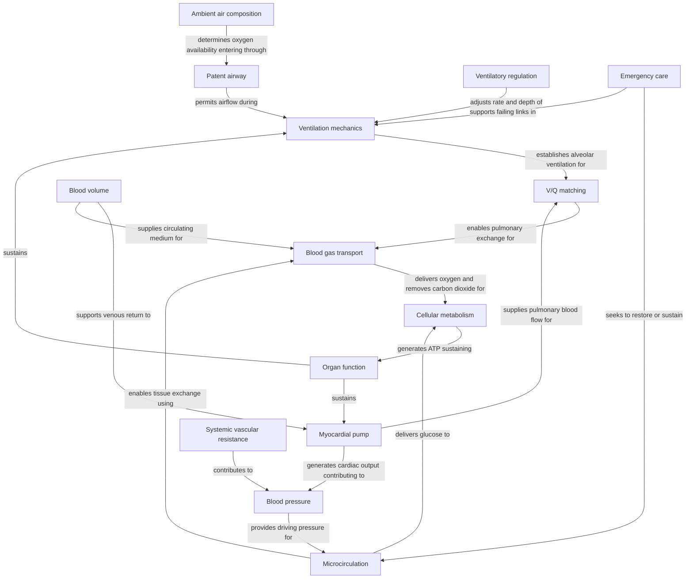

The eleven components operate as an interconnected system. Pressure, an open airway or normal saturation alone does not establish adequate cellular oxygen delivery.

## Cellular metabolism and injury

### Aerobic and anaerobic energy production

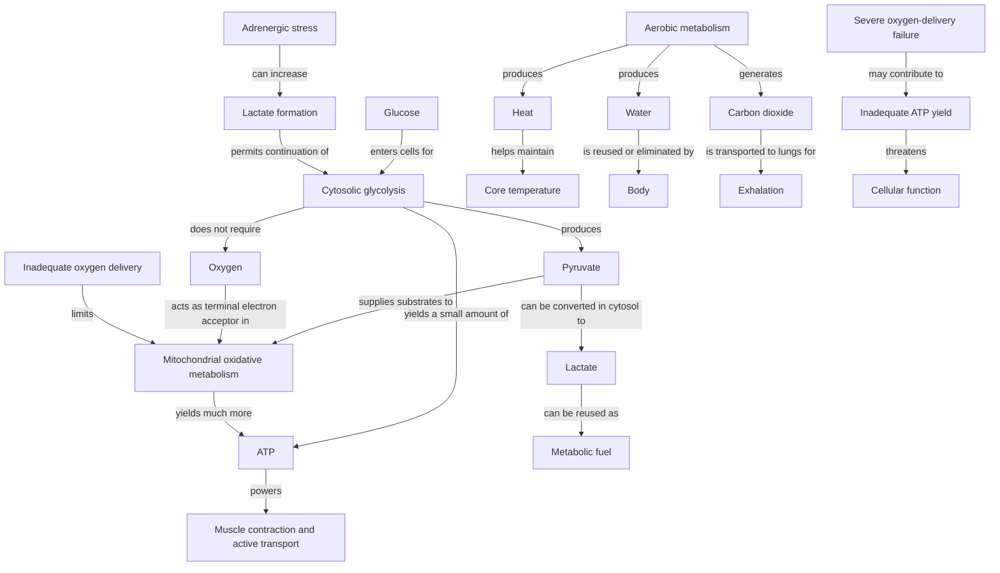

Lactate can form in the presence of oxygen; elevation is not proof of hypoxia and lactate is not the sole cause of acidosis or cell death.

### ATP-dependent membrane homeostasis and cellular injury

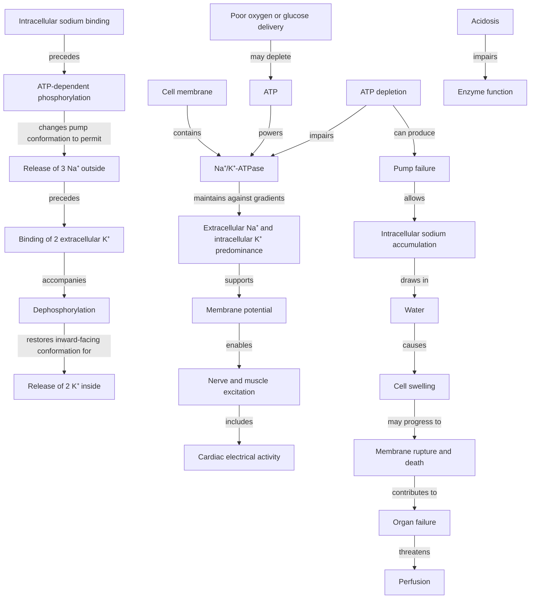

### Metabolic failure, compensation and advanced interpretation

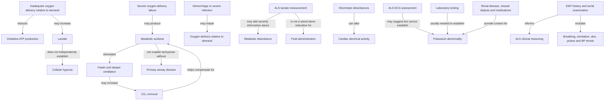

## Respiration and ventilatory mechanics

### Ambient oxygen, delivery devices and toxic exposure

```mermaid
flowchart TD
    N1["Atmospheric pressure (about 760 mmHg at sea level)"]
    N2["Partial pressure"]
    N3["Ambient oxygen fraction (0.21)"]
    N4["Inspired oxygen fraction (FiO₂)"]
    N5["Spontaneous breathing"]
    N6["Delivered oxygen fraction (FDO₂)"]
    N7["Device-assisted ventilation"]
    N8["Nonrebreather mask"]
    N9["FiO₂"]
    N10["BVM with reservoir at 15 L/min"]
    N11["FDO₂"]
    N12["Fit, flow, reservoir, demand and leaks"]
    N13["Actual delivered concentration"]
    N14["Oxygen-displacing fire gases"]
    N15["Available inspired oxygen"]
    N16["Carbon monoxide"]
    N17["Hemoglobin"]
    N18["Blood oxygen transport"]
    N19["Cyanide"]
    N20["Cellular oxygen utilization"]
    N21["Conventional pulse oximetry"]
    N22["Carboxyhemoglobin from oxyhemoglobin"]
    N23["Blood co-oximetry"]
    N24["CO exposure"]
    N25["Significant smoke exposure with compatible severe findings"]
    N26["Hydroxocobalamin"]
    N27["Laboratory measurements"]
    N28["Unsafe atmosphere"]
    N29["Fire and hazmat personnel"]
    N30["Exposure history and neurologic findings"]
    N31["Clinical assessment"]
    N32["Transport"]

    N1 -->|combines with gas fraction to determine| N2
    N3 -->|contributes about 159 mmHg to| N2
    N4 -->|describes concentration inhaled during| N5
    N6 -->|describes concentration supplied during| N7
    N8 -->|may provide approximately 0.95 as| N9
    N10 -->|may provide approximately 0.95–0.98 as| N11
    N12 -->|influence| N13
    N14 -->|reduce| N15
    N16 -->|binds to| N17
    N16 -->|impairs| N18
    N19 -->|prevents| N20
    N21 -->|cannot reliably distinguish| N22
    N23 -->|can confirm| N24
    N25 -->|may warrant authorized ALS consideration of| N26
    N26 -->|binds| N19
    N26 -->|may discolor skin and urine and interfere with| N27
    N28 -->|requires coordination with| N29
    N30 -->|inform| N31
    N31 -->|guides indicated oxygen and timely| N32
```

Device fractions are approximate, not guaranteed. Do not enter unsafe atmospheres or delay indicated care for a monitor reading.

### Airway structure, obstruction and protection

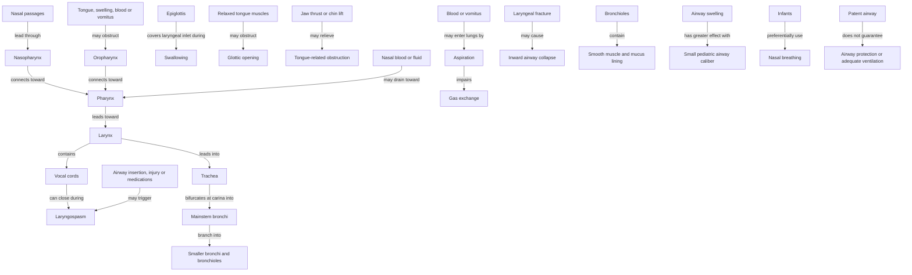

Pediatric airway dimensions vary; the cricoid remains clinically important but is not invariably the narrowest point. A nasal route may remain useful when oral access is obstructed.

### Bronchial obstruction and mechanism-specific therapy

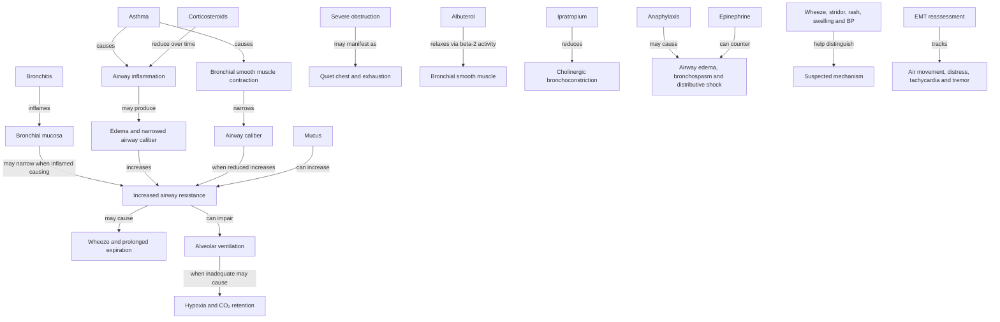

Medication authority varies by provider level and protocol; corticosteroids are not an immediate rescue for a failing airway.

### Pressure gradients, spontaneous breathing and pleural coupling

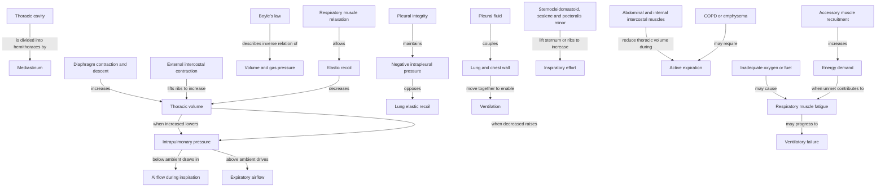

The source’s pressure examples (760 ambient, 758 inspiratory, 762 expiratory and 754 pleural mmHg) are illustrative, not fixed respiratory pressures.

### Compliance, resistance and traumatic loss of pleural integrity

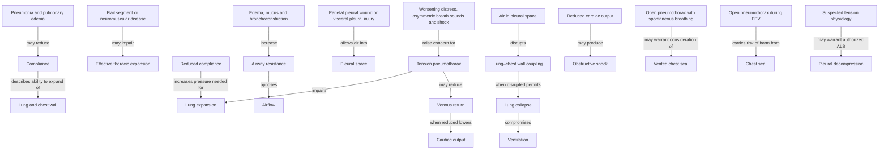

The 2024 guidance described in the source advises against chest seals for open pneumothorax during PPV. Follow local protocols; simple pneumothorax does not automatically warrant decompression. Continue necessary ventilation and transport.

### Minute ventilation versus effective alveolar ventilation

```mermaid
flowchart TD
    N1["Tidal volume (VT)"]
    N2["Volume moved per breath"]
    N3["Respiratory frequency (f)"]
    N4["Breaths per minute"]
    N5["Minute ventilation (VT × f)"]
    N6["Conducting airways"]
    N7["Anatomical dead space (VD)"]
    N8["Gas exchange"]
    N9["Alveolar ventilation ((VT − VD) × f)"]
    N10["500 mL × 12 breaths/min"]
    N11["Minute volume 6 L/min"]
    N12["Alveolar volume 4.2 L/min"]
    N13["200 mL × 28 breaths/min"]
    N14["Minute volume 5.6 L/min"]
    N15["Alveolar volume 1.4 L/min"]
    N16["Rapid shallow breathing"]
    N17["Low alveolar ventilation"]
    N18["CO₂ retention and impaired oxygenation"]
    N19["Oxygen alone"]
    N20["Appropriate assisted ventilation"]
    N21["Very rapid breathing"]
    N22["Fatigue"]

    N1 -->|measures| N2
    N3 -->|counts| N4
    N1 -->|multiplied by frequency gives| N5
    N3 -->|combines with tidal volume to determine| N5
    N6 -->|constitute| N7
    N7 -->|does not participate in| N8
    N7 -->|is subtracted from tidal volume in| N9
    N1 -->|combines with dead space and frequency to determine| N9
    N3 -->|also determines| N9
    N10 -->|yields| N11
    N10 -->|with VD 150 mL yields| N12
    N13 -->|yields| N14
    N13 -->|with VD 150 mL yields| N15
    N16 -->|may preserve| N5
    N16 -->|may severely reduce| N9
    N17 -->|may cause| N18
    N19 -->|cannot correct| N17
    N20 -->|addresses| N17
    N21 -->|may reduce filling time and increase| N22
```

Dead space is about 150 mL in the illustrative adult and helps explain residual oxygen in exhaled air. Rates of 40/min in adults or over 60/min in children are teaching examples, not universal failure cutoffs. Chest rise alone cannot quantify alveolar ventilation.

### Positive-pressure ventilation and hemodynamic interactions

```mermaid
flowchart TD
    N1["Spontaneous inspiration"]
    N2["Negative intrathoracic pressure"]
    N3["BVM or mechanical ventilator"]
    N4["Positive-pressure ventilation (PPV)"]
    N5["Intrathoracic pressure"]
    N6["Venous return"]
    N7["Preload"]
    N8["Reduced preload"]
    N9["Cardiac output and BP"]
    N10["Hypovolemia"]
    N11["Reduced cardiac output and BP"]
    N12["Increased airway resistance"]
    N13["Exhalation"]
    N14["Excessive ventilation or incomplete exhalation"]
    N15["Dynamic hyperinflation"]
    N16["Reduced compliance"]
    N17["Chest rise"]
    N18["PEEP"]
    N19["Alveolar recruitment"]
    N20["CPAP"]
    N21["Spontaneous breathing"]
    N22["Bilevel NIV"]
    N23["Inspiratory pressure support"]
    N24["Noninvasive ventilation (NIV)"]
    N25["Cardiogenic pulmonary edema"]
    N26["Inadequate spontaneous breathing, vomiting or airway protection failure"]
    N27["Severe hemodynamic instability"]
    N28["EMT mask seal and assisted breaths"]
    N29["EMT reassessment"]
    N30["Resistance, chest rise, BP and mentation"]
    N31["Mechanical ventilator"]
    N32["Circuit and pressure complications"]

    N1 -->|creates| N2
    N3 -->|supplies| N4
    N4 -->|raises| N5
    N5 -->|when elevated may reduce| N6
    N6 -->|determines in part| N7
    N8 -->|may lower| N9
    N10 -->|increases vulnerability to| N11
    N12 -->|prolongs| N13
    N14 -->|may cause| N15
    N15 -->|further elevates| N5
    N16 -->|may make difficult| N17
    N18 -->|maintains end-expiratory pressure to improve| N19
    N18 -->|may also reduce| N6
    N20 -->|maintains positive airway pressure during| N21
    N22 -->|adds| N23
    N24 -->|may improve gas exchange in| N25
    N26 -->|may make inappropriate| N24
    N27 -->|may make inappropriate| N24
    N28 -->|support| N4
    N29 -->|detects changes in| N30
    N31 -->|may improve breath consistency but remains subject to| N32
```

EMT CPAP may be authorized locally; advanced settings and ventilator management require separate authorization.

### Advanced airway support and continuing BLS responsibilities

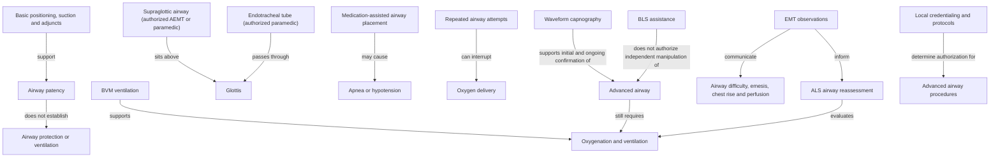

## Regulation of breathing

### Brainstem respiratory control and sensory feedback

```mermaid
flowchart TD
    N1["Medulla and pons"]
    N2["Respiratory control networks"]
    N3["Dorsal respiratory group"]
    N4["Ventral respiratory group"]
    N5["Diaphragm and intercostals"]
    N6["Phrenic nerve"]
    N7["Diaphragm"]
    N8["Intercostal nerves"]
    N9["Intercostals"]
    N10["Pontine centers"]
    N11["Transition from inspiration to expiration"]
    N12["Higher voluntary centers"]
    N13["Inspiratory activity"]
    N14["Inspiratory accessory muscles"]
    N15["Expiratory activity"]
    N16["Expiratory accessory muscles"]
    N17["Central chemoreceptors in medulla"]
    N18["CO₂-related CSF pH"]
    N19["CO₂ and water"]
    N20["Hydrogen ions"]
    N21["CSF pH"]
    N22["Low CSF pH"]
    N23["Rate and depth of breathing"]
    N24["Peripheral chemoreceptors in carotid and aortic bodies"]
    N25["Significant arterial oxygen decline"]
    N26["CO₂ and pH changes"]
    N27["Alveolar ventilation"]
    N28["CO₂"]
    N29["CO₂ removal"]
    N30["Irritant receptors"]
    N31["Increased breathing rate"]
    N32["Stretch receptors"]
    N33["Rate and volume"]
    N34["J-receptors near alveolar capillaries"]
    N35["Rapid shallow breathing"]

    N1 -->|contain| N2
    N3 -->|relays sensory information to| N4
    N4 -->|contributes motor drive for| N5
    N6 -->|carries motor signals to| N7
    N8 -->|carry motor signals to| N9
    N10 -->|help coordinate| N11
    N12 -->|influence| N2
    N13 -->|recruits when needed| N14
    N15 -->|recruits during forced expiration| N16
    N17 -->|respond primarily to| N18
    N19 -->|form carbonic acid yielding| N20
    N20 -->|lower| N21
    N22 -->|stimulates increased| N23
    N24 -->|respond strongly to| N25
    N24 -->|also respond to| N26
    N25 -->|stimulates increased| N23
    N23 -->|when effective increase| N27
    N27 -->|removes| N28
    N29 -->|reduces stimulus to| N17
    N30 -->|trigger cough, bronchoconstriction and| N31
    N32 -->|limit overinflation by reducing| N33
    N34 -->|respond to increased capillary pressure with| N35
```

The chapter’s 2-second inspiration and 3-second expiration illustrate 12 breaths/min. Its claim that the VRG is the sole motor-impulse source is not established, so the map uses a nonexclusive network relationship. Pontine and medullary centers work together; sensory and motor pathways are simplified here.

### COPD, oxygen-induced hypercapnia and metabolic compensation

```mermaid
flowchart TD
    N1["Chronic hypercapnia"]
    N2["Ventilatory chemoreceptor responses"]
    N3["COPD"]
    N4["Oxygen-only drive"]
    N5["Excess oxygen in susceptible COPD patients"]
    N6["V/Q matching"]
    N7["Haldane effect"]
    N8["CO₂"]
    N9["Altered V/Q matching"]
    N10["Hypercapnia"]
    N11["Changes in ventilation"]
    N12["Titrated oxygen"]
    N13["Oxygen saturation"]
    N14["Risk of hypercapnic respiratory failure"]
    N15["SpO₂ 88–92% per guidance"]
    N16["Critical hypoxemia or failing ventilation"]
    N17["Necessary oxygen and ventilation support"]
    N18["Opioids"]
    N19["Brainstem ventilatory drive"]
    N20["Naloxone"]
    N21["Spontaneous ventilation"]
    N22["Naloxone effect"]
    N23["Opioid effect"]
    N24["Withdrawal or vomiting"]
    N25["Immediate assisted ventilation"]
    N26["Opioid-related inadequate ventilation"]
    N27["Metabolic acidosis"]
    N28["Compensatory deep rapid breathing"]
    N29["Advanced airway medications"]
    N30["Inadequate replacement ventilation"]
    N31["Respiratory compensation"]
    N32["Serial respiratory assessment"]
    N33["Recurrent respiratory depression"]

    N1 -->|may modify| N2
    N3 -->|does not universally replace CO₂ control with| N4
    N5 -->|may alter| N6
    N5 -->|increases oxygenation of hemoglobin leading to| N7
    N7 -->|reduces hemoglobin carriage of| N8
    N9 -->|can contribute to| N10
    N7 -->|can contribute to| N10
    N11 -->|may contribute to| N10
    N12 -->|aims for appropriate| N13
    N14 -->|commonly supports target of| N15
    N16 -->|requires| N17
    N18 -->|depress| N19
    N20 -->|antagonizes opioid receptors to restore| N21
    N22 -->|may wear off before| N23
    N20 -->|may precipitate| N24
    N25 -->|addresses| N26
    N27 -->|stimulates| N28
    N29 -->|may interrupt| N28
    N30 -->|may eliminate| N31
    N32 -->|identifies| N33
```

Do not withhold necessary oxygen or ventilation in critical illness. The saturation target is conditional on presentation and local guidance, not a universal target. Report baseline pattern, exposure history and response to ventilation.

## Gas exchange and blood gas transport

### Ventilation–perfusion matching and pulmonary exchange

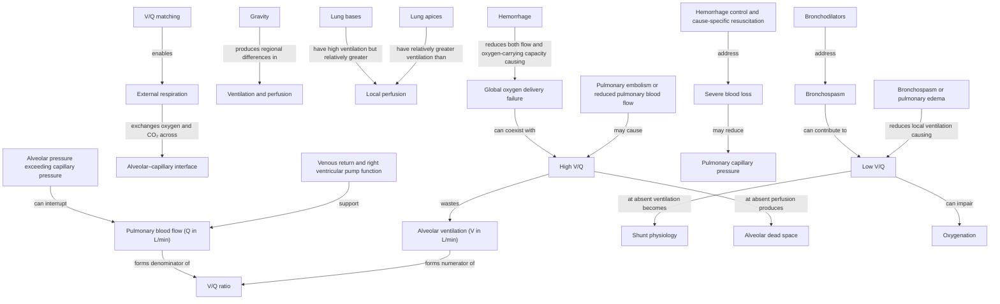

Bronchodilators address bronchospasm, not pulmonary edema itself or hemorrhage. The source describes an overall normal V/Q below 1, with regional variation. V/Q mismatch is not the sole explanation for tissue hypoxia in hemorrhage.

### Oxygen carriage, tissue exchange and delivery

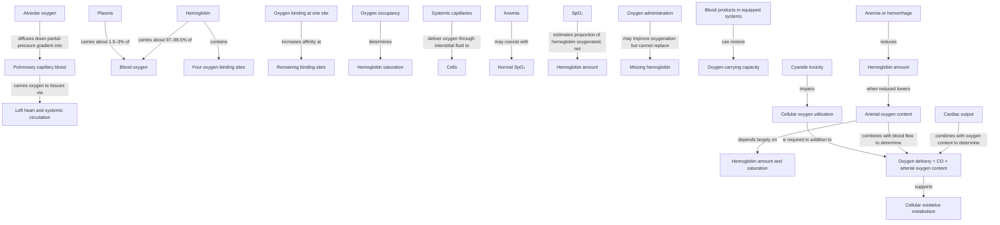

Hemoglobin saturation and content are not interchangeable. The chapter illustrates total oxygen transport around 1,000 mL/min; this varies with content and flow. Oxygen is used according to clinical indication and protocol, not solely because anemia is suspected.

### Carbon dioxide transport and capnographic interpretation

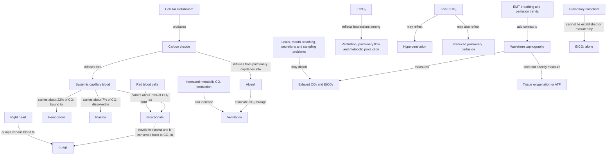

## Circulation and vascular physiology

### Blood volume, composition and circulation

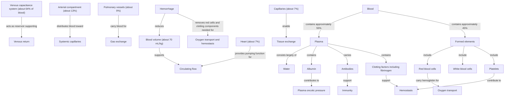

### Capillary fluid exchange and cardiogenic pulmonary edema

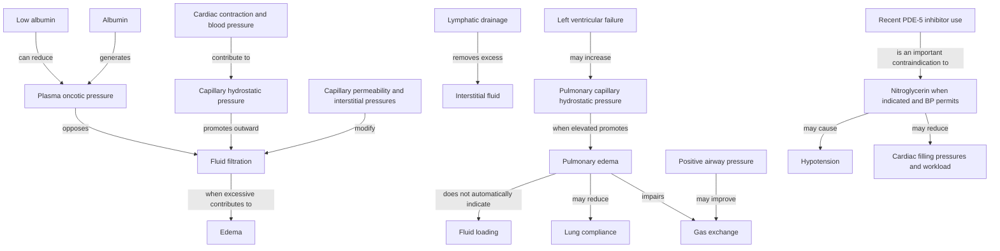

High oncotic pressure does not establish overload, and low albumin or edema does not prove intravascular depletion. Advanced therapy and medication selection depend on clinical presentation and authorization.

### Cardiac output, filling and ejection

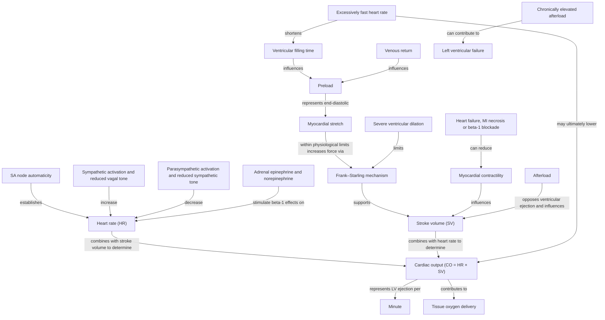

The source illustrates resting output around 5 L/min and possible increases up to sixfold. Rate above 160/min is not a universal threshold. Preload is myocardial stretch, not simply filling volume or pressure; afterload is not simply diastolic BP.

### Electrical activity versus mechanical perfusion

```mermaid
flowchart TD
    N1["Cardiac monitor"]
    N2["Electrical rhythm"]
    N3["12-lead ECG"]
    N4["Possible ischemia or dysrhythmia"]
    N5["Effective mechanical contraction"]
    N6["Clinical perfusion"]
    N7["Slow rate with poor perfusion"]
    N8["Atropine, chronotropic agents or pacing"]
    N9["Atropine"]
    N10["Vagal influence on heart"]
    N11["Pacing"]
    N12["Electrical capture"]
    N13["Mechanical capture"]
    N14["Fast rate with poor perfusion"]
    N15["Compensatory tachycardia and primary dysrhythmia"]
    N16["Hemorrhage"]
    N17["Compensatory tachycardia"]
    N18["Underlying cause"]
    N19["Selected unstable tachyarrhythmias"]
    N20["Synchronized cardioversion"]
    N21["Organized electrical activity without palpable pulse"]
    N22["Pulseless electrical activity"]
    N23["Cardiac arrest"]
    N24["CPR and appropriate AED use"]
    N25["ALS arrest care"]
    N26["Rhythm-specific care and reversible-cause evaluation"]
    N27["EMT pulse, BP, mentation and symptom trends"]
    N28["Authorized EMT ECG acquisition or transmission"]
    N29["Advanced ECG interpretation"]

    N1 -->|records| N2
    N3 -->|samples electrical activity from multiple perspectives to identify| N4
    N2 -->|does not establish| N5
    N5 -->|contributes to| N6
    N7 -->|may warrant ALS consideration of| N8
    N9 -->|reduces| N10
    N11 -->|attempts to initiate| N12
    N12 -->|does not establish| N13
    N13 -->|must be assessed through| N6
    N14 -->|requires distinction between| N15
    N16 -->|can provoke| N17
    N17 -->|requires treatment of| N18
    N19 -->|may warrant authorized ALS| N20
    N21 -->|may represent| N22
    N23 -->|requires foundational| N24
    N25 -->|adds| N26
    N27 -->|inform| N6
    N28 -->|supports but does not confer| N29
```

### Systemic vascular resistance and pulse pressure

```mermaid
flowchart TD
    N1["Arteriolar diameter"]
    N2["Systemic vascular resistance (SVR)"]
    N3["Sympathetic alpha-1 stimulation"]
    N4["Vasoconstriction"]
    N5["Reduced sympathetic tone and local mediators"]
    N6["Vasodilation"]
    N7["Diastolic BP"]
    N8["Arterial compliance, heart rate and runoff"]
    N9["Systolic BP and diastolic BP"]
    N10["Pulse pressure = SBP − DBP"]
    N11["Falling preload and cardiac output"]
    N12["Systolic BP"]
    N13["Compensatory vasoconstriction"]
    N14["Falling systolic and preserved diastolic BP"]
    N15["Narrow pulse pressure"]
    N16["Weak or thready pulse"]
    N17["Hemorrhage"]
    N18["Peripheral tissue perfusion"]
    N19["Reduced peripheral tissue perfusion"]
    N20["Cool pale skin"]
    N21["Distributive shock"]
    N22["Substantial cardiac output"]

    N1 -->|inversely influences| N2
    N3 -->|promotes| N4
    N4 -->|reduces| N1
    N5 -->|may promote| N6
    N6 -->|increases| N1
    N2 -->|influences| N7
    N8 -->|also influence| N7
    N9 -->|determine difference called| N10
    N11 -->|can reduce| N12
    N13 -->|may sustain or raise| N7
    N14 -->|may produce| N15
    N15 -->|may accompany| N16
    N10 -->|when below 25% of SBP meets chapter example of| N15
    N17 -->|may stimulate| N13
    N13 -->|may preserve pressure at expense of| N18
    N19 -->|may manifest as| N20
    N15 -->|raises concern in context but does not diagnose| N17
    N21 -->|can reduce| N2
    N21 -->|can impair perfusion despite| N22
```

Diastolic BP is not a direct measure of SVR. Most systemic vessels do not have substantial parasympathetic vasodilator innervation. Mental-status changes can have multiple causes; quietness or agitation cannot distinguish a single mechanism.

### Microcirculation and systemic versus local perfusion

```mermaid
flowchart TD
    N1["Arterioles"]
    N2["Metarterioles"]
    N3["True capillaries"]
    N4["Venules"]
    N5["Precapillary sphincters"]
    N6["Sphincter relaxation"]
    N7["Capillary exchange"]
    N8["Sphincter contraction"]
    N9["Temperature, hypoxia, acidosis and histamine"]
    N10["Local vascular regulation"]
    N11["Microvascular flow"]
    N12["Sympathetic neural activity"]
    N13["Epinephrine alpha-1 effects"]
    N14["Endothelial signals and local mediators"]
    N15["Tissue oxygen and nutrient exchange"]
    N16["Sepsis"]
    N17["Endothelial function and vascular tone"]
    N18["Systemic BP"]
    N19["Improved systemic BP"]
    N20["Restored cellular metabolism"]
    N21["Serial skin, refill, mentation and pulses"]
    N22["Tissue perfusion"]
    N23["Temperature, age, lighting and vascular disease"]

    N1 -->|regulate flow toward| N2
    N2 -->|conduct blood toward| N3
    N3 -->|provide exchange before drainage to| N4
    N5 -->|regulate entry into| N3
    N6 -->|increases access to| N7
    N8 -->|can divert flow away from| N7
    N9 -->|influence| N10
    N10 -->|predominates at rest in control of| N11
    N12 -->|can constrict| N1
    N13 -->|can constrict| N1
    N14 -->|help regulate| N11
    N11 -->|enables| N15
    N16 -->|may disrupt| N17
    N17 -->|when impaired may disrupt| N11
    N18 -->|measures arterial pressure but not| N7
    N19 -->|does not guarantee| N20
    N21 -->|provide indirect clues to| N22
    N23 -->|limit interpretation of| N21
```

### Baroreflex, chemoreflex and pressure compensation

```mermaid
flowchart TD
    N1["Cardiac output"]
    N2["MAP − right atrial pressure = CO × SVR"]
    N3["Systemic vascular resistance (SVR)"]
    N4["Mean arterial pressure (MAP)"]
    N5["DBP + one-third pulse pressure"]
    N6["Falling arterial pressure"]
    N7["Carotid sinus and aortic arch baroreceptor stretch"]
    N8["Medullary cardiovascular centers"]
    N9["Increased sympathetic and reduced vagal activity"]
    N10["Heart rate and contractility"]
    N11["Vasoconstriction"]
    N12["Venoconstriction"]
    N13["Venous return and preload"]
    N14["Arterial pressure"]
    N15["Reduced sympathetic and increased vagal activity"]
    N16["Significant pressure decline"]
    N17["Epinephrine and norepinephrine"]
    N18["Low arterial oxygen with CO₂ and pH changes"]
    N19["Chemoreceptor reflex"]

    N1 -->|combines with SVR to determine| N2
    N3 -->|combines with CO to determine| N2
    N4 -->|can be estimated at ordinary rates by| N5
    N6 -->|decreases| N7
    N7 -->|when reduced decreases impulses to| N8
    N8 -->|respond to reduced input with| N9
    N9 -->|increases| N10
    N10 -->|may increase| N1
    N9 -->|stimulates| N11
    N11 -->|increases| N3
    N12 -->|can support| N13
    N9 -->|can stimulate| N12
    N13 -->|support| N1
    N1 -->|helps restore| N14
    N3 -->|helps restore| N14
    N14 -->|when restored increases| N7
    N7 -->|when increased favors| N15
    N15 -->|lowers HR and vascular tone to reduce| N14
    N16 -->|may stimulate adrenal release of| N17
    N17 -->|sustain adrenergic support of| N10
    N18 -->|activates| N19
    N19 -->|can stimulate| N9
```

The feedback loop opposes pressure changes; preserved pressure may mask worsening tissue perfusion. MAP approximation is less reliable in marked tachycardia or abnormal waveforms. Older patients and patients taking beta blockers may not show expected tachycardia.

## Clinical and BLS–ALS integration

### Cause-specific circulatory resuscitation

```mermaid
flowchart TD
    N1["External hemorrhage control (BLS)"]
    N2["Ongoing blood loss"]
    N3["Circulating volume and red cell mass"]
    N4["Oxygen delivery"]
    N5["IV or IO access (authorized ALS)"]
    N6["Authorized resuscitation"]
    N7["Crystalloid"]
    N8["Circulating fluid compartment"]
    N9["Red cells or clotting components"]
    N10["Excess crystalloid in hemorrhage"]
    N11["Dilution, cooling and edema"]
    N12["Blood products (equipped and credentialed systems)"]
    N13["Oxygen-carrying capacity"]
    N14["Coagulation components"]
    N15["Life-threatening traumatic bleeding"]
    N16["Traumatic brain injury"]
    N17["Resuscitation targets"]
    N18["Distributive shock"]
    N19["Inadequate vascular tone"]
    N20["Norepinephrine (authorized ALS)"]
    N21["Perfusion pressure"]
    N22["Excessive vasoconstriction, arrhythmia and extravasation"]
    N23["Vasopressors"]
    N24["Blood and hemorrhage control"]
    N25["EMT heat-loss prevention"]
    N26["Cooling"]
    N27["EMT serial examination"]
    N28["Deterioration or treatment complications"]
    N29["Definitive hemorrhage control"]
    N30["Trauma transport"]

    N1 -->|limits| N2
    N2 -->|reduces| N3
    N3 -->|determine important components of| N4
    N5 -->|provides route for| N6
    N7 -->|transiently expands| N8
    N7 -->|does not replace| N9
    N10 -->|may worsen| N11
    N12 -->|can restore| N13
    N12 -->|depending on product can restore| N14
    N15 -->|may favor blood components over| N7
    N16 -->|may alter| N17
    N18 -->|may involve| N19
    N20 -->|increases vascular tone to support| N21
    N20 -->|carries risk of| N22
    N23 -->|cannot replace in hemorrhage| N24
    N25 -->|helps limit| N26
    N27 -->|identifies possible| N28
    N29 -->|requires timely| N30
```

The source favors blood components in supported transfusion programs for life-threatening traumatic hemorrhage and isotonic crystalloid when crystalloid is used. Neither access nor a pressure number alone establishes the appropriate treatment. Monitor for dyspnea, hypotension or suspected transfusion reaction; do not delay definitive care for nonessential procedures.

### Hemorrhage, compensation and cellular oxygen debt

```mermaid
flowchart TD
    N1["Hemorrhage"]
    N2["Circulating blood volume"]
    N3["Circulating oxygen-carrying capacity"]
    N4["Venous return and preload"]
    N5["Stroke volume"]
    N6["Cardiac output"]
    N7["Tissue oxygen delivery"]
    N8["Falling arterial pressure"]
    N9["Baroreceptor stretch"]
    N10["Reduced baroreceptor stretch"]
    N11["Sympathetic activity"]
    N12["Compensatory tachycardia"]
    N13["Vasoconstriction"]
    N14["Systemic vascular resistance"]
    N15["Arterial pressure"]
    N16["Peripheral perfusion"]
    N17["Pale cool clammy skin and weak pulse"]
    N18["Reduced cardiac output with elevated SVR"]
    N19["Narrow pulse pressure"]
    N20["ATP depletion and metabolic acidosis"]
    N21["Organ function"]
    N22["Altered mentation and compensatory breathing"]
    N23["Compensation"]
    N24["Measurable arterial pressure"]
    N25["Hemorrhage control"]

    N1 -->|reduces| N2
    N1 -->|reduces| N3
    N2 -->|when reduced decreases| N4
    N4 -->|when reduced lowers| N5
    N5 -->|when reduced tends to lower| N6
    N6 -->|when reduced threatens| N7
    N3 -->|when reduced threatens| N7
    N8 -->|decreases| N9
    N10 -->|increases| N11
    N11 -->|produces| N12
    N12 -->|attempts to preserve| N6
    N11 -->|produces| N13
    N13 -->|increases| N14
    N14 -->|can temporarily maintain| N15
    N13 -->|can reduce| N16
    N16 -->|when reduced may manifest as| N17
    N18 -->|can produce| N19
    N7 -->|when inadequate may cause| N20
    N20 -->|may impair| N21
    N20 -->|may manifest as| N22
    N23 -->|can mask deterioration despite| N24
    N25 -->|targets| N1
```

### Internal and external hemorrhage: interpreting the chapter cases

```mermaid
flowchart TD
    N1["Penetrating abdominal injury with rigid tender abdomen"]
    N2["Internal hemorrhage"]
    N3["Large spurting leg wound"]
    N4["Life-threatening external hemorrhage"]
    N5["Hypovolemic shock"]
    N6["Internal case BP 102/88"]
    N7["Pulse pressure 14 mmHg"]
    N8["External case BP 98/76"]
    N9["Pulse pressure 22 mmHg"]
    N10["Internal case systolic BP 102"]
    N11["External case systolic BP 98"]
    N12["Both case pulse pressures"]
    N13["Internal case HR 122 and weak radial pulse"]
    N14["Compensatory circulatory failure"]
    N15["External case HR 134 and absent radial pulse"]
    N16["Both cases with pale cool clammy skin"]
    N17["Peripheral vasoconstriction"]
    N18["Moaning or speech"]
    N19["Adequate alveolar ventilation"]
    N20["RR 24 slightly shallow or RR 26"]
    N21["Depth, effort and ventilatory adequacy"]
    N22["External bleeding"]
    N23["Direct pressure or indicated tourniquet (BLS)"]
    N24["External wound covering"]
    N25["Definitive hemorrhage control"]
    N26["Scene hazards including aggressive animals"]
    N27["Safe patient access"]
    N28["Both cases"]
    N29["Rapid appropriate trauma transport"]
    N30["Early notification and handoff"]
    N31["Reassessment"]
    N32["Mentation, pulse, BP, chest rise and fatigue"]

    N1 -->|raises concern for| N2
    N3 -->|indicates concern for| N4
    N2 -->|may cause| N5
    N4 -->|may cause| N5
    N6 -->|yields| N7
    N8 -->|yields| N9
    N7 -->|is below 25% of| N10
    N9 -->|is about 22% of| N11
    N12 -->|support concern in context for| N5
    N13 -->|supports concern for| N14
    N15 -->|supports concern for| N14
    N16 -->|suggest| N17
    N18 -->|indicates some airflow but not| N19
    N20 -->|requires assessment of| N21
    N22 -->|may respond to| N23
    N2 -->|cannot be definitively controlled by| N24
    N2 -->|requires hospital resources for| N25
    N26 -->|must be addressed for| N27
    N28 -->|require ongoing assessment and| N29
    N29 -->|is supported by| N30
    N31 -->|monitors| N32
```

Values are case-specific, not universal clinical thresholds. The internal case used a nonrebreather at 15 L/min as an illustrative intervention; oxygen, ventilation and bleeding control are selected according to need and protocol. Request ALS without delaying essential care or transport.

### Assessment findings and the failing physiological link

```mermaid
flowchart TD
    N1["Scene and exposure history"]
    N2["Mechanism of illness or injury"]
    N3["Airway and chest assessment"]
    N4["Patency and ventilatory effort"]
    N5["SpO₂"]
    N6["Arterial oxygen saturation"]
    N7["Hemoglobin amount, ventilation or tissue perfusion"]
    N8["ALS waveform capnography"]
    N9["Exhaled CO₂, ventilation and pulmonary blood flow"]
    N10["Arterial CO₂ or cause of shock"]
    N11["Blood co-oximetry"]
    N12["Hemoglobin species including COHb"]
    N13["Tissue perfusion"]
    N14["BP measurement"]
    N15["Systemic arterial pressure"]
    N16["Capillary exchange"]
    N17["ECG"]
    N18["Electrical activity"]
    N19["Mechanical output"]
    N20["Serial clinical examination"]
    N21["Clinical response and deterioration"]
    N22["Blood gas or hemoglobin values"]
    N23["Obstruction or fatigue"]
    N24["Alveolar ventilation"]
    N25["Pulmonary edema"]
    N26["Gas exchange"]
    N27["Hemorrhage or CO exposure"]
    N28["Oxygen content"]
    N29["Shock or dysrhythmia"]
    N30["Blood flow"]
    N31["Cyanide exposure"]
    N32["Cellular utilization"]
    N33["Cellular oxygen delivery and use"]
    N34["Clinical reasoning"]
    N35["Suspected failing link"]

    N1 -->|helps identify| N2
    N3 -->|evaluates| N4
    N5 -->|estimates| N6
    N5 -->|cannot establish| N7
    N8 -->|provides clues about| N9
    N8 -->|cannot precisely establish| N10
    N11 -->|measures| N12
    N11 -->|cannot establish alone| N13
    N14 -->|estimates| N15
    N15 -->|does not establish| N16
    N17 -->|records| N18
    N18 -->|does not establish| N19
    N20 -->|tracks| N21
    N20 -->|cannot establish exact| N22
    N23 -->|may impair| N24
    N25 -->|may impair| N26
    N27 -->|may impair| N28
    N29 -->|may impair| N30
    N31 -->|may impair| N32
    N24 -->|is one link required for| N33
    N26 -->|is one link required for| N33
    N28 -->|is one link required for| N33
    N30 -->|is one link required for| N33
    N32 -->|is essential for| N33
    N34 -->|integrates findings to identify| N35
```

Measurements complement, rather than replace, the clinical exam. Overlapping abnormalities have multiple possible mechanisms; no single finding is a definitive diagnosis.

### Coordinated clinical care, scope and reassessment

```mermaid
flowchart TD
    N1["Clinical assessment"]
    N2["Immediately reversible BLS problems"]
    N3["Authorized EMT interventions"]
    N4["Airway support, oxygenation, ventilation and hemorrhage control"]
    N5["Cellular oxygen delivery"]
    N6["Suspected mechanism of failure"]
    N7["Cause-specific ALS considerations"]
    N8["AEMT scope"]
    N9["Limited advanced airway, vascular access and medications"]
    N10["Paramedic scope"]
    N11["Advanced diagnostics, pharmacology, electrical therapy and airway management"]
    N12["State law, licensure and training"]
    N13["Authorized clinical practice"]
    N14["Credentialing, agency protocols and medical direction"]
    N15["National models and guidelines"]
    N16["Knowledge of ALS procedures"]
    N17["EMT observations and intervention response"]
    N18["ALS clinical reasoning"]
    N19["Authorized cause-specific interventions"]
    N20["Foundational BLS care"]
    N21["Reassessment"]
    N22["Management considerations"]
    N23["Early ALS consultation"]
    N24["Lifesaving BLS and transport"]
    N25["Documented findings, times and responses"]
    N26["Handoff and continuity"]
    N27["Receiving facility care"]

    N1 -->|identifies| N2
    N2 -->|inform| N3
    N3 -->|include indicated| N4
    N4 -->|support| N5
    N1 -->|informs| N6
    N6 -->|informs| N7
    N8 -->|may add| N9
    N10 -->|may add| N11
    N12 -->|limit| N13
    N14 -->|define local| N13
    N15 -->|do not independently confer| N13
    N16 -->|does not confer| N13
    N17 -->|inform| N18
    N18 -->|integrates mechanism and findings to select| N19
    N19 -->|require continued| N20
    N20 -->|requires| N21
    N19 -->|require| N21
    N21 -->|feeds updated trends into| N1
    N21 -->|informs changes to| N22
    N23 -->|may support care without delaying| N24
    N25 -->|support| N26
    N26 -->|support| N27
```

This is a reasoning and coordination model, not a mandated treatment sequence. Assessment, treatment, reassessment and transport may occur concurrently. Report actual trends and responses; prepare or assist with advanced equipment only within authorization.
