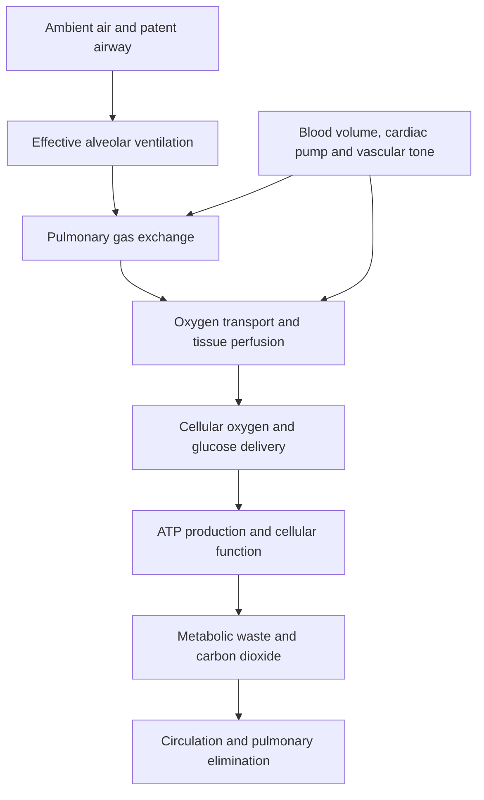
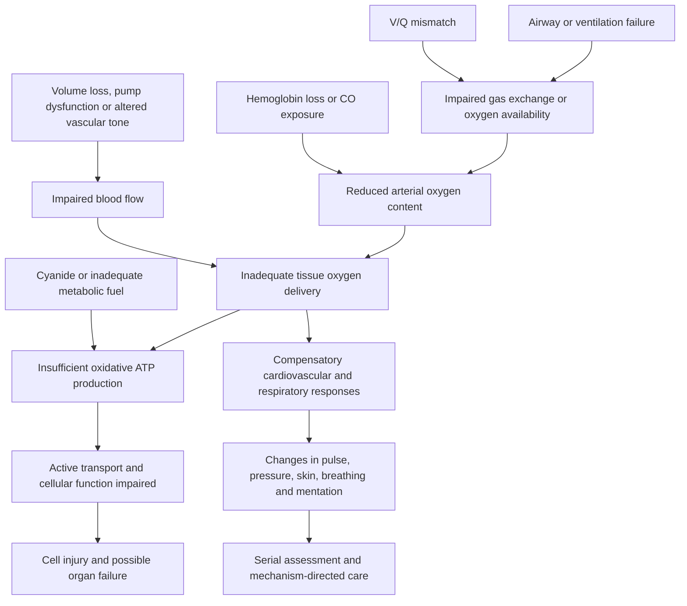

# Chapter 8: Pathophysiology — PQ4RS

## Preview

Pathophysiology explains how disturbances in normal physiological processes produce illness, injury, and observable clinical findings. For the EMT, the unifying concern is whether cells receive oxygen and glucose, produce enough ATP to function, and eliminate metabolic waste. Breathing, circulation, and cellular metabolism are therefore interdependent rather than separate assessment subjects.

The chapter follows oxygen from the environment through the airway, ventilation, gas exchange, blood transport, and tissue circulation to the cell. It then examines how the body compensates when this delivery system fails and why those compensations can conceal deteriorating perfusion. The hemorrhage cases demonstrate how these mechanisms inform assessment, immediate BLS care, ALS collaboration, and transport.

## Question

- **Q01.** Why is adequate perfusion the fundamental objective of emergency care, and how does loss of oxygen or glucose threaten cellular survival?
- **Q02.** How do airway patency, respiratory mechanics, respiratory control, and effective alveolar ventilation work together?
- **Q03.** Why can a patient have air movement or apparently adequate oxygen saturation while still experiencing tissue hypoxia?
- **Q04.** How do blood volume, myocardial function, vascular resistance, and microcirculation collectively determine tissue perfusion?
- **Q05.** How do respiratory and cardiovascular compensatory responses reveal physiological stress, and why can apparently acceptable vital signs be misleading?
- **Q06.** How can understanding the failed physiological link guide BLS care, ALS collaboration, reassessment, and transport without exceeding the provider's scope?

## Read

### Cellular metabolism and the purpose of emergency care

The fundamental purpose of emergency care is to restore or sustain adequate perfusion so that cells receive oxygen, glucose, and other necessary substances continuously and metabolic waste products are removed. Oxygen and glucose are essential to normal cellular metabolism and function. Illness and injury can disrupt these processes; understanding the mechanisms helps EMTs recognize why signs and symptoms develop and understand the care required. The National EMS Education Standards identify applying the pathophysiology of respiration and perfusion to patient assessment and management as a core competency. [S2](https://www.ems.gov/assets/EMS_Education_Standards_2021_Updated2_24_25forEO.pdf)

#### Energy production

Cellular metabolism (cellular respiration) breaks down fuel molecules such as glucose to produce energy. The chapter distinguishes aerobic and anaerobic metabolism according to the availability of oxygen and metabolic fuel. Glucose is the primary fuel discussed here. Oxygen is required for efficient mitochondrial energy production.

#### Aerobic metabolism

Aerobic metabolism produces ATP through a sequence of reactions in the presence of oxygen. First, glucose crosses the cell membrane and undergoes glycolysis in the cytosol, yielding pyruvic acid and a small amount of adenosine triphosphate (ATP). Glycolysis does not require oxygen. When oxygen is available, mitochondrial pathways use the products of glycolysis to produce much larger amounts of ATP. ATP supplies energy for cellular functions, including muscle contraction and energy-dependent processes.

Other products of aerobic metabolism are normally used or eliminated:

- Heat helps maintain core body temperature; increased metabolism can increase core temperature.
- Carbon dioxide (CO₂) is carried in blood to the lungs and eliminated during exhalation. Increased metabolic production of CO₂ can increase respiratory rate to facilitate its removal.
- Water is reused or excreted.

> [!NOTE]
> **Physiology clarification:** Although the original chapter calls oxygen a catalyst, it is more precisely the terminal electron acceptor in the mitochondrial electron transport chain. Glycolysis occurs in the cytosol, not in the mitochondria. [S6](https://openstax.org/books/anatomy-and-physiology-2e/pages/24-2-carbohydrate-metabolism)

> [!NOTE]
> **ALS Connection — Carbon dioxide as a link between metabolism, circulation and breathing.** Cells produce CO₂; blood carries it to the lungs and ventilation removes it. Waveform capnography measures exhaled CO₂, including end-tidal CO₂ (EtCO₂), at the end of expiration. A change can reflect altered ventilation, circulation, metabolic production or equipment/sample problems. It is not a direct measurement of ATP or tissue oxygenation. [S5](https://pubmed.ncbi.nlm.nih.gov/35001819/)

#### Anaerobic metabolism and cellular injury

When oxygen is unavailable for adequate oxidative metabolism, glycolysis still produces pyruvic acid and a small amount of ATP. Pyruvate is converted to lactate, allowing glycolysis to continue. The much smaller energy yield can be insufficient to maintain normal cellular functions. In severe oxygen-delivery failure, acidosis and energy depletion impair enzyme function, disrupt cell membranes and contribute to cellular injury and death.

> [!CAUTION]
> **Physiology clarification:** The original anaerobic metabolism illustration places glycolysis in mitochondria; glycolysis and conversion of pyruvate to lactate occur in the cytosol. Lactate can be produced in the presence of oxygen, including during adrenergic stress, and reused as fuel. Elevated lactate does not prove cellular hypoxia, nor is lactate itself the sole cause of acidosis or cell death. The chapter's simplified aerobic/anaerobic distinction remains useful for understanding inadequate oxygen delivery. [S6](https://openstax.org/books/anatomy-and-physiology-2e/pages/24-2-carbohydrate-metabolism) [S7](https://pubmed.ncbi.nlm.nih.gov/26378980/)

> [!NOTE]
> **ALS Connection — Shock, lactate and compensatory breathing.** When delivery of oxygen cannot meet cellular demand, ATP generation through oxidative metabolism declines. Lactate may rise; metabolic acidosis can stimulate faster/deeper ventilation. This explains why a patient with hemorrhage or severe infection may breathe rapidly even without a primary airway problem. Some advanced systems measure blood lactate as an additional severity marker; it is not a universal prehospital test or a stand-alone trigger for fluids. [S7](https://pubmed.ncbi.nlm.nih.gov/26378980/)
>
> **EMT contribution:** Describe the breathing pattern, mental status, skin findings, pulse quality, BP trend, suspected infection or blood loss, and response to care. Treat the patient, not a presumed lactate value.

#### Sodium–potassium pump and ATP depletion

Sodium (Na⁺) and potassium (K⁺) are positively charged ions. Sodium is predominantly extracellular and potassium predominantly intracellular, although both are present on either side of the cell membrane. Their gradients support specialized functions such as nerve impulse transmission and muscle contraction. Substances tend to move from higher to lower concentration; maintaining these ion gradients therefore requires active transport.

The Na⁺/K⁺-ATPase sits in the lipid bilayer between intracellular and extracellular fluid and uses ATP to move sodium out and potassium in. Its cycle proceeds as follows:

1. Intracellular sodium binds to the pump.
2. ATP transfers a phosphate to the pump, leaving ADP.
3. The pump changes shape, closing toward the intracellular side and opening toward the extracellular side, releasing sodium.
4. Extracellular potassium binds and the phosphate detaches.
5. The extracellular side closes and the intracellular side opens.
6. Potassium is released into the cell.

> [!CAUTION]
> **Physiology correction:** Three sodium ions are transported out and two potassium ions in per ATP cycle. Both movements oppose their respective concentration gradients; the original chapter incorrectly describes potassium moving inward down its gradient. [S8](https://openstax.org/books/anatomy-and-physiology/pages/3-1-the-cell-membrane)

Inadequate perfusion, oxygen delivery or glucose delivery can deplete ATP and impair the pump. Sodium accumulates inside the cell and water follows, causing swelling that may progress to membrane rupture and death. ATP-dependent transport failure is one of multiple mechanisms of cellular injury. Widespread cellular damage can lead to organ failure, reinforcing the need to maintain oxygen and glucose delivery and waste removal.

> [!NOTE]
> **ALS Connection — Electrical activity and cellular homeostasis.** Sodium and potassium gradients help establish membrane potentials and permit nerve and muscle excitation, including cardiac electrical activity. Severe metabolic disturbances can impair these processes. A paramedic may use ECG findings and the clinical history to investigate suspected electrolyte abnormalities, but an ECG cannot reliably establish or exclude an abnormal potassium concentration. Laboratory testing is usually needed. [S8](https://openstax.org/books/anatomy-and-physiology/pages/3-1-the-cell-membrane) [S3](https://nasemso.org/content.aspx?module_id=701974&page_id=22)
>
> Report renal disease, missed dialysis, medications, weakness, altered mental status and changes in pulse. Maintain indicated BLS care; do not infer a particular electrolyte abnormality from shock or a rhythm alone.

### The physiological chain of perfusion

Adequate perfusion depends on a continuous relationship among ventilation, gas exchange, circulation and cellular metabolism. The eleven components identified in the chapter are:

1. Composition of ambient air.
2. Patent airway.
3. Mechanics of ventilation.
4. Regulation of ventilation.
5. Ventilation/perfusion (V/Q) ratio.
6. Transport of oxygen and carbon dioxide by blood.
7. Blood volume.
8. Pump function of the myocardium.
9. Systemic vascular resistance (SVR).
10. Microcirculation.
11. Blood pressure.

Pulmonary capillary perfusion requires adequate venous volume and right ventricular pump function. Exchange across the alveolar–capillary and capillary–cell interfaces, sufficient hemoglobin and plasma, effective cardiac output, appropriate vascular tone, and adequate minute and alveolar ventilation must all work together. A disturbance in any link can compromise cellular oxygen delivery or waste removal and ultimately reduce ATP production.

> [!NOTE]
> **Clinical scope:** EMTs provide foundational assessment, oxygenation and ventilation, bleeding control, reassessment and transport. AEMTs generally add limited advanced airway, vascular access and medication capabilities; paramedics generally add advanced diagnostic interpretation, broader pharmacology, electrical therapy and advanced airway management. Skills vary with state law, training, licensure, credentialing, agency protocols and medical direction. Understanding or preparing an intervention does not authorize its performance. National models and evidence-based recommendations are not local orders. [S1](https://nasemso.org/content.aspx?club_id=157064&module_id=701418&page_id=22) [S2](https://www.ems.gov/assets/EMS_Education_Standards_2021_Updated2_24_25forEO.pdf)

> [!NOTE]
> **ALS Connection — Identify the failing link, not just the abnormal vital sign.** Oxygen delivery depends on blood flow and oxygen content; cells also need usable fuel and functioning metabolic pathways. A patient can have an open airway yet inadequate ventilation, a normal saturation yet inadequate oxygen-carrying capacity, or a measurable blood pressure yet poor tissue perfusion. The ALS clinician uses additional monitoring and interventions to identify and address the failing link while the EMT maintains effective basic care. [S3](https://nasemso.org/content.aspx?module_id=701974&page_id=22) [S4](https://www.ncbi.nlm.nih.gov/books/NBK538336/)
>
> **Teamwork:** Report the trend and the intervention response, not just the most recent number. For example, report increasing work of breathing despite oxygen, or worsening mentation despite an apparently acceptable BP. Early ALS consultation may be helpful for impending respiratory failure or shock, but should not delay lifesaving BLS care or transport.

> [!NOTE]
> **ALS Connection — The perfusion chain.** Different failures can produce similar symptoms. ALS treatment is selected according to the suspected mechanism and response to basic care, not merely the availability of a procedure. [S3](https://nasemso.org/content.aspx?module_id=701974&page_id=22) [S4](https://www.ncbi.nlm.nih.gov/books/NBK538336/)

| Failed component | Example | Possible added assessment/capability |
| --- | --- | --- |
| Air entry or alveolar ventilation | Obstruction, respiratory fatigue | Capnography, advanced airway when necessary |
| Gas exchange | Pulmonary edema | Noninvasive ventilation when appropriate |
| Blood oxygen content | Hemorrhage, CO exposure | Blood products in equipped systems; toxic exposure evaluation |
| Blood flow | Shock, dysrhythmia | ECG, vascular access, cause-specific resuscitation |
| Cellular utilization | Cyanide exposure | Antidotal therapy in authorized systems |

These are illustrative pathways, not automatic treatment decisions. Continue airway support, ventilation, hemorrhage control, reassessment and transport as indicated.

In clinical care, identify scene hazards and immediately reversible BLS problems, then evaluate airway patency, ventilation, gas exchange, oxygen content, blood flow and cellular utilization as appropriate. Reassess throughout care, request additional capabilities early when needed and maintain transport progress. This relationship is a reasoning framework, not a fixed treatment sequence. [S3](https://nasemso.org/content.aspx?module_id=701974&page_id=22) [S5](https://pubmed.ncbi.nlm.nih.gov/35001819/)

### Respiration: air supply, airway and ventilation

#### Composition of ambient air

At sea level, ambient atmospheric pressure is approximately 760 mmHg. Each gas contributes a partial pressure proportional to its concentration.

| Gas | Atmospheric concentration | Partial pressure |
| --- | ---: | ---: |
| Oxygen | 20.95% (≈21%) | 159.2 mmHg |
| Nitrogen | 78.08% (≈78%) | 593.4 mmHg |
| Argon | 0.93% (≈0.9%) | 7.1 mmHg |
| Carbon dioxide | 0.03% | 0.2 mmHg |
| Total (listed gases) | 99.99% | 759.9 mmHg |

Trace gases make up the remaining fraction. Inspired and delivered oxygen fractions are expressed as decimals rather than percentages.

* **Inspired & Delivered Oxygen Fractions (expressed as decimals, not percentages):**
  * **$FiO_2$ (Fraction of Inspired Oxygen):** Concentration inhaled by a *spontaneously breathing* patient (ambient air = **0.21**; nonrebreather mask ≈ **0.95**; 100% $O_2$ = **1.0**).
  * **$FDO_2$ (Fraction of Delivered Oxygen):** Concentration delivered by a *ventilation device* (e.g., BVM with reservoir at 15 lpm ≈ **0.95–0.98**). *$FiO_2$ is typically used in place of $FDO_2$.*
* **Toxic Gases & Hypoxia Mechanisms:**
  * *Oxygen displacement:* Enclosed-space fire gases displace $O_2$ and suffocate the patient.
  * *Transport disruption:* **Carbon monoxide** binds to the oxygen-carrying portion of RBCs.
  * *Cellular utilization disruption:* **Cyanide** prevents cells from using $O_2$ even when alveolar and blood $O_2$ levels are adequate.

> [!NOTE]
> **ALS Connection — Oxygen delivery and toxic exposure.** Conventional pulse oximetry cannot reliably distinguish carboxyhemoglobin from oxyhemoglobin. Suspected CO poisoning requires exposure history, clinical assessment and appropriate oxygen therapy despite a deceptively reassuring saturation; blood co-oximetry can confirm exposure. In significant enclosed-space smoke exposure with compatible severe findings, authorized ALS clinicians may consider hydroxocobalamin, a cyanide-binding antidote that permits recovery of cellular oxygen utilization. It can discolor skin/urine and interfere with some laboratory measurements. [S3](https://nasemso.org/content.aspx?module_id=701974&page_id=22) [S9](https://www.cdc.gov/carbon-monoxide/hcp/clinical-guidance/index.html)
>
> **EMT teamwork:** Do not enter an unsafe atmosphere; coordinate with fire/hazmat personnel. Report exposure duration if known, loss of consciousness, soot, burns, symptoms in other occupants and neurologic changes. Do not delay oxygen or transport for a monitor reading.

> [!CAUTION]
> **Device limitation:** The FiO₂/FDO₂ figures above are approximate performance examples, not guaranteed concentrations. Mask fit, reservoir inflation, gas flow, patient inspiratory demand and leaks all affect delivered oxygen. The clinical response and adequacy of ventilation matter more than the theoretical device concentration. [S3](https://nasemso.org/content.aspx?module_id=701974&page_id=22) [S10](https://pubmed.ncbi.nlm.nih.gov/35001826/)

#### Airway patency and obstruction

* **Patent Airway:** Open and unobstructed by blood, secretions, vomitus, swollen tissues, bone, teeth, or other substances.
* **Airway Obstruction Sites, top to bottom:** Nasopharynx -> oropharynx -> posterior pharynx -> epiglottis -> larynx -> trachea -> bronchi -> bronchioles.
* **Anatomic Levels:**
  * **Nasopharynx** *(nostrils to soft palate)*: Fluid/blood can drain into the pharynx and be aspirated; serves as an alternative airway if the mandible is fractured or teeth are clenched; critical to keep clear in infants, traditionally described as obligate nose breathers (see pediatric clarification below).
  * **Oropharynx** *(mouth/soft palate to epiglottis)*: Obstructed by tongue, foreign bodies, swelling, hematomas, blood, or vomitus; liquids can be aspirated into alveoli and impair gas exchange.
  * **Epiglottis:** Cartilaginous flap covering the larynx during swallowing; can swell/inflame or fall over the glottic opening when tongue muscles relax (lifted clear by jaw-thrust or chin-lift).
  * **Larynx:** Contains vocal cords.
    * *Adult:* Cylindrical airway; narrowest point = **vocal cords**.
    * *Child (<8 years):* The traditional teaching describes a cone-shaped airway with the cricoid ring as the narrowest point; see the pediatric clarification below.
    * *Obstructions:* **Laryngeal spasm (laryngospasm)** (vocal cords spasm shut from injury, airway insertion, or medications) or laryngeal fracture causing inward collapse.
  * **Trachea, Bronchi, and Bronchioles:**
    * Trachea bifurcates at the **carina** (**2nd intercostal space / angle of Louis** anteriorly; **T4** posteriorly) into right and left mainstem bronchi -> smaller bronchi -> **bronchioles** (no cartilaginous rings in distal bronchioles; lined with mucus and smooth muscle).
    * *Bronchitis:* Infection inflames bronchial mucous lining -> reduces diameter -> increases airway resistance.
    * *Asthma:* Inflammation + smooth muscle contraction (**bronchoconstriction**) -> turbulent airflow (**wheezing**), **prolonged expiratory phase** (early sign), hypoxia, and $CO_2$ retention (**hypercarbia**).

> [!CAUTION]
> **Pediatric anatomy clarification:** Infants are preferential nasal breathers rather than invariably unable to breathe through the mouth. The traditional rigid distinction of a funnel-shaped airway with the cricoid always the narrowest point under age eight is an oversimplification: imaging studies and reviews identify different narrowest dimensions depending on anatomy, age and measurement, with the nondistensible cricoid still clinically important. Small airway caliber makes swelling particularly consequential. [S11](https://pubmed.ncbi.nlm.nih.gov/33179415/)

> [!NOTE]
> **ALS Connection — Airway patency versus protection.** An open airway does not ensure that a patient can protect it from aspiration or ventilate effectively. AEMTs may be authorized to use supraglottic airways; paramedics may also be authorized for endotracheal intubation or medication-assisted airway management. A supraglottic airway sits above the glottis; an endotracheal tube passes through it. Neither replaces the need for oxygenation, ventilation and reassessment. Medication-assisted airway placement may cause apnea or hypotension, and repeated attempts can interrupt oxygen delivery. Waveform capnography is recommended for initial and ongoing advanced airway confirmation. [S1](https://nasemso.org/content.aspx?club_id=157064&module_id=701418&page_id=22) [S5](https://pubmed.ncbi.nlm.nih.gov/35001819/)
>
> **EMT teamwork:** Maintain positioning, suction, basic adjuncts and effective BVM ventilation as authorized; help obtain equipment and report airway difficulty, emesis, chest rise and changes in perfusion. Do not independently insert or manipulate an advanced airway outside your authorization.

> [!NOTE]
> **ALS Connection — Bronchospasm and edema are different problems.** Albuterol (a beta-2 agonist) relaxes bronchial smooth muscle; ipratropium (an antimuscarinic) reduces cholinergic bronchoconstriction. Corticosteroids reduce inflammation over a longer time and do not immediately rescue a failing airway. Epinephrine in anaphylaxis helps counter airway edema, bronchospasm and distributive shock. Authorization for these drugs differs by level and local protocol. Wheeze, stridor, poor air movement, exhaustion, rash, swelling and hypotension help distinguish mechanisms; a quiet chest can be dangerous. Report tachycardia, tremor, worsening distress or declining responsiveness after treatment. [S1](https://nasemso.org/content.aspx?club_id=157064&module_id=701418&page_id=22) [S3](https://nasemso.org/content.aspx?module_id=701974&page_id=22)

#### Mechanics of spontaneous ventilation

The thoracic cavity is bounded superiorly by neck muscles and ribs 1–2, inferiorly by the diaphragm, anteriorly by muscles, ribs and sternum, and posteriorly by muscles, vertebrae and ribs. The mediastinum separates the right and left hemithorax.

Boyle's law describes the inverse relationship between gas pressure and volume. Expansion of the thorax lowers pressure and allows air to enter; reduction in thoracic volume increases pressure and expels air.

- **Inhalation:** An active process. The diaphragm accounts for approximately 60–70% of the effort and descends, while external intercostals lift the ribs up and out. As the thorax expands, pressure falls (the chapter illustrates a change from 760 to 758 mmHg) and air enters the lungs.
- **Exhalation:** Normally passive. Relaxation of respiratory muscles and elastic recoil reduce thoracic volume, increasing pressure (illustrated as 762 mmHg) and expelling air.

Serous fluid between the parietal and visceral pleura couples lung movement to the chest wall, like two wet glass plates, opposing elastic recoil and maintaining negative intrapleural pressure.

##### Accessory muscles and fatigue

| Phase | Muscle | Effect |
| --- | --- | --- |
| Inhalation | Sternocleidomastoid | Lifts sternum |
| Inhalation | Scalene | Elevates ribs 1 and 2 |
| Inhalation | Pectoralis minor | Elevates ribs 3–5 |
| Active exhalation | Abdominal muscles | Raise abdominal pressure and push diaphragm upward |
| Active exhalation | Internal intercostals | Pull sternum and ribs downward |

Accessory inspiratory muscles increase thoracic volume and negative pressure; expiratory muscles decrease thoracic volume and increase pressure, making exhalation active, as can occur in COPD/emphysema. This extra work consumes energy; inadequate oxygen or fuel can lead to respiratory muscle fatigue and failure.

##### Compliance and airway resistance

Compliance is the ability of the lungs and chest wall to stretch and expand. Pneumonia, pulmonary edema, flail segment or neuromuscular disease can impair effective expansion. Airway resistance describes opposition to airflow through the conducting airways; edema (identified in the chapter as the most common cause of increased resistance), mucus and bronchoconstriction can increase it.

##### Pleural integrity and pneumothorax

The chapter illustrates pressures of 760 mmHg outside the chest, 758 mmHg inside the lung and 754 mmHg within the pleural space. These are illustrative values, not fixed pressures throughout respiration. A break in the parietal pleura (open chest wound) or visceral pleura (lung injury) permits air to enter the pleural space, disrupting the coupling of the lung to the chest wall and allowing collapse. The original instruction to occlude open chest wounds early must be understood with the following clinical limitation.

> [!WARNING]
> **Updated chest trauma guidance:** Tension pneumothorax can impair lung expansion and venous return, producing obstructive shock. The 2024 NAEMSP traumatic pneumothorax statement (published online 2024) permits consideration of a vented seal for a spontaneously breathing patient with an open pneumothorax, but advises against chest seals in patients with open pneumothorax receiving PPV because of potential harm. The original instruction to occlude all open chest wounds is therefore too broad. Follow local chest-wound protocols and promptly communicate worsening distress, asymmetric breath sounds or shock. Authorized ALS providers may consider pleural decompression for suspected tension physiology; not every simple pneumothorax warrants it. Continue needed ventilation and do not delay transport. [S14](https://pubmed.ncbi.nlm.nih.gov/39499620/)

#### Minute ventilation, dead space and alveolar ventilation

Tidal volume ($V_T$) is the volume moved per breath; frequency ($f$) is the number of breaths per minute. Minute ventilation (minute volume) requires both sufficient tidal volume and frequency:

`Minute ventilation = tidal volume × breaths per minute`

For an illustrative adult: `500 mL × 12/min = 6,000 mL/min = 6 L/min`.

Not all inspired air reaches the gas-exchanging alveoli. Anatomical dead air space ($V_D$) includes the conducting airways (trachea, bronchi and bronchioles) where gas exchange does not occur. In an average adult it is about 150 mL; the conducting airways fill first on each inspiration. Dead-space gas helps explain why exhaled air still contains approximately 17–18% oxygen.

`Alveolar ventilation = (tidal volume − dead space) × breaths per minute`

| Illustrative breathing pattern | Minute ventilation | Alveolar ventilation |
| --- | ---: | ---: |
| 500 mL × 12/min | 6,000 mL/min (6 L/min) | (500 − 150) × 12 = 4,200 mL/min (4.2 L/min) |
| 200 mL × 28/min | 5,600 mL/min (5.6 L/min) | (200 − 150) × 28 = 1,400 mL/min (1.4 L/min) |

Rapid shallow breathing can therefore produce an apparently near-normal minute ventilation while severely reducing alveolar ventilation. Oxygen alone cannot resolve inadequate ventilation; appropriate positive-pressure ventilation may be needed. The chapter illustrates potentially unsustainable respiratory rates of ≥40/min in adults and >60/min in children, which reduce filling time and contribute to fatigue.

> [!CAUTION]
> **Clinical clarification:** The respiratory rate figures above are teaching examples, not universal cutoffs for failure. Low alveolar ventilation causes CO₂ retention and can impair oxygenation, but the actual gas levels depend on the clinical context. Visible chest rise does not quantitatively establish alveolar ventilation. Oxygen alone cannot correct inadequate ventilation; provide appropriate assisted ventilation without waiting for ALS. [S3](https://nasemso.org/content.aspx?module_id=701974&page_id=22) [S10](https://pubmed.ncbi.nlm.nih.gov/35001826/)

> [!NOTE]
> **ALS Connection — The rate/volume distinction and capnography.** SpO₂ estimates arterial oxygen saturation; EtCO₂ and its waveform add information about ventilation and circulation. A patient taking rapid shallow breaths can have inadequate alveolar ventilation despite an apparently normal respiratory rate or saturation on oxygen. Assess effort, depth, chest rise, mentation and trends. Waveform sampling is susceptible to mask leaks, mouth breathing, secretions and poor circulation. A low EtCO₂ can reflect hyperventilation or low pulmonary blood flow, not simply adequate ventilation. [S5](https://pubmed.ncbi.nlm.nih.gov/35001819/) [S10](https://pubmed.ncbi.nlm.nih.gov/35001826/)

##### ALS Connection: Positive pressure and cardiopulmonary interactions

Spontaneous inspiration creates negative intrathoracic pressure. Positive-pressure ventilation (PPV), whether BVM or an advanced ventilator, pushes gas into the lungs. Positive intrathoracic pressure can reduce venous return and preload, particularly in hypovolemia. Excessive ventilation or incomplete exhalation can worsen these effects. [S5](https://pubmed.ncbi.nlm.nih.gov/35001819/) [S10](https://pubmed.ncbi.nlm.nih.gov/35001826/) [S12](https://pubmed.ncbi.nlm.nih.gov/35001824/)

| Concept | Advanced relevance | EMT observation |
| --- | --- | --- |
| Reduced compliance | More pressure may be needed to expand stiff lungs | Difficulty achieving chest rise |
| Increased airway resistance | Flow is impeded; exhalation may be prolonged | Wheezing, slow exhalation, increasing BVM resistance |
| Air trapping (dynamic hyperinflation) | Incomplete exhalation raises intrathoracic pressure | Worsening ventilation or BP during assisted breaths |
| Positive end-expiratory pressure (PEEP) | Maintains end-expiratory pressure, potentially improving recruitment; may reduce venous return | Oxygenation response, BP, tolerance |

CPAP maintains positive airway pressure throughout spontaneous breathing; bilevel noninvasive ventilation adds inspiratory pressure support. These can improve selected patients with respiratory distress, including cardiogenic pulmonary edema. They require suitable patient selection and monitoring; inability to protect the airway, vomiting, severe hemodynamic instability or inadequate spontaneous breathing may make NIV inappropriate. EMT CPAP use may be permitted under training and protocol; ventilator management and advanced settings require separate authorization. [S1](https://nasemso.org/content.aspx?club_id=157064&module_id=701418&page_id=22) [S13](https://pubmed.ncbi.nlm.nih.gov/35001825/)

> [!TIP]
> **Teamwork:** Continue effective mask seal and appropriate assisted breaths, report resistance or loss of chest rise, and communicate BP or mental-status deterioration. A mechanical ventilator can provide more consistent breaths after an advanced airway, but circuit problems, air trapping and pressure-related complications remain possible. [S10](https://pubmed.ncbi.nlm.nih.gov/35001826/) [S12](https://pubmed.ncbi.nlm.nih.gov/35001824/)

#### Regulation of ventilation

* **Autonomic Control of Respiration:**
  * *Brainstem (Medulla/Pons, bottom to top):* Dorsal respiratory group (with vagus nerve), ventral respiratory group, apneustic center, central chemoreceptor, pneumotaxic center (linked to higher/voluntary centers).
  * *Peripheral & Lung Structures:* Carotid body, aortic bodies, stretch receptors, irritant receptors, J-receptors, intercostal nerves, phrenic nerve (to diaphragm).
* **Chemoreceptors:**
  * **Central Chemoreceptors (medulla):** Most sensitive to **$CO_2$ and CSF pH** ($CO_2 + H_2O \rightarrow$ carbonic acid $\rightarrow H^+$ ions). $\uparrow CO_2 \rightarrow \uparrow$ acid $\rightarrow \uparrow$ rate and depth of breathing.
  * **Peripheral Chemoreceptors (aortic arch, carotid bodies):** Most sensitive to a significant drop in **arterial $O_2$** (also somewhat sensitive to $CO_2$/pH) -> stimulates $\uparrow$ rate and depth.
  * **Hypoxic drive:** The chapter describes normal CO₂-driven ventilation (hypercapnic/hypercarbic drive) and a traditional model in which chronic CO₂ elevation in COPD desensitizes central chemoreceptors and shifts control toward low-oxygen stimulation of peripheral chemoreceptors. This model is oversimplified; see the clinical clarification below.
* **Lung Receptors:**
  * **Irritant receptors (airways):** Detect irritating gases/aerosols/particles -> trigger cough, bronchoconstriction, $\uparrow$ rate.
  * **Stretch receptors (airway smooth muscle):** Detect high tidal volumes -> $\downarrow$ rate and volume to prevent overinflation.
  * **J-receptors (alveoli near capillaries):** Detect $\uparrow$ capillary pressure -> stimulate rapid, shallow ventilation.
* **Brainstem Respiratory Control Centers:**
  * **Ventral Respiratory Group (VRG — anterior medulla):** The chapter presents the VRG as the sole source of respiratory motor impulses to the diaphragm and external intercostals. This is a simplified model of respiratory control; the exclusivity of this claim requires verification. Illustrative cycle: $VRG_I$ fires **2 seconds** (inhalation), then $VRG_E$ + pontine center inhibit $VRG_I$ for **3 seconds** (exhalation) -> **12 breaths/min**. In forced breathing, $VRG_I$ recruits inspiratory accessory muscles and $VRG_E$ activates expiratory accessory muscles.
  * **Dorsal Respiratory Group (DRG — posterior medulla):** Relays sensory input on rate and depth to the VRG.
  * **Pontine Respiratory Center (Pneumotaxic Center — pons):** Sends inhibitory impulses to $VRG_I$ for smooth transition from inhalation to exhalation.

> [!WARNING]
> **Current evidence clarification — COPD and the hypoxic-drive myth.** Chronic hypercapnia may modify ventilatory responses, but COPD does not universally switch breathing control to oxygen alone. Excess oxygen can worsen hypercapnia, particularly through altered V/Q matching and the Haldane effect (oxygenated hemoglobin carries less CO₂), as well as changes in ventilation. A prehospital randomized trial found better outcomes with titrated rather than indiscriminate high-flow oxygen in suspected COPD exacerbations. A commonly recommended target for patients at risk of hypercapnic respiratory failure is SpO₂ 88–92%, subject to clinical presentation and local guidance. Never withhold necessary oxygen or ventilation from a critically hypoxemic or failing patient. [S15](https://pmc.ncbi.nlm.nih.gov/articles/PMC3682248/) [S16](https://www.bmj.com/content/341/bmj.c5462)

> [!NOTE]
> **ALS Connection — Respiratory drive and metabolic compensation.** Opioids can depress brainstem ventilatory drive; naloxone is an opioid receptor antagonist that can restore spontaneous ventilation, but ventilation support remains the immediate priority. Its effect may wear off before the opioid, and withdrawal or vomiting may occur. In metabolic acidosis, rapid deep breaths can be compensatory rather than primary lung disease. Advanced airway medications and inadequate replacement ventilation can abruptly remove this compensation. Report baseline breathing pattern, depth, exposure history, glucose when authorized, response to ventilation and recurrence of respiratory depression. [S3](https://nasemso.org/content.aspx?module_id=701974&page_id=22) [S5](https://pubmed.ncbi.nlm.nih.gov/35001819/)

### Pulmonary and tissue gas exchange

#### Ventilation/perfusion (V/Q) ratio

* **Definition:** Ratio of alveolar ventilation ($V$, in L/min) to pulmonary capillary blood flow ($Q$, in L/min).
* **External and internal respiration:** *External respiration* (pulmonary capillaries exchange $CO_2$ to alveoli, pick up $O_2$); *Internal respiration* (systemic capillaries deliver $O_2$ to cells via interstitial fluid, pick up $CO_2$).
* **Normal Gravity Effects:**
  * *Apexes:* Larger, less compliant alveoli with higher surface tension; less blood flow -> **wasted ventilation**.
  * *Bases:* More compliant alveoli + gravity pulls blood down -> highest ventilation and perfusion, with perfusion exceeding ventilation -> **wasted perfusion**. Overall normal **V/Q < 1**.
* **Pressure Imbalances:** If alveolar pressure exceeds pulmonary capillary pressure (e.g., severe blood loss dropping BP), capillary blood flow stops -> hypoxemia and hypoxia.
* **V/Q Mismatches:**
  * *Ventilatory disturbance (perfusion without ventilation):* e.g., asthma -> airway blockage causes wasted perfusion -> treat with **$O_2$ and bronchodilators**.
  * *Perfusion disturbance (ventilation without perfusion):* e.g., arterial hemorrhage -> lack of blood/hemoglobin causes wasted ventilation -> must **stop bleeding and restore fluid/blood**.

##### ALS Connection: V/Q mismatch as a clinical reasoning framework

- **Low V/Q:** Blood reaches poorly ventilated alveoli, such as with bronchospasm or edema. At the extreme, perfusion with absent ventilation is shunt physiology.
- **High V/Q:** Ventilation exceeds local perfusion. Pulmonary embolism and reduced pulmonary blood flow can increase physiologic dead space. At the extreme, ventilated alveoli receive no perfusion.
- **Global oxygen delivery failure:** Hemorrhage reduces blood flow and circulating oxygen-carrying capacity; pulmonary V/Q mismatch may coexist but is not the only explanation for tissue hypoxia.

ALS may use capnography, ECG, history and clinical examination to refine a field impression. For example, a sudden drop in EtCO₂ in a shocked patient may indicate declining pulmonary blood flow rather than improving ventilation. Pulmonary embolism cannot be diagnosed or excluded by EtCO₂ alone. [S4](https://www.ncbi.nlm.nih.gov/books/NBK538336/) [S5](https://pubmed.ncbi.nlm.nih.gov/35001819/)

> [!TIP]
> **EMT teamwork:** Report onset, chest pain, dyspnea, bleeding, pulse quality, saturation reliability, breathing pattern and changes with treatment. Bronchodilators address bronchospasm, not blood loss; oxygen supports oxygenation but does not replace hemorrhage control or circulation.

#### Transport of oxygen and carbon dioxide

* **Gas exchange:** Gases diffuse down partial-pressure gradients at both lungs and tissues (described in the original chapter as movement from high to low concentration).
* **Oxygen Transport (~1,000 mL/min):**
  * **97–98.5%** bound to **hemoglobin** (**4 iron binding sites**: 1 = 25%, 2 = 50%, 3 = 75%, 4 = 100% saturation; binding 1 site increases affinity for the rest). Bound = **oxyhemoglobin**; unbound = **deoxyhemoglobin**.
  * **1.5–3%** dissolved in plasma (insufficient for survival alone).
  * *Anemia Pearl:* Low hemoglobin can still read **normal $SpO_2$** on a pulse oximeter while cells are hypoxic—**give $O_2$** to anemic patients complaining of dyspnea.
* **Carbon Dioxide Transport:** **70%** as **bicarbonate** (formed in RBC, carried in plasma, reversed in lungs), **23%** on hemoglobin, **7%** dissolved in plasma.
* **Alveolar/Capillary Exchange:** $O_2$ moves alveolus -> capillary (to left heart -> body); $CO_2$ moves capillary -> alveolus (exhaled).
* **Cell/Capillary Exchange:** $O_2$ moves capillary -> cell; $CO_2$ moves cell -> capillary (to right heart -> lungs).

> [!CAUTION]
> **Anemia clarification:** Oxygen may be appropriate for hypoxemia, respiratory distress or critical illness according to protocol, but oxygen does not restore missing hemoglobin and should not be prescribed solely because anemia is suspected. Severe bleeding may require transfusion and definitive hemorrhage control. Motion, poor peripheral perfusion and dyshemoglobinemia can impair pulse oximeter reliability; do not dismiss distress because saturation looks reassuring. [S3](https://nasemso.org/content.aspx?module_id=701974&page_id=22) [S4](https://www.ncbi.nlm.nih.gov/books/NBK538336/) [S9](https://www.cdc.gov/carbon-monoxide/hcp/clinical-guidance/index.html) [S17](https://pubmed.ncbi.nlm.nih.gov/40131241/)

##### ALS Connection: Oxygen saturation is not oxygen delivery

Conceptually, oxygen delivery = cardiac output × arterial oxygen content (with compatible units). Oxygen content depends largely on the amount of hemoglobin and its saturation. A normal SpO₂ only describes the proportion of measurable hemoglobin carrying oxygen; it does not measure the amount of hemoglobin, blood flow or cellular utilization. [S4](https://www.ncbi.nlm.nih.gov/books/NBK538336/)

| Assessment | What it adds | What it cannot establish alone |
| --- | --- | --- |
| Pulse oximetry | Estimated arterial saturation | Hemoglobin concentration, ventilation, perfusion adequacy |
| Waveform capnography | Exhaled CO₂ and respiratory waveform | Arterial CO₂ precisely, oxygen content, cause of shock |
| Blood co-oximetry | Hemoglobin species, including COHb | Overall tissue perfusion |
| Serial examination | Clinical response and deterioration | Exact blood gas or hemoglobin values |

### Circulation: blood volume, cardiac output and vascular resistance

#### Blood volume and composition

* **Volume:** ~**70 mL/kg** (70 kg / 154 lb adult ≈ **4,900 mL / 4.9 L**).
* **Composition:**
  * **Plasma (55%):** **91% water** + plasma proteins (**albumin** for oncotic pressure, **antibodies** for immunity, **clotting factors** led by **fibrinogen**).
  * **Formed Elements (45%):** **RBCs** (erythrocytes; ~48% in men, ~42% in women), **WBCs** (leukocytes), **platelets** (thrombocytes—cell fragments for clotting).
* **Distribution of blood**
  * **Venous (capacitance/reservoir system):** **64%**
  * **Arterial:** **13%**
  * **Pulmonary vessels:** **9%**
  * **Capillaries:** **7%**
  * **Heart:** **7%**

#### Capillary fluid movement and edema

* **Fluid Balance:**
  * **Hydrostatic Pressure:** "Push" force from cardiac contraction/BP pushing fluid *out* of capillaries -> high hydrostatic pressure causes **edema** (e.g., left ventricular failure backing up into pulmonary capillaries -> **pulmonary edema**).
  * **Plasma (Colloid) Oncotic Pressure:** "Pull" force generated by **albumin** keeping/drawing fluid *into* vessels -> the original chapter associates high oncotic pressure with volume overload and low oncotic pressure with volume loss and edema; these are simplified associations qualified below.

> [!CAUTION]
> **Fluid physiology clarification:** Plasma oncotic pressure opposes filtration; high oncotic pressure does not by itself establish clinical volume overload. Low albumin can contribute to edema without necessarily proving intravascular depletion. Fluid exchange also depends on capillary permeability, interstitial pressures and lymphatic drainage. [S19](https://openstax.org/books/anatomy-and-physiology/pages/26-1-body-fluids-and-fluid-compartments)

##### ALS Connection: Fluid resuscitation is cause-specific

AEMTs and paramedics commonly have vascular access and selected IV fluid capabilities, subject to local scope. IV/IO access creates a route for authorized treatment, not a treatment by itself. Crystalloid expands the circulating fluid compartment transiently; it does not replace red cells or clotting components. In hemorrhagic shock, excessive crystalloid can worsen dilution, cooling and edema. Blood products can restore oxygen-carrying capacity and, depending on product, coagulation factors. NAEMSP's 2025 statement favors blood components over crystalloid for life-threatening traumatic bleeding in systems with a supported transfusion program; it is not a universal capability or mandate. Its separate fluid statement favors isotonic crystalloids when crystalloid is used. Targets vary, notably when traumatic brain injury is suspected. [S1](https://nasemso.org/content.aspx?club_id=157064&module_id=701418&page_id=22) [S17](https://pubmed.ncbi.nlm.nih.gov/40131241/) [S18](https://pubmed.ncbi.nlm.nih.gov/39576138/)

In cardiogenic pulmonary edema, elevated pulmonary capillary hydrostatic pressure can drive fluid into the lung. Positive airway pressure may improve gas exchange; nitroglycerin, an organic nitrate vasodilator, may reduce filling pressures and cardiac workload when indicated and BP permits. It can cause hypotension and has important contraindications, including recent phosphodiesterase-5 inhibitor use. Pulmonary edema does not automatically call for fluid loading or nitroglycerin. [S3](https://nasemso.org/content.aspx?module_id=701974&page_id=22) [S13](https://pubmed.ncbi.nlm.nih.gov/35001825/)

> [!TIP]
> **EMT teamwork:** Control external hemorrhage, prevent heat loss, obtain repeat vitals, communicate fluid/medication response, prepare access or transfusion equipment only as authorized, and report new dyspnea, hypotension or suspected transfusion reaction. Prioritize movement and definitive hemorrhage control over nonessential scene procedures.

#### Myocardial pump function and cardiac output

* **Cardiac Output (CO):** Blood ejected by the left ventricle in 1 minute (normal adult at rest = **5 L/min**; can increase up to **6x**).
  * **Formula:** $CO = \text{Heart Rate (HR)} \times \text{Stroke Volume (SV)}$
* **Heart Rate:** Controlled by SA node (automaticity) and brainstem **cardiovascular control center** (**cardioexcitatory** = $\uparrow$ SNS / $\downarrow$ PNS; **cardioinhibitory** = $\uparrow$ PNS / $\downarrow$ SNS), plus sustained **epinephrine/norepinephrine ($\beta_1$)** from adrenal medulla.
  * *Rate Limit:* Excessively fast HR (the chapter uses >160 bpm in adults as an illustrative rate) shortens ventricular filling time -> $\downarrow$ preload -> **$\downarrow$ CO**.
* **Stroke volume determinants:**
  * **Preload:** Left ventricular end-diastolic pressure/volume (driven by venous return). **Frank-Starling Law:** Greater fiber stretch produces stronger contraction (up to a limit—severely dilated ventricles fail).
  * **Myocardial Contractility:** Force of ventricular contraction (reduced in CHF, MI necrosis, or $\beta_1$ blockers).
  * **Afterload:** The load the left ventricle must overcome during ejection. The original chapter describes this using aortic resistance and diastolic BP; chronically increased afterload can contribute to left ventricular failure. See the qualification below.

> [!CAUTION]
> **Physiology clarification:** A rate above 160 bpm is not an absolute threshold for falling output; filling time, age, rhythm, preload and myocardial function matter. Preload describes end-diastolic myocardial stretch (volume and pressure are imperfect surrogates); afterload is the load opposing ventricular ejection, not simply diastolic BP. Frank–Starling responsiveness is limited and additional fluid is not always beneficial. [S21](https://openstax.org/books/anatomy-and-physiology-2e/pages/20-2-blood-flow-blood-pressure-and-resistance)

##### ALS Connection: Distinguishing electrical rate from mechanical output

A cardiac monitor records electrical activity; a 12-lead ECG samples electrical signals from multiple perspectives and may identify patterns suggesting ischemia or dysrhythmia. Neither proves effective contraction or adequate perfusion. Some EMTs may acquire or transmit a 12-lead with training and authorization; diagnostic interpretation and advanced rhythm treatment generally belong to paramedics or other appropriately authorized clinicians. [S1](https://nasemso.org/content.aspx?club_id=157064&module_id=701418&page_id=22) [S20](https://cpr.heart.org/en/resuscitation-science/cpr-and-ecc-guidelines/adult-advanced-life-support)

- **Slow rate with poor perfusion:** Paramedics may consider atropine (an antimuscarinic that reduces vagal influence on the heart), selected chronotropic agents or pacing when clinically indicated. Pacing attempts to generate a heartbeat electrically; electrical capture alone does not prove mechanical capture.
- **Fast rate with poor perfusion:** Determine whether tachycardia is compensatory (e.g., bleeding) or a primary dysrhythmia. Selected unstable tachyarrhythmias may warrant synchronized cardioversion; compensatory sinus tachycardia requires addressing the cause rather than reflexively slowing the heart.
- **Cardiac arrest:** Organized electrical activity without a palpable pulse may represent pulseless electrical activity. High-quality CPR and appropriate AED use remain foundational; ALS adds rhythm-specific care and evaluation of reversible causes. [S20](https://cpr.heart.org/en/resuscitation-science/cpr-and-ecc-guidelines/adult-advanced-life-support)

> [!TIP]
> **EMT teamwork:** Relay symptom onset, pulse quality and rate, BP, mental status, chest discomfort, medication history and changes after intervention. Prepare monitoring equipment and assist with pads or lead placement only if trained and authorized. Continue appropriate BLS care and confirm clinical perfusion rather than relying on the ECG display.

#### Systemic vascular resistance and pulse pressure

* **SVR:** Resistance to systemic blood flow. The chapter uses diastolic BP as a rough indicator, not a direct measure.
  * **Vasoconstriction** ($\downarrow$ diameter via SNS / $\alpha_1$) -> $\uparrow$ SVR -> $\uparrow$ diastolic BP.
  * **Vasodilation** ($\uparrow$ diameter; traditionally attributed here to PNS activity, see clarification below) -> $\downarrow$ SVR -> $\downarrow$ diastolic BP.
  * *Compensation Trade-Off:* During blood loss, vasoconstriction maintains BP at the expense of cellular perfusion -> cool skin and quiet/sleepy appearance from anaerobic energy loss (distinguish from hypoxic agitation).
* **Pulse Pressure (PP):** $\text{Systolic BP} - \text{Diastolic BP}$.
  * **Narrow Pulse Pressure:** **<25% of systolic BP** (e.g., BP 108/88 -> PP = 20 mmHg, which is <27 mmHg).
  * Signals $\downarrow$ systolic BP (falling CO/preload) + $\uparrow$ diastolic BP (compensatory $\uparrow$ SVR) -> produces a **"thready" pulse**.

> [!CAUTION]
> **Physiology clarification:** Diastolic BP is influenced by SVR, arterial compliance, heart rate and runoff; it is not a direct SVR measurement. Most systemic vessels lack substantial parasympathetic vasodilator innervation; reduced sympathetic tone, local mediators and circulating factors explain much systemic dilation. Norepinephrine also has beta-1 activity. [S21](https://openstax.org/books/anatomy-and-physiology-2e/pages/20-2-blood-flow-blood-pressure-and-resistance) [S23](https://openstax.org/books/anatomy-and-physiology-2e/pages/20-4-homeostatic-regulation-of-the-vascular-system)

> [!NOTE]
> **ALS Connection — Pressure is not flow.** In distributive shock (e.g., severe infection), low vascular tone can cause inadequate perfusion even with substantial cardiac output. Norepinephrine, a predominantly alpha-adrenergic vasopressor with beta-1 activity, increases vascular tone and may support perfusion pressure in selected shock states; administration and titration require appropriate ALS authorization. Excessive vasoconstriction, arrhythmias and extravasation injury are concerns. In hemorrhagic shock a vasopressor cannot replace blood or bleeding control; routine use is not a substitute for resuscitation. [S3](https://nasemso.org/content.aspx?module_id=701974&page_id=22) [S22](https://pubmed.ncbi.nlm.nih.gov/39693581/)
>
> **EMT relevance:** A narrow pulse pressure can be concerning in context but is not diagnostic of blood loss. Follow trends in BP, radial pulse, mentation, skin and breathing. Report new deterioration even when systolic pressure remains above a familiar threshold.

#### Microcirculation and capillary blood flow

* **Microvascular flow:** Flow through **arterioles** (smooth muscle) -> **metarterioles** (thoroughfares) -> **true capillaries** (exchange sites) -> **venules**. **Precapillary sphincters** relax to open capillaries or contract to shunt blood away.
* **Three Regulatory Influences:**
  1. **Local factors (dominant at rest):** Temperature, hypoxia, acidosis, histamine.
  2. **Neural factors (adaptation):** SNS (constrict/close); the traditional chapter model contrasts this with PNS dilation/opening, an oversimplification qualified below.
  3. **Hormonal factors (sustained effect):** Epinephrine ($\alpha_1$ constricts/closes).

> [!NOTE]
> **ALS Connection — Macro- versus microcirculation.** A BP cuff measures arterial pressure, not capillary-level oxygen exchange. Sepsis can disrupt vascular tone, endothelial function and microcirculatory flow; improvement in systemic pressure does not guarantee restoration of cellular metabolism. ALS clinicians may consider cause-specific fluid or vasoactive treatment and reassess systemic and clinical findings. [S3](https://nasemso.org/content.aspx?module_id=701974&page_id=22) [S7](https://pubmed.ncbi.nlm.nih.gov/26378980/) [S21](https://openstax.org/books/anatomy-and-physiology-2e/pages/20-2-blood-flow-blood-pressure-and-resistance)
>
> **EMT contribution:** Serial skin temperature/color, capillary refill when appropriate, mental status and peripheral pulses can help identify changes, but each has limitations (ambient temperature, age, lighting, vascular disease and other factors). Do not use one sign as proof of shock resolution.
>
> **Clarification:** Local metabolic and endothelial signals, hormones and sympathetic tone regulate vascular flow; parasympathetic dilation is not the general counterpart to sympathetic constriction in most systemic vascular beds. [S23](https://openstax.org/books/anatomy-and-physiology-2e/pages/20-4-homeostatic-regulation-of-the-vascular-system)

#### Blood pressure and reflex regulation

* **Simplified relationship:** $BP = CO \times SVR$ (higher BP generally increases cellular perfusion; lower BP decreases it).
* **Baroreceptors:** Stretch-sensitive receptors in the **aortic arch and carotid sinuses** signaling the medulla's cardioregulatory and vasomotor centers:
  * **Response to $\uparrow$ BP:** $\uparrow$ stretch -> $\uparrow$ impulses to medulla -> $\uparrow$ PNS / $\downarrow$ SNS -> $\downarrow$ HR, $\downarrow$ contractility, vasodilation ($\downarrow$ SVR & $\downarrow$ venous return/preload) -> **$\downarrow$ BP**.
  * **Response to $\downarrow$ BP:** $\downarrow$ stretch -> $\downarrow$ impulses to medulla -> $\uparrow$ SNS / $\downarrow$ PNS -> $\uparrow$ HR, $\uparrow$ contractility, vasoconstriction ($\uparrow$ SVR & $\uparrow$ venous return/preload) -> **$\uparrow$ BP**.
  * *Significant BP Drop:* Medulla triggers adrenal medulla to release **epinephrine** ($\alpha_1, \alpha_2, \beta_1$) and **norepinephrine** ($\alpha_1, \alpha_2$).
* **Chemoreceptor Reflexes:** Significant drop in arterial $O_2$ (with $\uparrow CO_2$ and $\downarrow$ pH) triggers medulla's cardioexcitatory and vasomotor centers -> $\uparrow$ HR, $\uparrow$ contractility, and vasoconstriction (explaining why hypoxia presents with **pale, cool skin and tachycardia**).

> [!NOTE]
> **ALS Connection — Mean arterial pressure (MAP) and compensation.** The hemodynamic relationship is more precisely MAP minus right atrial pressure = cardiac output × SVR (with compatible units); when right atrial pressure is small, MAP is approximately CO × SVR. MAP represents average arterial driving pressure, not systolic or diastolic BP alone. A commonly used estimate at ordinary heart rates is DBP + one-third of pulse pressure, but this approximation is less reliable in marked tachycardia or abnormal waveforms. [S21](https://openstax.org/books/anatomy-and-physiology-2e/pages/20-2-blood-flow-blood-pressure-and-resistance)
>
> **Clinical reasoning:** Baroreflex compensation can preserve measured pressure while perfusion worsens. Older patients or patients taking beta blockers may not mount the expected tachycardic response. ALS may use repeated noninvasive BP, ECG, capnography and clinical response to guide treatment; no single value substitutes for the examination. [S3](https://nasemso.org/content.aspx?module_id=701974&page_id=22) [S5](https://pubmed.ncbi.nlm.nih.gov/35001819/)
>
> **Teamwork:** Obtain appropriately sized cuff readings and repeat questionable measurements. Report BP and pulse trends together with mentation, skin and suspected cause; do not independently titrate pressors or fluids outside scope.

#### Clinical application: compensatory responses to internal hemorrhage

A 50-year-old man has a penetrating abdominal wound after an assault. Police have secured the scene and the assailant is in custody. The patient is found on his left side, blood soaking his shirt and pooling nearby. An aggressive barking dog must be secured before care proceeds; the family member is asked to place it in a closed room.

He moans, clutches his abdomen, responds with his name and describes what happened. These findings indicate an open airway and some air movement, but do not establish adequate alveolar ventilation. Respirations are 24/min and slightly shallow, with visible chest rise and fall. Increased rate may raise minute ventilation, but the tidal volume and effective alveolar ventilation cannot be established from chest rise alone.

His radial pulse is barely palpable, skin pale, cool and clammy, and HR 122 bpm. Exposure and a rapid head-to-toe examination reveal severe abdominal pain and rigidity and tenderness on palpation, raising concern for internal blood loss. The initial BP is 102/88 mmHg. In this case, the partner administers oxygen using a nonrebreather mask at 15 L/min to increase alveolar oxygen availability and maximize binding to available hemoglobin; this is an illustrative intervention, not a universal oxygen prescription.

**Interpreting the findings:**

- Pulse pressure = 102 − 88 = 14 mmHg, less than 25% of the systolic pressure (25.5 mmHg; the original case approximates this as 25 mmHg).
- Blood loss reduces venous return and preload, lowering stroke volume and cardiac output and tending to reduce systolic pressure.
- Reduced baroreceptor stretch in the carotid sinuses and aortic arch increases sympathetic activity. Tachycardia attempts to maintain cardiac output; sympathetic vasoconstriction and circulating epinephrine and norepinephrine increase SVR, contributing to pale, cool, clammy skin and a weak peripheral pulse.
- Reduced cardiac output with compensatory elevation in vascular resistance can produce a narrow pulse pressure even before a marked fall in systolic pressure. The BP of 102/88 is therefore not reassuring in context.

Internal hemorrhage cannot be controlled simply by covering the abdominal wounds. Cover the wounds appropriately, maintain scene safety, assess airway, breathing and circulation, manage external bleeding, support oxygenation and ventilation as indicated, limit heat loss, and expedite transport to an appropriate trauma facility. Reassess en route and notify the receiving facility early. Request ALS under local intercept policy without delaying definitive care. Give an oral handoff to the receiving physician/team and transfer care. [S3](https://nasemso.org/content.aspx?module_id=701974&page_id=22) [S17](https://pubmed.ncbi.nlm.nih.gov/40131241/) [S18](https://pubmed.ncbi.nlm.nih.gov/39576138/)

##### ALS Connection: internal hemorrhage

**Potential ALS contributions:** ECG and capnography may add information about rhythm, ventilation and perfusion. An authorized AEMT/paramedic may establish vascular access during transport when practical; fluid strategy depends on injury, physiology and protocol. An equipped and credentialed team may consider blood products for life-threatening bleeding. Pain management may be considered while monitoring ventilation and hemodynamics. No particular drug or procedure is mandatory solely because the pulse pressure is narrow. [S3](https://nasemso.org/content.aspx?module_id=701974&page_id=22) [S17](https://pubmed.ncbi.nlm.nih.gov/40131241/) [S18](https://pubmed.ncbi.nlm.nih.gov/39576138/)

**Example handoff to the ALS partner:** Adult with penetrating abdominal trauma, rigid tender abdomen, suspected internal hemorrhage. Initial BP 102/88, pulse 122 and weak, RR 24 and slightly shallow, skin pale/cool/clammy; responds to name. Oxygen provided as described in the case. Need ongoing reassessment, hemorrhage management and rapid trauma transport. Add actual trends, treatments and responses rather than inventing them.

**Reassessment:** Watch for decreasing responsiveness, worsening pulse quality, falling BP, respiratory fatigue or decreasing chest rise. Document intervention times and responses. Definitive control of internal bleeding requires hospital resources.

#### Clinical application: life-threatening external hemorrhage

A 28-year-old construction worker has a large, gaping left upper-leg laceration with spurting blood. He responds to his name being yelled only with moans. His respiratory rate is 26/min, radial pulse is absent, skin is extremely pale, cool and clammy, BP is 98/76 mmHg and HR is 134 bpm. These are patient-specific findings, not universal clinical thresholds.

The described spurting leg wound, poor responsiveness and absent radial pulse raise concern for life-threatening external bleeding and shock. Immediate effective hemorrhage control (direct pressure and an appropriate tourniquet when indicated under protocol), concurrent airway/ventilation assessment, prevention of hypothermia and rapid transport are foundational. Communicate the time of hemorrhage control, persistent bleeding, mental status, vitals and changes. [S3](https://nasemso.org/content.aspx?module_id=701974&page_id=22) [S17](https://pubmed.ncbi.nlm.nih.gov/40131241/) [S18](https://pubmed.ncbi.nlm.nih.gov/39576138/)

An ALS clinician may add monitoring, access and cause-specific resuscitation; these do not replace hemorrhage control. Pulse pressure is 22 mmHg, approximately 22% of the systolic pressure, meeting the chapter's narrow-pulse-pressure example, but the entire clinical picture establishes concern. A normal saturation would not exclude impaired oxygen delivery. Reassess breathing depth/effort and clinical perfusion after interventions. [S4](https://www.ncbi.nlm.nih.gov/books/NBK538336/) [S21](https://openstax.org/books/anatomy-and-physiology-2e/pages/20-2-blood-flow-blood-pressure-and-resistance)

## Reflect

The following connections are educational interpretations of the preceding material, intended to reveal relationships between mechanisms rather than add independent clinical guidelines.

### Delivery, utilization, and survival are different problems

A useful analogy is a supply network: ventilation brings oxygen to the loading point, hemoglobin carries it, circulation moves the carrier to its destination, and cellular metabolic pathways use the delivered oxygen. Increasing the supply at the loading point cannot, by itself, repair a transport failure or a cellular utilization failure. Carbon monoxide exposure, hemorrhage, and cyanide exposure illustrate these distinct problems.

### Compensation can preserve one function at another's expense

The respiratory system may increase breathing frequency as metabolic stress increases, but small tidal volumes can make the added breaths ineffective. Similarly, vasoconstriction can preserve arterial pressure while reducing peripheral tissue flow. Both responses illustrate why a measurable improvement in one variable need not indicate restoration of cellular function.

### Respiration and circulation influence one another

Pulmonary gas exchange requires ventilation and pulmonary blood flow. Positive-pressure ventilation can support alveolar ventilation while impairing venous return, especially when circulating volume is already reduced. Exhaled carbon dioxide also connects the two systems: it depends on cellular production, transport to the lungs, and elimination by ventilation. This is why capnography must be interpreted with the rest of the examination.

### Apply the relationships

- **F01.** Two patients have similarly reassuring pulse oximeter readings: one has major blood loss and one has suspected carbon monoxide exposure. Explain why their readings may be reassuring for different reasons and why neither reading establishes adequate tissue oxygen delivery.
- **F02.** A patient with severe bronchospasm becomes quieter and less responsive after prolonged respiratory effort. Explain why less audible wheezing need not mean improvement, and what observations should inform BLS support and ALS communication.
- **F03.** A bleeding patient develops cool skin and a weak pulse but retains a measurable systolic pressure. Explain the trade-off between preserving pressure and maintaining tissue flow, then explain why aggressive positive pressure could complicate the situation if ventilation support is necessary.

## Recite

Retrieve the answers without looking at Read; explain mechanisms in your own words where possible. These are newly generated exercises based on the chapter.

### Cellular metabolism and the perfusion chain

- **R01.** Trace aerobic metabolism from glucose entering the cell to ATP production. Identify the location of glycolysis, oxygen’s role, and the fate of heat, carbon dioxide, and water.
- **R02.** Explain how glycolysis continues when oxidative metabolism is insufficient. Why is elevated lactate not proof of tissue hypoxia?
- **R03.** Reconstruct the sodium–potassium pump cycle, including ion direction, stoichiometry, energy source, and consequences of ATP depletion.
- **R04.** Name the eleven components of the perfusion chain, in order.

### Air supply, airway, and ventilation

- **R05.** Recall atmospheric pressure at sea level and the approximate concentrations and partial pressures of the four listed gases. Distinguish FiO₂ from FDO₂ and recall the device examples.
- **R06.** Distinguish oxygen displacement, carbon monoxide poisoning, and cyanide toxicity. What are the limitations of conventional pulse oximetry in smoke exposure?
- **R07.** Trace potential obstruction sites from the nasopharynx to the bronchioles. Describe characteristic causes of obstruction at the pharynx, epiglottis, larynx, and lower airways, including the pediatric qualifications.
- **R08.** Explain how bronchitis and asthma increase resistance. Which findings suggest bronchospasm, and how do the supplemental medication mechanisms differ?
- **R09.** Use Boyle’s law to describe spontaneous inhalation and exhalation. Identify the major and accessory respiratory muscles and their actions.
- **R10.** Contrast compliance with airway resistance, then explain how pleural coupling is lost in pneumothorax and how tension physiology affects circulation.
- **R11.** Recall both ventilation equations and the approximate adult anatomical dead space. Compare 500 mL at 12/min with 200 mL at 28/min.
- **R12.** Explain the effects of PPV, air trapping, and PEEP on ventilation and hemodynamics. Distinguish CPAP from bilevel NIV and recall important selection limitations.
- **R13.** Compare central and peripheral chemoreceptors, irritant/stretch/J-receptors, and the roles of the VRG, DRG and pontine center.
- **R14.** Explain why the traditional hypoxic-drive model is insufficient. What oxygen target does the source cite for patients at risk of hypercapnic respiratory failure, and what safety qualification applies?
- **R15.** Explain how opioid toxicity and metabolic acidosis can each change breathing. What is the role of naloxone, and why does airway management require attention to prior ventilation?

### Gas exchange and transport

- **R16.** Define V/Q and compare normal apex/base relationships, low V/Q, high V/Q, and their extremes.
- **R17.** Trace external and internal respiration and recall the main forms and proportions of oxygen and carbon dioxide transport.
- **R18.** State the conceptual oxygen-delivery equation. Compare what pulse oximetry, waveform capnography, blood co-oximetry, and serial examination can and cannot establish.

### Circulation and compensation

- **R19.** Recall typical adult blood volume, its composition and distribution. Estimate blood volume for the source’s 70 kg example.
- **R20.** Contrast hydrostatic and oncotic pressures. Explain pulmonary edema in left ventricular failure and why low albumin does not necessarily prove intravascular depletion.
- **R21.** Compare crystalloid, blood products, positive airway pressure and nitroglycerin in the contexts discussed in the source.
- **R22.** Recall the cardiac output formula, typical resting value and potential increase. Explain heart-rate control and why extreme tachycardia can decrease output.
- **R23.** Compare preload, contractility and afterload. Explain Frank–Starling responsiveness and its limit.
- **R24.** Explain why an ECG rhythm does not prove effective cardiac output. Distinguish compensatory tachycardia from a primary unstable tachyarrhythmia, and electrical from mechanical pacing capture.
- **R25.** Define SVR and explain how vasoconstriction and vasodilation affect pressure. Calculate pulse pressure for 108/88 and apply the source’s narrow-pulse-pressure criterion.
- **R26.** Trace microcirculatory flow and name the three regulatory influences. Explain why restored systemic BP does not guarantee restored microcirculation.
- **R27.** Reconstruct the baroreceptor reflex for falling and rising BP, and compare it with the cardiovascular chemoreceptor response to hypoxia.
- **R28.** State the simplified pressure relationship, the more precise MAP relationship, and the approximate MAP formula. Why is MAP not equivalent to tissue perfusion?
- **R29.** Explain the rationale for norepinephrine in selected distributive shock states and why vasopressors cannot replace blood or bleeding control.

### Clinical application and team care

- **R30.** Reconstruct the internal hemorrhage case: BP 102/88, HR 122, RR 24 and slightly shallow, pale cool clammy skin, weak radial pulse and rigid tender abdomen. Calculate pulse pressure, explain the signs and identify BLS priorities.
- **R31.** For the construction worker with spurting upper-leg bleeding, moaning, absent radial pulse, RR 26, BP 98/76 and HR 134, calculate pulse pressure and explain how priorities differ from the internal hemorrhage case.
- **R32.** Explain the difference between airway patency, airway protection, and effective ventilation. What advanced airway capabilities may be available, and how can EMTs assist?
- **R33.** Give a concise handoff for suspected hemorrhagic shock and identify which additional ALS capabilities could be considered without delaying essential BLS care or definitive treatment.

## Review

### Consolidated answer key

#### Guiding questions

- **Q01.** Perfusion sustains delivery of oxygen and glucose and removal of metabolic waste. Inadequate oxidative ATP production threatens active transport, membrane integrity and organ function; restoring delivery and supporting ventilation/circulation addresses the underlying cellular need.
- **Q02.** A patent airway permits airflow; respiratory muscles and pleural coupling generate pressure changes; neural and chemical feedback adjust rate and depth. Effective alveolar ventilation depends on tidal volume beyond dead space, not merely airway openness or respiratory frequency.
- **Q03.** Air may enter without adequate alveolar ventilation or matched pulmonary perfusion. Saturation does not establish hemoglobin concentration, cardiac output or cellular oxygen use, and CO exposure can distort conventional readings. Each link needs assessment.
- **Q04.** Blood volume supports venous return and preload; rate and stroke volume determine output; vascular resistance influences arterial driving pressure and distribution; microcirculation enables exchange at tissues. Failure in any component can limit delivery despite preservation of other components.
- **Q05.** Chemoreceptor and baroreceptor responses alter breathing, cardiac activity and vascular tone. Tachypnea, tachycardia, cool skin and weak pulses may reveal stress before severe hypotension. Compensation can preserve pressure or minute ventilation without restoring tissue flow or alveolar ventilation.
- **Q06.** Identify the likely failing link from mechanism, history, serial examination and response. Maintain essential BLS airway/ventilation support and hemorrhage control; request appropriate additional capabilities, communicate trends and expedite definitive care. ALS monitoring and cause-specific interventions supplement rather than replace BLS, and depend on authorization.

#### Reflection prompts

- **F01.** In hemorrhage, remaining hemoglobin may be well saturated despite reduced blood flow and oxygen-carrying capacity. In CO exposure, conventional pulse oximetry cannot reliably distinguish carboxyhemoglobin from oxyhemoglobin. Assess the mechanism and perfusion, manage bleeding or suspected exposure appropriately, and do not let the displayed saturation delay necessary care.
- **F02.** Reduced audible wheezing can reflect critically reduced airflow rather than relieved obstruction. Respiratory muscles can fatigue under sustained work; declining mentation, reduced chest rise or depth, and poor air movement are concerning. Support oxygenation and ventilation as indicated, request ALS and report changes, prior treatment and response. A quiet chest alone does not establish the cause.
- **F03.** Blood loss lowers preload and stroke volume. Sympathetic constriction can maintain arterial pressure while sacrificing peripheral flow; weak pulses and cool skin can reveal this trade-off. PPV may further reduce venous return, particularly with excessive ventilation or incomplete expiration. Necessary ventilation should still be provided with attention to effective breaths and reassessment of hemodynamics.

#### Cellular metabolism and the perfusion chain

- **R01.** Glycolysis in the cytosol yields pyruvate and a small amount of ATP without requiring oxygen. Mitochondrial oxidative pathways produce much more ATP with oxygen as the terminal electron acceptor. Heat contributes to temperature, CO₂ travels to the lungs for exhalation, and water is reused or excreted.
- **R02.** Conversion of pyruvate to lactate permits glycolysis to continue, but its ATP yield is small. Energy depletion and acidosis can impair cell function. Lactate also forms under oxygenated conditions, including adrenergic stress, and can be reused; it is not the sole cause of acidosis or injury.
- **R03.** Intracellular Na⁺ binds; ATP phosphorylates the pump and changes its shape to release three Na⁺ outside. Two extracellular K⁺ bind; phosphate detaches, the pump returns inward and releases K⁺. Both gradients require active transport. When ATP falls, intracellular sodium and water accumulate, causing swelling and possible membrane failure; nerve and muscle function also depend on these gradients.
- **R04.** Ambient air composition; patent airway; ventilation mechanics; ventilation regulation; V/Q ratio; blood gas transport; blood volume; myocardial pump function; systemic vascular resistance; microcirculation; blood pressure. Failure at any link can impair cellular oxygen supply or waste removal.

#### Air supply, airway, and ventilation

- **R05.** About 760 mmHg; oxygen 20.95% (159.2 mmHg), nitrogen 78.08% (593.4), argon 0.93% (7.1), CO₂ 0.03% (0.2). FiO₂ is the inspired fraction (room air 0.21; nonrebreather about 0.95; pure oxygen 1.0). FDO₂ describes delivered oxygen (BVM with reservoir at 15 L/min about 0.95–0.98); FiO₂ is often used instead. Device figures are approximate and depend on fit, flow, demand, and leaks.
- **R06.** Displacement reduces available oxygen; CO interferes with hemoglobin oxygen transport and conventional SpO₂ cannot reliably distinguish COHb from oxyhemoglobin; cyanide interferes with cellular use of oxygen. Scene safety, exposure history, appropriate oxygen and transport are essential. Co-oximetry can confirm CO exposure; authorized ALS may consider hydroxocobalamin for compatible significant cyanide exposure.
- **R07.** Nasopharynx → oropharynx → posterior pharynx → epiglottis → larynx → trachea → bronchi → bronchioles. Blood, secretions, tongue, vomitus, swelling, hematoma and foreign bodies can obstruct upper passages; epiglottic swelling or relaxation-related obstruction and laryngospasm/fracture may obstruct the laryngeal region. The trachea divides at the carina (angle of Louis/second intercostal space, T4 posteriorly); mucus, edema and bronchoconstriction impede lower airflow. Infants preferentially breathe nasally; the rigid cricoid-narrowest rule for children under eight is oversimplified.
- **R08.** Bronchitis inflames the mucous lining; asthma combines inflammation and smooth-muscle contraction, causing wheeze, prolonged expiration, hypoxia and possible hypercarbia. Albuterol relaxes smooth muscle via beta-2 activity; ipratropium reduces cholinergic constriction; corticosteroids act more slowly on inflammation; epinephrine in anaphylaxis addresses edema, bronchospasm and distributive shock. A quiet chest can indicate severe obstruction. All medications depend on authorization and indication.
- **R09.** Increased thoracic volume lowers pressure; decreased volume raises pressure. Inhalation is active: diaphragm descends (about 60–70% of effort) and external intercostals lift ribs. Normal exhalation is passive recoil. Sternocleidomastoid lifts sternum, scalenes lift ribs 1–2 and pectoralis minor elevates ribs 3–5. Abdominals push diaphragm upward and internal intercostals pull ribs/sternum down for active expiration. Extra effort can exhaust limited energy supplies.
- **R10.** Compliance is ease of lung/chest expansion; edema, pneumonia, flail segment or neuromuscular disease can impair expansion. Resistance opposes airflow and rises with edema, mucus or bronchoconstriction. Pleural fluid and negative intrapleural pressure couple lungs to chest wall; air entering the pleural space disrupts this coupling. Tension can impair expansion and venous return. Source guidance qualifies blanket chest sealing: a vented seal may be considered with spontaneous breathing, while the cited statement advises against seals in open pneumothorax receiving PPV; follow local protocols and report worsening signs.
- **R11.** Minute ventilation = tidal volume × frequency; alveolar ventilation = (tidal volume − dead space) × frequency. With 150 mL dead space, the first pattern yields 6 L/min minute and 4.2 L/min alveolar ventilation; the second yields 5.6 L/min minute and 1.4 L/min alveolar ventilation. Similar minute ventilation can conceal severe loss of gas-exchanging ventilation.
- **R12.** Positive pressure can reduce venous return/preload; excessive ventilation or inadequate exhalation worsens this, especially with hypovolemia. Air trapping raises intrathoracic pressure. PEEP maintains end-expiratory pressure and may recruit alveoli but reduce venous return. CPAP maintains continuous pressure during spontaneous breathing; bilevel adds inspiratory support. Vomiting, inability to protect the airway, inadequate spontaneous breathing and severe instability may preclude NIV. Report chest rise, resistance, BP and tolerance; support ventilation as indicated.
- **R13.** Central receptors respond chiefly to CO₂-mediated CSF pH changes; peripheral receptors respond chiefly to significantly low arterial oxygen and also CO₂/pH. Irritant receptors evoke cough/constriction/faster breathing; stretch receptors limit overinflation; J-receptors respond to increased capillary pressure with rapid shallow breathing. The source model assigns inspiratory/expiratory output to VRG, sensory relay to DRG and transition control to the pontine center; VRG exclusivity is a simplified unresolved claim. The illustrative 2-second inspiration and 3-second expiration give 12/min.
- **R14.** Chronic hypercapnia can alter responses, but oxygen is not the sole ventilatory driver in COPD. Excess oxygen may worsen CO₂ retention through altered V/Q, the Haldane effect and ventilation changes. The cited target is 88–92% when appropriate to the patient and local guidance. Never withhold necessary oxygen or ventilation from a critically hypoxemic or failing patient.
- **R15.** Opioids depress ventilatory drive; naloxone antagonizes opioid receptors and may restore breathing but does not replace immediate ventilation support. Its effect may wear off, and withdrawal/vomiting may occur. Acidosis can drive deep rapid compensatory breathing; advanced airway medications and insufficient replacement ventilation can abruptly remove compensation. Report baseline pattern and response to care.

#### Gas exchange and transport

- **R16.** V/Q = alveolar ventilation divided by pulmonary capillary flow. Apexes have relatively less perfusion and higher V/Q; bases receive greater ventilation and perfusion, with perfusion exceeding ventilation. Overall normal ratio is below one in the source. Low V/Q means perfusion exceeds ventilation (extreme: shunt); high V/Q means ventilation exceeds perfusion (extreme: dead space). Bronchospasm/edema and embolism/low flow illustrate distinct mechanisms.
- **R17.** O₂ diffuses from alveoli into pulmonary capillaries and from systemic capillaries to cells; CO₂ moves in reverse. About 97–98.5% of O₂ is hemoglobin-bound and 1.5–3% dissolved; four binding sites correspond to 25%, 50%, 75%, 100% occupancy and binding increases affinity. CO₂ transport is about 70% bicarbonate, 23% hemoglobin-bound and 7% dissolved. Diffusion follows partial-pressure gradients.
- **R18.** Oxygen delivery = cardiac output × arterial oxygen content (compatible units); content depends largely on hemoglobin amount and saturation. SpO₂ estimates saturation, not hemoglobin amount, ventilation or perfusion; EtCO₂ reflects exhaled CO₂ and is influenced by ventilation, perfusion, metabolism and sampling; co-oximetry measures hemoglobin species, not overall perfusion; serial examination reveals clinical change, not exact laboratory values. No individual measure proves adequate cellular utilization.

#### Circulation and compensation

- **R19.** About 70 mL/kg, so 70 kg corresponds to 4.9 L. Plasma is about 55% (91% water plus albumin, antibodies and clotting factors); formed elements 45% (RBCs, WBCs and platelets). Source hematocrit examples are 48% men and 42% women. Distribution: venous 64%, arterial 13%, pulmonary 9%, capillaries 7%, heart 7%.
- **R20.** Hydrostatic pressure favors filtration outward; albumin-mediated plasma oncotic pressure opposes it. Left ventricular failure can raise pulmonary capillary hydrostatic pressure and promote pulmonary edema. Permeability, interstitial pressures and lymphatic drainage also matter. Low albumin can promote edema without establishing volume depletion; high oncotic pressure does not itself prove overload.
- **R21.** Crystalloid transiently expands volume but does not restore red cells or clotting factors; excessive amounts in traumatic hemorrhage risk dilution, cooling and edema. Blood products can restore oxygen-carrying capacity and, depending on product, coagulation; available programs and protocols govern use. Positive airway pressure may improve gas exchange in selected cardiogenic edema; nitroglycerin can reduce filling pressure/workload if indicated, but hypotension and recent PDE-5 inhibitor use are important limitations. None is an automatic treatment.
- **R22.** CO = HR × SV; about 5 L/min at adult rest and up to sixfold increase in the source. SA node automaticity, autonomic brainstem control and adrenal catecholamines influence rate. Excessive rate reduces ventricular filling time and preload, potentially lowering SV and CO. The illustrative >160/min adult figure is not an absolute threshold.
- **R23.** Preload is end-diastolic myocardial stretch, influenced by venous return; volume/pressure are imperfect surrogates. Contractility is contraction force and can be impaired by CHF, MI or beta-1 blockade. Afterload opposes ejection and is not simply diastolic BP. Increased stretch can increase contraction force only within limits; additional fluid is not always helpful.
- **R24.** ECG records electrical activity, not effective contraction or perfusion. Bleeding-related tachycardia attempts to support output; treating its cause is essential. Selected unstable primary tachyarrhythmias may warrant authorized synchronized cardioversion. Electrical pacing capture must be accompanied by effective mechanical contraction; organized electrical activity without a pulse may represent PEA. CPR and appropriate AED use remain foundational in arrest.
- **R25.** SVR is opposition to systemic flow; constriction increases resistance and dilation decreases it. Diastolic pressure is influenced by resistance, compliance, HR and runoff, not a direct SVR measure. PP = SBP − DBP = 20 mmHg, below 25% of 108 (27 mmHg). This may signal falling output with compensatory resistance, but is not diagnostic of hemorrhage.
- **R26.** Arterioles → metarterioles → true capillaries → venules; precapillary sphincters regulate access. Local metabolic/endothelial factors, neural influences (especially sympathetic tone) and hormones regulate flow. Sepsis may disrupt endothelial and microcirculatory function despite improved arterial pressure. Most systemic vessels do not have substantial parasympathetic vasodilator innervation.
- **R27.** Carotid sinus/aortic arch stretch decreases with falling pressure, increasing sympathetic and reducing parasympathetic activity: HR, contractility, SVR and venous return rise. Increasing pressure reverses this response. Significant falls stimulate adrenal catecholamine release. Low arterial O₂ with high CO₂/low pH can stimulate cardiovascular centers, increasing rate, contraction and vasoconstriction. Beta blockers and age can blunt expected responses.
- **R28.** Simplified BP ≈ CO × SVR; more precisely MAP − right atrial pressure = CO × SVR in compatible units. MAP ≈ DBP + PP/3 at ordinary rates, less reliable with marked tachycardia or abnormal waveforms. Pressure does not measure capillary flow, oxygen content or cellular utilization; interpret with serial examination.
- **R29.** Norepinephrine increases vascular tone primarily via alpha activity and also has beta-1 effects; it may support perfusion pressure with low vascular tone. Excessive vasoconstriction, arrhythmia and extravasation injury are concerns. It does not restore missing hemoglobin or circulating blood volume, and use requires ALS authorization and cause-specific assessment.

#### Clinical application and team care

- **R30.** PP is 14 mmHg, below 25.5 mmHg (25% of systolic). Suspected blood loss reduces venous return, SV and CO; sympathetic compensation increases rate and resistance, preserving pressure while peripheral flow worsens. Scene safety (including securing the dog), ABC assessment, external bleeding management, appropriate oxygen/ventilation, heat conservation, rapid trauma transport, reassessment and early notification are essential. Wound covering does not stop internal bleeding. Oxygen by nonrebreather at 15 L/min is the case example, not universal.
- **R31.** PP = 22 mmHg, approximately 22% of systolic. The findings suggest major external hemorrhage with shock. Immediate effective bleeding control, direct pressure and appropriate tourniquet when indicated under protocol, concurrent airway/ventilation assessment, heat conservation and rapid transport are foundational. Unlike internal bleeding, the external source may be directly controlled in the field. Report control time, persistent bleeding and trends.
- **R32.** An open airway permits airflow but does not prove aspiration protection or adequate ventilation. Supraglottic airways sit above the glottis; endotracheal tubes pass through it. Authorized ALS may use these and medication-assisted placement, which can produce apnea/hypotension; repeated attempts can disrupt oxygenation. Waveform capnography supports initial and ongoing confirmation. EMTs maintain positioning, suction, authorized adjuncts and effective BVM, communicate changes and assist with equipment within scope.
- **R33.** State mechanism, suspected bleeding site, mental status, breathing depth/rate, pulse quality/rate, BP trend, skin, interventions and actual responses; include hemorrhage-control timing when relevant. ALS may add ECG, capnography, access, authorized analgesia and cause-specific fluid or blood resuscitation when supported. Do not invent trends, delay definitive care, or assume a specific intervention is mandatory because of a single vital sign.

### High-impact distinctions

| Misleading shortcut | More useful distinction |
| --- | --- |
| Rapid breathing means sufficient ventilation. | Rate and tidal volume determine minute ventilation; dead space reduces alveolar ventilation. |
| Normal SpO₂ means adequate oxygen delivery. | Oxygen content, flow, measurement reliability and cellular utilization also matter. |
| High lactate proves anaerobic metabolism. | Lactate can arise under oxygenated conditions; interpret the mechanism and clinical picture. |
| Normal systolic BP or electrical rhythm excludes shock. | Compensation and electrical activity can coexist with inadequate mechanical output or tissue perfusion. |
| COPD patients must rely entirely on hypoxic drive. | Oxygen-induced hypercapnia is multifactorial; titrate appropriately but never withhold necessary oxygen or ventilation. |
| All shock requires the same advanced intervention. | Identify the mechanism; hemorrhage control, ventilation and cause-specific resuscitation are complementary, not interchangeable. |

## Synthesize

### One system, multiple points of failure

The most useful integrated model of pathophysiology is a distinction between the **availability of oxygen, delivery of oxygen and cellular utilization of oxygen**. Each depends on other systems, and adequate oxygen alone does not guarantee adequate energy production: glucose and functional metabolic pathways also matter. When supply or utilization fails, loss of ATP can disrupt membrane transport, cellular integrity and ultimately organ function.

### Mechanism-directed clinical reasoning

| Suspected failing link | Mechanism and findings to connect | Foundational response and possible ALS contribution |
| --- | --- | --- |
| Airway or ventilatory mechanics | Obstruction, bronchospasm, inadequate chest expansion or respiratory fatigue reduce effective ventilation. | Maintain airway patency and support ventilation as indicated; authorized ALS may add medication, capnography or advanced airway management. |
| Pulmonary gas exchange | Edema or other V/Q disturbance reduces effective exchange despite air entry. | Assess breathing and oxygenation; selected patients may benefit from protocol-authorized positive airway pressure and cause-specific treatment. |
| Blood oxygen content | Hemorrhage reduces circulating oxygen-carrying capacity; CO interferes with hemoglobin transport. | Control external bleeding or manage toxic exposure safely; ALS may add co-oximetry or blood products where supported. |
| Circulatory flow and distribution | Loss of preload, poor contractility, dysrhythmia or altered vascular tone reduces effective tissue flow. | Assess perfusion trends and treat reversible BLS problems; ALS may add rhythm assessment, vascular access or cause-specific resuscitation. |
| Cellular utilization | Cyanide can prevent oxygen use even when delivery appears adequate. | Ensure scene safety, support vital functions and communicate exposure; authorized ALS may consider antidotal therapy. |

These examples are conceptual connections from the chapter, not a mandatory treatment sequence. Multiple failures can coexist, and similar findings do not establish the same diagnosis.

### Integrating the hemorrhage cases

The internal and external hemorrhage cases demonstrate the same physiological chain with different opportunities for definitive control. Loss of circulating volume reduces venous return, preload, stroke volume and cardiac output. The baroreflex increases sympathetic activity, producing tachycardia and peripheral vasoconstriction. As systemic resistance rises, diastolic pressure may remain relatively preserved while systolic pressure falls, narrowing pulse pressure. Meanwhile, oxygen delivery can worsen even with measurable BP or a reassuring saturation.

In the external hemorrhage case, immediate effective field bleeding control directly addresses the source. In the internal hemorrhage case, appropriately covering wounds does not control internal bleeding; definitive care requires hospital resources. Both patients require ongoing airway and ventilation assessment, heat conservation, reassessment and rapid transport. Additional ALS capabilities can help characterize and support circulation but cannot substitute for essential BLS interventions or definitive hemorrhage control.

The integrated assessment therefore asks whether oxygen and metabolic fuel are reaching cells, whether cells can use them, which compensations are occurring, and whether interventions are improving the patient's condition. Clinical trends and response to care connect physiology to action more reliably than any isolated monitor value. BLS and ALS are complementary parts of that same objective: sustaining cellular function until the underlying problem can be corrected.

## References

The supplied source records a reference check on November 26, 2026 and identifies NASEMSO National Model EMS Clinical Guidelines version 3 (March 2022) as published, with version 4 in development at that time. These inherited references are retained; they have not been independently reverified for this reorganization. Some older physiology studies are not prehospital-specific. National guidance does not establish Louisiana-specific or local authorization.

- **S1.** [NASEMSO, National EMS Scope of Practice Model (2019; August 2021 update)](https://nasemso.org/content.aspx?club_id=157064&module_id=701418&page_id=22)
- **S2.** [NHTSA, National EMS Education Standards (2021; 2025 updated file)](https://www.ems.gov/assets/EMS_Education_Standards_2021_Updated2_24_25forEO.pdf)
- **S3.** [NASEMSO, National Model EMS Clinical Guidelines, version 3 (March 2022)](https://nasemso.org/content.aspx?module_id=701974&page_id=22)
- **S4.** [StatPearls, Physiology, Oxygen Transport (2022 update)](https://www.ncbi.nlm.nih.gov/books/NBK538336/)
- **S5.** [NAEMSP, Optimizing Physiology During Prehospital Airway Management (2022)](https://pubmed.ncbi.nlm.nih.gov/35001819/)
- **S6.** [OpenStax, Anatomy and Physiology 2e, Carbohydrate Metabolism (2022)](https://openstax.org/books/anatomy-and-physiology-2e/pages/24-2-carbohydrate-metabolism)
- **S7.** [Lactic Acidosis in Sepsis: It's Not All Anaerobic (2016)](https://pubmed.ncbi.nlm.nih.gov/26378980/)
- **S8.** [OpenStax, Anatomy and Physiology, The Cell Membrane (2013)](https://openstax.org/books/anatomy-and-physiology/pages/3-1-the-cell-membrane)
- **S9.** [CDC, Clinical Guidance for Carbon Monoxide Poisoning (2024)](https://www.cdc.gov/carbon-monoxide/hcp/clinical-guidance/index.html)
- **S10.** [NAEMSP, Prehospital Manual Ventilation (2022)](https://pubmed.ncbi.nlm.nih.gov/35001826/)
- **S11.** [Structural and functional development in airways throughout childhood: Children are not small adults (2021)](https://pubmed.ncbi.nlm.nih.gov/33179415/)
- **S12.** [NAEMSP, Prehospital Mechanical Ventilation (2022)](https://pubmed.ncbi.nlm.nih.gov/35001824/)
- **S13.** [NAEMSP, Prehospital Noninvasive Ventilation (2022)](https://pubmed.ncbi.nlm.nih.gov/35001825/)
- **S14.** [NAEMSP, Prehospital Trauma Compendium: Traumatic Pneumothorax Care (online 2024), DOI 10.1080/10903127.2024.2416978](https://pubmed.ncbi.nlm.nih.gov/39499620/)
- **S15.** [Abdo and Heunks, Oxygen-induced hypercapnia in COPD: myths and facts (2012)](https://pmc.ncbi.nlm.nih.gov/articles/PMC3682248/)
- **S16.** [Austin et al., Effect of high flow oxygen on mortality in chronic obstructive pulmonary disease patients in prehospital setting: randomised controlled trial (2010), DOI 10.1136/bmj.c5462](https://www.bmj.com/content/341/bmj.c5462)
- **S17.** [NAEMSP, Prehospital Trauma Compendium: Transfusion of Blood Products in Trauma (2025), DOI 10.1080/10903127.2025.2476195](https://pubmed.ncbi.nlm.nih.gov/40131241/)
- **S18.** [NAEMSP, Prehospital Trauma Compendium: Fluid Resuscitation in Trauma (online 2024), DOI 10.1080/10903127.2024.2433146](https://pubmed.ncbi.nlm.nih.gov/39576138/)
- **S19.** [OpenStax, Anatomy and Physiology, Body Fluids and Fluid Compartments (2013)](https://openstax.org/books/anatomy-and-physiology/pages/26-1-body-fluids-and-fluid-compartments)
- **S20.** [AHA, 2025 Guidelines for CPR and ECC, Part 9: Adult Advanced Life Support](https://cpr.heart.org/en/resuscitation-science/cpr-and-ecc-guidelines/adult-advanced-life-support)
- **S21.** [OpenStax, Anatomy and Physiology 2e, Blood Flow, Blood Pressure, and Resistance (2022)](https://openstax.org/books/anatomy-and-physiology-2e/pages/20-2-blood-flow-blood-pressure-and-resistance)
- **S22.** [NAEMSP, Prehospital Trauma Compendium: Vasopressors in Trauma (online 2024), DOI 10.1080/10903127.2024.2437656](https://pubmed.ncbi.nlm.nih.gov/39693581/)
- **S23.** [OpenStax, Anatomy and Physiology 2e, Homeostatic Regulation of the Vascular System (2022)](https://openstax.org/books/anatomy-and-physiology-2e/pages/20-4-homeostatic-regulation-of-the-vascular-system)