# Human Anatomy, Physiology, and Pathophysiology

## Module overview

### From body structure to cellular survival

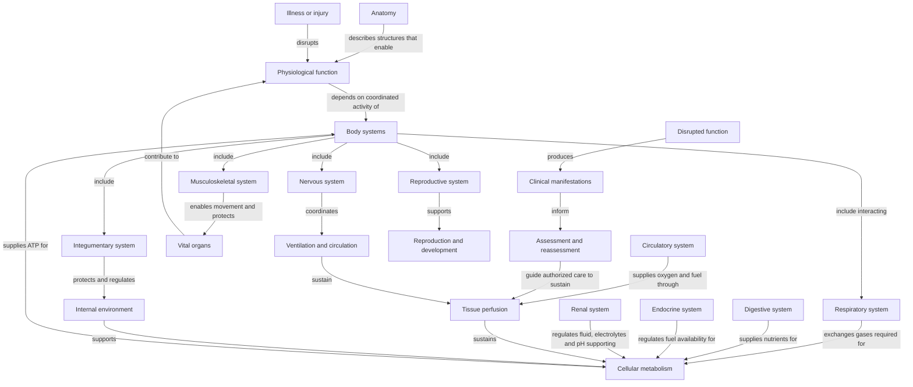

### Clinical authority and continuity

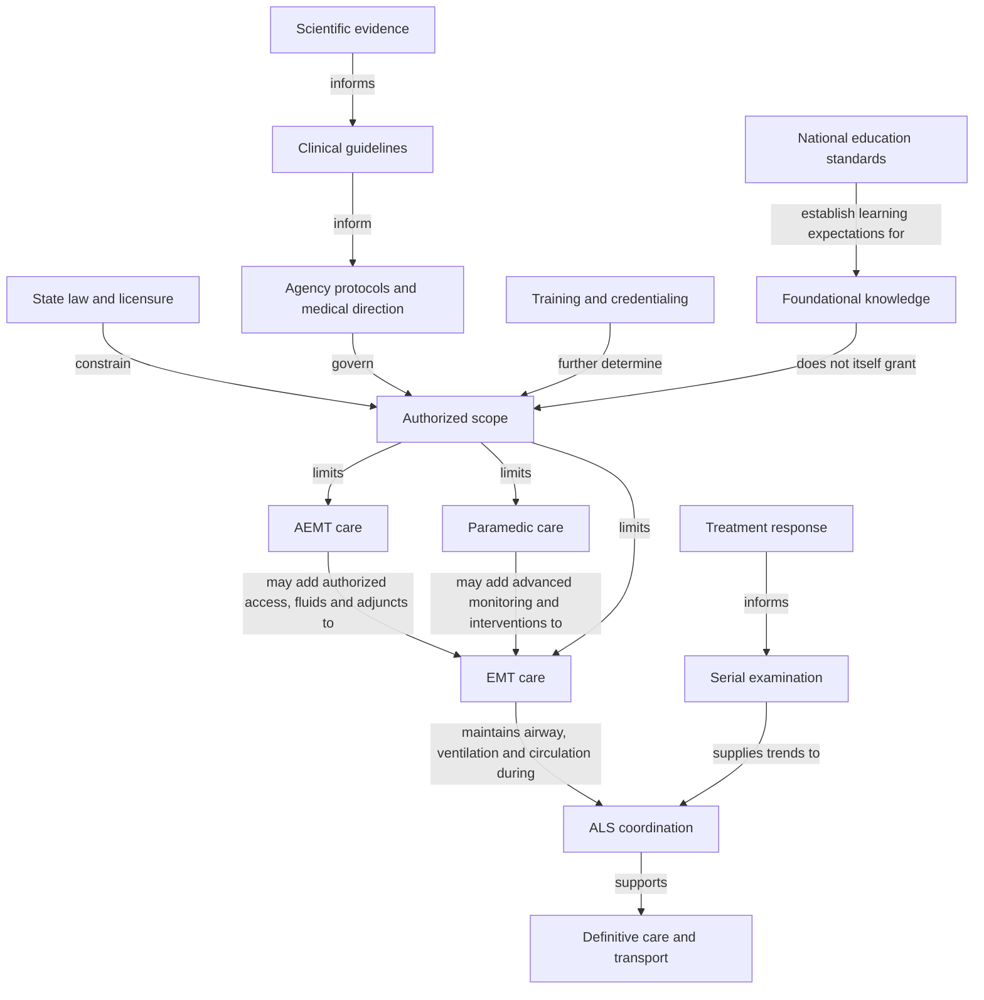

## Cellular metabolism and perfusion

### Aerobic and anaerobic energy pathways

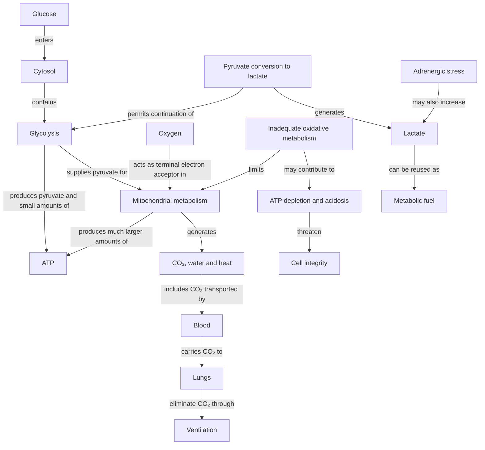

Lactate elevation is not proof of hypoxia; lactate itself is not the sole cause of acidosis or injury. Glycolysis occurs in the cytosol regardless of oxygen availability.

### Ion gradients and cellular injury

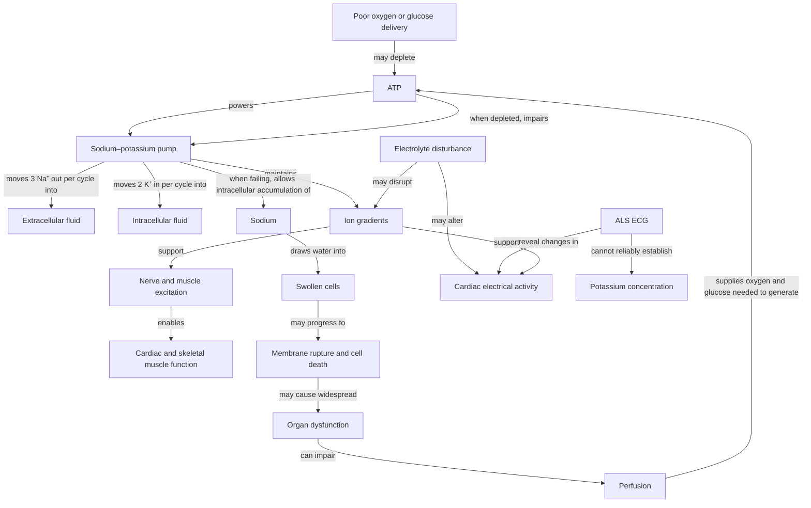

### Eleven-link chain of oxygen delivery

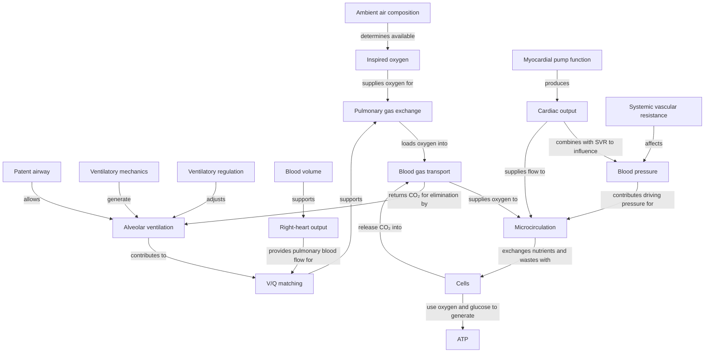

These dependencies operate together, not as a fixed care algorithm. Normal pressure, saturation or airway patency alone does not establish adequate perfusion.

## Medical language and anatomical communication

### Word construction and clinical meaning

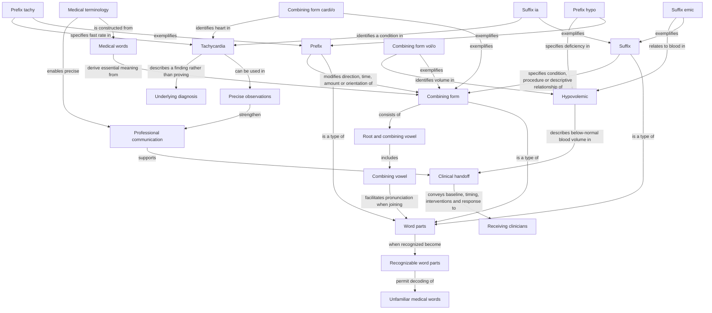

### Procedure terminology as a relationship

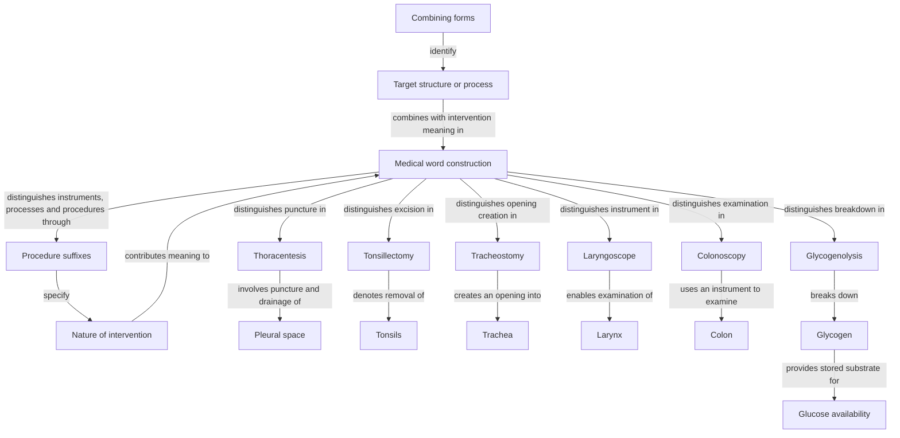

The terminology dictionary remains the place for exhaustive individual word-part definitions.

### Anatomical reference and localization

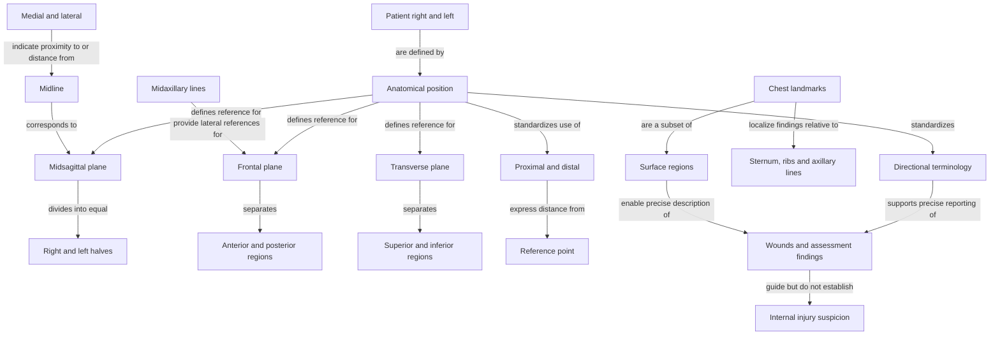

### Cavities, abdominal regions and concealed injury

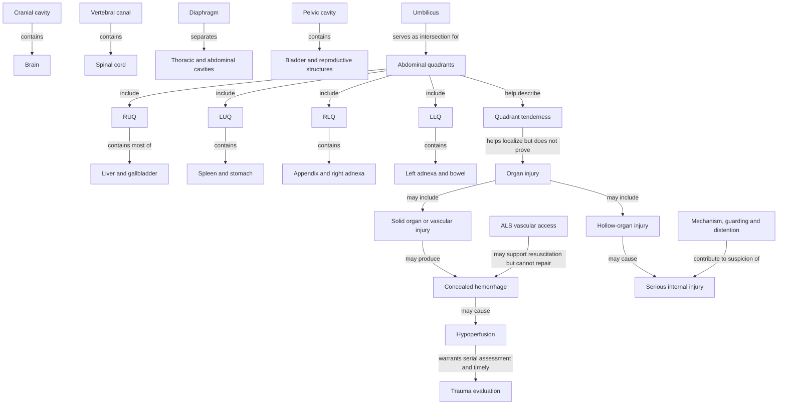

### Positioning, breathing and perfusion

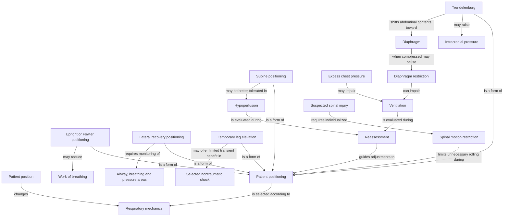

Do not use routine Trendelenburg for shock, routine leg elevation in trauma, or a fixed side-switch timer to override spinal precautions. Inadequate breathing takes priority over positioning preferences.

## Musculoskeletal structure and injury

### Structural support, protection and movement

```mermaid
flowchart TD
    N01["Skeleton"]
    N02["Shape and support"]
    N03["Vital organs"]
    N04["Bone marrow"]
    N05["Blood cells"]
    N06["Bones"]
    N07["Minerals"]
    N08["Ligaments"]
    N09["Bone to bone"]
    N10["Tendons"]
    N11["Muscle to bone"]
    N12["Skeletal muscle contraction"]
    N13["Joints"]
    N14["Cranium"]
    N15["Brain"]
    N16["Vertebrae and ligaments"]
    N17["Spinal cord"]
    N18["Intervertebral disks"]
    N19["Mechanical shock"]
    N20["Thoracic cage"]
    N21["Ventilation"]
    N22["Pelvis"]
    N23["Pelvic organs"]
    N24["Hip socket and femoral head"]
    N25["Hip joint"]
    N26["Tibia"]
    N27["Lower leg"]
    N28["Clavicle and scapula"]
    N29["Shoulder girdle"]
    N30["Humeral head and shallow scapular cup"]
    N31["Shoulder dislocation"]

    N01 -->|provides| N02
    N01 -->|protects| N03
    N04 -->|produces| N05
    N06 -->|store| N07
    N08 -->|connect| N09
    N10 -->|connect| N11
    N12 -->|moves bones at| N13
    N14 -->|encloses and protects| N15
    N16 -->|support body and surround| N17
    N18 -->|absorb| N19
    N20 -->|protects organs and supports| N21
    N22 -->|supports intestines and protects| N23
    N24 -->|form| N25
    N26 -->|bears weight in| N27
    N28 -->|form| N29
    N30 -->|permit wide movement but predispose to| N31
    N01 -->|includes| N14
    N01 -->|includes| N16
    N01 -->|includes| N20
    N01 -->|includes| N22
    N01 -->|includes bones of| N27
    N01 -->|includes| N29
    N01 -->|provides attachment for| N10
    N01 -->|contains bones joined by| N08
    N01 -->|moves at| N13
    N01 -->|contains| N04
    N01 -->|consists of| N06
    N16 -->|surround| N18
    N22 -->|contributes to| N24
    N29 -->|includes scapula contributing to| N30
```

### Joint motion and muscle specialization

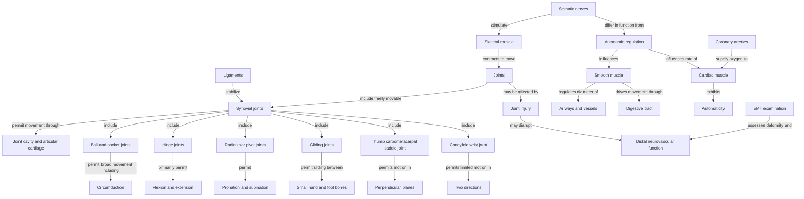

The source corrects its textbook ankle and wrist examples: the talocrural ankle is principally a hinge, and forearm rotation occurs at radioulnar joints.

### Head, spine and secondary injury

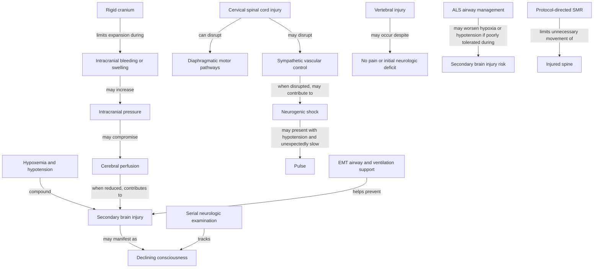

### Fracture and hemorrhage

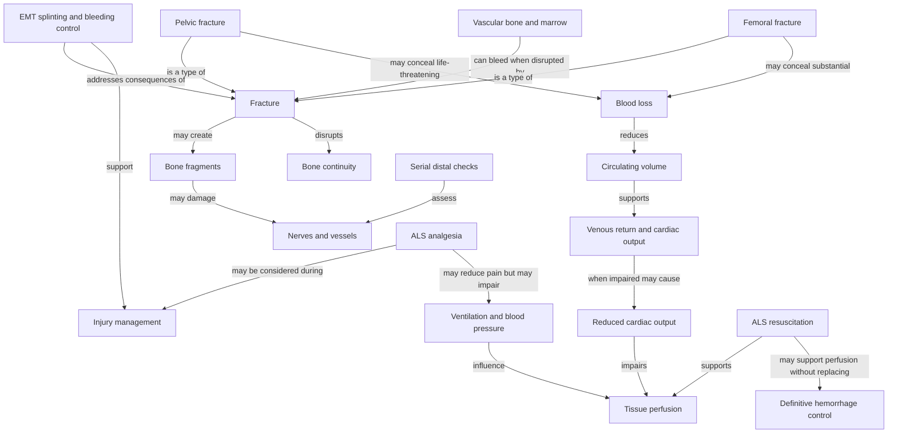

## Nervous and endocrine systems

### Neural information, consciousness and vital control

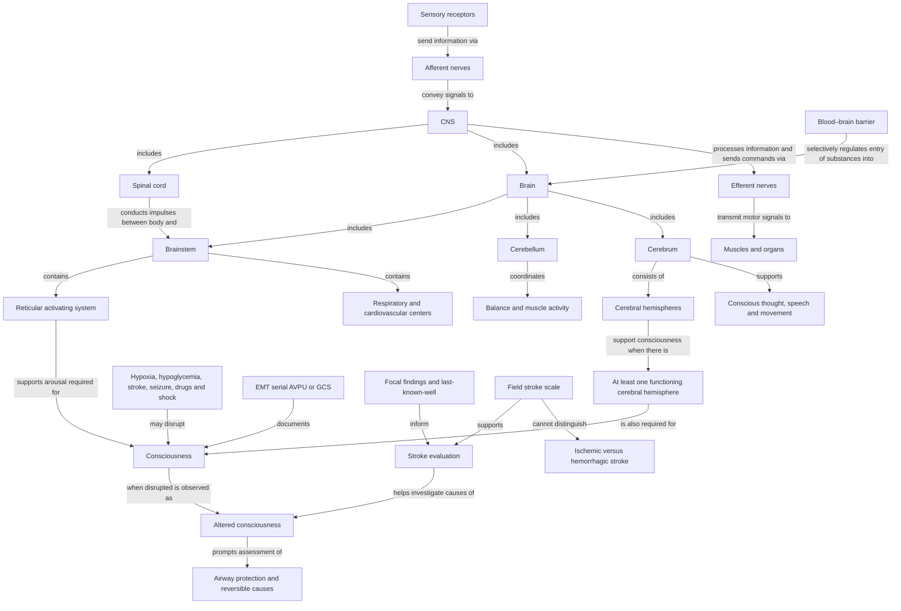

### Autonomic and hormonal stress response

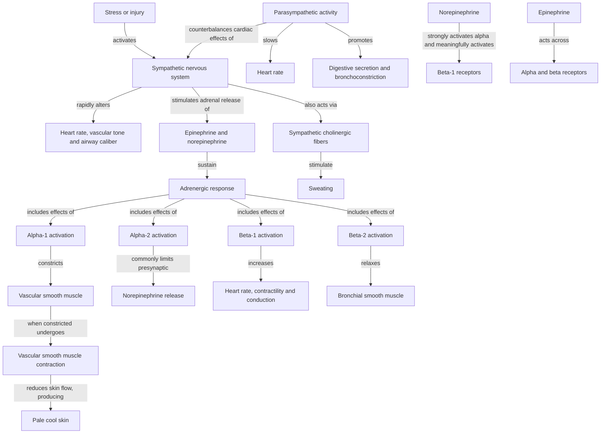

Most systemic vessels do not have substantial parasympathetic vasodilator innervation. Sweating is not a direct alpha-1 effect.

### Endocrine regulation and clinical pharmacology

```mermaid
flowchart TD
    N01["Endocrine glands"]
    N02["Bloodstream"]
    N03["Pineal melatonin"]
    N04["Circadian rhythm"]
    N05["Pituitary hormones"]
    N06["Growth and other endocrine glands"]
    N07["Thyroid hormones"]
    N08["Metabolism and development"]
    N09["Parathyroid hormones"]
    N10["Calcium and phosphorus balance"]
    N11["Thymus"]
    N12["Immune maturation"]
    N13["Adrenal hormones"]
    N14["Stress, salt and water balance"]
    N15["Pancreatic insulin"]
    N16["Cellular glucose uptake"]
    N17["Pancreatic glucagon"]
    N18["Blood glucose"]
    N19["Gonadal hormones"]
    N20["Reproduction and sex characteristics"]
    N21["ATP production"]
    N22["Epinephrine under protocol"]
    N23["Anaphylactic bronchospasm and vasodilation"]
    N24["Albuterol"]
    N25["Bronchospasm"]
    N26["Upper airway obstruction"]
    N27["Norepinephrine in authorized ALS care"]
    N28["Selected distributive shock"]
    N29["Hemorrhage control"]
    N30["Medication effects"]
    N31["Pulse, breathing, pressure and response"]

    N01 -->|release hormones into| N02
    N03 -->|regulates| N04
    N05 -->|regulate| N06
    N07 -->|regulate| N08
    N09 -->|regulate| N10
    N11 -->|supports| N12
    N13 -->|regulate| N14
    N15 -->|promotes| N16
    N17 -->|raises| N18
    N19 -->|influence| N20
    N18 -->|supplies fuel for| N21
    N22 -->|counteracts| N23
    N24 -->|activates beta-2 receptors to relieve| N25
    N24 -->|does not relieve| N26
    N27 -->|may restore tone in| N28
    N27 -->|cannot replace| N29
    N30 -->|require monitoring of| N31
    N02 -->|transports| N03
    N01 -->|include glands producing| N05
    N01 -->|include glands producing| N07
    N01 -->|include glands producing| N09
    N01 -->|include| N11
    N01 -->|include glands producing| N13
    N01 -->|include glands producing| N15
    N01 -->|include glands producing| N17
    N01 -->|include glands producing| N19
    N15 -->|regulates| N18
    N16 -->|supplies fuel for| N21
    N13 -->|include catecholamine effects mimicked by| N22
    N22 -->|produces| N30
    N24 -->|produces| N30
    N27 -->|produces| N30
```

## Digestion, renal function and reproduction

### Digestion, fuel and blood composition

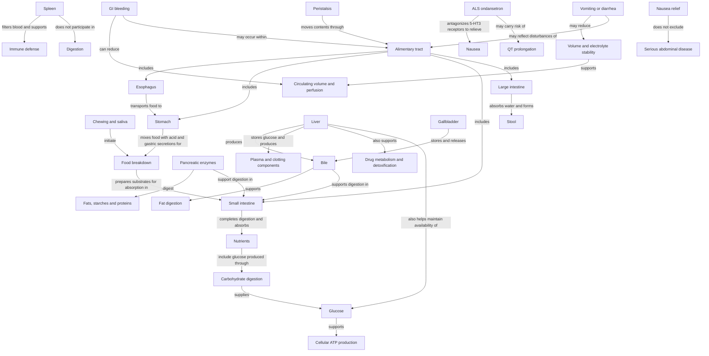

### Renal homeostasis and electrolyte disturbance

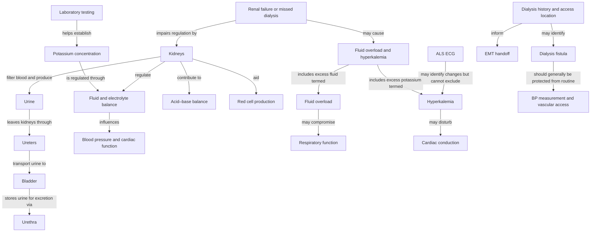

### Reproductive anatomy and pregnancy physiology

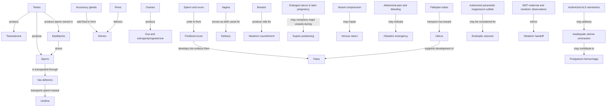

Positioning or uterine displacement is context-dependent, including trauma and resuscitation considerations.

## Blood, cardiac anatomy and circulation

### Pulmonary and systemic blood flow

```mermaid
flowchart TD
    N01["Systemic tissues"]
    N02["Venae cavae"]
    N03["Right atrium"]
    N04["Right ventricle"]
    N05["Pulmonary arteries"]
    N06["Pulmonary capillaries"]
    N07["Pulmonary veins"]
    N08["Left atrium"]
    N09["Left ventricle"]
    N10["Aorta"]
    N11["Systemic arteries"]
    N12["Arterioles"]
    N13["Systemic capillaries"]
    N14["Systemic veins"]
    N15["Venous valves"]
    N16["Backflow"]
    N17["Coronary arteries"]
    N18["Myocardium"]
    N19["Pericardium"]
    N20["Heart"]

    N01 -->|return deoxygenated blood via| N02
    N02 -->|drain into| N03
    N03 -->|passes blood through tricuspid valve to| N04
    N04 -->|ejects through pulmonary valve into| N05
    N05 -->|carry blood away from heart toward| N06
    N06 -->|exchange CO₂ for O₂ and drain into| N07
    N07 -->|return oxygenated blood to| N08
    N08 -->|passes blood through mitral valve to| N09
    N09 -->|ejects through aortic valve into| N10
    N10 -->|distributes blood through| N11
    N11 -->|supply| N12
    N12 -->|regulate inflow into| N13
    N13 -->|exchange gases and nutrients with| N01
    N13 -->|drain through venules into| N14
    N14 -->|return blood via| N02
    N15 -->|limit| N16
    N10 -->|gives rise to| N17
    N17 -->|supply| N18
    N19 -->|surrounds and lubricates movement of| N20
```

### Blood composition and transport capacity

```mermaid
flowchart TD
    N01["Blood"]
    N02["Plasma"]
    N03["Formed elements"]
    N04["Albumin"]
    N05["Oncotic pressure"]
    N06["Antibodies and clotting factors"]
    N07["Immunity and hemostasis"]
    N08["Red blood cells"]
    N09["Hemoglobin"]
    N10["Blood oxygen"]
    N11["White blood cells"]
    N12["Immune defense"]
    N13["Platelets"]
    N14["Clot formation"]
    N15["Blood loss"]
    N16["Venous circulation"]
    N17["Blood volume"]
    N18["Illustrative adult"]
    N19["Venous return"]
    N20["Temperature and acid–base regulation"]
    N21["Tissue oxygen delivery"]

    N01 -->|consists approximately 55 percent of| N02
    N01 -->|consists approximately 45 percent of| N03
    N02 -->|contains water and proteins including| N04
    N04 -->|contributes to| N05
    N02 -->|contains| N06
    N06 -->|contribute respectively to| N07
    N03 -->|include| N08
    N08 -->|contain| N09
    N09 -->|carries most| N10
    N03 -->|include| N11
    N11 -->|contribute to| N12
    N03 -->|include| N13
    N13 -->|cooperate with clotting factors in| N14
    N14 -->|limits| N15
    N16 -->|contains about 64 percent of| N17
    N17 -->|is approximately 70 mL/kg in| N18
    N17 -->|influences| N19
    N01 -->|also supports| N20
    N17 -->|represents circulating quantity of| N01
    N01 -->|supports| N12
    N14 -->|helps preserve| N17
    N10 -->|contributes to| N21
```

### Electrical activation versus mechanical perfusion

```mermaid
flowchart TD
    N01["SA node"]
    N02["AV node"]
    N03["Bundle of His"]
    N04["Bundle branches"]
    N05["Purkinje fibers"]
    N06["Ventricular myocardium"]
    N07["Stroke volume"]
    N08["Cardiac output"]
    N09["Tissue perfusion"]
    N10["Left ventricular contraction"]
    N11["Pulse pressure wave"]
    N12["Arterial pulse sites"]
    N13["Mechanical pulse"]
    N14["Cardiac monitor"]
    N15["Electrical activity"]
    N16["12-lead ECG"]
    N17["Ischemia and dysrhythmias"]
    N18["Effective mechanical contraction"]
    N19["EMT authorized ECG acquisition"]
    N20["ALS interpretation"]
    N21["Serial pulse and pressure assessment"]
    N22["Electrical monitoring"]

    N01 -->|initiates impulses that travel to| N02
    N02 -->|conducts impulses toward| N03
    N03 -->|conducts into| N04
    N04 -->|transmit impulses to| N05
    N05 -->|activate| N06
    N06 -->|contracts to generate| N07
    N07 -->|contributes to| N08
    N08 -->|supports| N09
    N10 -->|generates arterial| N11
    N12 -->|permit assessment of| N13
    N14 -->|records| N15
    N16 -->|samples electrical activity to investigate| N17
    N15 -->|does not prove| N18
    N18 -->|does not alone establish| N09
    N19 -->|supplies tracing to| N20
    N21 -->|complements| N22
    N01 -->|produces| N15
    N11 -->|is detected as| N13
    N13 -->|reflects but does not establish adequacy of| N18
    N14 -->|supports| N22
    N16 -->|is a type of| N22
    N20 -->|evaluates| N15
```

## Respiratory function and failure

### Ambient air, oxygen availability and toxicity

```mermaid
flowchart TD
    N01["Atmospheric pressure"]
    N02["Gas partial pressure"]
    N03["Ambient air"]
    N04["Oxygen"]
    N05["Oxidative metabolism"]
    N06["Oxygen delivery devices"]
    N07["Inspired oxygen fraction"]
    N08["Mask fit, flow and leaks"]
    N09["Enclosed-space fire gases"]
    N10["Carbon monoxide"]
    N11["Hemoglobin oxygen transport"]
    N12["Cyanide"]
    N13["Cellular oxygen utilization"]
    N14["Tissue oxygen delivery"]
    N15["Conventional SpO₂"]
    N16["Carboxyhemoglobin"]
    N17["Blood co-oximetry"]
    N18["Authorized ALS hydroxocobalamin"]
    N19["Exposure history"]
    N20["Toxic gas exposure"]
    N21["Scene safety"]
    N22["Unsafe atmosphere"]

    N01 -->|combines with gas fraction to determine| N02
    N03 -->|provides approximately 21 percent| N04
    N04 -->|enables efficient| N05
    N06 -->|may increase| N07
    N08 -->|affect actual| N07
    N09 -->|may displace| N04
    N10 -->|interferes with| N11
    N12 -->|impairs| N13
    N11 -->|contributes to| N14
    N14 -->|supports| N05
    N13 -->|is required for| N05
    N15 -->|cannot reliably distinguish| N16
    N17 -->|can identify| N16
    N18 -->|binds cyanide to permit recovery of| N13
    N19 -->|guides suspicion of| N20
    N21 -->|requires avoiding| N22
    N04 -->|contributes to| N02
    N07 -->|influences available| N04
    N10 -->|produces| N16
    N19 -->|may identify| N09
    N20 -->|may involve| N10
    N20 -->|may involve| N12
    N22 -->|may contain| N09
    N12 -->|may be treated in appropriate circumstances by| N18
```

Approximate source device concentrations are not guaranteed. Hydroxocobalamin can discolor skin and urine and interfere with some laboratory measurements.

### Airway anatomy and protective mechanisms

```mermaid
flowchart TD
    N01["Nasal cavity"]
    N02["Nasopharynx"]
    N03["Oral cavity"]
    N04["Oropharynx"]
    N05["Laryngopharynx"]
    N06["Esophagus"]
    N07["Larynx"]
    N08["Epiglottis and vocal cord closure"]
    N09["Swallowing"]
    N10["Trachea"]
    N11["Cricoid cartilage"]
    N12["Bronchi"]
    N13["Bronchioles"]
    N14["Alveoli"]
    N15["Pulmonary gas exchange"]
    N16["Tongue relaxation, blood, vomitus or foreign material"]
    N17["Upper airway"]
    N18["Laryngeal edema or spasm"]
    N19["Glottic airflow"]
    N20["Airway patency"]
    N21["Adequate ventilation"]
    N22["Airway protection"]
    N23["Aspiration"]

    N01 -->|warms, moistens and filters air entering| N02
    N03 -->|provides alternative airflow into| N04
    N02 -->|conveys air toward| N05
    N04 -->|conveys air and swallowed material toward| N05
    N05 -->|directs swallowed material toward| N06
    N05 -->|directs air toward| N07
    N08 -->|help protect airway during| N09
    N07 -->|conducts air through glottis into| N10
    N11 -->|forms a complete supporting ring at| N07
    N10 -->|divides into| N12
    N12 -->|branch into| N13
    N13 -->|conduct air toward| N14
    N14 -->|provide surface for| N15
    N16 -->|can obstruct| N17
    N18 -->|can obstruct| N19
    N20 -->|permits but does not establish| N21
    N22 -->|reduces risk of| N23
    N17 -->|includes| N05
    N17 -->|includes| N07
    N19 -->|contributes to| N20
    N17 -->|when unobstructed supports| N20
    N08 -->|contribute to| N22
    N14 -->|require airflow supported by| N20
```

### Airway intervention and mechanism-specific medications

```mermaid
flowchart TD
    N01["EMT positioning, suction and basic adjuncts"]
    N02["Airway patency"]
    N03["Bag-mask ventilation"]
    N04["Ventilation is inadequate"]
    N05["Supraglottic airway"]
    N06["Glottis"]
    N07["Endotracheal tube"]
    N08["Airway protection"]
    N09["Authorized AEMT or paramedic care"]
    N10["Advanced airway devices"]
    N11["Medication-assisted airway placement"]
    N12["Apnea or hypotension"]
    N13["Repeated airway attempts"]
    N14["Oxygen delivery"]
    N15["Continuous waveform capnography"]
    N16["Bronchospasm"]
    N17["Lower-airway resistance"]
    N18["Albuterol"]
    N19["Ipratropium"]
    N20["Bronchoconstriction"]
    N21["Corticosteroids"]
    N22["Failing airway"]
    N23["Anaphylaxis"]
    N24["Distributive shock"]
    N25["Protocol-authorized epinephrine"]
    N26["Anaphylactic airway and circulatory effects"]
    N27["Wheeze, stridor, rash and swelling"]
    N28["Obstruction mechanism"]
    N29["EMT equipment preparation and reassessment"]

    N01 -->|support| N02
    N03 -->|supports gas movement when| N04
    N05 -->|sits above| N06
    N07 -->|passes through| N06
    N07 -->|may reduce gross aspiration but cannot guarantee| N08
    N09 -->|may include appropriate| N10
    N11 -->|may cause| N12
    N13 -->|may interrupt| N14
    N15 -->|supports confirmation and monitoring of| N10
    N16 -->|increases| N17
    N18 -->|relaxes bronchial smooth muscle to reduce| N16
    N19 -->|reduces cholinergic| N20
    N21 -->|reduce inflammation over time rather than immediately reversing| N22
    N23 -->|may produce edema, bronchospasm and| N24
    N25 -->|helps counter| N26
    N27 -->|inform but do not establish| N28
    N29 -->|support safe| N10
```

### Spontaneous ventilation, muscle work and fatigue

```mermaid
flowchart TD
    N01["Brainstem respiratory centers"]
    N02["Phrenic and intercostal nerves"]
    N03["Phrenic nerve C3–C5"]
    N04["Diaphragm"]
    N05["Diaphragm contraction"]
    N06["Thoracic volume"]
    N07["External intercostal contraction"]
    N08["Boyle's law"]
    N09["Lungs"]
    N10["Visceral and parietal pleura"]
    N11["Chest wall"]
    N12["Negative pleural pressure"]
    N13["Lung inflation"]
    N14["Muscle relaxation and elastic recoil"]
    N15["Air"]
    N16["Inspiratory accessory muscles"]
    N17["Increased breathing demand"]
    N18["Abdominal and internal intercostal muscles"]
    N19["Active exhalation"]
    N20["Energy consumption"]
    N21["Inadequate oxygen or glucose"]
    N22["Respiratory muscle ATP supply"]
    N23["Respiratory fatigue"]
    N24["Ventilatory failure"]
    N25["Oxygen availability"]
    N26["Lung–chest wall coupling"]

    N01 -->|send motor impulses through| N02
    N03 -->|stimulates| N04
    N05 -->|increases| N06
    N07 -->|elevates ribs to increase| N06
    N06 -->|varies inversely with gas pressure according to| N08
    N06 -->|when increased, lowers lung pressure and draws air into| N09
    N10 -->|couple lungs to| N11
    N12 -->|helps maintain| N13
    N14 -->|reduce| N06
    N06 -->|when reduced, raises lung pressure to expel| N15
    N16 -->|assist expansion during| N17
    N18 -->|assist| N19
    N17 -->|increases| N20
    N21 -->|limits| N22
    N22 -->|when depleted, contributes to| N23
    N23 -->|may lead to| N24
    N24 -->|further impairs| N25
    N02 -->|include| N03
    N04 -->|increases thoracic volume through| N05
    N09 -->|are surrounded by| N10
    N13 -->|depends on| N26
    N10 -->|facilitate| N26
    N17 -->|can require| N18
    N20 -->|increases demand for| N22
    N24 -->|decreases| N25
    N25 -->|supports| N22
```

### Resistance, compliance and pleural injury

```mermaid
flowchart TD
    N01["Lung and chest wall compliance"]
    N02["Expansion"]
    N03["Pulmonary edema or pneumonia"]
    N04["Compliance"]
    N05["Flail segment or neuromuscular disease"]
    N06["Edema, mucus and bronchoconstriction"]
    N07["Airway resistance"]
    N08["Airflow"]
    N09["Reduced compliance and increased resistance"]
    N10["Work of breathing"]
    N11["Pleural disruption"]
    N12["Pleural space"]
    N13["Air in pleural space"]
    N14["Lung–chest wall coupling"]
    N15["Lung collapse"]
    N16["Tension pneumothorax"]
    N17["Lung expansion and venous return"]
    N18["Obstructive shock"]
    N19["Asymmetric breath sounds and worsening distress"]
    N20["Pneumothorax"]
    N21["Vented chest seal"]
    N22["Spontaneously breathing open pneumothorax"]
    N23["Chest seal during positive-pressure ventilation"]
    N24["Open pneumothorax"]
    N25["Authorized ALS pleural decompression"]
    N26["Tension physiology"]

    N01 -->|determines ease of| N02
    N03 -->|may reduce| N04
    N05 -->|can impair| N02
    N06 -->|increase| N07
    N07 -->|impedes| N08
    N09 -->|increase| N10
    N11 -->|allows air into| N12
    N13 -->|disrupts| N14
    N14 -->|when disrupted, permits| N15
    N16 -->|may impair| N17
    N17 -->|when impaired by tension, may contribute to| N18
    N19 -->|may raise concern for| N20
    N21 -->|may be considered under protocol for| N22
    N23 -->|may increase risk in| N24
    N25 -->|may address suspected| N26
```

The source's updated chest trauma guidance distinguishes spontaneously breathing patients from those receiving PPV. Not every pneumothorax warrants decompression; local protocols govern care.

### Minute ventilation and alveolar ventilation

```mermaid
flowchart TD
    N01["Tidal volume"]
    N02["Breath"]
    N03["Respiratory frequency"]
    N04["Minute"]
    N05["Tidal volume and respiratory frequency"]
    N06["Minute ventilation = VT × f"]
    N07["Conducting airways"]
    N08["Anatomical dead space"]
    N09["Gas exchange"]
    N10["Tidal volume minus dead space"]
    N11["Alveolar ventilation = (VT − VD) × f"]
    N12["500 mL × 12/min with 150 mL dead space"]
    N13["Minute 6 L/min; alveolar 4.2 L/min"]
    N14["200 mL × 28/min with 150 mL dead space"]
    N15["Minute 5.6 L/min; alveolar 1.4 L/min"]
    N16["Rapid shallow breathing"]
    N17["Minute ventilation"]
    N18["Alveolar ventilation"]
    N19["Low alveolar ventilation"]
    N20["CO₂ retention and hypoxemia"]
    N21["Supplemental oxygen"]
    N22["Inadequate alveolar ventilation"]
    N23["Appropriate assisted ventilation"]

    N01 -->|describes air moved per| N02
    N03 -->|describes breaths per| N04
    N05 -->|determine| N06
    N07 -->|contain| N08
    N08 -->|does not participate in| N09
    N10 -->|determines effective volume per breath for| N11
    N03 -->|multiplies effective volume in| N11
    N12 -->|yields| N13
    N14 -->|yields| N15
    N16 -->|can preserve near-normal| N17
    N16 -->|may severely reduce| N18
    N19 -->|may cause| N20
    N21 -->|does not correct| N22
    N23 -->|can support| N18
    N08 -->|is subtracted in| N10
    N06 -->|is distinct from| N11
    N11 -->|quantifies| N18
    N06 -->|quantifies| N17
    N22 -->|is a reduction in| N18
```

Rates, volumes and dead space are illustrative adult values; chest rise alone does not quantify effective alveolar ventilation.

### Respiratory regulation and acid–base feedback

```mermaid
flowchart TD
    N01["CO₂ retention"]
    N02["CSF pH"]
    N03["Central chemoreceptors"]
    N04["Marked arterial hypoxemia"]
    N05["Peripheral chemoreceptors"]
    N06["Brainstem respiratory centers"]
    N07["Dorsal respiratory group"]
    N08["Ventral respiratory group"]
    N09["Pontine respiratory center"]
    N10["Respiratory cycle"]
    N11["Respiratory muscles"]
    N12["Alveolar ventilation"]
    N13["Irritant receptors"]
    N14["Breathing"]
    N15["Stretch receptors"]
    N16["Lung inflation"]
    N17["J-receptors"]
    N18["Rapid shallow breathing"]
    N19["Metabolic acidosis"]
    N20["Rapid deep breathing"]
    N21["Lungs, kidneys and bicarbonate buffer"]
    N22["Acid–base balance"]

    N01 -->|increases hydrogen ions and lowers| N02
    N02 -->|when reduced, stimulates| N03
    N04 -->|stimulates| N05
    N05 -->|signal| N06
    N03 -->|signal| N06
    N07 -->|relays sensory input to| N08
    N09 -->|helps regulate transitions in| N10
    N08 -->|participates in motor control of| N11
    N11 -->|increase rate and depth to raise| N12
    N12 -->|eliminates CO₂, counteracting| N01
    N13 -->|trigger cough, constriction and faster| N14
    N15 -->|help limit excessive| N16
    N17 -->|respond to elevated capillary pressure with| N18
    N19 -->|may stimulate compensatory| N20
    N21 -->|jointly regulate| N22
```

The source's VRG-exclusive model is not established. Respiratory CO₂ compensation differs from correction of the underlying metabolic cause.

### COPD, opioid effects and respiratory compensation

```mermaid
flowchart TD
    N01["Chronic hypercapnia"]
    N02["Ventilatory response"]
    N03["COPD"]
    N04["Hypoxic drive"]
    N05["Excess oxygen in susceptible COPD"]
    N06["Hypercapnia"]
    N07["Altered V/Q matching"]
    N08["Haldane effect"]
    N09["Titrated oxygen"]
    N10["Oxygen-induced hypercapnia"]
    N11["Critical hypoxemia or ventilatory failure"]
    N12["Necessary oxygen and ventilation"]
    N13["Opioids"]
    N14["Brainstem ventilatory drive"]
    N15["Depressed ventilatory drive"]
    N16["Hypoventilation"]
    N17["Naloxone"]
    N18["Spontaneous ventilation"]
    N19["Naloxone effect wearing off"]
    N20["Recurrent respiratory depression"]
    N21["Metabolic acidosis"]
    N22["Rapid deep breathing"]
    N23["Apnea or inadequate replacement ventilation"]
    N24["Respiratory compensation"]
    N25["EMT assisted ventilation and reassessment"]

    N01 -->|may modify| N02
    N03 -->|does not universally make ventilation dependent only on| N04
    N05 -->|can worsen| N06
    N07 -->|contributes to oxygen-induced| N06
    N08 -->|contributes to oxygen-induced| N06
    N09 -->|may reduce risk of| N10
    N11 -->|still requires| N12
    N13 -->|depress| N14
    N15 -->|may cause| N16
    N17 -->|antagonizes opioid receptors to restore| N18
    N19 -->|may permit| N20
    N21 -->|can cause compensatory| N22
    N23 -->|can interrupt| N24
    N25 -->|address| N16
```

Source target for patients at risk of hypercapnic respiratory failure is commonly SpO₂ 88–92%, subject to clinical status and local guidance. Do not withhold necessary oxygen. Naloxone may cause withdrawal or vomiting.

### Positive pressure, venous return and noninvasive support

```mermaid
flowchart TD
    N01["Spontaneous inspiration"]
    N02["Negative intrathoracic pressure"]
    N03["Bag-mask or mechanical ventilation"]
    N04["Positive airway pressure"]
    N05["Intrathoracic pressure"]
    N06["Elevated intrathoracic pressure"]
    N07["Venous return"]
    N08["Preload and cardiac output"]
    N09["Hypovolemia"]
    N10["Incomplete exhalation"]
    N11["Air trapping"]
    N12["Excessive pressure or volume"]
    N13["Lung injury"]
    N14["PEEP"]
    N15["Alveolar recruitment"]
    N16["CPAP"]
    N17["Spontaneous breathing"]
    N18["Bilevel NIV"]
    N19["Inspiratory pressure support"]
    N20["Noninvasive ventilation"]
    N21["Cardiogenic pulmonary edema"]
    N22["Vomiting, inadequate breathing or unstable hemodynamics"]
    N23["EMT reassessment"]
    N24["Hemodynamic response"]
    N25["Advanced ventilator settings"]
    N26["Separate authorization"]

    N01 -->|generates| N02
    N03 -->|generates| N04
    N04 -->|can raise| N05
    N06 -->|may reduce| N07
    N07 -->|when reduced, lowers| N08
    N09 -->|increases vulnerability to reduced| N08
    N10 -->|can produce| N11
    N11 -->|further increases| N05
    N12 -->|may cause| N13
    N14 -->|can improve| N15
    N14 -->|may also reduce| N07
    N16 -->|maintains pressure throughout| N17
    N18 -->|adds| N19
    N20 -->|may improve selected patients with| N21
    N22 -->|may limit| N20
    N23 -->|tracks chest rise, resistance and| N24
    N25 -->|require| N26
    N04 -->|includes end-expiratory pressure termed| N14
    N20 -->|includes| N16
    N20 -->|includes| N18
    N20 -->|uses| N04
    N17 -->|includes| N01
    N24 -->|may reflect changes in| N08
```

### Distress, failure and complementary assessment

```mermaid
flowchart TD
    N01["Adequate ventilation"]
    N02["Rate and depth"]
    N03["Increased airway resistance or poor expansion"]
    N04["Increased work of breathing"]
    N05["Retractions, flaring and accessory muscle use"]
    N06["Respiratory fatigue"]
    N07["Falling effort and altered alertness"]
    N08["Agonal gasps"]
    N09["Normal breathing"]
    N10["Cardiac arrest"]
    N11["Pulse oximetry"]
    N12["Hemoglobin saturation"]
    N13["Ventilation adequacy"]
    N14["Waveform capnography"]
    N15["CO₂ and waveform"]
    N16["Ventilation, metabolism and pulmonary blood flow"]
    N17["Leaks and sampling problems"]
    N18["Serial breathing and mental-status examination"]
    N19["BLS assisted ventilation"]
    N20["Advanced respiratory support"]

    N01 -->|requires appropriate| N02
    N03 -->|can cause| N04
    N04 -->|may manifest as| N05
    N06 -->|may manifest as| N07
    N08 -->|are not| N09
    N08 -->|warrant assessment for| N10
    N11 -->|estimates| N12
    N12 -->|does not establish| N13
    N14 -->|measures exhaled| N15
    N16 -->|influence| N15
    N17 -->|can distort| N15
    N18 -->|helps determine| N13
    N13 -->|informs need for| N19
    N19 -->|continues while authorized ALS evaluates| N20
```

Rate ranges are reference values, not stand-alone intervention thresholds; normal SpO₂ on oxygen does not exclude hypoventilation.

## Gas exchange, oxygen transport and circulation

### Ventilation/perfusion matching

```mermaid
flowchart TD
    N01["Alveolar ventilation"]
    N02["Pulmonary gas exchange"]
    N03["Pulmonary capillary flow"]
    N04["Alveolar ventilation and pulmonary flow"]
    N05["V/Q ratio = V divided by Q"]
    N06["Gravity"]
    N07["Lung bases"]
    N08["Lung apex"]
    N09["V/Q ratio"]
    N10["Bronchospasm or alveolar edema"]
    N11["Low V/Q"]
    N12["Alveoli"]
    N13["Absent ventilation with perfusion"]
    N14["Shunt physiology"]
    N15["Pulmonary embolism or reduced pulmonary blood flow"]
    N16["High V/Q"]
    N17["Local perfusion"]
    N18["Absent perfusion with ventilation"]
    N19["Dead-space physiology"]
    N20["Severe blood loss"]
    N21["Pulmonary blood flow"]
    N22["Reduced flow and oxygen content"]
    N23["Alveolar pressure exceeding capillary pressure"]
    N24["ALS EtCO₂ trend"]

    N01 -->|supplies air for| N02
    N03 -->|supplies blood for| N02
    N04 -->|determine| N05
    N06 -->|produces greater relative perfusion at| N07
    N08 -->|has relatively greater| N09
    N07 -->|have relatively lower| N09
    N10 -->|may produce| N11
    N11 -->|reflects perfusion of poorly ventilated| N12
    N13 -->|represents extreme| N14
    N15 -->|may produce| N16
    N16 -->|reflects ventilation exceeding| N17
    N18 -->|represents extreme| N19
    N20 -->|reduces| N21
    N20 -->|also reduces systemic oxygen delivery through| N22
    N23 -->|can impede| N03
    N24 -->|may reflect declining| N03
    N05 -->|when abnormally low is| N11
    N05 -->|when abnormally high is| N16
    N11 -->|at its extreme is| N14
    N16 -->|at its extreme is| N19
    N17 -->|is part of| N03
    N12 -->|receive| N01
    N03 -->|is reflected in part by| N24
    N21 -->|includes| N03
```

EtCO₂ cannot diagnose or exclude pulmonary embolism; hemorrhage is more than a V/Q problem. Bronchodilators address bronchospasm rather than blood loss.

### Gas transport and partial-pressure gradients

```mermaid
flowchart TD
    N01["Partial-pressure gradients"]
    N02["Alveolar–capillary membrane"]
    N03["Alveolar oxygen"]
    N04["Pulmonary capillary blood"]
    N05["Hemoglobin"]
    N06["Blood oxygen"]
    N07["Plasma"]
    N08["Oxyhemoglobin"]
    N09["Tissue capillaries"]
    N10["Cells"]
    N11["Carbon dioxide"]
    N12["Bicarbonate, about 70 percent"]
    N13["Hemoglobin, about 23 percent"]
    N14["Plasma, about 7 percent"]
    N15["Bicarbonate"]
    N16["Pulmonary circulation"]
    N17["Pulmonary capillary CO₂"]
    N18["Alveoli"]
    N19["Exhalation"]

    N01 -->|drive diffusion across| N02
    N03 -->|diffuses into| N04
    N05 -->|carries approximately 97–98.5 percent of| N06
    N07 -->|carries approximately 1.5–3 percent as dissolved| N06
    N05 -->|binds up to four oxygen molecules forming| N08
    N08 -->|delivers oxygen via systemic blood to| N09
    N09 -->|exchange oxygen through interstitial fluid with| N10
    N10 -->|produce| N11
    N11 -->|diffuses into| N09
    N11 -->|is carried mostly as| N12
    N11 -->|is also carried bound to| N13
    N11 -->|is also carried dissolved in| N14
    N15 -->|is converted back to CO₂ in| N16
    N17 -->|diffuses into| N18
    N18 -->|release CO₂ through| N19
```

### Oxygen delivery is not saturation

```mermaid
flowchart TD
    N01["Hemoglobin concentration and saturation"]
    N02["Arterial oxygen content"]
    N03["Oxygen delivery = CO × arterial O₂ content"]
    N04["Cardiac output"]
    N05["Anemia"]
    N06["Hemoglobin concentration"]
    N07["Hemorrhage"]
    N08["Hemoglobin mass and circulating flow"]
    N09["Carbon monoxide"]
    N10["Functional oxygen transport"]
    N11["Pulse oximetry"]
    N12["Hemoglobin saturation"]
    N13["Normal saturation"]
    N14["Adequate arterial oxygen content or tissue flow"]
    N15["Poor perfusion, motion and pigmentation"]
    N16["Pulse oximetry accuracy"]
    N17["Co-oximetry"]
    N18["Hemoglobin species"]
    N19["EtCO₂"]
    N20["Pulmonary blood flow"]
    N21["Serial clinical examination"]
    N22["Tissue perfusion"]
    N23["Aerobic ATP generation"]
    N24["Supplemental oxygen"]
    N25["Missing hemoglobin"]
    N26["Authorized blood products"]
    N27["Oxygen-carrying capacity"]

    N01 -->|largely determine| N02
    N02 -->|combines with cardiac output in| N03
    N04 -->|contributes blood flow to| N03
    N05 -->|reduces| N06
    N07 -->|reduces| N08
    N09 -->|disrupts| N10
    N11 -->|estimates| N12
    N13 -->|cannot establish| N14
    N15 -->|may impair| N16
    N17 -->|distinguishes| N18
    N19 -->|reflects ventilation, metabolism and| N20
    N21 -->|reveals trends in| N22
    N03 -->|supports efficient| N23
    N24 -->|may support saturation but cannot replace| N25
    N26 -->|can restore| N27
    N06 -->|contributes to| N01
    N12 -->|contributes to| N01
    N08 -->|when reduced may impair| N03
    N07 -->|reduces oxygen delivery via| N04
    N10 -->|contributes to| N02
    N16 -->|influences reliability of| N12
    N03 -->|helps explain| N22
    N27 -->|contributes to| N02
    N25 -->|reduces| N27
```

Clinical distress is important even with normal saturation. Neither quietness nor screaming establishes trauma priority or perfusion adequacy.

## Hemodynamics and microcirculation

### Cardiac output and determinants of stroke volume

```mermaid
flowchart TD
    N01["SA node and autonomic control"]
    N02["Heart rate"]
    N03["CO = HR × SV"]
    N04["Stroke volume"]
    N05["Venous return"]
    N06["End-diastolic myocardial stretch (preload)"]
    N07["Preload"]
    N08["Frank–Starling mechanism"]
    N09["Myocardial contractility"]
    N10["Afterload"]
    N11["Myocardial infarction or heart failure"]
    N12["Beta-1 blockers"]
    N13["Excessively fast heart rate"]
    N14["Ventricular filling time"]
    N15["Shortened ventricular filling time"]
    N16["Chronically increased afterload"]
    N17["Left ventricular failure"]
    N18["Cardiac output"]
    N19["Tissue blood flow"]

    N01 -->|regulate| N02
    N02 -->|multiplies stroke volume in| N03
    N04 -->|multiplies heart rate in| N03
    N05 -->|influences| N06
    N07 -->|influences stroke volume through| N08
    N08 -->|increases force with stretch up to a limit, influencing| N04
    N09 -->|determines ejection strength contributing to| N04
    N10 -->|opposes ventricular ejection, influencing| N04
    N11 -->|can reduce| N09
    N12 -->|may reduce| N09
    N13 -->|can shorten| N14
    N15 -->|can reduce| N07
    N16 -->|may contribute to| N17
    N18 -->|supplies| N19
    N06 -->|is the concept of| N07
    N03 -->|expresses| N18
    N09 -->|may be impaired in| N17
```

Resting adult CO of about 5 L/min is illustrative. A rate above 160/min is not a universal threshold for reduced output; fluid response and preload are context-dependent.

### Vascular tone, pressure and pulse findings

```mermaid
flowchart TD
    N01["Arteriolar smooth muscle"]
    N02["Vessel diameter"]
    N03["Vasoconstriction"]
    N04["Systemic vascular resistance"]
    N05["Vasodilation"]
    N06["Cardiac output and systemic vascular resistance"]
    N07["MAP − right atrial pressure = CO × SVR"]
    N08["Systolic pressure"]
    N09["Ventricular contraction"]
    N10["Diastolic pressure"]
    N11["Contractions"]
    N12["Systolic and diastolic pressures"]
    N13["Pulse pressure = SBP − DBP"]
    N14["Pulse pressure"]
    N15["MAP ≈ DBP + PP/3"]
    N16["Reduced cardiac output with compensation"]
    N17["Narrow pulse pressure"]
    N18["Weak peripheral pulse"]
    N19["Arterial compliance, heart rate and runoff"]
    N20["Blood pressure"]
    N21["Tissue perfusion"]
    N22["Serial EMT BP, pulse, mentation and skin"]
    N23["Tissue perfusion assessment"]

    N01 -->|regulates| N02
    N03 -->|decreases| N02
    N02 -->|when reduced increases| N04
    N05 -->|lowers| N04
    N06 -->|influence| N07
    N08 -->|reflects arterial pressure during| N09
    N10 -->|reflects arterial pressure between| N11
    N12 -->|determine| N13
    N14 -->|contributes to estimated| N15
    N16 -->|may produce| N17
    N17 -->|may accompany| N18
    N19 -->|also influence| N10
    N20 -->|provides driving pressure but cannot establish| N21
    N22 -->|inform| N23
    N04 -->|contributes to| N06
    N07 -->|describes relationship governing| N20
    N13 -->|expresses| N14
    N17 -->|is a reduction of| N14
    N08 -->|is one component of| N12
    N10 -->|is one component of| N12
    N20 -->|includes| N12
    N23 -->|evaluates| N21
```

Narrow pulse pressure below 25% of SBP is the textbook example, not a diagnostic cutoff. MAP approximation is less reliable at extreme rates or abnormal waveforms.

### Baroreflex and sympathetic compensation

```mermaid
flowchart TD
    N01["Falling arterial pressure"]
    N02["Carotid sinus and aortic arch baroreceptors"]
    N03["Reduced baroreceptor signaling"]
    N04["Medullary cardiovascular centers"]
    N05["Parasympathetic activity"]
    N06["Sympathetic activity"]
    N07["Heart rate and contractility"]
    N08["Systemic vascular resistance"]
    N09["Sympathetic venous constriction"]
    N10["Venous return"]
    N11["Stroke volume"]
    N12["Heart rate and stroke volume"]
    N13["Cardiac output"]
    N14["Cardiac output and SVR"]
    N15["Arterial pressure"]
    N16["Restored arterial pressure"]
    N17["Increased baroreceptor signaling"]
    N18["Heart rate"]
    N19["Severe pressure fall"]
    N20["Catecholamines"]
    N21["Severe hypoxemia"]
    N22["Compensatory vasoconstriction"]
    N23["Peripheral tissue flow"]

    N01 -->|reduces stretch of| N02
    N03 -->|alters| N04
    N04 -->|increase sympathetic and decrease| N05
    N04 -->|increase| N06
    N06 -->|increases| N07
    N06 -->|constricts vessels to increase| N08
    N09 -->|supports| N10
    N10 -->|helps maintain| N11
    N12 -->|determine| N13
    N14 -->|help restore| N15
    N16 -->|increases stretch of| N02
    N17 -->|reduces sympathetic and increases| N05
    N05 -->|slows| N18
    N19 -->|promotes adrenal release of| N20
    N20 -->|sustain| N06
    N21 -->|stimulates chemoreceptor responses influencing| N04
    N22 -->|may sacrifice| N23
    N15 -->|when falling causes| N01
    N15 -->|when increased promotes| N17
    N06 -->|includes| N09
    N07 -->|influence| N13
    N13 -->|contributes to| N14
    N08 -->|contributes to| N14
    N06 -->|produces| N22
```

Normal measured pressure can persist despite worsening tissue perfusion; reduced sympathetic tone rather than widespread direct parasympathetic vascular innervation explains much systemic vasodilation.

### Microcirculation, edema and pulmonary consequences

```mermaid
flowchart TD
    N01["Arterioles"]
    N02["Metarterioles and capillary beds"]
    N03["Precapillary sphincters"]
    N04["True capillaries"]
    N05["Tissue cells"]
    N06["Venules"]
    N07["Local metabolic factors"]
    N08["Microvascular flow"]
    N09["Sympathetic tone and hormones"]
    N10["Sepsis"]
    N11["Systemic pressure"]
    N12["Capillary hydrostatic pressure"]
    N13["Fluid filtration"]
    N14["Plasma albumin"]
    N15["Permeability, interstitial pressure and lymphatic drainage"]
    N16["Fluid balance"]
    N17["Excess filtration or reduced oncotic opposition"]
    N18["Edema"]
    N19["Left ventricular failure"]
    N20["Pulmonary capillary hydrostatic pressure"]
    N21["Pulmonary edema"]
    N22["Gas exchange and compliance"]
    N23["EMT skin, refill and pulse trends"]
    N24["Tissue perfusion"]

    N01 -->|feed| N02
    N03 -->|regulate flow into| N04
    N04 -->|enable nutrient and waste exchange with| N05
    N04 -->|drain into| N06
    N07 -->|regulate| N08
    N09 -->|influence| N08
    N10 -->|may disrupt tone and endothelium, impairing| N08
    N11 -->|cannot establish| N08
    N12 -->|drives outward| N13
    N14 -->|generates oncotic pressure opposing| N13
    N15 -->|also influence| N16
    N17 -->|may contribute to| N18
    N19 -->|may elevate| N20
    N20 -->|may drive fluid into lungs causing| N21
    N21 -->|can impair| N22
    N23 -->|provide indirect information about| N24
```

Low albumin may contribute to edema without proving intravascular depletion. Capillary refill and skin findings are influenced by age, temperature and vascular disease.

## Development, aging and physiological reserve

### Pediatric anatomy, alignment and trauma

```mermaid
flowchart TD
    N01["Relatively large head"]
    N02["Head injury"]
    N03["Large occiput"]
    N04["Supine positioning"]
    N05["Neck flexion or hyperextension"]
    N06["Pediatric airway"]
    N07["Appropriate shoulder padding"]
    N08["Neutral airway and spinal alignment"]
    N09["Immature head control"]
    N10["Head support during movement"]
    N11["Unfused skull plates"]
    N12["Fontanelles"]
    N13["Acute intracranial swelling"]
    N14["Brain tissue"]
    N15["Fontanelle appearance"]
    N16["Intracranial pressure or dehydration"]
    N17["Decreased mental status"]
    N18["Brain dysfunction"]
    N19["Pliable bones"]
    N20["Greenstick fractures"]
    N21["Immature coordination"]
    N22["Falls"]
    N23["Pliable rib cage"]
    N24["Internal thoracic organs"]
    N25["Less developed abdominal muscles and exposed liver/spleen"]
    N26["Blunt abdominal organ injury"]
    N27["Caregiver history"]
    N28["Individual developmental baseline"]
    N29["Age-appropriate examination"]

    N01 -->|increases susceptibility to| N02
    N03 -->|may flex neck during| N04
    N05 -->|can obstruct| N06
    N07 -->|may support| N08
    N09 -->|requires| N10
    N11 -->|create| N12
    N13 -->|may still compress| N14
    N15 -->|is unreliable alone for assessing| N16
    N17 -->|may indicate| N18
    N19 -->|may bend and splinter in| N20
    N21 -->|increases risk of| N22
    N23 -->|may transmit force to| N24
    N25 -->|increase risk of| N26
    N27 -->|helps establish| N28
    N28 -->|informs| N29
```

### Pediatric airway vulnerability and respiratory failure

```mermaid
flowchart TD
    N01["Small oral cavity and relatively large tongue"]
    N02["Upper airway obstruction"]
    N03["Small airway diameter"]
    N04["Edema and secretions"]
    N05["Pliable trachea"]
    N06["Malalignment and external compression"]
    N07["Infant nasal breathing preference"]
    N08["Nasal obstruction"]
    N09["Pressure beneath chin"]
    N10["Pharynx"]
    N11["Age-appropriate alignment"]
    N12["Airway patency"]
    N13["Horizontal ribs and pliable chest wall"]
    N14["Diaphragm"]
    N15["Underdeveloped accessory muscles"]
    N16["Retractions"]
    N17["Laryngeal braking or grunting"]
    N18["End-expiratory lung inflation"]
    N19["Increased respiratory work"]
    N20["Oxygen and metabolic fuel"]
    N21["Diaphragmatic fatigue"]
    N22["Falling respiratory effort and ventilation"]
    N23["Falling ventilation"]
    N24["Hypoxemia and bradycardia"]
    N25["Poor interaction or declining air movement"]
    N26["Respiratory failure"]
    N27["EMT age-appropriate BVM"]
    N28["Ventilation"]
    N29["Weight in kilograms and equipment sizing"]
    N30["BLS and ALS respiratory care"]

    N01 -->|increase risk of| N02
    N03 -->|magnifies effects of| N04
    N05 -->|is vulnerable to| N06
    N07 -->|increases impact of| N08
    N09 -->|may displace tongue into| N10
    N11 -->|helps maintain| N12
    N13 -->|increase dependence on| N14
    N15 -->|contribute to early| N16
    N17 -->|helps maintain| N18
    N19 -->|consumes| N20
    N21 -->|can cause| N22
    N23 -->|can produce| N24
    N25 -->|may indicate| N26
    N27 -->|supports| N28
    N29 -->|support safe| N30
```

Infant nasal breathing is a preference, not an absolute inability to breathe orally. Glottic versus cricoid narrowing is debated; the source's six/eight-year rules are not equipment-sizing rules. No universal rate of 60/min establishes failure.

### Pediatric metabolic and cardiovascular reserve

```mermaid
flowchart TD
    N01["Higher metabolic demand"]
    N02["Oxygen and glucose"]
    N03["Poor glucose stores and immature hepatic release"]
    N04["Hypoglycemia"]
    N05["Seizures, altered behavior or apnea"]
    N06["Hypoxia"]
    N07["CNS function"]
    N08["Authorized glucose measurement"]
    N09["Oral glucose"]
    N10["Safe swallowing"]
    N11["Authorized IV dextrose"]
    N12["Glucose"]
    N13["Authorized glucagon"]
    N14["Hepatic glucose stores"]
    N15["Depleted hepatic stores"]
    N16["Smaller circulating volume"]
    N17["Blood loss"]
    N18["Limited ability to increase contractility"]
    N19["Tachycardia and vasoconstriction"]
    N20["Blood pressure during compensated shock"]
    N21["Exhausted compensation"]
    N22["Hypotension"]
    N23["Bradycardia"]
    N24["Cold exposure"]
    N25["Mottled skin"]
    N26["EMT age-specific serial findings"]
    N27["Pediatric deterioration"]
    N28["Authorized AEMT or paramedic access and resuscitation"]
    N29["Cause-specific perfusion restoration"]

    N01 -->|increases consumption of| N02
    N03 -->|increase risk of| N04
    N04 -->|may cause| N05
    N06 -->|may rapidly impair| N07
    N08 -->|helps investigate| N04
    N09 -->|requires| N10
    N11 -->|directly supplies| N12
    N13 -->|mobilizes| N14
    N15 -->|may limit response to| N13
    N16 -->|magnifies impact of| N17
    N18 -->|increases dependence on| N19
    N19 -->|may maintain| N20
    N21 -->|may cause sudden| N22
    N06 -->|may cause| N23
    N24 -->|can also produce| N25
    N26 -->|inform early escalation for| N27
    N28 -->|may support| N29
```

Bradycardia is a particularly concerning hypoxic response, and newborn responses differ from older children. Approximate source blood-loss percentages are not treatment thresholds. Fever, fear and activity can also raise heart rate.

### Aging, physiological reserve and atypical illness

```mermaid
flowchart TD
    N01["Normal aging"]
    N02["Physiological reserve"]
    N03["Acute illness and trauma"]
    N04["Chronic disease"]
    N05["Polypharmacy"]
    N06["Clinical presentation"]
    N07["Reduced immune defenses"]
    N08["Fever during infection"]
    N09["Decreased regulatory responsiveness"]
    N10["Physiological stress"]
    N11["Sensory and motor decline"]
    N12["Falls and medication errors"]
    N13["New confusion"]
    N14["Acute illness rather than age alone"]
    N15["Caregiver and patient history"]
    N16["Baseline cognition and function"]
    N17["Medication and anticoagulant history"]
    N18["Injury and illness assessment"]
    N19["Low-energy trauma"]
    N20["Older adults"]
    N21["Serial examination"]
    N22["Growing older population"]
    N23["Geriatric EMS competence"]

    N01 -->|reduces| N02
    N02 -->|when reduced, increases vulnerability to| N03
    N04 -->|further reduces| N02
    N05 -->|may alter| N06
    N07 -->|may blunt| N08
    N09 -->|impairs responses to| N10
    N11 -->|increases risk of| N12
    N13 -->|may reflect| N14
    N15 -->|establishes| N16
    N17 -->|informs| N18
    N19 -->|may cause serious injury in| N20
    N21 -->|identifies changes from| N16
    N22 -->|increases importance of| N23
```

Normal aging is not disease, and acute mental-status change should not be dismissed as aging. Source population counts and projections are historical teaching figures.

### Aging musculoskeletal, neurologic and sensory function

```mermaid
flowchart TD
    N01["Loss of bone minerals"]
    N02["Osteoporosis and fracture risk"]
    N03["Reduced muscle mass"]
    N04["Weakness and imbalance"]
    N05["Degenerating neurons"]
    N06["Reflexes and proprioception"]
    N07["Weakness and impaired proprioception"]
    N08["Fall risk"]
    N09["Thinning cartilage and weakening ligaments"]
    N10["Joint mobility and stability"]
    N11["Disk narrowing"]
    N12["Kyphosis"]
    N13["Spinal motion restriction"]
    N14["Individualized padding"]
    N15["Usual spinal curvature"]
    N16["Cataracts"]
    N17["Retina"]
    N18["Glaucoma"]
    N19["Optic nerve"]
    N20["Macular degeneration"]
    N21["Central vision"]
    N22["Retinal detachment"]
    N23["Conversion of light to nerve impulses"]
    N24["Presbycusis"]
    N25["Background noise"]
    N26["Hearing aid verification and clear speech"]
    N27["Communication"]
    N28["Neuropathy"]
    N29["Pain and sensation"]
    N30["Reduced pain perception"]
    N31["Injury or myocardial ischemia"]
    N32["Anticoagulant use and head impact"]
    N33["Early trauma handoff"]
    N34["Weakness, dyspnea or syncope without chest pain"]
    N35["ACS evaluation"]

    N01 -->|increases| N02
    N03 -->|contributes to| N04
    N05 -->|slow| N06
    N07 -->|increase| N08
    N09 -->|reduce| N10
    N11 -->|contributes to| N12
    N12 -->|complicates| N13
    N14 -->|accommodates| N15
    N16 -->|reduce light reaching| N17
    N18 -->|may damage| N19
    N20 -->|impairs| N21
    N22 -->|disrupts| N23
    N24 -->|impairs high-frequency hearing and separation of| N25
    N26 -->|support| N27
    N28 -->|may diminish| N29
    N30 -->|may mask| N31
    N32 -->|increase concern requiring| N33
    N34 -->|may warrant| N35
```

### Aging respiratory and cardiovascular reserve

```mermaid
flowchart TD
    N01["Weaker respiratory muscles and stiffer thorax"]
    N02["Ventilatory reserve"]
    N03["Reduced alveolar surface"]
    N04["Gas diffusion"]
    N05["Reduced chemoreceptor sensitivity"]
    N06["Hypoxia and hypercapnia"]
    N07["Small airway changes"]
    N08["Air trapping"]
    N09["Reduced cough, ciliary function and protective secretions"]
    N10["Respiratory infection"]
    N11["Reduced SA-node cells and catecholamine responsiveness"]
    N12["Maximum heart rate response"]
    N13["Beta blockers"]
    N14["Compensatory tachycardia"]
    N15["Conduction degeneration"]
    N16["Dysrhythmias"]
    N17["Arterial stiffening"]
    N18["Systolic pressure"]
    N19["Reduced baroreceptor sensitivity"]
    N20["Postural BP compensation"]
    N21["Orthostatic hypotension and falls"]
    N22["Valve dysfunction and limited cardiac reserve"]
    N23["Fluid resuscitation"]
    N24["Combined cardiopulmonary reserve loss"]
    N25["Subtle deterioration"]
    N26["EMT baseline home oxygen, CPAP and medication history"]
    N27["ALS evaluation of mechanism"]

    N01 -->|reduce| N02
    N03 -->|impairs| N04
    N05 -->|blunts response to| N06
    N07 -->|promote| N08
    N09 -->|increase risk of| N10
    N11 -->|limit| N12
    N13 -->|may blunt| N14
    N15 -->|increases risk of| N16
    N17 -->|increases cardiac load and may raise| N18
    N19 -->|impairs| N20
    N20 -->|when impaired, contributes to| N21
    N22 -->|complicate| N23
    N24 -->|increases vulnerability to| N25
    N26 -->|informs| N27
```

Do not provoke standing in an unstable or fall-prone patient. Older adults do not universally have an increased resting heart rate.

### Aging endocrine, digestive and renal reserve

```mermaid
flowchart TD
    N01["Reduced insulin responsiveness"]
    N02["Type 2 diabetes"]
    N03["Altered fluid-regulating hormones"]
    N04["Volume and BP regulation"]
    N05["Reduced thyroid hormone conversion"]
    N06["Temperature and heart rate"]
    N07["Reduced taste, smell and dentition"]
    N08["Nutritional intake"]
    N09["Impaired swallowing and esophageal tone"]
    N10["Swallowing difficulty and reflux"]
    N11["Reduced intestinal absorption"]
    N12["Malnutrition"]
    N13["Slower colonic motility"]
    N14["Constipation and impaction"]
    N15["Reduced hepatic enzymes and blood flow"]
    N16["Drug metabolism"]
    N17["Nephron loss and reduced renal blood flow"]
    N18["Filtration reserve"]
    N19["Drug elimination"]
    N20["Reduced drug metabolism and elimination"]
    N21["Drug toxicity"]
    N22["Acute illness"]
    N23["Long-acting diabetes medications"]
    N24["Hypoglycemia"]
    N25["Vision and motor limitations with polypharmacy"]
    N26["Medication errors"]
    N27["Infusion pump"]
    N28["Clinical appropriateness"]
    N29["EMT reports new dyspnea, sedation or access swelling"]
    N30["Authorized ALS medication and fluid reassessment"]

    N01 -->|increases risk of| N02
    N03 -->|may disturb| N04
    N05 -->|may affect| N06
    N07 -->|may impair| N08
    N09 -->|may contribute to| N10
    N11 -->|contributes to| N12
    N13 -->|contributes to| N14
    N15 -->|impair| N16
    N17 -->|reduce| N18
    N18 -->|when reduced, impairs| N19
    N20 -->|increase risk of| N21
    N22 -->|may overwhelm| N18
    N23 -->|may cause recurrent| N24
    N25 -->|increase risk of| N26
    N27 -->|controls rate but cannot establish| N28
    N29 -->|support| N30
```

## Shock and resuscitation

### Distinct mechanisms converging on hypoperfusion

```mermaid
flowchart TD
    N01["Hemorrhage or fluid loss"]
    N02["Reduced circulating volume"]
    N03["Hypovolemic shock mechanism"]
    N04["Sepsis or anaphylaxis"]
    N05["Abnormal vascular tone"]
    N06["Distributive shock mechanism"]
    N07["Myocardial pump failure"]
    N08["Reduced forward blood flow"]
    N09["Cardiogenic shock mechanism"]
    N10["Tension pneumothorax"]
    N11["Mechanical impediment to circulation"]
    N12["Obstructive shock mechanism"]
    N13["Tissue perfusion"]
    N14["Cellular ATP production"]
    N15["Organ dysfunction"]
    N16["Different shock mechanisms"]
    N17["Weak pulses, altered mentation and abnormal breathing"]
    N18["Serial examination and mechanism"]
    N19["Cause-specific management"]

    N01 -->|causes| N02
    N02 -->|produces| N03
    N04 -->|may cause| N05
    N05 -->|produces| N06
    N07 -->|causes| N08
    N08 -->|produces| N09
    N10 -->|can cause| N11
    N11 -->|produces| N12
    N03 -->|compromises| N13
    N06 -->|compromises| N13
    N09 -->|compromises| N13
    N12 -->|compromises| N13
    N13 -->|when inadequate, threatens| N14
    N14 -->|when insufficient, may lead to| N15
    N16 -->|may produce overlapping| N17
    N18 -->|guide| N19
    N03 -->|is one of| N16
    N06 -->|is one of| N16
    N09 -->|is one of| N16
    N12 -->|is one of| N16
    N17 -->|are evaluated by| N18
```

### Hemorrhage, compensatory physiology and clinical findings

```mermaid
flowchart TD
    N01["Hemorrhage"]
    N02["Circulating volume"]
    N03["Venous return"]
    N04["Preload"]
    N05["Stroke volume and cardiac output"]
    N06["Systolic pressure"]
    N07["Baroreceptor stretch"]
    N08["Sympathetic compensation"]
    N09["Heart rate and SVR"]
    N10["Arterial pressure"]
    N11["Pale cool skin"]
    N12["Sympathetic cholinergic activity"]
    N13["Clammy skin"]
    N14["Narrow pulse pressure"]
    N15["Tissue oxygen delivery"]
    N16["Acidosis and ATP depletion"]
    N17["Compensatory tachypnea"]
    N18["Hypotension and declining consciousness"]

    N01 -->|reduces| N02
    N01 -->|reduces| N03
    N03 -->|when reduced, lowers| N04
    N04 -->|when reduced, may lower| N05
    N05 -->|when reduced, tend to lower| N06
    N06 -->|when falling, reduces| N07
    N07 -->|when reduced, activates| N08
    N08 -->|increases| N09
    N09 -->|may temporarily sustain| N10
    N09 -->|with elevated SVR, reduce skin perfusion causing| N11
    N12 -->|causes| N13
    N05 -->|when reduced amid vasoconstriction, may cause| N14
    N01 -->|reduces blood flow and oxygen content, impairing| N15
    N15 -->|when impaired, may contribute to| N16
    N16 -->|through acidosis, may stimulate| N17
    N01 -->|when persistent, may overwhelm| N08
    N08 -->|when exhausted, may give way to| N18
    N02 -->|when reduced decreases| N03
    N08 -->|includes| N12
    N14 -->|is interpreted alongside| N11
    N10 -->|may remain measurable despite impaired| N15
```

Normal systolic pressure does not rule out hemorrhagic shock. Tachycardia, tachypnea and narrow pulse pressure are nonspecific and must be interpreted in context.

### Cause-specific circulatory interventions

```mermaid
flowchart TD
    N01["EMT hemorrhage control"]
    N02["Accessible external bleeding"]
    N03["Definitive surgical care"]
    N04["Internal bleeding"]
    N05["Authorized AEMT or paramedic IV access"]
    N06["Vascular treatment route"]
    N07["Authorized IO access"]
    N08["Vascular marrow space"]
    N09["Resuscitation"]
    N10["Isotonic crystalloid"]
    N11["Circulating fluid compartment"]
    N12["Crystalloid"]
    N13["Red cells and clotting factors"]
    N14["Excess crystalloid"]
    N15["Dilution, cooling and edema"]
    N16["Authorized blood products"]
    N17["Oxygen capacity and coagulation components"]
    N18["Authorized norepinephrine"]
    N19["Selected shock states"]
    N20["Hemorrhage control or blood"]
    N21["Cardiogenic pulmonary edema"]
    N22["Positive airway pressure"]
    N23["Protocol-authorized nitroglycerin"]
    N24["Filling pressures and cardiac workload"]
    N25["Hypotension"]
    N26["Recent PDE-5 inhibitor use"]
    N27["EMT serial perfusion and respiratory observations"]
    N28["Resuscitation response"]
    N29["Treatment strategy"]

    N01 -->|limits| N02
    N03 -->|is required to control many sources of| N04
    N05 -->|provides| N06
    N07 -->|provides route via| N08
    N06 -->|enables delivery but is not itself| N09
    N10 -->|transiently expands| N11
    N12 -->|does not replace| N13
    N14 -->|may worsen| N15
    N16 -->|may restore| N17
    N18 -->|may increase vascular tone in| N19
    N18 -->|does not replace| N20
    N21 -->|may respond when appropriate to| N22
    N23 -->|may reduce| N24
    N23 -->|may cause| N25
    N26 -->|is an important contraindication to| N23
    N27 -->|guide communication about| N28
    N28 -->|informs authorized reassessment of| N29
    N10 -->|is a form of| N12
    N07 -->|establishes| N06
    N06 -->|may deliver authorized| N10
    N06 -->|may deliver| N16
    N06 -->|may deliver| N18
    N06 -->|may deliver IV formulations of| N23
    N23 -->|may be considered in| N21
    N18 -->|cannot replace| N01
    N01 -->|addresses external bleeding, unlike definitive care for| N04
    N14 -->|is a risk of| N12
    N25 -->|may be detected through| N27
```

Fluid and blood product decisions depend on cause, resources and protocol, including suspected brain injury. The source's 2025 trauma transfusion position favors blood components in supported systems, not a universal mandate. Monitor access sites and report suspected reactions; do not independently titrate outside authorization.

### Trauma cases: internal and external hemorrhage

```mermaid
flowchart TD
    N01["Penetrating abdominal injury"]
    N02["Internal hemorrhage"]
    N03["Abdominal rigidity and tenderness"]
    N04["BP 102/88 in abdominal case"]
    N05["Pulse pressure 14 mmHg"]
    N06["Pulse pressure 14 mmHg with weak pulse and cool skin"]
    N07["Hypoperfusion"]
    N08["Penetrating neck, chest and abdomen"]
    N09["Airway, ventilation and circulation"]
    N10["Ability to scream or speak"]
    N11["Hypoperfusion or inadequate ventilation"]
    N12["Spurting upper-leg wound"]
    N13["Life-threatening external bleeding"]
    N14["BP 98/76 in leg case"]
    N15["Pulse pressure 22 mmHg"]
    N16["Poor responsiveness and absent radial pulse"]
    N17["Direct pressure or indicated tourniquet"]
    N18["Accessible external bleeding"]
    N19["Wound covering"]
    N20["EMT warmth, airway and bleeding management"]
    N21["Rapid trauma transport"]
    N22["ALS ECG and capnography"]
    N23["Rhythm, ventilation and perfusion"]
    N24["Authorized ALS resuscitation"]
    N25["Circulation during transport"]
    N26["Serial examination"]
    N27["Evolving respiratory or circulatory deterioration"]
    N28["Early handoff"]
    N29["Trauma team"]

    N01 -->|raises concern for| N02
    N03 -->|support suspicion of| N02
    N04 -->|yields| N05
    N05 -->|accompanies| N06
    N06 -->|supports concern for| N07
    N08 -->|may threaten| N09
    N10 -->|does not exclude| N11
    N12 -->|indicates| N13
    N14 -->|yields| N15
    N16 -->|increase concern for| N07
    N17 -->|can control| N18
    N19 -->|cannot definitively control| N02
    N20 -->|supports| N21
    N22 -->|may add information about| N23
    N24 -->|may support| N25
    N26 -->|detects| N27
    N28 -->|communicates mechanism, wounds, trends and treatment to| N29
```

Case values illustrate mechanisms, not universal thresholds. Scene hazards must be controlled; transport should not be postponed for nonessential procedures.

## Skin, thermal balance and burns

### Skin structure, homeostasis and age-related risks

```mermaid
flowchart TD
    N01["Epidermis"]
    N02["Protective barrier"]
    N03["Melanin"]
    N04["Dermis"]
    N05["Sensation and thermal regulation"]
    N06["Subcutaneous fat"]
    N07["Insulation"]
    N08["Sweat glands"]
    N09["Temperature regulation"]
    N10["Microorganisms"]
    N11["Large surface area relative to mass"]
    N12["Heat loss vulnerability"]
    N13["Thin pediatric skin and immature hypothalamus"]
    N14["Aging subcutaneous tissue and dermal attachments"]
    N15["Skin fragility"]
    N16["Slower cell replacement"]
    N17["Wound healing"]
    N18["Reduced sweating and sensation"]
    N19["Impaired temperature regulation"]
    N20["Hypothermia or hyperthermia"]
    N21["EMT minimized exposure and padding"]
    N22["Skin integrity and temperature"]

    N01 -->|forms outer| N02
    N03 -->|provides pigment in| N01
    N04 -->|contains vessels, glands and sensory nerves supporting| N05
    N06 -->|contributes to| N07
    N08 -->|support| N09
    N02 -->|limits water loss and entry of| N10
    N11 -->|increases pediatric| N12
    N13 -->|impair| N09
    N14 -->|increase| N15
    N16 -->|delays| N17
    N18 -->|impair| N09
    N19 -->|increases risk of| N20
    N21 -->|protect| N22
```

### Burn injury, perfusion and progressive airway compromise

```mermaid
flowchart TD
    N01["Deep or extensive burns"]
    N02["Protective skin barrier"]
    N03["Fluid and temperature regulation"]
    N04["Circumferential deep burn"]
    N05["Edema"]
    N06["Distal perfusion"]
    N07["Serial distal pulses, sensation and movement"]
    N08["Facial burn with oral swelling"]
    N09["Progressive airway edema"]
    N10["Early normal speech and oxygenation"]
    N11["Stridor and airway obstruction"]
    N12["EMT suction and BVM readiness"]
    N13["Airway deterioration"]
    N14["Authorized ALS airway assessment"]
    N15["Loss of airway"]
    N16["Deep burns and suspected inhalation injury"]
    N17["Burn center consultation"]
    N18["Burn sheets and heat-loss prevention"]
    N19["Injured skin and temperature"]
    N20["Authorized ALS analgesia and fluid evaluation"]
    N21["Pain and circulatory needs"]
    N22["Precise anatomical wound descriptions"]
    N23["Handoff and PCR"]
    N24["Serial voice, breathing and mentation"]
    N25["Evolving airway compromise"]

    N01 -->|disrupt| N02
    N02 -->|when disrupted, may impair| N03
    N04 -->|may constrain circulation as tissue develops| N05
    N05 -->|can impair| N06
    N07 -->|assess| N06
    N08 -->|raises concern for| N09
    N10 -->|do not exclude| N09
    N09 -->|may cause| N11
    N12 -->|supports response to| N13
    N14 -->|weighs procedural risk against| N15
    N16 -->|warrant consideration of| N17
    N18 -->|protect| N19
    N20 -->|may address| N21
    N22 -->|support| N23
    N24 -->|detect| N25
    N01 -->|include| N04
    N01 -->|may require| N18
    N01 -->|may warrant| N20
    N01 -->|may be described through| N22
    N09 -->|may cause| N13
    N09 -->|may lead to| N15
    N24 -->|support| N14
    N16 -->|may involve| N08
```

Singed hair alone is less direct evidence than oral swelling. Outdoor flash burns do not automatically establish CO exposure. The case's normal early vitals do not exclude later deterioration.

## Cross-system clinical integration

### Shared findings, distinct physiological mechanisms

```mermaid
flowchart TD
    N01["Bronchospasm"]
    N02["Alveolar ventilation impairment"]
    N03["Pulmonary edema"]
    N04["Impaired gas exchange"]
    N05["Hemorrhage"]
    N06["Reduced circulating flow and oxygen capacity"]
    N07["Opioid toxicity"]
    N08["Depressed ventilatory drive"]
    N09["Cyanide exposure"]
    N10["Disrupted cellular oxygen utilization"]
    N11["Hypoglycemia"]
    N12["Limited metabolic fuel"]
    N13["Reduced cellular energy"]
    N14["Altered mental status"]
    N15["Metabolic acidosis"]
    N16["Rapid deep breathing"]
    N17["Respiratory distress"]
    N18["Multiple underlying mechanisms"]
    N19["Serial examination and history"]
    N20["Pulse oximetry"]
    N21["Saturation"]
    N22["Capnography"]
    N23["Exhaled CO₂ and pulmonary flow"]
    N24["ECG"]
    N25["Cardiac electrical activity"]
    N26["No single monitor"]
    N27["Adequate tissue perfusion"]
    N28["BLS care"]
    N29["Airway, ventilation and circulation"]
    N30["Authorized ALS interventions"]
    N31["Underlying mechanisms"]
    N32["Reassessment"]
    N33["BLS and ALS care"]
    N34["Clinical reasoning and transport priorities"]

    N01 -->|may cause| N02
    N03 -->|may cause| N04
    N05 -->|causes| N06
    N07 -->|may cause| N08
    N09 -->|causes| N10
    N11 -->|causes| N12
    N02 -->|may contribute to| N13
    N04 -->|may contribute to| N13
    N06 -->|may contribute to| N13
    N08 -->|may contribute to| N13
    N10 -->|may contribute to| N13
    N12 -->|may contribute to| N13
    N13 -->|may manifest as| N14
    N15 -->|may manifest as| N16
    N17 -->|can reflect| N18
    N19 -->|help distinguish| N18
    N20 -->|adds information about| N21
    N22 -->|adds information about| N23
    N24 -->|adds information about| N25
    N26 -->|can independently confirm| N27
    N28 -->|sustains immediately threatened| N29
    N30 -->|address selected| N31
    N32 -->|evaluates response to| N33
    N32 -->|updates| N34
    N13 -->|can accompany| N15
    N16 -->|may occur as part of| N17
    N14 -->|informs| N19
    N19 -->|contributes to| N34
    N20 -->|complements| N19
    N22 -->|complements| N19
    N24 -->|complements| N19
    N28 -->|is part of| N33
    N30 -->|are part of| N33
    N18 -->|inform selection of| N30
```

These maps support clinical reasoning, not mandatory treatment algorithms. Provider level, protocols, credentialing and medical direction govern every intervention.