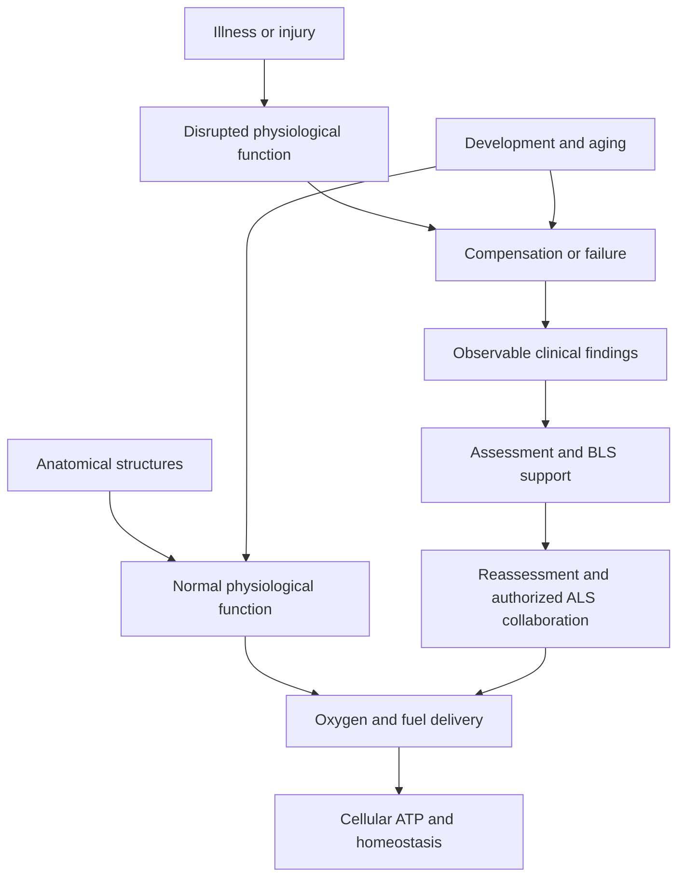
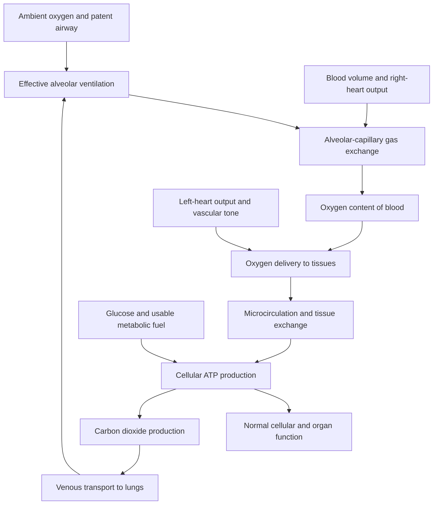
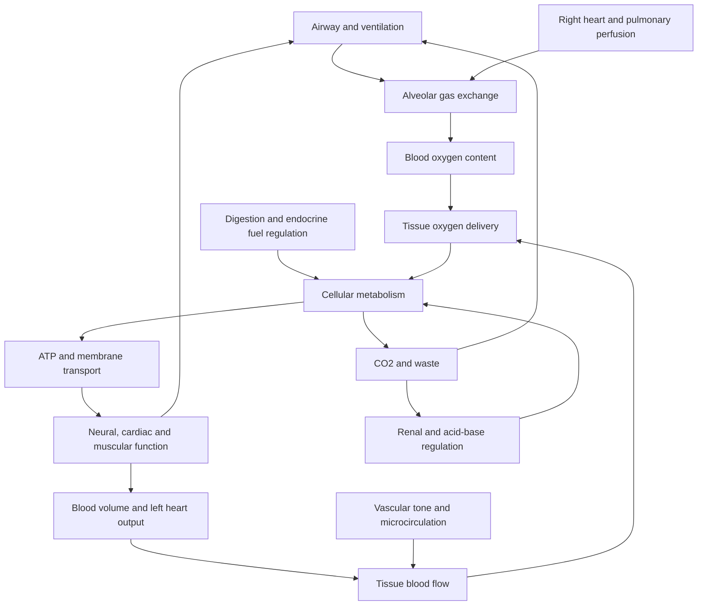

# Human Anatomy, Physiology, and Pathophysiology — PQ4RS

## Preview

The central problem of emergency care is preserving the conditions that allow cells and organs to function. Anatomy identifies the structures involved; physiology explains how they normally work; pathophysiology explains how illness or injury disrupts their function. Medical language makes these observations communicable across the healthcare team.

This integrated module links cellular metabolism, anatomical orientation, organ systems, ventilation, gas exchange, circulation, compensation, shock and injury. Pediatric development and geriatric loss of reserve change how these mechanisms appear at the bedside. Basic life support maintains essential functions while authorized advanced care adds mechanism-specific capabilities.

The relationships in the diagram are conceptual rather than a fixed treatment algorithm.

## Question

- **Q01.** How do anatomy, physiology, pathophysiology and medical terminology collectively support assessment and communication?
- **Q02.** Why does maintaining cellular energy require more than supplying oxygen?
- **Q03.** How do the musculoskeletal, nervous and endocrine systems cooperate in movement, protection and the response to stress?
- **Q04.** How do digestive, renal and reproductive physiology affect emergency assessment beyond their individual organs?
- **Q05.** Why must airway patency, ventilation, gas exchange, oxygen content and tissue perfusion be assessed as distinct but connected processes?
- **Q06.** How do cardiac output, vascular resistance and microcirculation interact during compensation and shock?
- **Q07.** How do pediatric anatomy and metabolic demand and geriatric physiological reserve change the meaning of clinical findings?
- **Q08.** How do skin integrity, thermal regulation and trauma interact with airway and circulatory emergencies?
- **Q09.** How can BLS and ALS cooperate without confusing advanced knowledge with authorization?

## Read

### Foundations of human function and emergency care

Anatomy describes the structure of the body and the relationships of its parts; physiology describes how the living body and its parts function. Knowledge of both enables EMTs to recognize normal function and potentially life-threatening deviations, understand signs and symptoms, identify affected systems, and anticipate the reasons for and effects of treatment. Because body systems interact and change with age, anatomy and physiology guide which areas to assess in adult, pediatric, and geriatric patients.

Accurate medical terminology and standardized anatomical descriptions allow clinicians to communicate the location, direction, extent and nature of illness or injury concisely in written and oral reports. These are substantive expectations of the [National EMS Education Standards][education] for anatomy, physiology and medical terminology.

#### Scope of clinical practice

- **EMT:** Foundational assessment, airway positioning, suction, bag-mask ventilation, CPR/AED, hemorrhage control, and authorized medications or monitoring remain central throughout care.
- **AEMT:** Generally adds selected vascular access, fluids, medications and airway adjuncts; capabilities differ by jurisdiction.
- **Paramedic:** Generally has broader medication, ECG interpretation, manual electrical therapy and advanced airway capabilities. Drug-assisted airway management, blood products and other specialized practices require separate system authorization where offered.

National models describe levels of practice; scientific evidence supports clinical recommendations, guidelines inform local protocols, and state law, training, licensure, credentialing, agency protocols and medical direction determine actual authorization. Preparing equipment or acquiring a tracing is not the same as performing or interpreting an intervention. Never assume a partner's presence expands your scope. [Scope][scope] · [Model guidelines][model]

### Cellular metabolism, energy and injury

The fundamental purpose of emergency care is to restore or sustain adequate perfusion so that cells receive oxygen, glucose, and other necessary substances continuously and metabolic waste products are removed. Oxygen and glucose are essential to normal cellular metabolism and function. Illness and injury can disrupt these processes; understanding the mechanisms helps EMTs recognize why signs and symptoms develop and understand the care required. The National EMS Education Standards identify applying the pathophysiology of respiration and perfusion to patient assessment and management as a core competency. [Education standards][education]

#### Energy production

Cellular metabolism (cellular respiration) breaks down fuel molecules such as glucose to produce energy. The textbook distinguishes aerobic and anaerobic metabolism according to the availability of oxygen and metabolic fuel. Glucose is the primary fuel discussed here. Oxygen is required for efficient mitochondrial energy production.

#### Aerobic metabolism

Aerobic metabolism produces ATP through a sequence of reactions in the presence of oxygen. First, glucose crosses the cell membrane and undergoes glycolysis in the cytosol, yielding pyruvic acid and a small amount of adenosine triphosphate (ATP). Glycolysis does not require oxygen. When oxygen is available, mitochondrial pathways use the products of glycolysis to produce much larger amounts of ATP. ATP supplies energy for cellular functions, including muscle contraction and energy-dependent processes.

Other products of aerobic metabolism are normally used or eliminated:

- Heat helps maintain core body temperature; increased metabolism can increase core temperature.
- Carbon dioxide (CO₂) is carried in blood to the lungs and eliminated during exhalation. Increased metabolic production of CO₂ can increase respiratory rate to facilitate its removal.
- Water is reused or excreted.

> [!NOTE]
> **Physiology clarification:** Although the original textbook calls oxygen a catalyst, it is more precisely the terminal electron acceptor in the mitochondrial electron transport chain. Glycolysis occurs in the cytosol, not in the mitochondria. [Carbohydrate metabolism][carb]

> [!NOTE]
> **ALS Connection — Carbon dioxide as a link between metabolism, circulation and breathing.** Cells produce CO₂; blood carries it to the lungs and ventilation removes it. Waveform capnography measures exhaled CO₂, including end-tidal CO₂ (EtCO₂), at the end of expiration. A change can reflect altered ventilation, circulation, metabolic production or equipment/sample problems. It is not a direct measurement of ATP or tissue oxygenation. [Airway physiology][airway]

#### Anaerobic metabolism and cellular injury

When oxygen is unavailable for adequate oxidative metabolism, glycolysis still produces pyruvic acid and a small amount of ATP. Pyruvate is converted to lactate, allowing glycolysis to continue. The much smaller energy yield can be insufficient to maintain normal cellular functions. In severe oxygen-delivery failure, acidosis and energy depletion impair enzyme function, disrupt cell membranes and contribute to cellular injury and death.

> [!CAUTION]
> **Physiology clarification:** The original anaerobic metabolism illustration places glycolysis in mitochondria; glycolysis and conversion of pyruvate to lactate occur in the cytosol. Lactate can be produced in the presence of oxygen, including during adrenergic stress, and reused as fuel. Elevated lactate does not prove cellular hypoxia, nor is lactate itself the sole cause of acidosis or cell death. The textbook's simplified aerobic/anaerobic distinction remains useful for understanding inadequate oxygen delivery. [Carbohydrate metabolism][carb] [Lactate in sepsis][lactate]

> [!NOTE]
> **ALS Connection — Shock, lactate and compensatory breathing.** When delivery of oxygen cannot meet cellular demand, ATP generation through oxidative metabolism declines. Lactate may rise; metabolic acidosis can stimulate faster/deeper ventilation. This explains why a patient with hemorrhage or severe infection may breathe rapidly even without a primary airway problem. Some advanced systems measure blood lactate as an additional severity marker; it is not a universal prehospital test or a stand-alone trigger for fluids. [Lactate in sepsis][lactate]
>
> **EMT contribution:** Describe the breathing pattern, mental status, skin findings, pulse quality, BP trend, suspected infection or blood loss, and response to care. Treat the patient, not a presumed lactate value.

#### Sodium–potassium pump and ATP depletion

Sodium (Na⁺) and potassium (K⁺) are positively charged ions. Sodium is predominantly extracellular and potassium predominantly intracellular, although both are present on either side of the cell membrane. Their gradients support specialized functions such as nerve impulse transmission and muscle contraction. Substances tend to move from higher to lower concentration; maintaining these ion gradients therefore requires active transport.

The Na⁺/K⁺-ATPase sits in the lipid bilayer between intracellular and extracellular fluid and uses ATP to move sodium out and potassium in. Its cycle proceeds as follows:

1. Intracellular sodium binds to the pump.
2. ATP transfers a phosphate to the pump, leaving ADP.
3. The pump changes shape, closing toward the intracellular side and opening toward the extracellular side, releasing sodium.
4. Extracellular potassium binds and the phosphate detaches.
5. The extracellular side closes and the intracellular side opens.
6. Potassium is released into the cell.

> [!CAUTION]
> **Physiology correction:** Three sodium ions are transported out and two potassium ions in per ATP cycle. Both movements oppose their respective concentration gradients; the original textbook incorrectly describes potassium moving inward down its gradient. [Cell membrane][cellmem]

Inadequate perfusion, oxygen delivery or glucose delivery can deplete ATP and impair the pump. Sodium accumulates inside the cell and water follows, causing swelling that may progress to membrane rupture and death. ATP-dependent transport failure is one of multiple mechanisms of cellular injury. Widespread cellular damage can lead to organ failure, reinforcing the need to maintain oxygen and glucose delivery and waste removal.

> [!NOTE]
> **ALS Connection — Electrical activity and cellular homeostasis.** Sodium and potassium gradients help establish membrane potentials and permit nerve and muscle excitation, including cardiac electrical activity. Severe metabolic disturbances can impair these processes. A paramedic may use ECG findings and the clinical history to investigate suspected electrolyte abnormalities, but an ECG cannot reliably establish or exclude an abnormal potassium concentration. Laboratory testing is usually needed. [Cell membrane][cellmem] [Model guidelines][model]
>
> Report renal disease, missed dialysis, medications, weakness, altered mental status and changes in pulse. Maintain indicated BLS care; do not infer a particular electrolyte abnormality from shock or a rhythm alone.

#### The physiological chain of perfusion

Adequate perfusion depends on a continuous relationship among ventilation, gas exchange, circulation and cellular metabolism. The eleven components identified in the textbook are:

1. Composition of ambient air.
2. Patent airway.
3. Mechanics of ventilation.
4. Regulation of ventilation.
5. Ventilation/perfusion (V/Q) ratio.
6. Transport of oxygen and carbon dioxide by blood.
7. Blood volume.
8. Pump function of the myocardium.
9. Systemic vascular resistance (SVR).
10. Microcirculation.
11. Blood pressure.

Pulmonary capillary perfusion requires adequate venous volume and right ventricular pump function. Exchange across the alveolar–capillary and capillary–cell interfaces, sufficient hemoglobin and plasma, effective cardiac output, appropriate vascular tone, and adequate minute and alveolar ventilation must all work together. A disturbance in any link can compromise cellular oxygen delivery or waste removal and ultimately reduce ATP production.

> [!NOTE]
> **ALS Connection — Identify the failing link, not just the abnormal vital sign.** Oxygen delivery depends on blood flow and oxygen content; cells also need usable fuel and functioning metabolic pathways. A patient can have an open airway yet inadequate ventilation, a normal saturation yet inadequate oxygen-carrying capacity, or a measurable blood pressure yet poor tissue perfusion. The ALS clinician uses additional monitoring and interventions to identify and address the failing link while the EMT maintains effective basic care. [Model guidelines][model] [Oxygen transport physiology][oxygenphys]
>
> **Teamwork:** Report the trend and the intervention response, not just the most recent number. For example, report increasing work of breathing despite oxygen, or worsening mentation despite an apparently acceptable BP. Early ALS consultation may be helpful for impending respiratory failure or shock, but should not delay lifesaving BLS care or transport.

The same clinical manifestation can arise from different failures in this chain. Choose care according to the suspected mechanism and response to basic care rather than the availability of a procedure. [Model guidelines][model] · [Oxygen transport][oxygenphys]

| Failed component | Example | Possible added assessment/capability |
| --- | --- | --- |
| Air entry or alveolar ventilation | Obstruction, respiratory fatigue | Capnography, advanced airway when necessary |
| Gas exchange | Pulmonary edema | Noninvasive ventilation when appropriate |
| Blood oxygen content | Hemorrhage, CO exposure | Blood products in equipped systems; toxic exposure evaluation |
| Blood flow | Shock, dysrhythmia | ECG, vascular access, cause-specific resuscitation |
| Cellular utilization | Cyanide exposure | Antidotal therapy in authorized systems |

These are illustrative pathways, not automatic treatment decisions. Continue airway support, ventilation, hemorrhage control, reassessment and transport as indicated.

In clinical care, identify scene hazards and immediately reversible BLS problems, then evaluate airway patency, ventilation, gas exchange, oxygen content, blood flow and cellular utilization as appropriate. Reassess throughout care, request additional capabilities early when needed and maintain transport progress. This relationship is a reasoning framework, not a fixed treatment sequence. [Model guidelines][model] [Airway physiology][airway]

This is a conceptual model of interacting processes, not a clinical treatment algorithm.

#### Organization of body systems

The textbook identifies ten major systems: musculoskeletal, respiratory, circulatory, nervous, endocrine, integumentary, digestive, urinary (renal), and the male and female reproductive systems.

### Medical language and clinical communication

#### Clinical and professional use

* **Definition:** The specialized language used in all fields of medicine.
* **Why It Matters for EMTs:**
  * Enables effective communication with other members of the health care team.
  * Assists in understanding terminology in textbooks, classroom lectures, continuing education sessions, and future medical education.
  * Helps develop a more professional and competent presentation.

#### Medical Words and Word Parts

* Medical words are constructed from **three kinds of word parts**: **combining forms**, **suffixes**, and **prefixes**.

Medical words can be decoded by identifying their recognizable word parts and combining their meanings.

* **Study Strategy:** Learn the individual prefixes, combining forms, and suffixes rather than memorizing every complete medical word. Break unfamiliar words into recognizable parts and consult a medical terminology text or dictionary when needed.

> [!TIP]
> **ALS Connection — Translating terminology into a handoff**
>
> Use precise observations rather than unsupported diagnostic labels. For example, “new right-sided weakness, speech difficulty, last known well 14:20” is more actionable than “possible CVA” alone. “Tachypneic with shallow breaths and declining alertness” communicates a ventilation concern better than “hypoxic” without supporting data. Include baseline, interventions, times, response and unresolved threats. Read back unfamiliar verbal orders or terms rather than assuming meaning. [Stroke 2026][stroke] · [Scope][scope]

##### Combining Form

* The **foundation** of every medical word; gives the word its essential meaning.
* **Two Parts:**
  * **Root:** Contains the core medical meaning.
  * **Combining vowel:** Usually **`o`** (sometimes **`a`**, **`e`**, or **`i`**); joins the root to another word part and makes the whole word pronounceable.
* **Formatting Rule:** Always ends with a hyphen to show it is a word part, not a complete word (e.g., `cardi/o-`). The hyphen—and sometimes the combining vowel—is deleted when joined with other word parts.
* **Construction Examples:**
  * `cardi/o-` (heart) + `-logy` (study of) = **`cardiology`** (study of the heart)
  * `peri-` (around) + `cardi/o-` (heart) + `-um` (structure) = **`pericardium`** (structure that surrounds the heart)
  * `my/o-` (muscle) + `cardi/o-` (heart) + `-al` (pertaining to) = **`myocardial`** (pertaining to heart muscle)
* **Other combining-form examples:** `pulmon/o-` (lungs), `angi/o-` (blood vessels), `bronch/o-` (bronchi of the lower airway), `cerebr/o-` (cerebrum of the brain).

##### Suffix

* A word part added to the **end** of a combining form that modifies or gives additional/specific meaning.
* **Construction Examples:**
  * `bronch/o-` (bronchus) + `-itis` (inflammation of) = **`bronchitis`** (inflammation of the bronchi or of the lower airway)
  * `hepat/o-` (liver) + `-ic` (pertaining to) = **`hepatic`** (pertaining to the liver)
  * **Multiple Combining Forms:** `laryng/o-` (larynx) + `trache/o-` (trachea) + `bronch/o-` (bronchus) + `-itis` (inflammation of) = **`laryngotracheobronchitis`** (inflammation of the larynx, trachea, and bronchi)
* **Shared-Meaning Adjective Suffixes:** **`-ac`**, **`-al`**, **`-ary`**, **`-eal`**, **`-ic`**, and **`-ous`** all mean **"pertaining to"** and typically turn the word into an adjective.

##### Prefix

* A word part that comes **before** a combining form; modifies the combining form(s), often indicating **direction, time, or orientation**.
* **Construction Example:**
  * `endo-` (within) + `trache/o-` (trachea) + `-al` (pertaining to) = **`endotracheal`** (pertaining to something within the trachea, e.g., an endotracheal tube)

#### Worked Examples of Medical Word Construction

* **`hypovolemic`** = `hypo-` (below normal) + `vol/o-` (volume) + `-emic` (pertaining to the blood) -> *Pertaining to a below-normal volume of blood*
* **`hyperglycemia`** = `hyper-` (above normal) + `glyc/o-` (glucose, sugar) + `-emia` (condition of the blood) -> *Condition of an above-normal blood glucose (sugar) level*
* **`apnea`** = `a-` (without, no) + `pne/o-` (breathing) + `-a` (condition) -> *Condition of no breathing (absence of breathing)*
* **`tachycardia`** = `tachy-` (fast) + `cardi/o-` (heart) + `-ia` (condition) -> *Condition of a fast heart rate*
* **`bradypnea`** = `brady-` (slow) + `pne/o-` (breathing) + `-a` (condition) -> *Condition of a slow breathing rate*

Word parts can also distinguish procedures and processes: `-centesis` denotes puncturing (thoracentesis involves puncture and drainage of the pleural space), `-ectomy` denotes removal (tonsillectomy), `-ostomy` denotes creation of an opening (tracheostomy), `-scope` denotes an examination instrument (laryngoscope), and `-scopy` denotes examination with an instrument (colonoscopy). `-lysis` denotes breakdown or loosening, as in glycogenolysis, the breakdown of glycogen to form glucose. These examples illustrate how terminology describes clinical processes rather than merely naming structures.

#### Common Combining Forms
* **`abdomin/o-`** — abdomen
* **`acous/o-`** — hearing, sound
* **`acr/o-`** — extremity, highest part
* **`aden/o-`** — gland
* **`adip/o-`** — fat
* **`albin/o-`** — white
* **`alg/o-`** — pain
* **`all/o-`** — other, strange
* **`andr/o-`** — male
* **`angi/o-`** — blood vessel
* **`aort/o-`** — aorta
* **`arter/o-`** — artery
* **`arthr/o-`** — joint
* **`articul/o-`** — joint
* **`audi/o-`** — hearing
* **`aur/i-`** — ear
* **`auscult/o-`** — listen
* **`bi/o-`** — life
* **`blephar/o-`** — eyelid
* **`brachi/o-`** — arm
* **`bronch/o-`** — bronchus
* **`bucc/o-`** — cheek
* **`burs/o-`** — pouch or sac, bursa
* **`calcane/o-`** — heel
* **`carcin/o-`** — cancer
* **`cardi/o-`** — heart
* **`carp/o-`** — wrist
* **`caus/o-`** — burn
* **`cephal/o-`** — head
* **`cervic/o-`** — neck, cervix
* **`chol/e-`** — bile
* **`chondr/o-`** — cartilage
* **`chrom/o-`** — color
* **`cili/o-`** — hairlike structure
* **`cis/o-`** — cut
* **`cleid/o-`** — collarbone (clavicle)
* **`cochle/o-`** — cochlea of the inner ear
* **`cor/o-`** — pupil
* **`coron/o-`** — encircling structure (like the vessels that encircle and supply the heart)
* **`corpor/o-`** — body
* **`cost/o-`** — rib
* **`cry/o-`** — cold
* **`cubit/o-`** — elbow
* **`cyan/o-`** — blue
* **`cyst/o-`** — bladder, cyst
* **`dent/i-`** — tooth
* **`derm/a-`** — skin
* **`digit/o-`** — finger or toe
* **`edem/o-`** — swelling
* **`embryon/o-`** — fetus
* **`enter/o-`** — intestines
* **`erythr/o-`** — red
* **`esthes/o-`** — sensation
* **`eti/o-`** — cause
* **`febr/o-`** — fever
* **`fibr/o-`** — fiber
* **`flex/o-`** — bend
* **`fract/o-`** — break up
* **`gastr/o-`** — stomach
* **`gnos/o-`** — knowledge
* **`gynec/o-`** — female
* **`hem/o-`** — blood
* **`hepat/o-`** — liver
* **`heter/o-`** — other, different
* **`home/o-`** — same
* **`humer/o-`** — upper arm
* **`hydr/o-`** — water
* **`hyster/o-`** — womb, uterus
* **`idi/o-`** — unknown, individual
* **`inguin/o-`** — groin
* **`lact/i-`** — milk
* **`later/o-`** — side
* **`leuk/o-`** — white
* **`ligat/o-`** — tie, bind
* **`lith/o-`** — stone
* **`medi/o-`** — middle
* **`meg/a-`** — large
* **`melan/o-`, `melen/o-`** — black
* **`men/o-`** — monthly
* **`morb/o-`** — disease
* **`mort/o-`** — death
* **`myel/o-`** — bone marrow, spinal cord
* **`my/o-`** — muscle
* **`nephr/o-`** — kidney
* **`neur/o-`** — nerve
* **`noct/o-`** — night
* **`ocul/o-`** — eye
* **`odont/o-`** — tooth
* **`o/o-`, `ov/i-`** — egg
* **`ophthalm/o-`** — eye
* **`orch/o-`** — testis
* **`osse/o-`, `oste/o-`** — bone
* **`ot/o-`** — ear
* **`palpat/o-`** — touch, feel
* **`par/o-`** — birth
* **`pariet/o-`** — wall of a cavity
* **`path/o-`** — disease
* **`ped/o-`** — child
* **`percuss/o-`** — strike, tap
* **`phag/o-`** — eat, swallow
* **`phot/o-`** — light
* **`placent/o-`** — placenta
* **`pleur/o-`** — pleura (lung membrane)
* **`pne/o-`** — breathe
* **`pneum/o-`** — lung, air
* **`pod/o-`** — foot
* **`psych/o-`** — mind
* **`purul/o-`, `pyl/o-`** — pus
* **`pyel/o-`** — pelvis (including pelvis of the kidney)
* **`pyret/o-`** — fever
* **`ren/o-`** — kidney
* **`reticul/o-`** — network
* **`retin/o-`** — retina of the eye
* **`rhin/o-`** — nose
* **`rub/o-`** — red
* **`salping/o-`** — fallopian tube
* **`sang/o-`** — blood
* **`scler/o-`** — hard
* **`seb/o-`** — sebum (oil)
* **`sect/o-`** — cut
* **`sept/o-`** — wall
* **`ser/o-`** — serum
* **`sinus/o-`** — cavity or hollow, sinus
* **`somat/o-`** — body
* **`sphincter/o-`** — sphincter muscle
* **`spir/o-`** — coil, breathe
* **`stern/o-`** — sternum
* **`steth/o-`** — chest
* **`sthen/o-`** — strength
* **`stom/o-`** — opening, mouth
* **`tact/o-`** — touch
* **`tars/o-`** — ankle
* **`tele/o-`** — distance
* **`tempor/o-`** — time, temple of the head
* **`tendon/o-`** — tendon
* **`tetr/a-`** — four
* **`tom/o-`** — cut
* **`toxic/o-`** — poison
* **`trache/o-`** — trachea
* **`trich/o-`** — hair
* **`urin/o-`** — urine
* **`vagin/o-`** — female genital canal
* **`vertebr/o-`** — vertebra
* **`viscer/o-`** — viscera (internal organs)
* **`viscos/o-`** — thick
* **`vol/o-`** — volume
* **`xen/o-`** — foreign
* **`xer/o-`** — dry

#### Common Prefixes
* **`a-`, `an-`** (without, lack of) — *apnea* (without breath), *asthenia* (lack of strength, weakness), *anemia* (lack of blood)
* **`ab-`** (away from) — *abnormal* (away from the normal)
* **`acr-`** (pertaining to extremity) — *acromegaly* (enlargement of the bones of the distal parts)
* **`ad-`** (to, toward) — *adhesion* (something stuck to)
* **`ante-`** (before, forward) — *antenatal* (occurring or formed before birth)
* **`anti-`** (against, opposed to) — *antipyretic* (against fever)
* **`auto-`** (self) — *autointoxication* (poisoning by a toxin generated within the body)
* **`bi-`** (two) — *bilateral* (two-sided)
* **`brady-`** (slow) — *bradycardia* (slow heartbeat)
* **`circum-`** (around, about) — *circumflex* (winding around)
* **`contra-`** (against, opposite) — *contralateral* (on the opposite side)
* **`di-`** (twice, double) — *diplopia* (double vision)
* **`dia-`** (through, completely) — *diagnosis* (knowing completely)
* **`dys-`** (with pain or difficulty) — *dyspnea* (difficulty breathing)
* **`e-`, `ex-`** (from, out of) — *excise* (to cut out or remove completely or surgically)
* **`ecto-`** (out from) — *ectopic* (out of place)
* **`em-`** (in) — *empyema* (pus in the chest)
* **`endo-`** (within) — *endometrium* (within the uterus)
* **`epi-`** (upon, on) — *epidermis* (outer layer of skin)
* **`eu-`** (normal, good) — *eupnea* (normal breathing)
* **`exo-`** (outside) — *exogenous* (produced outside the body)
* **`extra-`** (outside, in addition) — *extrasystole* (premature contraction of the heart)
* **`hemi-`** (half) — *hemiplegia* (paralysis of one side of the body)
* **`hyper-`** (excessive, above normal) — *hyperplasia* (excessive formation)
* **`hypo-`** (deficient, below normal) — *hypotension* (low blood pressure)
* **`in-`** (not) — *inferior* (beneath or lower)
* **`infra-`** (below) — *infrascapular* (below the scapula)
* **`inter-`** (between) — *intercostal* (between the ribs)
* **`iso-`** (equal) — *isotonic* (having equal tension)
* **`para-`** (by the side of) — *parathyroid* (beside the thyroid)
* **`per-`** (through) — *percutaneous* (through the skin)
* **`peri-`** (around) — *pericardium* (fibroserous sac surrounding the heart)
* **`poly-`** (many) — *polycystic* (containing many cysts)
* **`post-`** (after, behind) — *postpartum* (after childbirth)
* **`pro-`** (before) — *prognosis* (forecast of the outcome of a disease)
* **`quadri-`** (four) — *quadrant* (quarter of an area)
* **`retro-`** (backward) — *retroflexion* (bending backward)
* **`semi-`** (half) — *semiflexion* (partial flexion)
* **`sub-`** (below, less than) — *subacute* (moderately sharp)
* **`supra-`** (above) — *supraclavicular* (above the clavicles)
* **`sym-`** (with, together) — *symphysis* (growing together)
* **`tachy-`** (fast) — *tachycardia* (fast heartbeat)
* **`trans-`** (across) — *transfusion* (pouring across)
* **`tri-`** (three) — *tricuspid* (have three cusps)
* **`uni-`** (one) — *unilateral* (one-sided)

#### Common Suffixes
* **`-a`** (condition of) — *dyspnea* (condition of difficulty in breathing)
* **`-ac`** (pertaining to) — *insomniac* (pertaining to insomnia, or lack of sleep)
* **`-al`** (pertaining to) — *carpal* (pertaining to the wrist)
* **`-algia`** (pertaining to pain) — *neuralgia* (pain along a nerve)
* **`-ary`** (pertaining to) — *coronary* (pertaining to the blood vessels that supply the heart muscle)
* **`-blast`** (germ of immature cell) — *myeloblast* (bone marrow cell)
* **`-cele`** (tumor, hernia) — *enterocele* (hernia of the intestine)
* **`-centesis`** (puncturing) — *thoracentesis* (puncture and draining of the pleural space)
* **`-cyte`** (cell) — *leukocyte* (white cell)
* **`-eal`** (pertaining to) — *tracheal* (pertaining to the trachea)
* **`-ectomy`** (a cutting out) — *tonsillectomy* (excision of the tonsils)
* **`-emia`** (condition of the blood) — *hypoxemia* (condition of low blood oxygen)
* **`-emic`** (pertaining to the blood) — *hyperglycemic* (pertaining to high blood sugar)
* **`-gram`** (record or picture) — *electrocardiogram* (electronic picture of heart activity)
* **`-ic`** (pertaining to) — *psychic* (pertaining to the mind)
* **`-itis`** (inflammation) — *bursitis* (inflammation of the bursae)
* **`-logy`** (study of) — *ophthalmology* (study of the eye)
* **`-lysis`** (destruction or loosening) — *glycogenolysis* (breakdown of glycogen to form glucose)
* **`-meter`** (measuring instrument) — *oximeter* (instrument that measures blood oxygen saturation)
* **`-oma`** (tumor, swelling) — *neuroma* (tumor of a nerve)
* **`-osis`** (condition of) — *psychosis* (a mental disorder)
* **`-ostomy`** (creation of an opening) — *tracheostomy* (artificial opening into the trachea)
* **`-ous`** (pertaining to) — *fibrous* (pertaining to fiber)
* **`-pathy`** (disease) — *neuropathy* (disease of the nervous system)
* **`-plasty`** (surgical repair of, tying of) — *nephroplasty* (suturing of a kidney)
* **`-ptosis`** (falling, drooping) — *enteroptosis* (falling of the intestine)
* **`-rrhagia`** (excessive flow, bursting forth) — *hemorrhage* (heavy flowing of blood)
* **`-rrhea`** (flowing or discharge) — *rhinorrhea* (runny nose)
* **`-scope`** (instrument for examination) — *laryngoscope* (instrument for visualization of the larynx)
* **`-scopy`** (examination with an instrument) — *colonoscopy* (instrumental examination of the colon)
* **`-stasis`** (standing still) — *homeostasis* (remaining the same)
* **`-taxia`** (order, coordination) — *ataxia* (failure of muscle coordination)

### Anatomical orientation, positioning and regional assessment

* **Anatomical Position:** The standard reference position assumed unless otherwise indicated—patient standing erect, facing forward, arms down at sides, palms facing forward.

#### Anatomical Planes and Reference Lines

* **Sagittal (Median) Plane:** Vertical lengthwise plane dividing the body into right and left segments (not necessarily equal).
  * **Midsagittal Plane:** Divides the body into two **equal** right and left halves.
* **Frontal (Coronal) Plane:** Divides the body into front (anterior) and back (posterior) halves.
* **Transverse (Horizontal / Axial) Plane:** Parallel with the ground; divides the body into upper (superior) and lower (inferior) halves.
* **Midline:** Imaginary vertical line from the top of the head through the nose and navel to the ground between the legs; corresponds with the **midsagittal plane**.
* **Midaxillary Line:** Imaginary vertical line (in profile) from the center of the armpit down to the ankle. A side-to-side vertical line connecting both midaxillary lines forms the **frontal plane**, dividing the body into the **anterior plane** (front) and **posterior plane** (back).
* **Transverse Line:** Imaginary horizontal line through the waist. Extending front-to-back forms the **transverse plane**, dividing the body into the **superior plane** (above the waist) and **inferior plane** (below the waist).

#### Directional Terms

* **Anterior / Posterior:** Toward the front / toward the back.
* **Superior / Inferior:** Toward the head (above point of reference) / toward the feet (below point of reference).
* **Dorsal / Ventral:** Toward the back or spine (also dorsum of hand/foot) / toward the front or belly (abdomen).
* **Medial / Lateral:** Toward the midline (center) / away from the midline (left or right).
  * *Related Terms:* **Bilateral** (both sides), **unilateral** (one side), **ipsilateral** (same side), **contralateral** (opposite side).
* **Proximal / Distal:** Near the point of reference / far (distant) from the point of reference.
* **Right / Left:** Always refers to the **patient's** right and left (opposite of the viewer when facing the patient).
* **Midclavicular / Midaxillary:** Center of each collarbone (**midclavicular line** extends down the anterior thorax) / center of the armpit (**midaxillary line** extends to the ankle).
* **Plantar / Palmar:** Sole of the foot / palm of the hand.

#### Patient Positions

* **Supine:** Lying face up on the back.
* **Prone:** Lying face down on the stomach.
* **Lateral Recumbent / Recovery Position:**
  * Lying on the left or right side (upper arm tucked under head, lower arm extended).
  * *Precautions:* Position so you can easily monitor the airway; avoid excessive pressure on the chest that could impair breathing; turn the patient to the opposite side if kept in this position for **more than 30 minutes** to prevent impaired blood flow to the lower arm.
* **Fowler's Position:** Lying on the back with the upper body elevated at a **45° to 60° angle**.
* **Semi-Fowler's Position:** Lying on the back with the upper body elevated at an angle **less than 45°**.
* **Trendelenburg Position:** Lying on the back with legs elevated higher than the head and body on an inclined plane (head down, legs up).
  * *Clinical Update:* **No longer recommended for shock**—gravity pushes abdominal organs against the diaphragm (impairing breathing) and may increase intracranial pressure in head-injured patients.
* **Shock Position (historical):** Lying on the back with only the feet and legs elevated approximately **12 inches**.
  * *Clinical Update:* **No longer recommended for shock** (no evidence of effectiveness) and **contraindicated in suspected spinal injury**. May still be used for a simple faint (syncopal episode) or vasodilation causing decreased blood pressure.

> [!CAUTION]
> **Clinical clarification — Positioning is physiology, not a fixed rule**
>
> Upright positioning can reduce the work of breathing; a supine position may be better tolerated in hypoperfusion. The 2024 AHA/Red Cross first-aid guidance allows temporary leg elevation in selected nontraumatic shock situations, but evidence of benefit is limited and transient. This differs from the textbook's categorical statement; it does not justify Trendelenburg or routine leg elevation in trauma. The fixed 30-minute side-switch instruction is not a universal contemporary EMS rule. Reassess airway, breathing, pressure areas and perfusion; do not roll a patient with suspected spine injury solely because a timer expired. If breathing becomes inadequate, prioritize ventilation or resuscitation as indicated. [First aid][firstaid] · [SMR][smr]

#### Body Regions and External Landmarks

##### Regions of the Body

* **Head & Neck:** Cranial region (upper head), occipital region (back of head), cervical region (neck).
* **Anterior Torso / Trunk:** Thoracic region (chest), umbilical region (belly button), inguinal region (pelvis), genital region (crotch).
* **Posterior Torso / Trunk:** Inferior angle of scapula (inner lower point of shoulder blade), lumbar region (lower back), flank (hips), iliac crest (meeting of hips and buttocks), sacral region (base of spine), buttocks.
* **Upper Extremity:** Arm (upper arm), cubital region (elbow), forearm (lower arm).
* **Lower Extremity:** Thigh / femoral region (upper leg), popliteal region (behind the knee), leg (lower leg), plantar aspect of foot (bottom of foot), dorsum of foot (top of foot).

##### Anterior Chest Landmarks

* **Midsternal line:** Center vertical line through the sternum.
* **Trachea:** Throat region.
* **Suprasternal notch:** Depression between the trachea and clavicle.
* **Manubrium:** Upper portion of the sternum, connected to the body of the sternum by the **Angle of Louis**.
* **Sternum:** Breastbone.
* **Xiphoid process:** Lower tip of the sternum.
* **Costal margin:** Lower edge of the ribcage.
* **Intercostal space:** Area between the ribs.
* **Acromion:** Edge of the scapula at the shoulder.
* **Clavicle:** Collarbone.
* **Anterior axillary line:** Vertical line along the coronal plane at the front of the armpit/body.

##### Posterior Chest Landmarks

* **Midspinal line:** Center vertical line through the spine.
* **Midscapular line:** Vertical line through the scapula.
* **Scapula:** Shoulder blade (with **inferior angle of scapula** at its bottom tip).
* **Spinous process:** Posterior bony protrusion from a vertebra.

##### Lateral Chest Landmarks

* **Anterior axillary line:** Front edge of the axilla.
* **Midaxillary line:** Center of the axilla.
* **Posterior axillary line:** Back edge of the axilla.

##### Topographic Anatomy

* **Anterior Skeletal Landmarks:** Cranium (forehead), eye orbit (eye socket), temporomandibular joint (connects jaw to skull), maxilla (upper jawbone), mandible (lower jawbone), clavicle, humerus (upper arm bone), sternum, xiphoid process, radial shaft and ulnar shaft (forearm bones), femur (upper leg bone), greater trochanter (outer top of femur), symphysis pubis, patella (kneecap), tibia (medial lower leg bone), fibula (lateral lower leg bone), malleolus (protruding ankle bone).
* **Posterior Landmarks:** Mastoid process (back of skull behind the ear), scapula, iliac crest, coccyx (tailbone), thigh, leg, foot, calcaneus (heel bone).
* **Internal Organs (Solid vs. Hollow):**
  * *Solid organs:* Lung, heart, liver, spleen, pancreas, kidney.
  * *Hollow organs:* Gallbladder, stomach, bladder, small intestine, large intestine.
  * *Airway landmark:* Larynx (voice box).

> [!NOTE]
> **ALS Connection — Chest landmarks and diagnostic equipment**
>
> A 12-lead ECG records electrical activity from multiple perspectives using electrodes placed on standardized landmarks. Misplaced leads can distort the tracing and imitate disease. The EMT may locate landmarks, prepare skin, help position the patient or acquire a tracing if authorized; the paramedic or receiving clinician interprets it in context. Report chest wounds and breath sounds using patient-side orientation and precise axillary or intercostal landmarks. These landmarks also help ALS clinicians communicate about suspected pleural pathology and advanced procedures; recognition does not authorize invasive chest procedures. [ACS guideline][acs] · [Scope][scope]

#### Body Cavities

* **Cranial cavity:** Houses the brain.
* **Spinal cavity:** The source initially describes this cavity as housing the spine; the spinal cord is the structure enclosed within the vertebral column.
* **Thoracic cavity:** Upper chest.
* **Diaphragm:** Muscle separating the thoracic and abdominal cavities (center chest).
* **Abdominal cavity:** Upper belly.
* **Pelvic cavity:** Pelvis.
* **Abdominopelvic cavity:** Combined lower belly and pelvis.

#### Abdominal Quadrants

*Divided by imaginary horizontal and vertical lines intersecting at the **umbilicus (navel)**:*

* **Right Upper Quadrant (RUQ):** Majority of liver, right kidney, colon, small portion of pancreas, gallbladder, small intestines.
* **Left Upper Quadrant (LUQ):** Small portion of liver, spleen, left kidney, stomach, colon, majority of pancreas, small intestines.
* **Right Lower Quadrant (RLQ):** Colon, small intestines, right ureter, appendix, right ovary and right fallopian tube (females).
* **Left Lower Quadrant (LLQ):** Colon, small intestines, left ureter, left ovary and left fallopian tube (females).
* **Midline Area:** Bladder, uterus (females), prostate (males).

> [!NOTE]
> **ALS Connection — Abdominal findings and occult hemorrhage**
>
> Quadrant tenderness, guarding, distention, mechanism, and evolving vital signs help identify concern for internal injury, but pain location does not prove which organ is injured. Blood loss from a solid organ or vascular injury may occur without external bleeding; hollow-organ injury can also be serious. AEMT/paramedic vascular access may support resuscitation where appropriate, but it cannot repair internal bleeding. Report mechanism, location, perfusion and changes; arrange timely trauma evaluation rather than delaying for procedures. [Field triage][triage] · [Model guidelines][model]

### Development, aging and physiological reserve

#### Pediatric development

* Most pediatric emergencies are managed similarly to adult emergencies, with specific modifications based on anatomic and physiologic development.
* **Children with Special Health Care Needs:** Anatomic and physiologic differences may vary significantly from the norm—**using the caretaker to help with the assessment is critical**.
* **Primary Focus:** The most significant anatomic and physiologic differences typically concern the **airway**.

Children have faster baseline heart and respiratory rates, lower blood pressure, smaller blood volume, and a greater risk of dehydration. Mottled extremities can reflect cold exposure because of immature temperature control, rather than necessarily indicating poor perfusion. The tracheal and esophageal openings are closer together. The relatively large head, small airway and unstable temperature regulation affect assessment and management.

#### Geriatric demographics and assessment

* **Fastest-Growing Population:** People over **age 65** are the fastest-growing segment of the U.S. population.
* **U.S. Census Bureau Statistics:**
  * **2019:** Approximately **54.1 million** older adults (65 years of age or older) living in the United States, comprising approximately **16%** of the total population.
  * **2040 (Projected):** Estimated **81 million** older adults, comprising approximately **22%** of the population.
* **Impact on EMS:**
  * Many EMS calls today already involve geriatric patients.
  * **By 2030 (Projected):** Estimated that **more than 50%** of EMS calls will be for elderly patients.
  * EMTs must understand the characteristics of geriatric patients and how to tailor assessment and treatment to their special needs.

#### Clinical Considerations & Altered Presentation

* **Increased Vulnerability:** Elderly patients differ from younger counterparts and are at **greater risk for nearly all types of injuries and illnesses**.
* **Physiologic Changes:** Present with different signs and symptoms due to the **changing physiology** of geriatric body systems.
* **Comorbidities & Polypharmacy:** Geriatric patients often have **one or more coexisting long-term conditions** that may require **multiple medications**.
* **Assessment Challenge:** All of these factors combined can **mask or change the presentation** of the current emergency problem.

> [!TIP]
> **ALS Connection — Geriatric assessment and baseline function**
>
> Ask the patient or caregiver what is normal for cognition, mobility, breathing and BP; establish what changed and when. Obtain the medication list, recent doses, allergies and anticoagulant use. Older adults may have important injuries after low-energy mechanisms and atypical presentations. The textbook's demographic counts and projections are historical textbook figures, not updated population estimates. [Field triage][triage] · [Model guidelines][model]

#### Physiologic Reserve and Normal Aging

* **Normal Aging Onset:** Changes in cellular, organ, and system functioning typically begin at approximately **age 30**. Diet, exercise, and health care may slow aging, but cannot stop it entirely.
* **Chronic vs. Acute Illness:**
  * **Chronic:** Long-term or progressing gradually; people are living longer with multiple chronic diseases in varying stages of development.
  * **Acute:** Severe, with rapid onset; fewer physiologic reserves in the aging body contribute to acute medical and traumatic emergencies.
* **Key Principle:** Illness is common among the elderly, but **not** an inevitable part of aging. Normal physiologic aging changes are not caused by disease, but any disease or injury will worsen—or be made worse by—these changes.

Reduced immune defenses and an often absent fever can make infection less apparent. Clinical depression and altered mental status are common concerns, but acute mental-status changes require assessment rather than attribution to age.

### Musculoskeletal structure, movement and injury

* Consists of the bony framework (skeleton), **ligaments** (connect bone to bone), layers of muscles, **tendons** (connect muscle to bone), and other connective tissues.
* Must be strong (support/protection), jointed (motion), and flexible (withstand stress).

#### The Skeletal System

* **Four Functions:**
  1. Giving the body its shape
  2. Protecting vital internal organs
  3. Allowing for movement
  4. Storing minerals and producing blood cells
* **Six Basic Components:** Skull, spinal column, thorax, pelvis, upper extremities, and lower extremities. The source describes these components individually but does not explicitly classify them into axial and appendicular divisions.
* **Bone Classifications:** Long, short, flat, or irregular.
* **Anterior Skeleton, top to bottom:** Skull, maxilla, mandible, cervical vertebrae, scapula, sternum, humerus, ribs, thoracic vertebrae (T11), lumbar vertebrae (L4), ulna, radius, ilium, sacrum, coccyx, pubis, carpals, metacarpals, hand phalanges, ischium, femur, patella, tibia, fibula, tarsals, metatarsals, foot phalanges.

##### The Skull

* Rests atop the spinal column; houses and protects the brain; divided into the **cranium** and **face**.
* **Cranium:** Forms the top, back, sides, and forehead using flat interlocking bones: **occipital**, **two parietal**, **two temporal**, and **frontal**.
  * *Structure:* Thick, tough outer layer; thinner, more brittle inner layer.
  * *Pathophysiology Pearl:* Because the cranium cannot expand, bleeding and swelling compress brain tissue, increasing intracranial pressure and causing malfunction, unresponsiveness, or death. Bony projections/ridges on the anterior and inferior inner surfaces commonly lacerate the brain.
* **Face:** 14 bones between brow and chin (**13 immovable/interlocking** + **1 movable**):
  * *Immovable:* **Orbits** (eye sockets), **nasal bones** (bridge/bed of nose), **maxillae** (fused upper jaw), **zygomatic bones** (cheekbones).
  * *Movable:* **Mandible** (lower jaw)—horseshoe-shaped, largest and strongest facial bone, moves freely on hinge joints.

> [!NOTE]
> **ALS Connection — Brain injury and secondary insults**
>
> A head injury may increase intracranial pressure and compromise cerebral perfusion. Hypoxemia and hypotension can compound injury. ALS clinicians may use capnography during ventilation and evaluate hemodynamic support; advanced airway placement itself can worsen both problems if physiology is not protected. EMT priorities are airway patency, effective ventilation when needed, baseline and serial mental status, pupils, vital signs and prompt transport. A normal initial conversation does not exclude evolving injury. [Trauma airway][traumaair]

##### The Spinal Column (Vertebral Column)

* Principal support system of the body; composed of **33 irregularly shaped vertebrae** bound by strong ligaments, housing the spinal cord.
* **Textbook assessment distinction:** Spinal **cord** damage may produce **loss of sensation or movement distal** to the injury; the textbook describes spinal **column (vertebrae)** injury as usually producing **only pain**. This is not a reliable exclusion rule; see the clinical clarification below.
* **Intervertebral Disks:** Fluid-filled pads of tough elastic cartilage between vertebrae acting as shock absorbers; highly susceptible to twisting, grinding, or improper lifting injuries.
* **Five Divisions (superficial to deep):**
  1. **Cervical spine (C1–C7):** Neck; 7 vertebrae; **most prone to injury**.
  2. **Thoracic spine (T1–T12):** Upper back; 12 vertebrae; 12 pairs of ribs attach posteriorly for support.
  3. **Lumbar spine (L1–L5):** Lower back; 5 vertebrae; **least mobile** (most lower-back injuries involve muscles, not vertebrae).
  4. **Sacral spine / Sacrum (S1–S5):** 5 fused vertebrae forming the rigid posterior wall of the pelvis.
  5. **Coccyx (tailbone):** 4 fused vertebrae without typical vertebral protrusions.

> [!WARNING]
> **Clinical clarification — Spine pain and neurologic findings**
>
> A vertebral injury can occur without pain, and an initially intact neurologic exam does not clear the spine. High cervical injury can impair the diaphragm and sympathetic pathways. Hypotension with an unexpectedly slow pulse may raise concern for neurogenic shock, but hemorrhage must still be considered. Report motor and sensory findings, mechanism and trends; use protocol-directed spinal motion restriction (SMR), not routine prolonged rigid backboard transport. Do not force alignment against pain or resistance. [SMR][smr] · [Trauma airway][traumaair]

##### The Thorax (Chest)

* Composed of the ribs, **sternum** (breastbone), and thoracic spine.
* **Ribs (24 total / 12 pairs):** Semiflexible arches attached posteriorly to T1–T12:
  * *True ribs (pairs 1–7):* Attach directly to the sternum via cartilage.
  * *False ribs (pairs 8–12):* Pairs 8–10 attach to the ribs above via cartilage; pairs 11–12 (**floating ribs**) have no anterior attachment to the sternum.
* **Sternum:** Flat anterior chest bone with three parts: **manubrium** (superior; clavicles attach here), **body** (middle; ribs attach here), and **xiphoid process** (inferior tip).

##### The Pelvis

* Doughnut-shaped structure (includes sacrum and coccyx) forming the floor of the abdominal cavity; supports intestines and houses the **bladder, rectum, and internal reproductive organs**.
* **Key Bones:** **Iliac crests** (lateral "wings"), **pubis** (anterior/inferior), **ischium** (posterior/inferior).

##### The Lower Extremities

* **Hip Joint:** Pelvic socket (**acetabulum**) + rounded head of the **femur** (thighbone).
* **Knee Joint:** Hinged joint (angular movement only) formed by distal femur and proximal tibia; protected anteriorly by the triangular **patella** (kneecap).
* **Lower Leg:**
  * **Tibia (shin):** Anterior/medial weight-bearing bone; distal end forms the **medial malleolus** of the ankle.
  * **Fibula:** Lateral bone parallel to tibia; distal end forms the **lateral malleolus**.
* **Foot:** **Tarsals** (proximal foot, including the **calcaneus** / heel bone), **5 metatarsals** (body of foot), and **14 phalanges** (2 in big toe, 3 in each other toe).

##### The Upper Extremities

* **Shoulder Girdle:** **Clavicle** (collarbone) + **scapula** (shoulder blade); tip is the **acromion**.
* **Arm:** **Humerus** (largest upper extremity bone); head fits into shallow scapular cup forming a ball-and-socket joint (**most freely movable and easily dislocated joint in the body**).
* **Elbow & Forearm:** Hinged joint formed by distal humerus + proximal **radius** (lateral, thumb side; upper two-thirds sheathed in muscle, lower third forms most of wrist joint) and **ulna** (medial, little-finger side; palpable along length; **olecranon** forms bony prominence of elbow).
* **Wrist & Hand:** **8 carpals** (wrist), **metacarpals** (hand structural strength), and **phalanges** (3 per finger, 2 per thumb).

##### The Joints

* Place where one bone connects to another: **immovable** (skull plates), **slightly movable** (vertebrae), and **freely movable** (hip, elbow, knee).
* **Seven Joint Movements:**
  * **Flexion:** Bending toward the body / decreasing angle.
  * **Extension:** Straightening away from the body / increasing angle.
  * **Abduction:** Movement away from the midline.
  * **Adduction:** Movement toward the midline.
  * **Circumduction:** Combination of the four above (conical / 360° movement, e.g., shoulder).
  * **Pronation:** Turning forearm so palm faces backward.
  * **Supination:** Turning forearm so palm faces forward.
* **Six Types of Freely Movable Joints (two bones meeting at a joint cavity with synovial membrane, articular cartilage, and wrapping ligaments):**
  1. **Ball-and-socket:** Widest range of motion (flexion, extension, abduction, adduction, rotation); e.g., **shoulders, hips**.
  2. **Hinged:** Flexion and extension along one plane; e.g., **elbow** (forward), **knee** (backward), **fingers**.
  3. **Pivot:** Turning/rotating motion on same plane; e.g., **C1–C2 (head/neck)**, **wrist**.
  4. **Gliding:** Simplest movement, one bone sliding across another; e.g., **small bones of hands and feet**.
  5. **Saddle:** Limited movements along perpendicular planes; e.g., **ankle**.
  6. **Condyloid:** Modified ball-and-socket allowing limited motion in two directions (up/down, side-to-side, no full rotation); e.g., **wrist**.

> [!CAUTION]
> **Clinical clarification — Joint classification**
>
> The thumb carpometacarpal joint is a classic saddle joint; the talocrural ankle is principally a hinge joint, and forearm pronation/supination occurs at radioulnar pivot joints rather than the wrist proper. The textbook's ankle and wrist examples are retained for comparison. In the field, describe deformity, distal circulation, sensation and movement rather than attempting to demonstrate a painful joint's full range. [Joint anatomy][joints]

##### Bone Injury

* **Fracture:** Loss of continuity in bone structure; sharp fragments can injure nerves, vessels, and connective tissue.
* **Internal Bleeding Risk:** Bones are living tissue with a rich arterial/venous network extending through compact bone, marrow cavity, and spongy bone.
  * **Fractured femur:** Can lose **1,000 to 2,000 mL** of blood.
  * **Pelvic fracture:** Can lose the patient's **entire blood volume (~5 L, or 70–80 mL/kg)** into the pelvic cavity -> severe shock.

> [!IMPORTANT]
> **ALS Connection — Fractures, bleeding and analgesia**
>
> A femoral or pelvic fracture can produce major concealed blood loss; the textbook's volumes illustrate potential severity rather than predicted losses in a specific patient. EMT hemorrhage control, appropriate splinting, warmth and serial distal neurovascular checks support ALS care. Paramedic analgesia may improve comfort, but opioids can impair ventilation and lower blood pressure; report baseline and post-treatment breathing, alertness and perfusion. Vascular access or resuscitation may be considered without postponing definitive hemorrhage control. [Field triage][triage] · [Model guidelines][model]

> [!CAUTION]
> The chapter’s classification of the lumbar spine as the least mobile region and its simplified descriptions of joint motion are textbook statements. The supplied material does not independently substantiate the lumbar mobility comparison; do not use it to exclude injury.

#### The Muscular System

* Muscle cells (**fibers**) contract (shorten and thicken) when stimulated by nerve impulses.
* **Major Skeletal Muscles, top to bottom:** Masseter (jaw), sternocleidomastoid (neck), deltoid (shoulder), pectoralis major (chest), triceps (posterior upper arm), biceps (anterior upper arm), rectus abdominis (central abdomen), external oblique (lateral abdomen), sartorius (lateral upper to medial thigh), adductor femoris (medial upper thigh), quadriceps femoris (anterior/medial upper leg), vastus medialis (medial lower thigh to knee), gastrocnemius (calf), tibialis anterior (shin).
* **Three Types of Muscle:**
  1. **Skeletal (Voluntary) Muscle:** Controlled consciously by brain/nervous system; thick, spaced fibers; attached to bone by tendons (or skin/cartilage/organs); broad/flat in trunk, long/spindle-shaped in extremities.
  2. **Smooth (Involuntary) Muscle:** Tapered fibers wound together; automatic rhythmic, wavelike movements; found in walls of tubelike organs, ducts, respiratory tract, intestines, urinary system, and blood vessels.
     * *Vessel Control:* **Vasoconstriction** decreases vessel diameter -> increases resistance -> **increases pressure**. **Vasodilation** increases vessel diameter -> decreases resistance -> **decreases pressure**.
  3. **Cardiac Muscle:** Found only in the heart; striated like skeletal muscle but involuntary like smooth muscle in a unique cellular meshwork; exhibits **automaticity** (generates electrical impulses on its own even if disconnected from the CNS); supplied by **coronary arteries** and cannot tolerate even brief interruptions in blood supply.

A child’s skeletal development and an older adult’s reduced bone and muscle reserve change the consequences of the same mechanism of injury. The following differences extend the structural and injury principles above.

#### Pediatric head, spinal alignment and assessment

* **Proportionally larger head:**
  * Predisposes children to head injuries in falls, motor vehicle crashes, and other trauma.
  * **Large occiput (back of head):** Causes the neck to flex forward when supine on a flat surface.
  * **Airway/Spinal Alignment Fix:** Place a small amount of **padding behind the shoulders** to keep the head straight and maintain neutral alignment of the airway and cervical spine.
    * Without shoulder padding, the head may tilt forward when supine.
    * Appropriate shoulder padding helps maintain neutral alignment.
  * Padding is necessary until the body proportionately catches up at approximately **8 to 9 years of age** (adult dimensions reached at about **age 10**).
* **Head support:** Infants younger than **6–7 months** typically cannot fully support their own heads—always support a baby's head when picking them up.
* **Fontanelles ("soft spots"):** Incomplete closure of skull plates; do **not** press on or poke into the fontanelle:
  * **Anterior fontanelle:** Typically closes between **12 and 18 months** of age.
  * **Posterior fontanelle:** Closes by **3 months** of age.
* **Prehospital Fontanelle Assessment Limitations:**
  * Assessing whether a fontanelle is sunken (dehydration) or bulging (increased intracranial pressure) is **not accurate** and is difficult in the prehospital setting.
  * *Increased ICP:* More important to recognize a **decreased mental status**. (Although the skull is not fully fused, **acute** swelling over hours to days cannot be accommodated by the **dura**, resulting in brain compression.)
  * *Dehydration:* More important to recognize **tachycardia**, **mottling**, and caregiver reports of **decreased tear production and urination (fewer wet diapers)**.

#### Pediatric extremities

* **Greenstick fractures:** Children's extremity bones fracture more often by **bending and splintering**.
* **Motor development:** Progresses from **head to toes** (the head is one of the first things an infant controls); lack of coordination leads to frequent injuries from falls.

#### Aging bones, joints and muscles

* Osteoarthritis is common.
* **Osteoporosis:** Loss of bone minerals -> brittle bones, high fracture risk, and slowed healing (resultant injury/immobility can lead to illness and death).
* **Kyphosis:** Narrowing of intervertebral disks causes characteristic spinal curvature (seen in **2 out of 3 elderly patients**, most pronounced in **thoracic vertebrae**); complicates **spine motion restriction (SMR)**—requires additional padding to fill voids on a backboard .
* **Joints & Muscle Mass:**
  * Thinning articular cartilage, thickening synovial fluid, and weakening ligaments -> reduced range of motion, pain, and increased joint injury risk.
  * Progressive loss of **skeletal muscle mass** -> general weakness, worsening balance, and higher risk of falls and slow-healing fractures.

> [!CAUTION]
> **Clinical clarification — Kyphosis and spinal motion restriction**
>
> Respect the patient's usual spinal curvature and avoid forcing a flat position. Use padding and approved transport equipment to minimize movement and pressure injury. A long backboard may assist extrication but is not routinely necessary for continued transport; select SMR according to assessment and protocol. [SMR][smr]

### Nervous system, consciousness and autonomic regulation

#### Basic Functions

1. Controlling and maintaining consciousness and awareness
2. Transmitting sensory stimuli to the brain
3. Controlling motor function (voluntary and involuntary movement)
4. Controlling body functions via the autonomic nervous system

#### Structural Divisions

* **Central Nervous System (CNS):** Brain + spinal cord, enclosed by three protective membranes (**meninges**) and cushioned by **cerebrospinal fluid (CSF)**.
  * **Brain (~3 lbs):** Rich blood supply, high $O_2$ need, **does not store glucose** (requires constant supply).
    * *Cerebrum:* Outermost, largest part; controls sensation, thought, speech, associative memory, and conscious motion.
    * *Cerebellum ("small brain"):* Posterior/inferior cranium; coordinates muscle activity, balance, and partial muscle contraction.
    * *Brainstem:* Contains mesencephalon (midbrain), **pons** (bridge), and **medulla oblongata** (houses the **respiratory center**, **cardiac center**, and **vasomotor center** for BP/vessel tone).
    * *Pathophysiology Pearl:* The **blood–brain barrier** is a specialized capillary network allowing only select substances (like glucose) into the brain.
  * **Spinal Cord (~18 inches):** Extension of brainstem conducting nerve impulses.
* **Peripheral Nervous System (PNS):** Nerves outside brain/spinal cord.
  * **Afferent nerves:** Carry **sensory** info from body -> CNS.
  * **Efferent nerves:** Carry **motor** info from CNS -> body (e.g., reflexive withdrawal of a finger from a candle flame).

#### Functional Divisions

* **Voluntary (Somatic) Nervous System:** Controls skeletal (voluntary) muscles.
* **Autonomic Nervous System:** Automatic control of smooth muscles and glands; two opposing divisions:
  * **Sympathetic ("fight-or-flight"):** Activated by stressors (trauma, blood loss, fright) -> decreases gastric juices and saliva, increases sweat, secretes epinephrine, constricts most blood vessels, increases heart rate, dilates bronchioles, dilates pupils.
  * **Parasympathetic:** Returns body to normal / depresses function -> increases gastric juices and saliva, dilates most blood vessels, decreases heart rate, constricts bronchioles, constricts pupils.
  * *Pathophysiology Pearl:* Injury triggers an immediate nerve-based sympathetic response, followed within minutes by sustained hormonal release of **epinephrine and norepinephrine**.

#### Consciousness & Unconsciousness

* Controlled by the **cerebral hemispheres** (right and left sides of cerebrum) and the **reticular activating system (RAS)** (nerve network in the brainstem acting as the "wake/sleep" or "on/off" center).
* **Conscious:** Requires an intact **RAS + at least one cerebral hemisphere**.
* **Unconscious:** Occurs if **either the RAS OR both cerebral hemispheres** are damaged/dysfunctional.

> [!NOTE]
> **ALS Connection — Altered consciousness and neurologic assessment**
>
> Hypoxia, hypoglycemia, stroke, seizures, drugs and shock can all disrupt brain function. An EMT's baseline AVPU/GCS as trained, focal findings, last-known-well time, glucose if authorized, witness history and serial changes help distinguish possibilities. ALS may evaluate reversible causes and administer targeted medication, but a field stroke scale cannot determine ischemic versus hemorrhagic stroke. Protect the airway, avoid oral intake when swallowing is unsafe, and follow regional stroke routing; do not delay transport for nonessential testing. [Stroke 2026][stroke] · [Model guidelines][model]

#### Neurologic and sensory changes with aging

* **Structural Brain Changes:**
  * Decreased brain mass and weight -> increased **cerebrospinal fluid (CSF)** filling extra skull space.
  * Degenerating neurons accumulate waste products, forming abnormal **plaques and tangles** -> impaired overall brain function.
* **Neuron Degeneration & Reflexes:**
  * Neurons begin degenerating as early as the **mid-20s** -> slowed reflexes, impaired perception of body position, and unsteadiness (combined with musculoskeletal changes, drives high fall risk).
* **Regulatory Center Decline:** Brainstem and regulatory changes alter perception of **hunger and thirst** and impair regulation of **breathing rate/depth, heart rate, blood pressure, and core body temperature** during stress.
* **Sensory Perception Decline:** Diminished auditory, visual, olfactory (smell), touch, pain, hot/cold, and body position senses.
  * *Vision:* Decreased **visual acuity** (clarity), **visual accommodation** (focusing at varying distances), color discrimination, night/dark vision, and tear production (eye irritation); contributes to falls and medication dosage errors.
  * **Common Age-Related Eye Diseases:**
    * **Cataracts:** Clouding (opacity) of the eye's lens, obstructing light from reaching the **retina**.
    * **Glaucoma:** **Second leading cause of blindness** in the U.S.; increased intraocular pressure damages the optic nerve.
    * **Macular degeneration:** Impairs vision in the **center of the visual field** (reading, recognizing faces), though peripheral vision may remain intact.
    * **Retinal detachment:** Retina separates from supportive tissue behind it, preventing conversion of light to nerve impulses (local or complete vision loss/blindness).
  * *Assessment Tip:* Diminished vision and hearing (separately or combined) frequently lead to falls, motor vehicle crashes, and other injuries.
* **Hearing — Presbycusis:**
  * Age-related hearing loss: **progressive, bilateral, and symmetrical**, most marked at **higher frequencies**; difficulty differentiating close vs. background noise.
  * *Communication Tip:* Verify the patient is wearing their **hearing aid** and that it is **turned on**; **do not talk loudly** (causes distortion).
* **Neuropathy:**
  * Derangement or abnormal function of motor, sensory, and autonomic nerve tracts (**diffuse** affecting many tracts, or **focal** affecting a single nerve).
  * *Findings:* Pain, numbness, tingling, swelling, muscle weakness, or **absent pain perception**.
  * *Clinical Impact:* Can mask classic emergency presentations—e.g., diabetic patients may have a **silent myocardial infarction** without chest pain; many diabetics develop **peripheral neuropathy** affecting hands and feet.

> [!NOTE]
> **ALS Connection — Baseline cognition, falls and silent ischemia**
>
> Do not assume new confusion is dementia or absence of pain means no injury. An acute change warrants assessment for oxygenation, glucose, stroke, infection, trauma and medication effects as appropriate. Anticoagulants and head impact should be communicated early, even when external injury seems minor. An older patient with weakness, dyspnea or syncope may warrant evaluation for acute coronary syndrome despite no chest pain. [Field triage][triage] · [ACS guideline][acs] · [Stroke 2026][stroke]

### Endocrine regulation and metabolic reserve

The immediate neural response to stress and the sustained hormonal response work together to maintain perfusion and energy availability. Receptor effects help explain the changes in pulse, skin, airway caliber and vascular tone described in the respiratory and shock discussions.

* Ductless glands that secrete **hormones** directly into the bloodstream to regulate body functions:
  * **Pineal gland** (brain, superior/posterior to thalamus): Produces **melatonin** (regulates circadian rhythm; inhibits reproductive system).
  * **Pituitary gland** (base of brain): **"Master gland"**—regulates growth, thyroid, parathyroid, pancreas, gonads, fatty acid/protein metabolism, blood sugar, and urinary excretion.
  * **Thyroid gland** (anterior neck): Regulates metabolism, growth/development, and nervous system activity.
  * **Parathyroid glands** (behind thyroid): Regulate calcium and phosphorus metabolism in bones/blood.
  * **Thymus gland** (neck, superior to heart): Secretes **thymosin** (immune system development/maturation).
  * **Adrenal glands** (atop kidneys; cortex + medulla): Secrete **epinephrine** and **norepinephrine**, postpone muscle fatigue, increase sugar storage, control kidney function, and regulate salt/water metabolism.
  * **Pancreas / Islets of Langerhans** (between kidneys/below stomach): Produce **insulin** (allows glucose into cells) and **glucagon** (raises blood glucose).
  * **Gonads** (ovaries in lower abdomen, testes in genital area): Govern reproduction and sex characteristics.

#### Epinephrine & Norepinephrine Receptor Effects

* **$\alpha_1$ (Alpha-1):** Causes **vasoconstriction** (shunts blood from skin to core -> **pale, cool skin**) and stimulates sweat glands (**moist/clammy skin**).
* **$\alpha_2$ (Alpha-2):** Regulates the release of $\alpha_1$.
* **$\beta_1$ (Beta-1):** Affects the **heart**—increases heart rate, increases force of contraction, and speeds electrical conduction.
* **$\beta_2$ (Beta-2):** Causes **smooth muscle dilation**, especially in **bronchioles** and some blood vessels.
* **Hormone Profiles:**
  * **Epinephrine (adrenaline):** Activates **all four** ($\alpha_1, \alpha_2, \beta_1, \beta_2$); used in severe allergic reactions to reverse vasodilation and bronchoconstriction.
  * **Norepinephrine:** Primarily **$\alpha_1$ and $\alpha_2$** (trace $\beta_1/\beta_2$) -> effects mainly seen in blood vessels and skin (pale, cool, clammy).

> [!CAUTION]
> **Clinical clarification — Adrenergic receptors and medication effects**
>
> Alpha-1 causes vascular smooth-muscle contraction; alpha-2 commonly limits presynaptic norepinephrine release (not release of alpha-1 itself). Sweating is primarily mediated by sympathetic cholinergic fibers, not direct alpha-1 stimulation. Norepinephrine has clinically meaningful beta-1 activity as well as strong alpha effects, with relatively little beta-2 effect. [Autonomic physiology][autonomic]
>
> **ALS medication connections:** Epinephrine is an adrenergic agonist used under distinct protocols for anaphylaxis and resuscitation; it can increase heart rate and vascular tone and relax bronchial muscle. Albuterol is a predominantly beta-2 agonist that can relieve bronchospasm but not upper-airway obstruction; tremor and tachycardia may occur. Norepinephrine is a vasopressor used by some paramedic systems for selected shock states, not a substitute for hemorrhage control. Report breathing, pulse, BP and clinical response. Some epinephrine and albuterol uses are BLS-authorized; routes and indications matter. [Scope][scope] · [Model guidelines][model] · [Adult ALS][als]

#### Pediatric metabolic demand and glucose reserve

* **Faster metabolic rate (even at rest):**
  * Cells use **oxygen and glucose 2 to 3 times faster** than adults.
  * Apnea, hypoventilation, or poor oxygenation are much more dangerous and cause **CNS damage faster**.
  * Explains why pediatric patients show signs/symptoms of **carbon monoxide poisoning earlier** than adults.
* **High risk for acute hypoglycemia** due to any of four factors:
  1. Poor glucose stores
  2. Inability to stimulate glucose release from an immature liver
  3. Increased metabolic rate consuming large quantities of glucose
  4. Known history of diabetes
* **Signs/Symptoms of Pediatric Hypoglycemia:** Twitching, seizures, limpness, eye rolling, apnea, or irregular respirations.
  * Onset is **rapid** and requires **rapid intervention** to prevent cerebral injury.

> [!NOTE]
> **ALS Connection — Glucose and pediatric metabolic reserve**
>
> A child with poor intake, seizure or altered behavior may have hypoglycemia, but similar findings can have other causes. Glucose measurement where authorized helps direct care. Oral glucose requires safe swallowing; IV dextrose supplies glucose directly and glucagon mobilizes hepatic glucose stores, which may be limited in depleted patients. These medications and routes depend on provider level and protocol. Reassess glucose if authorized, behavior, breathing and recurrence of symptoms. [Model guidelines][model]

#### Endocrine changes with aging

* **Altered Hormone Levels & Target Organ Response:**
  * Decreased insulin effectiveness / receptor responsiveness -> mild carbohydrate intolerance, minimal increase in fasting blood glucose, and higher risk of **type 2 diabetes**.
  * Increased **vasopressor hormones** (norepinephrine, vasopressin) -> **hypertension**.
  * Deranged fluid-balance hormones (**renin, aldosterone**) and increased **atrial natriuretic hormone (ANH)** (from atrial muscle; regulates water, sodium, potassium, fat) -> **fluid imbalance** (retention or dehydration) and BP changes.
  * Decreased target organ response to **beta (sympathetic) stimulation** in heart and vascular smooth muscle -> contributes to **hypertension and orthostatic hypotension**.
  * Decreased metabolism of **thyroxine** and reduced conversion to **triiodothyronine** (most powerful thyroid hormone) -> affects body temperature, growth, and heart rate.

> [!NOTE]
> **ALS Connection — Medication effects in older adults**
>
> Reduced renal elimination, hepatic metabolism and altered receptor responses can increase or prolong drug effects. Hypoglycemia may recur after treatment, particularly with certain long-acting diabetes medications. Give ALS a reliable medication history and report worsening sedation, hypotension or respiratory changes after treatment. Do not independently adjust prescribed or EMS medications. [Model guidelines][model]

### Digestion, nutrition and abdominal organ function

* Composed of the **alimentary tract** and **accessory organs**; ingests/carries food for absorption and eliminates waste.
* **Major Organs:**
  * **Mouth & Salivary Glands:** Mechanical chewing + saliva begins breaking down food.
  * **Esophagus:** Flexible tube posterior to trachea carrying food to stomach.
  * **Stomach:** Large hollow main digestive organ; secretes gastric juices/acid to convert food for absorption.
  * **Pancreas:** Flat solid organ inferior/posterior to stomach; secretes pancreatic juices (digest fats, starches, proteins) and insulin (islets of Langerhans).
  * **Liver:** Largest solid abdominal organ (RUQ, beneath diaphragm); produces **bile** (fat digestion), stores sugars, produces immune/clotting/plasma components, and detoxifies digestive toxins.
  * **Spleen:** Solid organ in LUQ; **no digestive function**—filters blood, serves as emergency **blood reservoir** during hemorrhage, and supports immune system.
  * **Gallbladder:** Hollow pouch on bile duct; stores bile and contracts to release it into small intestine for fat digestion.
  * **Small Intestine (duodenum, jejunum, ileum):** Completes digestion and absorbs nutrients into bloodstream.
  * **Large Intestine (Colon):** Absorbs water from unabsorbed waste -> forms stool passed through rectum and anus.
* **Two Digestive Processes:**
  * *Mechanical:* Chewing, swallowing, **peristalsis** (rhythmic movement), and **defecation**.
  * *Chemical:* Enzymes break down **carbohydrates -> glucose**, **fats -> fatty acids**, and **proteins -> amino acids**.

> [!NOTE]
> **ALS Connection — Digestive disorders, bleeding and medication effects**
>
> Vomiting or diarrhea can reduce volume and disturb electrolytes; gastrointestinal bleeding can produce shock without a visible external wound. Ask about blood in vomit or stool, onset, intake, anticoagulants and liver disease. ALS may assess perfusion, obtain vascular access or consider antiemetic therapy such as ondansetron (a serotonin 5-HT3 antagonist); some patients have risk of QT prolongation. Relief of nausea does not exclude a dangerous abdominal cause. Continue airway protection, reassessment and transport. [Model guidelines][model]

#### Pediatric abdominal injury vulnerability

* **Less developed abdominal musculature:** Increases likelihood of internal organ damage from blunt abdominal trauma.
* **Exposed liver and spleen:** Until **puberty**, the liver and spleen are more exposed and less protected by the ribs in the abdominal cavity.

#### Gastrointestinal changes with aging

* **Upper GI & Intake:**
  * Swallowing may be impaired.
  * Reduced taste and smell -> less food enjoyment -> irregular eating and **malnutrition**.
  * Mouth deterioration and periodontal disease -> gum loss and **tooth loss**; decreased **salivary flow**.
  * Decreased esophageal smooth muscle contractions and loss of tone between esophagus and stomach -> **chronic heartburn** (acid reflux).
  * Decreased **hydrochloric acid** in the stomach -> less efficient food breakdown.
* **Liver:** Decreases in size, weight, function, hepatic enzymes, and blood flow -> impaired digestion and **reduced drug metabolism**.
* **Lower GI:**
  * Slowed **peristalsis** throughout the GI tract.
  * Degeneration of **small intestine** lining -> poor nutrient absorption -> **malnutrition**.
  * Diminished **large intestine** contractions -> **constipation and fecal impaction**.
  * Degeneration of **rectal sphincter muscle** -> loss of bowel control.

### Renal function, electrolyte and acid–base homeostasis

* Filters and excretes blood wastes, maintains water/chemical balance, helps regulate **blood pressure**, aids **RBC production**, and maintains **acid–base balance**.
* **Components:**
  * **Two kidneys** (medial abdomen): Filter blood and produce urine.
  * **Two ureters:** Transport urine from kidneys to bladder.
  * **One urinary bladder** (pelvis): Stores urine.
  * **One urethra:** Carries urine out of the body (differs structurally in males vs. females).

> [!NOTE]
> **ALS Connection — Renal function, potassium and cardiac monitoring**
>
> Kidneys regulate potassium, fluid and acid–base status. Missed dialysis or renal failure may produce fluid overload or hyperkalemia, which can disturb cardiac conduction. A paramedic may obtain an ECG and consider protocol-specific therapy; an ECG cannot reliably exclude hyperkalemia, and laboratory testing is usually needed. Report dialysis schedule, access location, symptoms, respiratory findings and medication history. Avoid using a dialysis fistula for routine access or BP measurement when possible; follow local policy. [Model guidelines][model] · [Adult ALS][als]

#### Renal reserve and medication risk with aging

* **Structural & Functional Decline:**
  * Loss of **nephrons** reduces kidney weight by approximately **one-third** -> decreased filtration surface area.
  * Cardiovascular changes reduce **renal blood flow** -> less blood filtered per minute.
* **Clinical Consequences:**
  * Kidney malfunction/injury causes secondary **fluid and electrolyte imbalances**.
  * High risk of **drug toxicity** (e.g., antibiotics) when drugs are taken in excess or too frequently, as liver metabolism and kidney filtration are reduced.
  * May meet daily baseline demands, but **acute illness or injury can trigger renal failure**.
* **Assessment Tip (Toxicologic Emergency Risk Factors):** Diminished kidney function, altered GI absorption, altered liver function, poor eyesight, medication noncompliance, **polypharmacy**, loss of **blood–brain barrier** integrity, and poor motor skills.

> [!NOTE]
> **ALS Connection — Renal reserve and infusions**
>
> In older patients, kidney impairment can complicate electrolyte balance and fluid treatment. An infusion pump controls delivery rate but cannot determine whether a medication or fluid is clinically appropriate. A paramedic may adjust treatment based on response and protocol; an EMT can report swelling at the access site, new dyspnea, mental status changes and monitor alarms without altering settings unless authorized. [Scope][scope] · [Model guidelines][model]

### Reproduction and pregnancy-related physiological changes

* Male **sperm** + female **ovum** = fertilized ovum -> **embryo** -> **fetus** -> newborn.
* **Male Reproductive System:**
  * **Two testes** (produce sperm and **testosterone**), **epididymis** (stores sperm), **vas deferens** (transports sperm to urethra), accessory glands (**seminal vesicles, bulbourethral gland, prostate gland**—secrete semen fluid), and **penis** (delivers semen).
* **Female Reproductive System:**
  * **Two ovaries** (produce ova and **estrogen/progesterone**), **two fallopian tubes** (transport ovum to uterus), **uterus** (site of fetal development), **vagina** (receives semen; birth canal), **external genitals / vulva** (protects vaginal orifice and urinary meatus), and **breasts** (produce milk).

> [!NOTE]
> **ALS Connection — Pregnancy and obstetric emergencies**
>
> Pregnancy changes circulation and anatomy; in later pregnancy the uterus can compress major vessels when supine. Positioning or uterine displacement may help in appropriate contexts, with trauma and resuscitation considerations. Abdominal pain and bleeding can signal ectopic pregnancy or other obstetric emergencies; postpartum bleeding may reflect inadequate uterine contraction. ALS may consider vascular access and protocol-authorized uterotonics or other resuscitation measures; paramedic magnesium sulfate may be considered for eclamptic seizures. Record gestational age, bleeding, contractions, delivery times and maternal/newborn status; prioritize transport or imminent delivery care as appropriate. [First aid][firstaid] · [Model guidelines][model]

### Blood, heart and vascular anatomy

#### Overview & Functions

* Closed system of the **heart**, **blood vessels**, and **blood**.
* **Six Functions:** Perfusion of cells ($O_2$/nutrients in, $CO_2$/wastes out), blood transport for gas exchange, blood reservoir, acid–base buffering medium, immune cell delivery, and clotting/temperature regulation.

#### The Heart

* Fist-sized muscular pump in the thoracic cavity between lungs (~2/3 left of midline; **apex** just above diaphragm); enclosed in the fluid-lubricated, double-walled **pericardium**.
* **Four Chambers & Blood Flow:**
  * Deoxygenated blood from body enters **superior & inferior venae cavae** -> **right atrium** -> **tricuspid valve** -> **right ventricle** -> **pulmonary valve** -> **pulmonary arteries** -> lungs.
  * Oxygenated blood returns via **pulmonary veins** -> **left atrium** -> **mitral (bicuspid) valve** -> **left ventricle** -> **aortic valve** -> **aorta** -> body.
* **Cardiac Conduction System:** Electrical impulse causes **myocardium** (middle muscle layer) to contract:
  1. **Sinoatrial (SA) node** (pacemaker) -> internodal pathways
  2. **Atrioventricular (AV) node**
  3. **Bundle of His** (atrioventricular bundle)
  4. **Bundle branches** (in interventricular septum)
  5. **Purkinje fibers** (in ventricular myocardium)

#### Blood Vessels

* **Arteries** *(carry blood **away** from heart; all carry oxygenated blood EXCEPT **pulmonary arteries**)*:
  * **Aorta:** Main trunk from heart; divides into iliac arteries around navel.
  * **Coronary arteries:** Right and left coronary arteries (plus anterior descending branch) supplying the heart muscle itself.
  * **Carotid:** Neck (brain/head); **Femoral:** Groin/thigh; **Dorsalis pedis:** Top of foot (big-toe side); **Posterior tibial:** Posterior to medial malleolus; **Brachial:** Antecubital region / medial upper arm (BP and infant pulse); **Radial:** Wrist proximal to thumb (standard pulse).
* **Arterioles:** Smallest arteries; feed capillaries.
* **Capillaries:** Microscopic single-layer endothelium vessels connecting arterioles to venules; site of all gas, nutrient, and waste exchange.
* **Venules:** Smallest veins draining capillaries.
* **Veins** *(carry blood **back** to heart; all carry deoxygenated blood EXCEPT **pulmonary veins**)*:
  * *Pathophysiology Pearl:* Unlike arteries, **veins have valves** to prevent backflow.
  * **Superior & inferior venae cavae:** Return deoxygenated blood to right atrium.

#### Composition, volume and distribution of blood

Blood carries oxygen, carbon dioxide, nutrients, waste products, immune cells and clotting components. Red blood cells contain hemoglobin in their cytosol; oxygen and carbon dioxide can bind at different sites on hemoglobin. Albumin in plasma contributes to oncotic pressure, opposing filtration of water out of the circulation.

* **Volume:** ~**70 mL/kg** (70 kg / 154 lb adult ≈ **4,900 mL / 4.9 L**).
* **Composition:**
  * **Plasma (55%):** **91% water** + plasma proteins (**albumin** for oncotic pressure, **antibodies** for immunity, **clotting factors** led by **fibrinogen**).
  * **Formed Elements (45%):** **RBCs** (erythrocytes; ~48% in men, ~42% in women), **WBCs** (leukocytes; immune defense against infection), **platelets** (thrombocytes—cell fragments that, together with clotting factors, form clots to stop bleeding).
* **Distribution of blood**
  * **Venous (capacitance/reservoir system):** **64%**
  * **Arterial:** **13%**
  * **Pulmonary vessels:** **9%**
  * **Capillaries:** **7%**
  * **Heart:** **7%**

> [!NOTE]
> Blood volume figures are approximate: the injury discussion uses 70–80 mL/kg (about 5 L in an average adult), while the 70 mL/kg example above yields 4.9 L at 70 kg.

### Respiration, air supply and airway integrity

#### Functions

* The textbook states that brain cells begin to die in about **5 minutes** if oxygen is cut off. This is an approximate teaching figure, not a time to wait before intervention.
* **Four Basic Functions:**
  1. **Respiration:** Gas exchange—moving $O_2$ and $CO_2$ across membranes (alveoli, capillaries, cells).
  2. **Ventilation:** Mechanical movement of air in and out of the lungs via chest pressure changes.
  3. **Oxygenation & $CO_2$ Removal:** Diffusion of $O_2$ from high to low concentration into cells for metabolism, and removal of $CO_2$.
  4. **Acid–Base Balance Buffer:** One of three regulators (alongside kidneys and the bicarbonate buffer system); increased body acid triggers faster/deeper respirations to exhale excess $CO_2$ and lower acid load.

#### Composition of ambient air

At sea level, ambient atmospheric pressure is approximately 760 mmHg. Each gas contributes a partial pressure proportional to its concentration.

| Gas | Atmospheric concentration | Partial pressure |
| --- | ---: | ---: |
| Oxygen | 20.95% (≈21%) | 159.2 mmHg |
| Nitrogen | 78.08% (≈78%) | 593.4 mmHg |
| Argon | 0.93% (≈0.9%) | 7.1 mmHg |
| Carbon dioxide | 0.03% | 0.2 mmHg |
| Total (listed gases) | 99.99% | 759.9 mmHg |

Trace gases make up the remaining fraction. Inspired and delivered oxygen fractions are expressed as decimals rather than percentages.

* **Inspired & Delivered Oxygen Fractions (expressed as decimals, not percentages):**
  * **$FiO_2$ (Fraction of Inspired Oxygen):** Concentration inhaled by a *spontaneously breathing* patient (ambient air = **0.21**; nonrebreather mask ≈ **0.95**; 100% $O_2$ = **1.0**).
  * **$FDO_2$ (Fraction of Delivered Oxygen):** Concentration delivered by a *ventilation device* (e.g., BVM with reservoir at 15 lpm ≈ **0.95–0.98**). *$FiO_2$ is typically used in place of $FDO_2$.*
* **Toxic Gases & Hypoxia Mechanisms:**
  * *Oxygen displacement:* Enclosed-space fire gases displace $O_2$ and suffocate the patient.
  * *Transport disruption:* **Carbon monoxide** binds to the oxygen-carrying portion of RBCs.
  * *Cellular utilization disruption:* **Cyanide** prevents cells from using $O_2$ even when alveolar and blood $O_2$ levels are adequate.

> [!NOTE]
> **ALS Connection — Oxygen delivery and toxic exposure.** Conventional pulse oximetry cannot reliably distinguish carboxyhemoglobin from oxyhemoglobin. Suspected CO poisoning requires exposure history, clinical assessment and appropriate oxygen therapy despite a deceptively reassuring saturation; blood co-oximetry can confirm exposure. In significant enclosed-space smoke exposure with compatible severe findings, authorized ALS clinicians may consider hydroxocobalamin, a cyanide-binding antidote that permits recovery of cellular oxygen utilization. It can discolor skin/urine and interfere with some laboratory measurements. [Model guidelines][model] [CDC CO][co]
>
> **EMT teamwork:** Do not enter an unsafe atmosphere; coordinate with fire/hazmat personnel. Report exposure duration if known, loss of consciousness, soot, burns, symptoms in other occupants and neurologic changes. Do not delay oxygen or transport for a monitor reading.

> [!CAUTION]
> **Device limitation:** The FiO₂/FDO₂ figures above are approximate performance examples, not guaranteed concentrations. Mask fit, reservoir inflation, gas flow, patient inspiratory demand and leaks all affect delivered oxygen. The clinical response and adequacy of ventilation matter more than the theoretical device concentration. [Model guidelines][model] [Manual ventilation][manualvent]

#### Airway anatomy, patency and obstruction

A patent airway is open and unobstructed by blood, secretions, vomitus, swollen tissue, bone, teeth or foreign material. Air follows the nasal or oral passages through the pharynx, past the epiglottis and glottis into the trachea, bronchi and bronchioles, then reaches the alveoli. Each level presents distinct risks.

##### Upper airway (to the cricoid cartilage)

- **Nares and nasal cavity:** Warm, moisten and filter inspired air through mucous membranes; the nasal cavity extends to the distal end of the three bony conchae along its sides. The nasal route can provide an alternative path when the mandible is fractured or the teeth are clenched.
- **Mouth and oral cavity:** Alternative air entry. The tongue and other soft tissues can obstruct airflow.
- **Pharynx:** Extends from the soft palate toward the superior esophagus. Its subdivisions are:
  - **Nasopharynx:** The passage from the posterior conchae to the soft palate (the broader nasal airway extends from the nostrils). Normally conveys air only; blood or vomitus may travel into or out of the nose, drain into the pharynx and be aspirated. Maintaining nasal patency is particularly important in infants.
  - **Oropharynx:** Behind the soft palate to the epiglottis, conveys air, food and drink. Tongue relaxation, foreign bodies, swelling, hematoma, blood and vomitus may obstruct it.
  - **Laryngopharynx (hypopharynx):** From the hyoid bone at the base of the tongue to the laryngeal and esophageal openings; directs air to the larynx and food and liquid to the esophagus.
- **Larynx:** Anterior throat between the laryngopharynx and trachea; cartilages harden with age.
  - **Thyroid cartilage:** Large anterior cartilage (Adam's apple).
  - **Cricoid cartilage:** Most inferior laryngeal cartilage, the only complete circumferential cartilage ring, connecting the larynx to the trachea.
  - **Vocal cords:** Superior false vocal cords (vestibular folds) and inferior true vocal cords (vocal folds), which vibrate to produce sound. The space between the true cords is the glottis; laryngeal inflammation is laryngitis. Traditional adult anatomy describes the airway as cylindrical and the vocal cords as the narrowest point. Laryngospasm (from injury, airway instrumentation or medications) may close the cords; a laryngeal fracture can collapse inward.
  - **Epiglottis:** Flexible cartilage attached to the thyroid cartilage that tips posteriorly over the glottic opening during swallowing; closure of the vocal cords also protects the airway. Inflammation or swelling may obstruct the airway. Relaxation of the tongue and upper airway tissues can compromise airflow; appropriately performed chin-lift or jaw-thrust can help open the airway.
  - **Aspiration:** Altered consciousness may relax airway muscles and impair protective reflexes, allowing blood, liquid or vomitus into the larynx, trachea and alveoli, disrupting gas exchange.

##### Lower airway

- **Trachea:** Extends from the distal larynx to approximately the T4–T5 region (the anatomy source lists T5 and the pathophysiology source places the carina posteriorly at T4, anteriorly at the angle of Louis/second intercostal space; these are approximate landmarks). Reinforced anteriorly and laterally by **15–20 C-shaped cartilage rings**; the posterior wall contains a flexible ligament and trachealis muscle rather than cartilage. The esophagus lies immediately posterior.
- **Bronchi and bronchioles:** The trachea divides at the carina into right and left mainstem bronchi, then smaller bronchi and bronchioles. Distal bronchioles lack cartilage rings and have mucus-lined walls and smooth muscle.
  - Bronchoconstriction reduces diameter, increases resistance and makes breathing harder; bronchodilation has the opposite effect.
  - Bronchitis involves inflammation of the bronchial mucosal lining (infection is an example), reducing diameter and increasing resistance.
  - Asthma combines airway inflammation and bronchoconstriction, leading to turbulent airflow, wheezing, a prolonged expiratory phase (an early sign), hypoxia and potentially carbon dioxide retention (hypercarbia).
- **Alveoli and respiratory membrane:** Tiny air sacs surrounded by capillaries; their thin walls enable diffusion. Surfactant, a lipid/protein mixture lining alveoli, reduces surface tension and helps prevent collapse. It may be deficient in premature infants and disrupted in drowning.

##### Lungs, pleura and diaphragm

The visceral pleura covers the lungs; the thicker, elastic parietal pleura lines the internal chest wall. The small negative-pressure pleural space helps couple the lungs to the thorax and maintain inflation. The powerful dome-shaped diaphragm separates thoracic and abdominal cavities.

#### Pediatric airway anatomy and alignment

* **Small mouth and nose; proportionally larger tongue** relative to mouth size:
  * Easily occludes the airway in a child with altered mental status.
  * Leaves very little room for airway swelling.
* **Narrower tracheal diameter:**
  * Newborn trachea is approximately **4 to 5 mm** (~one-third the diameter of a dime, or the size of a straw) vs. **20 mm** in an adult.
  * Injury/inflammation (e.g., inhaling steam or toxic fumes) causes life-threatening swelling **faster and with less exposure** than in an adult.
* **More pliable trachea and less rigid cricoid cartilage:**
  * Tracheal rings are underdeveloped (except the first tracheal ring).
  * Pressure on the soft cricoid cartilage may obstruct the airway. A folded towel approximately **1 inch thick** under the shoulders may help maintain appropriate alignment (sniffing position); adjust to the individual child.
  * Can lead to partial or complete airway occlusion when the neck is **hyperextended or hyperflexed**, or when infants work hard to breathe.
* **Soft tissue under the chin:**
  * Pressure here (such as during a chin-lift or jaw-thrust maneuver) easily displaces the tongue back into the pharynx, causing airway obstruction.
* **Nasal breathing preference (newborns and infants; traditionally described as obligate nose breathing):**
  * Prefer breathing through the nose and do **not** automatically open their mouths when secretions, blood, or other substances obstruct the nose.
  * Obstructed or inflamed nares from infection can rapidly cause respiratory distress.
* **Traditional textbook description of the narrowest part of the upper airway:** Located at the **cricoid cartilage** (not the vocal cords as in adults) until approximately **6 years of age** in the anatomy source; the pathophysiology source describes a conical airway with a cricoid narrowing in children **under 8 years**.
* **Higher epiglottis:** Positioned much higher in the airway than in adults, leading to a **higher incidence of aspiration**, especially when the neck is hyperextended.

> [!CAUTION]
> **Clinical clarification — The pediatric airway**
>

> Infants strongly prefer nasal breathing but are not invariably unable to breathe orally. The traditional cricoid-is-narrowest rule is debated: imaging studies have found narrower glottic dimensions, while the cricoid is a relatively unyielding ring with practical significance for tube fit. This literature comes largely from anesthesiology, not field outcomes. The key EMT lesson is to maintain age-appropriate alignment, avoid compressing soft tissues and recognize obstruction early. Do not choose advanced airway sizes from the textbook's age rule. [Pediatric airway review][pedair] · [Childhood airway development][childair] · [PALS][pals]

#### ALS Connection: Airway patency, protection and ventilation

An open airway permits airflow; a protected airway reduces aspiration risk. A patient may still speak while losing protective reflexes or developing swelling. Effective BLS positioning, suction, authorized basic adjuncts and bag-mask ventilation can be lifesaving and may avoid or bridge invasive management.

A supraglottic airway sits above the glottis; an endotracheal tube passes through the glottis into the trachea, providing greater protection against gross aspiration but not a guarantee. AEMTs may be authorized to use supraglottic airways; paramedics may also be authorized for intubation or medication-assisted airway management. Neither replaces effective oxygenation, ventilation or reassessment. Medication-assisted placement can cause apnea or hypotension, and repeated attempts can interrupt oxygen delivery. Continuous waveform capnography is recommended for initial and ongoing confirmation of an advanced airway.

**EMT teamwork:** Prepare suction, oxygen and backup BVM equipment; maintain basic care and report airway difficulty, emesis, chest rise and perfusion changes. Do not insert or manipulate an advanced airway independently outside your authorization. [Airway physiology][airway] · [Scope][scope]

> [!NOTE]
> **ALS Connection — Bronchospasm and edema are different problems.** Albuterol (a beta-2 agonist) relaxes bronchial smooth muscle; ipratropium (an antimuscarinic) reduces cholinergic bronchoconstriction. Corticosteroids reduce inflammation over a longer time and do not immediately rescue a failing airway. Epinephrine in anaphylaxis helps counter airway edema, bronchospasm and distributive shock. Authorization for these drugs differs by level and local protocol. Wheeze, stridor, poor air movement, exhaustion, rash, swelling and hypotension help distinguish mechanisms; a quiet chest can be dangerous. Report tachycardia, tremor, worsening distress or declining responsiveness after treatment. [Scope][scope] [Model guidelines][model]

### Ventilatory mechanics, respiratory control and failure

#### Mechanics of spontaneous ventilation

The thoracic cavity is bounded superiorly by neck muscles and ribs 1–2, inferiorly by the diaphragm, anteriorly by muscles, ribs and sternum, and posteriorly by muscles, vertebrae and ribs. The mediastinum separates the right and left hemithorax.

Boyle's law describes the inverse relationship between gas pressure and volume. Expansion of the thorax lowers pressure and allows air to enter; reduction in thoracic volume increases pressure and expels air.

- **Inhalation:** An active process. The diaphragm accounts for approximately 60–70% of the effort and descends, while external intercostals (approximately 30–40% of the effort) lift the ribs up and out. As the thorax expands, pressure falls (the textbook illustrates a change from 760 to 758 mmHg) and air enters the lungs.
- **Exhalation:** Normally passive. Relaxation of respiratory muscles and elastic recoil reduce thoracic volume, increasing pressure (illustrated as 762 mmHg) and expelling air.

Serous fluid between the parietal and visceral pleura couples lung movement to the chest wall, like two wet glass plates, opposing elastic recoil and maintaining negative intrapleural pressure.

The phrenic nerve arises from **C3–C5** and stimulates the diaphragm; intercostal nerves arise at thoracic levels. High cervical spinal cord injury may impair or eliminate spontaneous breathing, requiring assisted ventilation when breathing is inadequate or absent. Gas exchange itself is developed below; mechanical air movement is distinct from diffusion of gases.

##### Accessory muscles and fatigue

| Phase | Muscle | Effect |
| --- | --- | --- |
| Inhalation | Sternocleidomastoid | Lifts sternum |
| Inhalation | Scalene | Elevates ribs 1 and 2 |
| Inhalation | Pectoralis minor | Elevates ribs 3–5 |
| Active exhalation | Abdominal muscles | Raise abdominal pressure and push diaphragm upward |
| Active exhalation | Internal intercostals | Pull sternum and ribs downward |

Accessory inspiratory muscles increase thoracic volume and negative pressure; expiratory muscles decrease thoracic volume and increase pressure, making exhalation active, as can occur in COPD/emphysema. This extra work consumes energy; inadequate oxygen or fuel can lead to respiratory muscle fatigue and failure.

##### Compliance and airway resistance

Compliance is the ability of the lungs and chest wall to stretch and expand. Pneumonia, pulmonary edema, flail segment or neuromuscular disease can impair effective expansion. Airway resistance describes opposition to airflow through the conducting airways; edema (identified in the textbook as the most common cause of increased resistance), mucus and bronchoconstriction can increase it.

##### Pleural integrity and pneumothorax

The textbook illustrates pressures of 760 mmHg outside the chest, 758 mmHg inside the lung and 754 mmHg within the pleural space. These are illustrative values, not fixed pressures throughout respiration. A break in the parietal pleura (open chest wound) or visceral pleura (lung injury) permits air to enter the pleural space, disrupting the coupling of the lung to the chest wall and allowing collapse. The original instruction to occlude open chest wounds early must be understood with the following clinical limitation.

> [!WARNING]
> **Updated chest trauma guidance:** Tension pneumothorax can impair lung expansion and venous return, producing obstructive shock. The 2024 NAEMSP traumatic pneumothorax statement (published online 2024) permits consideration of a vented seal for a spontaneously breathing patient with an open pneumothorax, but advises against chest seals in patients with open pneumothorax receiving PPV because of potential harm. The original instruction to occlude all open chest wounds is therefore too broad. Follow local chest-wound protocols and promptly communicate worsening distress, asymmetric breath sounds or shock. Authorized ALS providers may consider pleural decompression for suspected tension physiology; not every simple pneumothorax warrants it. Continue needed ventilation and do not delay transport. [Traumatic pneumothorax][pneumothorax]

#### Minute ventilation, dead space and alveolar ventilation

Tidal volume ($V_T$) is the volume moved per breath; frequency ($f$) is the number of breaths per minute. Minute ventilation (minute volume) requires both sufficient tidal volume and frequency:

`Minute ventilation = tidal volume × breaths per minute`

For an illustrative adult: `500 mL × 12/min = 6,000 mL/min = 6 L/min`.

Not all inspired air reaches the gas-exchanging alveoli. Anatomical dead air space ($V_D$) includes the conducting airways (trachea, bronchi and bronchioles) where gas exchange does not occur. In an average adult it is about 150 mL; the conducting airways fill first on each inspiration. Dead-space gas helps explain why exhaled air still contains approximately 17–18% oxygen.

`Alveolar ventilation = (tidal volume − dead space) × breaths per minute`

| Illustrative breathing pattern | Minute ventilation | Alveolar ventilation |
| --- | ---: | ---: |
| 500 mL × 12/min | 6,000 mL/min (6 L/min) | (500 − 150) × 12 = 4,200 mL/min (4.2 L/min) |
| 200 mL × 28/min | 5,600 mL/min (5.6 L/min) | (200 − 150) × 28 = 1,400 mL/min (1.4 L/min) |

Rapid shallow breathing can therefore produce an apparently near-normal minute ventilation while severely reducing alveolar ventilation. Oxygen alone cannot resolve inadequate ventilation; appropriate positive-pressure ventilation may be needed. The textbook illustrates potentially unsustainable respiratory rates of ≥40/min in adults and >60/min in children, which reduce filling time and contribute to fatigue.

> [!CAUTION]
> **Clinical clarification:** The respiratory rate figures above are teaching examples, not universal cutoffs for failure. Low alveolar ventilation causes CO₂ retention and can impair oxygenation, but the actual gas levels depend on the clinical context. Visible chest rise does not quantitatively establish alveolar ventilation. Oxygen alone cannot correct inadequate ventilation; provide appropriate assisted ventilation without waiting for ALS. [Model guidelines][model] [Manual ventilation][manualvent]

> [!NOTE]
> **ALS Connection — The rate/volume distinction and capnography.** SpO₂ estimates arterial oxygen saturation; EtCO₂ and its waveform add information about ventilation and circulation. A patient taking rapid shallow breaths can have inadequate alveolar ventilation despite an apparently normal respiratory rate or saturation on oxygen. Assess effort, depth, chest rise, mentation and trends. Waveform sampling is susceptible to mask leaks, mouth breathing, secretions and poor circulation. A low EtCO₂ can reflect hyperventilation or low pulmonary blood flow, not simply adequate ventilation. [Airway physiology][airway] [Manual ventilation][manualvent]

Ventilation is also part of acid–base regulation. Carbon dioxide retention from hypoventilation tends to lower pH, whereas rapid, deep breathing in metabolic acidosis may be compensatory rather than anxiety. The kidneys and bicarbonate buffer system work with the lungs. Waveform capnography does not measure blood pH; blood gases and other laboratory data may be needed. [Gas exchange][gas] · [Airway physiology][airway]

#### ALS Connection: Positive pressure and cardiopulmonary interactions

Spontaneous inspiration creates negative intrathoracic pressure. Positive-pressure ventilation (PPV), whether BVM or an advanced ventilator, pushes gas into the lungs. Positive intrathoracic pressure can reduce venous return and preload, particularly in hypovolemia. Excessive ventilation or incomplete exhalation can worsen these effects and cause lung injury. Sudden loss of a capnographic waveform warrants immediate evaluation of the patient, airway and circuit. [Airway physiology][airway] [Manual ventilation][manualvent] [Mechanical ventilation][mechvent]

| Concept | Advanced relevance | EMT observation |
| --- | --- | --- |
| Reduced compliance | More pressure may be needed to expand stiff lungs | Difficulty achieving chest rise |
| Increased airway resistance | Flow is impeded; exhalation may be prolonged | Wheezing, slow exhalation, increasing BVM resistance |
| Air trapping (dynamic hyperinflation) | Incomplete exhalation raises intrathoracic pressure | Worsening ventilation or BP during assisted breaths |
| Positive end-expiratory pressure (PEEP) | Maintains end-expiratory pressure, potentially improving recruitment; may reduce venous return | Oxygenation response, BP, tolerance |

CPAP maintains positive airway pressure throughout spontaneous breathing; bilevel noninvasive ventilation adds inspiratory pressure support. These can improve selected patients with respiratory distress, including cardiogenic pulmonary edema. They require suitable patient selection and monitoring; inability to protect the airway, vomiting, severe hemodynamic instability or inadequate spontaneous breathing may make NIV inappropriate. EMT CPAP use may be permitted under training and protocol; ventilator management and advanced settings require separate authorization. [Scope][scope] [Noninvasive ventilation][niv]

> [!TIP]
> **Teamwork:** Continue effective mask seal and appropriate assisted breaths, report resistance or loss of chest rise, and communicate BP or mental-status deterioration. A mechanical ventilator can provide more consistent breaths after an advanced airway, but circuit problems, air trapping and pressure-related complications remain possible. [Manual ventilation][manualvent] [Mechanical ventilation][mechvent]

#### Regulation of ventilation

* **Autonomic Control of Respiration:**
  * *Brainstem (Medulla/Pons, bottom to top):* Dorsal respiratory group (with vagus nerve), ventral respiratory group, apneustic center, central chemoreceptor, pneumotaxic center (linked to higher/voluntary centers).
  * *Peripheral & Lung Structures:* Carotid body, aortic bodies, stretch receptors, irritant receptors, J-receptors, intercostal nerves, phrenic nerve (to diaphragm).
* **Chemoreceptors:**
  * **Central Chemoreceptors (medulla):** Most sensitive to **$CO_2$ and CSF pH** ($CO_2 + H_2O \rightarrow$ carbonic acid $\rightarrow H^+$ ions). $\uparrow CO_2 \rightarrow \uparrow$ acid $\rightarrow \uparrow$ rate and depth of breathing.
  * **Peripheral Chemoreceptors (aortic arch, carotid bodies):** Most sensitive to a significant drop in **arterial $O_2$** (also somewhat sensitive to $CO_2$/pH) -> stimulates $\uparrow$ rate and depth.
  * **Hypoxic drive:** The textbook describes normal CO₂-driven ventilation (hypercapnic/hypercarbic drive) and a traditional model in which chronic CO₂ elevation in COPD desensitizes central chemoreceptors and shifts control toward low-oxygen stimulation of peripheral chemoreceptors. This model is oversimplified; see the clinical clarification below.
* **Lung Receptors:**
  * **Irritant receptors (airways):** Detect irritating gases/aerosols/particles -> trigger cough, bronchoconstriction, $\uparrow$ rate.
  * **Stretch receptors (airway smooth muscle):** Detect high tidal volumes -> $\downarrow$ rate and volume to prevent overinflation.
  * **J-receptors (alveoli near capillaries):** Detect $\uparrow$ capillary pressure -> stimulate rapid, shallow ventilation.
* **Brainstem Respiratory Control Centers:**
  * **Ventral Respiratory Group (VRG — anterior medulla):** The textbook presents the VRG as the sole source of respiratory motor impulses to the diaphragm and external intercostals. This is a simplified model of respiratory control; the exclusivity of this claim requires verification. Illustrative cycle: $VRG_I$ fires **2 seconds** (inhalation), then $VRG_E$ + pontine center inhibit $VRG_I$ for **3 seconds** (exhalation) -> **12 breaths/min**. In forced breathing, $VRG_I$ recruits inspiratory accessory muscles and $VRG_E$ activates expiratory accessory muscles.
  * **Dorsal Respiratory Group (DRG — posterior medulla):** Relays sensory input on rate and depth to the VRG.
  * **Pontine Respiratory Center (Pneumotaxic Center — pons):** Sends inhibitory impulses to $VRG_I$ for smooth transition from inhalation to exhalation.

> [!WARNING]
> **Current evidence clarification — COPD and the hypoxic-drive myth.** Chronic hypercapnia may modify ventilatory responses, but COPD does not universally switch breathing control to oxygen alone. Excess oxygen can worsen hypercapnia, particularly through altered V/Q matching and the Haldane effect (oxygenated hemoglobin carries less CO₂), as well as changes in ventilation. A prehospital randomized trial found better outcomes with titrated rather than indiscriminate high-flow oxygen in suspected COPD exacerbations. A commonly recommended target for patients at risk of hypercapnic respiratory failure is SpO₂ 88–92%, subject to clinical presentation and local guidance. Never withhold necessary oxygen or ventilation from a critically hypoxemic or failing patient. [COPD oxygen physiology][copdmechanism] [COPD oxygen trial][copdtrial]

> [!NOTE]
> **ALS Connection — Respiratory drive and metabolic compensation.** Opioids can depress brainstem ventilatory drive; naloxone is an opioid receptor antagonist that can restore spontaneous ventilation, but ventilation support remains the immediate priority. Its effect may wear off before the opioid, and withdrawal or vomiting may occur. In metabolic acidosis, rapid deep breaths can be compensatory rather than primary lung disease. Advanced airway medications and inadequate replacement ventilation can abruptly remove this compensation. Report baseline breathing pattern, depth, exposure history, glucose when authorized, response to ventilation and recurrence of respiratory depression. [Model guidelines][model] [Airway physiology][airway]

#### Recognizing adequate breathing, distress and failure

* **Adequate Breathing:** Requires **both** adequate **respiratory rate** and adequate **tidal volume ($V_T$)** (chest wall moves outward **~1 inch** in average adult), regular rhythm, clear breath sounds, and effortless work.
  * *Normal Respiratory Rates:* Adults **8–24/min** (avg **12–20**); Elderly **20–22/min**; Children **18–37/min**; Infants **30–60/min**.
* **Signs of potentially inadequate breathing (assess adequacy and provide ventilation when indicated):**
  * Rate too slow or too fast; irregular pattern
  * Diminished/absent breath sounds; unequal or shallow chest expansion
  * Pale or bluish (cyanotic), cool, clammy skin/mucous membranes
  * Accessory muscle use / retractions (supraclavicular, intercostal, subcostal, neck muscles)
  * Nasal flaring (especially children)
  * **"Seesaw" breathing** in infants (chest and abdomen move in opposite directions)
  * **Head bobbing** (up on inhalation, down on exhalation -> severe respiratory fatigue)
  * **Agonal respirations** (occasional gasping breaths just before death)
  * **Grunting** (especially newborns, at end of inspiration or start of exhalation)

> [!WARNING]
> **ALS Connection — Distress, failure and monitoring**
>
> The textbook's respiratory ranges are textbook reference values, not independent intervention thresholds. Assess age, depth, effort, alertness, chest movement and trajectory. A tiring patient whose rate falls may be deteriorating. Agonal gasps are not normal breathing: assess for cardiac arrest and initiate BLS resuscitation when indicated. [Adult BLS][bls] · [PALS][pals]
>
> - **Pulse oximetry (SpO₂):** Estimates hemoglobin oxygen saturation, not ventilation or tissue oxygen delivery. Motion, low perfusion, temperature and skin pigmentation can impair accuracy. A normal value on oxygen does not exclude hypoventilation. [FDA][fda]
> - **Waveform capnography (EtCO₂):** Measures CO₂ at the end of exhalation and displays a respiratory waveform. Ventilation, metabolism, pulmonary blood flow, leaks and sampling problems influence readings. An obstructive waveform may support bronchospasm but does not establish a diagnosis. [Airway physiology][airway]
> - **ALS escalation:** Depending on mechanism and severity, an authorized clinician may consider bronchodilators, noninvasive positive pressure or advanced airway management. Continue BLS support and reassessment; CPAP is not a substitute for ventilation in apnea. [Model guidelines][model]

#### Pediatric chest mechanics and respiratory fatigue

* **More pliable ribs:**
  * Rib cage cannot protect internal organs as effectively.
  * Decreases likelihood of rib fractures, but **increases likelihood of internal organ damage** from blunt chest trauma.
* **More horizontal ribs (less rounded):**
  * Provides little leverage to increase anterior-posterior chest diameter and air volume.
  * Forces heavy reliance on the **diaphragm** to compensate for increased breathing demands.
* **More fragile lung tissue:**
  * Higher incidence of **pulmonary contusion** with blunt chest trauma and **pneumothorax** with positive pressure ventilation.
* **Minimal chest movement:**
  * Due to rib immaturity and flexibility, it is **normal for the abdomen to rise with inhalation and fall with exhalation**.
* **Underdeveloped chest muscles (used as accessory muscles):**
  * Leads to **early retractions** in respiratory distress:
    * *Mild respiratory distress:* **Intercostal** retractions (between the ribs).
    * *More severe respiratory distress:* **Suprasternal** (above sternum), **supraclavicular** (above clavicles), and **sternal** retractions.
* **Lung collapse & "grunting":**
  * Compliant chest wall + smaller airways + diaphragm dependence make infants' lungs prone to collapse.
  * With airway swelling/secretions from infection, infants **"grunt"** by closing their vocal cords (**"laryngeal braking"**) and bearing down abdominally at the end of inspiration to maintain positive pressure and prevent lung collapse—this is **exhausting**.

> [!NOTE]
> **ALS Connection — Pediatric respiratory mechanics and equipment**
>
> A child may compensate with tachypnea and retractions before tiring. Falling effort, altered interaction, poor air movement or bradycardia are particularly concerning. Effective age-appropriate bag-mask ventilation remains a central intervention; ALS airway placement is not automatically superior. Prepare appropriately sized equipment, obtain measured or estimated weight in kilograms using approved tools, and report the source of the weight. Avoid excessive pressure and volume, and reassess chest rise and perfusion. [PALS][pals] · [Airway physiology][airway]

#### Pediatric respiratory assessment and deterioration

* **Textbook respiratory-rate threshold:** The textbook lists **60 breaths/min or greater** in children as inadequate breathing; the clinical clarification below explains why this is not universal.
  * A **decreasing respiratory rate** may indicate **respiratory failure**.
* **Apnea episodes:** Infants may have brief episodes of apnea in response to stress (parents may report the infant stopped breathing briefly and turned blue)—a concerning sign prompting **rapid transport**.
* **Faster, shallower baseline breathing:** Infants and children **under 5 years** breathe **2 to 3 times faster** than adults, with shallower breaths (less volume and pressure needed to ventilate).
* **Diaphragm fatigue:**
  * Infant diaphragm muscles fatigue easily; working hard to breathe consumes oxygen needed by other organs.
  * A lethargic or overly tired infant showing a **lack of "attitude" or normal behavior** is **extremely ill** and needs advanced care immediately.

> [!WARNING]
> **Clinical clarification — Pediatric respiratory rates**
>
> A rate of 60/min is not a universal threshold for inadequate breathing: normal ranges vary markedly by age, and a young infant can have a rate near that value. Conversely, an exhausted child may have a much lower rate and still be in respiratory failure. Assess appearance, work of breathing, air movement, skin color and oxygenation, and support ventilation based on adequacy rather than rate alone. [PALS][pals]

#### Respiratory changes with aging

* **Chest Wall & Alveoli:**
  * Decreased size and strength of respiratory muscles; **calcium deposits** where ribs join the sternum make the rib cage **less pliable**.
  * New alveoli are generated until about **age 20**; in the elderly, alveolar surfaces progressively decrease -> **declining $O_2$ and $CO_2$ diffusion** across the alveolar membrane.
* **Chemoreceptor Decline:** Chemoreceptors in the **aortic arch, carotid bodies, and brainstem surface** become less sensitive -> relative inability to detect **hypoxia** (low $O_2$) or **hypercapnia** (high $CO_2$).
* **Airflow Changes:**
  * Decreased number and strength of smooth muscle fibers supporting smaller airways (**bronchioles**) -> **turbulent airflow**, diminished airflow to terminal alveoli on inspiration, and **air trapping** on exhalation.
  * Airflow velocity slowly diminishes after **age 30** and is worsened by **COPD**, stress, shock, or pneumonia.
* **Reduced Defense Against Infection:**
  * Weakened, less readily triggered **cough reflex**; less effective **cilia** moving mucus/particles out; reduced protective **antibody** secretion in nasal/airway mucus.
  * Combined with common **dehydration**, this increases susceptibility to **pneumonia** and other lung infections.

> [!NOTE]
> **ALS Connection — Reduced respiratory reserve**
>
> Older patients with chronic lung disease, infection or heart failure may deteriorate with subtle signs. Oxygenation and ventilation are distinct; oxygen alone will not correct hypoventilation. ALS may consider noninvasive support when appropriate, but airway protection, blood pressure and tolerance matter. Report baseline home oxygen or CPAP use, breath sounds, accessory muscle use, mental status and response to BLS care. [Airway physiology][airway] · [Model guidelines][model]

### Pulmonary gas exchange, blood gas transport and tissue oxygen delivery

#### Ventilation/perfusion (V/Q) ratio

* **Definition:** Ratio of alveolar ventilation ($V$, in L/min) to pulmonary capillary blood flow ($Q$, in L/min).
* **External and internal respiration:** *External respiration* (pulmonary capillaries exchange $CO_2$ to alveoli, pick up $O_2$); *Internal respiration* (systemic capillaries deliver $O_2$ to cells via interstitial fluid, pick up $CO_2$).
* **Normal Gravity Effects:**
  * *Apexes:* Larger, less compliant alveoli with higher surface tension; less blood flow -> **wasted ventilation**.
  * *Bases:* More compliant alveoli + gravity pulls blood down -> highest ventilation and perfusion, with perfusion exceeding ventilation -> **wasted perfusion**. Overall normal **V/Q < 1**.
* **Pressure Imbalances:** If alveolar pressure exceeds pulmonary capillary pressure (e.g., severe blood loss dropping BP), capillary blood flow stops -> hypoxemia and hypoxia.
* **V/Q Mismatches:**
  * *Ventilatory disturbance (perfusion without ventilation):* e.g., asthma -> airway blockage causes wasted perfusion -> treat with **$O_2$ and bronchodilators**.
  * *Perfusion disturbance (ventilation without perfusion):* e.g., arterial hemorrhage -> lack of blood/hemoglobin causes wasted ventilation -> must **stop bleeding and restore fluid/blood**.

#### ALS Connection: V/Q mismatch as a clinical reasoning framework

- **Low V/Q:** Blood reaches poorly ventilated alveoli, such as with bronchospasm or edema. At the extreme, perfusion with absent ventilation is shunt physiology.
- **High V/Q:** Ventilation exceeds local perfusion. Pulmonary embolism and reduced pulmonary blood flow can increase physiologic dead space. At the extreme, ventilated alveoli receive no perfusion.
- **Global oxygen delivery failure:** Hemorrhage reduces blood flow and circulating oxygen-carrying capacity; pulmonary V/Q mismatch may coexist but is not the only explanation for tissue hypoxia.

ALS may use capnography, ECG, history and clinical examination to refine a field impression. For example, a sudden drop in EtCO₂ in a shocked patient may indicate declining pulmonary blood flow rather than improving ventilation. Pulmonary embolism cannot be diagnosed or excluded by EtCO₂ alone. [Oxygen transport physiology][oxygenphys] [Airway physiology][airway]

> [!TIP]
> **EMT teamwork:** Report onset, chest pain, dyspnea, bleeding, pulse quality, saturation reliability, breathing pattern and changes with treatment. Bronchodilators address bronchospasm, not blood loss; oxygen supports oxygenation but does not replace hemorrhage control or circulation.

#### Transport of oxygen and carbon dioxide

* **Gas exchange:** Gases diffuse down partial-pressure gradients at both lungs and tissues (described in the original teaching material as movement from high to low concentration). The transport percentages are approximate and vary with physiology. [Gas transport][transport]
* **Oxygen Transport (~1,000 mL/min):**
  * **97–98.5%** bound (the anatomy source gives **97%**) to **hemoglobin** (**4 iron binding sites**: 1 = 25%, 2 = 50%, 3 = 75%, 4 = 100% saturation; binding 1 site increases affinity for the rest). Bound = **oxyhemoglobin**; unbound = **deoxyhemoglobin**.
  * **1.5–3%** dissolved (the anatomy source gives **3%**) in plasma (insufficient for survival alone).
  * *Anemia Pearl:* Low hemoglobin can still read **normal $SpO_2$** on a pulse oximeter while cells are hypoxic—**give $O_2$** to anemic patients complaining of dyspnea.
* **Carbon Dioxide Transport:** **70%** as **bicarbonate** (formed in RBC, carried in plasma, reversed in lungs), **23%** on hemoglobin (at sites distinct from oxygen binding), **7%** dissolved in plasma.
* **Alveolar/Capillary Exchange:** $O_2$ moves alveolus -> capillary (to left heart -> body); $CO_2$ moves capillary -> alveolus (exhaled).
* **Cell/Capillary Exchange:** $O_2$ moves capillary -> cell; $CO_2$ moves cell -> capillary (to right heart -> lungs).

> [!CAUTION]
> **Anemia clarification:** Oxygen may be appropriate for hypoxemia, respiratory distress or critical illness according to protocol, but oxygen does not restore missing hemoglobin and should not be prescribed solely because anemia is suspected. Severe bleeding may require transfusion and definitive hemorrhage control. Motion, poor peripheral perfusion and dyshemoglobinemia can impair pulse oximeter reliability; do not dismiss distress because saturation looks reassuring. [Model guidelines][model] [Oxygen transport physiology][oxygenphys] [CDC CO][co] [Trauma transfusion][transfusion]

#### ALS Connection: Oxygen saturation is not oxygen delivery

Conceptually, oxygen delivery = cardiac output × arterial oxygen content (with compatible units). Oxygen content depends largely on the amount of hemoglobin and its saturation. A normal SpO₂ only describes the proportion of measurable hemoglobin carrying oxygen; it does not measure the amount of hemoglobin, blood flow or cellular utilization. [Oxygen transport physiology][oxygenphys]

| Assessment | What it adds | What it cannot establish alone |
| --- | --- | --- |
| Pulse oximetry | Estimated arterial saturation | Hemoglobin concentration, ventilation, perfusion adequacy |
| Waveform capnography | Exhaled CO₂ and respiratory waveform | Arterial CO₂ precisely, oxygen content, cause of shock |
| Blood co-oximetry | Hemoglobin species, including COHb | Overall tissue perfusion |
| Serial examination | Clinical response and deterioration | Exact blood gas or hemoglobin values |

The cellular consequence of impaired oxygen delivery is the reduction in efficient aerobic ATP production described earlier. Lactate may rise during poor perfusion, but also for other reasons; it is not a stand-alone shock test. The original anatomy teaching example suggests prioritizing a quiet trauma patient over one screaming in pain because quietness may indicate energy depletion. This is not a safe triage rule: neither quietness nor screaming establishes perfusion adequacy or priority. Objectively assess immediate threats in every patient. [Field triage][triage] · [Gas transport][transport] · [CDC CO][co]

### Hemodynamics, microcirculation and compensatory responses

#### Pulse, arterial pressure and clinical perfusion

A pulse is a pressure wave of blood propelled by left ventricular contraction, often palpable where an artery crosses bone.

- **Central pulses:** Carotid and femoral.
- **Peripheral pulses:** Radial, brachial, posterior tibial and dorsalis pedis.
- **Apical pulse:** Assessed over the left chest; mechanical contraction does not establish blood volume or effective pumping. It may still be detected during severe blood loss when radial or carotid pulses are weak or absent.
- **Systolic BP:** Arterial pressure during ventricular contraction.
- **Diastolic BP:** Arterial pressure between contractions. Both pressures are influenced by flow, vascular properties and resistance; neither is an isolated measure of pumping effectiveness or vessel diameter.

**Perfusion** is the adequate delivery of oxygen, glucose and other nutrients to cells and removal of carbon dioxide and waste. **Hypoperfusion (shock)** is inadequate delivery and waste removal due to impaired circulation. Blood pressure and pulse quality help evaluate perfusion but cannot establish it alone. The capillary fluid exchange and pulmonary edema mechanisms below connect circulation to respiration.

#### Myocardial pump function and cardiac output

* **Cardiac Output (CO):** Blood ejected by the left ventricle in 1 minute (normal adult at rest = **5 L/min**; can increase up to **6x**).
  * **Formula:** $CO = \text{Heart Rate (HR)} \times \text{Stroke Volume (SV)}$
* **Heart Rate:** Controlled by SA node (automaticity) and brainstem **cardiovascular control center** (**cardioexcitatory** = $\uparrow$ SNS / $\downarrow$ PNS; **cardioinhibitory** = $\uparrow$ PNS / $\downarrow$ SNS), plus sustained **epinephrine/norepinephrine ($\beta_1$)** from adrenal medulla.
  * *Rate Limit:* Excessively fast HR (the textbook uses >160 bpm in adults as an illustrative rate) shortens ventricular filling time -> $\downarrow$ preload -> **$\downarrow$ CO**.
* **Stroke volume determinants:**
  * **Preload:** Left ventricular end-diastolic pressure/volume (driven by venous return). **Frank-Starling Law:** Greater fiber stretch produces stronger contraction (up to a limit—severely dilated ventricles fail).
  * **Myocardial Contractility:** Force of ventricular contraction (reduced in CHF, MI necrosis, or $\beta_1$ blockers).
  * **Afterload:** The load the left ventricle must overcome during ejection. The original textbook describes this using aortic resistance and diastolic BP; chronically increased afterload can contribute to left ventricular failure. See the qualification below.

> [!CAUTION]
> **Physiology clarification:** A rate above 160 bpm is not an absolute threshold for falling output; filling time, age, rhythm, preload and myocardial function matter. Preload describes end-diastolic myocardial stretch (volume and pressure are imperfect surrogates); afterload is the load opposing ventricular ejection, not simply diastolic BP. Frank–Starling responsiveness is limited and additional fluid is not always beneficial. [Hemodynamics][hemodynamics]

#### ALS Connection: Electrical rate versus mechanical output

A cardiac monitor records electrical activity; a 12-lead ECG samples electrical signals from multiple perspectives and may identify patterns suggesting ischemia or dysrhythmia, guide destination decisions and detect evolving rhythm changes when paired with continuous monitoring. [ACS guideline][acs] Neither proves effective contraction or adequate perfusion. Some EMTs may acquire or transmit a 12-lead with training and authorization; diagnostic interpretation and advanced rhythm treatment generally belong to paramedics or other appropriately authorized clinicians. [Scope][scope] [Adult ALS][als]

- **Slow rate with poor perfusion:** Paramedics may consider atropine (an antimuscarinic that reduces vagal influence on the heart), selected chronotropic agents or pacing when clinically indicated. Pacing attempts to generate a heartbeat electrically; electrical capture alone does not prove mechanical capture.
- **Fast rate with poor perfusion:** Determine whether tachycardia is compensatory (e.g., bleeding) or a primary dysrhythmia. Selected unstable tachyarrhythmias may warrant synchronized cardioversion; compensatory sinus tachycardia requires addressing the cause rather than reflexively slowing the heart.
- **Cardiac arrest:** Organized electrical activity without a palpable pulse may represent pulseless electrical activity. High-quality CPR, minimizing interruptions and appropriate AED use remain foundational; ALS adds rhythm-specific care, including manual defibrillation for shockable arrest rhythms, and evaluation of reversible causes. [Adult ALS][als]

> [!TIP]
> **EMT teamwork:** Relay symptom onset, pulse quality and rate, BP, mental status, chest discomfort, medication history and changes after intervention. Prepare monitoring equipment and assist with pads or lead placement only if trained and authorized. Continue appropriate BLS care and confirm clinical perfusion rather than relying on the ECG display.

#### Systemic vascular resistance and pulse pressure

* **SVR:** Resistance to systemic blood flow. The textbook uses diastolic BP as a rough indicator, not a direct measure.
  * **Vasoconstriction** ($\downarrow$ diameter via SNS / $\alpha_1$) -> $\uparrow$ SVR -> $\uparrow$ diastolic BP.
  * **Vasodilation** ($\uparrow$ diameter; traditionally attributed here to PNS activity, see clarification below) -> $\downarrow$ SVR -> $\downarrow$ diastolic BP.
  * *Compensation Trade-Off:* During blood loss, vasoconstriction maintains BP at the expense of cellular perfusion -> cool skin and quiet/sleepy appearance from anaerobic energy loss (distinguish from hypoxic agitation).
* **Pulse Pressure (PP):** $\text{Systolic BP} - \text{Diastolic BP}$.
  * **Narrow Pulse Pressure:** **<25% of systolic BP** (e.g., BP 108/88 -> PP = 20 mmHg, which is <27 mmHg).
  * Signals $\downarrow$ systolic BP (falling CO/preload) + $\uparrow$ diastolic BP (compensatory $\uparrow$ SVR) -> produces a **"thready" pulse**.

> [!CAUTION]
> **Physiology clarification:** Diastolic BP is influenced by SVR, arterial compliance, heart rate and runoff; it is not a direct SVR measurement. Most systemic vessels lack substantial parasympathetic vasodilator innervation; reduced sympathetic tone, local mediators and circulating factors explain much systemic dilation. Norepinephrine also has beta-1 activity. [Hemodynamics][hemodynamics] [Vascular regulation][vascularreg]

> [!NOTE]
> **ALS Connection — Pressure is not flow.** In distributive shock (e.g., severe infection), low vascular tone can cause inadequate perfusion even with substantial cardiac output. Norepinephrine, a predominantly alpha-adrenergic vasopressor with beta-1 activity, increases vascular tone and may support perfusion pressure in selected shock states; administration and titration require appropriate ALS authorization. Excessive vasoconstriction, arrhythmias and extravasation injury are concerns. In hemorrhagic shock a vasopressor cannot replace blood or bleeding control; routine use is not a substitute for resuscitation. [Model guidelines][model] [Trauma vasopressors][pressors]
>
> **EMT relevance:** A narrow pulse pressure can be concerning in context but is not diagnostic of blood loss. Follow trends in BP, radial pulse, mentation, skin and breathing. Report new deterioration even when systolic pressure remains above a familiar threshold.

#### Microcirculation and capillary blood flow

* **Microvascular flow:** Flow through **arterioles** (smooth muscle) -> **metarterioles** (thoroughfares) -> **true capillaries** (exchange sites) -> **venules**. **Precapillary sphincters** relax to open capillaries or contract to shunt blood away.
* **Three Regulatory Influences:**
  1. **Local factors (dominant at rest):** Temperature, hypoxia, acidosis, histamine.
  2. **Neural factors (adaptation):** SNS (constrict/close); the traditional chapter model contrasts this with PNS dilation/opening, an oversimplification qualified below.
  3. **Hormonal factors (sustained effect):** Epinephrine ($\alpha_1$ constricts/closes).

> [!NOTE]
> **ALS Connection — Macro- versus microcirculation.** A BP cuff measures arterial pressure, not capillary-level oxygen exchange. Sepsis can disrupt vascular tone, endothelial function and microcirculatory flow; improvement in systemic pressure does not guarantee restoration of cellular metabolism. ALS clinicians may consider cause-specific fluid or vasoactive treatment and reassess systemic and clinical findings. [Model guidelines][model] [Lactate in sepsis][lactate] [Hemodynamics][hemodynamics]
>
> **EMT contribution:** Serial skin temperature/color, capillary refill when appropriate, mental status and peripheral pulses can help identify changes, but each has limitations (ambient temperature, age, lighting, vascular disease and other factors). Do not use one sign as proof of shock resolution.
>
> **Clarification:** Local metabolic and endothelial signals, hormones and sympathetic tone regulate vascular flow; parasympathetic dilation is not the general counterpart to sympathetic constriction in most systemic vascular beds. [Vascular regulation][vascularreg]

#### Blood pressure and reflex regulation

* **Simplified relationship:** $BP = CO \times SVR$ (higher BP generally increases cellular perfusion; lower BP decreases it).
* **Baroreceptors:** Stretch-sensitive receptors in the **aortic arch and carotid sinuses** signaling the medulla's cardioregulatory and vasomotor centers:
  * **Response to $\uparrow$ BP:** $\uparrow$ stretch -> $\uparrow$ impulses to medulla -> $\uparrow$ PNS / $\downarrow$ SNS -> $\downarrow$ HR, $\downarrow$ contractility, vasodilation ($\downarrow$ SVR & $\downarrow$ venous return/preload) -> **$\downarrow$ BP**.
  * **Response to $\downarrow$ BP:** $\downarrow$ stretch -> $\downarrow$ impulses to medulla -> $\uparrow$ SNS / $\downarrow$ PNS -> $\uparrow$ HR, $\uparrow$ contractility, vasoconstriction ($\uparrow$ SVR & $\uparrow$ venous return/preload) -> **$\uparrow$ BP**.
  * *Significant BP Drop:* Medulla triggers adrenal medulla to release **epinephrine** ($\alpha_1, \alpha_2, \beta_1$) and **norepinephrine** ($\alpha_1, \alpha_2$).
* **Chemoreceptor Reflexes:** Significant drop in arterial $O_2$ (with $\uparrow CO_2$ and $\downarrow$ pH) triggers medulla's cardioexcitatory and vasomotor centers -> $\uparrow$ HR, $\uparrow$ contractility, and vasoconstriction (explaining why hypoxia presents with **pale, cool skin and tachycardia**).

> [!NOTE]
> **ALS Connection — Mean arterial pressure (MAP) and compensation.** The hemodynamic relationship is more precisely MAP minus right atrial pressure = cardiac output × SVR (with compatible units); when right atrial pressure is small, MAP is approximately CO × SVR. MAP represents average arterial driving pressure, not systolic or diastolic BP alone. A commonly used estimate at ordinary heart rates is DBP + one-third of pulse pressure, but this approximation is less reliable in marked tachycardia or abnormal waveforms. [Hemodynamics][hemodynamics]
>
> **Clinical reasoning:** Baroreflex compensation can preserve measured pressure while perfusion worsens. Older patients or patients taking beta blockers may not mount the expected tachycardic response. ALS may use repeated noninvasive BP, ECG, capnography and clinical response to guide treatment; no single value substitutes for the examination. [Model guidelines][model] [Airway physiology][airway]
>
> **Teamwork:** Obtain appropriately sized cuff readings and repeat questionable measurements. Report BP and pulse trends together with mentation, skin and suspected cause; do not independently titrate pressors or fluids outside scope.

#### Capillary fluid movement and edema

* **Fluid Balance:**
  * **Hydrostatic Pressure:** "Push" force from cardiac contraction/BP pushing fluid *out* of capillaries -> high hydrostatic pressure causes **edema** (e.g., left ventricular failure backing up into pulmonary capillaries -> **pulmonary edema**).
  * **Plasma (Colloid) Oncotic Pressure:** "Pull" force generated by **albumin** keeping/drawing fluid *into* vessels -> the original textbook associates high oncotic pressure with volume overload and low oncotic pressure with volume loss and edema; these are simplified associations qualified below.

> [!CAUTION]
> **Fluid physiology clarification:** Plasma oncotic pressure opposes filtration; high oncotic pressure does not by itself establish clinical volume overload. Low albumin can contribute to edema without necessarily proving intravascular depletion. Fluid exchange also depends on capillary permeability, interstitial pressures and lymphatic drainage. [Body fluids][bodyfluids]

#### Pediatric cardiovascular compensation

* **Heart rate triggers:** Increases in response to **fear, fever, anxiety, hypoxia, activity, and hypovolemia**.
* **Bradycardia & hypoxia:**
  * In **infants and children:** Bradycardia is a **late response** to hypoxia.
  * In **newborns:** Bradycardia is the **initial response** to hypoxia.
* **Smaller circulating blood volume:** Stop any bleeding as quickly as possible—a comparatively small blood loss in an adult is a **major hemorrhage** in a child.
* **Delayed, sudden hypotension:**
  * Hypotension usually does **not** develop until **greater than 30% of blood volume** has been lost.
  * Onset of hypotension is **sudden** when compensation fails.
* **Limited cardiac contractility:**
  * Unlike adults (who compensate via heart rate, contractility, and vasoconstriction), infants and young children **cannot** significantly increase the strength of cardiac contraction.
  * Compensation relies primarily on **increasing heart rate** and **peripheral vasoconstriction** (increasing systemic vascular resistance), evidenced by **skin mottling and cool extremities**.
  * Blood pressure remains based on **cardiac output** and **systemic vascular resistance**.

> [!NOTE]
> **ALS Connection — Pediatric compensated shock and bradycardia**
>
> Children may preserve BP until advanced shock; the quoted percentage of blood loss is an approximation, not a trigger for care. Severe hypoxia can cause bradycardia, so oxygenation and ventilation are central to pediatric resuscitation. An AEMT/paramedic may consider IV/IO access and cause-specific resuscitation. Fluid decisions differ in hemorrhage, dehydration and myocardial dysfunction. Report age, weight, pulse quality, capillary refill, mental status, work of breathing and repeated vitals. [PALS][pals]

#### Cardiovascular changes with aging

* **Valve Degeneration:** Calcium is progressively deposited in areas of deterioration, especially around heart valves:
  * **Stenosis:** Narrowing of the valve opening -> restricts blood flow through the heart -> can prevent the heart from meeting body demands.
  * **Regurgitation:** Backward flow of blood when a valve fails to seal; more common with the **bicuspid (mitral) valve** than the tricuspid valve -> blood backs up into the left atrium and lungs -> **pulmonary edema**.
* **Cardiac Hypertrophy:** Fibrous tissue replaces muscle tissue -> heart walls thicken *without* increasing atrial or ventricular chamber size -> decreased **stroke volume** (less blood held/ejected per beat) -> decreased **cardiac output** (blood ejected per minute) -> reduced compensatory efficiency during stress, illness, or injury.
* **Heart Rate Limitations:**
  * Older patients generally have **higher resting heart rates** to meet normal demands, but **less capability to raise their rate** during activity, stress, or illness.
  * *Pathophysiology Pearl:* Fewer electrical conducting (**"pacemaker"**) cells and reduced responsiveness to **catecholamines** prevent the heart from increasing rate when greater cardiac output is needed.
  * *Assessment Tip:* Even during physiologic stress (infection, shock, respiratory distress), an older patient's heart cannot achieve the same maximum heart rate as a younger patient.
* **Dysrhythmias:** Irregular myocardial contractions secondary to electrical disturbances; can be critical or fatal.
  * *Pathophysiology Pearl:* General deterioration of the heart's conduction system impairs initiation and propagation of normal electrical impulses.
  * *Assessment Tip:* Conduction failure causes irregular rate, rhythm, or contraction force -> pulse may feel **weak, irregular, or absent**.
* **Vascular & Blood Pressure Regulation:**
  * Arteries lose elasticity and harden (**arteriosclerosis**) -> stiffer arteries -> increased resistance against which the heart must pump -> **rising systolic blood pressure**.
  * **Drop in baroreceptor sensitivity:** Baroreceptors (pressure sensors in the **aortic arch** and **carotid bodies** in the original aging description (more precisely, carotid sinuses for arterial baroreceptors; carotid bodies are chemoreceptors) that signal the brainstem) become less sensitive -> harder to regulate BP -> **orthostatic (postural) hypotension** (drop in systolic BP and elevation in HR when moving from lying to standing).

> [!NOTE]
> **ALS Connection — Aging cardiovascular reserve**
>
> A beta-blocker may blunt tachycardia, and conduction disease or a pacemaker can alter pulse responses. Older adults do not universally have a higher resting heart rate. Valve dysfunction and reduced cardiac reserve may make fluid resuscitation more complex. ALS may compare ECG, lung findings and hemodynamic trends to distinguish possible pump failure from volume depletion. Do not provoke standing in an unstable or fall-prone patient to obtain orthostatic vitals; report baseline medications, weakness, syncope and changing perfusion. [ACS guideline][acs] · [Model guidelines][model]

### Shock mechanisms, resuscitation and clinical application

The same findings of inadequate tissue perfusion can reflect different physiological problems. The underlying mechanism determines the role of hemorrhage control, ventilation, fluids, vasoactive medications or other authorized interventions.

| Physiologic problem | Example | Why ALS may evaluate further |
| --- | --- | --- |
| Hypovolemic | Hemorrhage | Loss of circulating volume; bleeding control and appropriate resuscitation |
| Distributive | Sepsis or anaphylaxis | Abnormal vascular tone; cause-directed treatment and perfusion support |
| Cardiogenic | Pump failure | Poor forward flow; excessive fluid can worsen pulmonary congestion |
| Obstructive | Tension pneumothorax | Mechanical impediment to circulation; cause-specific treatment |

Fluid, blood products or vasopressors may be considered by appropriately authorized clinicians according to cause, resources and protocol. They are not interchangeable; large crystalloid volumes may be harmful in certain hemorrhagic or cardiogenic states. Report serial BP, pulse quality, mentation, skin and breathing; a falling trend or worsening mental status matters even before hypotension. [Model guidelines][model] · [Trauma airway][traumaair]

#### ALS Connection: Vascular access and venous return

> [!NOTE]
> **ALS Connection — Vascular access and venous return**
>
> Peripheral IV access provides a route into the circulation; intraosseous (IO) access reaches the vascular marrow space when appropriate. An AEMT or paramedic may establish access under local authorization. Access is not a treatment by itself and is not always necessary. Watch for new swelling, discomfort, leakage or dislodgement and tell the clinician; do not manipulate the line or infusion unless permitted. [Scope][scope] · [Adult ALS][als]

#### ALS Connection: Cause-specific fluid and circulatory support

AEMTs and paramedics commonly have vascular access and selected IV fluid capabilities, subject to local scope. IV/IO access creates a route for authorized treatment, not a treatment by itself. Crystalloid expands the circulating fluid compartment transiently; it does not replace red cells or clotting components. In hemorrhagic shock, excessive crystalloid can worsen dilution, cooling and edema. Blood products can restore oxygen-carrying capacity and, depending on product, coagulation factors. NAEMSP's 2025 statement favors blood components over crystalloid for life-threatening traumatic bleeding in systems with a supported transfusion program; it is not a universal capability or mandate. Its separate fluid statement favors isotonic crystalloids when crystalloid is used. Targets vary, notably when traumatic brain injury is suspected. [Scope][scope] [Trauma transfusion][transfusion] [Trauma fluids][traumafluid]

In cardiogenic pulmonary edema, elevated pulmonary capillary hydrostatic pressure can drive fluid into the lung. Positive airway pressure may improve gas exchange; nitroglycerin, an organic nitrate vasodilator, may reduce filling pressures and cardiac workload when indicated and BP permits. It can cause hypotension and has important contraindications, including recent phosphodiesterase-5 inhibitor use. Pulmonary edema does not automatically call for fluid loading or nitroglycerin. [Model guidelines][model] [Noninvasive ventilation][niv]

> [!TIP]
> **EMT teamwork:** Control external hemorrhage, prevent heat loss, obtain repeat vitals, communicate fluid/medication response, prepare access or transfusion equipment only as authorized, and report new dyspnea, hypotension or suspected transfusion reaction. Prioritize movement and definitive hemorrhage control over nonessential scene procedures.

#### Clinical application: compensatory responses to internal hemorrhage

A 50-year-old man has a penetrating abdominal wound after an assault. Police have secured the scene and the assailant is in custody. The patient is found on his left side, blood soaking his shirt and pooling nearby. An aggressive barking dog must be secured before care proceeds; the family member is asked to place it in a closed room.

He moans, clutches his abdomen, responds with his name and describes what happened. These findings indicate an open airway and some air movement, but do not establish adequate alveolar ventilation. Respirations are 24/min and slightly shallow, with visible chest rise and fall. Increased rate may raise minute ventilation, but the tidal volume and effective alveolar ventilation cannot be established from chest rise alone.

His radial pulse is barely palpable, skin pale, cool and clammy, and HR 122 bpm. Exposure and a rapid head-to-toe examination reveal severe abdominal pain and rigidity and tenderness on palpation, raising concern for internal blood loss. The initial BP is 102/88 mmHg. In this case, the partner administers oxygen using a nonrebreather mask at 15 L/min to increase alveolar oxygen availability and maximize binding to available hemoglobin; this is an illustrative intervention, not a universal oxygen prescription.

**Interpreting the findings:**

- Pulse pressure = 102 − 88 = 14 mmHg, less than 25% of the systolic pressure (25.5 mmHg; the original case approximates this as 25 mmHg).
- Blood loss reduces venous return and preload, lowering stroke volume and cardiac output and tending to reduce systolic pressure.
- Reduced baroreceptor stretch in the carotid sinuses and aortic arch increases sympathetic activity. Tachycardia attempts to maintain cardiac output; sympathetic vasoconstriction and circulating epinephrine and norepinephrine increase SVR, contributing to pale, cool, clammy skin and a weak peripheral pulse.
- Reduced cardiac output with compensatory elevation in vascular resistance can produce a narrow pulse pressure even before a marked fall in systolic pressure. The BP of 102/88 is therefore not reassuring in context.

Internal hemorrhage cannot be controlled simply by covering the abdominal wounds. Cover the wounds appropriately, maintain scene safety, assess airway, breathing and circulation, manage external bleeding, support oxygenation and ventilation as indicated, limit heat loss, and expedite transport to an appropriate trauma facility. Reassess en route and notify the receiving facility early. Request ALS under local intercept policy without delaying definitive care. Give an oral handoff to the receiving physician/team and transfer care. [Model guidelines][model] [Trauma transfusion][transfusion] [Trauma fluids][traumafluid]

##### ALS Connection: Internal hemorrhage

**Potential ALS contributions:** ECG and capnography may add information about rhythm, ventilation and perfusion. An authorized AEMT/paramedic may establish vascular access during transport when practical; fluid strategy depends on injury, physiology and protocol. An equipped and credentialed team may consider blood products for life-threatening bleeding. Pain management may be considered while monitoring ventilation and hemodynamics. No particular drug or procedure is mandatory solely because the pulse pressure is narrow. [Model guidelines][model] [Trauma transfusion][transfusion] [Trauma fluids][traumafluid]

**Example handoff to the ALS partner:** Adult with penetrating abdominal trauma, rigid tender abdomen, suspected internal hemorrhage. Initial BP 102/88, pulse 122 and weak, RR 24 and slightly shallow, skin pale/cool/clammy; responds to name. Oxygen provided as described in the case. Need ongoing reassessment, hemorrhage management and rapid trauma transport. Add actual trends, treatments and responses rather than inventing them.

**Reassessment:** Watch for decreasing responsiveness, worsening pulse quality, falling BP, respiratory fatigue or decreasing chest rise. Document intervention times and responses. Definitive control of internal bleeding requires hospital resources.

#### Clinical application: Penetrating multisystem trauma

A 23-year-old man has penetrating wounds to the neck, right anterior chest and abdomen. He is screaming in pain, has a respiratory rate of **28/min**, a weak rapid radial pulse, pale, cool, clammy skin and a BP of **88/68 mmHg**. These are case-specific observations, not universal intervention thresholds.

The hypotension, tachypnea, poor peripheral pulse quality and cool clammy skin are concerning for hypoperfusion despite the patient's ability to scream. Neck, thoracic and abdominal wounds may threaten the airway, ventilation, major vessels or organs. Do not assume a specific internal injury from the external wound.

- **EMT:** Control accessible life-threatening bleeding, address airway and ventilation threats, apply protocol-directed chest injury care, prevent heat loss, and expedite transport to the appropriate trauma facility. Give serial vital signs and wound locations to the ALS partner.
- **ALS:** May assess for obstructive or hemorrhagic shock, obtain vascular access, consider appropriate resuscitation or treatment for suspected tension pneumothorax, and coordinate trauma activation. Advanced procedures do not replace immediate bleeding control or surgical care. Do not delay definitive care for nonessential procedures.
- **Reassessment:** Track respiratory effort and bilateral breath sounds, pulse quality, mental status, bleeding and BP; promptly communicate new changes.

[Field triage][triage] · [Trauma airway][traumaair] · [Model guidelines][model]

#### Clinical application: life-threatening external hemorrhage

A 28-year-old construction worker has a large, gaping left upper-leg laceration with spurting blood. He responds to his name being yelled only with moans. His respiratory rate is 26/min, radial pulse is absent, skin is extremely pale, cool and clammy, BP is 98/76 mmHg and HR is 134 bpm. These are patient-specific findings, not universal clinical thresholds.

The described spurting leg wound, poor responsiveness and absent radial pulse raise concern for life-threatening external bleeding and shock. Immediate effective hemorrhage control (direct pressure and an appropriate tourniquet when indicated under protocol), concurrent airway/ventilation assessment, prevention of hypothermia and rapid transport are foundational. Communicate the time of hemorrhage control, persistent bleeding, mental status, vitals and changes. [Model guidelines][model] [Trauma transfusion][transfusion] [Trauma fluids][traumafluid]

An ALS clinician may add monitoring, access and cause-specific resuscitation; these do not replace hemorrhage control. Pulse pressure is 22 mmHg, approximately 22% of the systolic pressure, meeting the textbook's narrow-pulse-pressure example, but the entire clinical picture establishes concern. A normal saturation would not exclude impaired oxygen delivery. Reassess breathing depth/effort and clinical perfusion after interventions. [Oxygen transport physiology][oxygenphys] [Hemodynamics][hemodynamics]

### Skin integrity, temperature regulation and burns

* **Four Functions:** Protects from environment/bacteria, regulates body temperature, serves as sensory receptor (heat, cold, touch, pain, pressure), and aids water/electrolyte (sodium, chloride) regulation.
* **Three Layers (superficial to deep):**
  1. **Epidermis:** Outermost layer (4 cell layers; outer 2 are dying/dead sloughed cells; deepest layers contain **melanin** pigment); contains sensory receptors and sweat pores.
  2. **Dermis:** Much thicker dense connective tissue giving elasticity/strength; contains blood vessels, hair follicles/shafts, arrector pili muscles, sweat glands, sebaceous (oil) glands, and sensory nerves.
  3. **Subcutaneous Layer:** Fatty connective tissue beneath dermis containing nerves, veins, arteries, and sweat glands; thickness varies (thin on eyelids, thick on abdomen/buttocks).
* **Four Accessory Structures:** Nails, hair, sweat glands, and oil glands.

> [!NOTE]
> **ALS Connection — Burns, barrier loss and circulation**
>
> Deep or extensive burns may disrupt the protective barrier, temperature regulation and fluid balance. Circumferential burns can constrain circulation as edema develops. Monitor distal pulses, sensation and movement, protect burned tissue and prevent hypothermia. An authorized ALS provider may evaluate analgesia, vascular access and fluid needs based on burn extent and clinical condition; a normal early BP does not rule out later deterioration. [Burn referral][burn] · [Model guidelines][model]

#### Pediatric skin and body surface area

* **Large body surface area (BSA) relative to body mass:** Makes children much more susceptible to **hypothermia** in cold environments; protect them carefully from environmental extremes.
* **Thinner, more delicate skin & less subcutaneous tissue:**
  * Combined with a **poorly developed hypothalamus** in newborns, this leads to temperature regulation problems and a higher incidence of **hypothermia** in newborns, infants, and young children.

#### Aging skin and thermoregulation

* **Structural Changes:**
  * Skin becomes **thinner** due to deterioration of the **subcutaneous layer** and reduced attachment tissue between the **dermis** and **epidermis**.
  * Slower cell replacement -> **slow wound healing** and slow skin regeneration.
* **Functional Impacts:**
  * **Less perspiration** and dulled sense of touch.
  * Prone to **sores and tearing injuries** -> weakened protective barrier against microorganisms.
  * Impaired **thermoregulation** -> increased risk of both **hypothermia and hyperthermia**.

> [!TIP]
> **ALS Connection — Skin and temperature**
>
> Thin skin can tear during movement or adhesive removal, and impaired thermoregulation increases exposure risk. Minimize unnecessary exposure, pad pressure points, protect fragile skin and reassess temperature when indicated. Report baseline wounds and new injuries, and help prepare monitoring electrodes without compromising skin integrity. [First aid][firstaid]

#### Clinical application: Fuel burn, skin injury and progressive airway risk

A 38-year-old woman was burned when model airplane fuel ignited during refueling. She is found sitting about 15 feet from the smoldering aircraft. Park the ambulance clear of traffic, assess hazards, and verify that the fire is extinguished and fuel and aircraft no longer pose a threat before approaching.

* **Patient Assessment:**
  * *General Impression & Primary Assessment (case-specific):* Extreme pain from burns to her right arm and right side of her head. Responds appropriately with her name and describes what happened. Airway and breathing are adequate. In this example the team assesses circulation and starts **oxygen therapy** before proceeding with secondary assessment and care.
  * *Injury Examination:*
    * **Right arm:** Entire right arm from the **elbow to the fingertips** is severely charred from the burning fuel.
    * **Head & airway:** Minor but extensive burns involving the right side of the face and singeing of the hair; **swelling of the mucous membranes in the mouth** and **singeing of nasal hair** (closely monitor mouth and upper airway due to serious airway/breathing risk).
  * *Secondary Assessment:*
    * Pupils equal and reactive to light; no other head or neck injuries noted.
    * Breath sounds equal bilaterally; patient denies shortness of breath.
    * Full-body inspection reveals no other burns; pulses present in all extremities; moves extremities well.
    * History consistent with burn injury; no other significant medical history.
  * *Vitals & Treatment:*
    * Blood pressure and heart rate are both slightly high; respiratory rate and depth are normal.
    * Gently apply **sterile burn sheets** to injury sites and help the patient relax.
    * Position on the wheeled stretcher in **Fowler's position** (comfortable and helps her breathe easily).
  * *Reassessment (En Route):* Reassess mental status (remains alert), airway, respiration, circulation, vital signs, and ensure burn sheets continue protecting the burned skin.
* **Communication and Documentation:**
  * *En Route Radio Report (Anatomical Terminology):*
    * **Arm:** **Full-thickness burn** (through all layers of the skin) originating at the **right elbow joint**, extending **inferiorly and circumferentially** to the **distal fingers**.
    * **Head/Face:** **Superficial burn** involving the **right cranium and face**, specifically the **lateral aspect of the right mandible, maxilla, and zygomatic arch**.
  * *Medical Direction Reminder:* Emergency physician reminds you to stay alert for possible **airway compromise from upper airway swelling** due to the facial burns.
  * **Handoff:** Patient arrives alert with severe pain but not in severe respiratory distress; deliver verbal report to ED staff, transfer to hospital bed, complete PCR using accurate anatomical terminology.

> [!IMPORTANT]
> **ALS Connection — Applying the burn case**
>
> Oral swelling is a more direct warning of potential airway compromise than singed hair alone; early normal speech and oxygenation do not exclude progression. An ALS clinician may evaluate the need for advanced airway management before swelling worsens, balancing procedural risk against the danger of losing the airway. The EMT can prepare suction and bag-mask equipment, reassess voice, stridor, work of breathing, mental status and distal circulation, and coordinate early receiving-facility notification. Deep burns and suspected inhalation injury warrant burn-center consultation or transfer consideration. Oxygen decisions depend on findings and exposure (ordinary SpO₂ cannot exclude CO poisoning); do not automatically assume CO poisoning from an outdoor flash burn. [Burn referral][burn] · [CDC CO][co] · [Trauma airway][traumaair]

## Reflect

### The difference between a measurement and a physiological process

A measured value represents only part of the chain from ambient air to cellular metabolism. SpO₂ estimates hemoglobin saturation, EtCO₂ reflects several processes including pulmonary blood flow and ventilation, and arterial pressure reflects a relationship between flow and resistance. None directly establishes adequate cellular ATP production. This is an educational interpretation of the module's monitoring limitations, not a substitute for clinical assessment.

| Observation | What it may help assess | What it cannot establish alone |
| --- | --- | --- |
| Speech or visible chest rise | Some airway patency and air movement | Adequate alveolar ventilation |
| SpO₂ | Estimated hemoglobin saturation | Ventilation, total oxygen content or tissue delivery |
| EtCO₂ and waveform | Exhaled CO₂, ventilation and circulation trends | Blood pH, tissue oxygenation or a specific diagnosis |
| Arterial BP | Systemic pressure | Effective capillary exchange or absence of shock |
| ECG activity | Electrical rhythm | Mechanical perfusion or electrolyte concentration |

### Compensation as a temporary physiological advantage

The autonomic and endocrine responses to stress support blood pressure and flow to essential organs. Tachycardia, vasoconstriction and changing respiratory patterns may therefore be signs of worsening disease rather than independent problems to suppress. Compensation has limits, and aging, medications or developmental differences may change its appearance. Similarly, rapid deep breathing in metabolic acidosis may help remove CO₂ rather than indicate primary respiratory disease.

### Structural vulnerability becomes functional failure

A relatively narrow pediatric airway has little room for swelling. A rigid cranium has limited room for bleeding or edema. A damaged pleural space can impair lung expansion and, under tension, venous return. A fractured femur or pelvis may conceal significant hemorrhage. These examples illustrate how anatomical constraints produce physiological consequences that may be disproportionate to what is externally visible.

### Feedback and collaboration

The relationship between BLS and ALS is bidirectional: initial observations guide the selection of advanced capabilities, while changes after an intervention inform continued BLS support. Positive pressure may improve ventilation or oxygenation but can impair venous return; analgesia can relieve pain but may depress ventilation or pressure. Assess and report the response rather than treating the intervention itself as proof of improvement.

### Reflection prompts

- **F01.** Why might a bleeding patient with a near-normal systolic pressure and reassuring SpO₂ still have worsening cellular injury? Connect blood volume, compensation, oxygen delivery and ATP.
- **F02.** Compare the significance of increasing respiratory effort followed by a falling respiratory rate in a child versus an adult with greater reserve. Why is a single age-based threshold insufficient?
- **F03.** Explain why giving additional fluid, increasing oxygen concentration and increasing ventilation are not interchangeable responses to a patient with dyspnea and poor perfusion. Use the module's hemorrhage, pulmonary edema and shallow-breathing examples.

## Recite

### Cellular foundations and medical language

- **R01.** Trace aerobic metabolism from glucose to ATP and explain the roles of oxygen, heat, CO₂ and water.
- **R02.** Explain anaerobic glycolysis, lactate formation and two limitations of using elevated lactate as a marker of hypoxia.
- **R03.** Reconstruct the Na⁺/K⁺-ATPase cycle, its ion ratio and the consequence of ATP depletion.
- **R04.** Name the eleven components of the perfusion chain and explain why a normal value in one cannot clear the others.
- **R05.** Identify the ten major body systems in the source and explain why the module integrates rather than isolates them.
- **R06.** Explain how a combining form, prefix and suffix work; decode pericardium, hypovolemic, hyperglycemia, apnea, tachycardia and bradypnea.
- **R07.** Distinguish the meanings of -itis, -centesis, -ectomy, -ostomy, -scope, -scopy and -lysis using examples from the module.

### Anatomical orientation and musculoskeletal structure

- **R08.** Describe anatomical position, the sagittal, midsagittal, frontal and transverse planes, and the midline, midclavicular and axillary reference lines.
- **R09.** Use paired directional terms to describe a wound relative to the elbow, midline and surface of the hand; whose right and left are used?
- **R10.** Describe supine, prone, lateral recumbent, Fowler’s, semi-Fowler’s, Trendelenburg and historical shock position. What qualifications apply to the 30-minute rule and leg elevation?
- **R11.** Locate the main body cavities and reconstruct the four abdominal quadrants, naming characteristic organs in each.
- **R12.** Name the four skeletal functions, six skeletal components and five spinal divisions with their vertebral counts.
- **R13.** Describe the cranium, facial bones, rib categories, sternum and pelvic landmarks; explain why these structures matter in injury.
- **R14.** Trace upper and lower extremity bones and distinguish ligaments, tendons and the seven joint movements.
- **R15.** Name the six types of freely movable joints and identify the source’s corrected examples.
- **R16.** Compare skeletal, smooth and cardiac muscle; explain how fractures and spinal injuries threaten perfusion or neurologic function.

### Regulation, organ function and lifespan

- **R17.** Reconstruct CNS/PNS, afferent/efferent, somatic/autonomic divisions and the structures required for consciousness.
- **R18.** Compare cerebrum, cerebellum and brainstem functions and explain why altered consciousness does not identify a single cause.
- **R19.** Name the endocrine glands described and explain insulin, glucagon and adrenergic receptor effects with the source’s corrections.
- **R20.** Trace food through the digestive tract and describe the roles of liver, pancreas, gallbladder and spleen.
- **R21.** Trace urine formation and passage and explain why renal failure can affect cardiac rhythm, breathing and medication response.
- **R22.** Reconstruct male and female reproductive structures and explain why late pregnancy and postpartum bleeding may affect perfusion.
- **R23.** Explain pediatric differences in head/airway alignment, abdominal protection, glucose reserve and temperature regulation.
- **R24.** Explain how aging affects musculoskeletal, neurologic, sensory, endocrine, digestive and renal reserve and how this changes assessment.
- **R25.** Distinguish normal aging from disease and acute from chronic illness. Recall the source’s historical geriatric figures and their limitation.

### Respiration, gas exchange and monitoring

- **R26.** Trace pulmonary and systemic blood flow through all four chambers and valves; then trace cardiac conduction.
- **R27.** Classify arteries, arterioles, capillaries, venules and veins; recall blood volume, composition and distribution examples.
- **R28.** Distinguish respiration, ventilation, oxygenation and acid–base regulation. Recall atmospheric oxygen and pressure and the approximate device oxygen fractions.
- **R29.** Trace the upper and lower airway to alveoli, describing obstruction hazards, surfactant and pleural function.
- **R30.** Compare pediatric airway and chest mechanics with adult mechanics, including tracheal diameter and safe alignment considerations.
- **R31.** Explain inhalation and exhalation, accessory muscle recruitment, compliance, resistance and how pneumothorax can cause shock.
- **R32.** Calculate minute and alveolar ventilation for 500 mL × 12/min and 200 mL × 28/min, assuming 150 mL dead space.
- **R33.** Compare central/peripheral chemoreceptors and lung receptors, and explain why oxygen must not be withheld because of the traditional COPD hypoxic-drive model.
- **R34.** Distinguish adequate breathing, distress and failure, including signs of pediatric fatigue and limitations of textbook rate ranges.
- **R35.** Explain low versus high V/Q, shunt and dead space, and distinguish external from internal respiration.
- **R36.** Explain how hemoglobin carries oxygen, how CO₂ travels, and why carbon monoxide and cyanide create different failures.
- **R37.** Contrast SpO₂ and waveform capnography and explain the cardiopulmonary risks of positive pressure, PEEP and air trapping.
- **R38.** Describe how aging reduces respiratory reserve and why a seemingly modest respiratory illness may become serious.

### Hemodynamics, shock and integument

- **R39.** Define cardiac output, stroke volume, preload, afterload and contractility; explain why excessive HR or fluid can fail to improve output.
- **R40.** Distinguish central and peripheral pulse sites, systolic and diastolic pressure, SVR, pulse pressure and estimated MAP. Calculate PP for 102/88 and 98/76.
- **R41.** Trace microcirculation and explain baroreceptor, chemoreceptor and capillary fluid regulation.
- **R42.** Compare hemorrhagic, cardiogenic, distributive and obstructive mechanisms and explain why treatment must be cause-specific.
- **R43.** Explain pediatric cardiovascular compensation and geriatric limitations, including how hypotension and heart rate may mislead.
- **R44.** Interpret the internal hemorrhage case (BP 102/88, HR 122, RR 24 shallow) and the external hemorrhage case (BP 98/76, HR 134, absent radial pulse). What should be communicated?
- **R45.** Explain why the penetrating neck/chest/abdominal trauma case requires simultaneous respiratory and circulatory reasoning.
- **R46.** Describe the skin’s functions, layers and accessory structures and compare pediatric versus geriatric thermal vulnerability.
- **R47.** Use the fuel-burn case to explain why initially adequate breathing and distal pulses do not end reassessment. Give a precise anatomical handoff.
- **R48.** Teach back the limits of ALS monitoring and treatment in shock, airway failure and metabolic emergencies.

## Review

### Guiding questions

**Q01.** Anatomy locates structures; physiology describes normal function; pathophysiology explains disruption and resulting findings. Standard terminology conveys location, nature and extent accurately, while observed findings and trends remain distinct from diagnostic assumptions.

**Q02.** Cells require usable fuel, effective ventilation and gas exchange, oxygen-carrying blood, circulation, tissue exchange and functioning metabolic pathways. ATP depletion can disrupt active transport and ultimately organ function.

**Q03.** The skeleton protects and supports; muscles produce movement, including ventilation, through neural or intrinsic stimulation. Neural control initiates rapid responses and endocrine signals sustain changes in metabolism, vascular tone and cardiac activity.

**Q04.** Digestion supplies nutrients; gastrointestinal losses or bleeding affect volume and perfusion. Kidneys regulate fluid, electrolytes and acid–base status and influence medication elimination. Pregnancy alters anatomy and circulation and introduces maternal, fetal and obstetric concerns.

**Q05.** An open airway does not guarantee effective alveolar ventilation; ventilation does not guarantee perfusion of alveoli; saturation does not establish oxygen content or tissue blood flow. Toxic exposure may also interfere with transport or cellular utilization.

**Q06.** Blood loss or pump failure may reduce output, while vascular tone and reflexes may sustain arterial pressure temporarily. Capillary perfusion and tissue exchange may remain impaired even when measured BP appears acceptable.

**Q07.** Children have small airways, faster metabolism, smaller circulating volume and age-specific mechanics and compensation. Older adults have reduced reserve, altered sensory and autonomic responses, comorbidities and medication effects; both groups may deteriorate or present atypically.

**Q08.** Burns and other trauma can threaten the protective barrier, fluid balance, temperature and perfusion. Facial or oral swelling may progress to airway compromise. External appearance alone cannot establish internal injury or later stability.

**Q09.** BLS supports airway, ventilation, hemorrhage control, CPR/AED when indicated, warmth and reassessment. Additional monitoring, medication, vascular access and procedures depend on scope and protocol; observations, intervention response and timely transport connect the team.

### Reflection feedback

**F01.** Blood loss reduces circulating volume, venous return and stroke volume, and may reduce oxygen-carrying capacity. Tachycardia and vasoconstriction can temporarily sustain arterial pressure; SpO₂ describes saturation rather than how much oxygen is delivered. Reduced tissue delivery threatens oxidative ATP generation and membrane transport. Serial mental status, pulse, skin, breathing and BP trends are important.

**F02.** A child has narrower airways, more pliable chest mechanics, less effective accessory muscles and higher metabolic demand; fatigue may rapidly reduce ventilation. Falling rate with poorer effort or alertness can signal failure in any age group. Interpret age, depth, effort, chest movement, mentation and trends together rather than applying a single number.

**F03.** Hemorrhage requires bleeding control and cause-specific restoration of perfusion; oxygen cannot replace circulating blood. Pulmonary edema may worsen with inappropriate fluid loading, whereas positive pressure or authorized vasodilator treatment may help selected patients. Rapid shallow breathing reduces alveolar ventilation and requires assessment for assisted ventilation, not oxygen alone. Each intervention addresses a different failing link.

### Retrieval answer key

**R01.** Glycolysis in the cytosol produces pyruvate and a small ATP yield without requiring oxygen. Mitochondrial oxidative metabolism produces much more ATP; oxygen is the terminal electron acceptor. Heat helps maintain temperature, CO₂ travels to lungs for exhalation, and water is reused or excreted.

**R02.** Conversion of pyruvate to lactate permits glycolysis to continue with limited ATP yield. Lactate may also be produced during oxygen availability and adrenergic stress and can be reused as fuel. Elevated lactate does not prove hypoxia; lactate is not the sole cause of acidosis or injury.

**R03.** Intracellular Na⁺ binds, ATP phosphorylates the pump, and a shape change releases 3 Na⁺ outside. Two extracellular K⁺ bind, phosphate detaches, the pump returns to its original shape and releases K⁺ inside. Both movements oppose gradients. ATP depletion impairs transport, intracellular Na⁺ and water accumulate, and cells may swell and die.

**R04.** Ambient air composition, airway patency, ventilation mechanics, ventilation regulation, V/Q, gas transport by blood, blood volume, myocardial pump function, SVR, microcirculation and BP. Each contributes to delivery or exchange; a preserved component cannot compensate indefinitely for every other failure.

**R05.** Musculoskeletal, respiratory, circulatory, nervous, endocrine, integumentary, digestive, urinary, male reproductive and female reproductive. Their combined functions support energy, protection, regulation, circulation and waste removal.

**R06.** A combining form contains root and combining vowel (usually o); a prefix modifies the beginning and a suffix modifies the ending. Pericardium surrounds the heart; hypovolemic indicates low blood volume; hyperglycemia high blood glucose; apnea absent breathing; tachycardia fast heart rate; bradypnea slow breathing. The combining vowel may be dropped when joining parts.

**R07.** Inflammation (bronchitis); puncturing (thoracentesis); removal (tonsillectomy); creation of an opening (tracheostomy); examination instrument (laryngoscope); examination with an instrument (colonoscopy); breakdown or loosening (glycogenolysis). These terms describe processes or instruments, not authorization to perform them.

**R08.** Standing erect facing forward, arms at sides, palms forward. Sagittal divides right/left; midsagittal divides equal halves; frontal divides anterior/posterior; transverse divides superior/inferior. Midline follows midsagittal plane; midclavicular passes through the midpoint of the clavicle down the chest; anterior, mid- and posterior axillary lines correspond to front, middle and back of axilla.

**R09.** A wound toward the fingers is distal to the elbow; toward the shoulder is proximal. Toward the midline is medial, away lateral; palmar means palm and dorsal can mean back of hand. Anterior/posterior and superior/inferior describe front/back and above/below. Use the patient’s right and left.

**R10.** Supine face up; prone face down; lateral on a side; Fowler’s upper body 45–60°; semi-Fowler’s below 45°; Trendelenburg head down and legs up on an incline; historical shock position legs elevated about 12 inches. Reassess airway, pressure and perfusion rather than automatically rolling at 30 minutes; selected nontraumatic shock may allow temporary leg elevation, not routine trauma elevation or Trendelenburg.

**R11.** Cranial brain; spinal cord within vertebral column; thoracic cavity above diaphragm; abdominal and pelvic cavities below. RUQ liver and gallbladder, right kidney; LUQ spleen, stomach, left kidney and much pancreas; RLQ appendix, right ureter and right reproductive structures; LLQ left ureter and left reproductive structures. Intestines/colon span quadrants; bladder, uterus or prostate are midline. Location alone does not diagnose injury.

**R12.** Shape, protection, movement, mineral storage and blood-cell production. Skull, spinal column, thorax, pelvis, upper and lower extremities. Cervical 7, thoracic 12, lumbar 5, sacral 5 fused, coccygeal 4 fused (textbook total 33).

**R13.** Cranium includes frontal, occipital, paired parietal and temporal bones; face includes orbits, nasal bones, maxillae, zygomatic bones and movable mandible. Ribs 1–7 true, 8–10 indirect anterior attachment, 11–12 floating; sternum manubrium/body/xiphoid. Pelvis includes ilium/iliac crests, pubis, ischium, sacrum and coccyx. Enclosed skull swelling may compress brain; thoracic and pelvic trauma may injure underlying organs and vessels.

**R14.** Upper: clavicle/scapula, humerus, radius/ulna, carpals, metacarpals, phalanges. Lower: pelvis, femur, patella, tibia/fibula, tarsals, metatarsals, phalanges. Ligaments connect bone to bone; tendons muscle to bone. Movements: flexion, extension, abduction, adduction, circumduction, pronation, supination.

**R15.** Ball-and-socket (hip/shoulder), hinge (elbow, talocrural ankle), pivot (C1–C2 and radioulnar joints), gliding (small hand/foot bones), saddle (thumb carpometacarpal), condyloid (wrist). Forearm rotation occurs at radioulnar pivot joints; the ankle is not the classic saddle example.

**R16.** Skeletal is voluntary and moves the body; smooth is involuntary in tubular organs/vessels; cardiac is involuntary, striated and exhibits automaticity. Femur fractures may conceal 1–2 L and pelvic fractures potentially an entire blood volume (illustrative). Bone fragments can injure vessels/nerves; spinal injury can exist without pain or deficits. Assess distal circulation, sensation and movement and follow SMR protocol.

**R17.** CNS brain/spinal cord; PNS nerves outside them. Afferent carries sensory signals to CNS; efferent motor signals outward. Somatic controls voluntary skeletal muscles; autonomic regulates involuntary function. Consciousness requires functioning RAS and at least one cerebral hemisphere in the source model; failure of RAS or both hemispheres can cause unconsciousness.

**R18.** Cerebrum supports thought, speech, sensation and voluntary motion; cerebellum coordinates balance and movement; brainstem contains respiratory, cardiovascular and vasomotor centers. Hypoxia, hypoglycemia, shock, seizure, stroke, drugs and trauma may impair brain function; assess and trend findings.

**R19.** Pineal (melatonin), pituitary (regulation), thyroid (metabolism), parathyroids (calcium/phosphorus), thymus (immune development), adrenals (stress and fluid regulation), pancreas (insulin/glucagon), gonads (reproduction). Insulin supports glucose uptake; glucagon raises glucose. α1 vasoconstriction, α2 commonly limits presynaptic norepinephrine release, β1 cardiac rate/force/conduction, β2 bronchodilation. Sweating is primarily sympathetic cholinergic; norepinephrine has meaningful β1 activity.

**R20.** Mouth, esophagus, stomach, small intestine (duodenum/jejunum/ileum), colon, rectum/anus. Mechanical and chemical digestion make nutrients available; liver produces bile, stores sugars and synthesizes components; pancreas produces digestive juices and hormones; gallbladder stores bile; spleen filters blood and supports immunity, not digestion.

**R21.** Kidneys filter blood and produce urine; ureters carry it to bladder; urethra carries it outside. Renal regulation of potassium, fluid, pH and elimination means failure may cause hyperkalemia, fluid overload, acid–base changes and drug toxicity. ECG alone cannot exclude hyperkalemia.

**R22.** Male: testes, epididymis, vas deferens, accessory glands, penis. Female: ovaries, fallopian tubes, uterus, vagina, vulva, breasts. In later pregnancy supine uterine compression may impair major-vessel flow; postpartum bleeding may reflect inadequate uterine contraction. Assess maternal status and follow obstetric and transport protocols.

**R23.** Large occiput can flex neck when supine; shoulder padding may help neutral alignment. Less abdominal muscle and less protected liver/spleen increase injury vulnerability. Limited glucose stores, immature hepatic release and high metabolism predispose to hypoglycemia. Large surface area relative to mass, thin skin and immature temperature regulation increase heat loss.

**R24.** Reduced bone/muscle strength, altered sensation and cognition, changed hormone responsiveness, impaired intake/absorption, slower GI motility, diminished liver metabolism and renal filtration reduce resilience. Neuropathy may mask pain; medications and comorbidities alter presentation. Establish baseline, new changes, medication history and caregiver observations.

**R25.** Normal aging is not disease; acute illness develops rapidly while chronic illness persists or progresses gradually. Source figures: 2019 54.1 million (16%) age 65+, 2040 projected 81 million (22%), 2030 projected over half of EMS calls involving older patients. They are historical textbook counts/projections, not verified current estimates.

**R26.** Venae cavae → RA → tricuspid → RV → pulmonary valve → pulmonary arteries → lungs → pulmonary veins → LA → mitral → LV → aortic valve → aorta/body. SA node → AV node → bundle of His → bundle branches → Purkinje fibers.

**R27.** Arteries carry away, veins toward the heart; pulmonary vessels reverse the usual oxygenation pattern. Arterioles feed capillaries, exchange occurs across capillaries, venules drain them. Adult example 70 mL/kg × 70 kg = 4.9 L; plasma ~55%, formed elements ~45%. Distribution: venous 64%, arterial 13%, pulmonary 9%, capillaries 7%, heart 7%. Injury section uses 70–80 mL/kg; estimates vary.

**R28.** Respiration is gas exchange, ventilation air movement, oxygenation oxygen transfer, and ventilation regulates CO₂/pH alongside kidney and bicarbonate buffering. Sea level ~760 mmHg; oxygen ~21%, partial pressure ~159 mmHg. Ambient FiO₂ 0.21, NRB example ~0.95, BVM with reservoir at 15 L/min ~0.95–0.98; actual delivery varies with fit, flow, leaks and demand.

**R29.** Nares/oral cavity → nasopharynx/oropharynx → laryngopharynx → larynx/glottis → trachea → bronchi → bronchioles → alveoli. Tongue, swelling, blood, secretions, foreign material and aspiration can obstruct or impair exchange. Surfactant reduces surface tension. Visceral/parietal pleura and negative-pressure space couple lungs to thorax.

**R30.** Newborn trachea ~4–5 mm versus adult ~20 mm; proportionally large tongue, narrow and pliable airway, nasal breathing preference, large occiput and pliable ribs increase vulnerability. Avoid neck extremes and pressure on soft tissue under the chin; shoulder padding may help alignment. Use appropriately sized equipment and assess actual ventilation.

**R31.** Inhalation actively expands thorax and lowers pressure; diaphragm ~60–70% of effort, external intercostals ~30–40%. Exhalation normally passive; accessory muscles support increased effort. Low compliance or high resistance raises work. Pleural air disrupts lung expansion; tension can also obstruct venous return. Follow chest-wound protocols, especially distinctions involving PPV.

**R32.** Minute = VT × rate; alveolar = (VT − VD) × rate. First: 6 L/min minute, 4.2 L/min alveolar. Second: 5.6 L/min minute, 1.4 L/min alveolar. Similar minute volumes can conceal markedly different effective ventilation.

**R33.** Central receptors respond to CO₂/CSF pH; peripheral receptors respond strongly to low arterial oxygen and also CO₂/pH. Irritant receptors trigger cough/bronchoconstriction; stretch limits overinflation; J-receptors respond to increased capillary pressure. COPD oxygen-induced hypercapnia involves altered V/Q and Haldane effect as well as ventilation; titrate per protocol (often 88–92% for at-risk patients), never withhold needed oxygen/ventilation.

**R34.** Adequacy requires rate, volume, rhythm, chest rise, effort and breath sounds in context. Retractions, flaring, grunting, seesaw breathing, head bobbing, shallow or irregular breaths and falling alertness may signal deterioration. Falling rate can indicate fatigue; agonal gasps are not normal breathing. Age ranges are references, not stand-alone treatment thresholds.

**R35.** V/Q is alveolar ventilation divided by pulmonary capillary flow. Low V/Q: perfusion exceeds ventilation, extreme shunt has absent ventilation. High V/Q: ventilation exceeds perfusion, extreme dead space has absent perfusion. External exchange occurs between alveoli and pulmonary capillaries; internal exchange between systemic capillaries and tissues.

**R36.** Oxygen mainly binds hemoglobin, with a small dissolved fraction. CO₂ travels chiefly as bicarbonate, with bound and dissolved portions. CO interferes with hemoglobin oxygen transport and conventional SpO₂ can be misleading; cyanide impairs cellular oxygen utilization even with adequate blood oxygen. Exposure history, safety and appropriate care matter.

**R37.** SpO₂ estimates saturation; capnography measures exhaled CO₂ and waveform affected by ventilation, flow, metabolism and sampling. Positive intrathoracic pressure can reduce venous return, and air trapping from incomplete exhalation worsens pressure. PEEP may improve recruitment but reduce return. Observe chest rise, resistance, BP and mentation; CPAP does not replace ventilation in apnea.

**R38.** Reduced chest compliance, alveolar changes, reduced chemoreceptor sensitivity, airflow impairment and weakened infection defenses may impair compensation. Reassess depth, effort, mentation and trends rather than relying on a familiar rate or symptom.

**R39.** CO = HR × SV; resting adult example ~5 L/min. SV is volume ejected per beat; preload is end-diastolic myocardial stretch; afterload opposes ejection; contractility is intrinsic pumping strength. Fast HR can shorten filling time and Frank–Starling response is limited, so more fluid or rate does not always improve flow.

**R40.** Central carotid/femoral; peripheral radial, brachial, posterior tibial, dorsalis pedis. SBP is contraction pressure, DBP between contractions; SVR is resistance, not directly measured by DBP. PP = SBP − DBP: 14 and 22 mmHg. MAP estimate = DBP + PP/3 at ordinary rates; MAP minus right atrial pressure = CO × SVR in compatible units. Neither PP nor MAP alone proves perfusion.

**R41.** Arterioles → metarterioles → capillaries → venules; local signals and sympathetic tone regulate flow. Reduced baroreceptor stretch increases compensatory sympathetic activity; low oxygen and CO₂/pH changes activate reflex responses. Hydrostatic pressure favors filtration; plasma oncotic pressure opposes it; permeability, interstitial pressures and lymphatics also matter.

**R42.** Hemorrhage reduces circulating volume and oxygen delivery; cardiogenic shock impairs pumping; distributive shock disrupts vascular tone and flow; obstruction (e.g. tension pneumothorax) impedes circulation. BLS addresses immediate threats and transport; advanced fluids/blood, vasopressors, ventilatory support or decompression depend on cause, scope and protocol.

**R43.** Children rely heavily on heart rate because stroke-volume reserve is limited; small absolute blood loss can be significant. Hypotension can be late, and hypoxic bradycardia is concerning. Older adults may have reduced cardiac reserve, altered vascular response or beta-blockade and lack expected tachycardia.

**R44.** Both suggest shock despite systolic pressures near 100. PP is 14 and 22 respectively; narrow pressure plus weak/absent peripheral pulses, skin and altered responsiveness support concern. Report mechanism, bleeding, mental status, breathing quality, serial vitals, hemorrhage-control times and responses. Internal bleeding needs definitive care; external spurting bleeding needs immediate effective control per protocol.

**R45.** BP 88/68, rapid weak pulse, RR 28 and pale cool clammy skin suggest hypoperfusion. Multiple wounds may affect airway, lung mechanics, major vessels or internal organs; screaming does not exclude shock. Control accessible bleeding, address ventilation and chest threats per protocol, preserve warmth, transport promptly and reassess.

**R46.** Skin protects, regulates temperature, senses stimuli and helps water/electrolyte balance. Epidermis, dermis, subcutaneous layer; nails, hair, sweat and oil glands. Children have high surface-area-to-mass ratio, thin skin and immature regulation; older adults have thin fragile skin, slower healing and less effective sweating/temperature control.

**R47.** Oral swelling can progress to airway compromise; circumferential deep burns may constrain distal circulation. Describe the right upper-extremity full-thickness circumferential burn from elbow to distal fingers and superficial right cranial/facial burn involving lateral mandible, maxilla and zygomatic region. Report airway/voice, work of breathing, mentation, distal circulation, interventions and actual trends; coordinate early notification.

**R48.** ECG does not prove mechanical output or electrolyte values; EtCO₂ is not tissue oxygenation or pH; access is a route, not treatment; fluids cannot replace blood components or definitive bleeding control; advanced airways and medications carry risks. Maintain effective BLS support, report responses and perform only authorized interventions.

### High-priority distinctions

- Oxygenation, ventilation and perfusion are different processes; no single monitor proves all three are adequate.
- A maintained BP does not exclude shock, and electrical rhythm does not establish effective mechanical circulation.
- Traditional textbook thresholds, historical positioning advice and simplified receptor models must be read with their adjacent clinical qualifications.
- Pediatric and geriatric findings require context and serial reassessment.
- Advanced knowledge and equipment preparation do not expand authorization or replace lifesaving BLS care.

## Synthesize

### The integrated model: structure, function, failure and response

The module's systems are not separate emergency-care problems. The airway and lungs establish gas exchange; the heart, blood and vessels distribute oxygen and nutrients; digestion and endocrine regulation supply and regulate usable fuel; kidneys and lungs regulate fluid, electrolytes and acid–base status. Cellular ATP supports membrane transport, neural signaling, muscular contraction and the continued function of the very systems that deliver oxygen and nutrients. Skin, skeleton and other structures protect this network from environmental and mechanical injury.

This feedback network helps explain why isolated abnormalities can develop into multisystem emergencies. Reduced circulation can impair myocardial function and ventilatory muscles; impaired ventilation can worsen oxygen delivery and acid–base status. The pathway may become self-reinforcing as compensation fails.

### Integrating clinical findings across systems

| Representative source example | Interacting physiological problems | Integrated care reasoning |
| --- | --- | --- |
| Rapid shallow breathing | Low effective alveolar ventilation despite substantial minute volume | Assess depth, effort and mentation; support ventilation when indicated; use monitoring as an adjunct. |
| Hemorrhage with narrow pulse pressure | Reduced preload and output, reduced oxygen delivery and compensatory vasoconstriction | Recognize shock from the overall pattern; control accessible bleeding, support basic functions and expedite definitive care. |
| Pediatric respiratory fatigue | Narrow airway, pliable chest, high metabolic demand and limited reserve | Use age-appropriate alignment and equipment; reassess frequently and identify declining ventilation early. |
| Older adult with new confusion or dyspnea | Reduced multisystem reserve, possible atypical illness and medication effects | Establish baseline and changes; assess reversible threats without attributing new findings to normal aging. |
| Facial and circumferential limb burns | Potential progressive airway swelling, loss of skin barrier and distal vascular compromise | Protect tissue, monitor airway and circulation, prevent heat loss and coordinate timely advanced evaluation. |

### One shared clinical reasoning framework

Start with scene safety and immediately reversible threats. Use the history and anatomical examination to locate potential injury or illness, then relate observed findings to the physiological processes that may be failing. Consider how developmental stage, aging, medications and compensation modify those findings. Provide indicated BLS care, obtain additional authorized capabilities when useful, and communicate precise observations and changes during transport and handoff. Reassessment closes the loop: improvement in one monitored value is meaningful only in the context of the patient's overall trajectory.

The unifying goal is not to normalize every number independently. It is to sustain effective cellular and organ function while addressing the underlying cause and moving the patient toward definitive care. This is a conceptual framework, not a replacement for local assessment and treatment protocols.

## References

The source documents record a reference check on November 26, 2026: the NASEMSO index listed version 3 (March 2022), and version 4 was in development but a published replacement had not been verified. The sources use AHA 2025 resuscitation guidance and the 2026 stroke update where relevant. These inherited citations have not been independently reverified for this module. Position statements and anatomy reviews are not all formal evidence-graded guidelines; some older physiology studies and pediatric airway studies are not prehospital-specific (the latter are largely hospital/anesthesiology based). The clinical notes do not constitute a comprehensive fact-check of every textbook claim. National guidance does not establish Louisiana-specific or local authorization; local protocols and individual credentials have not been reviewed.

- Susan Turley, *Medical Language* (Upper Saddle River, NJ: Pearson Prentice Hall, 2007). Source of the medical word-part explanations and examples.
- [NHTSA. National EMS Scope of Practice Model (2019, incorporating August 2021 change notices).](https://nasemso.org/content.aspx?club_id=157064&module_id=701418&page_id=22) NASEMSO-hosted index.
- [NASEMSO. National Model EMS Clinical Guidelines, version 3 (March 2022); official index.](https://nasemso.org/content.aspx?module_id=701974&page_id=22)
- [AHA/American Red Cross. 2024 Guidelines for First Aid.](https://cpr.heart.org/en/resuscitation-science/2024-first-aid-guidelines)
- [NAEMSP/ACS-COT/ACEP. Spinal Motion Restriction in the Trauma Patient (2018), joint position statement.](https://naemsp.org/position-statement/spinal-motion-restriction-in-the-trauma-patient/)
- [ACC/AHA/ACEP/NAEMSP/SCAI. 2025 Guideline for the Management of Patients With Acute Coronary Syndromes.](https://professional.heart.org/en/science-news/2025-guideline-for-the-management-of-patients-with-acute-coronary-syndromes/)
- [ACS. National Guideline for the Field Triage of Injured Patients, 2021 (published 2022).](https://pmc.ncbi.nlm.nih.gov/articles/PMC9323557/)
- [NAEMSP. Prehospital Trauma Airway Management (2022), position statement and resource document.](https://doi.org/10.1080/10903127.2021.1994069)
- [OpenStax. Anatomy and Physiology, section 9.4: Synovial Joints (2013).](https://openstax.org/books/anatomy-and-physiology/pages/9-4-synovial-joints)
- [OpenStax. Anatomy and Physiology 2e, section 22.4: Gas Exchange (2022).](https://openstax.org/books/anatomy-and-physiology-2e/pages/22-4-gas-exchange)
- [NAEMSP. Optimizing Physiology During Prehospital Airway Management (2022), position statement and resource document.](https://doi.org/10.1080/10903127.2021.1992056) [PubMed record](https://pubmed.ncbi.nlm.nih.gov/35001819/).
- [AHA. 2025 Adult Basic Life Support guidelines.](https://cpr.heart.org/en/resuscitation-science/cpr-and-ecc-guidelines/adult-basic-life-support)
- [AHA/AAP. 2025 Pediatric Advanced Life Support guidelines.](https://cpr.heart.org/en/resuscitation-science/cpr-and-ecc-guidelines/pediatric-advanced-life-support)
- [FDA. Pulse Oximeters (includes 2021 safety communication and later updates).](https://www.fda.gov/medical-devices/products-and-medical-procedures/pulse-oximeters)
- [AHA. 2025 Adult Advanced Life Support guidelines.](https://cpr.heart.org/en/resuscitation-science/cpr-and-ecc-guidelines/adult-advanced-life-support)
- [OpenStax. Anatomy and Physiology 2e, section 22.5: Transport of Gases (2022).](https://openstax.org/books/anatomy-and-physiology-2e/pages/22-5-transport-of-gases)
- [CDC. Clinical Guidance for Carbon Monoxide Poisoning Following Disasters and Severe Weather (2024).](https://www.cdc.gov/carbon-monoxide/hcp/clinical-guidance/index.html)
- [AHA/ASA. 2026 Guideline for the Early Management of Patients With Acute Ischemic Stroke.](https://professional.heart.org/en/science-news/2026-guideline-for-the-early-management-of-patients-with-acute-ischemic-stroke/top-things-to-know)
- [OpenStax. Anatomy and Physiology 2e, section 15.2: Autonomic Reflexes and Homeostasis (2022).](https://openstax.org/books/anatomy-and-physiology-2e/pages/15-2-autonomic-reflexes-and-homeostasis)
- [American Burn Association. Guidelines for Burn Patient Referral (current web page; revision date not stated).](https://www.ameriburn.org/burn-care-team/resources/guidelines-for-burn-patient-referral)
- [The pediatric airway: Historical concepts, new findings, and what matters (2019), review.](https://pubmed.ncbi.nlm.nih.gov/30861424/)
- [NHTSA, National EMS Education Standards (2021; 2025 updated file)](https://www.ems.gov/assets/EMS_Education_Standards_2021_Updated2_24_25forEO.pdf)
- [StatPearls, Physiology, Oxygen Transport (2022 update)](https://www.ncbi.nlm.nih.gov/books/NBK538336/)
- [OpenStax, Anatomy and Physiology 2e, Carbohydrate Metabolism (2022)](https://openstax.org/books/anatomy-and-physiology-2e/pages/24-2-carbohydrate-metabolism)
- [Lactic Acidosis in Sepsis: It's Not All Anaerobic (2016)](https://pubmed.ncbi.nlm.nih.gov/26378980/)
- [OpenStax, Anatomy and Physiology, The Cell Membrane (2013)](https://openstax.org/books/anatomy-and-physiology/pages/3-1-the-cell-membrane)
- [NAEMSP, Prehospital Manual Ventilation (2022)](https://pubmed.ncbi.nlm.nih.gov/35001826/)
- [Structural and functional development in airways throughout childhood: Children are not small adults (2021)](https://pubmed.ncbi.nlm.nih.gov/33179415/)
- [NAEMSP, Prehospital Mechanical Ventilation (2022)](https://pubmed.ncbi.nlm.nih.gov/35001824/)
- [NAEMSP, Prehospital Noninvasive Ventilation (2022)](https://pubmed.ncbi.nlm.nih.gov/35001825/)
- [NAEMSP, Prehospital Trauma Compendium: Traumatic Pneumothorax Care (online 2024), DOI 10.1080/10903127.2024.2416978](https://pubmed.ncbi.nlm.nih.gov/39499620/)
- [Abdo and Heunks, Oxygen-induced hypercapnia in COPD: myths and facts (2012)](https://pmc.ncbi.nlm.nih.gov/articles/PMC3682248/)
- [Austin et al., Effect of high flow oxygen on mortality in chronic obstructive pulmonary disease patients in prehospital setting: randomised controlled trial (2010), DOI 10.1136/bmj.c5462](https://www.bmj.com/content/341/bmj.c5462)
- [NAEMSP, Prehospital Trauma Compendium: Transfusion of Blood Products in Trauma (2025), DOI 10.1080/10903127.2025.2476195](https://pubmed.ncbi.nlm.nih.gov/40131241/)
- [NAEMSP, Prehospital Trauma Compendium: Fluid Resuscitation in Trauma (online 2024), DOI 10.1080/10903127.2024.2433146](https://pubmed.ncbi.nlm.nih.gov/39576138/)
- [OpenStax, Anatomy and Physiology, Body Fluids and Fluid Compartments (2013)](https://openstax.org/books/anatomy-and-physiology/pages/26-1-body-fluids-and-fluid-compartments)
- [OpenStax, Anatomy and Physiology 2e, Blood Flow, Blood Pressure, and Resistance (2022)](https://openstax.org/books/anatomy-and-physiology-2e/pages/20-2-blood-flow-blood-pressure-and-resistance)
- [NAEMSP, Prehospital Trauma Compendium: Vasopressors in Trauma (online 2024), DOI 10.1080/10903127.2024.2437656](https://pubmed.ncbi.nlm.nih.gov/39693581/)
- [OpenStax, Anatomy and Physiology 2e, Homeostatic Regulation of the Vascular System (2022)](https://openstax.org/books/anatomy-and-physiology-2e/pages/20-4-homeostatic-regulation-of-the-vascular-system)

[scope]: https://nasemso.org/content.aspx?club_id=157064&module_id=701418&page_id=22
[model]: https://nasemso.org/content.aspx?module_id=701974&page_id=22
[firstaid]: https://cpr.heart.org/en/resuscitation-science/2024-first-aid-guidelines
[smr]: https://naemsp.org/position-statement/spinal-motion-restriction-in-the-trauma-patient/
[acs]: https://professional.heart.org/en/science-news/2025-guideline-for-the-management-of-patients-with-acute-coronary-syndromes/
[triage]: https://pmc.ncbi.nlm.nih.gov/articles/PMC9323557/
[traumaair]: https://doi.org/10.1080/10903127.2021.1994069
[joints]: https://openstax.org/books/anatomy-and-physiology/pages/9-4-synovial-joints
[gas]: https://openstax.org/books/anatomy-and-physiology-2e/pages/22-4-gas-exchange
[airway]: https://doi.org/10.1080/10903127.2021.1992056
[bls]: https://cpr.heart.org/en/resuscitation-science/cpr-and-ecc-guidelines/adult-basic-life-support
[pals]: https://cpr.heart.org/en/resuscitation-science/cpr-and-ecc-guidelines/pediatric-advanced-life-support
[fda]: https://www.fda.gov/medical-devices/products-and-medical-procedures/pulse-oximeters
[als]: https://cpr.heart.org/en/resuscitation-science/cpr-and-ecc-guidelines/adult-advanced-life-support
[transport]: https://openstax.org/books/anatomy-and-physiology-2e/pages/22-5-transport-of-gases
[co]: https://www.cdc.gov/carbon-monoxide/hcp/clinical-guidance/index.html
[stroke]: https://professional.heart.org/en/science-news/2026-guideline-for-the-early-management-of-patients-with-acute-ischemic-stroke/top-things-to-know
[autonomic]: https://openstax.org/books/anatomy-and-physiology-2e/pages/15-2-autonomic-reflexes-and-homeostasis
[burn]: https://www.ameriburn.org/burn-care-team/resources/guidelines-for-burn-patient-referral
[pedair]: https://pubmed.ncbi.nlm.nih.gov/30861424/
[education]: https://www.ems.gov/assets/EMS_Education_Standards_2021_Updated2_24_25forEO.pdf
[oxygenphys]: https://www.ncbi.nlm.nih.gov/books/NBK538336/
[carb]: https://openstax.org/books/anatomy-and-physiology-2e/pages/24-2-carbohydrate-metabolism
[lactate]: https://pubmed.ncbi.nlm.nih.gov/26378980/
[cellmem]: https://openstax.org/books/anatomy-and-physiology/pages/3-1-the-cell-membrane
[manualvent]: https://pubmed.ncbi.nlm.nih.gov/35001826/
[childair]: https://pubmed.ncbi.nlm.nih.gov/33179415/
[mechvent]: https://pubmed.ncbi.nlm.nih.gov/35001824/
[niv]: https://pubmed.ncbi.nlm.nih.gov/35001825/
[pneumothorax]: https://pubmed.ncbi.nlm.nih.gov/39499620/
[copdmechanism]: https://pmc.ncbi.nlm.nih.gov/articles/PMC3682248/
[copdtrial]: https://www.bmj.com/content/341/bmj.c5462
[transfusion]: https://pubmed.ncbi.nlm.nih.gov/40131241/
[traumafluid]: https://pubmed.ncbi.nlm.nih.gov/39576138/
[bodyfluids]: https://openstax.org/books/anatomy-and-physiology/pages/26-1-body-fluids-and-fluid-compartments
[hemodynamics]: https://openstax.org/books/anatomy-and-physiology-2e/pages/20-2-blood-flow-blood-pressure-and-resistance
[pressors]: https://pubmed.ncbi.nlm.nih.gov/39693581/
[vascularreg]: https://openstax.org/books/anatomy-and-physiology-2e/pages/20-4-homeostatic-regulation-of-the-vascular-system