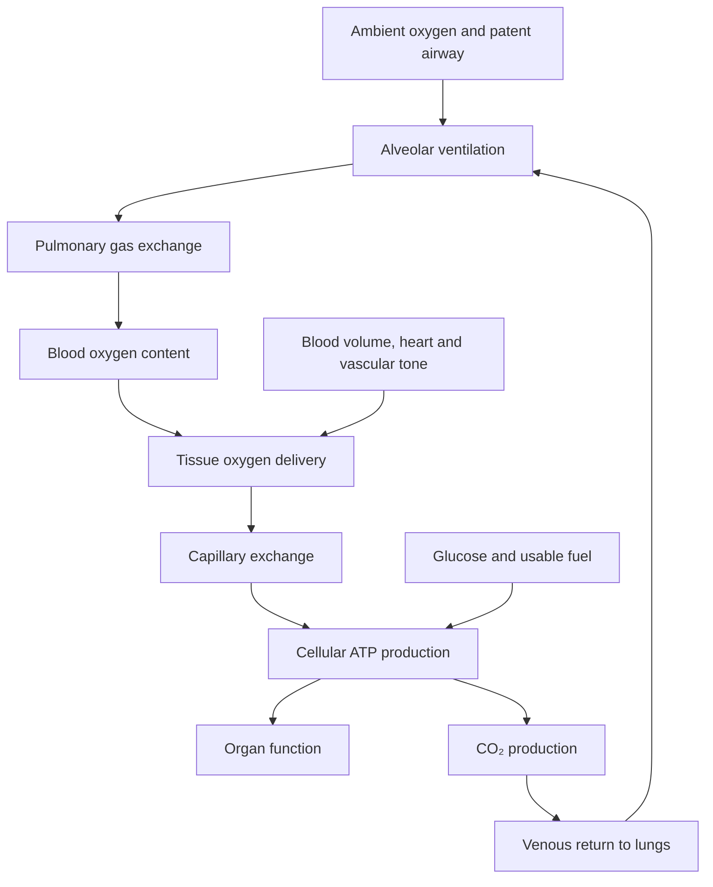

# Human Anatomy, Physiology, and Pathophysiology — Rapid Review

## Foundations of emergency care and cellular function

**Anatomy** describes structure; **physiology** describes function; pathophysiology explains how illness or injury disrupts function. These relationships help EMTs recognize abnormalities, anticipate deterioration and understand why interventions work. The major systems are musculoskeletal, nervous, endocrine, digestive, urinary, male and female reproductive, respiratory, circulatory and integumentary.

The central goal of emergency care is to sustain cellular delivery of oxygen and glucose and removal of metabolic wastes. Eleven interacting components support this process: ambient air composition, airway patency, ventilatory mechanics and regulation, ventilation/perfusion matching, blood gas transport, blood volume, myocardial pumping, systemic vascular resistance, microcirculation and blood pressure.

### Metabolism and cellular injury

- **Aerobic metabolism:** Glycolysis in the cytosol converts glucose into pyruvate and a small amount of ATP. With oxygen available, mitochondrial metabolism produces substantially more ATP. Oxygen is the terminal electron acceptor; CO₂, water and heat are metabolic products. ATP powers cellular functions such as contraction and active transport.
- **Anaerobic metabolism:** When oxidative metabolism cannot meet demand, conversion of pyruvate to lactate allows glycolysis to continue, but its ATP yield is small. Energy depletion and acidosis impair cellular function. Lactate can also increase without hypoxia and is not itself the sole cause of acidosis or cell death. [Metabolism][carb] · [Lactate][lactate]
- **Sodium–potassium pump:** Na⁺/K⁺-ATPase moves three sodium ions out and two potassium ions into the cell per ATP cycle, against their gradients. Sodium is predominantly extracellular and potassium intracellular. These gradients support nerve impulses and muscle contraction. ATP depletion impairs transport → intracellular sodium accumulation → water influx → swelling and possible membrane failure → cellular injury and organ dysfunction. [Cell membrane][cellmem]

> [!IMPORTANT]
> An open airway does not guarantee adequate ventilation; a normal SpO₂ does not guarantee adequate oxygen content or delivery; an acceptable BP does not guarantee adequate tissue perfusion. Identify the failing physiological link, address immediate reversible threats, reassess and transport appropriately.

EMTs provide foundational airway management, ventilation, CPR/AED, hemorrhage control and authorized medications/monitoring. AEMTs may add selected vascular access, fluids, medications and airway devices. Paramedics generally have broader diagnostic, electrical, medication and airway capabilities. Actual authorization depends on state law, training, credentialing, protocol and medical direction; working alongside ALS does not expand EMT scope. [Education standards][education] · [Scope][scope] · [Model guidelines][model]

## Medical language and anatomical orientation

### Medical word construction

Medical terminology supports precise assessment, documentation and handoff. Decode unfamiliar words by identifying their component meanings rather than memorizing every possible term.

- **Combining form:** Root provides the core meaning; a combining vowel (usually `o`, sometimes `a`, `e` or `i`) helps join word parts. For example, `cardi/o-` means heart. The notation hyphen and sometimes the vowel disappear in the completed word.
- **Prefix:** Precedes and modifies the root, often expressing amount, rate, direction or location.
- **Suffix:** Follows the root and describes a condition, relationship, process or procedure.

| Word | Construction and meaning |
| --- | --- |
| Hypovolemic | `hypo-` + `vol/o-` + `-emic`: below-normal blood volume |
| Hyperglycemia | `hyper-` + `glyc/o-` + `-emia`: elevated blood glucose |
| Apnea | `a-` + `pne/o-` + `-a`: absence of breathing |
| Tachycardia | `tachy-` + `cardi/o-` + `-ia`: fast heart rate |
| Bradypnea | `brady-` + `pne/o-` + `-a`: slow breathing |
| Pericardium | `peri-` + `cardi/o-` + `-um`: structure surrounding the heart |
| Myocardial | `my/o-` + `cardi/o-` + `-al`: pertaining to heart muscle |
| Laryngotracheobronchitis | Multiple roots plus `-itis`: inflammation of larynx, trachea and bronchi |

Recognize common contrasts: `hypo-/hyper-` below/above normal; `brady-/tachy-` slow/fast; `a-/an-` absence; `dys-` difficulty or pain; `eu-` normal; `endo-/exo-` inside/outside; `peri-` around; `inter-` between; `sub-/supra-` below/above; `uni-/bi-` one/two. Frequently encountered roots include `hem/o-` blood, `angi/o-` vessel, `neur/o-` nerve, `oste/o-` bone, `arthr/o-` joint, `hepat/o-` liver, `nephr/o-` kidney, `derm/a-` skin and `pneum/o-` lung or air.

Distinguish `-itis` inflammation, `-pathy` disease, `-algia` pain, `-emia` blood condition, `-rrhea` discharge, `-rrhagia` excessive flow and `-lysis` breakdown. Procedural suffixes differentiate puncture (`-centesis`), removal (`-ectomy`), creation of an opening (`-ostomy`), examination instrument (`-scope`) and examination using an instrument (`-scopy`). Suffixes `-ac`, `-al`, `-ary`, `-eal`, `-ic` and `-ous` mean pertaining to. The exhaustive word-part inventory remains outside this rapid review.

Clinical reports should describe observed findings, not merely attach diagnostic labels: new unilateral weakness, speech difficulty and last-known-well time communicate more than "possible CVA" alone. Include baseline, interventions, times and response. [Stroke 2026][stroke]

### Anatomical reference and patient positioning

**Anatomical position:** Standing upright, facing forward, arms at sides, palms forward. Right and left are always the patient's.

| Plane | Division |
| --- | --- |
| Sagittal | Right/left; midsagittal divides equally |
| Frontal (coronal) | Anterior/posterior |
| Transverse (axial) | Superior/inferior |

Anterior/posterior = front/back; dorsal/ventral = back/belly; superior/inferior = toward head/feet; medial/lateral = toward/away from midline; proximal/distal = nearer/farther from reference; ipsilateral/contralateral = same/opposite side; unilateral/bilateral = one/both sides; palmar/plantar = palm/sole.

- **Supine:** Face up; **prone:** face down; **lateral recumbent:** on the side, allowing airway monitoring when appropriate.
- **Fowler's:** Upper body elevated 45–60°; **semi-Fowler's:** less than 45° per source. Upright positioning may ease breathing; supine may be better tolerated in hypoperfusion.
- **Trendelenburg:** Head down on an inclined plane; not recommended for shock. Historical leg elevation is not routine trauma care. Selected nontraumatic shock patients may receive temporary leg elevation under applicable guidance, with limited evidence of benefit.

> [!CAUTION]
> Position according to airway, breathing, perfusion, injuries and tolerance. Avoid unnecessary movement in suspected spinal injury; a fixed 30-minute recovery-position side-switch rule is not universal EMS practice. [First aid 2024][firstaid] · [SMR][smr]

### Landmarks, cavities and abdominal quadrants

Chest reference lines include midsternal, midclavicular, anterior/mid/posterior axillary, midspinal and midscapular. Key palpable structures: clavicle, suprasternal notch, manubrium, angle of Louis, sternum, xiphoid, costal margin, intercostal spaces, acromion and scapula. Other useful regions include cranial/occipital, cervical, thoracic, umbilical, inguinal, lumbar, flank, sacral, cubital, femoral and popliteal. Accurate landmarks support injury localization and authorized ECG acquisition.

The cranial cavity contains the brain; the vertebral canal encloses the spinal cord. The diaphragm separates thoracic and abdominal cavities; the pelvic and abdominal cavities together form the abdominopelvic cavity.

| Quadrant | Important structures |
| --- | --- |
| RUQ | Most liver, gallbladder, right kidney, bowel, part of pancreas |
| LUQ | Spleen, stomach, most pancreas, left kidney, bowel, part of liver |
| RLQ | Appendix, bowel, right ureter, right ovary/tube |
| LLQ | Bowel, left ureter, left ovary/tube |
| Midline pelvis | Bladder, uterus or prostate |

Solid-organ or vascular injury may cause concealed hemorrhage; hollow-organ injury can also be serious. Tenderness, guarding, distention, mechanism and perfusion trends indicate concern but do not establish the injured organ. [Field triage][triage]

## Development, aging and physiological reserve

Children generally have faster baseline heart and breathing rates, lower BP, smaller circulating volume, higher metabolic demands and immature temperature regulation. Their relatively large head, smaller airway and limited physiological reserves require age-appropriate assessment and equipment. Caregivers are essential sources of baseline function, especially for children with special health care needs. Mottling can also occur with cold exposure.

Older adults have less reserve to compensate for acute illness or injury. Normal aging is not itself disease. Chronic conditions, polypharmacy, reduced immune response (infection may occur without fever), sensory impairment and altered physiology can mask typical findings. Establish baseline cognition, mobility, breathing and BP; obtain medications and anticoagulant history. New confusion or weakness is not automatically normal aging. Low-energy trauma may still cause significant injury. [Field triage][triage] · [Model guidelines][model]

## Musculoskeletal system

The skeleton supports shape, protects organs, enables movement, stores minerals and produces blood cells. Ligaments join bone to bone; tendons join muscle to bone. Bones are long, short, flat or irregular.

- **Skull:** Cranium protects brain; facial bones include maxilla, zygomatic bones, nasal bones and movable mandible. A rigid cranium limits expansion: bleeding or swelling may increase intracranial pressure and impair cerebral perfusion. Avoid secondary hypoxemia and hypotension; serial mental status is important. [Trauma airway][traumaair]
- **Spine:** 7 cervical, 12 thoracic, 5 lumbar, 5 fused sacral and typically 4 fused coccygeal vertebrae. High cervical injury may affect ventilation and sympathetic control. Pain absence or an initially normal neurologic examination does not clear the spine. Apply protocol-directed spinal motion restriction (SMR); do not force alignment or assume prolonged rigid backboard transport is necessary. [SMR][smr]
- **Thorax:** Sternum (manubrium, body, xiphoid), thoracic spine and 12 rib pairs. True ribs 1–7 attach directly to sternum; 8–10 indirectly; 11–12 float anteriorly.
- **Pelvis and limbs:** Pelvis includes ilium, pubis, ischium and sacrum; acetabulum receives femoral head. Lower extremity: femur, patella, medial tibia, lateral fibula, tarsals, metatarsals and phalanges. Upper extremity: clavicle/scapula, humerus, lateral radius (thumb side), medial ulna, carpals, metacarpals and phalanges.

### Joints and muscles

Joints may be immovable, slightly movable or freely movable (synovial). Flexion/extension decreases/increases joint angle; abduction/adduction moves away from/toward midline; circumduction combines movements; pronation/supination rotates the forearm.

| Synovial joint | Movement / example |
| --- | --- |
| Ball-and-socket | Multiple axes and rotation; hip/shoulder |
| Hinge | Primarily flexion/extension; elbow, knee, ankle |
| Pivot | Rotation; C1–C2, radioulnar joints |
| Gliding | Sliding; small hand/foot bones |
| Saddle | Movement in perpendicular planes; thumb base |
| Condyloid | Biaxial movement without full rotation; wrist |

The source corrects traditional ankle and wrist classification examples. Do not test painful joints through full motion; assess distal circulation, sensation and movement. [Joint anatomy][joints]

**Skeletal muscle** is voluntary and generally moves bones; **smooth muscle** is involuntary and regulates hollow organs, bronchioles and vessel caliber; **cardiac muscle** is involuntary, striated and exhibits automaticity. Coronary circulation supplies the myocardium.

> [!WARNING]
> Fractures can damage nerves and vessels and cause major concealed bleeding. Source estimates: femoral fracture 1–2 L; severe pelvic fracture potentially an entire adult blood volume (~5 L). These illustrate possible severity, not predicted losses. Appropriate splinting, hemorrhage management, warmth and serial neurovascular checks support transport and ALS resuscitation. [Field triage][triage] · [Model guidelines][model]

Children have a large occiput that may flex the neck when supine; shoulder padding may help achieve neutral alignment. Support infant heads. Fontanelles are vulnerable (anterior typically closes at 12–18 months, posterior by 3 months); do not press on them or rely on their appearance alone for dehydration/ICP assessment. Greenstick fractures involve bending and splintering. Older adults have osteoporosis, cartilage/ligament degeneration, muscle loss and kyphosis, increasing fall and fracture risk; accommodate usual spinal curvature and pad pressure areas.

## Nervous and endocrine regulation

### Nervous system and consciousness

The CNS consists of brain and spinal cord, protected by meninges and cerebrospinal fluid. The cerebrum controls thought, speech, sensation and conscious movement; cerebellum coordinates balance and movement; brainstem (midbrain, pons, medulla) regulates vital functions including breathing, cardiac activity and vascular tone. The brain depends on continuous oxygen and glucose delivery. The blood–brain barrier selectively regulates passage of substances.

Peripheral nerves connect the CNS to the body: afferent nerves carry sensory input toward the CNS; efferent nerves carry motor output away. The somatic system controls voluntary skeletal muscle; the autonomic system regulates involuntary function.

| Sympathetic (stress) | Parasympathetic (rest) |
| --- | --- |
| Increases HR and contractility | Slows heart rate |
| Bronchodilation, pupil dilation | Bronchoconstriction, pupil constriction |
| Vasoconstriction in many vascular beds | Reduced sympathetic tone permits much systemic dilation; direct parasympathetic vascular effects are limited |
| Reduced digestive activity, increased sweating | Increased digestive secretions/activity |

Consciousness depends on an intact reticular activating system (RAS) and at least one functioning cerebral hemisphere; dysfunction of the RAS or both hemispheres may cause unconsciousness. Hypoxia, hypoglycemia, shock, stroke, seizures, drugs and trauma can disrupt function. Assess baseline and serial AVPU/GCS as trained, focal signs, glucose when authorized and last-known-well time; protect airway and avoid oral intake if swallowing is unsafe. A stroke scale does not distinguish hemorrhagic from ischemic stroke. [Stroke 2026][stroke]

Aging reduces reflexes, sensory acuity, regulatory responses and balance. Neuropathy can impair motor, sensory and autonomic function, masking pain or ischemia. Cataracts cloud the lens; glaucoma damages optic nerve; macular degeneration impairs central vision; retinal detachment disrupts visual transmission. Presbycusis is typically bilateral high-frequency hearing loss; check hearing aids and reduce background noise rather than shouting.

### Endocrine glands and stress hormones

| Gland | Principal function |
| --- | --- |
| Pineal | Melatonin, circadian rhythm |
| Pituitary | Growth and regulation of other endocrine functions |
| Thyroid / parathyroids | Metabolic rate / calcium and phosphorus balance |
| Thymus | Immune development |
| Adrenal | Stress hormones; salt/water and metabolic regulation |
| Pancreatic islets | Insulin facilitates glucose uptake; glucagon raises blood glucose |
| Gonads | Sex hormones and reproduction |

Neural sympathetic responses occur rapidly; adrenal catecholamines sustain the response.

| Adrenergic receptor | Principal effect |
| --- | --- |
| Alpha-1 | Vascular smooth muscle contraction → increased vascular resistance |
| Alpha-2 | Commonly limits presynaptic norepinephrine release |
| Beta-1 | Increased cardiac rate, conduction and contractility |
| Beta-2 | Bronchial and selected vascular smooth muscle relaxation |

Epinephrine has alpha and beta activity; norepinephrine has strong alpha and meaningful beta-1 activity, relatively little beta-2. Sweating is primarily sympathetic cholinergic, not direct alpha-1 activation. [Autonomic physiology][autonomic]

> [!NOTE]
> **ALS connection:** Epinephrine counteracts bronchospasm, edema and vasodilation in anaphylaxis under distinct protocols; albuterol predominantly stimulates beta-2 receptors to relieve bronchospasm, not upper-airway obstruction. Norepinephrine supports vascular tone in selected shock states, not as a replacement for blood or hemorrhage control. Authorization varies. [Model guidelines][model]

Children use oxygen and glucose approximately 2–3 times faster per source and have limited glucose stores and hepatic reserve. Hypoglycemia may present rapidly with altered behavior, limpness, twitching, seizures or apnea. Check glucose when authorized; oral glucose requires safe swallowing; IV dextrose supplies glucose and glucagon depends on hepatic stores. Older adults may have insulin resistance, altered fluid-balance hormones and diminished receptor responsiveness; reduced hepatic/renal clearance can prolong medication effects and hypoglycemia can recur.

## Digestive, renal and reproductive systems

### Digestion and abdominal organs

Mechanical digestion includes chewing, swallowing and peristalsis; chemical digestion converts carbohydrates to glucose, fats to fatty acids and proteins to amino acids. Mouth/saliva initiate digestion; esophagus transports food; stomach mixes food with gastric secretions; small intestine (duodenum, jejunum, ileum) completes digestion and absorbs nutrients; colon absorbs water and forms stool.

The pancreas supplies digestive enzymes and hormones. The liver produces bile, stores sugars, metabolizes substances and produces clotting/plasma components. Gallbladder stores and releases bile. The spleen filters blood and supports immunity; it is not a digestive organ. Vomiting/diarrhea can reduce volume and alter electrolytes; GI bleeding can cause occult shock. Assess bleeding, intake, anticoagulants and perfusion. Children have less abdominal muscle protection and more exposed liver/spleen. Aging may impair swallowing, intake, absorption, liver metabolism and bowel motility, increasing malnutrition, constipation and medication toxicity risks.

### Renal homeostasis

Kidneys filter blood, produce urine, regulate fluid/electrolyte and acid–base balance, contribute to BP regulation and support RBC production. Ureters carry urine to the bladder; urethra carries it out. Loss of renal function or missed dialysis may cause volume overload, hyperkalemia or acidosis, threatening cardiac and respiratory function. ECG cannot reliably exclude hyperkalemia; report dialysis/access history and medications. Avoid routine BP measurement or vascular access on a dialysis fistula when possible, following policy. [Model guidelines][model] · [Adult ALS][als]

Aging reduces nephron number and renal blood flow; baseline function may be adequate but acute stress can precipitate failure. Reduced renal clearance and hepatic metabolism increase medication toxicity risk.

### Reproduction and pregnancy

Testes produce sperm/testosterone; epididymis stores sperm; vas deferens transports it; accessory glands contribute seminal fluid. Ovaries produce ova and estrogen/progesterone; fallopian tubes transport ova; uterus supports fetal development; vagina is the birth canal. Fertilization progresses from fertilized ovum to embryo to fetus.

Later pregnancy can compress major vessels when supine; positioning or uterine displacement may help in appropriate circumstances, accounting for trauma/resuscitation. Abdominal pain and bleeding may indicate ectopic pregnancy or another obstetric emergency; postpartum hemorrhage may involve inadequate uterine contraction. Record gestational age, bleeding, contractions, delivery times and maternal/newborn status. ALS medications/access are protocol-specific; prioritize transport or imminent delivery care as indicated. [First aid][firstaid] · [Model guidelines][model]

## Blood, heart and circulation

The circulatory system transports gases, nutrients, wastes, immune cells, clotting components and heat; it also supports acid–base balance. The heart is a muscular pump enclosed by the pericardium.

**Blood flow:** Body → superior/inferior vena cava → right atrium → tricuspid valve → right ventricle → pulmonary valve → pulmonary arteries → lungs → pulmonary veins → left atrium → mitral (bicuspid) valve → left ventricle → aortic valve → aorta → body.

**Conduction:** SA node (pacemaker) → AV node → bundle of His → bundle branches → Purkinje fibers → ventricular contraction. Electrical activity does not establish effective mechanical output.

Arteries carry blood away from the heart; veins return it. Pulmonary arteries carry deoxygenated blood and pulmonary veins oxygenated blood. Arterioles regulate flow into capillaries, where gases, nutrients and wastes exchange; venules drain capillaries. Venous valves help prevent backflow. Coronary arteries supply myocardium. Major pulse sites: carotid and femoral (central); radial, brachial, dorsalis pedis and posterior tibial (peripheral).

Adult blood volume is approximately **70–80 mL/kg** (70 kg at 70 mL/kg ≈ 4.9 L). Plasma constitutes ~55% (mostly water; albumin, antibodies, clotting factors); formed elements ~45% (RBCs carry hemoglobin, WBCs support immunity, platelets support clotting). The venous system is the main blood reservoir (~64%); arteries contain ~13%, pulmonary vessels ~9%, capillaries and heart ~7% each. Values are approximate.

## Respiration and airway integrity

**Ventilation** moves air mechanically; **respiration** exchanges gases across membranes; oxygenation supplies oxygen, and ventilation removes CO₂. Lungs, kidneys and bicarbonate buffers regulate acid–base balance. Interrupted cerebral oxygen delivery can cause injury within minutes; intervene promptly rather than waiting for a teaching time threshold.

At sea level, atmospheric pressure is approximately 760 mmHg; oxygen is ~21% (partial pressure ~159 mmHg), nitrogen ~78%. FiO₂ is inspired oxygen fraction (room air 0.21; pure oxygen 1.0). Actual device delivery depends on fit, flow, reservoir inflation, inspiratory demand and leaks; theoretical values are not guarantees. [Manual ventilation][manualvent]

### Airway anatomy and obstruction

Air passes from nose/mouth → pharynx (nasopharynx, oropharynx, laryngopharynx) → larynx → trachea → carina → main bronchi → smaller bronchi and bronchioles → alveoli.

- **Upper airway:** Nose warms, moistens and filters air. Relaxed tongue, blood, secretions, vomitus, foreign material and edema can obstruct airflow. Thyroid cartilage forms the Adam's apple; cricoid is a complete cartilage ring. The glottis is the opening between true vocal cords; epiglottic movement and cord closure protect the airway during swallowing. Impaired reflexes permit aspiration even with an initially open airway.
- **Lower airway:** Tracheal C-shaped cartilage supports airway patency; bronchioles have smooth muscle and no cartilage rings. Inflammation, mucus and bronchoconstriction narrow airways, increasing resistance. Asthma combines inflammation and bronchoconstriction, often producing wheeze and prolonged exhalation; a quiet chest may indicate critically poor airflow.
- **Alveoli:** Thin respiratory membrane permits diffusion; surfactant reduces surface tension and helps prevent collapse. The visceral pleura covers the lung, parietal pleura lines chest wall; negative pleural pressure couples lungs to chest expansion.

Infants have a relatively large tongue and occiput, small airway, soft cartilage and nasal breathing preference. Newborn trachea is approximately 4–5 mm versus 20 mm in adults (source estimates). Minor swelling can severely impede flow. Avoid hyperflexion, hyperextension and pressure on submandibular soft tissue; adjust shoulder padding to maintain alignment. Infants are not invariably obligate nasal breathers. The traditional cricoid-is-narrowest rule is debated; do not select advanced airway sizes from an age cutoff. [Pediatric airway][pedair] · [Childhood development][childair]

> [!NOTE]
> **ALS connection:** Supraglottic devices sit above the glottis; endotracheal tubes pass into the trachea and offer greater but incomplete aspiration protection. Placement does not guarantee oxygenation or ventilation. Waveform capnography supports confirmation and ongoing monitoring; repeated attempts and medication-assisted placement can cause hypoxemia, apnea or hypotension. Maintain BLS positioning, suction, appropriate adjuncts and BVM support; prepare equipment within authorization. [Airway physiology][airway] · [Scope][scope]

### Toxic exposure and oxygen delivery

Oxygen displacement reduces available inspired oxygen; carbon monoxide interferes with hemoglobin oxygen transport; cyanide impairs cellular oxygen utilization. Standard SpO₂ cannot reliably exclude CO poisoning. Exposure history, clinical assessment and appropriate oxygen treatment matter; blood co-oximetry can identify COHb. Authorized ALS may consider hydroxocobalamin for compatible severe cyanide exposure. Do not enter an unsafe atmosphere or delay care for monitoring. [CDC CO][co] · [Model guidelines][model]

## Ventilatory mechanics, control and failure

### Pressure, volume and resistance

Boyle's law: gas pressure varies inversely with volume. Inspiration is active: diaphragm descends and external intercostals lift ribs, enlarging thorax and lowering pressure. Expiration is normally passive via muscle relaxation and elastic recoil. Phrenic nerve roots **C3–C5** stimulate the diaphragm; high cervical injury can impair spontaneous ventilation.

Accessory inspiratory muscles (sternocleidomastoid, scalenes, pectoralis minor) increase expansion; abdominal and internal intercostal muscles aid active expiration. Increased work consumes oxygen and energy, risking fatigue. Compliance describes ease of expansion; edema, pneumonia, chest wall or neuromuscular problems impair effective expansion. Resistance describes opposition to airflow; edema, secretions and bronchoconstriction increase it.

Air entering the pleural space can uncouple the lung from the chest wall and cause collapse. Tension pneumothorax can additionally impair venous return, causing obstructive shock.

> [!WARNING]
> The source's 2024 NAEMSP traumatic pneumothorax clarification permits consideration of a vented chest seal in spontaneously breathing open pneumothorax but advises against seals in open pneumothorax receiving positive-pressure ventilation (PPV). Follow local protocols, monitor worsening distress, asymmetric breath sounds and shock. ALS decompression may be appropriate for suspected tension physiology, not every pneumothorax. Do not delay needed ventilation or transport. [Traumatic pneumothorax][pneumothorax]

### Minute and alveolar ventilation

- **Minute ventilation = tidal volume × respiratory frequency.**
- **Alveolar ventilation = (tidal volume − dead-space volume) × respiratory frequency.** Anatomical dead space is approximately 150 mL in an average adult; conducting airways do not exchange gases.

| Illustrative breathing pattern | Minute ventilation | Alveolar ventilation |
| --- | ---: | ---: |
| 500 mL × 12/min | 6 L/min | 4.2 L/min |
| 200 mL × 28/min | 5.6 L/min | 1.4 L/min |

Rapid shallow breathing can maintain near-normal minute ventilation while severely reducing alveolar ventilation. Hypoventilation promotes CO₂ retention and falling pH; rapid deep breathing may compensate for metabolic acidosis. Oxygen alone cannot correct inadequate ventilation. Assess depth, effort, chest rise, alertness and trends; assist ventilation when indicated. Visible chest rise is not a quantitative measure of alveolar ventilation. [Manual ventilation][manualvent] · [Gas exchange][gas]

### Regulation and recognition of failure

Medullary respiratory groups and pontine centers coordinate rhythm and depth. Central chemoreceptors respond mainly to CO₂-related CSF pH changes; peripheral chemoreceptors (carotid and aortic bodies) respond to significant arterial oxygen reduction and CO₂/pH changes. Irritant receptors trigger cough/bronchoconstriction; stretch receptors limit overinflation; J-receptors respond to pulmonary capillary pressure, promoting rapid shallow breathing.

> [!CAUTION]
> COPD does not universally switch ventilation to oxygen-only control. Excess oxygen can increase CO₂ through V/Q changes, the Haldane effect and ventilatory effects. A commonly recommended SpO₂ target for patients at risk of hypercapnic respiratory failure is **88–92%**, subject to presentation and protocol. Never withhold necessary oxygen or ventilation from a critically hypoxemic or failing patient. [COPD physiology][copdmechanism] · [Prehospital trial][copdtrial]

Adequate breathing requires appropriate rate **and** tidal volume, regular rhythm, effective air movement and minimal effort. Source textbook ranges (breaths/min): adults 8–24 (usual 12–20), older adults 20–22, children 18–37, infants 30–60. These are teaching references, not independent treatment thresholds.

Distress/failure findings include shallow or irregular breathing, retractions/accessory muscle use, nasal flaring, diminished or asymmetric breath sounds, cyanosis, altered mentation and fatigue. In infants, head bobbing, seesaw breathing and grunting are particularly concerning. Falling respiratory rate in a tiring patient may indicate deterioration, not improvement. Agonal gasps are not normal breathing; assess for arrest and initiate BLS resuscitation when indicated. [Adult BLS 2025][bls] · [PALS 2025][pals]

Children have pliable, horizontal ribs, rely heavily on the diaphragm and may sustain internal chest injury without rib fractures. Abdominal movement during breathing is normal in young children; retractions and grunting indicate increased work. Grunting helps retain end-expiratory pressure but consumes energy. A rate of 60/min is not a universal failure threshold; age, appearance, airflow and trajectory matter. Apnea, lethargy, decreasing effort or bradycardia are serious signs. Older adults have reduced chest compliance, muscle strength, exchange surface, chemoreceptor sensitivity and cough/ciliary defenses, increasing infection and respiratory failure risk.

> [!NOTE]
> **ALS connection — ventilatory support:** PPV can reduce venous return and preload, particularly with hypovolemia. Excess pressure/volume or incomplete exhalation can cause lung injury or air trapping. PEEP helps maintain alveolar recruitment but may lower venous return. CPAP maintains positive pressure during spontaneous breathing; bilevel support adds inspiratory assistance. NIV may benefit selected pulmonary edema patients but may be inappropriate with vomiting, impaired airway protection, severe hemodynamic instability or inadequate spontaneous breathing. CPAP does not ventilate an apneic patient. Report mask tolerance, chest rise, resistance, mentation and BP. [Airway physiology][airway] · [Mechanical ventilation][mechvent] · [NIV][niv]

Bronchodilators address lower-airway smooth-muscle narrowing; corticosteroids reduce inflammation more slowly. Naloxone reverses opioid-mediated ventilatory depression, but immediate ventilatory support and monitoring for recurrent depression remain critical. Medication authorization varies. [Model guidelines][model]

## Gas exchange and tissue oxygen delivery

Gases diffuse down partial-pressure gradients: external respiration transfers oxygen from alveoli to pulmonary blood and CO₂ in reverse; internal respiration transfers oxygen from systemic blood to tissues and CO₂ back to blood.

**V/Q ratio = alveolar ventilation / pulmonary capillary blood flow.** Gravity produces more ventilation and perfusion at lung bases, with relatively higher V/Q at apices and lower V/Q at bases; overall V/Q is normally less than 1.

| Disturbance | Mechanism and example |
| --- | --- |
| Low V/Q | Perfusion exceeds ventilation (bronchospasm, edema); extreme is shunt |
| High V/Q | Ventilation exceeds perfusion (pulmonary embolism or low pulmonary flow); extreme is dead space |
| Global delivery failure | Hemorrhage decreases blood flow and oxygen-carrying capacity; not simply a ventilation problem |

Oxygen transport is approximately 97–98.5% hemoglobin-bound and 1.5–3% dissolved. Hemoglobin has four oxygen-binding sites. CO₂ travels approximately 70% as bicarbonate, 23% bound to hemoglobin and 7% dissolved; figures vary with physiology. Oxygen delivery = cardiac output × arterial oxygen content (compatible units). Oxygen content depends largely on hemoglobin concentration and saturation. [Gas transport][transport] · [Oxygen transport][oxygenphys]

| Assessment | Information and limitations |
| --- | --- |
| SpO₂ | Estimates arterial oxygen saturation; not hemoglobin amount, ventilation or flow. Motion, low perfusion, skin pigmentation and dyshemoglobinemia can impair reliability. |
| EtCO₂ / waveform | Exhaled CO₂ and breathing pattern; influenced by ventilation, metabolism, pulmonary flow and sampling. Low EtCO₂ may reflect hyperventilation or poor circulation. Does not establish pH, PaCO₂ precisely or a specific diagnosis. |
| Blood co-oximetry | Differentiates hemoglobin species, including COHb; does not establish tissue perfusion. |
| Serial clinical examination | Tracks deterioration or response; does not quantify blood gases or hemoglobin. |

Normal saturation can coexist with anemia, hemorrhage or circulatory failure. Oxygen may support patients with hypoxemia, distress or critical illness per protocol, but cannot replace missing hemoglobin or restore blood flow. Do not triage based on quietness versus screaming, or rely on any single monitor value. [FDA][fda] · [Airway physiology][airway] · [Field triage][triage]

## Hemodynamics and compensatory responses

### Cardiac output, pressure and vascular resistance

A pulse is a pressure wave generated by ventricular contraction. Systolic BP reflects pressure during contraction; diastolic BP reflects pressure between contractions. Neither measures tissue perfusion directly.

**Cardiac output (CO) = HR × stroke volume (SV)**; typical resting adult CO is approximately 5 L/min. Stroke volume depends on:

- **Preload:** End-diastolic myocardial stretch, influenced by venous return. Frank–Starling relationship: increased stretch may increase contraction up to a limit; additional fluid is not always beneficial.
- **Contractility:** Force of myocardial contraction, impaired by infarction, heart failure and some medications.
- **Afterload:** Load opposing ventricular ejection; not simply diastolic BP.

Excessively fast HR can shorten filling time and reduce SV/CO, but no single rate (including the textbook's 160 bpm example) establishes that effect. Slow rate may also reduce output. [Hemodynamics][hemodynamics]

**Systemic vascular resistance (SVR):** Opposition to systemic blood flow. Vasoconstriction increases resistance; vasodilation decreases it. The precise relationship is MAP − right atrial pressure = CO × SVR. When right atrial pressure is small, MAP ≈ CO × SVR. Diastolic BP is influenced by multiple factors and is not a direct SVR measurement.

- **Pulse pressure (PP) = systolic BP − diastolic BP.** The source uses PP less than 25% of systolic pressure as an illustrative narrow pulse pressure. Reduced SV plus compensatory vasoconstriction may produce a weak/thready pulse and narrow PP; neither establishes hemorrhage alone.
- **Estimated MAP = diastolic BP + PP/3**, less reliable with extreme rates or abnormal waveforms.

Baroreceptors in carotid sinuses and aortic arch sense pressure-related stretch. Falling pressure → reduced stretch → increased sympathetic activity → tachycardia, increased contractility, vasoconstriction and increased venous return. Rising pressure produces an opposing response. Severe hypoxia also stimulates cardiorespiratory compensation. Reduced sympathetic tone and local/endothelial signals, not generalized direct parasympathetic innervation, explain much systemic vasodilation. [Vascular regulation][vascularreg]

### Microcirculation and fluid exchange

Arterioles → metarterioles → capillaries → venules. Precapillary sphincters influence exchange flow. Local metabolic/endothelial factors (hypoxia, acidosis, temperature, histamine), sympathetic activity and hormones regulate flow. Vasoconstriction can preserve measured BP while reducing peripheral perfusion. Sepsis may disrupt capillary flow even after systemic pressure improves.

**Hydrostatic pressure** pushes fluid out of capillaries; **plasma oncotic pressure**, largely from albumin, opposes filtration. Elevated pulmonary hydrostatic pressure from left-heart failure can produce pulmonary edema. Low albumin can contribute to edema, but does not establish intravascular depletion; permeability, interstitial pressures and lymphatic drainage also matter. [Body fluids][bodyfluids]

### Age-related circulatory differences

Children rely heavily on HR and peripheral vasoconstriction because contractile reserve is limited. Small absolute blood loss can be substantial relative to total volume. Hypotension may appear abruptly after advanced blood loss (the textbook cites >30%, not a treatment threshold). Severe hypoxia can cause bradycardia; this is often a late finding in infants/children and may be an early response in newborns. Assess age, pulse quality, capillary refill, appearance, work of breathing and serial vital signs. [PALS][pals]

Older adults may have valve stenosis (restricted forward flow), regurgitation (backflow), myocardial changes, reduced chronotropic reserve, dysrhythmias, arterial stiffening and diminished baroreceptor responsiveness. Orthostatic hypotension and reduced compensatory ability increase fall and shock risks; beta blockers may blunt tachycardia. Do not provoke standing in unstable or fall-prone patients. [Model guidelines][model]

> [!NOTE]
> **ALS connection — rhythm versus perfusion:** ECG can reveal electrical patterns but does not prove cardiac contraction. Bradycardia with poor perfusion may prompt authorized pharmacologic therapy or pacing; electrical capture must be assessed for mechanical effect. Compensatory tachycardia requires treatment of its cause, unlike selected unstable primary tachyarrhythmias that may warrant synchronized cardioversion. Organized electrical activity without a pulse may represent PEA. CPR, AED use and minimizing interruptions remain foundational in arrest. [Adult ALS 2025][als]

## Shock mechanisms and clinical application

Shock is inadequate tissue perfusion and waste removal. A falling CO, inadequate oxygen content, altered vascular distribution or impaired flow can reduce aerobic ATP production and cause organ dysfunction. Compensation can temporarily preserve BP; worsening mentation, weak pulses, cool/clammy skin, tachypnea and trends may reveal deterioration before hypotension.

| Shock type | Mechanism and management principle |
| --- | --- |
| Hypovolemic | Inadequate circulating volume (hemorrhage/dehydration); control bleeding and cause-specific volume replacement |
| Distributive | Abnormal vascular tone/distribution (sepsis/anaphylaxis); address cause and support perfusion |
| Cardiogenic | Pump failure limits forward flow; indiscriminate fluids may worsen congestion |
| Obstructive | Mechanical impediment to flow (tension pneumothorax); address obstruction when authorized |

**BLS priorities:** Scene safety; immediate hemorrhage control (direct pressure or appropriate tourniquet when indicated); airway and ventilation support; prevent heat loss; serial perfusion assessment; timely transport and early notification. Internal hemorrhage requires definitive hospital control. Do not delay transport for nonessential procedures or assume shock resolution from an isolated BP, saturation or capillary refill value.

**Clinical application:** Penetrating abdominal injury with BP 102/88 mmHg, HR 122/min, weak radial pulse, pallor and shallow tachypnea illustrates compensation. PP = 14 mmHg (<25% of 102). Blood loss reduces preload → SV/CO fall → baroreflex raises HR/SVR → narrowed PP and compromised peripheral flow. An apparently acceptable systolic BP does not rule out shock. A screaming multisystem trauma patient or a poorly responsive patient with spurting extremity bleeding both require objective assessment of immediate threats, not priority based on behavior. Reassess bleeding, effort/depth, alertness, pulse and BP after interventions.

> [!NOTE]
> **ALS connection — cause-specific resuscitation:** IV/IO access creates a route, not treatment itself. Crystalloids transiently expand volume but lack RBCs/clotting components; excessive amounts may cause dilution, cooling or edema. The source's NAEMSP 2025 statement favors blood components for life-threatening traumatic hemorrhage in supported transfusion systems; the separate fluid statement favors isotonic crystalloids when used. Targets differ, particularly in suspected TBI. Vasopressors may support selected distributive shock, not replace hemorrhage control or blood. In cardiogenic pulmonary edema, positive airway pressure and authorized nitroglycerin may help selected patients; BP and contraindications (including recent PDE-5 inhibitor use) matter. Report new dyspnea, BP changes, access-site problems or treatment reactions; do not adjust infusions without authorization. [Trauma transfusion][transfusion] · [Trauma fluids][traumafluid] · [Trauma vasopressors][pressors] · [Model guidelines][model]

## Integumentary system, thermoregulation and burns

Skin protects against environmental injury and microorganisms, regulates temperature, provides sensation and helps maintain water/electrolyte balance. Epidermis is the superficial protective layer with melanin; dermis provides strength and contains vessels, nerves, hair follicles and sweat/oil glands; subcutaneous tissue contains fat, vessels and nerves and contributes insulation. Accessory structures include hair, nails and glands.

Children have high body surface area relative to mass, thin skin and immature temperature regulation, increasing hypothermia risk. Aging thins skin/subcutaneous tissue, slows healing, reduces sweating and sensation and increases risk of tears, pressure injury and temperature extremes. Minimize exposure and protect fragile skin.

Deep/extensive burns impair barrier function, thermoregulation and fluid balance; circumferential burns can restrict distal circulation as swelling develops. Protect tissue, prevent heat loss and reassess distal pulse, sensation and movement. Facial burns with oral swelling may progress to airway obstruction despite normal initial speech and breathing; singed hair alone is less specific. Monitor voice, stridor, effort, mentation and perfusion. Early ALS evaluation may be needed before swelling worsens; prepare suction and BVM equipment. Deep burns or suspected inhalation injury warrant burn-center consultation or transfer consideration. Ordinary SpO₂ cannot exclude CO exposure; oxygen decisions depend on findings and exposure, not an automatic assumption of poisoning from every flash burn. [Burn referral][burn] · [CDC CO][co] · [Trauma airway][traumaair]

## References

References are inherited from the supplied module, not independently reverified. The module reports a November 26, 2026 reference check: NASEMSO model guidelines v3 (March 2022), with v4 in development but no verified published replacement; AHA 2025 resuscitation guidelines and 2026 stroke update are used where relevant. Position statements and physiology/anatomy studies vary in evidence level and prehospital applicability. Local authorization and protocols have not been reviewed. Medical word construction draws on Susan Turley, *Medical Language* (Pearson Prentice Hall, 2007).

[carb]: https://openstax.org/books/anatomy-and-physiology-2e/pages/24-2-carbohydrate-metabolism
[lactate]: https://pubmed.ncbi.nlm.nih.gov/26378980/
[cellmem]: https://openstax.org/books/anatomy-and-physiology/pages/3-1-the-cell-membrane
[education]: https://www.ems.gov/assets/EMS_Education_Standards_2021_Updated2_24_25forEO.pdf
[scope]: https://nasemso.org/content.aspx?club_id=157064&module_id=701418&page_id=22
[model]: https://nasemso.org/content.aspx?module_id=701974&page_id=22
[stroke]: https://professional.heart.org/en/science-news/2026-guideline-for-the-early-management-of-patients-with-acute-ischemic-stroke/top-things-to-know
[firstaid]: https://cpr.heart.org/en/resuscitation-science/2024-first-aid-guidelines
[smr]: https://naemsp.org/position-statement/spinal-motion-restriction-in-the-trauma-patient/
[triage]: https://pmc.ncbi.nlm.nih.gov/articles/PMC9323557/
[traumaair]: https://doi.org/10.1080/10903127.2021.1994069
[joints]: https://openstax.org/books/anatomy-and-physiology/pages/9-4-synovial-joints
[autonomic]: https://openstax.org/books/anatomy-and-physiology-2e/pages/15-2-autonomic-reflexes-and-homeostasis
[als]: https://cpr.heart.org/en/resuscitation-science/cpr-and-ecc-guidelines/adult-advanced-life-support
[manualvent]: https://pubmed.ncbi.nlm.nih.gov/35001826/
[pedair]: https://pubmed.ncbi.nlm.nih.gov/30861424/
[childair]: https://pubmed.ncbi.nlm.nih.gov/33179415/
[airway]: https://doi.org/10.1080/10903127.2021.1992056
[co]: https://www.cdc.gov/carbon-monoxide/hcp/clinical-guidance/index.html
[pneumothorax]: https://pubmed.ncbi.nlm.nih.gov/39499620/
[gas]: https://openstax.org/books/anatomy-and-physiology-2e/pages/22-4-gas-exchange
[copdmechanism]: https://pmc.ncbi.nlm.nih.gov/articles/PMC3682248/
[copdtrial]: https://www.bmj.com/content/341/bmj.c5462
[bls]: https://cpr.heart.org/en/resuscitation-science/cpr-and-ecc-guidelines/adult-basic-life-support
[pals]: https://cpr.heart.org/en/resuscitation-science/cpr-and-ecc-guidelines/pediatric-advanced-life-support
[mechvent]: https://pubmed.ncbi.nlm.nih.gov/35001824/
[niv]: https://pubmed.ncbi.nlm.nih.gov/35001825/
[transport]: https://openstax.org/books/anatomy-and-physiology-2e/pages/22-5-transport-of-gases
[oxygenphys]: https://www.ncbi.nlm.nih.gov/books/NBK538336/
[fda]: https://www.fda.gov/medical-devices/products-and-medical-procedures/pulse-oximeters
[hemodynamics]: https://openstax.org/books/anatomy-and-physiology-2e/pages/20-2-blood-flow-blood-pressure-and-resistance
[vascularreg]: https://openstax.org/books/anatomy-and-physiology-2e/pages/20-4-homeostatic-regulation-of-the-vascular-system
[bodyfluids]: https://openstax.org/books/anatomy-and-physiology/pages/26-1-body-fluids-and-fluid-compartments
[transfusion]: https://pubmed.ncbi.nlm.nih.gov/40131241/
[traumafluid]: https://pubmed.ncbi.nlm.nih.gov/39576138/
[pressors]: https://pubmed.ncbi.nlm.nih.gov/39693581/
[burn]: https://www.ameriburn.org/burn-care-team/resources/guidelines-for-burn-patient-referral