# Chapter 1: Emergency Medical Service Systems, Research, and Public Health — Concept Maps

Read each arrow as a proposition: the source concept, linking phrase and destination concept form a statement. Repeated concepts connect the focused maps; clinical illustrations are explanatory, not treatment protocols or authorization lists.

## Chapter overview

### EMS as an integrated system

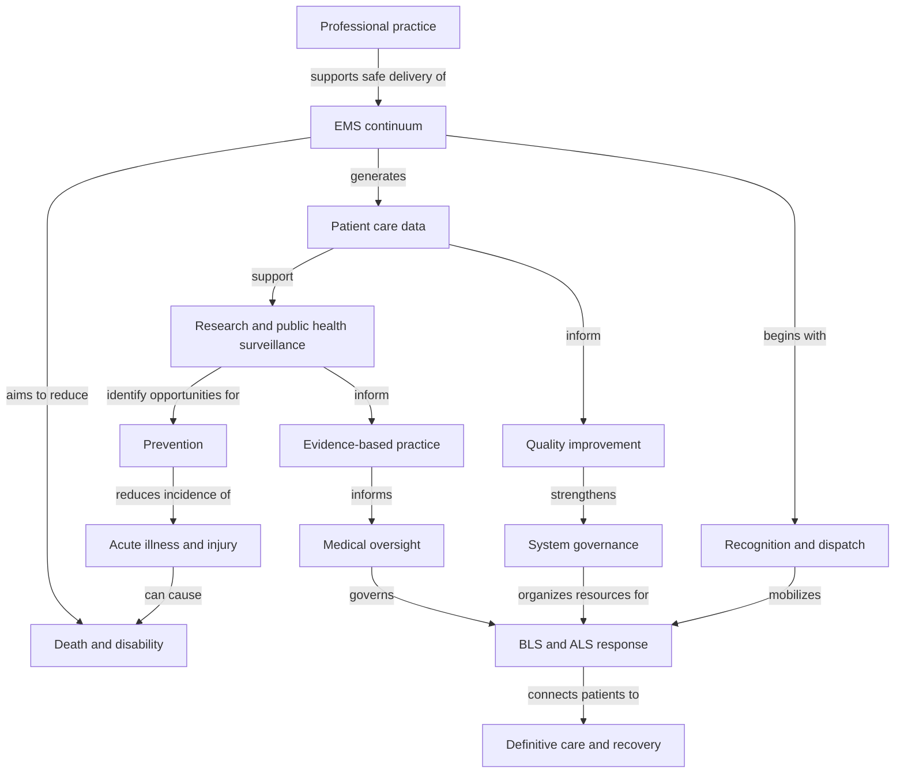

## EMS system development and organization

### Historical transformation of EMS

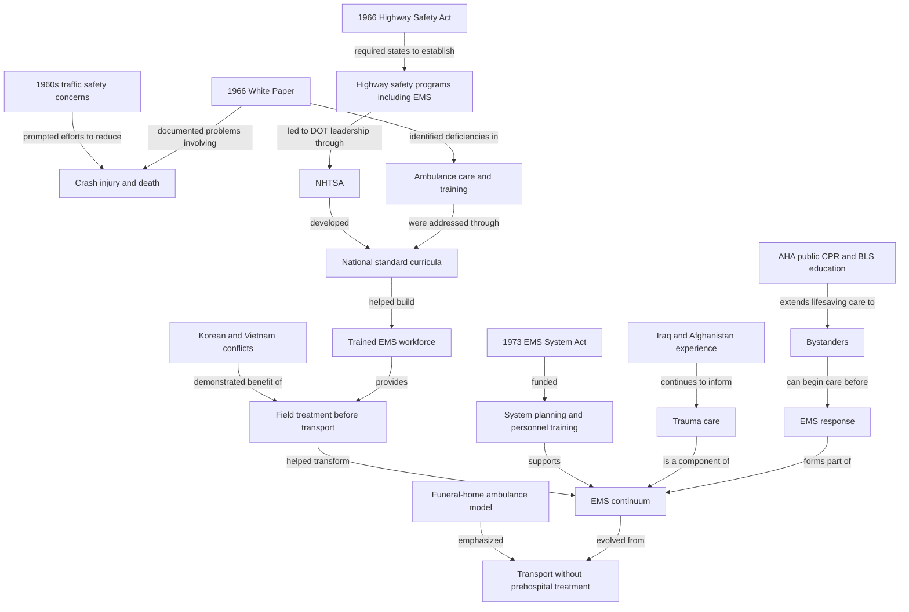

### National education and system vision

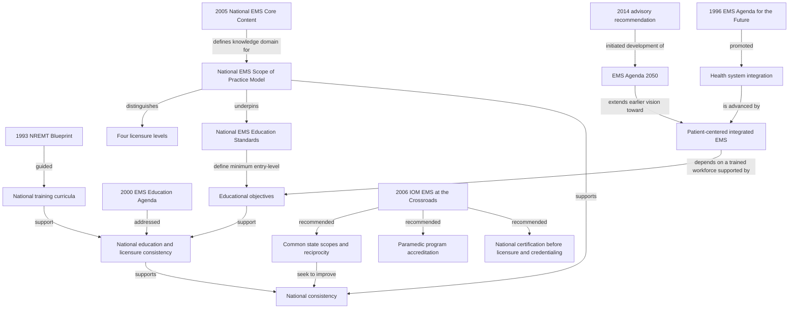

### State governance and system standards

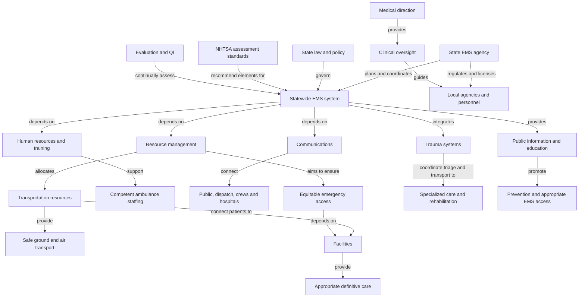

NHTSA standards are recommendations; states control system design. The source describes EMT-level ambulance staffing as a recommended standard, not a universal statement of every local staffing rule.

### Service models, capabilities and quality

```mermaid
flowchart TD
    N01["EMS service model"]
    N02["EMS agency"]
    N03["Fire-based EMS"]
    N04["Existing fire suppression organization"]
    N05["Municipal third service"]
    N06["Police and fire services"]
    N07["Private EMS"]
    N08["Private ownership and local operating rules"]
    N09["Hospital-based EMS"]
    N10["Hospital control"]
    N11["Law enforcement EMS"]
    N12["Law enforcement operations"]
    N13["Public safety officer model"]
    N14["Fire, police and EMS"]
    N15["Emergency response and transport"]
    N16["Transfers, event and disaster services"]
    N17["Critical care, air and special operations support"]
    N18["Prevention and community paramedicine"]
    N19["Clinical capability"]
    N20["Staff credentials and equipment"]
    N21["Medical direction and service authorization"]
    N22["Clinical quality"]
    N23["Patient outcomes"]
    N24["Service quality"]
    N25["Community needs"]
    N26["Economic efficiency"]
    N27["Reasonable cost"]
    N28["Accountability"]
    N29["Improvement and resilience"]

    N01 -->|determines organizational control of| N02
    N03 -->|uses| N04
    N05 -->|operates separately from| N06
    N07 -->|operates under| N08
    N09 -->|operates under| N10
    N11 -->|combines care with| N12
    N13 -->|cross-trains personnel across| N14
    N02 -->|may use any| N01
    N02 -->|delivers| N15
    N02 -->|may deliver| N16
    N02 -->|may deliver| N17
    N02 -->|may deliver| N18
    N19 -->|depends on| N20
    N19 -->|depends on| N21
    N01 -->|does not establish| N19
    N19 -->|helps determine appropriate use of| N17
    N22 -->|assesses achievement of| N23
    N24 -->|assesses whether care meets| N25
    N26 -->|balances quality with| N27
    N28 -->|checks whether systems meet| N25
    N29 -->|help systems adapt and strengthen| N02
    N03 -->|is a type of| N01
    N05 -->|is a type of| N01
    N07 -->|is a type of| N01
    N09 -->|is a type of| N01
    N11 -->|is a type of| N01
    N13 -->|is a type of| N01
    N22 -->|evaluates care delivered by| N02
    N24 -->|evaluates performance of| N02
    N26 -->|is a design goal for| N02
```

### Dispatch, access and communication

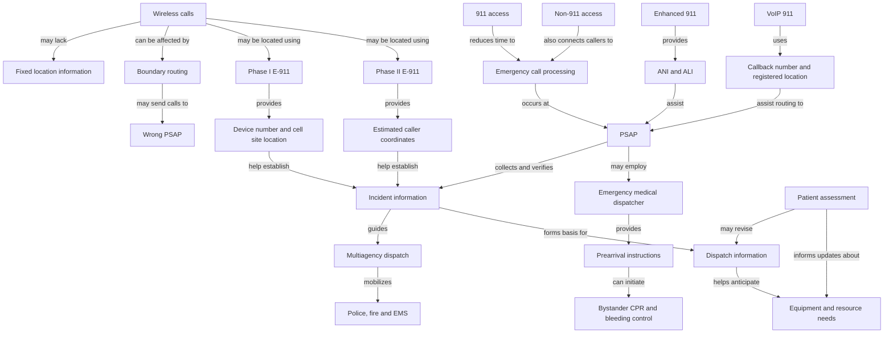

The wireless phases are the historical framework in the source; Phase II accuracy was described as 50–300 meters depending on technology. Dispatch information is not a confirmed diagnosis.

### Tiered response and resource allocation

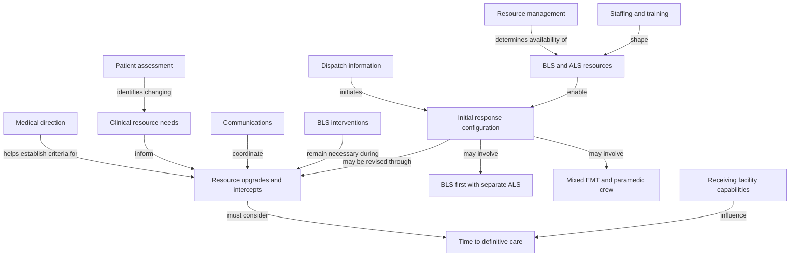

## Provider scope and medical oversight

### Provider levels and complementary roles

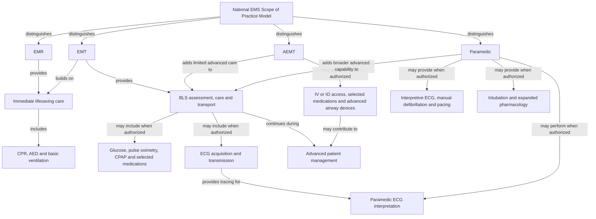

The national model includes glucose measurement at EMT level even though the textbook lists it under AEMT. ECG acquisition is not interpretation. Actual authorization varies by jurisdiction and agency.

### Education, legal scope and individual authorization

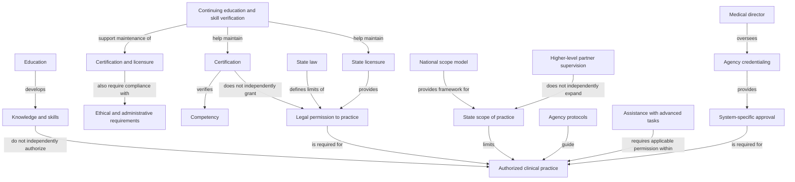

### Medical direction and accountability

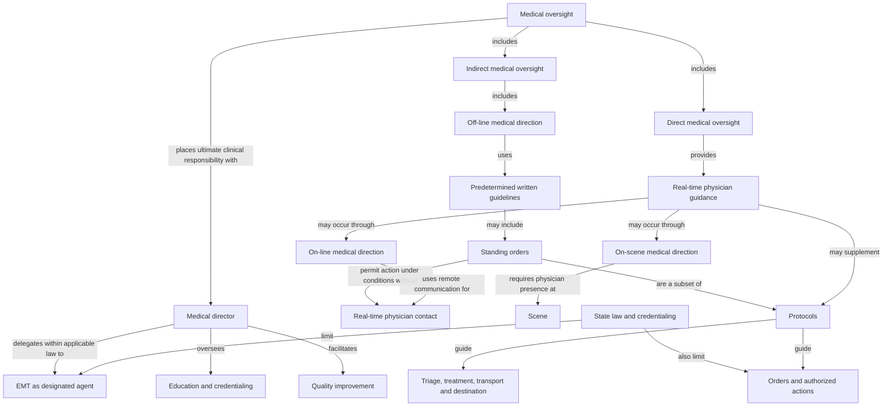

Some systems use standing orders as a synonym for off-line direction; others use the term for communication-failure orders. Neither direct nor indirect orders automatically override lawful scope or credentialing.

### Chest pain: historical orders and clinical reasoning

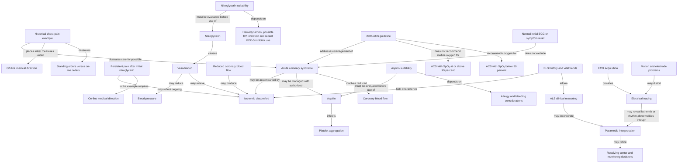

The historic example used 15 L/min oxygen, one prescribed nitroglycerin tablet with systolic BP above 90 mmHg, 160–325 mg aspirin, and ALS contact before seeking orders for further nitroglycerin. These values describe historical teaching, not an actionable or universal protocol. The oxygen threshold is specific to ACS; medication decisions require applicable authorization and contraindication assessment.

## Clinical care and interagency integration

### Destination selection and definitive care

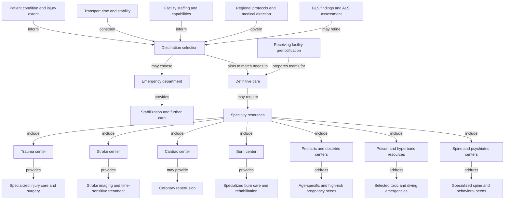

The closest hospital is not automatically the best destination; bypass is not universally appropriate either. Other specialty centers listed address additional specific needs.

### Suspected stroke: findings, capacity and system choice

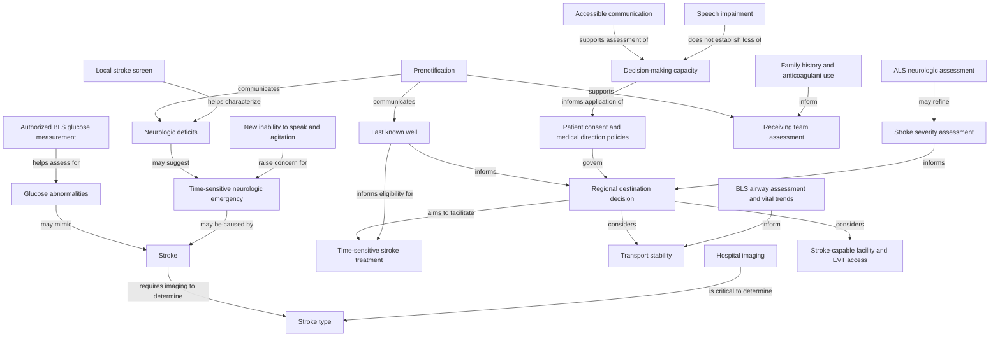

The source's 78-year-old patient has a nearby hospital and a stroke center about 20 minutes away. Distance alone cannot settle the choice. Additional advanced procedures must not needlessly delay transport; regional systems may favor direct EVT-center transport or nearer stroke-capable care with transfer.

### Professional readiness and public trust

```mermaid
flowchart TD
    N01["EMT professional responsibility"]
    N02["Vehicle and equipment readiness"]
    N03["Safe emergency response"]
    N04["Knowledge and skill competence"]
    N05["Safe assessment and treatment"]
    N06["Continuing education"]
    N07["Equipment cleaning and disinfection"]
    N08["Contamination risk"]
    N09["Professional grooming and uniform"]
    N10["Patient confidence"]
    N11["Integrity and moral character"]
    N12["Public trust"]
    N13["Empathy and listening"]
    N14["Patient communication and advocacy"]
    N15["Calm reassurance"]
    N16["Patient emotional needs"]
    N17["Judgment and leadership"]
    N18["Adaptability and resourcefulness"]
    N19["Response to unexpected conditions"]
    N20["Stress management and support"]
    N21["Provider well-being"]
    N22["Physical ability, vision and hearing"]
    N23["ADA reasonable accommodations"]
    N24["Employment for qualified individuals"]
    N25["Teamwork and diplomacy"]
    N26["Interagency coordination"]
    N27["Local terrain and traffic knowledge"]
    N28["Mixed-level crew preparation"]
    N29["Equipment familiarity"]
    N30["Advanced procedural authorization"]

    N01 -->|includes| N02
    N02 -->|supports| N03
    N04 -->|supports| N05
    N06 -->|maintains and expands| N04
    N07 -->|reduce| N08
    N09 -->|support| N10
    N11 -->|uphold| N12
    N13 -->|support| N14
    N15 -->|supports| N16
    N17 -->|help prioritize| N05
    N18 -->|support| N19
    N20 -->|help maintain| N21
    N22 -->|support| N03
    N23 -->|support access to| N24
    N25 -->|enable| N26
    N27 -->|support| N03
    N14 -->|reinforce| N12
    N28 -->|clarifies roles and equipment for| N05
    N29 -->|does not establish| N30
    N01 -->|requires| N04
    N01 -->|includes| N07
    N10 -->|supports| N12
    N15 -->|contributes to| N14
    N18 -->|support| N05
    N21 -->|supports| N03
    N24 -->|supports participation in| N01
    N26 -->|supports| N03
    N29 -->|supports| N28
    N05 -->|reinforces| N12
```

The source's 125-pound lifting example is not a universal job requirement or safe solo-lifting target. Essential functions, accommodations, equipment and safe-lift policies vary.

### Scene safety and coordinated rescue

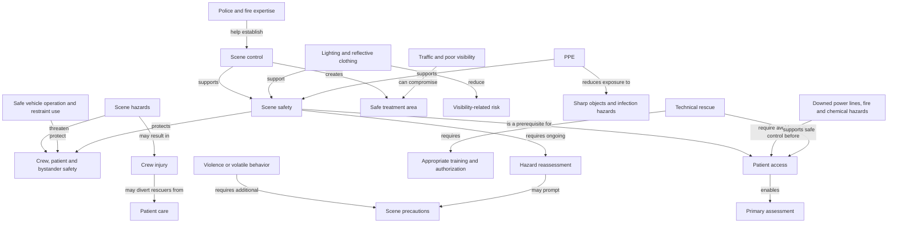

### BLS assessment as foundation for ALS reasoning

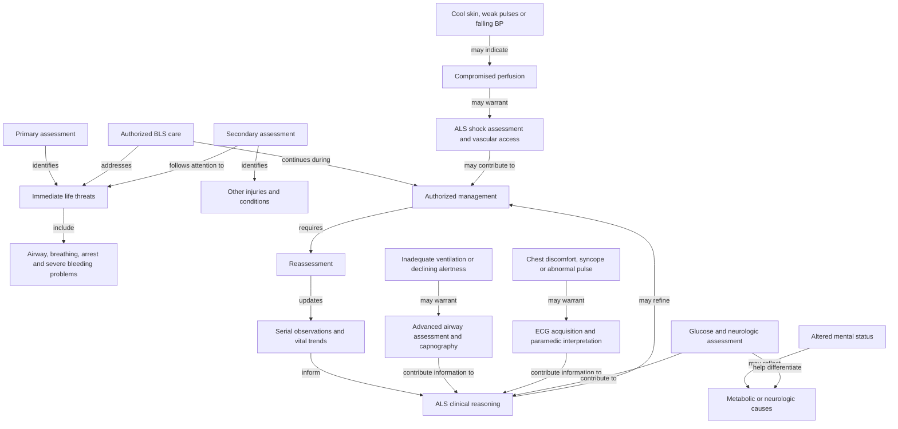

Findings and monitor values guide reasoning but do not by themselves establish diagnoses or require a particular ALS procedure.

### Oxygenation, ventilation and resuscitation

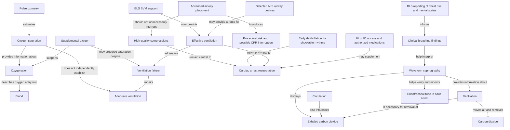

### Movement safety and advanced device continuity

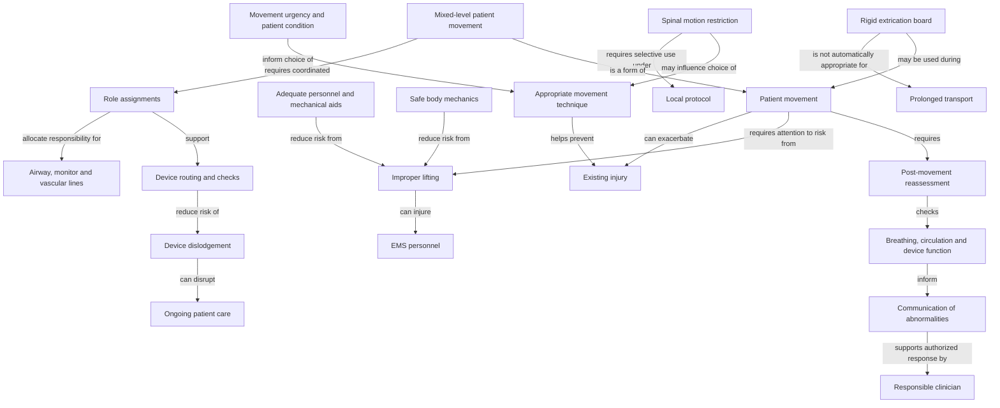

### Trauma case: mechanism, findings and resource decisions

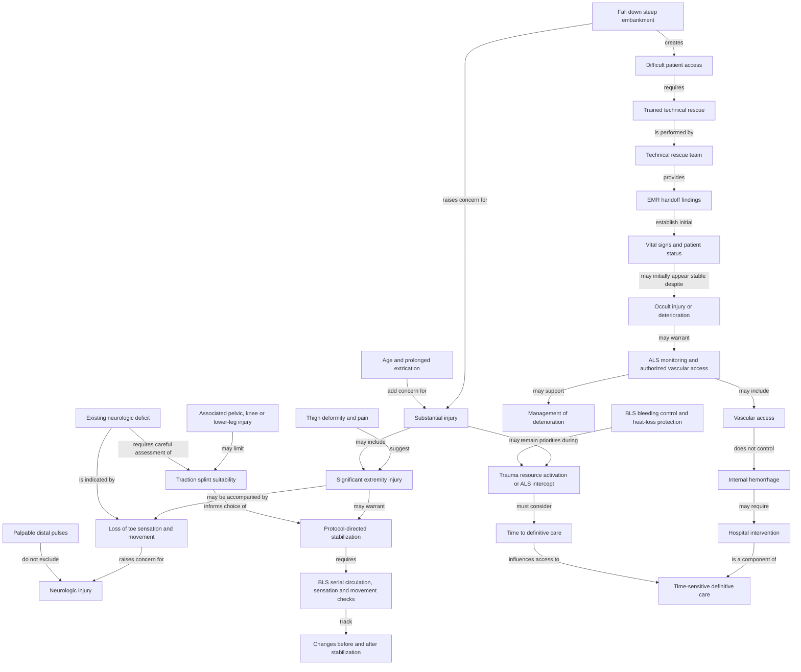

The case describes a 65-year-old after a 30-foot fall, with initial RR 24, pulse 90, SpO₂ 96% on room air, and right foot neurologic deficits despite pulses. Traction was used historically; the 2025 NAEMSP position statement notes uncertain comparative benefit and possible preference for static stabilization. The case's 15-minute reassessment interval is not permission to delay reassessment after interventions or changes.

### Pain management as shared clinical work

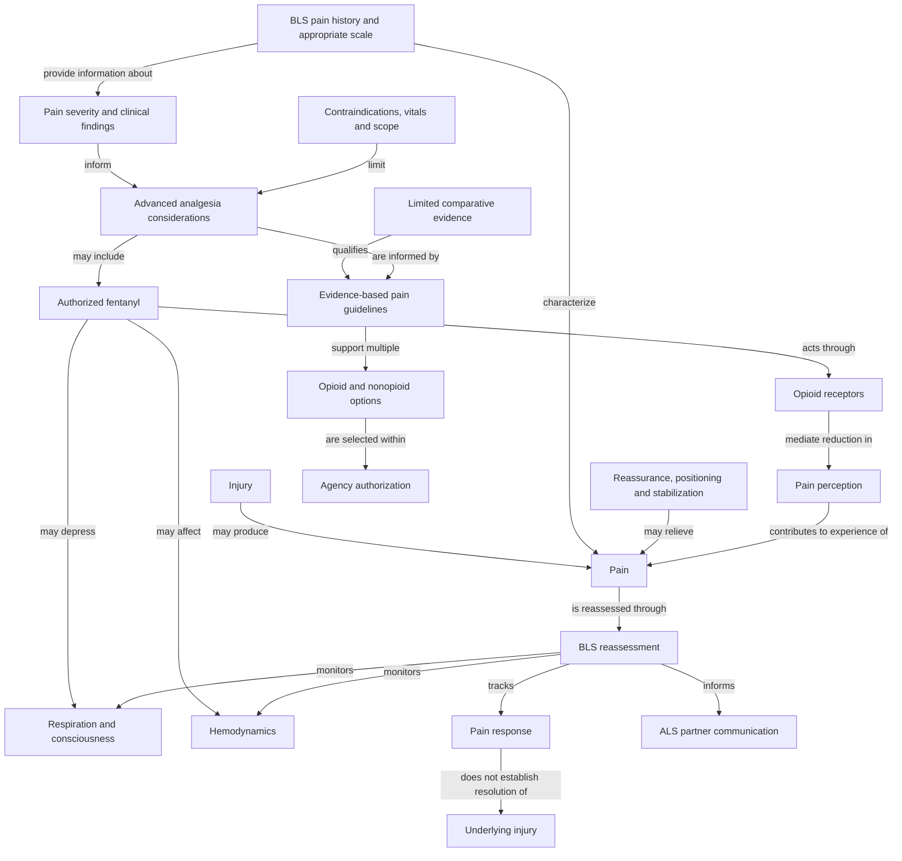

Analgesia is illustrative supplemental knowledge, not medication authorization. AEMT analgesia permissions vary. BLS pain care and monitoring continue regardless of drug availability.

## Continuity, patient advocacy and safety

### Transport, handoff and documentation

```mermaid
flowchart TD
    N01["Destination selection"]
    N02["Patient needs and local protocols"]
    N03["Prenotification"]
    N04["Patient count, severity and immediate needs"]
    N05["Receiving facility resources"]
    N06["En-route reassessment"]
    N07["Condition changes"]
    N08["Updated facility report or medical direction"]
    N09["Safe driving and appropriate warning devices"]
    N10["Patient, crew and public"]
    N11["Structured handoff"]
    N12["History, findings and vital trends"]
    N13["Interventions, times and responses"]
    N14["Unresolved concerns, allergies and medications"]
    N15["Verbal and written reports"]
    N16["Transfer of clinical responsibility"]
    N17["Receiving clinician confirmation"]
    N18["PCR"]
    N19["Shared clinical timeline"]
    N20["Measured observations and measurement conditions"]
    N21["Communications and transfer time"]
    N22["Patient medical record and permanent EMS record"]
    N23["Clinical continuity and QI"]
    N24["Observed versus reported information"]
    N25["Missing measurement"]
    N26["Normal result"]

    N01 -->|is guided by| N02
    N03 -->|communicates| N04
    N04 -->|help prepare| N05
    N06 -->|detects| N07
    N07 -->|may require| N08
    N09 -->|reduce risk to| N10
    N11 -->|communicates| N12
    N11 -->|communicates| N13
    N11 -->|communicates| N14
    N15 -->|support| N16
    N17 -->|reduces misunderstandings during| N16
    N18 -->|records| N19
    N19 -->|includes| N20
    N19 -->|includes| N13
    N19 -->|includes| N21
    N18 -->|becomes part of| N22
    N22 -->|support| N23
    N24 -->|must be distinguished in| N18
    N25 -->|must not be treated as| N26
    N01 -->|determines recipient of| N03
    N06 -->|provides findings for| N11
    N03 -->|supports| N16
    N11 -->|supports| N16
    N09 -->|support safe transport before| N16
    N25 -->|must be distinguished from measured values in| N18
```

Do not leave until appropriate transfer is complete. Use the agency's preferred handoff framework, such as MIST, and document only care actually provided; advanced clinicians record their own decisions according to agency rules.

### Advocacy throughout the care continuum

```mermaid
flowchart TD
    N01["Patient advocacy"]
    N02["Privacy and dignity"]
    N03["Patient valuables"]
    N04["Reasonable patient requests"]
    N05["Truthful plain-language explanations"]
    N06["Patient understanding"]
    N07["Accessible communication"]
    N08["Patient participation"]
    N09["Patient questions"]
    N10["Treating clinician"]
    N11["Family communication"]
    N12["Receiving facility"]
    N13["Confidentiality rules"]
    N14["Information disclosure"]
    N15["Patient discomfort and deterioration"]
    N16["Normal monitor readings"]
    N17["Patient concerns"]
    N18["Safety concern"]
    N19["Advanced patient management"]
    N20["Receiving facility report"]
    N21["Scene circumstances not witnessed by hospital staff"]
    N22["Clinical continuity"]

    N01 -->|protects| N02
    N01 -->|includes safeguarding and documenting| N03
    N01 -->|supports| N04
    N05 -->|promote| N06
    N07 -->|supports| N08
    N09 -->|may require referral to| N10
    N11 -->|helps relatives locate| N12
    N13 -->|limit| N14
    N15 -->|must be communicated to| N10
    N16 -->|do not justify dismissing| N17
    N18 -->|requires respectful escalation to| N10
    N01 -->|continues during| N19
    N20 -->|provides| N21
    N21 -->|support| N22
    N01 -->|includes| N05
    N01 -->|includes| N07
    N01 -->|includes| N11
    N13 -->|govern| N01
    N01 -->|includes reporting| N15
    N01 -->|requires attention to| N17
    N01 -->|supports| N22
```

### Patient safety and error prevention

```mermaid
flowchart TD
    N01["Skill or knowledge deficiencies"]
    N02["Patient care errors"]
    N03["Failure to follow rules"]
    N04["Interruptions and assumptions"]
    N05["Omitted or duplicate care"]
    N06["Poor communication"]
    N07["Misunderstandings and errors"]
    N08["High-risk handoffs"]
    N09["Structured communication"]
    N10["Named assignments"]
    N11["Individual responsibilities"]
    N12["Closed-loop communication"]
    N13["Receiver repeat-back"]
    N14["Sender confirmation"]
    N15["Distinct drug labeling"]
    N16["Medication confusion"]
    N17["Clear protocols and decision aids"]
    N18["Safe clinical decisions"]
    N19["Adequate lighting"]
    N20["Safe assessment and procedures"]
    N21["Reflection and questioning assumptions"]
    N22["Potential errors"]
    N23["Requesting assistance"]
    N24["Skill or resource limitations"]
    N25["Suspected medication error"]
    N26["Responsible clinician"]
    N27["Unsafe lifting, driving or spinal handling"]
    N28["Patient injury"]
    N29["Selective protocol-directed SMR"]
    N30["Unnecessary restriction"]
    N31["Quality improvement"]

    N01 -->|increase risk of| N02
    N03 -->|increases risk of| N02
    N04 -->|increase risk of| N05
    N06 -->|may cause| N07
    N08 -->|require| N09
    N10 -->|clarify| N11
    N12 -->|requires| N13
    N13 -->|is checked through| N14
    N14 -->|helps detect| N07
    N15 -->|helps prevent| N16
    N17 -->|support| N18
    N19 -->|supports| N20
    N21 -->|help identify| N22
    N23 -->|helps address| N24
    N25 -->|requires prompt reporting to| N26
    N27 -->|may cause| N28
    N29 -->|balances injury risk against| N30
    N02 -->|provide learning opportunities for| N31
    N05 -->|are types of| N02
    N07 -->|may contribute to| N02
    N09 -->|may incorporate| N12
    N10 -->|help prevent| N05
    N16 -->|may cause| N02
    N18 -->|help prevent| N02
    N20 -->|help prevent| N02
    N22 -->|may develop into| N02
    N24 -->|can contribute to| N02
    N25 -->|is a potential type of| N02
    N02 -->|may cause| N28
    N29 -->|aims to prevent worsening of| N28
```

### Quality improvement as an operational feedback loop

```mermaid
flowchart TD
    N01["Patient care report"]
    N02["Internal and external review"]
    N03["Patient and staff feedback"]
    N04["System shortcomings"]
    N05["Corrective plans"]
    N06["Excessive response times"]
    N07["Ambulance redeployment"]
    N08["Infrequently used skills"]
    N09["Refresher training"]
    N10["Equipment maintenance and skill practice"]
    N11["Provider competence"]
    N12["Safe and effective care"]
    N13["Outcome and process measures"]
    N14["QI"]
    N15["System effectiveness"]

    N01 -->|provides data for| N02
    N03 -->|provides information for| N02
    N02 -->|identifies| N04
    N04 -->|inform| N05
    N06 -->|may prompt| N07
    N08 -->|may prompt| N09
    N05 -->|may include| N07
    N05 -->|may include| N09
    N05 -->|may include| N10
    N09 -->|reinforces| N11
    N10 -->|support| N12
    N11 -->|supports| N12
    N12 -->|generates new data for| N01
    N13 -->|help assess effectiveness of| N05
    N01 -->|supports measurement of| N13
    N14 -->|aims to improve| N15
    N15 -->|is assessed through| N02
```

QI is intended to improve the system rather than punish individuals. Accountability for unsafe practice may still occur. Arrest reviews consider early CPR, interruptions, defibrillation, communication and outcome; stroke reviews consider recognition, last known well, scene time, prenotification and destination.

## Research and evidence-based practice

### Scientific inquiry and clinical evidence

```mermaid
flowchart TD
    N01["Clinical uncertainty"]
    N02["Research question"]
    N03["Literature review"]
    N04["Hypothesis"]
    N05["Research study"]
    N06["Collected data"]
    N07["Data analysis"]
    N08["Study limitations"]
    N09["Reported findings"]
    N10["Peer-reviewed literature"]
    N11["Clinical evidence appraisal"]
    N12["Population, setting, comparison and outcome relevance"]
    N13["Applicable evidence"]
    N14["Practice change"]
    N15["Approved protocols"]
    N16["Clinical outcomes"]

    N01 -->|motivates| N02
    N03 -->|identifies existing findings and gaps for| N02
    N02 -->|guides development of| N04
    N04 -->|is tested through| N05
    N05 -->|generates| N06
    N07 -->|uses| N06
    N07 -->|supports or rejects| N04
    N05 -->|requires identification of| N08
    N08 -->|qualify| N09
    N07 -->|produces| N09
    N09 -->|may appear in| N10
    N11 -->|assesses validity and reliability of| N10
    N11 -->|considers| N12
    N13 -->|may justify| N14
    N11 -->|helps identify| N13
    N14 -->|requires implementation through| N15
    N15 -->|influence| N16
    N16 -->|can generate new| N01
```

### National research infrastructure and registry data

```mermaid
flowchart TD
    N01["2001 National EMS Research Agenda"]
    N02["Prehospital science and innovation"]
    N03["NHTSA and Maternal Child Health Bureau"]
    N04["Federal research agencies"]
    N05["NIGMS"]
    N06["Research funding and collaboration"]
    N07["2014 FICEMS strategic goal"]
    N08["Data-driven and evidence-based EMS"]
    N09["NHTSA"]
    N10["NEMSIS"]
    N11["EMS encounter data"]
    N12["Accurate PCR documentation"]
    N13["CARES"]
    N14["OHCA records"]
    N15["Survival outcomes"]
    N16["Standardized benchmarks and QI"]
    N17["Registry associations"]
    N18["Improvement opportunities"]
    N19["Causation"]
    N20["Safety in Numbers initiative"]
    N21["When, where and how crash injuries occur"]
    N22["Crash prevention and improved EMS care"]
    N23["EMT research participation"]
    N24["Patient and provider outcomes"]

    N01 -->|sought support for| N02
    N03 -->|commissioned| N01
    N04 -->|support| N02
    N05 -->|promotes| N06
    N07 -->|promotes| N08
    N09 -->|supports data standardization through| N10
    N10 -->|standardizes| N11
    N12 -->|contributes to| N11
    N13 -->|links 911, responders, EMS and hospitals into| N14
    N14 -->|connect early BLS and ALS care with| N15
    N14 -->|support| N16
    N17 -->|can identify| N18
    N17 -->|do not independently prove| N19
    N20 -->|uses EMS data to identify| N21
    N21 -->|informs| N22
    N23 -->|supports| N02
    N11 -->|enable| N08
    N08 -->|can demonstrate| N24
    N06 -->|support| N02
    N02 -->|supports| N08
    N14 -->|can reveal| N17
    N13 -->|supports| N08
    N11 -->|provide input for| N20
```

Federal research participation in the source includes AHRQ, CDC, HRSA, National Fire Academy, Department of Defense and NIH alongside NHTSA. Research can improve workforce safety as well as patient outcomes and documentation.

### Evidence, guidelines and authorized practice

```mermaid
flowchart TD
    N01["Strong valid research"]
    N02["Evidence-based medicine"]
    N03["Clinical decision-making"]
    N04["Research findings"]
    N05["Evidence limitations"]
    N06["Expert recommendations"]
    N07["Evidence-based guidelines"]
    N08["Local protocols"]
    N09["Medical director"]
    N10["State scope and credentialing"]
    N11["Authorized clinical practice"]
    N12["Patient outcomes"]
    N13["Research and QI"]
    N14["More invasive procedures"]
    N15["Better patient outcomes"]

    N01 -->|supports| N02
    N02 -->|uses evidence to inform| N03
    N04 -->|carry| N05
    N04 -->|inform| N06
    N05 -->|affect strength of| N06
    N06 -->|are incorporated into| N07
    N07 -->|provide general frameworks for| N03
    N07 -->|inform development of| N08
    N09 -->|implements and oversees| N08
    N08 -->|must comply with| N10
    N10 -->|limit| N11
    N08 -->|guide| N11
    N11 -->|influences| N12
    N12 -->|are evaluated through| N13
    N13 -->|generate new| N04
    N02 -->|does not independently change| N08
    N14 -->|do not automatically produce| N15
    N15 -->|are the aim of| N02
```

Recommendations may reflect weak evidence or expert judgment. Local applicability, patient outcomes and approved implementation matter; a clinician cannot rewrite standing orders during a call.

### National prehospital guideline development cycle

```mermaid
flowchart TD
    N01["Existing protocols and AHA guidelines"]
    N02["System inputs"]
    N03["Evidence accumulation and evaluation"]
    N04["Development priorities"]
    N05["Guideline development"]
    N06["EMS protocol development"]
    N07["Dissemination"]
    N08["Implementation"]
    N09["Effectiveness, outcome, research and QI evaluation"]
    N10["FICEMS and NEMSAC"]
    N11["National EBG Model Process"]
    N12["2015 NAEMSP national strategy"]
    N13["Guideline development, implementation and evaluation"]
    N14["NHTSA and HRSA EMSC"]
    N15["NASEMSO pediatric pain project"]
    N16["Pediatric pain guidelines"]

    N01 -->|provide| N02
    N02 -->|feed| N03
    N03 -->|inform| N04
    N04 -->|guide| N05
    N05 -->|informs| N06
    N06 -->|produces material for| N07
    N07 -->|supports| N08
    N08 -->|is assessed through| N09
    N09 -->|feeds back into| N03
    N10 -->|facilitated and approved| N11
    N11 -->|includes| N05
    N12 -->|promotes sustainable| N13
    N14 -->|funded| N15
    N15 -->|applies and refines| N11
    N15 -->|focuses on| N16
    N16 -->|are an example of| N05
    N13 -->|are core activities of| N11
```

## Public health and EMS integration

### Population health and individual medicine

```mermaid
flowchart TD
    N01["Public health"]
    N02["Population health"]
    N03["Behavioral, biological and environmental factors"]
    N04["Social, economic, cultural and psychological factors"]
    N05["Disease and injury prevention"]
    N06["Individual medicine"]
    N07["Individual health"]
    N08["Diagnosis and treatment after onset"]
    N09["Multidisciplinary workforce"]
    N10["Public health and medicine"]
    N11["Science"]
    N12["EMS"]
    N13["Individual acute care"]
    N14["Population surveillance"]
    N15["Illness, injury and disability"]
    N16["Organized community efforts"]
    N17["Conditions that support health"]

    N01 -->|focuses on| N02
    N02 -->|depends on interacting| N03
    N02 -->|also depends on| N04
    N01 -->|emphasizes| N05
    N06 -->|focuses on| N07
    N06 -->|traditionally emphasizes| N08
    N06 -->|also increasingly incorporates| N05
    N01 -->|draws on| N09
    N06 -->|contributes clinical expertise to| N01
    N10 -->|share a foundation in| N11
    N12 -->|delivers| N13
    N12 -->|contributes to| N02
    N13 -->|can generate data for| N14
    N14 -->|identifies problems for| N05
    N05 -->|aims to reduce| N15
    N16 -->|help establish| N17
    N17 -->|advance| N02
    N11 -->|supports| N01
    N11 -->|supports| N06
```

Winslow (1920), the IOM (1988), Public Health in America (1994) and APHA emphasize organized prevention and the conditions that allow people and communities to be healthy. The contrast with medicine describes traditional emphasis, not mutually exclusive roles.

### Core public health functions and governance

```mermaid
flowchart TD
    N01["Government at all levels"]
    N02["Population health"]
    N03["State and local governments"]
    N04["Public health activities"]
    N05["Public and private organizations"]
    N06["Assessment"]
    N07["Policy development"]
    N08["Assurance"]
    N09["Epidemiology and biostatistics"]
    N10["Community health information"]
    N11["Health policies and plans"]
    N12["Health and safety regulations"]
    N13["Accessible and competent health services"]
    N14["Health policy and administration"]
    N15["Quality and accessibility of services"]
    N16["Research"]
    N17["2020 essential services revision"]
    N18["Health equity"]
    N19["Barriers to response, prevention and follow-up"]

    N01 -->|shares responsibility for| N02
    N03 -->|implement many| N04
    N05 -->|collaborate in| N04
    N04 -->|are organized through| N06
    N04 -->|are organized through| N07
    N04 -->|are organized through| N08
    N09 -->|support| N06
    N06 -->|collects and analyzes| N10
    N10 -->|guides| N07
    N07 -->|mobilizes partnerships and develops| N11
    N11 -->|guide| N08
    N08 -->|supports enforcement of| N12
    N08 -->|supports| N13
    N14 -->|help coordinate| N08
    N08 -->|evaluates| N15
    N15 -->|provide information for| N06
    N16 -->|supports| N06
    N16 -->|supports| N07
    N16 -->|supports| N08
    N17 -->|centers| N18
    N18 -->|requires attention to| N19
    N01 -->|contributes to| N04
    N18 -->|is advanced through| N13
```

The source describes state responsibility as historical framing, not complete constitutional law. It also presents historical essential-service groupings; the 2020 revised framework places equity at the center.

### Essential public health services in practice

```mermaid
flowchart TD
    N01["Health surveillance"]
    N02["Community health problems"]
    N03["Investigation"]
    N04["Public education and empowerment"]
    N05["Community prevention efforts"]
    N06["Community partnerships"]
    N07["Policy and planning"]
    N08["Health regulations"]
    N09["Health and safety"]
    N10["Access initiatives"]
    N11["Needed personal health services"]
    N12["Workforce development"]
    N13["Competent health workforce"]
    N14["Service evaluation"]
    N15["Research"]
    N16["Population health"]

    N01 -->|identifies| N02
    N03 -->|characterizes| N02
    N02 -->|inform| N04
    N04 -->|support| N05
    N06 -->|mobilize resources to address| N02
    N07 -->|support| N05
    N08 -->|protect| N09
    N10 -->|link people to| N11
    N12 -->|supports| N13
    N13 -->|delivers| N11
    N14 -->|assesses effectiveness and accessibility of| N11
    N14 -->|informs| N07
    N15 -->|identifies innovative solutions for| N02
    N05 -->|aim to improve| N16
    N16 -->|is monitored through| N01
    N07 -->|may establish| N08
```

The ten service concepts in this map reflect the chapter's historical CDC framework; their relationships are shown rather than assigning them to current official categories.

### Public health achievements and changing disease burden

```mermaid
flowchart TD
    N01["Vaccination"]
    N02["Vaccine-preventable infections"]
    N03["Water sanitation and scientific advances"]
    N04["Infectious diseases"]
    N05["Vehicle safety laws and restraints"]
    N06["Motor vehicle fatalities"]
    N07["Workplace regulations and safer equipment"]
    N08["Occupational injuries and fatalities"]
    N09["Risk-factor education and trained EMS"]
    N10["Coronary disease and stroke deaths"]
    N11["Food sanitation and preservation"]
    N12["Food contamination"]
    N13["Prenatal care, nutrition and hygiene"]
    N14["Maternal and infant health"]
    N15["Family planning"]
    N16["Pregnancy and family size"]
    N17["Water fluoridation"]
    N18["Tooth decay"]
    N19["Tobacco hazard recognition"]
    N20["Education and smoking prevention laws"]
    N21["Public health achievements"]
    N22["Longer and healthier lives"]
    N23["1900 mortality pattern"]
    N24["Infectious and diarrheal diseases"]
    N25["2018 mortality pattern"]
    N26["Heart disease, cancer and unintentional injuries"]
    N27["2022 mortality pattern"]
    N28["Heart disease, cancer and COVID-19"]
    N29["Changing mortality patterns"]
    N30["Public health assessment"]
    N31["Prevention efforts"]

    N01 -->|helps prevent or control| N02
    N03 -->|help control| N04
    N05 -->|reduce| N06
    N07 -->|reduce| N08
    N09 -->|contribute to lower| N10
    N11 -->|reduce| N12
    N13 -->|support| N14
    N15 -->|enables greater control of| N16
    N17 -->|helps prevent| N18
    N19 -->|promotes| N20
    N21 -->|contribute to| N22
    N23 -->|was dominated by| N24
    N25 -->|was dominated by| N26
    N27 -->|included among the top three| N28
    N29 -->|help identify priorities for| N30
    N21 -->|include| N01
    N21 -->|include| N03
    N21 -->|include| N05
    N21 -->|include| N07
    N21 -->|include| N09
    N21 -->|include| N11
    N21 -->|include| N13
    N21 -->|include| N15
    N21 -->|include| N17
    N21 -->|include| N19
    N23 -->|provides historical comparison for| N25
    N25 -->|provides pre-pandemic comparison for| N27
    N23 -->|helps illustrate| N29
    N30 -->|informs priorities for| N31
    N21 -->|illustrate results of| N31
```

The historical figures in the chapter are life expectancy at birth of 47.3 years in 1900, 78.4 in 2018 and 77.0 in 2020. These are historical snapshots, not proof that any single intervention caused the entire change. The source does not distinguish global eradication from regional elimination of poliomyelitis; no global eradication claim is made here.

### Social determinants, health equity and surveillance

```mermaid
flowchart TD
    N01["Social determinants of health"]
    N02["Economic stability"]
    N03["Education access and quality"]
    N04["Health care access and quality"]
    N05["Neighborhood and built environment"]
    N06["Social and community context"]
    N07["Medication affordability"]
    N08["Transportation and environmental exposures"]
    N09["Understanding health instructions"]
    N10["Needed care"]
    N11["Health disparities and inequities"]
    N12["EMS encounters"]
    N13["Barriers to care"]
    N14["Difficulty affording medication"]
    N15["Difficulty understanding health instructions"]
    N16["Referrals and clinical communication"]
    N17["EMS EHR data"]
    N18["Public health surveillance"]
    N19["Health policy decisions"]
    N20["Confidentiality rules"]
    N21["EMS EHR data sharing"]

    N01 -->|include| N02
    N01 -->|include| N03
    N01 -->|include| N04
    N01 -->|include| N05
    N01 -->|include| N06
    N02 -->|can influence| N07
    N05 -->|can affect| N08
    N03 -->|can influence| N09
    N04 -->|shape access to| N10
    N06 -->|can influence| N11
    N01 -->|contribute to| N11
    N12 -->|may reveal| N13
    N14 -->|is an example of| N13
    N02 -->|can affect| N14
    N08 -->|may contribute to| N13
    N15 -->|is an example of| N13
    N03 -->|can affect| N15
    N13 -->|inform authorized| N16
    N17 -->|provide information for| N18
    N18 -->|informs| N19
    N19 -->|can address| N11
    N20 -->|limit| N21
    N21 -->|must be authorized before use in| N18
```

Social barriers contextualize care; they neither establish a diagnosis nor justify labels such as noncompliance without investigation. Share information through approved channels only.

### Prevention levels and EMS roles

```mermaid
flowchart TD
    N01["Primary prevention"]
    N02["Disease and injury onset"]
    N03["Public education on seat belts, falls and fire safety"]
    N04["Authorized vaccination programs"]
    N05["Secondary prevention"]
    N06["Disease progression and complications"]
    N07["Screening and testing"]
    N08["Risk or early disease"]
    N09["Surveillance and reporting"]
    N10["Community health threats"]
    N11["Emergency management planning"]
    N12["Surveillance, mitigation and response"]
    N13["Tertiary prevention"]
    N14["Disease management and rehabilitation"]
    N15["Acute EMS treatment"]
    N16["EMS frontline contacts"]
    N17["Vulnerable and underserved populations"]
    N18["Authorized referrals and primary care access"]
    N19["Public education on CPR"]
    N20["Early resuscitation"]
    N21["Public AED access"]
    N22["Coordinated BLS and ALS care"]
    N23["AED"]
    N24["Shockable cardiac arrest rhythms"]
    N25["Uncomplicated heart attack with a pulse"]

    N01 -->|aims to prevent| N02
    N03 -->|supports| N01
    N04 -->|support| N01
    N05 -->|aims to limit| N06
    N07 -->|identify| N08
    N08 -->|may prompt| N05
    N09 -->|help identify| N10
    N10 -->|inform| N11
    N11 -->|coordinates| N12
    N13 -->|includes| N14
    N15 -->|contributes to| N13
    N16 -->|may identify| N17
    N17 -->|may benefit from| N18
    N18 -->|support| N14
    N19 -->|prepares bystanders for| N20
    N21 -->|supports| N20
    N20 -->|continues into| N22
    N23 -->|treats| N24
    N23 -->|does not treat| N25
    N16 -->|may provide opportunities for| N07
    N16 -->|may provide opportunities for| N09
    N16 -->|may provide opportunities for| N01
    N16 -->|may require| N15
    N22 -->|is a form of| N15
    N21 -->|provides access to| N23
```

The chapter lists AED access under secondary prevention; its direct clinical role is resuscitation, not treatment of a heart attack with a pulse. Screening can serve multiple prevention purposes depending on the program. Vaccination and screening require appropriate authority, training and oversight.

### Mobile integrated healthcare and community paramedicine

```mermaid
flowchart TD
    N01["Mobile integrated healthcare"]
    N02["Patient-centered out-of-hospital care"]
    N03["EMS system"]
    N04["Community paramedicine"]
    N05["Other health care entities"]
    N06["EMS community presence"]
    N07["Access to underserved patients"]
    N08["Specially trained personnel"]
    N09["Chronic disease management"]
    N10["Post-discharge follow-up"]
    N11["Prevention and patient education"]
    N12["Integrated programs"]
    N13["Routine dispatch or transport"]
    N14["High-risk or frequent health care users"]
    N15["Primary care, nursing, behavioral and social services"]
    N16["Authorized EMT observations and referrals"]
    N17["Training and credentials"]
    N18["Paramedic licensure alone"]
    N19["Scheduled visits and frequent EMS use"]
    N20["Acute emergencies"]
    N21["Emergency assessment and care"]

    N01 -->|uses mobile resources to deliver| N02
    N01 -->|integrates various health entities with| N03
    N04 -->|integrates EMS agency and personnel with| N05
    N04 -->|is a form of integrated| N02
    N06 -->|supports| N07
    N07 -->|can be improved through| N01
    N08 -->|may provide| N09
    N08 -->|may provide| N10
    N08 -->|may provide| N11
    N12 -->|may offer alternatives to| N13
    N14 -->|may benefit from| N09
    N14 -->|may benefit from| N10
    N15 -->|collaborate with| N04
    N16 -->|may support| N11
    N04 -->|requires program-specific| N17
    N18 -->|does not establish| N17
    N19 -->|do not exclude| N20
    N20 -->|require appropriate| N21
    N04 -->|may employ| N08
    N01 -->|may operate through| N12
    N08 -->|must remain alert for| N20
```

The 2016 NAEMT vision includes telephone advice as an alternative to dispatch, chronic care and follow-up in defined programs. MIH-CP is not simply routine ALS; alternative care depends on program authority and patient needs.

## Cross-concept synthesis

### One patient encounter as a system learning opportunity

```mermaid
flowchart TD
    N01["Public education and access"]
    N02["Early recognition and 911 activation"]
    N03["Dispatch and prearrival care"]
    N04["Coordinated BLS and ALS response"]
    N05["Training, resources and authorized scope"]
    N06["Medical direction and local protocols"]
    N07["Clinical reassessment and destination decisions"]
    N08["Handoff and definitive care"]
    N09["Clinical outcomes"]
    N10["PCR and EHR data"]
    N11["Quality improvement and registry research"]
    N12["Evidence-based guidelines"]
    N13["Population surveillance"]
    N14["Prevention and community partnerships"]
    N15["MIH and community paramedicine"]
    N16["Ongoing care and follow-up"]
    N17["Patient advocacy"]

    N01 -->|enable| N02
    N02 -->|initiates| N03
    N03 -->|mobilizes| N04
    N04 -->|depends on| N05
    N06 -->|govern| N04
    N04 -->|produces observations for| N07
    N07 -->|support| N08
    N08 -->|generate| N09
    N07 -->|are documented in| N10
    N10 -->|support| N11
    N09 -->|provide measures for| N11
    N11 -->|inform| N12
    N12 -->|inform| N06
    N11 -->|identify needs for| N05
    N10 -->|also support authorized| N13
    N13 -->|guides| N14
    N14 -->|support| N01
    N14 -->|can identify needs for| N15
    N15 -->|connect patients to| N16
    N17 -->|protects patient interests throughout| N04
```

