# Chapter 2: Workforce Safety and Wellness of the EMT — Concept Maps

## Conceptual overview

### Workforce safety, wellness and patient care

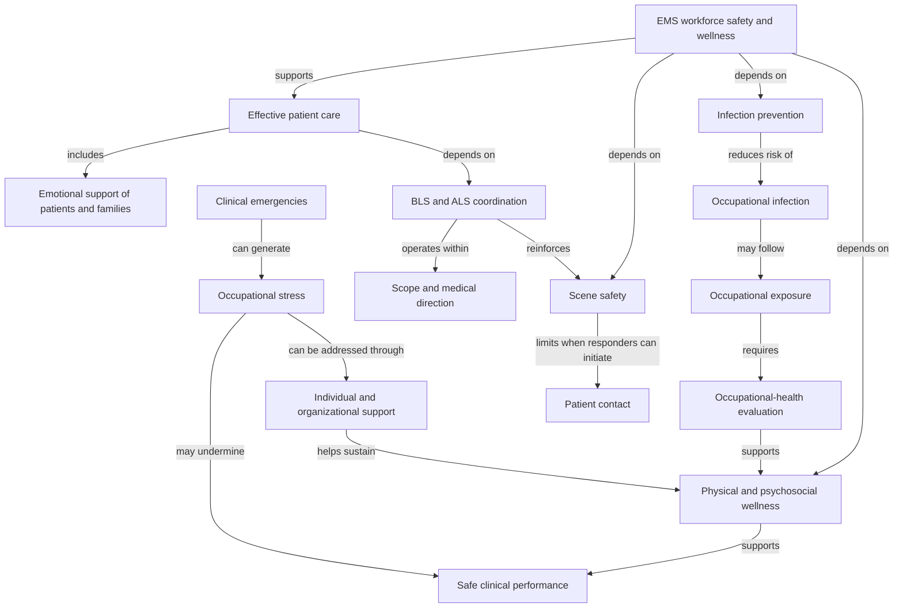

## Shared clinical responsibilities and scene safety

### Clinical capability, authorization and shared responsibilities

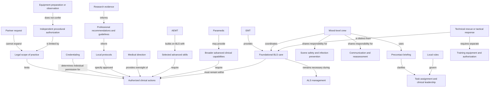

AEMT examples include selected vascular access, medications and airway adjuncts; paramedic examples include ECG interpretation, broader pharmacology, airway management and electrical therapies. All examples remain subject to local authorization.

### Hazard recognition, control and safe access

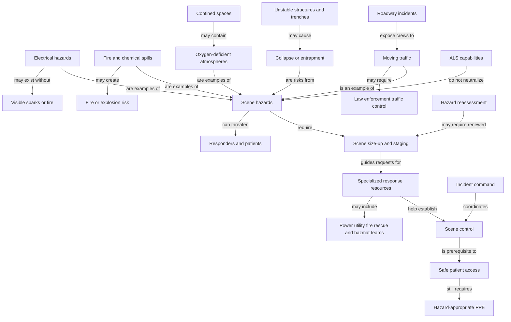

### Hazardous materials, contamination and clinical care

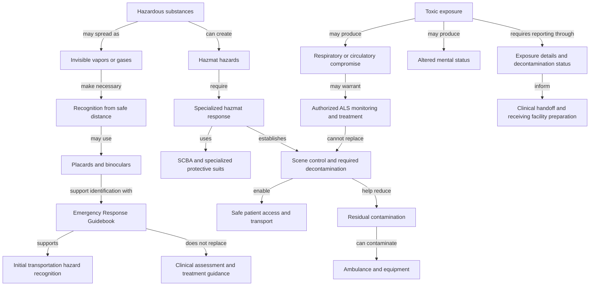

Report substance if known, exposure route, symptoms, number exposed and decontamination status. Contaminated transport requires a specialized response plan; verify local ERG carriage requirements.

### Rescue PPE and roadway visibility

```mermaid
flowchart TD
    N01["Hazard assessment"]
    N02["Hazard-appropriate PPE"]
    N03["Agency protocol and assigned role"]
    N04["Falling debris"]
    N05["Impact-resistant helmet with chin strap"]
    N06["Wet conditions"]
    N07["Waterproof boots and slip-resistant gloves"]
    N08["Cold conditions"]
    N09["Insulating layers hat and gloves"]
    N10["Puncture and splash hazards"]
    N11["Protective gloves and eyewear"]
    N12["Dust exposure"]
    N13["Appropriate particulate respiratory protection"]
    N14["Particulate respiratory protection"]
    N15["Oxygen-deficient confined spaces"]
    N16["Traffic exposure"]
    N17["High-visibility apparel"]
    N18["Responder conspicuity"]
    N19["Historical ANSI 107-2004"]
    N20["Traffic exposure and diverted attention"]
    N21["Historical ANSI 207-2006 public safety vest"]
    N22["Breakaway features and service identification"]
    N23["2023 MUTCD temporary traffic control guidance"]
    N24["Class 2 or 3 apparel under ANSI 107-2015 or equivalent revisions"]
    N25["Current adopted roadway rules and incident command"]

    N01 -->|guides| N02
    N03 -->|limit| N02
    N04 -->|warrants| N05
    N06 -->|warrant| N07
    N08 -->|warrant| N09
    N10 -->|may warrant| N11
    N12 -->|may warrant| N13
    N14 -->|does not authorize entry into| N15
    N16 -->|requires consideration of| N17
    N17 -->|helps improve| N18
    N19 -->|classified apparel by| N20
    N21 -->|incorporated| N22
    N23 -->|references| N24
    N25 -->|govern| N17
    N04 -->|influences selection of| N02
    N06 -->|influence selection of| N02
    N08 -->|influence selection of| N02
    N10 -->|influence selection of| N02
    N12 -->|influences selection of| N02
    N17 -->|is a form of| N02
    N19 -->|addressed| N17
    N21 -->|is a historical form of| N17
    N23 -->|addresses| N17
```

Historical Class 1 was described for traffic below 25 mph, Class 2 for diverted attention or speeds of at least 25 mph, and Class 3 for serious risk with attention greatly diverted. This shorthand and the historical federal vest rule are not current universal selection criteria.

### Violence, scene preservation and responder safety

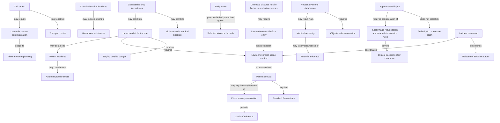

### Agitation, medical causes and authorized management

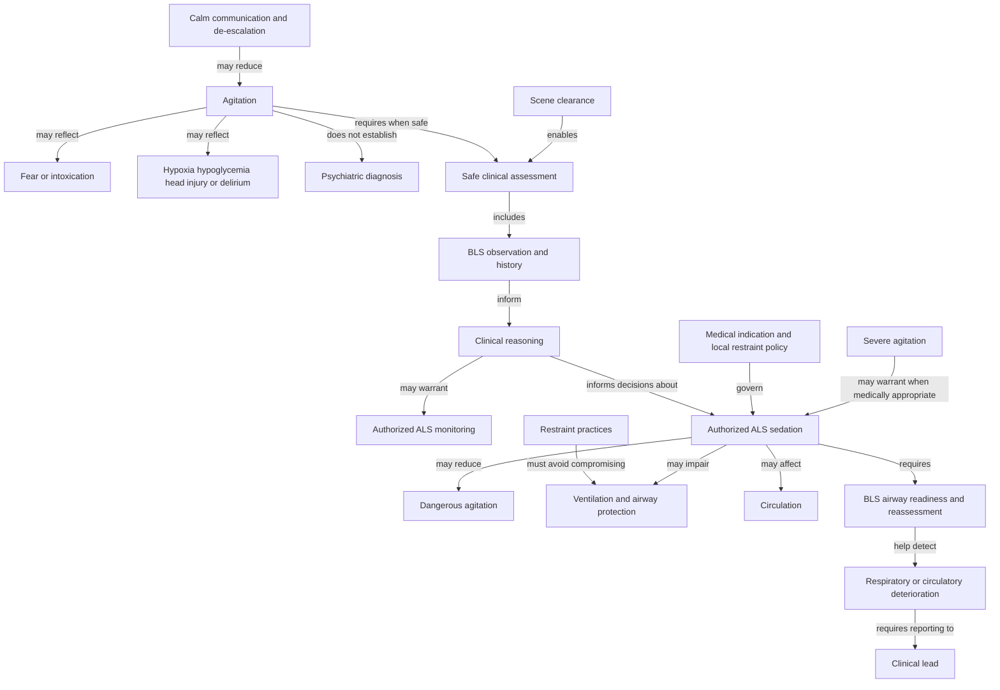

Sedation is not punishment or a means solely to facilitate custody. Reassess throughout transport; EMTs do not independently administer unauthorized sedatives.

### Pediatric trauma, perfusion and coordinated care

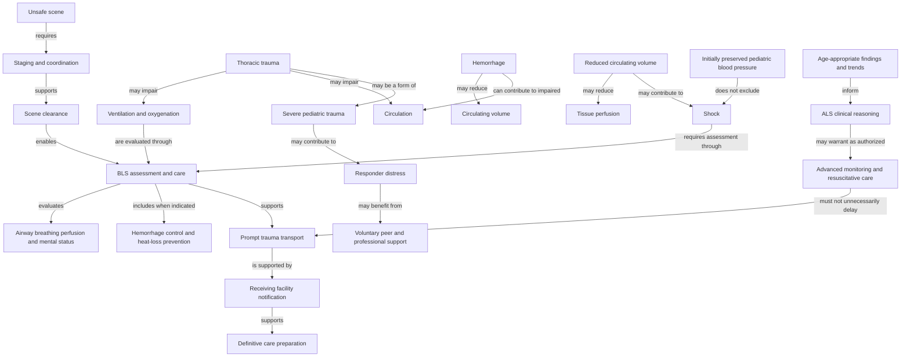

Advanced vascular access, fluids or blood where available, analgesia and chest-injury management depend on actual findings, resources and protocol; no intervention follows automatically from the mechanism.

### Moving a patient with advanced equipment

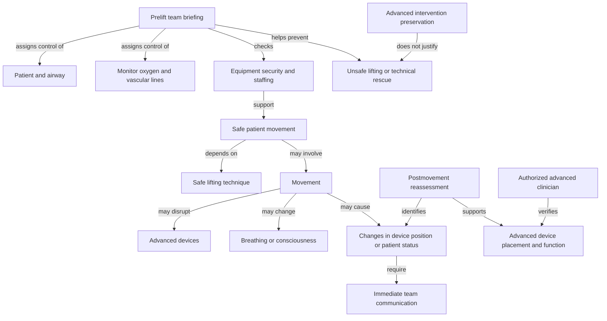

## Infection prevention and occupational exposure

### Pathogens, host dependence and disease

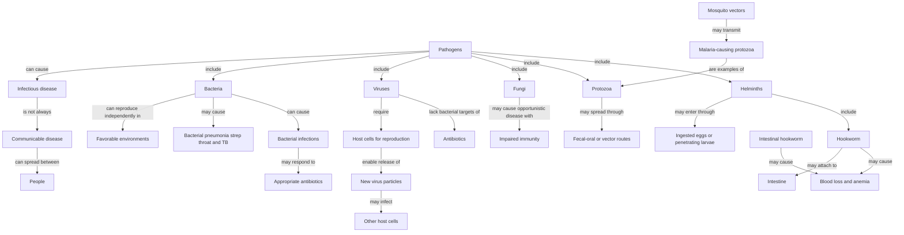

Organism categories are introductory generalizations. Antibiotic susceptibility, viral severity and host susceptibility vary; fungal and protozoal infections also occur in immunocompetent people.

### Transmission routes and disease-specific precautions

```mermaid
flowchart TD
    N01["Communicable disease"]
    N02["Direct contact"]
    N03["Indirect contact"]
    N04["Respiratory transmission"]
    N05["Blood wounds or mucous membranes"]
    N06["Contaminated objects or sharps"]
    N07["Blood and body fluid exposure"]
    N08["HIV HBV or HCV"]
    N09["Droplet and airborne precautions"]
    N10["Pulmonary or laryngeal TB"]
    N11["Airborne hazard"]
    N12["Varicella"]
    N13["Airborne contact and standard precautions"]
    N14["Influenza pertussis and meningitis examples"]
    N15["Transmission precautions"]
    N16["Staphylococcal skin infection"]
    N17["Lesion or contaminated object contact"]
    N18["SARS-CoV-2"]
    N19["Suspected viral hemorrhagic fever"]
    N20["Specialized risk assessment PPE and transport plan"]
    N21["Pneumonia"]
    N22["Zika"]
    N23["Mosquito sexual or maternal-fetal transmission"]
    N24["Suspected disease and exposure circumstances"]
    N25["Standard Precautions"]
    N26["Known infection status"]

    N01 -->|can spread by| N02
    N01 -->|can spread by| N03
    N01 -->|can spread by| N04
    N02 -->|may involve| N05
    N03 -->|may involve| N06
    N07 -->|may transmit| N08
    N04 -->|requires distinction between| N09
    N10 -->|is primarily| N11
    N12 -->|requires| N13
    N14 -->|require disease-specific| N15
    N16 -->|may spread through| N17
    N18 -->|requires current disease-specific| N15
    N19 -->|requires| N20
    N21 -->|has multiple causes with varying| N15
    N22 -->|may spread through| N23
    N24 -->|determine| N15
    N25 -->|apply regardless of| N26
    N02 -->|may involve| N07
    N11 -->|requires consideration of| N09
    N12 -->|requires disease-specific| N15
    N16 -->|requires disease-specific| N15
    N19 -->|requires specialized| N15
    N25 -->|are supplemented when indicated by| N15
    N04 -->|influences selection of| N15
```

Incubation estimates in the original table are historical and organism-dependent. HIV acute infection, diagnostic window and progression to AIDS are distinct; a surgical mask alone is insufficient for clinician protection against suspected varicella.

### Infection risk versus clinical deterioration

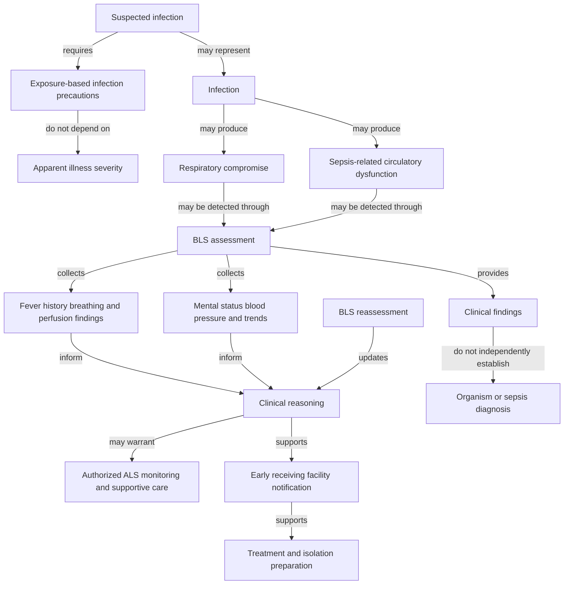

### Standard Precautions and occupational responsibilities

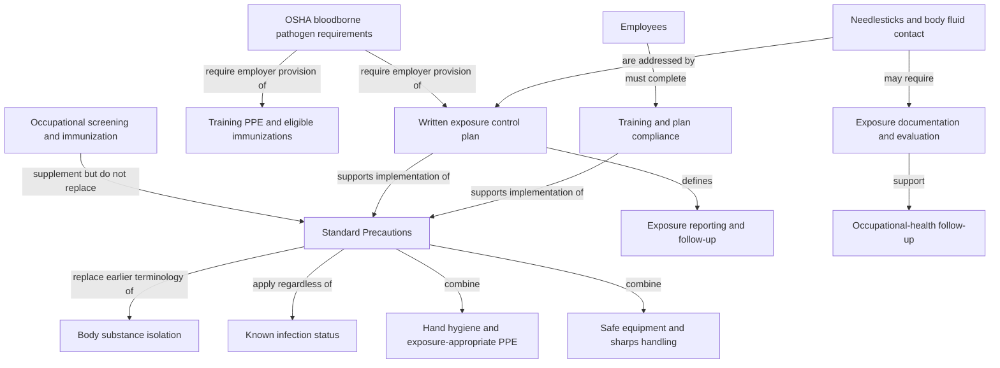

### Hand hygiene and interruption of contamination

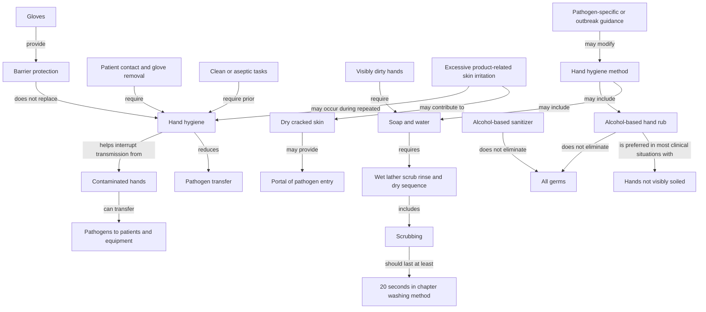

The source specifies at least 60% alcohol for its sanitizer example and distinguishes the historical 10–15-second lather estimate from the 20-second washing method.

### PPE barriers, respiratory protection and glove removal

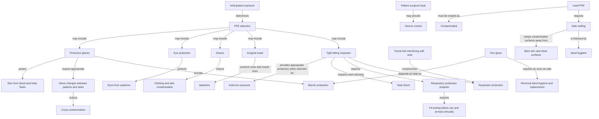

Double-gloving may be appropriate in selected circumstances; utility gloves are used for cleaning. Source control is not equivalent to a fit-tested clinician respirator.

### Glove doffing and containment

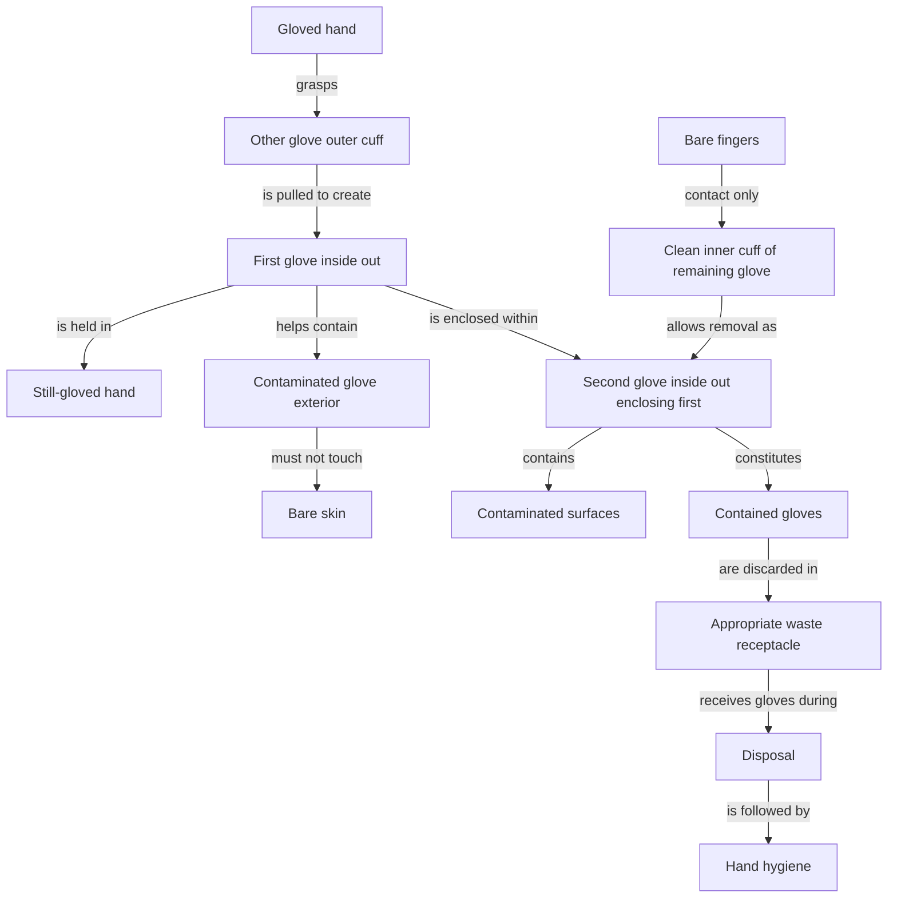

Follow agency waste-containment rules; glove disposal is not automatically regulated biohazard waste solely because of a diagnosis.

### Airway care: infection risk, oxygenation and ventilation

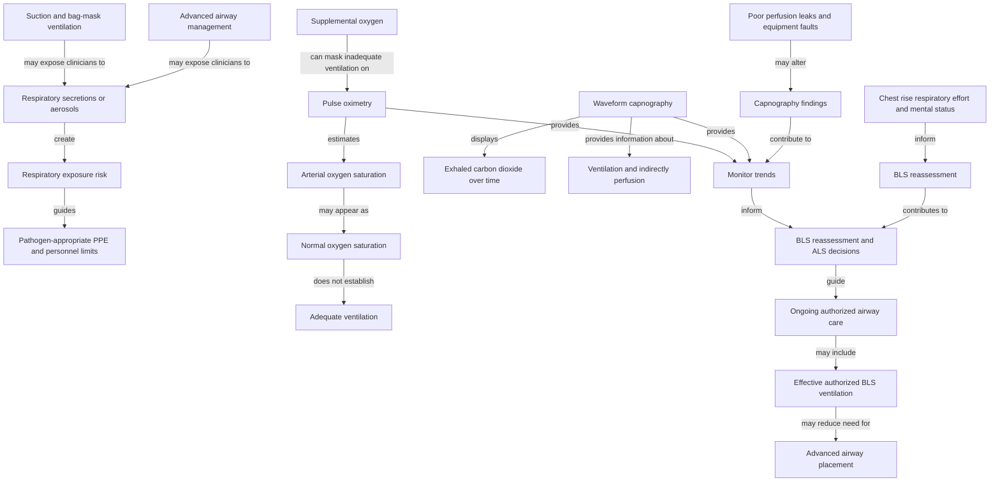

### Equipment reprocessing and aseptic handling

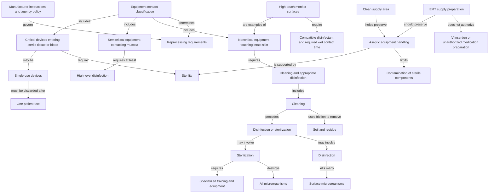

Reusable BP cuffs need appropriate disinfection; reusable laryngoscope blades are semicritical, not automatically critical. Do not improvise reprocessing of complex devices.

### Waste, laundry, spills and sharps safety

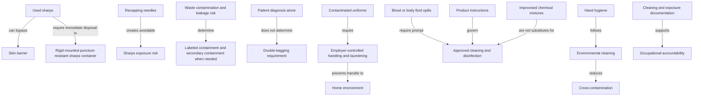

### Screening, immunity and vaccination

```mermaid
flowchart TD
    N01["Occupational screening"]
    N02["Early identification of infection risk"]
    N03["Initial TB screening"]
    N04["Risk assessment symptom evaluation and testing"]
    N05["Initial TB testing"]
    N06["IGRA or tuberculin skin test"]
    N07["Known exposure or ongoing transmission"]
    N08["Additional TB testing"]
    N09["Routine annual TB testing"]
    N10["Exposure or ongoing transmission"]
    N11["Prior positive TB results"]
    N12["Different management"]
    N13["Occupational immunization"]
    N14["Vaccine-preventable disease"]
    N15["Age immunity risk and contraindications"]
    N16["Individual vaccination recommendations"]
    N17["Hepatitis B occupational exposure assignment"]
    N18["10 working days subject to exceptions"]
    N19["Hepatitis B vaccination"]
    N20["Two-dose or three-dose series"]
    N21["Hepatitis B titer"]
    N22["Immune status"]
    N23["Influenza vaccine"]
    N24["Annually"]
    N25["Tdap followed by Td or Tdap"]
    N26["10 years"]
    N27["Pregnancy"]
    N28["Each pregnancy"]
    N29["Standard Precautions"]

    N01 -->|supports| N02
    N03 -->|includes| N04
    N05 -->|may use| N06
    N07 -->|may warrant| N08
    N09 -->|is generally not recommended without| N10
    N11 -->|require| N12
    N13 -->|reduces risk of| N14
    N15 -->|inform| N16
    N17 -->|triggers employer offer within| N18
    N19 -->|may use| N20
    N21 -->|helps assess| N22
    N23 -->|is recommended| N24
    N25 -->|provides boosters generally every| N26
    N27 -->|requires Tdap recommendation during| N28
    N13 -->|does not replace| N29
```

The source additionally includes COVID-19, MMR and varicella vaccination; verify immunity and follow occupational-health guidance rather than treating its list as an individualized schedule.

### Exposure reporting, notification and follow-up

```mermaid
flowchart TD
    N01["Suspected occupational exposure"]
    N02["Supervisor and designated officer notification"]
    N03["Objective incident documentation"]
    N04["Time fluid amount type and circumstances"]
    N05["Timely medical evaluation"]
    N06["Receiving facility diagnosis of qualifying airborne disease"]
    N07["Designated officer notification"]
    N08["Ryan White Act airborne notification provision"]
    N09["48 hours after facility determination"]
    N10["Exposed worker notification"]
    N11["Employer-arranged follow-up"]
    N12["Possible bloodborne exposure"]
    N13["Designated officer information gathering"]
    N14["Receiving facility inquiry"]
    N15["Findings reported within 48 hours"]
    N16["Notification process"]
    N17["Occupational-health evaluation"]
    N18["Baseline and interval testing"]
    N19["Local policy"]
    N20["More stringent notification procedures"]

    N01 -->|requires prompt| N02
    N01 -->|requires| N03
    N03 -->|records| N04
    N01 -->|requires| N05
    N06 -->|triggers| N07
    N08 -->|sets outer limit of| N09
    N07 -->|supports| N10
    N10 -->|supports| N11
    N12 -->|may prompt| N13
    N13 -->|may warrant| N14
    N14 -->|may result in| N15
    N16 -->|must not delay| N05
    N17 -->|may include| N18
    N19 -->|may impose| N20
```

The source corrects the original 24-hour airborne-notification claim to as soon as practicable and no later than 48 hours after determination.

### ALS sharps exposure and time-sensitive prophylaxis

```mermaid
flowchart TD
    N01["Invasive ALS procedures"]
    N02["Sharps hazards"]
    N03["Contaminated sharp"]
    N04["Skin barrier"]
    N05["Sharps container readiness"]
    N06["Immediate safe disposal"]
    N07["Clinician using the sharp"]
    N08["Unnecessary hands near sharp"]
    N09["Sharps exposure risk"]
    N10["Occupational bloodborne exposure"]
    N11["Immediate washing or mucous membrane flushing"]
    N12["Prompt reporting and urgent medical evaluation"]
    N13["Source-patient testing"]
    N14["Occupational-health clinician"]
    N15["HIV post-exposure prophylaxis"]
    N16["Establishment of HIV infection"]
    N17["2025 occupational HIV guidance"]
    N18["72 hours"]
    N19["Unusually high-risk exposure presenting later"]
    N20["Specialist consultation"]
    N21["Other bloodborne pathogens"]
    N22["Pathogen-specific evaluation"]

    N01 -->|introduce| N02
    N03 -->|can inoculate blood through| N04
    N05 -->|supports| N06
    N07 -->|is responsible for| N06
    N08 -->|increase| N09
    N10 -->|requires| N11
    N10 -->|requires| N12
    N13 -->|must not delay| N12
    N14 -->|determines need for| N15
    N15 -->|uses antiretrovirals to inhibit| N16
    N17 -->|recommends starting indicated PEP as soon as possible within| N18
    N19 -->|requires consideration of| N20
    N21 -->|require| N22
```

## Emotional care of patients and families

### Emotional crisis, loss and grief responses

```mermaid
flowchart TD
    N01["Pain anxiety strain or sorrow"]
    N02["Distress"]
    N03["Emotional pressures exceeding coping resources"]
    N04["Emotional crisis"]
    N05["Support toward emotional equilibrium"]
    N06["Death and dying"]
    N07["Grief responses"]
    N08["Nonfatal permanent loss"]
    N09["Kübler-Ross model"]
    N10["Denial"]
    N11["Anger"]
    N12["Bargaining"]
    N13["Depression"]
    N14["Acceptance"]
    N15["Shock of impending loss"]
    N16["Responders"]
    N17["Death or loss"]
    N18["Loss and unfinished concerns"]
    N19["Family members"]
    N20["Patients and loved ones"]
    N21["Withdrawn or altered behavior"]
    N22["Acute medical illness"]
    N23["Physiological and mental status assessment"]

    N01 -->|may produce| N02
    N03 -->|may produce| N04
    N04 -->|may require| N05
    N06 -->|may evoke| N07
    N08 -->|may also evoke| N07
    N09 -->|describes possible responses including| N10
    N09 -->|describes possible responses including| N11
    N09 -->|describes possible responses including| N12
    N09 -->|describes possible responses including| N13
    N09 -->|describes possible responses including| N14
    N10 -->|may buffer| N15
    N11 -->|may be directed toward| N16
    N12 -->|may express attempts to postpone| N17
    N13 -->|may reflect recognition of| N18
    N14 -->|may shift support needs toward| N19
    N07 -->|vary in timing and order among| N20
    N21 -->|may also reflect| N22
    N22 -->|requires continued| N23
    N04 -->|may accompany| N07
    N06 -->|may produce| N02
    N07 -->|are described in part by| N09
    N13 -->|may involve| N21
```

The five responses are not required stages, a diagnostic test, or a universal sequence.

### Dignity, communication and family support

```mermaid
flowchart TD
    N01["Emergency care"]
    N02["Treatment of illness or injury"]
    N03["Emotional support"]
    N04["Dignity respect privacy and control"]
    N05["Respectful communication"]
    N06["Patient orientation and procedure explanations"]
    N07["Care being provided"]
    N08["Unresponsive patients"]
    N09["Awareness of speech"]
    N10["Possible retained awareness"]
    N11["Empathetic listening"]
    N12["Safe expression of grief"]
    N13["Anger directed at responders"]
    N14["Nondefensive communication"]
    N15["Truthful and tactful explanations"]
    N16["False assurances"]
    N17["Family presence"]
    N18["Patient and family connection"]
    N19["Scene safety and uninterrupted care"]
    N20["Assigned support person"]
    N21["Family communication without interrupting care"]
    N22["Patient messages and requests"]
    N23["Reliable follow-through when promised"]
    N24["Family preference and responder comfort"]
    N25["Requested prayer"]
    N26["Transport safety and policy"]
    N27["Family accompaniment"]

    N01 -->|prioritizes| N02
    N01 -->|also includes| N03
    N03 -->|addresses| N04
    N05 -->|supports| N04
    N06 -->|reduce uncertainty about| N07
    N08 -->|may retain| N09
    N10 -->|supports| N05
    N11 -->|allows| N12
    N13 -->|calls for| N14
    N15 -->|avoid| N16
    N17 -->|may support| N18
    N19 -->|limit| N17
    N20 -->|can provide| N21
    N22 -->|require| N23
    N24 -->|guide| N25
    N26 -->|limit| N27
```

### Death, family contact and evidence preservation

```mermaid
flowchart TD
    N01["Patient death"]
    N02["Family need for contact and closure"]
    N03["Family contact with body"]
    N04["Local protocol and scene conditions"]
    N05["Noncriminal scene with permission"]
    N06["Respectful preparation of body"]
    N07["Severe disfigurement"]
    N08["Sensitive advance explanation to family"]
    N09["Possible crime scene"]
    N10["Cleaning or moving the body"]
    N11["Law enforcement coroner or medical examiner"]
    N12["Evidence preservation"]
    N13["Documentation of necessary disturbance"]
    N14["Care necessity"]
    N15["Avoidance of scene disturbance"]
    N16["Family support"]
    N17["Coroner or medical examiner arrives"]
    N18["Death communication"]
    N19["Role and local policy"]

    N01 -->|may create| N02
    N03 -->|depends on| N04
    N05 -->|may allow| N06
    N07 -->|warrants| N08
    N09 -->|restricts| N10
    N09 -->|restricts| N03
    N11 -->|may authorize| N03
    N12 -->|requires| N13
    N14 -->|may override| N15
    N16 -->|may continue until| N17
    N18 -->|must follow| N19
```

### Resuscitation, autonomy and shared care

```mermaid
flowchart TD
    N01["BLS resuscitation"]
    N02["Compressions ventilation and AED use when indicated"]
    N03["Authorized paramedic assessment"]
    N04["Rhythm and reversible causes"]
    N05["Advanced monitoring"]
    N06["Resuscitation decisions"]
    N07["Survival"]
    N08["Witnessed events and prior care"]
    N09["Documented patient wishes"]
    N10["Withholding or termination decisions"]
    N11["Possible DNR or portable medical order"]
    N12["Clinical leader"]
    N13["Family statement alone"]
    N14["Legally valid order"]
    N15["Applicable rules and medical direction"]
    N16["Authority to pronounce death"]
    N17["Paramedic certification alone"]
    N18["ALS resuscitation"]
    N19["Assigned family support person"]
    N20["Safe family presence and communication"]
    N21["Outcome uncertainty"]
    N22["Compassionate truthful communication"]
    N23["Authorized cessation of efforts"]
    N24["Clear death communication within role"]
    N25["Potential criminal scene"]
    N26["Evidence preservation"]

    N01 -->|provides| N02
    N03 -->|may evaluate| N04
    N05 -->|informs| N06
    N05 -->|does not guarantee| N07
    N08 -->|inform| N06
    N09 -->|may inform| N10
    N11 -->|requires communication to| N12
    N13 -->|does not establish| N14
    N15 -->|govern| N10
    N10 -->|are distinct from| N16
    N17 -->|does not confer| N16
    N01 -->|remains essential during| N18
    N19 -->|facilitates| N20
    N21 -->|requires| N22
    N23 -->|may be followed by| N24
    N25 -->|requires| N26
    N01 -->|supports| N06
    N04 -->|inform| N06
    N11 -->|may express| N09
    N06 -->|may include| N10
    N23 -->|depends on| N10
    N19 -->|can provide| N22
```

## Occupational stress and critical incident support

### EMS demands, stress and functional consequences

```mermaid
flowchart TD
    N01["External demands exceeding personal resources"]
    N02["Stress"]
    N03["Long hours shift work and excessive workload"]
    N04["Occupational demands"]
    N05["Boredom and limited recognition"]
    N06["Occupational stress"]
    N07["Rapid response and life-and-death decisions"]
    N08["Fear of errors and responsibility for life"]
    N09["Severe trauma pediatric emergencies and abuse"]
    N10["Critical incident stress"]
    N11["Multiple casualties coworker injury and care of relatives"]
    N12["Cognitive and psychological function"]
    N13["Physical and behavioral function"]
    N14["Social relationships"]
    N15["Impaired cognitive and psychological function"]
    N16["Clinical effectiveness"]
    N17["Impaired social relationships"]
    N18["Support resources"]
    N19["Reduced support resources"]

    N01 -->|may produce| N02
    N03 -->|increase| N04
    N05 -->|may contribute to| N06
    N07 -->|increase| N04
    N08 -->|may contribute to| N06
    N09 -->|may generate| N10
    N11 -->|may generate| N10
    N10 -->|contributes to| N06
    N06 -->|may affect| N12
    N06 -->|may affect| N13
    N06 -->|may affect| N14
    N15 -->|may reduce| N16
    N17 -->|may undermine| N18
    N19 -->|may compound| N06
    N04 -->|may exceed available resources and produce| N02
    N02 -->|in EMS may manifest as| N06
    N06 -->|may result in| N15
    N06 -->|may result in| N17
    N17 -->|may lead to| N19
```

### Acute, delayed and cumulative stress reactions

```mermaid
flowchart TD
    N01["High-stress incident"]
    N02["Acute stress reaction"]
    N03["Immediately or shortly after incident"]
    N04["Nausea tachycardia sweating and tremor"]
    N05["Sleep appetite and concentration changes"]
    N06["Absence of acute symptoms"]
    N07["Greater personal strength"]
    N08["Traumatic exposure"]
    N09["Delayed stress reaction"]
    N10["Days months or years later"]
    N11["Delayed onset"]
    N12["Connection to prior incident"]
    N13["PTSD"]
    N14["PTSD symptoms"]
    N15["Nightmares flashbacks irritability and insomnia"]
    N16["Persistent symptoms"]
    N17["Professional evaluation"]
    N18["Repeated occupational stress"]
    N19["Cumulative stress reaction"]
    N20["Anxiety and irritability"]
    N21["Emotional exhaustion"]
    N22["Burnout and physical illness"]
    N23["Burnout"]
    N24["Provider effectiveness"]
    N25["Reduced provider effectiveness"]
    N26["Leaving EMS"]

    N01 -->|may produce| N02
    N02 -->|may manifest| N03
    N02 -->|may include| N04
    N02 -->|may include| N05
    N06 -->|does not imply| N07
    N08 -->|may be followed by| N09
    N09 -->|may become evident| N10
    N11 -->|can obscure| N12
    N13 -->|is an example of| N09
    N14 -->|may include| N15
    N16 -->|warrant| N17
    N18 -->|may produce| N19
    N19 -->|may progress from| N20
    N20 -->|may progress toward| N21
    N21 -->|may accompany| N22
    N23 -->|may reduce| N24
    N25 -->|may contribute to| N26
    N08 -->|may involve| N01
    N09 -->|may involve| N11
    N13 -->|may manifest through| N14
    N14 -->|may become| N16
    N21 -->|may develop into| N23
    N23 -->|may result in| N25
```

These are possible patterns, not obligatory stages or diagnostic criteria. PTSD requires professional assessment.

### Stress manifestations and medical differential

```mermaid
flowchart TD
    N01["Stress-related sympathetic activation"]
    N02["Heart rate sweating and respiratory rate"]
    N03["Hypoglycemia cardiac ischemia and hypoxemia"]
    N04["Overlapping physical findings"]
    N05["Acute medical illness"]
    N06["Chest pain syncope or breathing difficulty"]
    N07["Urgent medical evaluation"]
    N08["Concerning symptoms in a responder"]
    N09["Stopping unsafe work and seeking evaluation"]
    N10["BLS observation"]
    N11["Onset associated symptoms and baseline findings"]
    N12["Clinical assessment"]
    N13["Authorized ALS assessment"]
    N14["ECG glucose testing and additional monitoring"]
    N15["Stress alone"]
    N16["Concerning physical symptoms"]
    N17["Stress warning signs"]
    N18["Confusion indecision or poor concentration"]
    N19["Irritability guilt and depressed mood"]
    N20["Headache exhaustion and gastrointestinal distress"]
    N21["Substance use appetite or sleep changes"]
    N22["Isolation and interpersonal conflict"]
    N23["Recognition of warning signs"]
    N24["Early support and evaluation"]

    N01 -->|can increase| N02
    N03 -->|may also produce| N04
    N04 -->|require consideration of| N05
    N06 -->|warrants| N07
    N08 -->|require| N09
    N10 -->|provides| N11
    N11 -->|inform| N12
    N13 -->|may include| N14
    N14 -->|provide further information for| N12
    N15 -->|must not be presumed to explain| N16
    N17 -->|may include| N18
    N17 -->|may include| N19
    N17 -->|may include| N20
    N17 -->|may include| N21
    N17 -->|may include| N22
    N23 -->|supports| N24
```

### Work-life balance, social support and work environment

```mermaid
flowchart TD
    N01["Work demands and unpredictable shifts"]
    N02["Family time and shared plans"]
    N03["Limited understanding of EMS work"]
    N04["Family worry or perceived neglect"]
    N05["Difficulty discussing shifts"]
    N06["Family ability to support responders"]
    N07["Open communication about work and feelings"]
    N08["Mutual understanding"]
    N09["Explanation of daily safety precautions"]
    N10["Family worry"]
    N11["Shared exercise and meals"]
    N12["Social and physical wellness"]
    N13["Priority setting"]
    N14["Family time and recovery"]
    N15["Trusted confidantes"]
    N16["Emotional support and alternative perspectives"]
    N17["Acceptance of mistakes and learning"]
    N18["Professional growth"]
    N19["Buddy system"]
    N20["Recognition of coworker distress"]
    N21["Positive coworker support"]
    N22["Work environment"]
    N23["Exercise breaks"]
    N24["Physical and emotional recovery opportunities"]
    N25["Shift or assignment changes"]
    N26["Occupational stress burden"]
    N27["Persistent or impairing distress"]
    N28["Mental health professional support"]
    N29["Coping strategies"]

    N01 -->|may disrupt| N02
    N03 -->|may contribute to| N04
    N05 -->|may limit| N06
    N07 -->|helps improve| N08
    N09 -->|may reduce| N10
    N11 -->|support| N12
    N13 -->|helps protect| N14
    N15 -->|provide| N16
    N17 -->|supports| N18
    N19 -->|supports| N20
    N21 -->|helps improve| N22
    N23 -->|provide| N24
    N25 -->|may reduce| N26
    N27 -->|warrants| N28
    N28 -->|helps develop| N29
```

### Team communication and stress-related error prevention

```mermaid
flowchart TD
    N01["Stress and fatigue"]
    N02["Attention and decision-making"]
    N03["Impaired attention and decision-making"]
    N04["Clinical error"]
    N05["Pre-task planning"]
    N06["Roles and task assignments"]
    N07["Closed-loop communication"]
    N08["Request acknowledgment and completion confirmation"]
    N09["Misunderstood instructions"]
    N10["Unfamiliar tasks"]
    N11["Scope awareness and authorized verification"]
    N12["Ambiguous instructions"]
    N13["Clarification before acting"]
    N14["Unexpected findings"]
    N15["Prompt clinical lead notification"]
    N16["Explicit cross-checks"]
    N17["Medication equipment and monitoring safety"]
    N18["Crew member unable to work safely"]
    N19["Relief or escalation under agency policy"]
    N20["Team communication"]
    N21["Safe clinical performance"]
    N22["Recognition of human limitations"]

    N01 -->|may impair| N02
    N03 -->|increase risk of| N04
    N05 -->|clarifies| N06
    N07 -->|requires| N08
    N08 -->|reduces risk of| N09
    N10 -->|require| N11
    N12 -->|require| N13
    N14 -->|require| N15
    N16 -->|support| N17
    N18 -->|requires| N19
    N20 -->|supports| N21
    N21 -->|depends on| N22
```

### Critical incident stress management and evidence limitations

```mermaid
flowchart TD
    N01["Critical incident stress"]
    N02["Intrusive memories burnout and fear of returning"]
    N03["Critical incident stress management"]
    N04["Preincident education"]
    N05["On-scene peer and one-to-one support"]
    N06["Disaster family and community support"]
    N07["CISD"]
    N08["Defusing"]
    N09["Traditional CISD"]
    N10["24 to 72 hours after incident"]
    N11["Facts feelings symptoms and coping discussion"]
    N12["Return-to-work planning and follow-up"]
    N13["Traditional defusing"]
    N14["8 hours after incident"]
    N15["Smaller directly involved group for 30 to 45 minutes"]
    N16["Psychologically focused debriefing"]
    N17["PTSD prevention (NICE and WHO) or treatment (NICE)"]
    N18["Individual professional counseling"]
    N19["Voluntary peer support"]
    N20["Compulsory emotional disclosure"]
    N21["Operational review"]
    N22["Confidential voluntary support"]
    N23["Professional evaluation and follow-up"]

    N01 -->|may produce| N02
    N03 -->|encompasses| N04
    N03 -->|encompasses| N05
    N03 -->|encompasses| N06
    N03 -->|traditionally includes| N07
    N03 -->|traditionally includes| N08
    N09 -->|was described at| N10
    N09 -->|includes| N11
    N09 -->|includes| N12
    N13 -->|was described within| N14
    N13 -->|involves| N15
    N16 -->|is not recommended as a method of| N17
    N09 -->|is not equivalent to| N18
    N19 -->|is distinct from| N20
    N21 -->|is distinct from| N16
    N22 -->|may facilitate| N23
```

The traditional timing and phases describe historical practice, not proof of effectiveness. NICE and WHO guidance does not invalidate every supportive component of CISM. Confidentiality is subject to applicable limits.

### Critical incident recovery and supportive supervision

```mermaid
flowchart TD
    N01["Exposure to a disturbing incident"]
    N02["Acute responder distress"]
    N03["Withdrawal tension or anger"]
    N04["Readiness for subsequent calls"]
    N05["Coworker recognition"]
    N06["Supportive supervisor contact"]
    N07["EAP referral"]
    N08["Professional assessment and support"]
    N09["Coping and functional recovery"]
    N10["Apparent early improvement"]
    N11["Later symptoms or follow-up needs"]
    N12["Voluntary follow-up"]
    N13["Continued recovery assessment"]
    N14["Factual operational review"]
    N15["Learning without forced disclosure"]

    N01 -->|may produce| N02
    N03 -->|may signal| N02
    N02 -->|may impair| N04
    N05 -->|can prompt| N06
    N06 -->|can facilitate| N07
    N07 -->|provides access to| N08
    N08 -->|may improve| N09
    N10 -->|does not exclude| N11
    N12 -->|supports| N13
    N14 -->|supports| N15
```

## Physical, mental and social wellness

### Wellness dimensions and resilience

```mermaid
flowchart TD
    N01["Wellness"]
    N02["Absence of illness"]
    N03["Physical and intellectual dimensions"]
    N04["Emotional and social dimensions"]
    N05["Environmental and spiritual dimensions"]
    N06["Imbalance in any wellness dimension"]
    N07["Poor health"]
    N08["Physical wellness"]
    N09["Physical demands of EMS"]
    N10["Social connections"]
    N11["Coping resources"]
    N12["Nutrition exercise and sleep"]
    N13["Resilience"]
    N14["Smoking drinking and social habits"]
    N15["Stress and adversity"]
    N16["Engagement flexibility and satisfaction"]
    N17["Occupational stress"]
    N18["Mental and physical wellness"]
    N19["Supportive leadership and accessible care"]
    N20["Mental illness"]

    N01 -->|extends beyond| N02
    N01 -->|includes interrelated| N03
    N01 -->|includes interrelated| N04
    N01 -->|includes interrelated| N05
    N06 -->|may contribute to| N07
    N08 -->|supports| N09
    N10 -->|support| N11
    N12 -->|influence| N13
    N14 -->|influence| N13
    N13 -->|supports coping with| N15
    N13 -->|may support| N16
    N17 -->|may undermine| N18
    N19 -->|help sustain| N01
    N13 -->|does not guarantee prevention of| N20
```

### Physical fitness and occupational injury prevention

```mermaid
flowchart TD
    N01["Aerobic exercise"]
    N02["Cardiovascular endurance"]
    N03["Oxygen and nutrient delivery during prolonged work"]
    N04["Resistance training"]
    N05["Muscle strength"]
    N06["Force for lifting patients and equipment"]
    N07["Muscle endurance"]
    N08["Repeated or prolonged carrying"]
    N09["Stretching"]
    N10["Muscle flexibility"]
    N11["Joint range of motion"]
    N12["Safe lifting and movement"]
    N13["Nutrition and exercise"]
    N14["Body composition"]
    N15["Higher body fat"]
    N16["Cardiovascular and metabolic disease"]
    N17["Safe lifting technique and staffing"]
    N18["Occupational injury risk"]
    N19["Vehicle restraints"]
    N20["Vehicle-related injury risk"]
    N21["Physical fitness"]

    N01 -->|improves| N02
    N02 -->|supports| N03
    N04 -->|develops| N05
    N05 -->|provides| N06
    N04 -->|also develops| N07
    N07 -->|supports| N08
    N09 -->|improves| N10
    N10 -->|supports| N11
    N11 -->|supports| N12
    N13 -->|influence| N14
    N15 -->|is associated with increased risk of| N16
    N17 -->|reduce| N18
    N19 -->|reduce| N20
    N21 -->|supports but does not replace| N17
    N02 -->|is a component of| N21
    N05 -->|is a component of| N21
    N07 -->|is a component of| N21
    N10 -->|is a component of| N21
    N14 -->|is a component of| N21
    N11 -->|helps reduce| N18
    N06 -->|supports| N17
    N20 -->|is one form of| N18
```

### Estimated target heart rate for aerobic training

```mermaid
flowchart TD
    N01["Age"]
    N02["Maximum heart rate"]
    N03["Resting heart rate"]
    N04["Heart rate reserve"]
    N05["Training increment"]
    N06["Target heart rate"]
    N07["Aerobic exercise intensity"]
    N08["Aerobic exercise"]
    N09["Cardiovascular endurance"]

    N01 -->|is subtracted from 220 to estimate| N02
    N03 -->|is subtracted from maximum to calculate| N04
    N02 -->|is used to calculate| N04
    N04 -->|is multiplied by 0.70 in the chapter example to obtain| N05
    N05 -->|is added to resting rate to estimate| N06
    N03 -->|is added to training increment to estimate| N06
    N06 -->|guides chapter example of| N07
    N08 -->|supports| N09
    N06 -->|is an estimate for intensity of| N08
```

Chapter example: age 28 and resting HR 62 bpm yield maximum HR 192 bpm, reserve 130 bpm, increment 91 bpm and target 153 bpm. The chapter suggests 30–40 minutes at target at least three days weekly; this is not an individualized exercise prescription.

### Nutrition, exercise and coping behaviors

```mermaid
flowchart TD
    N01["Balanced nutrition"]
    N02["Physical well-being"]
    N03["Chapter nutrition suggestions"]
    N04["Lean protein and smaller regular meals at work"]
    N05["Sugar caffeine alcohol and saturated fat"]
    N06["Aerobic exercise"]
    N07["Physical outlet for accumulated emotions"]
    N08["Endorphin release"]
    N09["Injury prevention and mood"]
    N10["Breathing exercises meditation and imagery"]
    N11["Relaxation"]
    N12["Enjoyable activities and hobbies"]
    N13["Temporary diversion from stress"]
    N14["Alcohol or drugs used to cope"]
    N15["Underlying stressors"]
    N16["Alcohol overuse"]
    N17["Health and mental function"]
    N18["Reliance on substances for coping"]
    N19["Professional assistance or EAP"]
    N20["Smoking"]
    N21["Cardiovascular pulmonary disease and cancer"]
    N22["Smoking cessation"]
    N23["Health and public health role modeling"]

    N01 -->|supports| N02
    N03 -->|emphasize| N04
    N03 -->|advise reducing| N05
    N06 -->|provides| N07
    N06 -->|promotes| N08
    N06 -->|helps support| N09
    N10 -->|may promote| N11
    N12 -->|provide| N13
    N14 -->|do not resolve| N15
    N16 -->|may impair| N17
    N18 -->|warrants| N19
    N20 -->|increases risk of| N21
    N22 -->|supports| N23
    N03 -->|are intended to support| N01
    N06 -->|supports| N02
    N11 -->|can help address| N15
    N16 -->|is a form of| N14
    N18 -->|may involve| N14
    N22 -->|reduces risks associated with| N20
```

The chapter also suggests limiting carbohydrates; its nutrition advice is general, not an individualized diet. Caffeine timing and fatigue countermeasures are distinct from habitual excessive caffeine use.

### Sleep, circadian disruption and patient safety

```mermaid
flowchart TD
    N01["Around-the-clock EMS shifts"]
    N02["Circadian rhythms"]
    N03["Circadian disruption"]
    N04["Coordination cognition and social function"]
    N05["Insufficient sleep"]
    N06["Fatigue"]
    N07["Attention and performance"]
    N08["Impaired attention and performance"]
    N09["Driving and clinical errors"]
    N10["Responders and patients"]
    N11["Chronic insufficient sleep"]
    N12["Heart disease weight gain and impaired mental function"]
    N13["Cool dark sleep environment"]
    N14["Sleep quality"]
    N15["Regular uninterrupted sleep period"]
    N16["Sleep duration"]
    N17["Avoiding heavy meals caffeine or exercise immediately before sleep"]
    N18["Sleep preparation"]
    N19["Reducing phone and household interruptions"]
    N20["Uninterrupted sleep"]
    N21["Adequate sleep"]
    N22["Safe clinical performance"]

    N01 -->|may disrupt| N02
    N03 -->|can impair| N04
    N05 -->|increases| N06
    N06 -->|impairs| N07
    N08 -->|increases risk of| N09
    N09 -->|endanger| N10
    N11 -->|may contribute to| N12
    N13 -->|supports| N14
    N15 -->|supports| N16
    N17 -->|may support| N18
    N19 -->|supports| N20
    N21 -->|supports| N22
    N02 -->|when disrupted may contribute to| N05
    N05 -->|may become| N11
    N14 -->|contributes to| N21
    N16 -->|contributes to| N21
    N20 -->|supports| N14
    N18 -->|supports| N14
    N06 -->|can lead to| N08
```

The source distinguishes the chapter’s 8–10-hour estimate from the general recommendation of at least seven hours for adults aged 18–60. Individual sleep needs vary.

### Fatigue risk management as an operational system

```mermaid
flowchart TD
    N01["2018 EMS fatigue guidelines"]
    N02["Validated fatigue and sleepiness surveys"]
    N03["Fatigue burden"]
    N04["Shifts shorter than 24 hours"]
    N05["Caffeine countermeasure"]
    N06["On-duty naps"]
    N07["Fatigue mitigation education"]
    N08["Shift design and safe staffing"]
    N09["Recovery opportunities"]
    N10["Caffeine and on-duty naps"]
    N11["Fatigue"]
    N12["Adequate sleep and safe staffing"]
    N13["Relief or escalation"]
    N14["Driving airway decisions monitoring and medication verification"]
    N15["Explicit cross-checks"]
    N16["Fatigue-related clinical errors"]
    N17["Recognition and reporting of fatigue"]
    N18["Agency fatigue-management response"]

    N01 -->|recommend| N02
    N02 -->|help identify| N03
    N01 -->|recommend| N04
    N01 -->|recommend access to| N05
    N01 -->|recommend opportunities for| N06
    N01 -->|recommend| N07
    N08 -->|support| N09
    N10 -->|may mitigate| N11
    N10 -->|do not replace| N12
    N03 -->|may warrant| N13
    N11 -->|can compromise| N14
    N15 -->|help reduce risk of| N16
    N07 -->|supports| N17
    N17 -->|inform| N18
    N18 -->|can modify| N08
    N03 -->|reflects| N11
    N15 -->|help protect tasks affected by| N11
```

### Mental well-being, substance use and crisis support

```mermaid
flowchart TD
    N01["Chronic occupational stress"]
    N02["Physical illness and emotional distress"]
    N03["Occupational stress"]
    N04["Relationships and personal-life balance"]
    N05["Traumatic exposure"]
    N06["Depression or PTSD"]
    N07["Work and personal functioning"]
    N08["Unaddressed distress"]
    N09["Alcohol or drug misuse"]
    N10["Health and mental function"]
    N11["Exercise relaxation and hobbies"]
    N12["Healthy coping"]
    N13["Trusted relationships"]
    N14["Insufficient self-help or impaired function"]
    N15["EAP or professional counseling"]
    N16["Resilience"]
    N17["Suicide prevention"]
    N18["Accessible clinical care supportive leadership and safe staffing"]
    N19["Mental health crisis"]
    N20["Crisis support and timely help"]
    N21["US crisis support"]
    N22["988"]
    N23["Immediate life-threatening emergency"]
    N24["911"]

    N01 -->|may contribute to| N02
    N03 -->|may strain| N04
    N05 -->|may contribute to| N06
    N06 -->|may impair| N07
    N08 -->|may contribute to| N09
    N09 -->|may worsen| N10
    N11 -->|may support| N12
    N13 -->|may support| N12
    N14 -->|warrants| N15
    N16 -->|is one component of| N17
    N18 -->|also contribute to| N17
    N19 -->|warrants| N20
    N21 -->|is available by call or text at| N22
    N23 -->|requires| N24
```

The chapter reports mental-health diagnosis prevalence above 30% and a sixfold suicide-rate claim among EMS personnel with PTSD, but does not identify the supporting studies. Neither is presented here as a verified current risk estimate.

## Cross-concept integration

### A systems view of safe BLS and ALS patient care

```mermaid
flowchart TD
    N01["Scene control"]
    N02["Safe patient access"]
    N03["Hazard reassessment"]
    N04["Restaging or specialized resources"]
    N05["Standard Precautions"]
    N06["Occupational exposure"]
    N07["Occupational-health response"]
    N08["Authorized BLS assessment"]
    N09["Clinical findings and trends"]
    N10["Authorized ALS clinical decisions"]
    N11["Advanced interventions"]
    N12["Authorized BLS care"]
    N13["Device sharps and respiratory exposure risks"]
    N14["Task-specific precautions"]
    N15["Team briefing and closed-loop communication"]
    N16["Coordinated clinical care"]
    N17["Reassessment and handoff"]
    N18["Fatigue and distress"]
    N19["Supportive supervision and recovery"]
    N20["Crew readiness"]
    N21["Scope credentialing and medical direction"]

    N01 -->|enables| N02
    N02 -->|requires continued| N03
    N03 -->|may trigger| N04
    N05 -->|reduce| N06
    N06 -->|requires| N07
    N08 -->|provides| N09
    N09 -->|inform| N10
    N10 -->|may guide| N11
    N12 -->|continues alongside| N11
    N11 -->|may introduce| N13
    N13 -->|require| N14
    N15 -->|support| N16
    N16 -->|includes| N17
    N17 -->|update| N09
    N18 -->|may compromise| N16
    N19 -->|help sustain| N20
    N20 -->|supports| N16
    N21 -->|govern| N12
    N21 -->|govern| N10
    N02 -->|enables| N08
    N02 -->|requires| N05
    N14 -->|supplement| N05
    N07 -->|supports| N20
```

The arrows describe conceptual dependencies and feedback through reassessment, not a complete or mandatory treatment sequence.