# Chapter 3: Medical, Legal, and Ethical Issues

## Chapter overview

### Professional accountability across emergency care

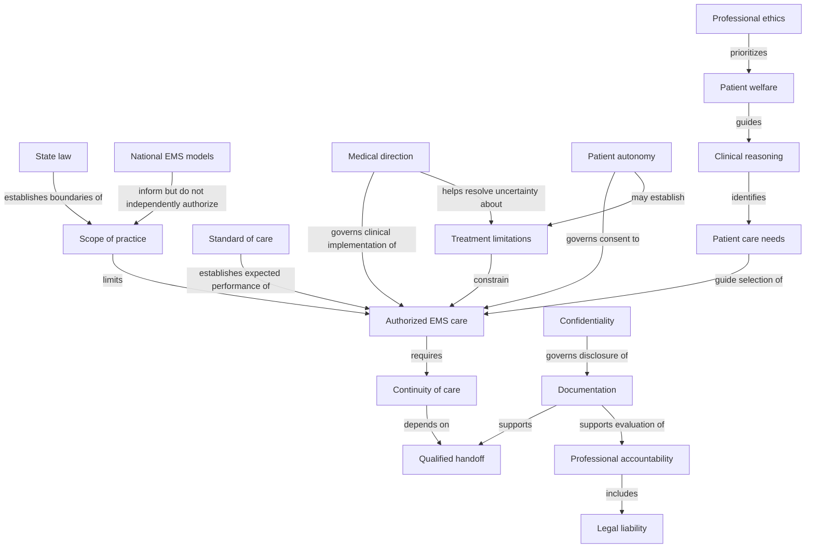

## Professional authority and oversight

### Scope, competence and individual authorization

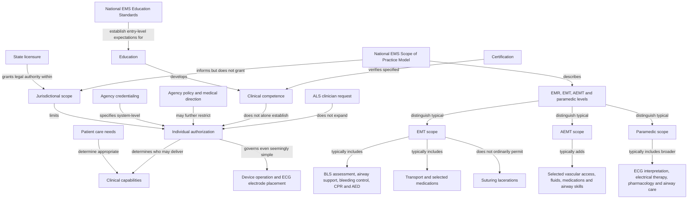

National levels describe typical capabilities, not permissions. Retrieving sealed supplies, positioning a patient and reporting blood pressures differ from independently starting an IV, administering IV medications or interpreting ECGs.

### Scope versus standard of care

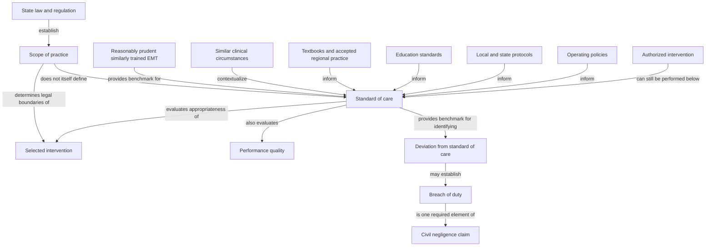

### Medical direction, delegation and escalation

```mermaid
flowchart TD
    N01["Medical direction"]
    N02["Medical oversight"]
    N03["Offline medical direction"]
    N04["Approved protocols and standing orders"]
    N05["Training, credentialing and equipment standards"]
    N06["Quality review"]
    N07["Online medical direction"]
    N08["Real-time consultation and orders"]
    N09["Uncertainty about care or scope"]
    N10["Disputed refusal or treatment limitation"]
    N11["Crew clinical leadership"]
    N12["Mixed-level care"]
    N13["Authorized tasks"]
    N14["Statutory medical direction"]
    N15["Unusual or conflicting instruction"]
    N16["Read-back when applicable"]
    N17["Orders"]
    N18["Skill"]
    N19["Communication failure"]
    N20["Contingency protocol"]
    N21["Appropriate BLS care"]
    N22["Documentation"]
    N23["Patient care"]
    N24["Interagency protocols"]
    N25["EMS and public safety interactions"]
    N26["Body camera recordings where used"]

    N01 -->|provides| N02
    N03 -->|establishes| N04
    N03 -->|oversees| N05
    N03 -->|incorporates| N06
    N07 -->|provides| N08
    N09 -->|warrants| N08
    N10 -->|may warrant| N08
    N11 -->|coordinates| N12
    N11 -->|delegates only| N13
    N11 -->|differs from| N14
    N15 -->|requires clarification of| N13
    N16 -->|reduces ambiguity in| N17
    N17 -->|cannot authorize a legally prohibited| N18
    N19 -->|invokes| N20
    N20 -->|supports continuation of| N21
    N22 -->|records time, clinician and content of| N17
    N22 -->|records resulting| N23
    N24 -->|coordinate| N25
    N26 -->|may document| N25
    N01 -->|operates through| N03
    N01 -->|operates through| N07
    N01 -->|constrains| N11
    N07 -->|may issue| N17
    N19 -->|may prevent access to| N07
    N24 -->|operate alongside| N04
```

## Duties and ethics

### Duty to act and continuity of responsibility

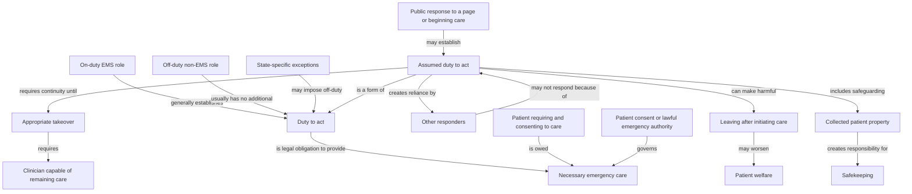

Off-duty obligations and consequences of volunteering vary by jurisdiction. Appropriate takeover generally means a qualified clinician with equal or higher training, but certification alone does not establish fitness for a particular patient.

### Responsibilities to patient, self, partner and equipment

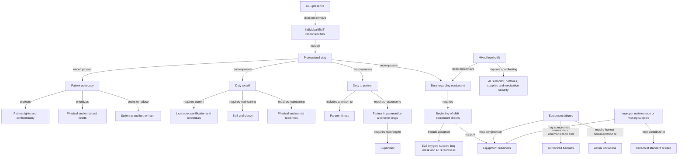

### Ethics, professional judgment and improvement

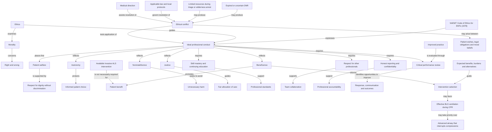

## Liability and protections

### Civil and criminal accountability and negligence

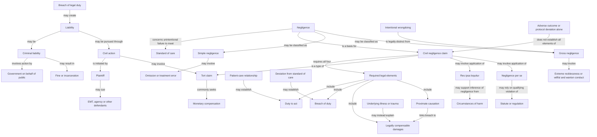

Exact legal tests, including the role of protocol violations, gross negligence and res ipsa loquitur, vary by jurisdiction. A complication is not proof of negligence.

### Intentional torts and safeguards

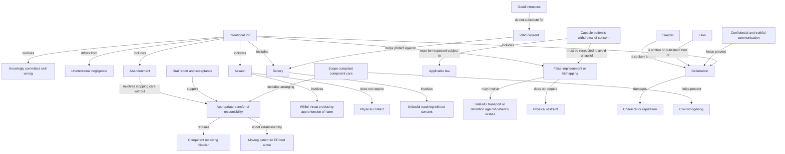

### Legal protections and their limits

```mermaid
flowchart TD
    N01["Good Samaritan laws"]
    N02["Good-faith emergency aid"]
    N03["Qualifying unpaid good-faith assistance"]
    N04["Gross negligence"]
    N05["Good Samaritan protection"]
    N06["Being sued"]
    N07["State EMS laws"]
    N08["Prehospital procedures without physician licensure"]
    N09["Personnel providing medical direction"]
    N10["Governmental immunity"]
    N11["Public agencies and employees"]
    N12["Statutory exceptions and waivers"]
    N13["Private EMS providers"]
    N14["Legal protections"]
    N15["Statute of limitations"]
    N16["Filing a claim"]
    N17["Injury event or discovery"]
    N18["Contributory or comparative fault"]
    N19["Damages"]
    N20["Patient contribution"]
    N21["Recovery"]
    N22["Competent professional care"]
    N23["Liability"]
    N24["Liability insurance or other protection"]
    N25["Financial exposure"]
    N26["ALS licensure or physician order"]
    N27["Immunity"]

    N01 -->|originated in California in 1959 to encourage| N02
    N01 -->|may protect| N03
    N04 -->|may exclude| N05
    N05 -->|does not prevent| N06
    N07 -->|may authorize| N08
    N07 -->|may protect qualifying| N09
    N10 -->|may limit claims against| N11
    N12 -->|qualify| N10
    N13 -->|may have other| N14
    N15 -->|sets state-specific deadline for| N16
    N17 -->|may trigger| N15
    N18 -->|considers patient's contribution to| N19
    N20 -->|does not necessarily bar| N21
    N22 -->|reduces risk of| N23
    N24 -->|may mitigate| N25
    N26 -->|does not guarantee| N27
    N01 -->|may provide| N05
    N05 -->|is a form of| N14
    N10 -->|is a form of| N14
    N07 -->|may establish| N14
    N15 -->|may limit claims involving| N23
    N18 -->|may affect| N21
    N21 -->|is sought through claims involving| N23
    N14 -->|may limit| N23
    N24 -->|is a form of| N14
    N27 -->|is a form of| N14
```

These protections are jurisdiction-specific; the chapter does not verify individual state liability statutes.

## Consent and decision-making

### Consent, autonomy and the emergency doctrine

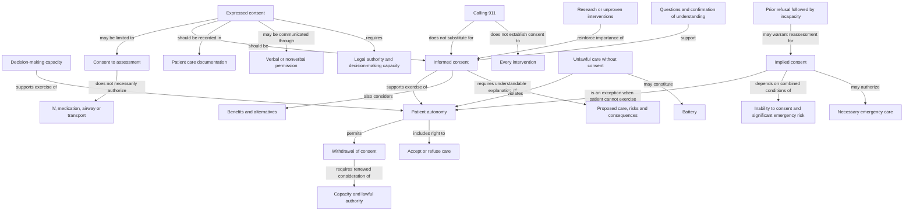

### Minors, surrogates and custody

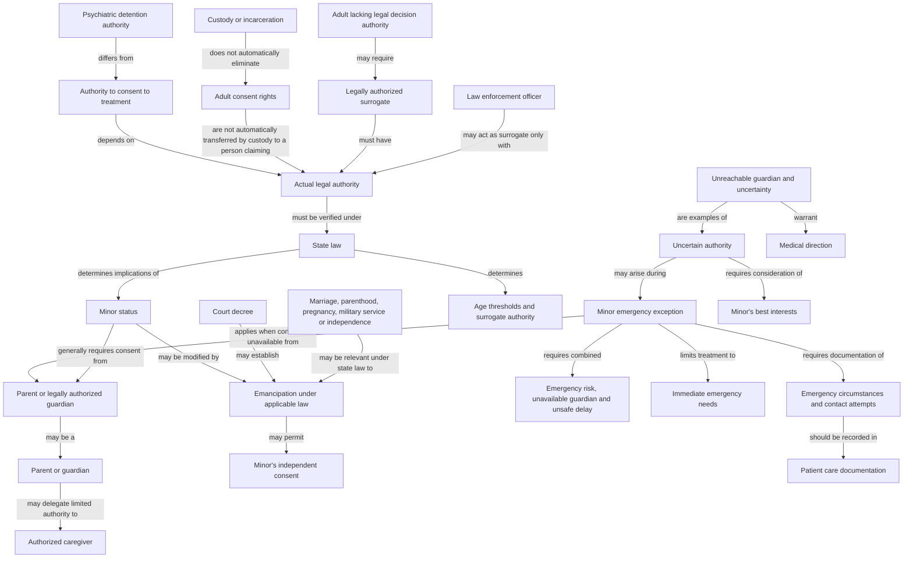

NASEMSO 2022 model guidance describes emergency treatment of minors when delay is unsafe. Listed emancipation circumstances and age thresholds are not universal.

### Decision-making capacity versus legal competence

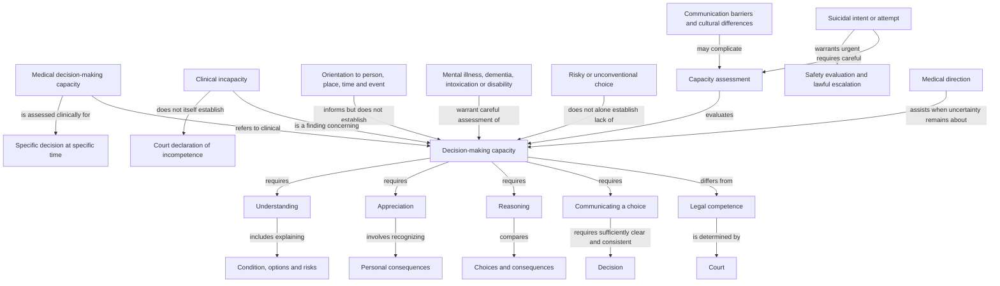

The source's categorical model-guideline wording about impairment and suicidal intent must be read with decision-specific capacity assessment and applicable behavioral-emergency and involuntary-transport law.

### Reversible causes of impaired cognition and BLS-ALS cooperation

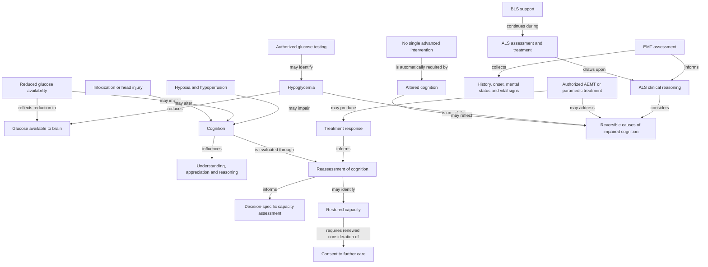

### Informed refusal, documentation and ongoing safety

```mermaid
flowchart TD
    N01["Capable adult or legally emancipated minor"]
    N02["Informed refusal"]
    N03["Selected assessment, treatment or transport"]
    N04["Initial assessment with permission"]
    N05["Clinical findings and vital signs"]
    N06["Refused assessment"]
    N07["Documentation"]
    N08["Clinical findings"]
    N09["Risks of declining care"]
    N10["Explanation of risks and alternatives"]
    N11["Informed decision"]
    N12["Teach-back"]
    N13["Understanding of consequences"]
    N14["Capacity assessment"]
    N15["High-risk or uncertain refusal"]
    N16["Medical direction"]
    N17["Respectful persuasion and family involvement when helpful"]
    N18["Coercion or threats"]
    N19["Signed refusal form and witness when available"]
    N20["Valid refusal"]
    N21["Refusal to sign"]
    N22["Witness statements"]
    N23["PCR"]
    N24["Findings, capacity reasoning and teach-back"]
    N25["Risks, alternatives, consultation and actual decision"]
    N26["Signatures or refusal to sign and safety instructions"]
    N27["Specific warning signs and recontact advice"]
    N28["Patient to seek help again"]
    N29["Lack of capacity and emergency risk"]
    N30["Lawful emergency authority"]
    N31["Potential violence"]
    N32["Crew safety and authorized assistance"]

    N01 -->|may make| N02
    N02 -->|may include declining only| N03
    N04 -->|provides| N05
    N06 -->|must be reflected in| N07
    N08 -->|inform explanation of| N09
    N10 -->|supports| N11
    N12 -->|checks| N13
    N14 -->|establishes whether patient can make| N11
    N15 -->|warrants protocol-based consultation with| N16
    N17 -->|may support| N11
    N02 -->|must be free from| N18
    N19 -->|document but do not establish| N20
    N21 -->|can be recorded through| N22
    N23 -->|records| N24
    N23 -->|records| N25
    N23 -->|records| N26
    N27 -->|enable| N28
    N29 -->|may justify care under| N30
    N31 -->|requires prioritizing| N32
    N02 -->|requires an| N11
    N05 -->|constitute| N08
    N08 -->|inform| N11
    N12 -->|supports| N11
    N06 -->|is a form of| N02
    N07 -->|is recorded in| N23
    N02 -->|is recorded in| N23
    N15 -->|requires careful| N14
    N20 -->|depends on| N11
    N21 -->|may occur during| N02
    N02 -->|should be accompanied by| N27
    N14 -->|may reveal| N29
    N31 -->|may complicate| N15
```

The chapter describes a witness other than the partner and a signed release form; actual refusal procedures depend on local requirements. A signature is not immunity. The 2025 refusal literature supports structured processes and quality review, while statewide protocols vary.

### Chest discomfort and high-risk refusal

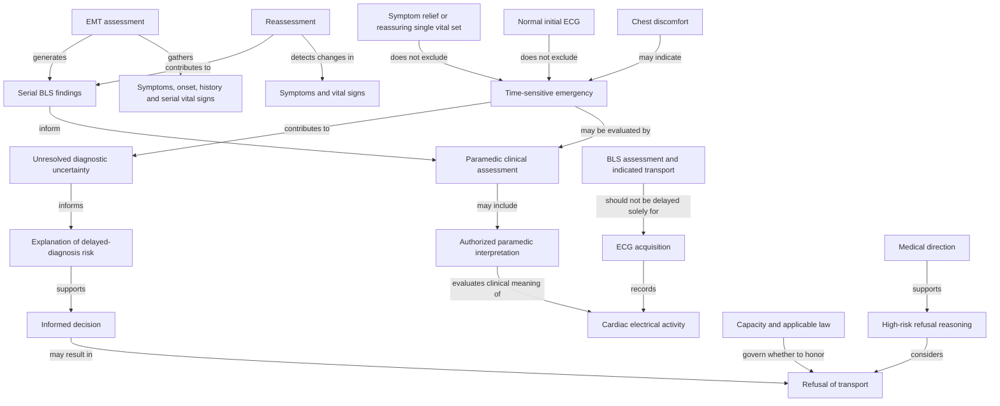

### Restraint, sedation and physiological risk

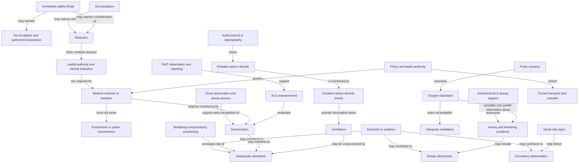

Never leave a restrained patient unattended or attempt restraint or forced transport alone or outside policy. These relationships describe safety considerations, not a restraint protocol.

### Case integration: vulnerable adults and withdrawal of consent

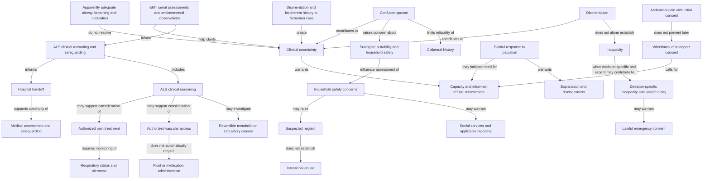

The Schuman case later reported gastric ulcer and organic brain syndrome in the patient, and Alzheimer's disease in his wife, followed by supervised care. These were subsequent diagnoses, not findings established by EMTs at the scene.

## Advance directives and end-of-life care

### Advance directives, surrogates and portable medical orders

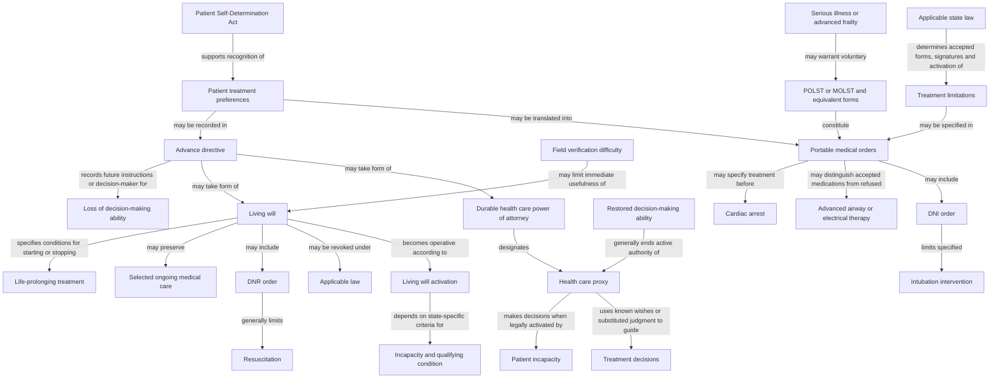

POLST variants include MOST, POST and TPOPP. The chapter's two-physician living-will example, physical-document requirement and one-year POLST eligibility example are not universal. Conventional advance directives may not apply to transient emergencies.

### Verification and interpretation of treatment limitations

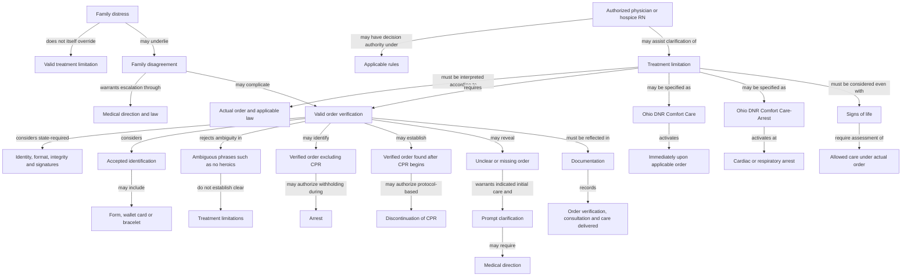

The NASEMSO 2022 model describes accepted identifiers and valid exclusions; actual legal forms and scope of permitted interventions are jurisdiction-specific. Do not delay indicated resuscitation while resolving uncertainty.

### Comfort-focused care and advanced intervention risks

```mermaid
flowchart TD
    N01["DNR"]
    N02["Do not treat"]
    N03["Valid treatment limitations"]
    N04["Allowed symptom-directed care"]
    N05["Patient goals"]
    N06["Pain or dyspnea"]
    N07["BLS positioning and comfort measures"]
    N08["Symptoms, oxygenation, order and protocol"]
    N09["Oxygen therapy"]
    N10["Authorized ALS assessment"]
    N11["Additional respiratory support or analgesia"]
    N12["Opioid analgesics such as fentanyl"]
    N13["Opioid receptors"]
    N14["Opioid receptor effects"]
    N15["Severe pain and distress"]
    N16["Respiratory depression, sedation and hypotension"]
    N17["Baseline BLS observations"]
    N18["Post-intervention reassessment"]
    N19["Alertness, airway, breathing, oxygenation, circulation and pain"]
    N20["Adverse changes"]
    N21["ALS clinician"]
    N22["Authorized supportive care"]
    N23["Advanced symptom management"]
    N24["Comfort-focused care"]
    N25["Patient welfare and continuity"]
    N26["DNR status alone"]
    N27["Opioid or oxygen administration"]

    N01 -->|does not mean| N02
    N03 -->|guide| N04
    N05 -->|guide| N04
    N06 -->|may warrant| N07
    N08 -->|determine appropriateness of| N09
    N10 -->|evaluates suitability of| N11
    N12 -->|act at| N13
    N14 -->|may reduce| N15
    N12 -->|may cause| N16
    N17 -->|establish comparison for| N18
    N18 -->|evaluates| N19
    N20 -->|require prompt communication to| N21
    N22 -->|continues during| N23
    N24 -->|preserves| N25
    N26 -->|does not indicate| N27
    N01 -->|may be one of the| N03
    N04 -->|may address| N06
    N04 -->|may include indicated| N09
    N04 -->|may involve| N10
    N10 -->|may support selected use of| N12
    N13 -->|mediate| N14
    N12 -->|require| N18
    N16 -->|are potential| N20
    N22 -->|supports| N04
    N04 -->|is part of| N24
    N26 -->|does not determine| N04
```

## Transport and continuity

### EMTALA, destination and transport capability

```mermaid
flowchart TD
    N01["COBRA-related EMTALA"]
    N02["Ability to pay"]
    N03["EMTALA"]
    N04["Covered hospitals"]
    N05["Screening, stabilization and appropriate transfer"]
    N06["Inappropriate diversion based on inability to pay"]
    N07["Patient dumping"]
    N08["Appropriate transfer"]
    N09["Patient needs and transport capability"]
    N10["Transferring facility"]
    N11["Available capability"]
    N12["Anticipated journey and deterioration"]
    N13["Continuous infusion"]
    N14["Pump management and titration"]
    N15["Continuous ECG monitoring"]
    N16["Advanced monitoring and interpretation"]
    N17["EMT scope"]
    N18["Ongoing advanced therapy"]
    N19["AEMT authorization"]
    N20["IV therapies"]
    N21["Paramedic licensure"]
    N22["Critical-care transport credentialing"]
    N23["Actual crew credentials and equipment"]
    N24["Transport capability"]
    N25["Capability mismatch"]
    N26["Loading and transfer"]
    N27["Medical director"]
    N28["Transferring physician"]
    N29["Emergency destination"]
    N30["Clinical appropriateness and authorized protocol"]
    N31["Appropriate bypass"]
    N32["Patient request, medical direction or destination protocol"]
    N33["Bypass reason"]
    N34["Documentation"]

    N01 -->|protects emergency access regardless of| N02
    N03 -->|primarily imposes duties on| N04
    N04 -->|must meet applicable duties of| N05
    N06 -->|may constitute| N07
    N08 -->|requires matching| N09
    N10 -->|must address stabilization within| N11
    N09 -->|must account for| N12
    N13 -->|may require| N14
    N15 -->|may require| N16
    N17 -->|may be insufficient for| N18
    N19 -->|covers only selected| N20
    N21 -->|does not guarantee| N22
    N23 -->|determine| N24
    N25 -->|warrants escalation before| N26
    N27 -->|may consult| N28
    N29 -->|should reflect| N30
    N31 -->|may depend on| N32
    N33 -->|must be recorded in| N34
    N02 -->|must not determine| N29
    N01 -->|refers to| N03
    N03 -->|seeks to prevent| N07
    N04 -->|include qualifying| N10
    N05 -->|include requirements for| N08
    N08 -->|depends on| N24
    N13 -->|may constitute| N18
    N15 -->|may constitute| N18
    N18 -->|influences| N09
    N20 -->|may be part of| N18
    N22 -->|may be needed for| N24
    N25 -->|occurs when patient needs exceed| N24
    N27 -->|may help resolve| N25
    N29 -->|may involve| N31
    N31 -->|requires documentation of| N33
```

EMTALA does not universally impose direct federal liability on an independent ambulance or EMT for accepting a transfer. Hospital-owned ambulance and community destination rules have specific qualifications. Do not transmit insurance or payment details over the radio.

### Handoff and interfacility transfer

```mermaid
flowchart TD
    N01["Interfacility transfer"]
    N02["Clear report of patient condition"]
    N03["Crew capability and scope"]
    N04["Applicable transfer requirements"]
    N05["Signed consent and physician transfer certification"]
    N06["Physician transfer certification when required"]
    N07["Transferring physician, destination and reason"]
    N08["Destination and route planning"]
    N09["Timely appropriate transport"]
    N10["Structured handoff"]
    N11["Identity, chief concern, onset and history"]
    N12["Initial and current findings and trends"]
    N13["Interventions by each provider, timing and response"]
    N14["Outstanding risks, consent and code status"]
    N15["Devices, ongoing medications and care needs"]
    N16["Receiving clinician acknowledgment"]
    N17["Accepted transfer of responsibility"]
    N18["Receiving clinician, time and relevant records"]
    N19["Stretcher transfer"]
    N20["Oxygen and authorized support"]
    N21["Interrupted monitoring or displaced device"]
    N22["Communication to receiving clinician"]
    N23["Infusion or ventilator malfunction"]
    N24["Authorized clinician"]
    N25["EMT"]
    N26["Devices outside authorization"]
    N27["Qualified acceptance"]
    N28["Abandonment"]

    N01 -->|begins with obtaining| N02
    N02 -->|enables verification of| N03
    N04 -->|may require| N05
    N06 -->|records| N07
    N08 -->|support| N09
    N10 -->|communicates| N11
    N10 -->|communicates| N12
    N10 -->|communicates| N13
    N10 -->|communicates| N14
    N10 -->|communicates| N15
    N16 -->|establishes| N17
    N17 -->|is recorded with| N18
    N19 -->|requires continuity of| N20
    N21 -->|requires prompt| N22
    N23 -->|requires assistance from| N24
    N25 -->|must not independently adjust| N26
    N27 -->|protects against| N28
    N02 -->|can use| N10
    N01 -->|must satisfy| N04
    N04 -->|may include| N06
    N01 -->|requires| N08
    N10 -->|culminates in| N16
    N01 -->|may involve| N19
    N19 -->|may cause| N21
    N23 -->|may compromise| N20
    N25 -->|must escalate malfunction to| N24
    N17 -->|requires| N27
```

A transfer report and physical movement are not substitutes for acceptance of responsibility. Written-consent and certification requirements vary with the transfer circumstances.

### ALS-to-BLS transition and individual accountability

```mermaid
flowchart TD
    N01["ALS clinical leadership"]
    N02["Mixed-level team care"]
    N03["EMT"]
    N04["Assigned BLS observations and care"]
    N05["Advanced intervention"]
    N06["Ongoing advanced monitoring or treatment"]
    N07["Recent medication or infusion"]
    N08["Normal latest blood pressure"]
    N09["Subsequent deterioration"]
    N10["Clinical trends and response"]
    N11["Downgrade suitability"]
    N12["Remaining patient needs"]
    N13["Receiving clinician competence, credentials and equipment"]
    N14["Local downgrade criteria"]
    N15["ALS-to-BLS transition"]
    N16["Required medical direction and documented acceptance"]
    N17["Lawful transition"]
    N18["Contingency plan"]
    N19["Unsafe downgrade"]
    N20["Designated clinician, supervisor or medical direction"]
    N21["Equal or higher certification"]
    N22["Appropriate receiving competence"]
    N23["New breathing change after ALS medication"]
    N24["EMT reporting and authorized support"]
    N25["Individual documentation"]
    N26["EMT and ALS actions, findings and times"]
    N27["Professional accountability and clinical continuity"]

    N01 -->|coordinates| N02
    N03 -->|retains responsibility for| N04
    N05 -->|may create need for| N06
    N07 -->|may require| N06
    N08 -->|does not exclude| N09
    N10 -->|inform| N11
    N12 -->|must match| N13
    N14 -->|govern| N15
    N16 -->|support| N17
    N18 -->|addresses| N09
    N19 -->|warrants escalation to| N20
    N21 -->|does not alone establish| N22
    N23 -->|requires prompt| N24
    N25 -->|distinguishes| N26
    N25 -->|supports| N27
    N15 -->|depends on absence of unmet| N06
    N15 -->|requires planning for| N09
    N15 -->|requires| N25
    N01 -->|may coordinate| N15
    N03 -->|participates in| N02
    N15 -->|depends on| N11
    N11 -->|depends on| N12
    N17 -->|includes applicable| N15
    N19 -->|reflects inadequate| N11
    N22 -->|is necessary for| N11
    N23 -->|may indicate| N09
```

## Confidentiality and patient information

### HIPAA, confidentiality and lawful disclosure

```mermaid
flowchart TD
    N01["HIPAA (1996)"]
    N02["Patient health information"]
    N03["Patient confidentiality"]
    N04["Physical and psychological conditions and care details"]
    N05["Privacy policies"]
    N06["Record storage, access, discussion and release"]
    N07["Unauthorized public or personal discussion"]
    N08["Confidentiality"]
    N09["Deliberate privacy invasion"]
    N10["Professional discipline and legal action"]
    N11["Patient or authorized representative"]
    N12["Information disclosure"]
    N13["Provider-to-provider treatment disclosure"]
    N14["Continuity of care"]
    N15["Separate HIPAA authorization"]
    N16["HIPAA minimum-necessary rule"]
    N17["Reasonable safeguards"]
    N18["Treatment disclosure"]
    N19["Applicable reporting law"]
    N20["Disclosure to designated authorities"]
    N21["Law enforcement request alone"]
    N22["Blanket disclosure authority"]
    N23["Subpoena or third-party billing request"]
    N24["Proper legal and agency handling"]
    N25["Patient permission under privacy rules"]
    N26["Persons involved in care"]
    N27["Agency privacy training"]
    N28["Compliant information handling"]
    N29["Privacy officer"]
    N30["Nonroutine requests and inadvertent disclosure"]
    N31["Approved communication channels"]
    N32["BLS and ALS shared documentation"]
    N33["Recordings and monitor downloads"]
    N34["Agency access and retention policy"]
    N35["Personal photos and unapproved cloud storage"]
    N36["Emergency treatment"]
    N37["Privacy notice paperwork"]
    N38["Privacy notice acknowledgment"]
    N39["Medical consent"]

    N01 -->|protects| N02
    N03 -->|applies to| N04
    N05 -->|govern| N06
    N07 -->|may violate| N08
    N09 -->|may lead to| N10
    N11 -->|may authorize| N12
    N13 -->|supports| N14
    N13 -->|generally does not require| N15
    N13 -->|generally is not subject to| N16
    N17 -->|still apply to| N18
    N19 -->|may require| N20
    N21 -->|does not establish| N22
    N23 -->|requires| N24
    N25 -->|may allow sharing with| N26
    N27 -->|supports| N28
    N29 -->|assists with| N30
    N31 -->|safeguard| N32
    N33 -->|follow| N34
    N35 -->|threaten| N08
    N36 -->|takes priority over| N37
    N38 -->|is distinct from| N39
    N01 -->|supports| N08
    N03 -->|is an aspect of| N08
    N05 -->|safeguard| N08
    N09 -->|violates| N08
    N12 -->|is governed by| N05
    N13 -->|is a permitted form of| N12
    N18 -->|includes| N13
    N20 -->|may be lawful| N12
    N22 -->|is not presumed under| N05
    N24 -->|is required for nonroutine| N12
    N26 -->|may receive authorized| N12
    N27 -->|explains| N05
    N29 -->|assists implementation of| N05
    N31 -->|support| N28
    N34 -->|is part of| N05
    N37 -->|communicates| N05
    N38 -->|documents receipt of| N37
```

HHS emergency notice guidance allows notice when practical after the emergency and does not require the usual good-faith acknowledgment effort for an emergency-delayed notice. Police and subpoena disclosures depend on applicable legal conditions.

## Special clinical and medicolegal situations

### Organ donation and medical identification

```mermaid
flowchart TD
    N01["Patient welfare"]
    N02["Potential organ donation"]
    N03["Valid treatment limitations and clinical indications"]
    N04["Resuscitation and supportive care"]
    N05["Potential organ suitability"]
    N06["Starting, prolonging or withholding resuscitation"]
    N07["Donor card or registration"]
    N08["Donation authorization"]
    N09["Driver's license donor indicator"]
    N10["Potential donor status"]
    N11["EMS recognition of potential donor"]
    N12["Receiving facility or designated process"]
    N13["Hospital and organ procurement organization"]
    N14["Donation eligibility and authorization"]
    N15["Family involvement"]
    N16["Legally effective donor authorization"]
    N17["Medical ID card, jewelry or wristband"]
    N18["Relevant condition or medication information"]
    N19["Diabetes identifier"]
    N20["Glucose and medication-history assessment"]
    N21["Anticoagulant identifier"]
    N22["Trauma"]
    N23["Medical alert tattoo"]
    N24["Nonstandard appearance"]
    N25["Altered mental status assessment"]
    N26["Medical identification"]
    N27["Current diagnosis"]
    N28["Alert tattoo alone"]
    N29["Resuscitation order"]
    N30["Exact identifier wording and independent clinical findings"]
    N31["BLS-to-ALS communication"]

    N01 -->|remains primary over| N02
    N03 -->|govern| N04
    N05 -->|must not independently determine| N06
    N07 -->|may establish legal| N08
    N09 -->|may identify| N10
    N11 -->|supports notification to| N12
    N13 -->|assess| N14
    N15 -->|does not necessarily override| N16
    N17 -->|may provide| N18
    N19 -->|may prompt| N20
    N21 -->|may increase concern after| N22
    N23 -->|may be overlooked due to| N24
    N25 -->|may include inspection for| N26
    N26 -->|provides clues but does not establish| N27
    N28 -->|may not satisfy legal requirements for| N29
    N30 -->|inform| N31
    N01 -->|guides| N04
    N02 -->|depends on assessment of| N05
    N10 -->|may be supported by| N07
    N10 -->|prompts consideration of| N02
    N10 -->|may prompt| N11
    N12 -->|coordinates with| N13
    N14 -->|includes verification of| N08
    N16 -->|is a form of| N08
    N17 -->|are forms of| N26
    N19 -->|is a form of| N26
    N21 -->|is a form of| N26
    N23 -->|is a form of| N26
    N28 -->|is a form of| N26
    N26 -->|informs| N30
    N26 -->|may prompt verification of| N03
```

### Field recognition of death and withholding resuscitation

```mermaid
flowchart TD
    N01["Unresponsiveness, apnea and absent pulse"]
    N02["Clinical cardiac arrest"]
    N03["Irreversible death"]
    N04["Absent breath sounds, blood pressure, pupils and reflex responses"]
    N05["Presumptive signs of death"]
    N06["Decapitation or decomposition"]
    N07["Obvious irreversible death under protocol"]
    N08["Rigor mortis and dependent lividity"]
    N09["Dependent lividity"]
    N10["Gravity-dependent blood pooling"]
    N11["Rigor mortis"]
    N12["Postmortem stiffening"]
    N13["Time estimates from rigor or decomposition"]
    N14["Time of death"]
    N15["Trauma incompatible with life"]
    N16["Protocol-defined withholding criteria"]
    N17["Traumatic arrest without signs of life"]
    N18["Verified valid exclusion order"]
    N19["Unclear findings or disputed status"]
    N20["Indicated resuscitation and medical direction"]
    N21["Hypothermia, drowning and lightning injury"]
    N22["Special-circumstance protocols"]
    N23["Routine withholding criteria"]
    N24["Obvious irreversible death"]
    N25["Formal neurologic death determination"]
    N26["Physician or legally authorized person"]
    N27["Death pronouncement under local law"]
    N28["Medicolegal process"]
    N29["Cause and manner of death"]

    N01 -->|indicate| N02
    N02 -->|does not alone establish| N03
    N04 -->|may accompany| N05
    N06 -->|may establish| N07
    N08 -->|may support| N07
    N09 -->|results from| N10
    N11 -->|involves| N12
    N13 -->|do not alone establish| N14
    N15 -->|may meet| N16
    N17 -->|may meet| N16
    N18 -->|may meet| N16
    N19 -->|warrant| N20
    N21 -->|require consideration of| N22
    N22 -->|may modify| N23
    N24 -->|differs from| N25
    N26 -->|may have authority for| N27
    N28 -->|determines| N29
    N03 -->|may be recognized through| N07
    N07 -->|may establish| N16
    N02 -->|may present with| N05
    N07 -->|may be evidenced by| N09
    N07 -->|may be evidenced by| N11
    N11 -->|is one factor considered in| N13
    N23 -->|are a subset of| N16
    N19 -->|may occur when evaluating| N16
    N07 -->|is a form of| N24
    N27 -->|may follow determination of| N07
    N28 -->|is distinct from| N27
```

The 2022 model includes narrowly defined severe injuries (torso transection, specified extensive incineration, massive crush injury and other injuries incompatible with life), trauma-specific findings, rigor/lividity, and agency-defined compelling reasons. These are not independent universal withholding rules. The source's 2–12 hour rigor and 24-hour decomposition estimates are not reliable stand-alone time determinations.

### Resuscitation termination, monitoring and BLS-ALS integration

```mermaid
flowchart TD
    N01["Withholding resuscitation"]
    N02["Valid exclusion criteria"]
    N03["Termination of resuscitation (TOR)"]
    N04["Approved TOR criteria"]
    N05["Pronouncement of death"]
    N06["Medical direction"]
    N07["AHA 2025 guidance"]
    N08["BLS, ALS and universal TOR rules"]
    N09["Paramedic assessment"]
    N10["Rhythm, response and reversible causes"]
    N11["AEMT authorization"]
    N12["Rhythm interpretation and electrical therapy"]
    N13["High-quality BLS CPR"]
    N14["Advanced resuscitation"]
    N15["Effective BLS ventilation"]
    N16["Advanced airway placement"]
    N17["Compressions or defibrillation"]
    N18["ECG"]
    N19["Electrical activity"]
    N20["Mechanical circulation"]
    N21["Pulseless electrical activity"]
    N22["Electrical activity and circulation"]
    N23["Waveform capnography"]
    N24["Exhaled carbon dioxide trends"]
    N25["Ventilation, airway placement and blood flow during CPR"]
    N26["Multiple physiological and treatment factors"]
    N27["Single ETCO2 value or rhythm"]
    N28["Futility"]
    N29["Hypothermia, drowning and toxic exposure"]
    N30["Modified resuscitation decisions"]
    N31["Assigned BLS and ALS roles"]
    N32["Valid decision communicated"]
    N33["Objective findings, times, response and decision-maker"]
    N34["Resuscitation documentation"]

    N01 -->|means deciding not to start under| N02
    N03 -->|means stopping efforts under| N04
    N05 -->|is distinct from| N03
    N04 -->|may require consultation with| N06
    N07 -->|distinguishes| N08
    N09 -->|may integrate| N10
    N11 -->|may limit| N12
    N13 -->|remains essential during| N14
    N15 -->|remains essential during| N14
    N16 -->|must not unnecessarily interrupt| N17
    N18 -->|records| N19
    N19 -->|does not guarantee| N20
    N21 -->|illustrates dissociation between| N22
    N23 -->|measures| N24
    N24 -->|may inform| N25
    N26 -->|influence| N24
    N27 -->|cannot alone establish| N28
    N29 -->|may require| N30
    N31 -->|continue until| N32
    N33 -->|must be recorded in| N34
    N01 -->|differs from| N03
    N07 -->|informs| N04
    N09 -->|informs application of| N04
    N11 -->|may limit contributions to| N09
    N14 -->|may include| N16
    N14 -->|may involve| N18
    N18 -->|may show| N21
    N14 -->|may involve| N23
    N23 -->|provides context beyond a| N27
    N30 -->|may alter application of| N04
    N31 -->|support| N14
    N32 -->|may concern| N03
    N34 -->|records decision concerning| N03
```

Do not apply ordinary TOR rules indiscriminately to special circumstances. Rewarming is a caution against premature declaration, not an absolute rule. A monitor reading does not authorize independent declaration of futility.

### Death investigation, scene safety and evidence preservation

```mermaid
flowchart TD
    N01["Violent, unusual or suspicious death"]
    N02["Medical examiner or coroner"]
    N03["Sudden infant death or dead-on-arrival case"]
    N04["Local protocol"]
    N05["Uncertain death status"]
    N06["Indicated patient resuscitation"]
    N07["Suspected crime scene"]
    N08["Law enforcement assistance"]
    N09["Active scene threat"]
    N10["Patient care"]
    N11["Police scene clearance"]
    N12["Evidence preservation"]
    N13["Urgent ventilation, bleeding control, exposure and transport"]
    N14["Minimal necessary scene changes"]
    N15["Evidence integrity"]
    N16["Single entry and exit route when feasible"]
    N17["Unnecessary scene disturbance"]
    N18["Necessary movement or contact"]
    N19["Law enforcement"]
    N20["Preserving clothing damage or knots where feasible"]
    N21["Objective scene observations and necessary alterations"]
    N22["Patient care documentation"]
    N23["Evidence transfer according to policy"]
    N24["Chain of evidence"]
    N25["Necessary covering and warmth"]
    N26["Dignity and prevention of heat loss"]
    N27["Sexual assault evidence-preservation options"]
    N28["Coercion"]
    N29["Capable patient's choices"]
    N30["Evidence-preservation options"]
    N31["Necessary care and basic needs"]
    N32["EMS role"]
    N33["Criminal investigation"]

    N01 -->|may require notification of| N02
    N03 -->|may require notification under| N04
    N05 -->|prioritizes| N06
    N07 -->|warrants consideration of| N08
    N09 -->|precludes unsafe entry for| N10
    N11 -->|enables cautious access for| N10
    N10 -->|takes priority over| N12
    N13 -->|must not be delayed for| N12
    N14 -->|support| N15
    N16 -->|reduces| N17
    N18 -->|should be communicated to| N19
    N20 -->|supports| N15
    N21 -->|belong in| N22
    N23 -->|supports| N24
    N25 -->|support| N26
    N27 -->|require explanation without| N28
    N29 -->|govern acceptance of| N30
    N31 -->|are not conditional on| N12
    N32 -->|does not include independent| N33
    N07 -->|may involve| N01
    N02 -->|may be notified of| N03
    N05 -->|necessitates consideration of| N10
    N07 -->|may present| N09
    N12 -->|depends on| N14
    N16 -->|helps achieve| N14
    N18 -->|may be part of| N14
    N22 -->|records| N14
    N12 -->|includes maintaining| N24
    N10 -->|may require| N25
    N12 -->|may include| N27
    N30 -->|include| N27
    N32 -->|prioritizes| N10
```

### Mandatory reporting, vulnerable patients and safe-haven surrender

```mermaid
flowchart TD
    N01["Applicable state law"]
    N02["Mandatory reporting situations"]
    N03["Suspected child, elder or partner abuse"]
    N04["Mandatory reporting"]
    N05["Crime-related injuries or suspected sexual assault"]
    N06["Drug-related injuries, communicable diseases or animal bites"]
    N07["Involuntary restraint or behavioral emergencies"]
    N08["Required report"]
    N09["Legally designated authority"]
    N10["Clinical handoff alone"]
    N11["Objective findings and exact relevant statements"]
    N12["Safeguarding and reporting"]
    N13["Speculative accusations"]
    N14["Objective reporting"]
    N15["Good-faith reporting"]
    N16["Statutory immunity"]
    N17["Confidentiality"]
    N18["Applicable reporting law"]
    N19["Reporting steps"]
    N20["Agency policy"]
    N21["Infant abandonment and deaths in 1990s"]
    N22["Safe-haven legislation"]
    N23["Texas (1999)"]
    N24["Safe-haven law"]
    N25["Safe-haven laws"]
    N26["Designated authority"]
    N27["State-specific law"]
    N28["Eligible infant age, location and surrender conditions"]
    N29["EMS station designation"]
    N30["Safe-haven surrender procedure"]
    N31["Authorized surrender"]
    N32["State-specific EMS assessment and response"]
    N33["BLS infant assessment"]
    N34["Warmth, breathing, color, responsiveness and illness or injury"]
    N35["Infant instability"]
    N36["ALS or neonatal resources"]
    N37["Infant surrender alone"]
    N38["Illness or indication for invasive care"]

    N01 -->|specifies| N02
    N03 -->|may trigger| N04
    N05 -->|may trigger| N04
    N06 -->|may trigger| N04
    N07 -->|may trigger| N04
    N08 -->|must reach| N09
    N10 -->|does not necessarily satisfy| N04
    N11 -->|support| N12
    N13 -->|undermine| N14
    N15 -->|may receive| N16
    N17 -->|permits or requires disclosure under| N18
    N19 -->|should be recorded according to| N20
    N21 -->|prompted| N22
    N23 -->|enacted first| N24
    N25 -->|permit qualifying surrender to| N26
    N27 -->|determines| N28
    N29 -->|determines applicability of| N30
    N31 -->|requires| N32
    N33 -->|evaluates| N34
    N35 -->|may warrant| N36
    N37 -->|does not establish| N38
    N01 -->|governs| N04
    N04 -->|requires a| N08
    N04 -->|should use| N11
    N11 -->|support| N14
    N15 -->|may satisfy| N04
    N18 -->|determines| N02
    N04 -->|entails recording| N19
    N22 -->|establishes| N25
    N24 -->|is an example of| N25
    N25 -->|vary according to| N27
    N27 -->|governs| N29
    N30 -->|guides| N31
    N32 -->|includes| N33
    N33 -->|may identify| N35
    N31 -->|does not make invasive care necessary on the basis of| N37
    N27 -->|is part of| N01
```

Safe-haven laws exist in all states and DC in the supplied chapter. Specific age and site examples were not independently verified; confirm local statutes. Reporting duties depend on jurisdiction and patient circumstances.

## Cross-concept integration

### Legal authority, consent, care and accountability as a connected system

```mermaid
flowchart TD
    N01["Patient condition and trends"]
    N02["Clinical care needs"]
    N03["Appropriate intervention selection"]
    N04["Scope, credentials and protocols"]
    N05["Authorized intervention selection"]
    N06["Capacity assessment"]
    N07["Consent decision"]
    N08["Valid consent or lawful exception"]
    N09["Authorized care"]
    N10["Valid treatment limitations"]
    N11["Medical direction"]
    N12["Consent, authorization and treatment limitations"]
    N13["Patient welfare and ethical principles"]
    N14["Clinical judgment"]
    N15["Standard of care"]
    N16["EMT observations and ALS findings"]
    N17["Clinical reassessment"]
    N18["Handoff and transport level"]
    N19["Receiving clinician capability and acceptance"]
    N20["Accepted handoff"]
    N21["Continuity of care"]
    N22["Accurate documentation"]
    N23["Findings, decisions, consent, interventions and handoff"]
    N24["Quality review and legal accountability"]
    N25["Confidentiality and reporting law"]
    N26["Training and protocols"]

    N01 -->|determine| N02
    N02 -->|inform| N03
    N04 -->|establish limits of| N05
    N03 -->|must stay within| N05
    N06 -->|determines ability to participate in| N07
    N08 -->|permits| N09
    N10 -->|constrain| N09
    N11 -->|assists uncertainty about| N12
    N13 -->|guide| N14
    N14 -->|informs| N03
    N09 -->|requires appropriate execution under| N15
    N16 -->|inform| N17
    N17 -->|updates| N01
    N17 -->|may require renewed| N06
    N17 -->|informs| N18
    N18 -->|depend on| N19
    N20 -->|preserves| N21
    N22 -->|records| N23
    N22 -->|supports| N24
    N25 -->|govern disclosure of| N22
    N24 -->|may identify improvement needs for| N26
    N26 -->|support| N15
    N05 -->|guides| N09
    N11 -->|helps resolve uncertainty about| N08
    N19 -->|supports| N20
```

This is an educational system map, not a treatment algorithm. BLS care remains foundational while ALS contributes only within individual authorization; no national model, order, or diagram grants permission to perform an advanced skill.
