# Chapter 4: Documentation — Concept Maps

## Conceptual overview

### Documentation as a clinical and operational system

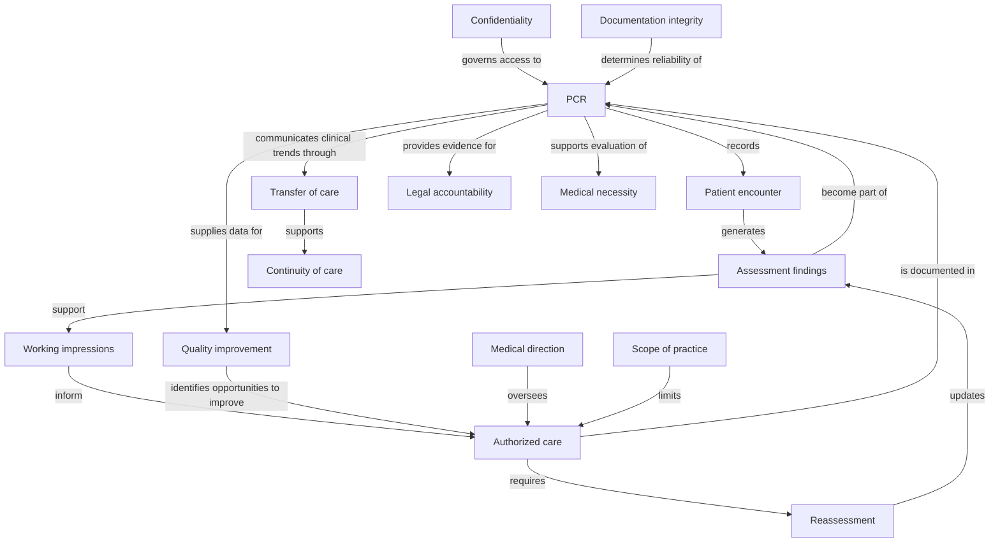

## Purpose and professional accountability

### Continuity, research, and quality improvement

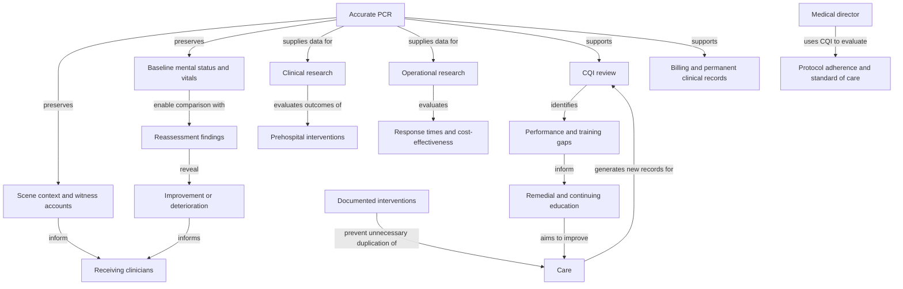

### Legal reliability and falsification

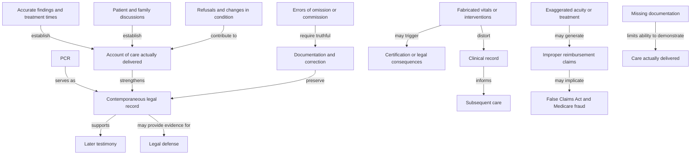

### Scope, medical direction, and authorship

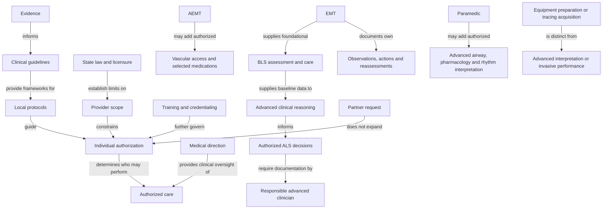

## Reporting systems and integrity

### Paper and electronic records

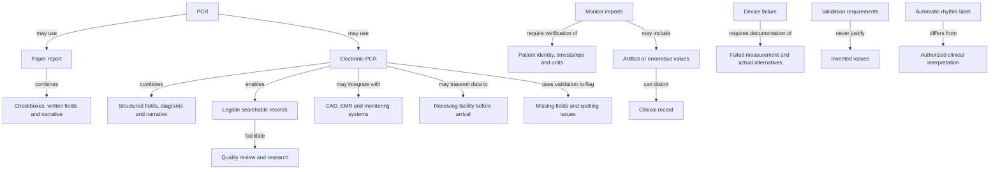

### Corrections, amendments, and communication

```mermaid
flowchart TD
    N01["Documentation error"]
    N02["Transparent amendment"]
    N03["Original entry"]
    N04["Author and correction information"]
    N05["Paper error during writing"]
    N06["Single line, initials and correct entry"]
    N07["Submitted paper error"]
    N08["Dated and timed initialed correction"]
    N09["Notification to prior recipients"]
    N10["Omitted paper information"]
    N11["Dated initialed note"]
    N12["Electronic PCR"]
    N13["Built-in timestamped amendment"]
    N14["Electronic PCR without amendment function"]
    N15["Corrected printed copy and resubmission"]
    N16["Later clinician clarification"]
    N17["Actual source and correction time"]
    N18["Clinically significant communicated error"]
    N19["Receiving team notification"]
    N20["Ongoing care"]
    N21["Auditability and legal accountability"]
    N22["Erasure, overwriting or backdating"]

    N01 -->|requires| N02
    N02 -->|preserves| N03
    N02 -->|identifies| N04
    N05 -->|is corrected with| N06
    N07 -->|requires| N08
    N07 -->|also requires| N09
    N10 -->|is added as| N11
    N12 -->|uses| N13
    N14 -->|may require| N15
    N16 -->|must retain| N17
    N18 -->|requires prompt| N19
    N19 -->|protects| N20
    N02 -->|protects| N21
    N22 -->|undermines| N21
```

## Standardized data and clinical narratives

### Minimum data, time synchronization, and interoperability

```mermaid
flowchart TD
    N01["Historical DOT minimum data set"]
    N02["Patient and incident data"]
    N03["Comparison across EMS systems"]
    N04["Complaint, responsiveness, perfusion and vital signs"]
    N05["Dispatch, patient arrival, departure, destination and transfer times"]
    N06["Synchronized clocks"]
    N07["Event chronology"]
    N08["Cardiac arrest downtime and intervention timing"]
    N09["Legal and operational review"]
    N10["Vehicle arrival"]
    N11["Patient contact and responsibility transfer"]
    N12["Witness-reported onset"]
    N13["Estimated time and source attribution"]
    N14["NEMSIS"]
    N15["Electronic EMS data elements and values"]
    N16["NEMSIS demographic dataset"]
    N17["Agency and system information"]
    N18["NEMSIS EMS dataset"]
    N19["Patient encounter information"]
    N20["Standard value codes"]
    N21["ICD-10, SNOMED or RxNorm"]
    N22["Local custom elements"]
    N23["Standardized data for regional needs"]
    N24["Version and local implementation"]
    N25["Applicable field constraints"]
    N26["Historical minimum data"]
    N27["Clinically indicated assessments"]

    N01 -->|sought to standardize| N02
    N02 -->|enable| N03
    N01 -->|included| N04
    N01 -->|included| N05
    N06 -->|support accurate| N07
    N07 -->|supports estimation of| N08
    N07 -->|supports| N09
    N10 -->|differs from| N11
    N12 -->|may require| N13
    N14 -->|standardizes| N15
    N16 -->|represents| N17
    N18 -->|represents| N19
    N20 -->|may derive from| N21
    N22 -->|extend| N23
    N24 -->|determine| N25
    N26 -->|does not limit| N27
```

Note: The historical DOT list used BP for patients older than 3 years and capillary refill for patients younger than 6 years; these are not restrictions on clinically indicated pediatric assessment. The source distinguishes historical NEMSIS v3.4 from later 3.5.0 and 3.5.1 resources. Local implementation governs actual fields.

### Structured fields, null values, and clinical meaning

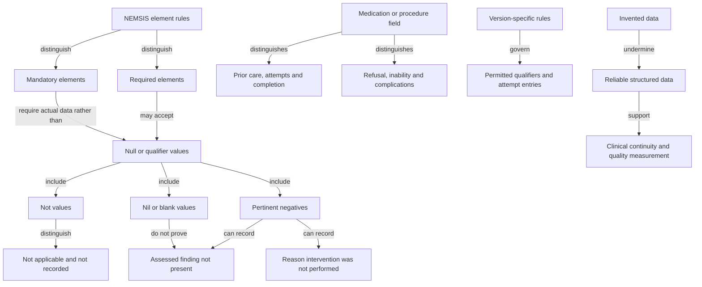

Note: The mandatory/required distinction reflects the source's historical NEMSIS framework. Exact constraints and permitted qualifiers depend on the applicable dictionary and software.

### Core PCR structure and clinical context

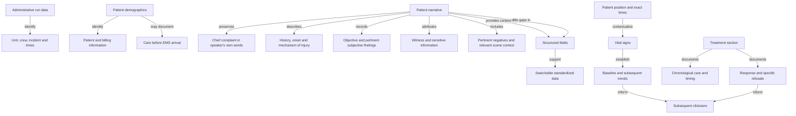

Note: The source recommends at least two complete vital-sign sets when feasible; document limitations rather than inventing measurements.

### Signs, symptoms, and supported impressions

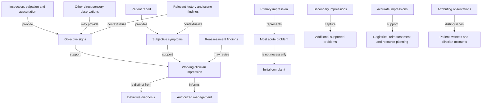

### Narrative frameworks compared

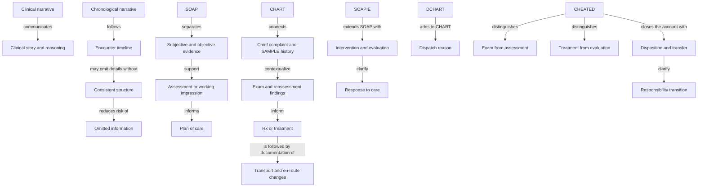

### Clear terminology and medication notation

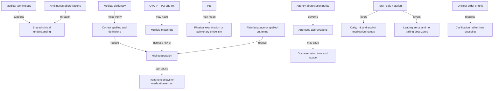

## Clinical data collection and decision support

### Incident, history, and disposition data

```mermaid
flowchart TD
    N01["2022 NASEMSO documentation guideline"]
    N02["Continuity and continuous performance improvement"]
    N03["Incident demographics"]
    N04["Service type, crew roles, location, modes and delays"]
    N05["Dispatch and back-in-service times"]
    N06["Cancelled or no-contact incidents"]
    N07["Patient demographics and medical history"]
    N08["Age, weight, allergies, medications and history"]
    N09["SAMPLE history"]
    N10["Symptoms, allergies, medications, past history, intake and events"]
    N11["Allergies and medications"]
    N12["Medication safety decisions"]
    N13["Complaint group"]
    N14["Onset, duration, location and associated symptoms"]
    N15["Barriers and substance indicators"]
    N16["Assessment limitations"]
    N17["Clinician impressions"]
    N18["Primary and secondary problems"]
    N19["Disposition"]
    N20["Initial and final acuity"]
    N21["Transport method, mode and destination"]
    N22["Clinical trajectory"]
    N23["Crew roles"]
    N24["Attribution of care"]
    N25["Local reporting and billing requirements"]
    N26["Minimum documentation standards"]

    N01 -->|supports| N02
    N03 -->|capture| N04
    N03 -->|include| N05
    N03 -->|remain relevant to| N06
    N07 -->|include| N08
    N09 -->|organizes| N10
    N11 -->|inform| N12
    N13 -->|captures| N14
    N15 -->|contextualize| N16
    N13 -->|informs| N17
    N17 -->|identify| N18
    N19 -->|records| N20
    N19 -->|records| N21
    N20 -->|help evaluate| N22
    N23 -->|establish| N24
    N25 -->|may extend| N26
```

### Targeted assessments and time-sensitive conditions

```mermaid
flowchart TD
    N01["Suspected stroke"]
    N02["Last known well"]
    N03["Time symptoms were discovered"]
    N04["Source and estimated or known time"]
    N05["Stroke exam"]
    N06["Speech, facial symmetry, arm findings and stroke score"]
    N07["Reperfusion screening and destination considerations"]
    N08["Trauma mechanism and injury risk"]
    N09["Field triage criteria"]
    N10["Occupant safety equipment and exam findings"]
    N11["Targeted trauma exam"]
    N12["Assessed finding not present"]
    N13["Trauma triage"]
    N14["Destination pre-arrival alert"]
    N15["Suspected spinal injury"]
    N16["Back, spine and extremity findings"]
    N17["Capacity assessment fields"]
    N18["Refusal and treatment reasoning"]
    N19["Legal decision-making capacity"]
    N20["12-lead acquisition"]
    N21["Procedure with tracing and timestamps"]
    N22["12-lead tracing"]
    N23["Authorized interpretation"]
    N24["Clinical and time data"]
    N25["Receiving team preparation"]

    N01 -->|makes relevant| N02
    N02 -->|differs from| N03
    N02 -->|requires attribution of| N04
    N05 -->|combines| N06
    N05 -->|informs| N07
    N08 -->|inform| N09
    N10 -->|contextualize| N08
    N11 -->|may document| N12
    N13 -->|may prompt| N14
    N15 -->|makes relevant| N16
    N17 -->|support| N18
    N17 -->|do not define| N19
    N20 -->|is documented as| N21
    N22 -->|requires| N23
    N24 -->|inform| N25
```

### Vitals and longitudinal assessment

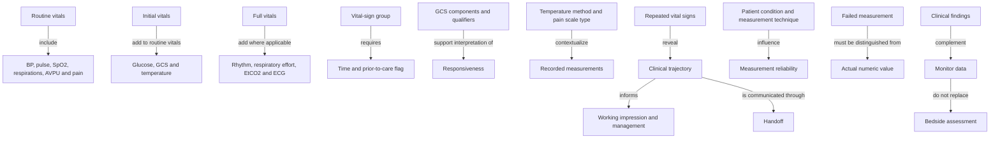

Note: Routine, initial and full groups are the source's documentation framework, not universal assessment requirements. Select clinically indicated and authorized measurements.

### Cardiac arrest documentation and quality feedback

```mermaid
flowchart TD
    N01["Witness and bystander history"]
    N02["Arrest onset and downtime estimate"]
    N03["Prior CPR and AED use"]
    N04["Pre-EMS resuscitation history"]
    N05["First monitored rhythm"]
    N06["Authorized resuscitation decisions"]
    N07["BLS compressions, AED and ventilation"]
    N08["Resuscitation"]
    N09["Authorized ALS therapies"]
    N10["Advanced airway placement"]
    N11["Compressions"]
    N12["Resuscitation event times"]
    N13["Treatment chronology"]
    N14["CPR, shocks, airway and medications"]
    N15["ROSC and final rhythm"]
    N16["Arrest outcome"]
    N17["Termination or transfer decisions"]
    N18["Reason, time and status"]
    N19["Arrest record"]
    N20["Pre-EMS history and treatment chronology"]
    N21["Treating agency and provider identity"]
    N22["Utstein criteria and CARES"]
    N23["Arrest reporting data"]
    N24["Arrest record and monitor downloads"]
    N25["Medical director quality review"]

    N01 -->|inform| N02
    N03 -->|establish| N04
    N05 -->|informs| N06
    N07 -->|support| N08
    N09 -->|supplement| N07
    N10 -->|should avoid unnecessary interruption of| N11
    N12 -->|establish| N13
    N13 -->|connects| N14
    N15 -->|characterize| N16
    N17 -->|require documentation of| N18
    N19 -->|integrates| N20
    N19 -->|includes| N21
    N22 -->|organize| N23
    N24 -->|support| N25
    N25 -->|informs improvements to| N08
```

## Treatment, monitoring, and clinical reassessment

### Intervention records and exceptions

```mermaid
flowchart TD
    N01["Medication entry"]
    N02["Drug, dose, unit, route and time"]
    N03["Crew identity, role and authorization"]
    N04["Procedure entry"]
    N05["Procedure, equipment size, site and time"]
    N06["Attempts and successful completion"]
    N07["Prior-to-care flag"]
    N08["Prior care from current crew care"]
    N09["Medication and procedure entries"]
    N10["Response and complications"]
    N11["Contraindication, refusal or order denial"]
    N12["Pertinent negative for intervention"]
    N13["Inability to complete"]
    N14["Medication allergy"]
    N15["Medication-specific pertinent negative"]
    N16["Medication already taken"]
    N17["Prior aspirin ingestion"]
    N18["Medication given before arrival"]
    N19["Medication already taken qualifier"]
    N20["Attempt documentation"]
    N21["Actual sequence and result"]
    N22["Reassessment and accountability"]
    N23["Applicable dictionary and protocol"]
    N24["Field and qualifier selection"]

    N01 -->|records| N02
    N01 -->|attributes| N03
    N04 -->|records| N05
    N04 -->|distinguishes| N06
    N07 -->|distinguishes| N08
    N09 -->|record| N10
    N11 -->|may justify| N12
    N13 -->|may justify| N12
    N14 -->|may justify| N15
    N16 -->|may justify| N15
    N17 -->|is documented as| N18
    N17 -->|may also support| N19
    N20 -->|preserves| N21
    N21 -->|supports| N22
    N23 -->|govern| N24
```

Note: The source's prior-aspirin example involves 324 mg taken per pre-arrival instructions; it illustrates reporting, not a medication recommendation. The historical one-attempt-per-entry rule is subject to local implementation.

### Treatment response versus complications

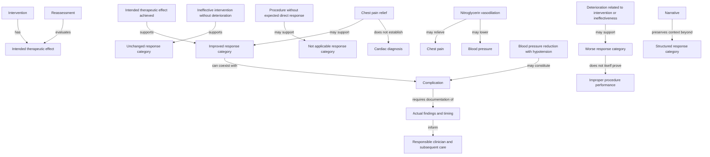

Note: The source lists no expected procedure response under both not applicable and unchanged. Resolve that coding ambiguity using the applicable dictionary and software. The medication and procedure examples are charting examples, not treatment indications.

### Clinical reasoning and suspected opioid toxicity

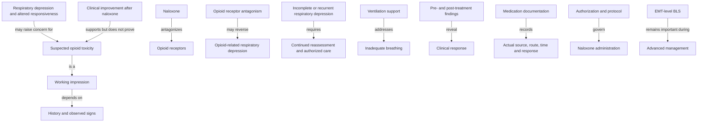

### Monitoring data and bedside assessment

```mermaid
flowchart TD
    N01["Pulse oximetry"]
    N02["Hemoglobin oxygen saturation"]
    N03["Ventilation or tissue blood flow"]
    N04["Poor perfusion and measurement factors"]
    N05["Pulse oximetry reliability"]
    N06["Skin temperature and pigmentation"]
    N07["Waveform capnography"]
    N08["Exhaled carbon dioxide over time"]
    N09["Ventilation"]
    N10["Capnography findings"]
    N11["Pulmonary blood flow"]
    N12["Sampling conditions"]
    N13["ECG"]
    N14["Cardiac electrical activity"]
    N15["Effective circulation"]
    N16["Bedside assessment"]
    N17["Chest movement, effort, mental status and perfusion"]
    N18["Monitor readings"]
    N19["Waveform capnography and clinical assessment"]
    N20["Endotracheal tube placement in adult cardiac arrest"]
    N21["Sudden monitor changes"]
    N22["Prompt communication and reassessment"]
    N23["Oxygen decisions"]
    N24["Clinical context, reliable data and protocol"]
    N25["Single monitor value"]
    N26["Adequate resuscitation or termination justification"]

    N01 -->|estimates| N02
    N02 -->|does not directly measure| N03
    N04 -->|may impair| N05
    N06 -->|may affect| N05
    N07 -->|measures| N08
    N09 -->|influences| N10
    N11 -->|influences| N10
    N12 -->|influence| N10
    N13 -->|reflects| N14
    N14 -->|does not establish| N15
    N16 -->|evaluates| N17
    N16 -->|contextualizes| N18
    N19 -->|support confirmation and monitoring of| N20
    N21 -->|warrant| N22
    N23 -->|depend on| N24
    N25 -->|cannot establish| N26
```

Note: The source's SpO2 below 94% example illustrates falsified oxygen documentation, not a universal treatment threshold. Oxygen delivery and settings must reflect actual care.

### BLS and ALS clinical information exchange

```mermaid
flowchart TD
    N01["EMT baseline findings"]
    N02["Pre-intervention condition"]
    N03["Advanced assessment"]
    N04["ECG or capnography information"]
    N05["Chest pressure, sweating and worsening perfusion"]
    N06["Paramedic evaluation and destination consideration"]
    N07["Nondiagnostic initial ECG"]
    N08["Acute coronary syndrome"]
    N09["ECG findings"]
    N10["History, perfusion and repeated vital signs"]
    N11["Advanced intervention"]
    N12["Authorized clinician"]
    N13["Own interpretation, indication and decisions"]
    N14["EMT"]
    N15["Equipment preparation and data acquisition"]
    N16["BLS care and reassessment"]
    N17["Changes in patient condition"]
    N18["Chronological documentation"]
    N19["Care before and after ALS contact"]
    N20["Temporal relationship of care and deterioration"]
    N21["Causation"]
    N22["Team allocation of timing duties"]
    N23["Accurate documentation without delaying urgent care"]

    N01 -->|establish| N02
    N02 -->|contextualizes| N03
    N03 -->|may add| N04
    N05 -->|may warrant| N06
    N07 -->|does not exclude| N08
    N09 -->|complement| N10
    N11 -->|requires| N12
    N12 -->|documents| N13
    N14 -->|may assist with authorized| N15
    N14 -->|continues| N16
    N16 -->|detect| N17
    N17 -->|inform| N03
    N18 -->|distinguishes| N19
    N18 -->|helps evaluate| N20
    N20 -->|does not alone prove| N21
    N22 -->|supports| N23
```

### Advanced intervention documentation

```mermaid
flowchart TD
    N01["Authorized advanced clinician"]
    N02["Intervention and indication"]
    N03["Vascular access record"]
    N04["Attempts, site, equipment and success"]
    N05["Vascular access"]
    N06["Actual fluid or medication administration"]
    N07["Advanced airway record"]
    N08["Device, size, attempts and confirmation methods"]
    N09["Actual airway confirmation"]
    N10["Assessment of placement"]
    N11["Airway reassessment"]
    N12["Complications or dislodgment"]
    N13["Manual electrical therapy record"]
    N14["Rhythm, therapy, time and clinician"]
    N15["Manual electrical therapy"]
    N16["EMT AED events"]
    N17["Electrical therapy reassessment"]
    N18["Rhythm, pulse, perfusion and complications"]
    N19["Medication or infusion record"]
    N20["Drug, dose, unit, route and timing"]
    N21["Infusion record"]
    N22["Confirmed settings and changes"]
    N23["ECG documentation"]
    N24["Tracing, acquisition time and artifact limitations"]
    N25["Capnography documentation"]
    N26["EtCO2, waveform, time and ventilation method"]
    N27["Intervention-specific records"]
    N28["BLS baseline and reassessment"]
    N29["Clinical response and adverse effects"]
    N30["Ongoing management"]

    N01 -->|verifies| N02
    N03 -->|distinguishes| N04
    N05 -->|is distinct from| N06
    N07 -->|captures| N08
    N09 -->|supports| N10
    N11 -->|detects| N12
    N13 -->|captures| N14
    N15 -->|is documented separately from| N16
    N17 -->|evaluates| N18
    N19 -->|captures| N20
    N21 -->|includes applicable| N22
    N23 -->|preserves| N24
    N25 -->|preserves| N26
    N27 -->|combine with| N28
    N28 -->|help establish| N29
    N29 -->|inform| N30
```

### Clinical integration: deteriorating abdominal pain case

```mermaid
flowchart TD
    N01["Reported abdominal pain and rigidity"]
    N02["Serious underlying disease"]
    N03["BP trend from 88/64 to 82/62"]
    N04["Evidence of worsening perfusion"]
    N05["Pulse trend from 128 to 134"]
    N06["Respirations from 24 to 26 per minute"]
    N07["Concern for deterioration"]
    N08["Pale cool clammy skin and weakening radial pulses"]
    N09["Declining responsiveness"]
    N10["Shock"]
    N11["Inadequate tissue perfusion"]
    N12["Initial SpO2 of 96 percent on room air"]
    N13["Poor peripheral perfusion"]
    N14["Later oximeter error"]
    N15["Failed measurement, not an estimated value"]
    N16["Prompt communication and authorized BLS reassessment"]
    N17["Additional ALS resources per protocol"]
    N18["Authorized ALS evaluation"]
    N19["Monitoring, vascular access and circulatory support"]
    N20["Cause and patient response"]
    N21["Advanced therapy decisions"]
    N22["Hospital diagnosis and definitive care"]

    N01 -->|raise concern for| N02
    N03 -->|contributes to| N04
    N05 -->|contributes to| N04
    N06 -->|contribute to| N07
    N08 -->|contribute to| N04
    N09 -->|contributes to| N04
    N04 -->|raises concern for| N10
    N10 -->|involves| N11
    N12 -->|does not exclude| N11
    N13 -->|may contribute to| N14
    N14 -->|requires documentation as| N15
    N07 -->|warrants| N16
    N07 -->|may warrant| N17
    N18 -->|may consider| N19
    N20 -->|influence| N21
    N02 -->|may require| N22
```

Note: This case supplies no definitive cause, third vital-sign set, treatment, treatment time, ALS contact or disposition. Do not infer that any such care occurred. The map is clinical reasoning and documentation, not a treatment pathway.

## Confidentiality and clinical handoff

### Information protection and permissible distribution

```mermaid
flowchart TD
    N01["PCR"]
    N02["Confidential patient information"]
    N03["Patient confidentiality"]
    N04["HIPAA and applicable law"]
    N05["Authorized disclosure"]
    N06["Treatment disclosure"]
    N07["Continuity of care without separate authorization"]
    N08["Authorized billing disclosure"]
    N09["Claims processing"]
    N10["Legally required subpoena"]
    N11["Court disclosure"]
    N12["Law enforcement request"]
    N13["Release of entire PCR"]
    N14["Defined legal circumstances and limits"]
    N15["Permitted law enforcement disclosure"]
    N16["State law and agency procedure"]
    N17["Disclosure restrictions"]
    N18["Privacy officer or supervisor"]
    N19["Uncertain disclosure authority"]
    N20["Secure agency communication"]
    N21["Personal accounts and social media"]
    N22["Identifiable patient records"]
    N23["Typical PCR distribution"]
    N24["Receiving facility, EMS agency and authorized oversight"]
    N25["Authorized oversight"]
    N26["Quality improvement"]
    N27["Continuity of care"]

    N01 -->|contains| N02
    N03 -->|is protected by| N04
    N04 -->|govern| N05
    N06 -->|may enable| N07
    N08 -->|supports| N09
    N10 -->|may require| N11
    N12 -->|does not alone authorize| N13
    N14 -->|determine| N15
    N16 -->|may impose additional| N17
    N18 -->|may help resolve| N19
    N20 -->|protects| N02
    N21 -->|are inappropriate for| N22
    N23 -->|provides copies to| N24
    N25 -->|uses data for| N26
    N27 -->|depends on appropriate| N05
```

### Transfer of care and drop reports

```mermaid
flowchart TD
    N01["Transfer of care"]
    N02["Identity, complaint, history and onset"]
    N03["Baseline, latest findings and treatment response"]
    N04["Outstanding concerns"]
    N05["Receiving clinician priorities"]
    N06["Advanced clinician"]
    N07["Airway, access, ECG, medication and infusion status"]
    N08["Verbal handoff"]
    N09["Written or electronic record"]
    N10["Full PCR at receiving facility"]
    N11["Transfer signature and facility copy"]
    N12["Immediate return to service or printing limitation"]
    N13["Abbreviated drop report"]
    N14["Drop report"]
    N15["Essential data and receiving signature"]
    N16["Full PCR"]
    N17["Drop report copy"]
    N18["Actual responsibility transfer"]
    N19["Receiving clinician and time"]
    N20["Vehicle or ALS arrival"]
    N21["Pre- and post-intercept records"]
    N22["Provider-specific actions and timing"]
    N23["Accurate handoff"]
    N24["Continuity of care"]

    N01 -->|requires communication of| N02
    N01 -->|requires communication of| N03
    N04 -->|guide| N05
    N06 -->|communicates| N07
    N08 -->|complements| N09
    N10 -->|ideally accompanies| N11
    N12 -->|may require| N13
    N14 -->|captures| N15
    N14 -->|supports later completion of| N16
    N16 -->|includes submission of| N17
    N18 -->|requires confirmation of| N19
    N20 -->|does not automatically establish| N18
    N21 -->|distinguish| N22
    N23 -->|supports| N24
```

## Refusal, capacity, and patient autonomy

### Decision-making capacity and the right to refuse

```mermaid
flowchart TD
    N01["Adult with decision-making capacity"]
    N02["Refuse care or transport"]
    N03["Decision-making capacity"]
    N04["Decision and time"]
    N05["Understand condition, options, risks and benefits"]
    N06["Appreciate personal consequences"]
    N07["Reason about options"]
    N08["Express a consistent choice"]
    N09["Orientation and neurological findings"]
    N10["Intoxication or psychiatric illness"]
    N11["Medically unwise choice"]
    N12["Hypoxia, hypoglycemia, head injury, intoxication or shock"]
    N13["Authorized advanced assessment"]
    N14["Reversible contributors to impairment"]
    N15["Communication accommodations"]
    N16["Teach-back responses"]
    N17["Understanding and appreciation"]
    N18["Patient refusal of questions or exam"]
    N19["Signature or ALS presence"]
    N20["Local law and protocol"]
    N21["Consultation and escalation authority"]
    N22["Refusal alone"]
    N23["Involuntary detention"]

    N01 -->|has right to| N02
    N03 -->|is specific to| N04
    N03 -->|includes ability to| N05
    N03 -->|includes ability to| N06
    N03 -->|includes ability to| N07
    N03 -->|includes ability to| N08
    N09 -->|inform but do not establish| N03
    N10 -->|does not automatically negate| N03
    N11 -->|does not automatically negate| N03
    N12 -->|may impair| N03
    N13 -->|may investigate| N14
    N15 -->|support assessment of| N03
    N16 -->|provide evidence about| N17
    N18 -->|may limit evaluation of| N03
    N19 -->|does not prove| N03
    N20 -->|govern| N21
    N22 -->|does not authorize| N23
```

### Informed refusal and safety responsibilities

```mermaid
flowchart TD
    N01["Scene safety"]
    N02["Assessment and persuasion efforts"]
    N03["Patient permission"]
    N04["Assessment and authorized care"]
    N05["Patient-specific risk explanation"]
    N06["Limited assessment"]
    N07["Documented uncertainty"]
    N08["Informed decision"]
    N09["Decision-making capacity"]
    N10["Persistent refusal"]
    N11["Medical direction consultation"]
    N12["Persuasion or directed on-scene care"]
    N13["Family involvement"]
    N14["Voluntary acceptance of care"]
    N15["Refusal documentation"]
    N16["Findings, care, specific refusals and capacity responses"]
    N17["Risk discussion, recommendations and consultation"]
    N18["Signed refusal form"]
    N19["Witness signature"]
    N20["Refusal to sign"]
    N21["Objective documentation and informed decision"]
    N22["Safe alternative evaluation"]
    N23["Clinical risk"]
    N24["Warning signs and invitation to call again"]
    N25["Return precautions"]
    N26["When to seek further care"]

    N01 -->|limits| N02
    N03 -->|determines extent of| N04
    N04 -->|supply evidence for| N05
    N06 -->|creates| N07
    N05 -->|supports| N08
    N08 -->|requires evidence of| N09
    N10 -->|may require per protocol| N11
    N11 -->|may support| N12
    N13 -->|may support| N14
    N15 -->|records| N16
    N15 -->|records| N17
    N18 -->|provides supporting evidence for| N15
    N19 -->|may document| N20
    N18 -->|does not replace| N21
    N22 -->|may be offered according to| N23
    N24 -->|support| N25
    N25 -->|communicate| N26
```

Note: The historical workflow includes witnesses and forms, but the source qualifies capacity and involuntary transport requirements. Alternative transportation is not necessarily safe for high-risk patients. Document actual responses rather than presuming informed refusal.

### Clinical integration: possible head injury and incomplete refusal assessment

```mermaid
flowchart TD
    N01["Collision and forehead bruise"]
    N02["Possible head injury"]
    N03["Witness report of slumped driver"]
    N04["Possible loss of consciousness or medical event"]
    N05["Patient denial of loss of consciousness"]
    N06["Initial alertness and adequate breathing"]
    N07["Limited observed baseline"]
    N08["Initial soreness and later symptom denial"]
    N09["Changing patient reports"]
    N10["Refusal of BP and further exam"]
    N11["Ability to assess clinical risk"]
    N12["Delayed serious deterioration"]
    N13["Recommendation for medical evaluation"]
    N14["Possible head injury or preceding medical event"]
    N15["Decision-making capacity"]
    N16["Incomplete assessment"]
    N17["Normal comprehensive exam or unsupported GCS"]
    N18["Conflicting accounts"]
    N19["Explicit source attribution"]
    N20["Documented uncertainty"]
    N21["Medical direction or ALS consultation if indicated"]
    N22["Actual capacity-related responses"]
    N23["Refusal evaluation"]
    N24["Patient and witness signatures"]
    N25["Informed refusal"]
    N26["Risk explanation and return precautions"]
    N27["Patient safety after refusal"]

    N01 -->|suggest| N02
    N03 -->|raises uncertainty about| N04
    N05 -->|does not resolve| N04
    N06 -->|describe| N07
    N08 -->|require documentation of| N09
    N10 -->|limits| N11
    N02 -->|may produce| N12
    N12 -->|informs| N13
    N14 -->|may affect| N15
    N16 -->|prevents claiming| N17
    N18 -->|require| N19
    N20 -->|supports| N21
    N22 -->|inform| N23
    N24 -->|support but do not establish| N25
    N26 -->|support| N27
```

## Incident reporting and resource constraints

### Multiple-casualty documentation

```mermaid
flowchart TD
    N01["Multiple-casualty incident"]
    N02["Time and resource constraints"]
    N03["Immediate full PCR completion"]
    N04["Local MCI plan"]
    N05["Triage and documentation priorities"]
    N06["Triage tag or approved identifier"]
    N07["Patient identity and care record"]
    N08["Triage tag"]
    N09["Complaint, vital signs and treatments"]
    N10["Triage reassessment"]
    N11["Triage priority"]
    N12["Patient identifier"]
    N13["Treating unit, destination and reassessments"]
    N14["Record duplication or wrong-patient monitor data"]
    N15["MCI PCR"]
    N16["Advanced interventions"]
    N17["Lifesaving BLS or evacuation priorities"]
    N18["Accurate patient linkage"]
    N19["Continuity despite resource scarcity"]

    N01 -->|creates| N02
    N02 -->|limit| N03
    N04 -->|governs| N05
    N06 -->|connects| N07
    N08 -->|captures| N09
    N10 -->|may change| N11
    N12 -->|links| N13
    N12 -->|reduces risk of| N14
    N08 -->|supports later completion of| N15
    N15 -->|may be less detailed under| N04
    N16 -->|must not displace| N17
    N18 -->|supports| N19
```

### Special reports and adverse-event documentation

```mermaid
flowchart TD
    N01["Suspected abuse, suspicious burns or gunshot injury"]
    N02["Special reporting"]
    N03["Infectious exposure or crew injury"]
    N04["Harm related to EMS care or equipment failure"]
    N05["State-level reporting"]
    N06["Response vehicle crash with injury or death"]
    N07["Serious on-duty crew injury or alleged substance use"]
    N08["State law and local protocol"]
    N09["Reporting requirements and recipients"]
    N10["Timely, factual and objective account"]
    N11["Factual and objective account"]
    N12["People, services and facilities involved"]
    N13["Unsupported conclusions or blame"]
    N14["Suspected medication error or device failure"]
    N15["Responsible clinician"]
    N16["Patient care record"]
    N17["Actual event sequence, interventions and response"]
    N18["Separate safety report"]
    N19["Agency incident review"]
    N20["Relevant device records"]
    N21["Incident review"]
    N22["Quality improvement"]

    N01 -->|may trigger| N02
    N03 -->|may trigger| N02
    N04 -->|may trigger| N05
    N06 -->|may trigger| N05
    N07 -->|may trigger| N05
    N08 -->|govern| N09
    N02 -->|requires| N10
    N11 -->|identifies| N12
    N11 -->|avoids| N13
    N14 -->|requires prompt communication to| N15
    N16 -->|documents| N17
    N18 -->|supports| N19
    N18 -->|does not replace| N16
    N20 -->|may support| N21
    N21 -->|informs| N22
```

## Medical necessity and reimbursement

### Payer requirements and factual justification

```mermaid
flowchart TD
    N01["Patient condition and transport needs"]
    N02["Medical necessity"]
    N03["Commercial payer"]
    N04["Prudent layperson standard"]
    N05["Reasonable expectation of serious impairment in an emergency"]
    N06["Medicare ambulance coverage"]
    N07["Other transport modes contraindicated"]
    N08["Medical necessity of billed service level"]
    N09["Medicaid"]
    N10["State-specific coverage requirements"]
    N11["State law and payer rules"]
    N12["Coverage determination"]
    N13["Dispatch complaint and on-scene condition"]
    N14["Objective findings and mental status"]
    N15["Monitoring and care required during transport"]
    N16["Ambulance and actual service level"]
    N17["Treatment response"]
    N18["Care delivered"]
    N19["Accurate PCR"]
    N20["Patient-specific reasons alternative transport is unsafe"]
    N21["Reimbursement assessment"]
    N22["Agency documentation policy"]
    N23["Adequate factual detail"]
    N24["Paramedic presence"]
    N25["Clinical authorization"]
    N26["Billing classification"]
    N27["Billing incentives"]
    N28["Unnecessary interventions or exaggerated charting"]

    N01 -->|support evaluation of| N02
    N03 -->|may apply| N04
    N04 -->|considers| N05
    N06 -->|requires| N07
    N06 -->|also requires| N08
    N09 -->|applies| N10
    N11 -->|influence| N12
    N13 -->|contextualize| N02
    N14 -->|provide evidence for| N02
    N15 -->|may justify| N16
    N17 -->|strengthens factual account of| N18
    N19 -->|documents| N20
    N19 -->|supports| N21
    N22 -->|guides| N23
    N24 -->|does not alone establish| N08
    N25 -->|is distinct from| N26
    N27 -->|must not dictate| N28
```

Note: The supplied source locates the Medicare rule at 42 CFR 410.40(e)(1), correcting the textbook's older subsection (d). Commercial and Medicaid coverage varies; no payer-specific contract is supplied.

### Historical ET3 model and separation of authority from payment

```mermaid
flowchart TD
    N01["CMS and HHS"]
    N02["Emergency Triage, Treat, and Transport model"]
    N03["ET3 model"]
    N04["Voluntary payment pilot"]
    N05["Traditional ED transport reimbursement"]
    N06["Transport to alternative destinations"]
    N07["Treatment in place"]
    N08["On-scene provider or telehealth"]
    N09["Alternative destinations and treatment in place"]
    N10["Unnecessary ED use and patient costs"]
    N11["December 31, 2023"]
    N12["Historical ET3 model"]
    N13["Current national ET3 benefit or authorization"]
    N14["Clinical capability"]
    N15["Legal authorization"]
    N16["Payer coverage"]
    N17["Applicable payment rules"]
    N18["Current alternative care arrangements"]
    N19["Local authorization and coverage"]

    N01 -->|announced in 2019| N02
    N03 -->|began in 2020 as| N04
    N04 -->|expanded historical options beyond| N05
    N03 -->|tested payment for| N06
    N03 -->|tested payment for| N07
    N07 -->|could involve| N08
    N09 -->|aimed to reduce| N10
    N03 -->|ended early on| N11
    N12 -->|does not establish| N13
    N14 -->|is distinct from| N15
    N15 -->|is distinct from| N16
    N16 -->|depends on| N17
    N18 -->|require applicable| N19
```

## Cross-concept integration

### One clinical story across care, safety, and system accountability

```mermaid
flowchart TD
    N01["Source-attributed history"]
    N02["Working impression"]
    N03["Baseline findings"]
    N04["Intervention response"]
    N05["Authorized management"]
    N06["Intervention record"]
    N07["Actual clinician, timing and care"]
    N08["Reassessment"]
    N09["Deterioration or adverse effects"]
    N10["Secure handoff or urgent notification"]
    N11["Continuity of care"]
    N12["Accurate PCR"]
    N13["Legal accountability and informed refusal review"]
    N14["Medical necessity evaluation"]
    N15["Quality and research data"]
    N16["Training and medical oversight"]
    N17["Confidentiality and transparent amendments"]

    N01 -->|informs| N02
    N03 -->|contextualize| N04
    N02 -->|informs| N05
    N05 -->|generates| N06
    N06 -->|documents| N07
    N08 -->|updates| N02
    N08 -->|detects| N09
    N09 -->|require communication through| N10
    N10 -->|supports| N11
    N06 -->|contributes to| N12
    N01 -->|contributes to| N12
    N08 -->|contributes to| N12
    N12 -->|provides evidence for| N13
    N12 -->|supports| N14
    N12 -->|supplies| N15
    N15 -->|inform| N16
    N16 -->|support improvement of| N05
    N17 -->|protect| N12
```
