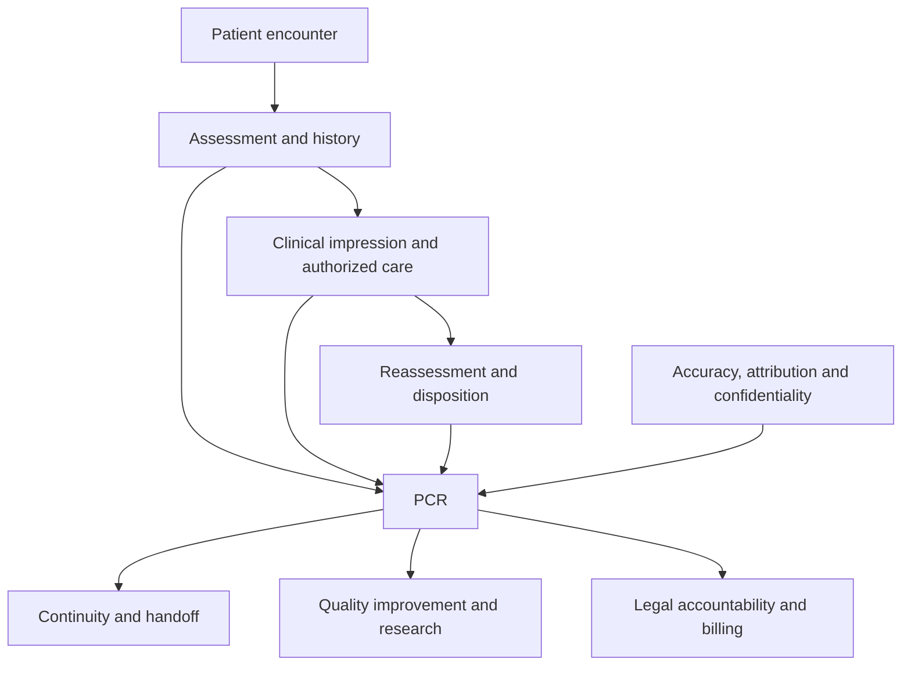
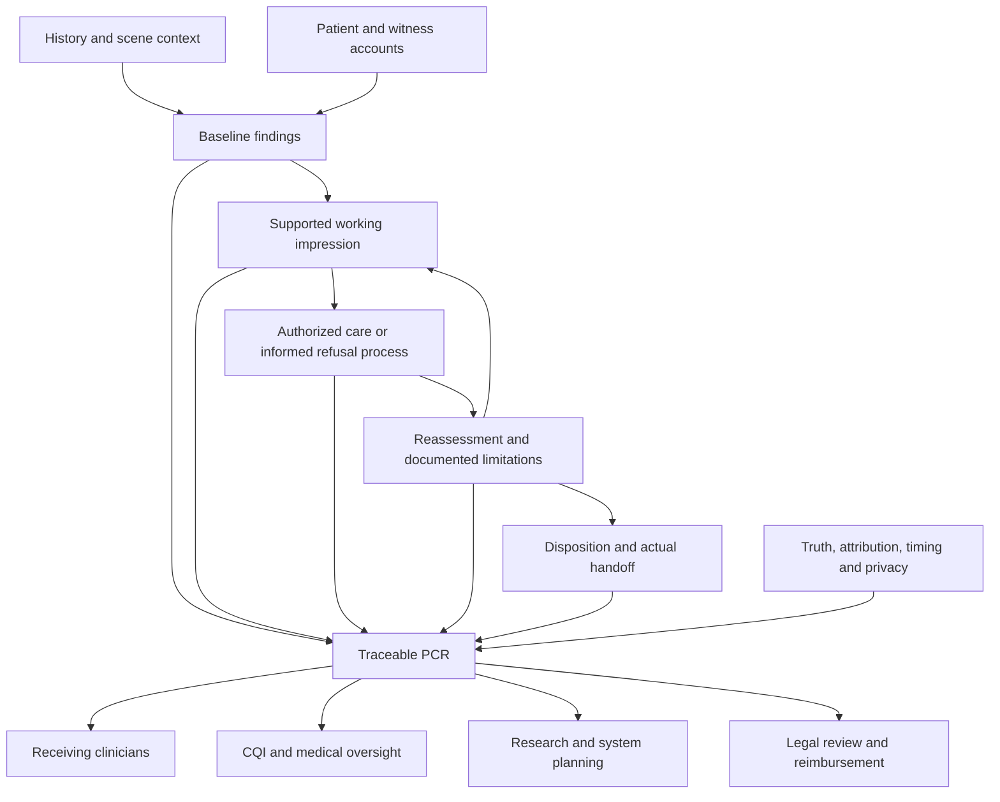

# Chapter 4: Documentation — PQ4RS

## Preview

EMS documentation converts a temporary patient encounter into a durable clinical record. The prehospital care report (PCR) communicates what was known, what was observed, what was done, how the patient changed, and who assumed responsibility. Its primary purpose is continuity of patient care; that same record also supports professional accountability, quality improvement, research, legal review, and reimbursement.

The chapter follows three connected ideas: **record the encounter accurately**, **communicate the clinical story and its limitations**, and **use the record responsibly after the encounter**. Structured data make findings comparable; narrative explains their meaning. Reassessment establishes trends rather than isolated measurements. Refusals, special incidents, and advanced interventions require the same integrity, with additional attention to capacity, authorship, scope, and uncertainty.

## Question

- **Q01.** Why is the PCR a clinical care tool before it is an administrative or legal document?
- **Q02.** How do truthful documentation, authorized amendments, synchronized timestamps, and clear authorship protect the reliability of a patient record?
- **Q03.** Why does a useful PCR need both standardized data and a narrative, and how do signs, symptoms, impressions, and pertinent negatives serve different functions?
- **Q04.** How does reassessment connect BLS findings, advanced interventions, clinical deterioration, and transfer of care?
- **Q05.** What makes a refusal of care informed and defensible, especially when assessment is incomplete or decision-making capacity is uncertain?
- **Q06.** How can clinicians share necessary information while protecting confidentiality and meeting special reporting obligations?
- **Q07.** How does accurate patient-specific documentation support medical necessity without allowing billing rules to dictate clinical care?

## Read

### Purpose, accountability, and continuity of care

The **prehospital care report (PCR)**, also called a patient care report, run report, or trip sheet, is the written or electronic record prepared and submitted for each patient contact. Although formats vary between EMS systems and states, the core information is substantially the same. It serves the patient, receiving clinicians, assisting agencies, administrators, medical directors, and researchers who may never directly encounter the patient.

Documentation is a shared clinical responsibility rather than an advanced procedure. A clear, concise, accurate, and legible report represents what actually occurred during assessment and management. It establishes professional accountability, supports continuity of medical care, provides a legal record, and supports reimbursement to offset the costs of EMS. Unchecked boxes, misspellings, and illegible or careless entries can reflect poorly on the quality of care.

#### Continuity of Medical Care

* **Primary Purpose:** Supporting high-quality patient care by providing a clear, complete record of assessment findings and emergency interventions.
* **Value to Emergency Department (ED) Staff:**
  * Enables timely, appropriate treatment upon arrival.
  * Conveys scene and environmental context that hospital personnel cannot observe firsthand.
  * Captures details from sources hospital staff may not have access to (e.g., bystanders, family members, or a patient who was initially awake).
* **Tracking Patient Trends:**
  * Recorded mental status and vital signs establish a **baseline** to measure whether the patient is improving or deteriorating.
  * Documented chief complaints, signs, and symptoms help guide the hospital's treatment plan.
  * Recording which interventions were—and were not—performed prevents unnecessary duplication of effort.

##### ALS Connection: One clinical story across provider levels

The EMT's earliest findings may be unavailable to the AEMT, paramedic, or receiving clinician. A useful record separates what the patient reported, what the EMT directly observed, what another clinician observed, what each clinician actually did, and how the patient responded. Record the timing of changes and transfer of responsibility rather than reconstructing a single undifferentiated account later.

**Clinical rationale:** A patient who is alert before a medication or an airway intervention but becomes less responsive afterward requires reassessment. Without the original baseline, later clinicians cannot readily determine when deterioration began. A precise timeline supports evaluation without assuming that the preceding intervention caused the change.

**Teamwork:** Agree on who is tracking times and reassessments while care is underway; communicate findings immediately and complete documentation when safe. Do not delay urgent BLS care to finish a PCR. [NASEMSO][model] · [Joint transfer-of-care statement][handoff]

##### ALS Connection: BLS findings guide advanced assessment

A useful BLS-to-ALS handoff includes the chief complaint in the patient's words, onset and progression, relevant SAMPLE history, baseline and most recent vital signs, pertinent negatives, BLS treatment and response, and any limitations on assessment. For example, a patient with chest pressure, sweating and worsening perfusion may warrant paramedic evaluation with ECG and consideration of time-sensitive destination decisions. The ECG adds electrical information but does not replace the history, perfusion exam or repeated vital signs; an initially nondiagnostic tracing does not exclude acute coronary syndrome.

The EMT can report changes, acquire data or help prepare monitoring equipment if authorized, and maintain appropriate BLS care. The clinician authorized to interpret a tracing or select advanced therapy documents their own impression and decisions. [NASEMSO][model] · [Scope model][scope]

#### Administrative Uses

* **Permanent Record & Billing:** Typically becomes part of the patient's permanent hospital record and is used for hospital/EMS billing and insurance claims.
* **System Statistics:** Supplies operational data for the EMS agency, including:
  * Average response times
  * On-scene times for critical trauma patients
  * Annual volume of specific call types (e.g., cardiac arrest patients treated per year)

#### Legal document

A PCR is often one of the first documents reviewed by a plaintiff’s attorney. It may be the only surviving account of a call months or years later, after thousands of subsequent encounters, when recollection is unreliable.

* **Court & Testimony:** Runs involving crimes or civil lawsuits may require the report author to testify as a witness months or years later, relying on the PCR to recall details.
* **Legal Defense:** Legible, accurate, and thorough documentation serves as a critical defense if the EMT is named in a lawsuit.
* **Essential Legal Details to Record:**
  * Objective findings and pertinent subjective findings
  * Patient's condition upon arrival on scene
  * Specific emergency care rendered and the times interventions were performed
  * Any changes in patient status upon arrival at the receiving facility
  * Discussions with the patient and/or family regarding care—particularly when treatment is refused

#### Educational and Research Uses

* **Clinical Research:** Helps scientists evaluate the positive or negative outcomes of specific prehospital interventions at different phases of care.
* **Administrative Research:** Allows administrators to analyze data to improve service timeliness and cost-effectiveness.
* **Training Needs:** Tracks recurring patient presentations and clinical conditions to identify areas where additional EMT education or training is needed.

#### Evaluation and Continuous Quality Improvement (CQI)

* **Quality Improvement:** PCR reviews are a core part of the CQI process, helping identify gaps that inform remedial and continuing education courses.
* **Medical Oversight:** Enables medical directors to verify that EMTs are following local protocols and meeting the established standard of care.

> [!NOTE]
> **ALS Connection — Quality improvement and resuscitation**
>
> In cardiac arrest, quality review may compare BLS and ALS care: bystander CPR history, first rhythm, CPR and defibrillation events, airway/ventilation management, medications, return of spontaneous circulation (ROSC), and transfer or termination decisions. Accurate timestamps and monitor downloads can help the medical director understand the sequence. The EMT's contribution is central: effective compressions, appropriate AED use and ventilation, and minimizing unnecessary interruptions remain critical even when advanced equipment is available. Advanced airway placement should not unnecessarily interrupt compressions. [AHA 2025 adult ALS][aha] · [NASEMSO][model]

#### Scope of practice and medical direction

EMTs provide foundational assessment, BLS care, observation, reassessment, and communication. AEMTs generally add focused advanced capabilities such as vascular access and selected medications; paramedics generally have broader pharmacology, advanced airway management, and cardiac rhythm interpretation/electrical therapies. Actual authorization varies. Acquiring a tracing, helping prepare supplies, and interpreting a rhythm or performing an invasive procedure are distinct tasks. State law, licensure, training, credentialing, local protocols and medical direction govern each task; a partner's request alone does not expand scope. [National EMS Scope of Practice Model][scope] · [National Model EMS Clinical Guidelines][model]

Evidence informs recommendations; guidelines provide clinical frameworks; local protocols operationalize care; scope and credentialing determine what an individual may perform. Medical direction provides clinical oversight within those legal boundaries. No local protocol has been assumed.

### Documentation integrity and reporting formats

#### Two foundational rules

1. **"If it wasn't written down, it wasn't done."** (ED staff won't know it was done, and you cannot prove it in court.)
2. **"If it wasn't done, don't write it down."** (Constitutes falsifying information.)

#### Falsification

* **Never Falsify a PCR:** Any mistake (error of omission or commission) must be highlighted, never covered up. Document exactly what did or did not happen and any steps taken to correct it.
* **Consequences:** Suspension or revocation of EMT certification/license, potential criminal charges, and compromised patient care (gives other health care providers an incorrect impression of the patient's condition).
* **Commonly Falsified Areas:**
  * **Vital signs:** Neglecting to take a set of vitals and making up numbers to cover the omission.
  * **Treatment:** Leaving out that you assisted with a medication without medical direction approval, or neglecting to give oxygen to a patient with **SpO2 less than 94%** and writing that oxygen was given.
  * **Billing/Reimbursement:** Exaggerating the patient's condition or care provided to seek higher insurance reimbursement. If used for **Medicare reimbursement**, this may constitute **Medicare fraud and abuse** and violate the **False Claims Act** (investigated by the federal government).

> [!CAUTION]
> **ALS Connection — Oxygen example is not a universal threshold**
>
> The textbook's SpO2 less than 94% example illustrates falsification, not an instruction that all patients below that value receive identical oxygen treatment. Oxygen use depends on clinical context, reliable measurements, condition-specific guidance and protocol. Poor perfusion, skin temperature, pigmentation and other factors can affect pulse oximetry. Document actual oxygen delivery (if given), device, relevant settings, response, and any reason a measurement could not be obtained. Never invent a saturation or chart oxygen that was not administered. [FDA][fda] · [NASEMSO][model]

#### Paper and electronic PCRs

##### Paper report

* Combines check boxes and write-on lines for vital signs and brief data, plus areas for a fuller narrative account.
* **Historical example: Beaver Township Fire/EMS two-page paper PCR (NEMSIS 2013):**
  * **Page 1 Sections:**
    * *Patient & Call Info:* Name, sex (M, F, ?), address, phone, SSN, DOB, age, doctor, race, code status (DNR-CC, DNR-CCA, living will, other, full code), location of call, receiving facility, reason for facility choice, date, trip number, CAD number.
    * *Response & Times:* Service level (ALS/BLS, trauma/other, medic back-up, first response), transport code, mileage (to/at), weight, and timestamps (call, dispatch, en route, on scene, ALS arrival, to hospital, at hospital, clear/CA).
    * *Vital Signs Grid:* Columns for time, on scene, and en route 1–3; rows for BP, pulse, respirations, SpO2, ECG, EtCO2, skin (color, temp, condition), pupils, lungs, and GCS (E, V, M, total); plus check boxes for monitor, 12-lead, transform, and blanks for BGL 1 & 2.
    * *Medical History & Impressions:* Check boxes for heart (MI, angina, A-fib, pacemaker, CHF, syncope), breathing (asthma, COPD, bronchitis, emphysema), diabetes (IDDM, NIDDM), cerebrovascular (HTN, CVA, TIA), seizure, cancer, psych, GI, OB/GYN, recent surgery, other; write-in lines for medications, allergies, primary/secondary EMT impression, chief complaint, and history of chief complaint.
    * *Crew & Procedures:* Crew roster (name, level, state number, driver); sections for **IV therapy** (attempts, success, location, size, solution, KVO/bolus/saline lock, condition, complication), **intubation** (attempts, success, size, oral/nasal/digital, mm at teeth, time, confirmation methods, condition, complication), and **cardiac arrest** (CPR begun by, time, AED, termination/ROSC time, online physician, condition, complication).
  * **Page 2 Sections:** Patient name, trip number, multi-row narrative and treatment areas, EMS signature, orders by (protocol vs. online physician), unit check boxes, and six numbered treatment boxes (time, drug, dose, route, condition improved/worsened/unchanged, complication).

##### Electronic PCR (most common)

* Data entered directly into a laptop, mobile data device, tablet, or smartphone app and synchronized/transferred to a large central database.

* **Electronic (Computer) Clipboard:** "Pen-based" systems that recognize handwriting and convert it to electronic format, or offer selection lists requiring little writing.
* **Advantages of Computerized Systems:**
  * Store more information in a more legible format; greater efficiency in storing, retrieving, and using data.
  * Can link to diagnostic/monitoring equipment, electronic medical records (EMRs), computer-aided dispatch (CAD), fleet management, inventory control, email, personnel, and payroll.
  * Enables **real-time upload** to the hospital to assist with pre-arrival preparation.
  * Checks spelling and abbreviations, alerts the EMT if required data are omitted, and facilitates QA/QI programs.

Electronic forms may use body diagrams and body-part-specific selection menus. Paper forms use manual entries and narrative areas; the electronic system provides more legible, searchable records, validation and integration, but device failures or erroneous automatic imports still require careful reconciliation.

> [!NOTE]
> **ALS Connection — Electronic records and monitor integration**
>
> When importing ECG strips, vital signs or device events, confirm that the monitor is associated with the correct patient, that times and units are reasonable, and that a measurement is not simply an artifact. An automatically imported number does not establish that a clinician assessed the patient or performed an intervention. A monitor rhythm label is not equivalent to a qualified clinician's interpretation.
>
> If a device fails, document observed findings, the failed measurement and any actual alternative assessment. Do not enter an invented value to satisfy a required field. Preserve original data, use authorized corrections and identify any estimated time as such. The EMT may help reconcile observations with the advanced clinician; who can enter, amend and attest to particular entries is agency-specific. [NEMSIS data dictionaries][nemsis] · [NASEMSO][model]

#### Correcting and amending reports

* **While Writing a Paper Report:** Draw a **single horizontal line** through the error, **initial** it, and write the correct information beside it. Never erase or write over an error (could be interpreted as a cover-up or falsification).
  * **Example:** A handwritten entry reads *"The ~~left~~ right pupil was fixed and dilated,"* with a single horizontal line through *"left"* and the EMT's initials next to the crossed-out word.
* **After a Paper Report Is Submitted:** Draw a single horizontal line through the error (preferably in a **different color of ink**), add a note with the correct information, **initial** the entry, and include the **date and time** of the correction. For omitted information, add a note with the correct info, date, and initials. Notify everyone to whom the incorrect report was submitted.
* **Electronic PCR:** Use the built-in amendment feature (includes a date and time stamp). If no electronic amendment option exists, correct a printed copy using traditional paper methods and resubmit as a corrected copy.

> [!NOTE]
> **ALS Connection — Amendments and shared authorship**
>
> An ePCR amendment should preserve the original entry, identify the author, and indicate the actual correction time according to the approved workflow. A later clarification from the paramedic should be attributed to them, not backdated or represented as an EMT's own earlier observation. If a clinically significant error has already been communicated, notify the receiving team promptly using the approved process; completing the amendment alone may not reach the bedside in time. [NASEMSO][model] · [Joint transfer-of-care statement][handoff]

### Standardized data and PCR structure

#### Historical U.S. DOT minimum data set

* Standardized data recommended by the DOT for all PCRs to improve care nationwide and allow meaningful data comparison across systems.
* **Patient Information:**
  * Chief complaint
  * Level of responsiveness (AVPU) — mental status
  * Blood pressure for patients **greater than 3 years old**
  * Skin perfusion (capillary refill) for patients **less than 6 years old**
  * Skin color, temperature, and condition
  * Pulse rate
  * Respiratory rate and effort
  * Patient demographics (age, sex, race, weight)
* **Administrative Information:**
  * Time the incident was reported
  * Time the unit was notified
  * Time of arrival at the patient
  * Time the unit left the scene
  * Time the unit arrived at its destination (hospital, etc.)
  * Time of transfer of care
* **Accurate and Synchronous Clocks:** All EMS system elements (dispatch, EMT watches, monitors) must use accurate, synchronized clocks—critical for determining cardiac arrest downtime before CPR/defibrillation and for administrative/legal review.

> [!NOTE]
> **ALS Connection — Minimum data versus clinically necessary data**
>
> The textbook's DOT minimum data set is a foundational reporting concept, not a ceiling on contemporary ePCR content or a rule limiting which patients should be assessed. Age-based entries in that historical list are not instructions to omit clinically indicated pediatric assessments. Contemporary records may include additional measurements, provider IDs, event times, procedures, outcomes and local elements. Record actual patient-contact and transfer times separately from vehicle arrival times; distinguish estimated witness-reported onset from observed times. [NEMSIS][nemsis] · [NASEMSO][model]

#### NEMSIS data standards and limitations

* **Versions:**
  * **v2.2.1 (2006):** Accepted through 12/31/2016.
  * **v3 (finalized 2011):** Flexible updates and linkage to other health records; **v3.3.4** (March 2014, accepted through 12/31/2017); **v3.4** (March 2015, sole standard as of August 2021; basis of these guidelines).
* **Mandatory vs. Required Elements:**
  * **Mandatory:** Must have real data; does **not** accept nil (blank), not values, or pertinent negatives.
  * **Required:** Must be completed to store/move record, but **allows** nil, not values, or pertinent negatives.
* **Null/Qualifier Values:**
  * **Not Values (NV):** `"not applicable"` and `"not recorded"`.
  * **Nil Values:** Blank fields (accidental or purposeful when nothing applies).
  * **Pertinent Negatives (PN):** 11 possible qualifiers (e.g., `"medication already taken"`; `"Chest --> gunshot wound --> Exam Finding Not Present"`).
* **Element & Value Naming:**
  * Two parent datasets: **Demographic (`d`)** (agency/system research) and **EMS (`e`)** (majority of ePCR data).
  * *Element Example:* `eVitals.06 — SBP (systolic blood pressure)` (`eVitals.06` stored in background; text shown to clinician).
  * *Value Codes:* Derived from **ICD-10, SNOMED, or RxNorm** (e.g., `9914117 — Medical-Cardiac Chest Pain` under `eProtocols.01`).
  * **Custom Elements:** States/local systems may add custom elements or value extensions for regional registries, research, education, or service performance.

> [!CAUTION]
> **Current-practice clarification — NEMSIS version update**
>
> The version history above describes the textbook's 2022-era guideline. NEMSIS currently publishes version 3.5.0 and 3.5.1 technical resources; do not treat v3.4 as the only current national standard. Individual state and agency implementation can differ. Verify the applicable data dictionary, field constraints and software workflow before interpreting or entering null values, pertinent negatives or attempts. A one-attempt-per-entry recommendation in the older guideline should be applied only in the appropriate documentation system, not assumed to be a universal technical rule. [Current NEMSIS version 3 data dictionaries][nemsis]

#### Standard sections of a PCR

1. **Administrative Information (Run Data):** Minimum data set administrative times + EMS unit number, run/call number, crew member names and certification levels, and dispatched address.
2. **Patient Demographics and Other Patient Data:** Legal name, age, sex, race, birth date, home address, insurance/billing info, location where patient was found, and any care given before EMT arrival.
3. **Vital Signs:**
   * Ideally, take and record **at least two complete sets** of vital signs.
   * Note the **patient's position** (supine, standing, sitting) and the **exact times** obtained.
4. **Patient Narrative:**
   * **Chief complaint:** In the patient's (or bystander's, if unresponsive) own words inside quotation marks (e.g., `"My leg hurts"`).
   * **History / Mechanism of Injury (MOI):** When the chief complaint began, how it progressed, and relevant history.
   * **Objective information:** Measurable or verifiable facts (e.g., pulse rate, discoloration below both eyes). A **sign** is an objective observation.
   * **Pertinent subjective information:** Based on perceptions/interpretations from the patient (`"I feel light-headed"`) or EMT (`"The patient seems to be in pain"`). A **symptom** is a subjective finding. Must relate to medical circumstances—do **not** include attempts at diagnosis or irrelevant observations (e.g., `"The patient's husband offered to transport the patient"`).
   * **Pertinent negatives:** Expected signs or symptoms based on the chief complaint that the patient denies (e.g., denying pain after a car crash, or no difficulty breathing with chest pain).
   * **Additional Narrative Elements:** Brief physical assessment in the order performed (head, neck, chest, etc.); pertinent scene details (medication bottles, suicide note, collapsed ladder); **source of sensitive information** (e.g., noting the wife stated `"My husband is addicted to heroin"`); time and findings of each reassessment to show trends.
   * **Style:** Simple and direct; **no radio codes or nonstandard abbreviations**.
5. **Treatment:**
   * Detail in **chronological order** all treatments administered, the **time** each was given, and the **patient's response** (improved or deteriorated).
   * Document any **refusal of specific treatments** by the patient.

### Clinical narrative, assessment, and working impressions

#### Signs, symptoms, and clinician impressions

* **Symptoms** are subjective (what the patient feels); **signs** are objective (what the clinician sees). **Clinician impressions** are the working field diagnosis *supported* by signs/symptoms—not the symptoms themselves (except rarely, e.g., undetermined weakness).
* *Impact:* Incorrectly entering symptoms as impressions can cause EMS agencies to **lose money, equipment, or staffing resources** (affects reimbursement, registries like CARES, and CPI).
* *Example:* Opiate overdose responding to naloxone -> *Clinical findings:* altered mental status, unconsciousness, respiratory distress/apnea. *Working impression:* suspected opioid/heroin overdose (rather than listing the findings as the impression).

> [!NOTE]
> **ALS Connection — Impressions are not definitive diagnoses**
>
> Record observations first; then identify who formed a working impression and the supporting findings. A respiratory depression case may raise concern for opioid toxicity, and improvement after naloxone supports that possibility, but does not establish that opioids were the only cause. Naloxone antagonizes opioid receptors and may reverse opioid-related respiratory depression; continued assessment and adequate ventilation remain important because response may be incomplete or respiratory depression may recur. Naloxone is not exclusively an ALS medication; administration routes and authorization vary. Document pre- and post-intervention breathing, mental status, medication source and time, and ongoing care. [NASEMSO][model] · [Scope model][scope]

#### Narrative organization

* **Role:** Summarizes history/care for continuity of care, captures facts that don't fit fixed fields ("paints the picture"), and adds essential clinical context.
* **Medical narrative:** Chronological story from start to finish; intuitive, but easy to omit facts due to lack of structure.

A consistent structure reduces omissions. SOAP, CHART, and CHEATED are common structured alternatives; the appropriate method depends on agency practice. The source describes CHART as favored by EMS legal authorities, but does not identify a specific authority for that preference. DCHART adds **D — Dispatch reason** to CHART.

#### SOAP

*Stands for **S**ubjective, **O**bjective, **A**ssessment, and **P**lan; often used as the basis for standard EMS reporting practices.*

* **S — Subjective:**
  * Information that the patient must tell you—**symptoms** you cannot see or feel during the physical exam (the patient's descriptions of how they are feeling).
  * *Example:* Patient states, `"I have terrible head pain."` You have no physical evidence of the pain, only the patient's description.
* **O — Objective:**
  * Information identified during the physical examination through **inspection, palpation, and auscultation**, as well as your **sense of smell**—referred to as **signs**.
  * *Example:* A large laceration is a sign of injury; whether or not the patient complains of pain, you can see the laceration and make an objective assumption that an injury has occurred.
* **A — Assessment:**
  * The **field assessment**—the general idea formed about the patient's condition based on subjective and objective components, scene assessment, chief complaint, and information from bystanders or family.
  * *Example:* A patient with a history of diabetes who is acting bizarrely, is not oriented, and has pale, cool, clammy skin plus tachycardia may be suffering from a low blood sugar level (**hypoglycemia**).
* **P — Plan:**
  * The plan of action and emergency care provided to the patient.
  * *Example (diabetic patient):* Administration of oral glucose and oxygen, and transportation to a medical facility.
* **Variation — SOAPIE:**
  * Adds **I — Intervention** and **E — Evaluation** to allow a better account of the ongoing assessment conducted on the patient.

> [!CAUTION]
> The SOAP hypoglycemia plan above is an illustrative documentation example, not an instruction to administer oral glucose or oxygen solely on the basis of suspected hypoglycemia. The source does not specify the eligibility or contraindications for these interventions in this example; follow authorized clinical protocols.

#### CHART

* **C — Chief Complaint:** The main complaint of the patient.
* **H — History:** The history of the patient (including the **SAMPLE** history).
* **A — Assessment:** Findings gathered in the primary assessment, secondary assessment, detailed physical exam, and ongoing assessment.
* **R — Rx:** Treatment provided to the patient.
* **T — Transport:** Any change in the patient's condition en route and the type of transport (e.g., emergency).

#### CHEATED

*A more specific mnemonic used to organize PCR documentation:*

* **C — Chief Complaint:** The reason why EMS was called.
* **H — History:** The history of the patient (including the **SAMPLE** history).
* **E — Exam:** Information found in the physical examination of the patient.
* **A — Assessment:** The field impression derived by processing the history and physical exam findings to determine a condition the patient may be suffering from.
* **T — Treatment:** Describes the treatment provided to the patient.
* **E — Evaluation:** Information found during the ongoing assessment, including any identified improvement or deterioration of the patient's condition.
* **D — Disposition:** The transfer of patient care at the medical facility or to another health care provider.

#### ALS Connection: Using CHEATED to preserve clinical reasoning

**Fictional educational example — not a treatment protocol.** The same content could be organized using SOAP or CHART. CHEATED helps keep examination, working impression, treatment, and evaluation distinct.

- **C — Complaint:** Patient reports worsening shortness of breath.
- **H — History:** Patient reports symptoms began earlier today; record the actual onset estimate, relevant medical history, medicines and allergies when obtained.
- **E — Exam:** Record actual mental status, respiratory effort, breath sounds, oxygen saturation and other vital signs. Include conditions of measurement and times.
- **A — Assessment:** Document observed respiratory distress and the clinician's supported working impression. Do not equate a symptom with a confirmed diagnosis.
- **T — Treatment:** Record actual BLS care and, if an ALS clinician initiates additional treatment, identify that clinician, therapy, reason or order, time and any relevant settings. Distinguish preparation from administration.
- **E — Evaluation:** Record whether respiratory effort, mental status, oxygen saturation and other clinical findings changed; communicate adverse changes immediately. If capnography is used, correlate trends with the bedside examination.
- **D — Disposition:** Include mode of transport, destination, receiving clinician, handoff time, status at transfer and ongoing care needs.

The EMT's responsibility is to obtain and communicate dependable findings, perform authorized care, and continue observation during advanced management. The advanced clinician is responsible for their interpretations, interventions and decisions. [NASEMSO][model] · [Scope model][scope]

#### Medical terminology and safe abbreviation use

* **Purpose:** Save room and time when writing the prehospital care report (PCR).
* **Universal Standards Only:** Use only universally accepted medical abbreviations; **never** make up your own, as made-up abbreviations may imply a different meaning—or no meaning—to other health care professionals reading your report.
* **Preferred Practice:** Because even acceptable abbreviations can be misinterpreted, it is **preferred that the EMT write out each term or word** instead of using an abbreviation.
* **System-Specific Lists & Discrepancies:**
  * Some EMS systems maintain their own list of acceptable abbreviations with exact definitions.
  * *Example of Discrepancy:* **PE** can mean **physical exam** to one EMT and **pulmonary embolism** to another.
  * Become familiar with your system's requirements and standard abbreviations, as they also play a major role in documentation for **billing and reimbursement**.

> [!CAUTION]
> **Medication safety — ambiguous abbreviations and dose notation**
>
> Historical charting abbreviations are not necessarily appropriate for current use. The Institute for Safe Medication Practices recommends avoiding error-prone abbreviations and dose expressions in medication communication. Write **daily** instead of QD, **mL** instead of cc, and spell out medication names and ambiguous route or frequency abbreviations. Use a leading zero for amounts less than one (0.5), and no trailing zero for whole-number medication doses (5 rather than 5.0). The numbers here illustrate notation only, not doses.
>
> PE may mean physical examination or pulmonary embolism; PO can mean orally/by mouth or postoperative in historical charting. Write the intended meaning explicitly. An EMT who hears an unclear medication name, unit or route should request clarification rather than guessing or transcribing an ambiguous order. [ISMP error-prone abbreviation list, 2024][ismp]

* Always ensure you are using the **proper term** and **spelling it correctly**.
* Look up spellings and definitions in a **medical dictionary** if you have any doubts.
* If you are still uneasy about the meaning of a term or whether it applies to the situation, **use everyday language instead**.
* Mistakes in medical terminology can cause confusion and lead to **delays or errors in treatment**.

Other examples of ambiguity in the historical abbreviation tables include CVA (used for cerebrovascular accident in clinical contexts and costovertebral angle in examination charting), PT (posterior tibial pulse or physical therapy), and Rx (prescription or therapy). Use the intended term rather than an ambiguous abbreviation.

### Standardized clinical data collection

#### National EMS Clinical Guidelines: universal documentation guideline

*(Adapted from NASEMSO National Model EMS Clinical Guidelines 2022)*

* **Goals:** Support continuity of care and continuous performance improvement (CPI) via minimum documentation standards for all EMS events where a patient was encountered. (NEMSIS, state/local systems, and billing services may require more.)

##### Key categories of data elements

1. **Incident Demographics** *(applies even if cancelled or no patient contact)*:
   * *Incident times:* Unit notified by dispatch *(NEMSIS mandatory)*, en route, arrived on scene, arrived at patient, left scene, arrived at destination, back in service *(NEMSIS mandatory)*.
   * *Service & Unit:* Type of service requested (911 vs. interfacility), primary role (transport vs. non-transport), dispatch complaint (from EMD).
   * *Crew:* Crew member ID (name/license #), license level, response role (primary/secondary caregiver).
   * *Location, Modes & Delays:* Incident location type (used for CARES, etc.), response mode to scene (e.g., lights/sirens) and descriptors, response/scene delays.
2. **Patient Demographics and Medical History** *(minimum for CPI; excludes PHI unless required locally)*:
   * Gender, age and age units, medication allergies, environmental/food allergies, medical/surgical history, current medications, alcohol/drug use indicators, barriers to patient care, estimated body weight in kg, length-based tape measure.
3. **Patient Complaints and Symptoms:**
   * Possible injury, complaint group (type, complaint, duration, time units, anatomic location, organ system), signs/symptoms (onset date/time, primary symptom, other associated symptoms, date/time last known well for stroke/CVA).
4. **Situational History:**
   * **SAMPLE History** *(often collected across separate ePCR fields rather than one block)*: **S**ymptoms (primary + associated), **A**llergies (med + env/food), **M**edications (current), **P**ast medical/surgical history, **L**ast oral intake, **E**vents leading to EMS activation.
   * **Barriers & Confounders:** Barriers to care, alcohol/drug use indicators.
   * **Stroke:** Date/time last known well.
   * **Trauma History:** Possible injury (Yes/No based on mechanism), cause of injury/MOI (ICD-10 values, including intent), Trauma Center Criteria and injury risk factors *(ACS-COT 2022 National Guideline for Field Triage)*, occupant safety equipment use, destination pre-arrival alerts (type and date/time).
   * **Cardiac Arrest History** *(meets Utstein Criteria and CARES)*: Cardiac arrest, etiology, resuscitation attempted by EMS, witnessed by, CPR prior to EMS and by whom, AED prior to EMS and by whom, type of CPR, first monitored rhythm, any ROSC, date/time of arrest and discontinuation, reason discontinued, rhythm on destination arrival, end of arrest event, other EMS/public safety agencies on scene (ID and service type).
5. **Clinician Impressions and Disposition:**
   * **Primary impression (single choice):** The **most acute (primary) problem**—*not necessarily* the first problem or initial complaint.
   * **Secondary impressions:** Choose all that apply.
   * **Disposition:** Initial acuity (prior to care), final acuity (after care), incident/patient disposition, transport method, transport mode (lights/sirens) and descriptors, destination/transferred-to name.
6. **Assessments and Exams** *(NEMSIS eExam fields are optional; useful for targeted exams)*:
   * **Capacity Assessment Group** *(supports refusal, spinal assessment, or treatment decisions; does NOT provide a legal definition of capacity)*: Barriers/alcohol-drug indicators, GCS, AVPU, mental status, neurological assessment.
   * **Stroke Assessments:** Initial vitals, last known well, stroke score, mental status, neuro assessment (speech, facial droop, arm drift, unilateral weakness), reperfusion checklist.
   * **Spinal Injury/Exam:** Capacity assessment, back/spine assessment (location + finding), extremity assessment (location + finding).
   * **12-Lead EKG Acquisition:** Arrived on scene/at patient times, EKG rhythm group, attach 12-lead graphic, document under procedures performed.
   * **Trauma/Injury:** Targeted exam fields; uses pertinent negative **"exam finding not present"** to prove an area was assessed and no injury was found.
7. **Vitals:**
   * *Groups (all require vitals date/time + prior-to-care flag):* GCS (eye, verbal, motor, qualifier, total), EKG rhythm (rhythm, type, interpretation method), Temperature (value, method), Pain scale (score, type), Stroke score (score, type).
   * *Additional options:* MAP, pulse rhythm, respiratory effort, EtCO2, CO, blood glucose, AVPU, APGAR.
   * *Routine Vitals:* Date/time, BP (SBP, DBP), heart rate, pulse oximetry, respiratory rate, AVPU, pain scale.
   * *Initial Vitals:* Routine vitals + blood glucose + GCS + temperature.
   * *Full Vitals:* Initial vitals + pulse rhythm + respiratory effort + EtCO2 + EKG rhythm (if available/applicable).
8. **Medications Given:**
   * Date/time, prior to care, medication given, route, dosage/units, response, complication, crew ID, role/license level.
   * *Allowed Pertinent Negatives (6):* Contraindication noted, medication already taken, denied by order, refused, medication allergy, unable to complete.
9. **Procedures Performed:**
   * Date/time, prior to care, procedure, equipment size, number of attempts *(always `"1"`—document each attempt separately with its own timestamp)*, successful, complication, response, crew ID, role, vascular access location.
   * *Allowed Pertinent Negatives (4):* Contraindication noted, refused, denied by order, unable to complete.

> [!NOTE]
> **ALS Connection — Structured fields are a clinical safety tool**
>
> SAMPLE history, medication allergies, relevant medications and onset data influence advanced decisions. For suspected stroke, record the time the patient was last known to be at their usual neurologic baseline, who supplied it, and whether it is estimated; this can differ from the time symptoms were discovered. For cardiac arrest, record initial observations and bystander interventions with their sources. For medication/procedure entries, distinguish prior care, attempts, successful completion, inability, refusal, and complications. An empty field is not proof that something was assessed and absent. The exact available codes depend on the version and local implementation. [NASEMSO][model] · [NEMSIS][nemsis]

### Documenting treatment, monitoring, and reassessment

#### Pertinent negatives for medications

* Shows a protocol-required medication was considered and satisfied without clinician administration.
* *Example:* Cardiac chest pain patient already took **324 mg aspirin** per 911 pre-arrival instructions -> document as medication given prior-to-arrival with estimated time and pertinent negative `"medication already taken"`.

#### Documenting medication response

* **Improved:** Intended therapeutic effect achieved (symptoms decreased/resolved). If a side effect causes deterioration in another system (e.g., nitroglycerin relieves chest pain but drops BP), still select **Improved** and document the side effect as a **complication**.
* **Unchanged:** Ineffective or sub-therapeutic effect, AND condition did not deteriorate.
* **Worse:** Condition deteriorated because medication was ineffective, sub-therapeutic, or the wrong medication worsened the condition (e.g., giving glucose to a hyperglycemic/DKA patient).

#### Documenting procedure response

* **Not applicable:** No direct expected clinical response (e.g., patient assessment, 12-lead EKG).
* **Improved:** Intended outcome achieved (e.g., defibrillation resolves VF; intubation secures airway). Document any complication separately (e.g., minor airway trauma during successful intubation).
* **Unchanged:** Did not achieve intended effect but did not worsen condition (e.g., remained in VF after shock; bandage failed to stop bleeding; or no expected clinical response).
* **Worse:** Procedure led to worsening symptoms/condition (e.g., defibrillation converted VF to asystole; splint increased pain or caused loss of pulses/sensation). *Note:* Worsening does not automatically mean the procedure was performed incorrectly.

> [!NOTE]
> **ALS Connection — Response and complications can coexist**
>
> For an educational example, if a patient reports less chest pain after nitroglycerin but becomes hypotensive, preserve both findings. Nitroglycerin is a vasodilator that can lower cardiac workload and blood pressure; symptom relief is not proof of a cardiac diagnosis. Record the actual blood pressure and mental status before and after the medication, when the change was noticed, and whom you notified. A structured response category never replaces a narrative account of clinically important deterioration. The responsible clinician confirms the medication and management; EMTs continue authorized reassessment. Nitroglycerin use or assistance varies by protocol and provider level. [NASEMSO][model] · [NEMSIS][nemsis]

> [!CAUTION]
> These response categories reflect the source’s documentation framework. It lists a procedure with no expected clinical response under both “not applicable” and “unchanged”; use the applicable data dictionary and local software rules to resolve that coding distinction. The examples illustrate charting, not indications for administering medications or performing procedures.

#### ALS Connection: Recording clinical trends and advanced interventions

These supplemental examples illustrate documentation priorities, not indications or instructions to independently perform advanced interventions. [NASEMSO][model] · [Scope model][scope] · [AHA 2025 adult ALS][aha]

| Advanced assessment or treatment | Information to connect with BLS findings |
| --- | --- |
| ECG monitoring / 12-lead ECG | Symptoms and onset, acquisition time, patient condition, artifact or limitations, clinician interpretation and destination alert if applicable. ECG reflects cardiac electrical activity, not necessarily effective circulation; assess the patient and pulse. |
| Waveform capnography | Time, end-tidal carbon dioxide (EtCO2), waveform quality, airway or ventilation method, and changes with care. Interpret alongside respiratory effort and perfusion. |
| IV/IO vascular access | Indication, clinician, time of each attempt, site, equipment, success, complications, fluid or medication actually given and subsequent findings. Access alone is not the same as administration. |
| Advanced airway | Clinician and timing, device and size, attempts, confirmation methods, ventilation and reassessment, complications or dislodgment. Document actual confirmation rather than assuming success. |
| Manual electrical therapy | Authorized clinician, rhythm assessment, therapy and time, response, pulse/perfusion, complications, and relevant tracing. An EMT's AED event is recorded separately. |
| Medication or infusion | Actual drug, amount and unit, route, time, clinician, indication or order, response and adverse effects. When applicable, record infusion settings and changes confirmed by the responsible clinician. |

**Why oxygen saturation and capnography are different:** Pulse oximetry estimates hemoglobin oxygen saturation, not ventilation or tissue blood flow. Capnography measures exhaled carbon dioxide over time; ventilation, pulmonary blood flow and sampling conditions affect the result. In adult cardiac arrest, waveform capnography plus clinical assessment is important for confirming and monitoring endotracheal tube placement. Neither number alone establishes adequate resuscitation or justifies terminating it. The EMT continues assessing chest movement, respiratory effort, mental status and perfusion; a sudden monitor change should be reported promptly. [FDA pulse oximeters][fda] · [AHA 2025 adult ALS][aha]

> [!TIP]
> **Teamwork:** An EMT can report times and BLS findings, bring equipment, help position the patient and perform authorized ventilation or monitoring tasks while the advanced clinician manages their procedures. Confirm the actual intervention and response with that clinician; never document that you personally performed an advanced skill when you did not.

#### Clinical example: documenting deterioration during transport

A 36-year-old woman reports sudden, progressively worsening abdominal pain beginning approximately four hours earlier while sitting at home. The pain is dull, aching, intermittent, non-radiating, rated 8/10, and unaffected by any reported aggravating or relieving factor. She reports nausea, light-headedness and dizziness whenever standing, and feeling unwell for several days, spending most of her time sitting at work or resting on the couch.

Her SAMPLE history includes no known allergies, OTC Prilosec for heartburn, no pertinent medical history, tonsillectomy at age 10, and no food or drink for approximately seven hours. Initially she has equal pupils sluggish to respond, no jugular venous distention, equal clear bilateral breath sounds, a rigid tender abdomen without evidence of trauma, and intact motor and sensory function in all four extremities. Chest rise is adequate during both assessments.

| Finding | Initial | En route |
| --- | --- | --- |
| BP | 88/64 mmHg | 82/62 mmHg |
| Heart rate | 128 bpm | 134 bpm |
| Respiratory rate | 24/min | 26/min |
| SpO2 | 96%, room air | Device error |
| Mental status | Alert and oriented | Requires verbal instruction to open eyes |
| Radial pulses | Very weak | Barely palpable |

No third vital-sign set, treatment, administration time, ALS contact, or definitive diagnosis is supplied. Do not invent one. The actual PCR would include exact assessment times if known, the reason for missing measurements, treatment and response if performed, and the actual disposition. The table is a compact educational restatement, not a completed real PCR.

Her skin is initially pale, cool and clammy with very weak peripheral pulses; en route it becomes more pale, cool and clammy, and radial pulses become barely palpable.

##### ALS Connection: recognition and communication of shock

The case presents worsening signs concerning for shock: falling pressure, increasing pulse and respiratory rates, deteriorating responsiveness, cool clammy skin and progressively weaker pulses. Shock involves inadequate tissue perfusion; a previously normal oxygen saturation does not establish adequate oxygen delivery to tissues. The later oximeter error may reflect poor peripheral perfusion or another measurement limitation. It is not a numeric saturation and should never be replaced with an estimated number. [FDA][fda] · [NASEMSO][model]

**BLS priorities:** Recognize and promptly report the deterioration, continue airway/breathing/perfusion assessment and authorized supportive care, reassess frequently as condition and protocol require, and facilitate timely transport. Communicate the need for additional resources according to local procedures without delaying necessary care or transport. The abdominal pain and rigidity with shock findings raise concern for serious underlying disease; the specific cause is not established by this case.

**Potential ALS contribution:** An authorized clinician may consider additional monitoring, vascular access, and protocol-directed circulatory support while evaluating possible causes and destination needs. AEMT and paramedic capabilities vary; neither access nor fluid administration is automatically indicated solely by a single pressure value. Fluid and other therapies depend on the suspected cause and response, and definitive diagnosis or hemorrhage control may require hospital resources. The EMT can obtain relevant additional history if feasible, communicate the exact trend, prepare supplies within authorized scope, and reassess. [NASEMSO][model] · [Scope model][scope]

### Confidentiality, distribution, and transfer of care

#### Confidentiality

* The PCR is a legal document, and confidentiality is the patient's legal right.
* The PCR and all information on it are strictly confidential—never show the form or discuss its contents with unauthorized individuals.
* Know and follow the limitations on release of information mandated by the **Health Insurance Portability and Accountability Act of 1996 (HIPAA)**.

> [!NOTE]
> **ALS Connection — Sharing clinical information securely**
>
> A mixed-level crew needs to communicate clinically relevant information with each other and the receiving team. Use approved ePCR systems, authorized monitor uploads and secure agency communications; do not send identifiable ECGs, photos or patient records through personal accounts or social media. HIPAA permits covered providers to disclose information for another provider's treatment without the patient's separate authorization, but that permission is not a blanket permission for unrelated disclosures. [HHS treatment-disclosure guidance][hipaa-treatment]

#### Distribution

* Follow state rules and local protocols when distributing the PCR and patient encounter information.
* **Legally Permitted Releases of Confidential Information:**
  * To a health care provider who needs the information to continue care
  * To police for a criminal investigation only when disclosure is legally permitted (see the qualification below)
  * To a third party as legally permitted for billing
  * In court if required by a legal subpoena
* **Typical Copy Distribution (Paper and Electronic):**
  * **Receiving facility copy:** Left with the patient in the emergency department or receiving facility.
  * **Original:** Retained by the EMS agency.
  * **Third copy:** May be forwarded to medical oversight or a quality improvement (QI) official.

> [!CAUTION]
> **ALS Connection — Law enforcement requests are conditional**
>
> A textbook description of police requests for criminal investigations is too broad if read as automatic authorization. Under the HIPAA Privacy Rule, disclosures to law enforcement are permitted in defined circumstances and subject to applicable requirements and limits (for example, certain legal process, identification requests or emergency crime reporting). A request alone does not necessarily authorize the entire PCR. State law may add restrictions. Follow agency procedures and consult a supervisor/privacy officer as needed; document legally required reporting through appropriate channels. [HHS law enforcement disclosure guidance][hipaa-police]

#### Transfer-of-Care Report ("Drop Report")

* **Ideal Procedure:** Complete a full PCR at the receiving facility, obtain a transfer-of-care signature from the medical professional assuming care, and leave a copy with the facility.
* **When Used:** When your unit must immediately return to service for another call, or when a computerized PCR cannot print a hard copy at the facility (downloaded later to the main computer, printed, and delivered/faxed).
* **How It Works:** An abbreviated transfer-of-care form (**"drop report"**) provides minimal patient data and collects the transfer-of-care signature. Use it as a reference when completing the full PCR later, and submit a copy of the transfer report with the full PCR.

> [!NOTE]
> **ALS Connection — Handoff from EMT to ALS to hospital**
>
> A concise verbal handoff should accompany the written/electronic record. Give patient identity, complaint and onset, relevant history, initial and latest assessment, interventions and response, outstanding concerns and responsibility transfer. If the patient has advanced care underway, the responsible clinician also communicates airway status, vascular access, recent medications, relevant ECG findings, ongoing infusions and monitoring needs. For an ALS intercept, distinguish care before and after contact and confirm who has assumed clinical responsibility; do not assume all care automatically transfers at vehicle arrival. [Joint ACEP/ENA/NAEMSP/NAEMT/NASEMSO statement][handoff]
>
> **Practical example (fictional):** “Initial pressure 88/64; most recent 82/62; radial pulse now barely palpable and patient requires verbal stimulation. Paramedic advised at the time of the repeat assessment. Pulse oximeter displayed an error.” This communicates a trend and measurement limitation without inventing a treatment or definitive diagnosis.

### Refusal of care and transport

#### Refusal workflow

* Any adult with the capacity to understand and make rational decisions has the right to refuse treatment, but legal questions frequently arise afterward regarding whether the patient truly had that capacity.
* **Textbook refusal workflow (read together with the capacity and safety qualifications below):**
  1. **Perform as much of an assessment as possible** (depending on what the patient allows) to gather information to explain risks. Keep scene safety your highest priority (never endanger yourself or your partner), and document all findings and any care provided on the PCR.
  2. **Make one more effort to persuade the patient** to go to the hospital before leaving. Verify the patient can make a rational, informed decision—not under the influence of alcohol/mind-altering drugs, not impaired by illness/injury, and not suicidal.
     * *Alcohol Nuance:* Tricky situation—a patient may be under the influence of alcohol without being intoxicated, or may be intoxicated yet still understand the risks of refusing care/transport.
  3. **Inform the patient clearly** why they should go to the hospital, what may happen if they do not, and the possible consequences of delaying or refusing treatment; confirm they understand.
  4. **Consult medical direction** per local protocol if the patient still refuses. Two major benefits:
     * The physician's opinion may carry more weight than the EMT's and persuade the patient to accept treatment.
     * If the patient still refuses transport, the physician can direct on-scene medical assistance.
     * Also urge family members to help persuade the patient.
  5. **Document thoroughly on the PCR:**
     * All assessment findings and emergency medical care given
     * Your explanation of the consequences of refusing care/transport (including potential death)
     * Any refusal of part or all of your assessment or intended care
     * Whether the patient is **alert and oriented to time, place, and person/self**, and the observed evidence of their capacity to understand and make a rational decision
     * Whether the assessment provided adequate information for an informed decision, including limitations (the onus is on the EMT to document what occurred)
  6. **Obtain a signed refusal-of-care form (Figure 4-5):**
     * Have the patient sign, plus a family member, police officer, or bystander sign as a witness (obtain witnesses' addresses if possible).
     * *Legal Limitation:* Releases and waivers hold **limited legal worth** and do **not** replace good objective documentation. It is never acceptable to just have a patient sign a refusal without fully informing them of findings, recommendations, and risks.
     * **Example refusal form (Beaver Township Fire/EMS, North Lima, Ohio — *Acknowledgment of Refusal of Treatment and/or Transport*):**
       * *Refusal Statement:* Undersigned acknowledges being advised that medical assistance is necessary and refusal of assistance/transport to an ED may result in death or impair health; refuses transport and/or treatment, assumes all risks/consequences, and releases the EMS agency, township, employees, and volunteers from liability.
       * *Privacy Statement:* Acknowledges receiving a copy of the EMS Notice of Privacy Practices (NPP); states a copy is as valid as the original.
       * *Form Fields:* Patient Refuses Treatment (`All` or `Partial — list tx. that was refused`), Signature, Date, Print Name, Relationship, and `NPP Given` (`Yes` or `No`; `If no NPP, why?`).
  7. **If the patient refuses to sign:** Have a family member, police officer, or bystander sign the form verifying the patient refused. Complete every section of the form.
  8. **Offer alternative methods of getting care** (e.g., taking a taxi to a clinic, asking a friend or family member for help seeing a doctor).
  9. **Invite them to call back and explain warning signs:** State that you or another EMT crew will be happy to return if they change their mind, and explain signs/symptoms indicating their condition is worsening.

#### ALS Connection: High-risk refusal and decision-making capacity

> [!CAUTION]
> The textbook's orientation, intoxication and signature language must not be treated as a complete current capacity test. Orientation alone does not establish capacity; intoxication, psychiatric illness, or a medically unwise choice does not automatically establish incapacity. Capacity is decision-specific and can fluctuate. A patient may decline some elements of assessment while accepting others. Do not claim an assessment was adequate or that a patient understood risks when the necessary information could not be obtained. [ACEP EMS refusal information paper, 2025][refusal]

An evidence-informed clinical framework evaluates whether the patient can:

- **Understand:** explain the relevant condition, proposed evaluation or care, and risks and benefits.
- **Appreciate:** recognize how those risks apply personally.
- **Reason:** compare options and explain their reasoning.
- **Express a choice:** communicate a consistent decision.

For high-risk refusals, advanced clinicians may investigate reversible contributors to impaired decision-making, including hypoglycemia, hypoxia, head injury, intoxication or shock, when assessment is allowed and indicated. AEMT or paramedic presence does not itself establish capacity. The EMT can document the patient's own responses, observable behavior, history from witnesses, accepted and refused assessments, specific risks explained, available alternatives, return precautions, and the time and content of medical-direction consultation. Arrange communication accommodations when needed. Follow local requirements for consultation, involuntary transport or other escalation; never assume authority to detain someone simply because they refuse. A signed form is supporting evidence, not a substitute for clinical assessment. Alternative travel is not necessarily safe for a high-risk patient. [ACEP information paper][refusal] · [Scope model][scope]

> [!TIP]
> Ask the patient to explain back what they understand about the concern and what could happen if they decline care. Record actual responses rather than a stock phrase such as “patient has capacity.” If the patient declines to answer, document that limitation and seek guidance when indicated.

#### Clinical example: possible head injury and refusal of further assessment

A man in his mid-30s is involved in a motor vehicle collision after braking and swerving to avoid a dog. His car's left front end and headlight are damaged, and a parked minivan has right rear damage and a broken light. The van owner, who was inside when she heard the collision, reports seeing the driver slumped over the steering wheel before calling 911. By the time EMS arrives, he is walking around the vehicles, angry and initially unwilling to accept help. The witness reports that he seemed all right when she came outside.

The crew remains calm and polite, introduces themselves, and asks how he feels while the partner examines the vehicle for mechanism-of-injury clues. The patient apologizes, explains the collision, and reports striking his forehead on the door frame, causing mild soreness. The EMT observes a slight left forehead bruise, alert and responsive mental status, open airway, adequate breathing, no bleeding, normal skin color, warm dry skin, and a slightly rapid but strong and regular pulse. He denies losing consciousness and states that he put his head down on the wheel out of frustration. The crew asks him to maintain head and neck alignment and avoid bending or rotating his neck (an illustrative action in the source, not a universal spinal-management protocol).

The patient becomes angry again and refuses further physical examination, blood pressure and other vital signs, SAMPLE questions, and transport; he denies pain or other symptoms during the later exchange. The crew recommends medical evaluation because an apparently minor head injury may later develop into a life-threatening condition. He declines despite the explanation. The partner informs dispatch of the refusal.

The PCR records the mechanism, bruise, limited initial findings, both the witness account and the patient's denial of loss of consciousness, the initial soreness and subsequent denial of symptoms, the specific refusals, advice, and risks discussed. The patient is allowed to review the PCR and refusal form; he signs, and two bystanders witness the refusal. The source describes recording his understanding of risk, but the actual capacity-related responses and any limitations must be documented rather than presumed from a signature. The crew again recommends prompt physician evaluation and calling 911 immediately if dizziness or pain develops; dispatch is advised when the unit returns to service.

> [!NOTE]
> **ALS Connection — Applying high-risk refusal principles**
>
> The witness saw him slumped over the wheel; the patient denies loss of consciousness. Neither statement establishes what happened definitively. Preserve both, explicitly attribute their sources, and document the head bruise, the patient's behavior and any assessment he permitted. His refusal of blood pressure and further examination leaves material uncertainty. Do not turn the partial assessment into a normal complete examination or assign a Glasgow Coma Scale score without the necessary assessment.
>
> If indicated by local policy, involve medical direction or ALS because possible head injury or a preceding medical event might affect safety and decision-making. Explain the risks and recommend appropriate evaluation; document any consultation, actual capacity-related responses, refusal of specific care, and return precautions. The patient signing a form does not prove capacity, and the EMT should not state that a comprehensive assessment occurred when it was refused. [ACEP 2025 refusal information paper][refusal]

### Special reporting and incident documentation

#### Multiple-Casualty Incidents (MCIs)

* **Challenge:** During MCIs (plane crashes, multiple-vehicle collisions, active shooter incidents), the volume of patients leaves no time to complete standard PCRs before moving to the next patient.
* **Triage Tag:** Under local MCI plans, basic information (**chief complaint, vital signs, and treatment provided**) is recorded on a **triage tag** attached to the patient and used later to complete the PCR.
* **MCI PCRs:** Typically less detailed than single-patient runs; follow local MCI plan guidelines for what is expected.

> [!NOTE]
> **ALS Connection — Continuity in an MCI**
>
> The triage tag or incident-approved identifier connects a patient to their own assessments, interventions and destinations. Report changes in triage priority, reassessment times, and the identity of the treating or transporting unit when feasible. Avoid attaching another patient's monitor strip or duplicating a record. During resource scarcity, advanced procedures must not displace lifesaving BLS actions or appropriate evacuation priorities; follow the incident plan and authorized triage system. [NASEMSO][model]

#### Special Reports

* Required when agencies and local authorities beyond the usual health care network must be notified.
* **Common Situations Requiring Special Reports:**
  * Suspected abuse of a child or elderly person
  * Suspicious burns
  * Gunshot wounds
  * Possible exposure to an infectious disease (e.g., meningitis, hepatitis, TB, HIV)
  * Injury to an EMS team member
  * Other situations the EMT feels require special documentation or informing another agency
* **Situations That May Require State-Level Reporting:**
  * A patient dies, is injured, or is killed as a result of direct commission or omission of care by EMS
  * An EMS response unit is involved in a motor vehicle crash in which a patient, crew member, or other person is injured or killed
  * An EMS crew member is killed or injured to the point of requiring hospitalization while on duty
  * A patient is harmed or care is compromised by failure of a piece of equipment
  * An EMS crew member who responded to a call has allegedly used alcohol or drugs
* **Special Report Guidelines:**
  * Follow state laws and local protocols (often provide specific forms).
  * Must be **accurate, descriptive, and objective**, and must **not lead to any conclusions**.
  * Include the names of all individuals, services, and facilities involved.
  * Submit in a timely manner, keep a copy for your agency's records, and distribute per local protocol.

> [!NOTE]
> **ALS Connection — Adverse events and equipment failures**
>
> If an advanced device malfunctions or a medication error is suspected, communicate immediately to the clinician responsible for care and follow the agency's reporting process. Document the patient's condition, factual event sequence, actual interventions and subsequent response in the PCR. A separate safety/incident report serves its own purpose and does not replace the patient record; preserve relevant device records according to policy. Do not assign blame or invent a causal relationship. [NASEMSO][model] · [NEMSIS][nemsis]

### Medical necessity, reimbursement, and historical payment models

* **Impact on Reimbursement:** How the EMS crew documents the scene, assessment findings, treatment, and transport is vital in determining whether—and how much—a commercial insurance company, Medicare, or Medicaid will reimburse the EMS agency for the call.
* **System Integration:** EMS documentation, billing, and reimbursement are highly integrated for private, nonprofit, and public services that submit claims for payment.
* **Medical Necessity Requirement:** To be paid by commercial insurance, Medicare, or Medicaid, the patient's transport must be determined to be **"medically necessary."**
* **Variability:** Standards are subjective and vary across payers; state laws may also play a role in determining medical necessity for payment.

#### Payer-specific medical necessity standards

##### Commercial insurance — The Prudent Layperson Standard

* **Standard:** Uses a **"prudent layperson" standard** to determine whether an ambulance transport will be paid.
* **Definition:** Based on whether a person of average knowledge of health and medicine would anticipate that serious impairment to their health would result in an emergency.
* **Practical Test:** Would the average person think the EMS run was an emergency based on the condition and situation, or would a prudent person seek an alternative means of transport in that exact situation?
* **Examples:**
  * *Clearly not needed:* A toothache that a person has been experiencing for two weeks.
  * *Clearly needed:* A motor vehicle crash with obvious multisystem trauma.
  * *Subjective calls:* Many situations fall in a gray area where the crew's documentation of the patient's **complaint, assessment findings, and treatments** makes the difference between being paid or not.

##### Medicare — Federal Law

* **Governing Regulation — 42 CFR § 410.40 (d):**
  * *"Medical necessity requirements—(1) General rule. Medicare covers ambulance services, including fixed wing and rotary wing ambulance services, only if they are furnished to a beneficiary whose medical condition is such that other means of transport are contraindicated. The beneficiary's condition must require both the ambulance transportation itself and the level of service provided in order for the billed service to be considered medically necessary."*
* **Documentation Focus:**
  * Requires justification of why the patient must be transported by ambulance rather than a lesser means (e.g., **private vehicle, wheelchair van, taxi, or bus**).
  * Medicare auditors specifically look for PCR documentation demonstrating that other forms of lesser transportation were **contraindicated**.

##### Medicaid — State Law

* **State-Specific Rules:** Because Medicaid is administered by individual states, each state may have different and unique definitions and requirements for medical necessity for ambulance transport.
* **Specificity:** Requirements can be very specific (e.g., the need for **continuous oxygen administration**); states often publish specific patient conditions that meet the medical necessity definition for ambulance transport.
* **Documentation Focus:** Proper documentation is essential to prove the call meets the state's medical necessity criteria for ambulance transport.

> [!CAUTION]
> **ALS Connection — Clinical care versus billing classification**
>
> The Medicare medical-necessity language quoted in the textbook is now located at 42 CFR § 410.40(e)(1), rather than subsection (d). The central principle remains that the medical condition must justify ambulance transport and the billed service level under applicable coverage rules. Document the actual patient-specific reasons that another mode would be unsafe, monitoring or care required during transport, the level of care actually delivered, and why relevant resources were requested. No invasive procedure should be added merely to support reimbursement. A paramedic on board does not automatically establish medical necessity; billing classification and clinical scope are distinct. Commercial and Medicaid requirements vary. [42 CFR § 410.40][cfr] · [CMS ambulance compliance guidance][cms]

#### Critical PCR Documentation for Medical Necessity & Reimbursement

* Thorough and factual documentation is the key to providing evidence of medical necessity for ambulance transport that leads to successful reimbursement.
* **Critical Information to Include on the PCR:**
  * Document the **dispatched and reported patient complaint or condition**.
  * Document the **patient's condition on the scene**.
  * Provide **all treatment and services provided**—it is imperative to include the **patient's response to the treatments**.
  * Provide **objective assessment findings**, including the patient's **appearance** and **mental status**.
  * Provide detail that is **factual and accurate** and supports the medical necessity of the ambulance transport.
  * Ensure **all information is truthful**.
* **Agency Policies:** EMS agencies should have their own policies on how to complete the PCR to ensure adequate detail and accuracy to justify medical necessity for ambulance transport.

#### Historical ET3 payment model

* **Name:** The textbook calls ET3 Emergency Treat, Triage, and Transport; the official name is corrected below.
* **Origin:** A pilot program announced in **2019** by the **Centers for Medicare and Medicaid Services (CMS)** and the **U.S. Department of Health and Human Services (HHS)**.
* **Timeline:** Began on **January 5, 2020**, for a **five-year voluntary performance evaluation period**.

> [!CAUTION]
> **Current-practice update — ET3 is historical.** CMS's official model name is Emergency **Triage, Treat, and Transport**. CMS ended the pilot early on **December 31, 2023**. The original planned five-year period and reimbursement mechanisms below are preserved as historical course material. They do not establish an active national ET3 benefit or authorize treatment-in-place or alternative destination services today. Other programs may exist under different rules; follow applicable local authorization and coverage arrangements. [CMS ET3 model and FAQ][et3]

##### Program goals and reimbursement mechanisms

* **Increase Reimbursement Options:** Designed to increase ambulance billing reimbursements and allow EMS providers to be reimbursed beyond traditional ED transports.
* **Alternative Destinations:** EMS agencies can receive reimbursement based on triage at the scene and **non-emergency transport to a facility other than an emergency department**.
* **Treatment in Place (Non-Transports):** Reimburses for **non-transports** if the patient is treated by a health care provider **at the scene** or via **telehealth**.
* **System & Patient Benefits:** Reduces the burden on emergency departments, reduces unnecessary ED use, and saves the patient money from a costly ED visit.

Clinical capability, legal authorization, and payer coverage or billing classification are governed by distinct standards. The level of provider present does not alone determine the reimbursable service level.

## Reflect

### A record is evidence, not a reconstruction of certainty

A useful conceptual distinction is between **what happened**, **what someone reported**, **what the clinician inferred**, and **what remains unknown**. A witness statement can disagree with a patient statement without either being discarded. A failed device reading is a known limitation, not a normal finding or an opportunity to estimate a value. A working impression connects findings to a possible explanation without turning that explanation into a confirmed diagnosis. Preserving these boundaries makes the record useful even when later clinicians reach a different conclusion.

### Time gives clinical findings meaning

A single measurement describes a moment; successive comparable measurements reveal direction. The abdominal pain example in Read demonstrates how falling blood pressure, increasing heart and respiratory rates, weaker pulses, and decreasing responsiveness converge on concern for inadequate perfusion. The initially normal saturation does not negate that concern, and a subsequent device error adds uncertainty rather than a new numeric finding. Linking findings to actual times and interventions makes it possible to distinguish a pre-existing trend from a later change without assuming causation.

### Structured fields and narrative serve complementary purposes

| Structured data can show | Narrative can explain |
| --- | --- |
| Recorded BP and assessment time | Position, measurement limitation, and relevance to other findings |
| Procedure attempt and response category | What was attempted, by whom, and whether the patient experienced a complication |
| Refusal disposition | What was refused, why the assessment remained incomplete, and what risks were discussed |
| Primary impression | Why observed findings supported the clinician's working impression |

The structured record supports comparison across encounters; the narrative preserves the context needed to interpret an individual encounter. Neither alone guarantees accuracy.

### BLS and ALS share a timeline, not interchangeable responsibilities

BLS observations establish the earliest available baseline. ALS monitoring and interventions may provide additional information or change the patient's condition, while the EMT continues authorized assessment, care, and communication. Clinical handoff joins those contributions without transferring authorship of another clinician's interpretation or procedure. This also makes later quality review meaningful: the system can examine what happened at each stage rather than treating the crew as an undifferentiated actor.

### Reflection prompts

- **F01.** In the abdominal pain case, why would replacing the en-route pulse oximeter error with the initial 96% reading undermine both clinical reasoning and legal accountability? What can be communicated without inventing a diagnosis or intervention?
- **F02.** In the motor vehicle collision refusal example, why can a signed form and apparently normal initial observations coexist with significant unresolved risk? How should the record preserve the differing accounts of possible loss of consciousness?
- **F03.** A medication produces the desired symptom relief but is followed by hypotension. Explain why a favorable response field, a complication entry, and a narrative reassessment may all be necessary, and why the sequence alone does not prove the underlying diagnosis.

## Recite

The following retrieval exercises are newly generated from the supplied instructional material.

### Foundations and documentation integrity

- **R01.** Define PCR, name its alternative names, and identify its principal clinical purpose and five additional uses or responsibilities. Explain why the earliest EMT observations matter even after ALS arrives.
- **R02.** State the two foundational documentation rules. Describe three types of falsification and their possible clinical, certification, criminal, and reimbursement consequences.
- **R03.** Compare paper PCRs and ePCRs: typical components, electronic advantages, integration risks, and what to do when an imported measurement is unreliable.
- **R04.** Reconstruct the correction procedures for an unfinished paper PCR, a submitted paper PCR, and an ePCR. Include how to handle omitted information, notification, and another provider's later clarification.
- **R05.** Explain how evidence, guidelines, protocols, licensure, credentialing, and medical direction relate to EMT, AEMT, and paramedic documentation. Distinguish ECG acquisition from interpretation and preparation from administration.

### Standardized data and narrative

- **R06.** Reconstruct the historical DOT minimum data set, including its pediatric age cutoffs and administrative times. Explain why the historical cutoffs do not limit current clinical assessment and why clocks must be synchronized.
- **R07.** Distinguish NEMSIS mandatory and required elements, not values, nil values, and pertinent negatives. Recall the two dataset prefixes, examples of coded elements and values, and the historical version sequence versus the newer resources identified in the source.
- **R08.** Name the five standard PCR sections and explain what belongs in each, including vital-sign timing, patient position, the ideal number of complete sets, and the chronological recording of treatment.
- **R09.** Distinguish objective signs, subjective symptoms, pertinent negatives, and working impressions. Use the source's suspected opioid overdose example to explain why response to naloxone is informative but not definitive.
- **R10.** Expand SOAP, SOAPIE, CHART, DCHART, and CHEATED. Explain the difference between exam, assessment, treatment, evaluation, and disposition in CHEATED.
- **R11.** Explain why a locally accepted abbreviation can still be unsafe. Give the ambiguous meanings of PE, PO, CVA, PT, and Rx, and recall safe alternatives to QD, cc, missing leading zeros, and trailing zeros.
- **R12.** Reconstruct the nine major categories of the 2022 universal documentation guideline. Identify key incident data even for a cancellation/no contact, major history items, and the purpose of initial and final acuity and primary versus secondary impressions.
- **R13.** Expand SAMPLE. Identify the distinctive documentation requirements for stroke, trauma, and cardiac arrest, including last known well, pre-arrival alerts, first rhythm, bystander care, and ROSC.
- **R14.** Compare routine, initial, and full vital-sign sets in the supplied guideline. Identify the grouped assessments, time/prior-care flags, and the difference between a targeted exam finding that is absent and an exam that was not performed.
- **R15.** Reconstruct the key fields for medication and procedure records. Name the six medication and four procedure pertinent negatives, and qualify the guideline's one-attempt-per-entry instruction.

### Treatment documentation and clinical trends

- **R16.** Explain how to document the source's example of aspirin already taken, including the amount and timing distinction. Why is a pertinent negative not a claim that the EMT administered the drug?
- **R17.** Distinguish improved, unchanged, and worse medication responses. Distinguish those same categories and not applicable for procedures; identify the coding ambiguity in the source and explain why a poor outcome is not necessarily proof of incorrect technique.
- **R18.** For ECG, capnography, IV/IO access, advanced airways, manual electrical therapy, and medications/infusions, recall the clinical and documentation details that must connect the advanced intervention with the patient's BLS baseline. Explain the difference between pulse oximetry and capnography.
- **R19.** Reconstruct the initial and en-route findings of the 36-year-old abdominal pain patient, including BP, pulse, respirations, saturation, responsiveness, and peripheral perfusion. What pattern is concerning, what remains unknown, and what may BLS and ALS contribute within their respective authorization?

### Confidentiality, refusal, and special incidents

- **R20.** Identify the permitted categories of PCR disclosure in the source, the typical distribution of copies, and the limitations of a police request. Explain the role of HIPAA and approved communications.
- **R21.** Describe when a drop report is used, how it relates to the full PCR, and what a BLS-to-ALS-to-hospital handoff must communicate. Distinguish vehicle arrival from actual transfer of clinical responsibility.
- **R22.** Reconstruct the nine-step textbook refusal workflow, including scene safety, risk explanation, medical direction, documentation, witnessing, refusal to sign, alternatives, and return precautions. Explain why a signature or waiver cannot replace assessment.
- **R23.** Name the four decision-making abilities used in the high-risk refusal framework. Explain why orientation, intoxication, psychiatric illness, a medically unwise decision, or ALS presence alone cannot decide capacity, and identify possible reversible contributors.
- **R24.** Reconstruct the important facts from the possible head-injury case: mechanism, witness and patient accounts, accepted observations, declined assessments, recommendations, and signatures. Identify facts that must not be invented.
- **R25.** Explain what is recorded on an MCI triage tag, how it connects to a later PCR, and why identifiers and reassessment matter when resources are limited.
- **R26.** Identify situations requiring special reports and situations that may require state-level reporting. Describe how a special report differs from the clinical PCR, using an equipment failure as an example.

### Medical necessity and reimbursement

- **R27.** Compare commercial insurance's prudent layperson standard, Medicare's transport and service-level requirements, and state-specific Medicaid criteria. Recall the corrected Medicare regulatory subsection and explain what the PCR should demonstrate.
- **R28.** Explain how factual dispatch information, objective findings, appearance, mental status, treatment, and response support medical necessity without exaggeration or unnecessary procedures. Why does a paramedic's presence alone not establish the billed service level?
- **R29.** Expand the official ET3 name, recall the announcement, launch, original planned duration, and actual end date, and explain its two nontraditional reimbursement mechanisms and historical status.

## Review

### Consolidated answer key

#### Guiding questions

- **Q01.** The PCR conveys findings, history, interventions, and changes to clinicians who may not have seen the patient at the scene. Its clinical purpose is continuity; legal defense, billing, research, administration, and CQI depend on the same accurate clinical evidence.
- **Q02.** Truthful entries preserve what was actually observed or performed. Traceable corrections preserve the original and identify when and by whom it changed. Synchronized clocks and attributed observations make a shared BLS/ALS timeline interpretable without implying an unsupported sequence or authorship.
- **Q03.** Standardized fields permit consistent recording, comparison, and reporting. Narrative captures chronology, source, context, and limitations. Signs are observed facts, symptoms are subjective reports, impressions are supported working explanations, and pertinent negatives explicitly describe relevant absent or qualified findings—not missing data.
- **Q04.** Baseline and repeat findings make change visible; time, treatment, response, and attribution connect the change to care without assuming causality. Handoff communicates the trend and ongoing needs so subsequent clinicians can continue assessment and management.
- **Q05.** An informed refusal requires decision-specific capacity, adequate information about recommendations, risks and options, and documentation of what the patient actually understood, accepted, or refused. When information is incomplete or capacity uncertain, document limitations and follow local escalation and medical-direction requirements. A signature alone is inadequate.
- **Q06.** Share information through authorized channels for treatment, legally permitted billing, required legal process, and defined reporting obligations. Protect identifiable information from unauthorized disclosure; a police request alone is not blanket authorization. Special reports follow applicable laws and agency procedures.
- **Q07.** The record demonstrates the patient's actual condition, why alternative transport would be inappropriate when applicable, care required and delivered, and the response. Payer criteria differ; they cannot expand clinical scope or justify unnecessary interventions or false entries.

#### Reflection feedback

- **F01.** The 96% reading belongs to the initial assessment. Carrying it forward falsely implies a successful repeat measurement and hides the device limitation. The later error could reflect poor peripheral perfusion or another limitation, not a known saturation. Communicate the falling pressures, increasing pulse and respiratory rates, weaker pulses, decreased responsiveness, and concern for shock, while identifying the absent reading and uncertain cause. No treatment, ALS contact, or diagnosis is supplied in the actual case.
- **F02.** The bruise and mechanism, differing reports of the driver's posture, and refused vitals and further exam leave important uncertainty. Initial alertness and a signed form do not establish capacity or rule out injury. Attribute the witness's observation and the patient's denial separately, document what was and was not assessed, and preserve actual capacity-related responses, risk discussions, consultations if made, and return precautions.
- **F03.** In the source's nitroglycerin example, symptom relief may satisfy the intended response while hypotension is a complication. The narrative should include actual BP and mental status changes, timing, notification and subsequent care if known. A beneficial response does not establish a cardiac diagnosis; temporal association alone is not definitive causal proof.

#### Retrieval answers

**Foundations and documentation integrity**

- **R01.** PCR means prehospital care report (also patient care report, run report, trip sheet). It supports continuity of care, professional accountability, administrative statistics, legal review, education/research, CQI/medical oversight, and reimbursement. Initial findings may be unavailable later if the patient's condition changes.
- **R02.** If it was not written down, it was not done; if it was not done, do not write it down. Fabricated vitals, charting care not delivered or concealing unauthorized care, and exaggerating illness for payment are examples. Consequences include misleading care, suspension/revocation, possible criminal charges, and potential Medicare fraud/False Claims Act violations. Document errors and actual corrective action rather than hiding them.
- **R03.** Paper combines checkboxes, vital-sign grids, write-in fields, narrative and treatment areas. ePCRs offer legibility, storage/retrieval, validation, real-time transmission and system/device integration. Verify patient association, timestamps, units and artifacts; record the failure and actual alternative assessment, not a fabricated value.
- **R04.** Before submitting paper: single line through error, initials, correct entry beside it. After submission: single line (preferably different ink), corrective note, initials, date/time; add omitted information and notify recipients. ePCR: authorized timestamped amendment; if unavailable, correct and resubmit printed copy as described. Preserve originals, attribute later clarification to its author, and promptly communicate clinically important errors.
- **R05.** Evidence informs guidance; guidelines provide frameworks; protocols operationalize care; law, training, licensure and credentialing determine authorization, with medical direction providing oversight. EMTs deliver foundational BLS; AEMTs and paramedics add varying authorized capabilities. Acquiring an ECG or preparing equipment is distinct from interpreting it or administering therapy. Attribute each person's actions and decisions.

**Standardized data and narrative**

- **R06.** Historical patient fields: complaint, AVPU, BP for patients older than 3, capillary refill for patients younger than 6, skin color/temperature/condition, pulse, respiratory rate/effort, and demographics (age, sex, race, weight). Administrative times: incident reported, unit notified, arrival at patient, departure from scene, destination arrival, transfer of care. These age-based reporting fields are not clinical limits. Synchronized clocks support event timing, arrest downtime, and legal/administrative review.
- **R07.** In the supplied historical framework, mandatory requires real data; required permits applicable nil, NV or PN qualifiers. NV includes not applicable and not recorded; nil is blank; PN documents a specific qualified finding or reason (11 possible qualifiers in the source). `d` is demographic, `e` is EMS; `eVitals.06` is SBP and `9914117` is Medical-Cardiac Chest Pain under `eProtocols.01`. ICD-10, SNOMED and RxNorm inform values; local extensions exist. Historical versions: 2.2.1 (2006; accepted through 2016), v3 finalized 2011, 3.3.4 (March 2014; through 2017), 3.4 (March 2015; sole standard as of August 2021 in textbook). The supplied clarification identifies 3.5.0 and 3.5.1; verify applicable local implementation.
- **R08.** Administrative/run data; patient demographics and other data; vital signs; narrative; treatment. Include unit/crew/times/address, identity and prior care, ideally at least two complete vital sets with exact times and position, quoted complaint, history/MOI, findings and negatives, relevant scene and sources, reassessment, then chronological treatment/time/response and refusals.
- **R09.** Signs are verifiable observations; symptoms are reported experiences; pertinent negatives are relevant absent findings or denied symptoms; an impression is the clinician's supported working explanation. Respiratory depression and altered responsiveness with improvement after naloxone support suspected opioid toxicity, but do not prove it is the only cause. Continued assessment and ventilation remain important.
- **R10.** SOAP: subjective, objective, assessment, plan; SOAPIE adds intervention and evaluation. CHART: chief complaint, history, assessment, Rx, transport; DCHART adds dispatch reason. CHEATED: chief complaint, history, exam, assessment, treatment, evaluation, disposition. Exam records findings, assessment interprets them, treatment records care, evaluation records changes, and disposition records transfer/outcome.
- **R11.** PE: physical exam or pulmonary embolism; PO: orally or postoperative; CVA: cerebrovascular accident or costovertebral angle; PT: posterior tibial pulse or physical therapy; Rx: prescription or therapy. Prefer explicit terms, daily over QD, mL over cc, 0.5 rather than .5, and 5 rather than 5.0 for whole-number medication doses. Clarify ambiguous names, units and routes.
- **R12.** Nine categories: incident demographics; patient demographics/medical history; complaints/symptoms; situational history; impressions/disposition; assessments/exams; vitals; medications; procedures. Incident data include dispatch/service/role, crew IDs and levels, location, times, modes and delays, even for cancellation/no contact. History includes allergies, medications, medical/surgical history, age, weight and barriers. Primary impression is the single most acute problem; secondary impressions capture other problems. Initial/final acuity describe status before and after care.
- **R13.** SAMPLE: symptoms, allergies, medications, past medical/surgical history, last oral intake, events. Stroke: last known well (source and estimated status), stroke score and relevant neuro findings. Trauma: MOI/intent, triage criteria, risk factors, safety equipment and alerts. Arrest: witnessed status, bystander CPR/AED, first rhythm, type of CPR, etiology, attempts, ROSC, arrest/discontinuation times and reasons, rhythm at destination, outcome and other responding agencies.
- **R14.** Routine: time, BP, HR, SpO2, RR, AVPU, pain. Initial adds glucose, GCS and temperature. Full adds pulse rhythm, respiratory effort, EtCO2 and ECG rhythm as applicable. GCS, ECG, temperature, pain and stroke score are grouped with their applicable components and time/prior-care flags; options include MAP, CO and APGAR. An explicitly absent exam finding indicates assessment occurred; a blank or refused exam cannot establish absence.
- **R15.** Medication fields: time, prior care, drug, route, dose/units, response, complications, crew ID and level/role. Negatives: contraindication, already taken, denied by order, refused, allergy, unable to complete. Procedure fields: time, prior care, procedure, equipment size, attempts, success, complications, response, crew ID/role and vascular access location. Negatives: contraindication, refused, denied by order, unable to complete. The older guideline's one attempt per entry is system-dependent; verify the applicable rules.

**Treatment documentation and clinical trends**

- **R16.** In the illustrative scenario, the patient already took 324 mg aspirin under pre-arrival instructions. Record it as prior care with actual or estimated time clearly identified, and the applicable already-taken qualifier. This records why clinician administration did not occur; it does not claim the EMT gave aspirin or establish a universal medication protocol.
- **R17.** Medication improved: intended effect achieved; unchanged: ineffective/subtherapeutic without deterioration; worse: deterioration in the source framework. Procedures: improved when intended outcome achieved, unchanged when unsuccessful without worsening, worse when condition worsens, and not applicable when no direct clinical response is expected. The source also lists no expected response under unchanged; consult local coding rules. Document complications separately and avoid inferring technique failure from outcome alone.
- **R18.** ECG: acquisition/time, symptoms, artifact, clinician interpretation, alert; capnography: time, EtCO2, waveform quality and ventilation/perfusion context; IV/IO: each attempt, site, equipment, success, actual administration and complication; airway: device, size, attempts, confirmation and reassessment; electrical therapy: rhythm, authorized clinician, time, response, pulse and tracing; drugs/infusions: actual dose/unit, route, time, clinician, indication/order, settings and adverse effects. Pulse oximetry estimates saturation, not ventilation or tissue flow; capnography measures exhaled CO2 and depends on ventilation, pulmonary blood flow and sampling. Neither replaces clinical assessment.
- **R19.** Initial to en route: BP 88/64 to 82/62 mmHg; HR 128 to 134 bpm; RR 24 to 26/min; SpO2 96% on room air to device error; alert/oriented to needing verbal instruction to open eyes; very weak to barely palpable radial pulses, with worsening pale, cool, clammy skin. This is concerning for shock, not a confirmed cause. BLS recognizes, communicates, reassesses, provides authorized care and facilitates transport; ALS may consider additional monitoring/access/circulatory support as indicated and authorized. No actual treatment, third set, ALS contact, or definitive diagnosis is given.

**Confidentiality, refusal, and special incidents**

- **R20.** Authorized treatment providers, legally permitted law enforcement disclosure, legally permitted billing, and required subpoena/legal process are listed. Typically facility receives a copy, agency retains original, and oversight/QI may receive a third. HIPAA allows treatment disclosures without separate authorization for covered providers but restricts unrelated sharing; follow applicable privacy rules, state law, and secure channels.
- **R21.** A drop report is an abbreviated record with minimal patient information and transfer signature when the full PCR cannot be left immediately; complete the full PCR and submit the transfer report as required. Verbal handoff includes identity, complaint/onset, history, initial/latest findings, actual treatment/response, outstanding concerns, and responsibility transfer. Advanced clinician communicates relevant airway/access/medication/ECG/infusion needs. Arrival alone is not transfer of responsibility.
- **R22.** Assess as allowed and maintain safety; make another effort to recommend care and evaluate capacity; explain risks and confirm understanding; consult medical direction per protocol and enlist appropriate support; document findings, care, refusals, explanations and capacity evidence; seek signature and witness; if signature refused, document and obtain witness as possible; offer safe alternatives; give return precautions and invite renewed contact. A waiver has limited legal worth and cannot replace a genuine informed refusal process.
- **R23.** Understand, appreciate, reason, express a consistent choice. Capacity is decision-specific and may fluctuate. Neither orientation, intoxication, psychiatric illness, refusal of recommended care, nor clinician level alone determines capacity. Hypoglycemia, hypoxia, head injury, intoxication and shock may contribute to impairment. Document actual responses, limitations, accommodations and consultation; follow local legal authority and protocol.
- **R24.** Driver swerved to avoid a dog and collided with a parked minivan; witness saw him slumped over the wheel, patient reported frustration and denied loss of consciousness. He reported mild forehead soreness initially, had a slight left forehead bruise, was alert with adequate airway/breathing, no bleeding, normal skin color/warm dry skin and slightly rapid strong regular pulse. Later he refused exam, BP/vitals, SAMPLE and transport and denied symptoms. Crew explained possible serious head injury, recommended evaluation, recorded refusals and return precautions; patient signed with two witnesses. Do not invent BP, GCS, full normal exam, definitive loss of consciousness or capacity findings.
- **R25.** Triage tag contains basic complaint, vital signs and treatment under the incident plan. Use the correct patient identifier to link findings, treatment, changing triage priority and destination to a later PCR. Do not duplicate records or mix patient monitor data; prioritize lifesaving care and evacuation under the plan.
- **R26.** Common special reports: suspected child/elder abuse, suspicious burns, gunshot wounds, possible infectious exposure, crew injury, other agency notification needs. Potential state reporting: patient harm/death from EMS acts or omissions; response-unit crash with injury/death; crew death/hospitalization; equipment failure compromising care; alleged crew alcohol/drug use. Follow law/protocol; record objective descriptive facts, people/agencies/facilities, and submit promptly. In equipment failure, PCR documents patient condition, sequence and care; separate incident report addresses safety reporting and does not replace PCR.

**Medical necessity and reimbursement**

- **R27.** Commercial: source describes prudent layperson expectation of serious impairment in an emergency; Medicare: other transport contraindicated and both ambulance and actual level of service medically necessary; Medicaid: criteria vary by state. Source corrects Medicare citation to 42 CFR § 410.40(e)(1). Show actual patient-specific reasons less intensive transport would be unsafe and care/monitoring required, subject to applicable coverage.
- **R28.** Document reported complaint, actual scene condition, objective findings, appearance, mental status, all care and responses, and factual justification for transport and level. Clinical authorization, care delivered and payer classification are distinct. Never add an invasive procedure or exaggerate findings to support a claim; ALS presence alone is not proof of medical necessity.
- **R29.** Emergency Triage, Treat, and Transport; announced 2019, launched January 5, 2020, planned five-year voluntary evaluation, ended December 31, 2023. Historical mechanisms included transport to alternative destinations and treatment in place by an on-scene provider or telehealth. It sought to expand payment options and reduce unnecessary ED use, but does not authorize those services today.

### High-consequence distinctions

| Do not confuse | Why the distinction matters |
| --- | --- |
| Not assessed with assessed and absent | Missing evidence is not a negative finding. |
| Initial saturation with a later device error | Reusing an earlier reading conceals uncertainty and may obscure deterioration. |
| Working impression with confirmed diagnosis | Findings support a possibility, not necessarily a definitive cause. |
| Response with complication | A desired effect and an adverse change can coexist; document both. |
| Alert and oriented with decision-making capacity | Capacity requires actual decision-specific evidence. |
| Signature with informed refusal | A form cannot substitute for the clinical and communication process. |
| Scope of practice with billed level | Authorization and coverage are distinct; care must not be driven by billing. |

## Synthesize

### One encounter, one traceable clinical story

The central organizing principle is **traceability from observation to decision to action to outcome**. An accurate PCR is the enduring representation of that chain. It must preserve the original evidence, the limitations of that evidence, the identity of the person who interpreted or acted on it, and the patient's subsequent condition. This lets the next clinician continue care without repeating unnecessary work or relying on an unsupported assumption.

The diagram is an educational integration of the source, not an independent clinical protocol. The feedback loop from reassessment to impression illustrates how new findings may change clinical understanding; the PCR preserves both earlier and later observations rather than rewriting the earlier record to match the later impression.

### Applying the same principle across different dispositions

In the abdominal pain encounter, the documentation problem is **continuity during deterioration**. Baseline findings and serial changes convey the seriousness of the situation, while the failed saturation measurement and unknown underlying cause remain explicit. Any actual advanced management would extend this timeline rather than erase the original BLS contribution.

In the head-injury refusal encounter, the documentation problem is **continuity despite an incomplete assessment**. The patient and witness provide different accounts; accepted observations and declined assessment must remain distinguishable. The record documents the actual informed-refusal process and uncertainty rather than presenting an apparently normal exam or a signature as proof that risk was resolved.

In an MCI, the same principle operates with scarce resources: an incident-approved identifier and concise triage record preserve the connection between patient, care, and destination until more complete documentation is possible. In an equipment failure, the PCR maintains the clinical story while a separate incident report supports organizational review.

Across these contexts, a single trustworthy record supports immediate patient care and later system improvement. Structured fields make information comparable, narrative preserves meaning, and secure handoff makes it actionable. The same factual detail may justify necessary transport, identify a training gap, or support later legal review, but those secondary uses must never alter what is documented or what care is clinically authorized. **The record exists to represent the patient encounter, not to manufacture a more convenient version of it.**

## References

The supplied chapter reports that these supplemental references were checked November 26, 2026. They support the supplemental material, not every textbook-derived statement. National models and position statements are not substitutes for agency-specific protocols. The NASEMSO model is a clinical framework; the ACEP refusal paper is an expert clinical/legal information paper rather than a universal law or a randomized trial. No local protocols, payer contract, or individual credentialing documents were supplied.

- [NHTSA / EMS.gov — National EMS Scope of Practice Model][scope], 2019, including change notices 1 and 2 (August 2021). Also see the [EMS.gov overview][scope-overview].
- [NASEMSO — Clinical & Evidence-Based Guidelines][model], including National Model EMS Clinical Guidelines, version 3 (March 2022), as listed on the official resource page.
- [NEMSIS Technical Assistance Center — Version 3 Data Dictionaries and XSD][nemsis], including 3.5.0 and 3.5.1 releases.
- [American Heart Association — 2025 Guidelines for CPR and ECC, Part 9: Adult Advanced Life Support][aha], published October 22, 2025.
- [FDA — Pulse Oximeters][fda], device accuracy and limitations; 2021 safety communication discussed on the resource page.
- [ACEP EMS Committee — High-Risk Patient Refusals in the Prehospital Setting—Clinical and Legal Considerations][refusal], *JACEP Open* 2025;6(2):100083. DOI: 10.1016/j.acepjo.2025.100083.
- [ACEP, ENA, NAEMSP, NAEMT and NASEMSO — Transfer of Patient Care Between EMS Providers and Receiving Facilities][handoff], 2014 joint policy statement. DOI: 10.3109/10903127.2014.883001.
- [Institute for Safe Medication Practices — List of Error-Prone Abbreviations, Symbols, and Dose Designations][ismp], 2024.
- [HHS Office for Civil Rights — Ambulance-to-hospital treatment disclosures][hipaa-treatment]; [law enforcement disclosures under the Privacy Rule][hipaa-police].
- [42 CFR § 410.40 — Coverage of ambulance services][cfr], current regulation as displayed by Cornell Legal Information Institute; [CMS ambulance compliance guidance][cms].
- [CMS — Emergency Triage, Treat, and Transport Model FAQ][et3], including early termination December 31, 2023.

[scope]: https://www.ems.gov/assets/National_EMS_Scope_of_Practice_Model_2019_Change_Notices_1_and-_2_August_2021.pdf
[scope-overview]: https://www.ems.gov/resources/newsletters/may-2019/2019-national-ems-scope-of-practice-model-now-available/
[model]: https://nasemso.org/content.aspx?module_id=701974&page_id=22
[nemsis]: https://nemsis.org/technical-resources/version-3/version-3-data-dictionaries/
[aha]: https://cpr.heart.org/en/resuscitation-science/cpr-and-ecc-guidelines/adult-advanced-life-support
[fda]: https://www.fda.gov/medical-devices/products-and-medical-procedures/pulse-oximeters
[refusal]: https://pmc.ncbi.nlm.nih.gov/articles/PMC11927591/
[handoff]: https://naemsp.org/position-statement/transfer-of-patient-care-between-ems-providers-and-receiving-facilities/
[ismp]: https://www.ismp.org/system/files/resources/2024-04/ISMP_ErrorProneAbbreviation_List.pdf
[hipaa-treatment]: https://www.hhs.gov/hipaa/for-professionals/faq/when-an-ambulance-delivers-a-patient-can-it-report-its-treatment-without-authorization/index.html
[hipaa-police]: https://www.hhs.gov/hipaa/for-professionals/faq/what-does-the-privacy-rule-allow-covered-entities-to-disclose-to-law-enforcement-officials/index.html
[cfr]: https://www.law.cornell.edu/cfr/text/42/410.40
[cms]: https://www.cms.gov/training-education/medicare-learning-networkr-mln/compliance/medicare-provider-compliance-tips/ambulance-services
[et3]: https://www.cms.gov/priorities/innovation/innovation-models/et3/faq