# Chapter 5: Communication — Concept Maps

## Conceptual overview

### Communication as a continuous EMS system

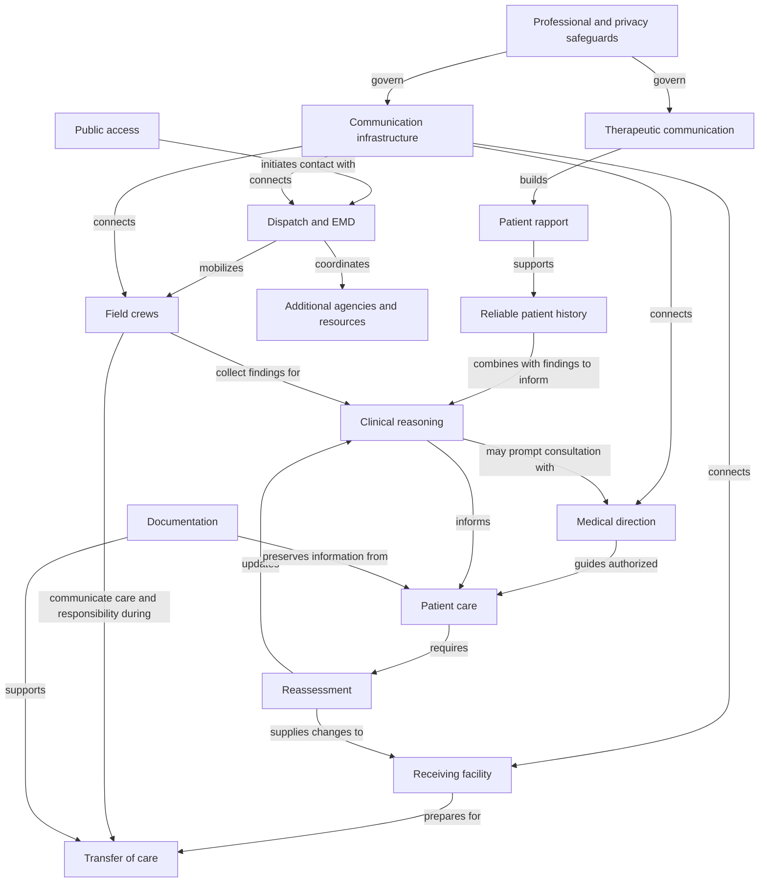

## EMS communication systems and infrastructure

### Historical development and expanding system functions

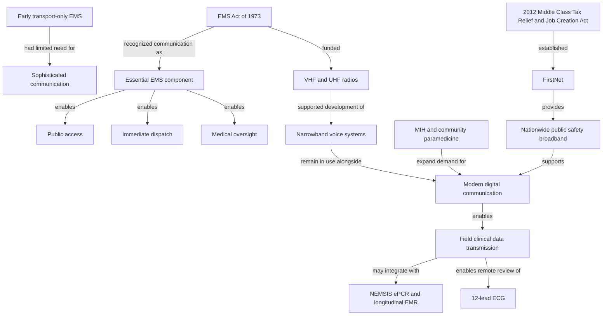

Longitudinal record access depends on system integration; it is not a universal EMS capability.

### Radio coverage, power and communication pathways

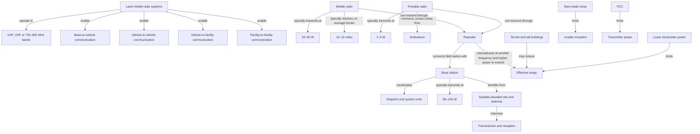

Actual coverage depends on terrain and antenna characteristics as well as transmitter power; the source’s typical ranges are not guarantees.

### Digital, cellular and satellite alternatives

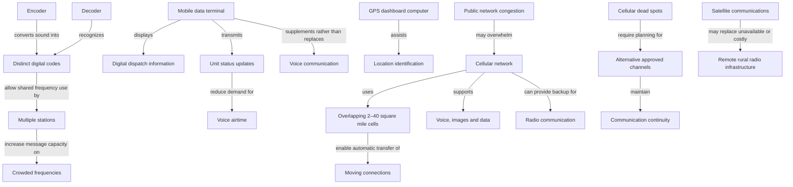

### Telemetry, telehealth and alternative destinations

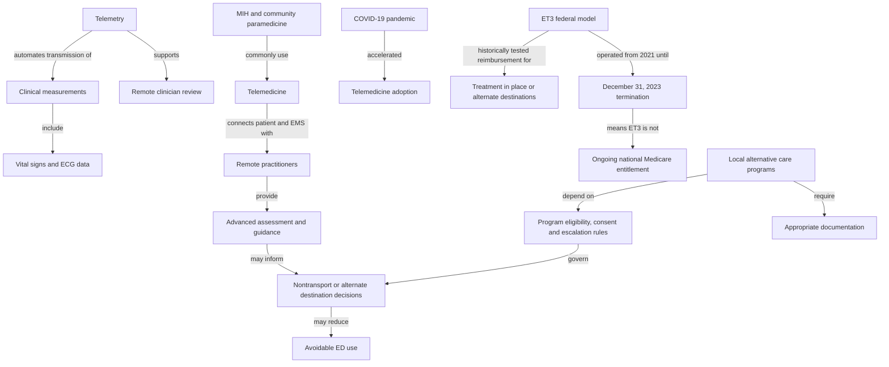

The supplied chapter corrects the textbook’s erroneous 2011 ET3 start date to January 1, 2021.

## Reliable and safe communication

### Regulation, equipment readiness and redundancy

```mermaid
flowchart TD
    N1["FCC"]
    N2["Base stations"]
    N3["Frequencies and call signs"]
    N4["Radio equipment"]
    N5["Transmitter power"]
    N6["Field operations"]
    N7["Broadcast interference"]
    N8["Obscenity and profanity"]
    N9["Equipment maintenance"]
    N10["Cleaning and protection from harsh conditions"]
    N11["Frequency drift"]
    N12["Reliable communication"]
    N13["Daily readiness checks"]
    N14["Radio and phone function"]
    N15["Freshly charged batteries and spares"]
    N16["Emergency generators"]
    N17["Base and repeater stations"]
    N18["Approved alternate channels and phones"]
    N19["Equipment or signal failure"]
    N20["Mixed-level crew preparation"]
    N21["Dispatch, ECG, order and timing roles"]
    N22["Radio, data terminal and monitor transmission"]
    N23["Authorized patient care"]
    N24["Standing protocols and scope"]
    N25["Lost communication"]
    N26["Approval for an order-required procedure"]

    N1 -->|licenses| N2
    N1 -->|assigns| N3
    N1 -->|approves| N4
    N1 -->|limits| N5
    N1 -->|monitors| N6
    N1 -->|regulates to reduce| N7
    N1 -->|prohibits| N8
    N9 -->|includes| N10
    N9 -->|detects| N11
    N11 -->|threatens| N12
    N13 -->|verify| N14
    N13 -->|include| N15
    N16 -->|maintain power for| N17
    N18 -->|provide fallback for| N19
    N20 -->|assigns| N21
    N20 -->|verifies| N22
    N19 -->|does not suspend| N23
    N23 -->|remains governed by| N24
    N25 -->|does not constitute| N26
```

### Shared channel access and message intelligibility

```mermaid
flowchart TD
    N1["Correct EMS frequency"]
    N2["Intended system"]
    N3["Listening before transmitting"]
    N4["Interrupted transmissions"]
    N5["PTT activation"]
    N6["Repeater readiness"]
    N7["Opening message words"]
    N8["Noise reduction and correct volume"]
    N9["Intelligibility"]
    N10["Clear calm speech at 2–3 inches"]
    N11["Unit name and number"]
    N12["Intended receiver"]
    N13["Own unit identification"]
    N14["Sender"]
    N15["Go ahead or stand by"]
    N16["Channel access"]
    N17["Brief organized transmission"]
    N18["Shared airtime"]
    N19["Pause after 30 seconds"]
    N20["Emergency interruption"]
    N21["Plain English"]
    N22["Interagency understanding"]
    N23["Ambiguous numbers"]
    N24["Repeating individual digits"]
    N25["Affirmative and negative"]
    N26["Yes and no"]
    N27["Objective facts and attributed impressions"]
    N28["Accurate clinical report"]
    N29["Over"]
    N30["Receiver acknowledgment"]
    N31["Message"]
    N32["Written notes"]
    N33["Addresses and medical orders"]

    N1 -->|connects to| N2
    N3 -->|prevents| N4
    N5 -->|requires a one-second pause for| N6
    N6 -->|prevents loss of| N7
    N8 -->|improve| N9
    N10 -->|improves| N9
    N11 -->|identify| N12
    N13 -->|identifies| N14
    N15 -->|regulates| N16
    N17 -->|preserves| N18
    N19 -->|allows| N20
    N21 -->|improves| N22
    N23 -->|are clarified by| N24
    N25 -->|reduce ambiguity compared with| N26
    N27 -->|support| N28
    N29 -->|requests| N30
    N30 -->|confirms or prompts repetition of| N31
    N32 -->|preserve| N33
```

### Codes, privacy and timekeeping

```mermaid
flowchart TD
    N1["Radio codes"]
    N2["Airtime"]
    N3["Shared code knowledge"]
    N4["Unfamiliar codes"]
    N5["Information transfer"]
    N6["Complex medical information"]
    N7["Plain language"]
    N8["Interagency understanding"]
    N9["Open radio channels"]
    N10["Identifiable patient information"]
    N11["Code obscurity"]
    N12["Patient confidentiality"]
    N13["Cellular systems"]
    N14["Transmission security"]
    N15["Agency-approved safeguards"]
    N16["Avoiding names on open radio"]
    N17["Impartial language"]
    N18["Defamatory personal comments"]
    N19["HIPAA treatment disclosure"]
    N20["Receiving clinician"]
    N21["Unrelated or unapproved disclosure"]
    N22["DOT timekeeping guidance"]
    N23["Synchronized accurate clocks"]
    N24["24-hour time and date"]
    N25["Clinical event timeline"]
    N26["Dispatch timestamps"]
    N27["PCR and legal record"]
    N28["Onset, last known well, contact, care and transfer"]
    N29["Estimated or unknown times"]
    N30["Actual documented times"]

    N1 -->|can shorten| N2
    N1 -->|depend on| N3
    N4 -->|may delay| N5
    N6 -->|often requires| N7
    N7 -->|supports| N8
    N9 -->|can expose| N10
    N11 -->|does not ensure| N12
    N13 -->|vary in| N14
    N15 -->|protect| N12
    N16 -->|reduces| N10
    N17 -->|reduces risk of| N18
    N19 -->|permits relevant information to| N20
    N19 -->|does not authorize| N21
    N22 -->|supports| N23
    N24 -->|reduce ambiguity in| N25
    N26 -->|support| N27
    N25 -->|distinguishes| N28
    N29 -->|must be distinguished from| N30
```

Midnight may be 0000 at the start of a date or 2400 at the preceding date’s end where accepted. Use the agency standard. The source contains an incomplete radio acknowledgment term; confirm locally rather than memorizing the fragment.

### Closed-loop communication as error control

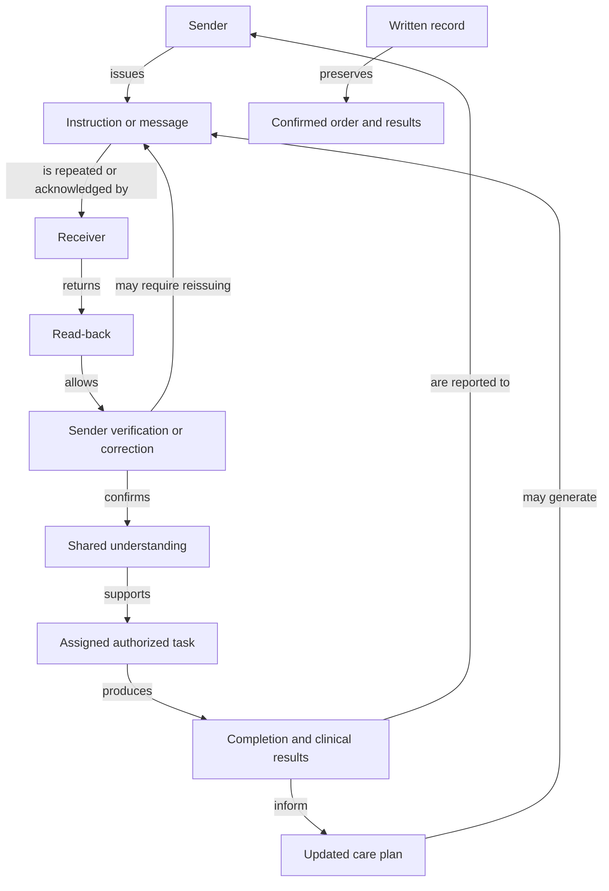

For medical orders, repeat word for word and obtain explicit confirmation. A task acknowledgment alone does not establish task completion.

## Dispatch, team coordination and scene leadership

### Dispatch information, risk and resource decisions

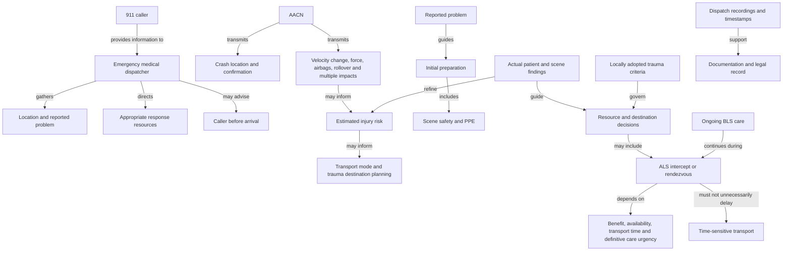

The 2021 national injury field-triage guideline (published 2022) supersedes the older 2009 CDC guidance cited in the source. Collision data inform risk, not a stand-alone diagnosis or destination decision.

### Dispatch status updates and operational continuity

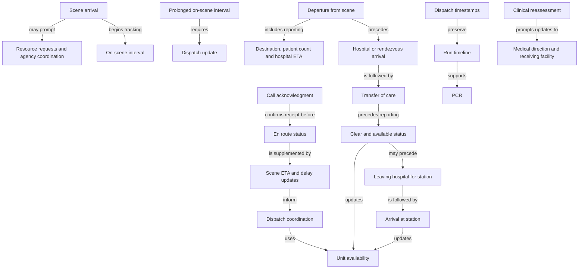

Local status-reporting requirements may also include time of reaching the patient. Clinical communication occurs in parallel, not only at dispatch milestones.

### Scene authority, patient priority and interagency cooperation

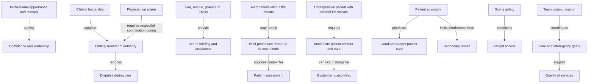

### Mixed-level crew responsibilities and safety escalation

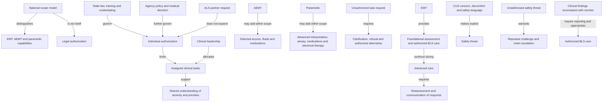

## Therapeutic communication and interviewing

### Encoding, decoding and feedback

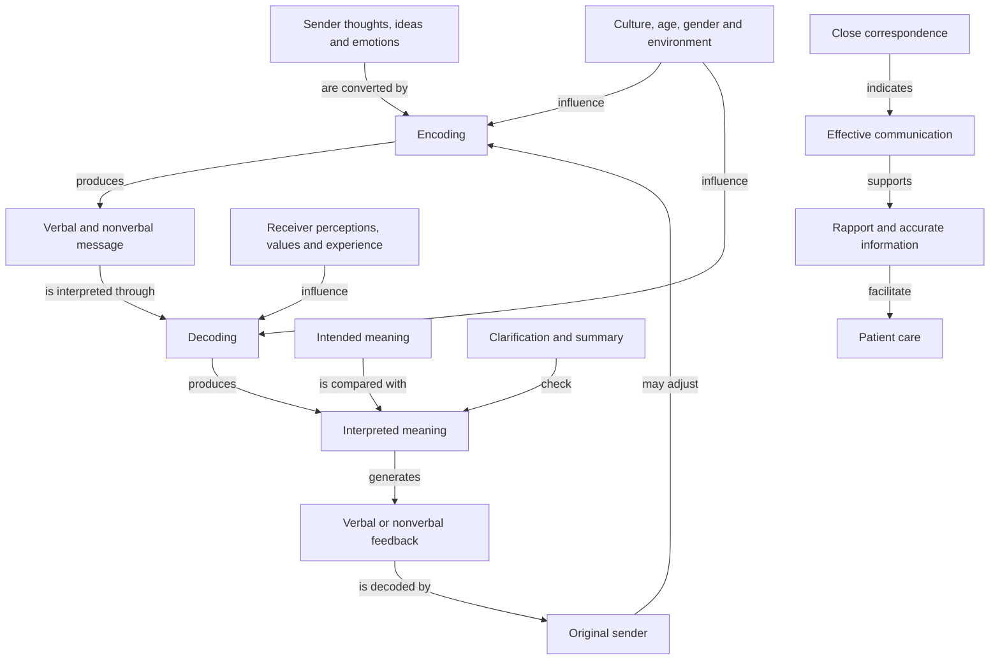

### Therapeutic responses and patient cooperation

```mermaid
flowchart TD
    N1["Active listening"]
    N2["Accurate understanding"]
    N3["Facilitation"]
    N4["Additional patient information"]
    N5["Clarification"]
    N6["Unclear meaning"]
    N7["Summary"]
    N8["Accuracy of interpretation"]
    N9["Explanation before care"]
    N10["Trust"]
    N11["Silence"]
    N12["Time to formulate responses"]
    N13["Patient needs and emotional state"]
    N14["Reflection"]
    N15["Patient feelings"]
    N16["Empathy"]
    N17["Agitated patient"]
    N18["Respectful confrontation"]
    N19["Discrepancies without aggression"]
    N20["Competence, confidence and compassion"]
    N21["Patient cooperation"]
    N22["Honesty"]
    N23["Fear, denial or confusion"]
    N24["Defensive responses"]
    N25["Calm refocusing"]
    N26["Teach-back"]
    N27["Quality of explanation"]

    N1 -->|supports| N2
    N3 -->|encourages| N4
    N5 -->|resolves| N6
    N7 -->|checks| N8
    N9 -->|helps establish| N10
    N11 -->|allows| N12
    N13 -->|determine suitability of| N11
    N14 -->|communicates understanding of| N15
    N16 -->|recognizes| N15
    N16 -->|may reduce distress in| N17
    N18 -->|addresses| N19
    N20 -->|promote| N21
    N10 -->|supports| N21
    N22 -->|preserves| N10
    N23 -->|may produce| N24
    N25 -->|may help address| N24
    N26 -->|checks| N27
    N27 -->|supports| N2
```

Silence is not universally therapeutic; the chapter cautions that it may be unhelpful for some patients coping with depression. Teach-back checks the explanation, not intelligence.

### Patient contact, environment and nonverbal signals

```mermaid
flowchart TD
    N1["Professional introduction and preferred names"]
    N2["Respectful relationship"]
    N3["Team identification"]
    N4["Who is providing care"]
    N5["Consent request"]
    N6["Patient autonomy"]
    N7["Plain language and slow calm speech"]
    N8["Understanding under stress"]
    N9["Stress and shock"]
    N10["Information processing"]
    N11["Privacy and limited interruptions"]
    N12["Focused interview"]
    N13["Lighting and noise control"]
    N14["Communication environment"]
    N15["Honest explanations and choices"]
    N16["Patient sense of control"]
    N17["Open posture and eye-level position"]
    N18["Safety and equality"]
    N19["Closed posture and gestures"]
    N20["Discomfort or emotion"]
    N21["Cultural norms"]
    N22["Eye contact and personal space"]
    N23["Permission and sensitivity"]
    N24["Therapeutic touch"]
    N25["Intimate distance under 1.5 ft"]
    N26["Threatening proximity"]
    N27["Personal distance 1.5–4 ft"]
    N28["Conversation"]
    N29["Social distance 4–12 ft"]
    N30["Public distance 12 ft or more"]
    N31["Close interpersonal contact"]
    N32["Nonverbal and verbal discrepancy"]
    N33["Contextual clarification"]
    N34["Pain, neurologic impairment, fear and disability"]
    N35["Nonverbal behavior"]
    N36["Deception, capacity or aggression"]
    N37["Nonthreatening position and clear exit"]
    N38["Safety during agitation"]

    N1 -->|establish| N2
    N3 -->|clarifies| N4
    N5 -->|respects| N6
    N7 -->|support| N8
    N9 -->|may slow| N10
    N11 -->|support| N12
    N13 -->|improve| N14
    N15 -->|support| N16
    N17 -->|may communicate| N18
    N19 -->|may signal| N20
    N21 -->|influence interpretation of| N22
    N23 -->|govern| N24
    N25 -->|may feel| N26
    N27 -->|often supports| N28
    N29 -->|may permit| N28
    N30 -->|differs from| N31
    N32 -->|warrants| N33
    N34 -->|may affect| N35
    N35 -->|does not alone establish| N36
    N37 -->|support| N38
```

Distance zones are source-described American cultural norms, not universal boundaries. New inability to speak or follow instructions may be deterioration rather than a communication preference.

### Interview design, history and decision quality

```mermaid
flowchart TD
    N1["Open-ended questions"]
    N2["Patient narrative"]
    N3["Closed-ended questions"]
    N4["Specific time-sensitive facts"]
    N5["Leading questions"]
    N6["Patient responses"]
    N7["One question at a time"]
    N8["Accurate answers"]
    N9["Adequate response time"]
    N10["Interruptions and excessive provider talking"]
    N11["Active listening"]
    N12["Nonjudgmental language"]
    N13["Perceived blame"]
    N14["False reassurance"]
    N15["Trust"]
    N16["Inappropriate advice or premature diagnosis"]
    N17["Appropriate evaluation"]
    N18["SAMPLE and OPQRST"]
    N19["Focused history"]
    N20["Medication dose, timing and missed doses"]
    N21["Last known baseline and onset"]
    N22["Bleeding, fainting and relevant pregnancy history"]
    N23["Private questioning"]
    N24["Sensitive history"]
    N25["Witness and patient accounts"]
    N26["Verified findings"]
    N27["Advanced clinical reasoning"]
    N28["Immediate threats"]
    N29["Complete history"]
    N30["Parallel crew interviewing"]
    N31["Immediate patient care"]

    N1 -->|elicit| N2
    N3 -->|fill gaps in| N2
    N3 -->|obtain| N4
    N5 -->|may bias| N6
    N7 -->|supports| N8
    N9 -->|supports| N8
    N10 -->|impair| N11
    N12 -->|reduces| N13
    N14 -->|undermines| N15
    N16 -->|may undermine| N17
    N18 -->|organize| N19
    N19 -->|includes| N20
    N19 -->|includes| N21
    N19 -->|includes| N22
    N23 -->|supports disclosure of| N24
    N25 -->|must be distinguished from| N26
    N19 -->|informs| N27
    N28 -->|take precedence over| N29
    N30 -->|allows history during| N31
```

### Autonomy, difficult interviews and de-escalation

```mermaid
flowchart TD
    N1["Adult with decision-making capacity"]
    N2["Own informed choices"]
    N3["Family preference"]
    N4["Children or patients lacking capacity"]
    N5["Consent and refusal process"]
    N6["Communication barrier"]
    N7["Lack of capacity"]
    N8["Ability to speak"]
    N9["Understanding consequences"]
    N10["Capacity uncertainty"]
    N11["Medical direction and local process"]
    N12["Clinical destination needs"]
    N13["Reason for specialized facility"]
    N14["Unmotivated patient"]
    N15["Open questions and understanding check"]
    N16["Qualified interpreter or accessible aid"]
    N17["Persistent interview difficulty"]
    N18["Focused closed questions and positive feedback"]
    N19["Hostile behavior"]
    N20["Scene safety"]
    N21["Unsafe scene"]
    N22["Safe distance and appropriate backup"]
    N23["Safe scene"]
    N24["Nonthreatening de-escalation"]
    N25["Benefits of cooperation and acceptable conduct"]
    N26["Restraint when necessary"]
    N27["Local restraint protocols and adequate personnel"]

    N1 -->|retains| N2
    N3 -->|does not override| N2
    N4 -->|require applicable| N5
    N6 -->|does not establish| N7
    N8 -->|does not guarantee| N9
    N10 -->|may require| N11
    N12 -->|warrant explaining| N13
    N14 -->|may benefit from| N15
    N15 -->|may reveal need for| N16
    N17 -->|may warrant| N18
    N19 -->|requires assessment of| N20
    N21 -->|requires| N22
    N23 -->|permits| N24
    N24 -->|explains| N25
    N26 -->|is governed by| N27
```

## Communication access and family-centered care

### Cultural, language and disability adaptations

```mermaid
flowchart TD
    N1["Culture"]
    N2["Interpretation of illness and treatment preferences"]
    N3["Ethnocentrism"]
    N4["Cultural imposition"]
    N5["Respect for patient values"]
    N6["Language or sensory barrier"]
    N7["Message exchange"]
    N8["Qualified interpreters and appropriate aids"]
    N9["Applicable ADA and federal language-access requirements"]
    N10["Interpreter selection"]
    N11["Family or bystander interpretation"]
    N12["Imminent threat with no qualified interpreter"]
    N13["Emergency exception"]
    N14["Approved telephone, video or sign-language service"]
    N15["Qualified interpretation"]
    N16["Direct patient address and pauses"]
    N17["Writing"]
    N18["Simple exchanges"]
    N19["Complex consent or history"]
    N20["Hearing or visual impairment"]
    N21["Visible lips, glasses or hearing aids"]
    N22["Older age alone"]
    N23["Independent AAC"]
    N24["Patient-directed expression"]
    N25["Facilitator-dependent physical guidance"]
    N26["Facilitator-authored message"]
    N27["Consent, refusal or symptoms"]
    N28["Communication aid and interpreter details"]
    N29["Documentation"]
    N30["Arranging communication access"]
    N31["Immediate lifesaving care"]

    N1 -->|influences| N2
    N3 -->|risks| N4
    N5 -->|avoids| N4
    N6 -->|may impair| N7
    N8 -->|improve| N7
    N9 -->|govern| N10
    N11 -->|is not default for| N10
    N12 -->|may permit limited| N13
    N14 -->|supports| N15
    N16 -->|support| N15
    N17 -->|may suffice for| N18
    N17 -->|may be insufficient for| N19
    N20 -->|may require| N21
    N22 -->|does not establish| N20
    N23 -->|enables| N24
    N25 -->|risks| N26
    N26 -->|cannot reliably establish| N27
    N28 -->|belong in| N29
    N30 -->|must not delay| N31
```

The historical facilitated-communication technique is discredited in the source’s ASHA 2018 clarification. Independent picture selection, eye gaze, writing and usual communication devices are distinct from facilitator-directed responses.

### Children, older adults and family-centered information

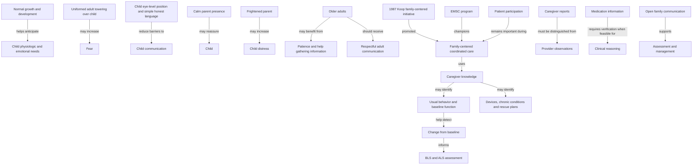

## Clinical information, medical direction and transfer of care

### Monitoring measurements and clinical interpretation

```mermaid
flowchart TD
    N1["12-lead ECG"]
    N2["Electrical activity from multiple viewpoints"]
    N3["Myocardial ischemia"]
    N4["ECG transmission"]
    N5["Remote review and cardiac team preparation"]
    N6["Initial nondiagnostic ECG"]
    N7["Acute coronary syndrome"]
    N8["Persistent symptoms or worsening condition"]
    N9["Repeat ECG"]
    N10["Continuous ECG"]
    N11["Electrical rate and rhythm"]
    N12["Perfusing pulse"]
    N13["Palpable pulse and patient condition"]
    N14["Waveform capnography"]
    N15["Exhaled CO2 and waveform"]
    N16["Ventilation, pulmonary blood flow and metabolism"]
    N17["Low EtCO2"]
    N18["Underlying cause"]
    N19["Pulse oximetry"]
    N20["Arterial oxygen saturation"]
    N21["Noninvasive BP"]
    N22["Arterial pressure"]
    N23["Motion, cold extremities and poor circulation"]
    N24["Measurement quality"]
    N25["Reported monitor data"]
    N26["Time, trend, clinical context and signal quality"]
    N27["Patient assessment"]
    N28["Device troubleshooting"]
    N29["Authorized trained EMT"]
    N30["Paramedic within scope"]
    N31["Advanced ECG interpretation"]

    N1 -->|records| N2
    N2 -->|may reveal patterns of| N3
    N4 -->|enables| N5
    N6 -->|does not exclude| N7
    N8 -->|may justify| N9
    N10 -->|displays| N11
    N11 -->|do not establish| N12
    N13 -->|help contextualize| N11
    N14 -->|measures| N15
    N16 -->|influence| N15
    N17 -->|does not independently identify| N18
    N19 -->|estimates| N20
    N21 -->|estimates| N22
    N23 -->|may degrade| N24
    N24 -->|qualifies| N25
    N25 -->|should include| N26
    N27 -->|takes precedence over| N28
    N29 -->|may acquire and transmit| N1
    N30 -->|may perform| N31
```

Monitoring is supplemental to clinical assessment. Acquisition, transmission, device operation and advanced interpretation require the applicable training and authorization; do not invent unavailable values.

### Clinical report content and receiver needs

```mermaid
flowchart TD
    N1["Clinical report"]
    N2["Unit and BLS or ALS service level"]
    N3["Age, sex and chief complaint"]
    N4["Scene, mechanism and pertinent history"]
    N5["Mental status and baseline vitals"]
    N6["Pertinent physical findings"]
    N7["Care already delivered and response"]
    N8["Current condition and ETA"]
    N9["Specialty services or destination"]
    N10["Medical direction consultation"]
    N11["Receiving facility notification"]
    N12["Specific action or intervention"]
    N13["Medication, procedure or triage guidance"]
    N14["Room, equipment and personnel preparation"]
    N15["Reassessment"]
    N16["Updated clinical report"]
    N17["Deterioration or improvement"]
    N18["Observed findings and attributed history"]
    N19["Clinical reasoning without premature diagnosis"]

    N1 -->|identifies| N2
    N1 -->|describes| N3
    N1 -->|summarizes| N4
    N1 -->|includes| N5
    N1 -->|includes| N6
    N1 -->|describes| N7
    N1 -->|states| N8
    N1 -->|may request| N9
    N1 -->|supports| N10
    N1 -->|supports| N11
    N10 -->|may additionally request| N12
    N10 -->|may provide| N13
    N11 -->|enables| N14
    N15 -->|generates| N16
    N16 -->|communicates| N17
    N16 -->|allows modification of| N14
    N1 -->|must distinguish| N18
    N18 -->|support| N19
```

### Medical orders, authorization and medication safety

```mermaid
flowchart TD
    N1["Legal scope and individual credentialing"]
    N2["Authorized interventions"]
    N3["Approved standing protocol"]
    N4["Authorized interventions without prior consultation"]
    N5["Online medical direction"]
    N6["Patient-specific orders"]
    N7["Clinical findings, trend and treatment response"]
    N8["Order request"]
    N9["Allergies and medication history"]
    N10["Specific clinical decision needed"]
    N11["Written record and word-for-word read-back"]
    N12["Drug, dose, units, route, time and restrictions"]
    N13["Explicit confirmation"]
    N14["Ambiguous or inappropriate order"]
    N15["Clarification and questioning"]
    N16["Authorized execution when appropriate"]
    N17["Monitoring and documentation"]
    N18["Action, time, provider and response"]
    N19["Unexpected effects or new contraindications"]
    N20["Prompt communication to medical direction"]

    N1 -->|limit| N2
    N3 -->|specifies conditions for| N4
    N5 -->|provides| N6
    N6 -->|cannot override| N1
    N7 -->|inform| N8
    N9 -->|inform| N8
    N8 -->|states| N10
    N8 -->|may result in| N6
    N6 -->|require| N11
    N11 -->|capture| N12
    N11 -->|require| N13
    N14 -->|requires| N15
    N15 -->|may correct| N6
    N13 -->|supports| N16
    N16 -->|requires| N17
    N17 -->|capture| N18
    N19 -->|require| N20
    N20 -->|may prompt revision of| N6
```

Read back restrictions and orders not to perform an intervention as well as affirmative orders. Evidence, guidelines, protocols, scope and credentialing are distinct; neither a standing order nor online direction expands legal scope.

### SBAR and prearrival preparation

```mermaid
flowchart TD
    N1["SBAR"]
    N2["Communication expectations"]
    N3["Misunderstanding and omission"]
    N4["Situation"]
    N5["Chief problem and reason for contact"]
    N6["Background"]
    N7["Pertinent history and prior treatment response"]
    N8["Assessment"]
    N9["Subjective and objective findings"]
    N10["Recommendation"]
    N11["Requested action or preparation"]
    N12["Medical direction and handoff"]
    N13["Prearrival notification"]
    N14["Receiving team preparation"]
    N15["Stroke alert"]
    N16["Onset or last known well, deficits and glucose"]
    N17["Cardiac alert"]
    N18["Symptoms, available ECG and hemodynamic status"]
    N19["Trauma alert"]
    N20["Mechanism, injuries, physiologic trend and care"]
    N21["Local activation criteria"]
    N22["Specialty alert decisions"]
    N23["New clinical change"]
    N24["Update report"]
    N25["New care, response and ETA"]

    N1 -->|standardizes| N2
    N2 -->|reduce| N3
    N4 -->|states| N5
    N6 -->|provides| N7
    N8 -->|reports| N9
    N10 -->|identifies| N11
    N4 -->|contributes to| N1
    N6 -->|contributes to| N1
    N8 -->|contributes to| N1
    N10 -->|contributes to| N1
    N1 -->|supports| N12
    N13 -->|allows| N14
    N15 -->|depends on relevant| N16
    N17 -->|depends on relevant| N18
    N19 -->|depends on relevant| N20
    N21 -->|govern| N22
    N22 -->|influence| N14
    N23 -->|should lead| N24
    N24 -->|includes| N25
    N24 -->|allows adjustment of| N14
```

### Chest discomfort reporting and ALS reasoning

```mermaid
flowchart TD
    N1["Prior MI and coronary stent"]
    N2["Possible ACS"]
    N3["Continuing chest discomfort and onset time"]
    N4["Pain severity or nitroglycerin response"]
    N5["Aspirin"]
    N6["Platelet aggregation"]
    N7["Clot formation"]
    N8["Actual aspirin dose, time, allergy and bleeding history"]
    N9["Authorized medication decisions"]
    N10["Nitroglycerin"]
    N11["Vasodilation"]
    N12["Cardiac workload"]
    N13["Blood pressure"]
    N14["Previous nitroglycerin doses and interacting drugs"]
    N15["Blood pressure trend"]
    N16["Oxygen"]
    N17["Inadequate oxygenation"]
    N18["Coronary obstruction"]
    N19["Adequate oxygenation"]
    N20["2025 ACS guideline"]
    N21["Focused BLS history and vitals"]
    N22["Advanced clinical reasoning"]
    N23["ECG acquisition and transmission when authorized"]
    N24["Serial ECG, authorized medications or specialty destination"]
    N25["Reassessment of pain, BP, breathing, mentation and perfusion"]

    N1 -->|provide context for| N2
    N3 -->|inform| N2
    N4 -->|does not establish or exclude| N2
    N5 -->|reduces| N6
    N6 -->|contributes to| N7
    N8 -->|inform| N9
    N10 -->|causes| N11
    N11 -->|reduces| N12
    N11 -->|may influence| N13
    N14 -->|inform| N9
    N15 -->|informs| N9
    N16 -->|addresses| N17
    N16 -->|does not directly remove| N18
    N19 -->|does not warrant routine oxygen under| N20
    N21 -->|inform| N22
    N23 -->|inform| N22
    N22 -->|may guide| N24
    N25 -->|informs| N22
```

The historical SBAR example (56-year-old with previous MI/stent, 50-minute onset, persistent pain after three nitroglycerin sprays and oxygen, reported 180 mg aspirin, BP 168/98 and HR 108) illustrates reporting, not universal medication orders. Report actual prior doses rather than guessing or duplicating them.

### Handoff as transfer of information and responsibility

```mermaid
flowchart TD
    N1["Handoff"]
    N2["Clinical information and responsibility"]
    N3["Identified available receiver"]
    N4["Questions and clarification"]
    N5["Approved structured format"]
    N6["Problem, baseline, care, trend and outstanding concern"]
    N7["Continuity of care"]
    N8["First and latest assessments"]
    N9["Clinical trajectory"]
    N10["Medication times, allergies and treatment responses"]
    N11["Ongoing care"]
    N12["Ongoing support and device information"]
    N13["Pending orders or assessments"]
    N14["Outstanding clinical concerns"]
    N15["Witness reports"]
    N16["Personally observed findings"]
    N17["BLS-to-ALS transfer"]
    N18["Prior care and current findings"]
    N19["ALS-to-hospital transfer"]
    N20["EMT timeline and updated vitals"]
    N21["In-person hospital report"]
    N22["Prearrival report"]
    N23["Written or electronic PCR"]
    N24["Oral handoff"]
    N25["Receiving clinician acceptance"]
    N26["Transfer of responsibility"]
    N27["Assigned authorized BLS care"]
    N28["Ongoing advanced therapy"]
    N29["Continuity and authorized direction"]
    N30["Agency policies"]
    N31["Field handoff and documentation exchange"]
    N32["Questions before departure"]

    N1 -->|transfers| N2
    N3 -->|enables| N4
    N5 -->|organizes| N6
    N6 -->|support| N7
    N8 -->|establish| N9
    N10 -->|inform| N11
    N12 -->|inform| N11
    N13 -->|identify| N14
    N15 -->|must be distinguished from| N16
    N17 -->|communicates| N18
    N19 -->|is supported by| N20
    N21 -->|updates| N22
    N23 -->|supplements| N24
    N25 -->|clarifies| N26
    N27 -->|continues until| N26
    N28 -->|requires| N29
    N30 -->|govern| N31
    N32 -->|resolve| N14
```

Do not restart a full history unnecessarily in an unstable patient or disconnect ongoing advanced therapy without appropriate authorized direction and continuity. The receiving facility receives the PCR; field transfer documentation follows agency policy.

## Clinical integration and reassessment

### Heavy-bleeding dispatch: from uncertainty to scene assessment

```mermaid
flowchart TD
    N1["Dispatch report of heavy bleeding"]
    N2["Hemorrhage-control preparation"]
    N3["Actual blood loss or perfusion"]
    N4["Unknown injury mechanism"]
    N5["Potential scene hazards"]
    N6["Cautious approach and scene scan"]
    N7["Scene appears secure"]
    N8["Patient access with PPE"]
    N9["Direct BLS assessment"]
    N10["Bleeding, pulse, mentation, skin and vitals"]
    N11["Clinical severity and resource need"]
    N12["Additional help or ALS"]
    N13["Hemorrhage control"]
    N14["Advanced procedures"]
    N15["Scene findings differing from dispatch"]
    N16["Team and dispatch update"]
    N17["Location, access hazards, count and threats"]
    N18["Resource coordination"]

    N1 -->|prompts| N2
    N1 -->|does not quantify| N3
    N4 -->|may suggest| N5
    N5 -->|warrant| N6
    N7 -->|permits| N8
    N8 -->|enables| N9
    N9 -->|evaluates| N10
    N10 -->|inform| N11
    N11 -->|may prompt| N12
    N13 -->|must not be postponed for| N14
    N15 -->|require| N16
    N16 -->|clarifies| N17
    N16 -->|supports| N18
```

### Stable hand injury: findings, BLS care and handoff

```mermaid
flowchart TD
    N1["Saber saw injury"]
    N2["Right palm laceration"]
    N3["Blood-soaked rag"]
    N4["Ongoing hemorrhage"]
    N5["Alertness, strong pulse and minimal current bleeding"]
    N6["Lower transport urgency"]
    N7["Sterile dressing and bandage"]
    N8["Hemorrhage control"]
    N9["Distal color, warmth, motor and sensation"]
    N10["Distal neurovascular status"]
    N11["Deeper tendon, nerve or vascular injury"]
    N12["Initial BP 148/86, HR 92, RR 14"]
    N13["Baseline vital signs"]
    N14["Repeat BP 146/84 then 144/82, HR 80, RR 14"]
    N15["Stable reassessment trend"]
    N16["No bleeding through dressing"]
    N17["Continued bleeding control"]
    N18["BLS management"]
    N19["Penicillin allergy and mechanism"]
    N20["Receiving facility handoff"]
    N21["Recurrent bleeding or worsening perfusion"]
    N22["Reassessment of urgency and ALS need"]
    N23["ALS vascular access or circulatory support when indicated"]
    N24["Hemorrhage control and definitive care"]
    N25["Cot refusal"]
    N26["Applicable consent and refusal process"]
    N27["Patient transport"]
    N28["Approved position and restraint system"]
    N29["PCR and return-to-service activities"]

    N1 -->|produces| N2
    N3 -->|indicates prior bleeding but not necessarily| N4
    N5 -->|support case-specific| N6
    N7 -->|support| N8
    N9 -->|provide information about| N10
    N10 -->|does not exclude| N11
    N12 -->|establishes| N13
    N14 -->|supports| N15
    N16 -->|supports| N17
    N15 -->|supports in this case| N18
    N17 -->|supports in this case| N18
    N19 -->|belong in| N20
    N10 -->|belongs in| N20
    N21 -->|would prompt| N22
    N23 -->|does not replace| N24
    N25 -->|requires| N26
    N27 -->|requires| N28
    N20 -->|is followed by| N29
```

The historical case’s jump-seat transport is not permission to use a crew seat for patient transport. Follow approved restraint systems and local policy; stable findings do not establish absence of deeper injury.

### Abdominal pain: converging evidence of deteriorating perfusion

```mermaid
flowchart TD
    N1["Sudden severe abdominal pain with rigidity and tenderness"]
    N2["Serious abdominal pathology"]
    N3["Internal hemorrhage including pregnancy-related bleeding when relevant"]
    N4["Circulatory shock"]
    N5["Other abdominal, vascular or infectious causes"]
    N6["Inadequate tissue perfusion"]
    N7["BP falling from 88/64 to 82/62"]
    N8["Worsening perfusion"]
    N9["HR rising from 128 to 134 and RR from 24 to 26"]
    N10["Increasing pallor, clamminess and weaker pulses"]
    N11["Reduced responsiveness requiring verbal prompting"]
    N12["Tissue oxygen delivery"]
    N13["Blood flow, hemoglobin and oxygenation"]
    N14["Initial SpO2 of 96 percent"]
    N15["Adequate tissue oxygen delivery"]
    N16["Poor peripheral perfusion"]
    N17["Pulse oximeter signal"]
    N18["Pulse oximeter error"]
    N19["Reliable current saturation"]
    N20["Hypoxemia"]
    N21["Adequate chest rise"]
    N22["Clinical trend and uncertainty"]

    N1 -->|raises concern for| N2
    N3 -->|is one possible cause of| N4
    N5 -->|may also explain| N4
    N4 -->|involves| N6
    N7 -->|contributes evidence for| N8
    N9 -->|contributes evidence for| N8
    N10 -->|contribute evidence for| N8
    N11 -->|contributes evidence for| N8
    N8 -->|raises concern for| N4
    N12 -->|depends on| N13
    N14 -->|does not establish| N15
    N16 -->|may degrade| N17
    N18 -->|indicates absence of| N19
    N18 -->|does not prove| N20
    N21 -->|does not exclude| N4
    N8 -->|requires communication of| N22
```

The case is a 36-year-old with sudden onset four hours earlier, progressive pain rated 8/10, nausea and orthostatic light-headedness. The findings are case-specific, not diagnostic or universal treatment thresholds.

### Abdominal pain: linking clinical deterioration to coordinated care

```mermaid
flowchart TD
    N1["Worsening perfusion and responsiveness"]
    N2["Immediate BLS reassessment"]
    N3["Airway, ventilation, oxygenation and circulation"]
    N4["Indicated authorized BLS support"]
    N5["Airway protection and heat-loss prevention"]
    N6["Clinical deterioration"]
    N7["Immediate partner and hospital update"]
    N8["New findings, last reliable readings and ETA"]
    N9["Preparation for unstable patient"]
    N10["ALS or medical direction coordination"]
    N11["Time-sensitive definitive care"]
    N12["AEMT or paramedic within scope"]
    N13["Vascular access and circulatory support"]
    N14["Paramedic within scope"]
    N15["Cardiac monitoring and assessment of competing causes"]
    N16["Fluids when indicated"]
    N17["Circulating volume"]
    N18["Definitive hemorrhage control"]
    N19["Suspected cause and clinical response"]
    N20["Suitability of fluids"]
    N21["Authorized care"]
    N22["Repeat reassessment"]
    N23["Clinical deterioration or improvement"]
    N24["Bedside handoff"]
    N25["Updated findings and PCR"]

    N1 -->|prompt| N2
    N2 -->|evaluates| N3
    N2 -->|informs| N4
    N4 -->|includes when needed| N5
    N6 -->|requires| N7
    N7 -->|communicates| N8
    N8 -->|support| N9
    N6 -->|may warrant| N10
    N10 -->|must not delay| N11
    N12 -->|may assess need for| N13
    N14 -->|may add| N15
    N16 -->|may improve| N17
    N16 -->|do not replace| N18
    N19 -->|influence| N20
    N21 -->|requires| N22
    N22 -->|updates| N23
    N23 -->|informs| N7
    N24 -->|conveys| N25
```

The scenario does not supply actual intervention times or unit identification. A real SBAR update must report those only if known, together with treatment response. Fluids are not appropriate for every shock state.

### Integration: communication as a clinical feedback system

```mermaid
flowchart TD
    N1["Dispatch information"]
    N2["Initial operational plan"]
    N3["Scene and patient assessment"]
    N4["Patient-centered communication"]
    N5["History and baseline function"]
    N6["BLS care and advanced clinical reasoning"]
    N7["Authorized monitoring"]
    N8["Medical direction request"]
    N9["Confirmed authorized order"]
    N10["Patient care"]
    N11["Reassessment"]
    N12["Closed-loop team communication"]
    N13["Prearrival update and structured handoff"]
    N14["Receiving team"]
    N15["Documentation and shared timeline"]
    N16["Findings, actions and responses"]
    N17["Scope, privacy and patient autonomy"]

    N1 -->|informs| N2
    N2 -->|is revised by| N3
    N4 -->|improves access to| N5
    N5 -->|combine with| N3
    N3 -->|inform| N6
    N7 -->|adds context to| N6
    N6 -->|may generate| N8
    N8 -->|may yield| N9
    N9 -->|guides| N10
    N6 -->|guide| N10
    N10 -->|requires| N11
    N11 -->|updates| N3
    N11 -->|communicates response through| N12
    N12 -->|supports revision of| N10
    N11 -->|supplies| N13
    N13 -->|prepare| N14
    N15 -->|preserve| N16
    N16 -->|support| N13
    N17 -->|constrain| N10
    N17 -->|constrain| N12
```

This map represents a conceptual feedback process, not a mandatory linear treatment sequence. Care, communication and reassessment often occur simultaneously.
