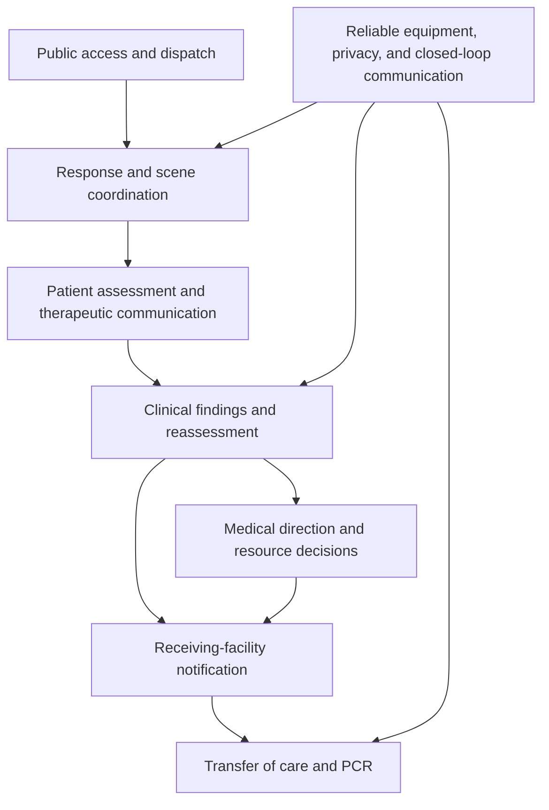
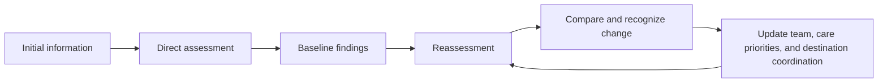
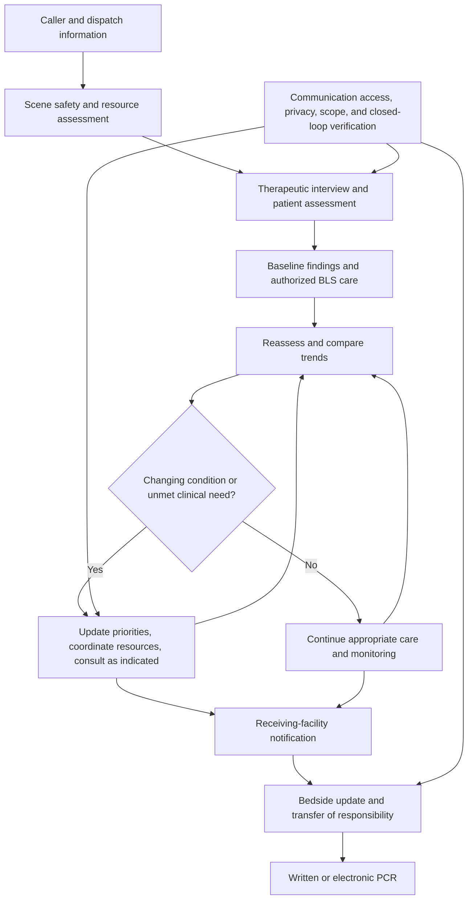

# Chapter 5: Communication — PQ4RS

## Preview

Communication in EMS is both a **system capability** and a **clinical skill**. It connects public access and dispatch to scene coordination, patient assessment, medical direction, receiving-facility preparation, and transfer of care. At the same time, therapeutic communication helps patients feel respected, express their needs, and participate in care.

The chapter connects eight major subjects:

- EMS communication history and the infrastructure that carries voice and clinical data.
- Equipment regulation, readiness, privacy, and backup communication.
- Radio, telephone, and timekeeping practices.
- Dispatch, scene leadership, and teamwork across BLS and ALS roles.
- Therapeutic communication, interviewing, and interpretation of verbal and nonverbal findings.
- Communication adaptations for age, culture, disability, language, and family involvement.
- Medical direction, structured reporting, order verification, and continuity of care.
- Clinical examples showing how stable and deteriorating patients require different communication priorities.

The central idea is that information must be **accurate, understood, actionable, and updated** as the patient and situation change. Advanced communication technology and ALS expertise complement, rather than replace, foundational assessment and BLS care.

## Question

Consider these guiding questions while reading. Explanatory answers appear together in Review.

- **Q01.** How has EMS communication evolved from transportation-oriented radio systems into a network supporting medical oversight, clinical data, and community-based services?
- **Q02.** How do equipment selection, maintenance, regulation and backup planning affect the reliability of patient care?
- **Q03.** How do clear language, feedback, privacy safeguards and accurate timekeeping reduce errors across an EMS encounter?
- **Q04.** How do dispatch information, scene findings and team communication influence resource requests and transport priorities?
- **Q05.** How do therapeutic communication and interview techniques improve assessment while protecting patient autonomy?
- **Q06.** Why must communication be adapted to each patient's language, sensory needs, age, culture and baseline function?
- **Q07.** What makes medical-direction consultation, SBAR and transfer-of-care reports clinically useful rather than merely complete?
- **Q08.** How can BLS and ALS personnel share information and responsibilities without compromising scope, patient safety or continuity of care?

## Read

### Communication in the EMS system

Communication connects every phase of emergency care: a patient, relative or bystander contacts a call taker; dispatch alerts responders verbally or digitally; the crew coordinates with other agencies, assesses the patient, consults medical direction, notifies the receiving facility and transfers care. System communication enables faster response, resource requests, medical oversight, data transmission and hospital preparation. Therapeutic communication is equally important: it establishes rapport, enables accurate information gathering and helps providers adapt care to patients with different needs.

EMS system communication and therapeutic communication are preparatory content areas in the National EMS Education Standards, connecting knowledge of the EMS system, provider safety and well-being, and medical, legal and ethical responsibilities to emergency care.

#### Development of EMS communications

##### Historical Background
* **Early EMS:** Ambulance crews only transported patients to hospitals with no emergency care responsibilities, so sophisticated communications systems were unnecessary.
* **EMS Act of 1973 (Public Law 93-154):**
  * Recognized communications as one of the **15 essential components** of an EMS system.
  * Defined the role of communications to include **public access to EMS**, **dispatch for immediate response**, and **medical oversight**.
  * Provided grant funding that equipped most ambulances with **Very High Frequency (VHF)** and **Ultra High Frequency (UHF)** radio equipment.
  * Despite major technological progress, most EMS systems today still use **narrowband voice radio communication** similar to the 1970s.

##### Modern Advances
* **Field Data Transmission:** Integration of data transmission from EMS personnel in the field to the medical facility or medical direction.
* **Longitudinal Electronic Medical Record (EMR):** The source describes transmitting records to EMS through National EMS Information System (NEMSIS) electronic patient care report (PCR) systems; the availability of such integration depends on the system.
* **12-Lead ECG Transmission:** Capability to transmit 12-lead electrocardiograms (ECGs) to the medical facility or medical direction.
* **MIH and Community Paramedicine:** Increasing availability of **mobile integrated health care (MIH)** and **community paramedicine** requires a more robust communications system to manage both emergency calls and unscheduled/scheduled community health services.
* **FirstNet (First Responder Network Authority):**
  * Established under the **Middle Class Tax Relief and Job Creation Act (Public Law 112-96)**, signed by President Obama in **2012**.
  * Created a **nationwide public safety broadband network** similar to major cellular phone provider networks, but **reserved for public safety** (including EMS communications).

### Communication infrastructure

An EMS communication system combines radio, digital and other technologies so dispatch, field crews and medical facilities can exchange information. The equipment differs in power, portability, coverage and the types of information transmitted.

#### Base Station
* Serves as the **dispatch and coordination area**; ideally in contact with all other elements of the EMS system.
* **Location:** Should be on suitable terrain (preferably a hill) and in proximity to the hospital serving as a medical command center.
* **Power & Antenna:**
  * Uses relatively high-power output (**80–150 watts**).
  * Equipped with a suitable antenna within a short distance (critical for transmission and reception efficiency).
  * Transmission power levels are limited by the **Federal Communications Commission (FCC)**, and minimum usable reception signal level is limited by **man-made noise**; a good antenna system helps compensate for these limits.
* **Modern Trend:** Newer systems use cellular and Internet-based communication systems.

#### Land Mobile Radio Systems (LMRS)
* Typically **UHF**, **VHF**, or **700- to 800-MHz** systems.
* Enables four communication pathways:
  * Dispatch base-to-vehicle (mobile and portable radios)
  * Vehicle-to-vehicle
  * Vehicle-to-medical facility
  * Medical facility-to-medical facility

#### Mobile Radios (Transmitter/Receivers)
* Vehicle-mounted devices used to communicate within the EMS system.
* **Power & Range:**
  * Transmit at lower power than base stations—typically **20–50 watts**.
  * Average range of **10 to 15 miles** on average terrain.
  * Range is reduced by mountainous terrain or tall buildings; higher-output transmitters generally have greater range; the source describes the relationship as proportional, although actual coverage also depends on terrain and the antenna system.

#### Portable Radios (Transmitter/Receivers)
* Handheld devices used when outside the vehicle or inside the patient compartment to stay in contact with the base, other crew members, and medical direction.
* May also be used by medical direction when stationed at a hospital without a radio.
* **Power & Range:** Typically **1 to 5 watts**, giving limited range; signal can be boosted by retransmission through a **repeater**.

#### Repeaters
* Devices that receive transmissions from a low-powered source (mobile or portable radio) and **rebroadcast them at another frequency and higher power**.
* Enable communication across wide geographic areas or difficult terrain; can be mounted in emergency vehicles or at fixed sites throughout the EMS service area.

#### Digital Equipment
* **Encoder:** Breaks down sound waves into unique digital codes (similar to CD players).
* **Decoder:** Recognizes and responds only to those specific digital codes.
* **Benefit:** Allows different mobile and base stations to operate on the same broadcast frequency, enabling more messages over crowded frequencies.
* **Mobile Data Terminal (MDT):**
  * Mounted in the ambulance cab; receives a digital radio signal and displays dispatch information on screen (some can print a hard copy).
  * EMT can press designated buttons to indicate status (**en route, on scene, en route to hospital, at hospital, back in service**) or reply by voice.
  * Installed to reduce necessary radio transmissions; designed to **facilitate**—not replace—voice communication.

#### Cellular (Wireless) Phones
* Transmit and receive through the air rather than over wires.
* **How They Work:** Service area is divided into slightly overlapping geographical **cells** ranging from **2 to 40 square miles** (acting like radio base stations); moving beyond one cell's range automatically transfers service to the next cell.

* **Benefits:** Excellent sound quality, channel availability, easy maintenance, and often increased privacy; smartphones also allow taking/sending scene images, accessing/sending data files, and searching the Internet. Often used as radio backups or where radio infrastructure is too expensive.
* **Major Disadvantage:** Part of the public phone system and can be **easily overwhelmed during multiple-casualty disasters**.

#### Telemetry
* The process of transmitting data through an automated communications process, most often using wireless data transfer technology.
* Historically used primarily for **ECG** transmission; today also transmits **vital signs, 12-lead ECGs, and other advanced patient data**.

#### Telemedicine (Telehealth)
* Most often used in **mobile integrated health care (MIH)** for non-urgent or non-emergency prehospital problems.
* Connects the EMS provider and patient remotely to health care practitioners for advanced assessment and care, helping triage and decide whether to treat without transport—reducing unnecessary ED visits and hospital overcrowding.
* **COVID-19 Impact:** Accelerated widespread implementation to relieve pressure on EDs and hospitals.
* **ET3 Model (Emergency Triage, Treat and Transport):**
  * Announced by the **U.S. Department of Health and Human Services (HHS)** in early **2019** to provide Medicare reimbursement for certain non-transport ambulance services and transports to alternate destinations (e.g., primary care doctors' offices, urgent-care clinics) or treatment on-scene/via telehealth.
  * *(Note: The textbook states CMS launched the first ET3 performance period on January 1, 2011.)*

> [!CAUTION]
> **Current-practice update — ET3:** The original date above is incorrect. CMS reports that the first performance period started January 1, **2021**, and the federal ET3 model ended early on December 31, **2023**. It is not an ongoing nationwide Medicare payment entitlement for treatment in place. Local alternative-destination and telehealth programs may exist independently; follow the particular program's eligibility, consent, escalation and documentation requirements. [5][5]

#### Land Mobile Satellite Communications
* Alternative to radio communications for EMS systems operating in **sparsely populated, remote rural areas** where radio systems are nonexistent or extremely expensive.

#### Communication pathways and equipment placement

A portable radio can connect through a repeater to a base station, dispatch remote console, other repeaters and vehicle-mounted radios. A mobile radio may be installed beside the driver, with a microphone in the patient compartment for contact with medical direction. Dashboard computers with GPS mapping assist with location identification; portable radios permit communication away from the ambulance, and hospital radio units connect medical personnel with the field crew.

#### ALS Connection: Electronic clinical data and advanced monitoring

A prehospital 12-lead ECG records electrical activity from multiple perspectives; it can reveal patterns of myocardial ischemia (inadequate blood supply) and inform hospital preparation. ECG transmission may allow remote review and advance activation of a cardiac catheterization service. A nondiagnostic initial tracing does not rule out acute coronary syndrome (ACS). Persistent symptoms or worsening condition can justify repeat tracings. [3][3]

An EMT can obtain symptom onset, baseline vital signs and medication history and, when trained and authorized, acquire and transmit ECGs. Acquisition is distinct from advanced interpretation and treatment selection. The national model includes 12-lead acquisition/transmission at EMT level and higher, while independent advanced ECG interpretation is associated with paramedic practice. [1][1]

A monitor reading is a measurement of a particular variable, not a complete assessment. The useful handoff includes the reading, time, clinical context, signal quality and trend. The following examples are a conceptual orientation, not instructions for operating equipment. [1][1] [2][2] [4][4]

| Monitoring tool | Information conveyed | EMT communication focus |
| --- | --- | --- |
| 12-lead ECG | Electrical patterns from multiple cardiac viewpoints | Symptoms, onset, changes, acquisition time, tracing quality |
| Continuous ECG | Rate and electrical rhythm | Compare displayed rate with palpable pulse and patient condition; report discrepancies |
| Waveform capnography | Exhaled carbon dioxide (EtCO2) and waveform | Ventilation quality, changes after airway care, apparent signal interruption |
| Pulse oximetry | Estimated arterial oxygen saturation | Report reading quality and breathing effort, not just SpO2 |
| Noninvasive BP | Estimated arterial pressure | Report trends, measurement method and inconsistent readings |

> [!CAUTION]
> **ALS scope and limitations:** Electrical rhythm is not proof of a perfusing pulse. Exhaled CO2 depends on ventilation, pulmonary blood flow and metabolism; a low value does not by itself identify the cause. Motion, cold extremities or poor circulation can degrade readings. Advanced interpretation and operation require applicable training and authorization. Assess the patient before troubleshooting a device; communicate what was actually observed instead of inventing a missing value.

### Regulation, equipment readiness and communication safeguards

#### Broadcast Regulations (FCC)
* The **Federal Communications Commission (FCC)** has jurisdiction over all U.S. radio operations, including EMS systems.
* **FCC Responsibilities:**
  * Licenses individual base station operations
  * Assigns radio call signs
  * Approves equipment for use
  * Establishes limitations for transmitter power output
  * Assigns radio frequencies
  * Monitors field operations
  * Sets regulations to limit interference with emergency radio broadcasts
  * Bars the use of **obscenity and profanity** in broadcasts

#### System Maintenance
* **Care & Inspection:**
  * Do not mishandle equipment or unnecessarily expose it to harsh environmental conditions.
  * Clean regularly with a **damp cloth and mild detergent**.
  * Check periodically to ensure equipment is not **drifting from its assigned frequency**.
* **Battery Management:**
  * Check battery-powered mobile/portable radios and phones **daily**.
  * Insert freshly charged rechargeable batteries every day and place removed batteries in the recharger.
  * Always keep a **backup set of fully charged batteries** on hand.
* **System Backups:**
  * EMS agencies must maintain backup provisions for equipment or power failure, such as **emergency generators** at base and repeater stations and **cellular phones** in EMS units for radio failure.

> [!TIP]
> **ALS Connection — Communication readiness on a mixed-level truck.**
>
> Agree before the call which crew member communicates with dispatch, sends ECGs, requests orders and records event times. Confirm that the radio, approved data terminal, chargers and monitor transmission capability work under agency procedures. Establish a fallback for lost signal: another approved channel, secure telephone or an in-person handoff. During a failure, maintain patient care and use standing protocols; never assume that silence is approval for a procedure requiring an order.

### Radio, telephone and timekeeping practices

#### Ground Rules for Radio Communication
*Standard format applying to all radio communications with any part of the EMS system:*

1. Turn on the radio and select the correct frequency. Use EMS frequencies **only** for EMS communication. Reduce background noise by closing vehicle windows.
2. **Listen before transmitting** to ensure the channel is clear and avoid interrupting someone else's transmission. Adjust radio to a proper volume.
3. Push the **"press to talk" (PTT)** button and **wait 1 second** before speaking (allows system repeaters to operate so the start of your message is not cut off).
4. Speak with your lips about **2 to 3 inches** from the microphone. Speak clearly, calmly, and slowly in a monotone voice that can be completely understood.
5. Address the unit being called by its name and number, then identify your unit by name.
6. Wait for the called unit to signal you to begin (e.g., `"go ahead"`). If they respond `"stand by"`, wait until further notified.
7. Keep transmissions brief. If a transmission takes **more than 30 seconds**, pause for a few seconds to allow other units to use the frequency for emergency transmissions.
8. Keep transmissions organized and to the point. Use **plain English and clear text**. Avoid slang and meaningless phrases (e.g., `"Be advised"`). Courtesy is assumed—limit saying `"Please"`, `"Thank you"`, or `"You're welcome"`. Avoid codes or agency-specific terms unless accepted in your system.
9. When transmitting a number that might be confused with another (e.g., **13** heard as **30**), say the number (`"thirteen"`) followed by the individual digits (`"one-three"`).
10. **Avoid offering a diagnosis.** Remain impartial and give only **objective information** (observable, verifiable facts like vital signs, chief complaint, patient's medications) and **relevant subjective information** (opinions/judgments like `"The patient appears to be in extreme pain"`).
11. Use the **"echo" method (closed-loop communication)** when receiving orders or information from dispatch, medical direction, or medical personnel: immediately repeat the order **word for word** to confirm accuracy and understanding.
12. Always **write down** important information received (addresses, medication orders, etc.).
13. **Protect patient privacy:** Open radio transmissions can be intercepted by scanners; cellular security varies by system. Do **not** use the patient's name; use objective, impartial language; do not make personalized comments (grounds for a **slander** suit); do **not** use profanity.
14. Use **`"we"`** rather than **`"I"`** (an EMT rarely acts alone).
15. Use **`"affirmative"`** and **`"negative"`** rather than `"yes"` and `"no"` (which can be difficult to hear).
16. When finished, say **`"Over"`** and wait for confirmation that the other unit received the message and needs nothing repeated.

> [!NOTE]
> **ALS Connection — Closed-loop communication and privacy.**
>
> A complete communication loop involves an instruction, a receiver's confirmation, and the sender's verification or correction. When a task is complete, report completion and relevant results. The same method applies inside the ambulance, not only over radio. [6][6]
>
> Example: Paramedic: "Please repeat the blood pressure and report it to me." EMT: "Repeating the blood pressure now." Paramedic confirms. EMT: "Repeat pressure is 82/62, and the patient is less responsive." Paramedic acknowledges and updates the plan.
>
> **Privacy clarification:** Open radio channels are not confidential, but cellular and radio systems vary in security; not all cellular messages are publicly interceptable. Use agency-approved safeguards and channels. HIPAA allows an EMS service to convey treatment-relevant patient information to the receiving clinician without a separate authorization; that permission is not permission to share identifiable details with unrelated persons or via unapproved personal messaging. [7][7]

#### Phone / Cellular Phone Communication
* Treat the content and format similarly to radio communications.
* Know the cellular technology being used and be aware of **cellular dead spots** in your service area.
* Have a **backup plan** in place in case a cellular transmission fails mid-report.
* Be familiar with important, commonly used telephone numbers (medical direction, local hospital EDs, dispatch centers).

#### Radio Codes
* Used by some EMS systems either alone or combined with messages in plain English.
* **Advantages:**
  * Shorten radio air time and provide clear, concise information.
  * Allow transmission of information in a format not understood by the patient, family members, or bystanders.
* **Disadvantages:**
  * Useless unless everyone in the system understands them.
  * Medical information is often too complex for codes.
  * Infrequently used codes can waste valuable time looking up their meaning.
* **Ten-Code System:**
  * Published by the **Associated Public Safety Communications Officers (APCO)** (e.g., `"10-4"` meaning `"received and understood"`).
  * Used primarily for dispatch and occasionally in EMS.
  * Many EMS systems have abandoned all codes in favor of **standard English**. Codes that bystanders do not understand should not be treated as a privacy safeguard; use approved communication channels.

#### Times (Military Time)
* **U.S. Department of Transportation (DOT) Guidelines:** Call for the use of **accurate and synchronous clocks** by EMTs.
* To ensure accuracy and synchronicity, most systems use **military time** rather than standard A.M. and P.M. designations in radio and written reports.
* **Standard-to-Military Time Conversion:**
  * **1:00 A.M. to 12 Noon** = **0100 to 1200 hours**
  * **1:00 P.M. to Midnight** = **1300 to 2400 hours**
* **Examples:**
  * **1427 hours** = 2:27 P.M.
  * **0030 hours** = 30 minutes after midnight

#### Radio Terms
*Universally understood one- or two-word phrases used to shorten radio conversations:*

* **Break:** Afford a "pause" so that the hospital can respond or interrupt if necessary
* **Clear:** End of transmission
* **“in” (as listed in the source):** Requesting acknowledgment of transmission. The wording appears incomplete; confirm the actual term with agency radio procedures.
* **Copy:** Message received and understood
* **ETA:** Estimated time of arrival
* **Go ahead:** Proceed with your message
* **Landline:** Refers to telephone communications
* **Over:** End of message; awaiting reply
* **Repeat/say again:** Did not understand message
* **Spell out:** Asking sender to spell out phonetically words that are unclear
* **Stand by:** Please wait
* **10-4:** Acknowledging that message is received and understood

> [!TIP]
> **ALS Connection — Shared event times.** Use synchronized clocks and your agency's documentation standard. Distinguish time of symptom onset, last known well, first patient contact, interventions, repeat assessments and transfer. Midnight may be recorded as 0000 at the start of a date or 2400 at the end of the preceding date where accepted; include the date to avoid ambiguity. Never silently substitute an estimated time for an actual documented time. If unknown, label it as unknown or estimated. [2][2]

### Team coordination, dispatch and scene communication

#### Roles, responsibilities and clinical leadership

* The EMT functions as a member of a team of health care professionals, often working alongside **fire, rescue, law enforcement**, and other professionals at a scene.
* EMTs are expected to communicate professionally with both team members and others on scene.
* **Benefits of Good Team Communication:**
  * Improves how the team accomplishes its goals.
  * Improves the quality of services provided to patients and the community.

#### Taking Charge
* **Establishing Authority:** Take charge confidently at the scene; your **personal appearance** and **professional manner** from arrival through departure communicate to bystanders, family members, and the patient that you are in charge.
* **Alert Patient (No Life-Threatening Conditions):**
  * It may be appropriate to get a brief report—before making direct patient contact—from the **Emergency Medical Responder** (e.g., police officer, relative, or someone who gave first aid).
  * This briefing does **not** need to take more than **1 minute**.
* **Unresponsive Patient (Life-Threatening Injuries Observed):**
  * Go **directly to the patient**.
  * Ask questions of bystanders *while* providing emergency care.
* **Orderly Transfer of Authority (Doctor, Fire-Rescue, or Police on Scene):**
  * Must occur smoothly so you are not engaged in a dispute while attempting to care for the patient.
  * *With rescue or police personnel:* Use a clear statement and question such as, *"We're Emergency Medical Technicians. Is there anything we need to know before we provide emergency care?"* — allows a quick briefing and smooth takeover of patient care.
  * *With a doctor on scene:* Say, *"We're certified EMTs, Doctor. How can we help?"*
* **Core Principle:** In any situation, the EMT must be the **advocate for good and proper patient care** and not allow secondary issues to interfere with it.

#### ALS Connection: Scope of practice and crew resource management

The national scope model distinguishes EMT, AEMT, and paramedic capabilities. EMTs provide foundational assessment, noninvasive resuscitation and authorized medications; AEMTs generally add selected vascular access, fluid and medication capabilities; paramedics have a broader range of advanced assessment, ECG interpretation, medication, airway and electrical therapy capabilities. The national model is a consensus framework, not a license. State law, credentialing, training, agency policy and medical direction govern individual authorization. An ALS partner's request does not extend an EMT's legal scope. [1][1]

If asked to perform an unauthorized task, clarify the concern, decline the task and offer an authorized alternative.

A safe crew creates a shared understanding of patient severity, current care, priorities and the next action. Clinical leadership does not mean the most highly credentialed clinician must perform every task. A mixed crew should explicitly allocate care roles and avoid leaving essential tasks unattended.

| Stage | EMT contribution within scope |
| --- | --- |
| Before advanced care | Gather findings; continue BLS; identify equipment and logistics |
| During advanced care | Carry out assigned authorized tasks; monitor the patient; communicate changes |
| After advanced care | Reassess; report response or adverse change; assist with documentation and handoff |

> [!TIP]
> **Safety language — CUS and escalation.** AHRQ TeamSTEPPS teaches escalating a safety concern from stating concern, to expressing discomfort, to identifying the safety issue. If the first challenge is overlooked, repeat the concern clearly and escalate through the appropriate chain. [10][10]
>
> Example: "I'm concerned that his breathing is worsening. I'm uncomfortable continuing without reassessing. This is a safety issue." An EMT can identify a threat without claiming expertise in an advanced procedure. If a monitor displays a pulse rate but no pulse is palpable, announce the clinical finding immediately and initiate appropriate BLS care rather than waiting for the monitor to settle.

#### Communicating with Dispatch
* **Role of Dispatch / EMD:** Usually the first contact on a run (often a certified **Emergency Medical Dispatcher [EMD]**). Acts as the public's point of contact (via 911) to gather emergency info, direct appropriate services, and advise the caller until help arrives.
* **Advanced Automatic Collision Notification (AACN):**
  * Standard feature in many newer car models that can transmit crash data to responding EMS crews:
    * Confirmation of crash and exact vehicle location
    * Change in velocity during the crash
    * Direction of force
    * Airbag deployment
    * Rollover
    * Occurrence of multiple collisions
  * Per the **2009 CDC *Guidelines for Field Triage of Injured Patients***, AACN data can be used prior to EMS arrival to predict **injury severity**, **transportation mode** (air vs. ground), and **medical facility destination** (trauma center level).
* **Legal Record & Timestamps:**
  * Dispatch often records all conversations (callers, police, fire, EMTs, receiving facilities), which can become part of the **legal record** in a court case.
  * Dispatch provides the **time** after most communications—critical for your written PCR and any future lawsuit.

> [!NOTE]
> **ALS Connection — Resource decisions and field triage.**
>
> A useful early request identifies the problem, severity and practical need: for example, a patient with suspected major hemorrhage and worsening perfusion, a need for an ALS intercept, and a safe rendezvous location. The 2021 national injury field-triage guideline (published 2022) supersedes the older CDC-era guidance referenced above. Use actual patient findings and the locally adopted trauma destination criteria; collision telemetry helps inform risk but is not a stand-alone diagnosis or destination decision. [8][8]
>
> An ALS rendezvous is a clinical and logistical choice, subject to protocol. Consider the expected benefit, transport duration, availability and urgency of definitive care. Continue BLS treatment while coordinating; do not hold a deteriorating patient solely to obtain a more advanced crew.

##### Nine Key Points to Communicate with Dispatch
1. Acknowledge that the dispatched call information was received.
2. Advise when the unit is **en route** to the call.
3. Give **estimated time of arrival (ETA)** at the scene while en route, and report special road conditions or unusual delays.
4. Announce **arrival on scene**, request additional resources, and coordinate response (some systems also require reporting when you reach the patient). Contact dispatch if there is a **prolonged on-scene time** without communication.
5. Announce **departure from the scene**, destination hospital, number of patients transported (if more than one), and ETA at the hospital.
6. Announce **arrival at the receiving hospital** or rendezvous point.
7. Announce that you are **`"clear"`** and available for another assignment after transferring the patient.
8. Announce that you are **leaving the hospital** and returning to the station.
9. Announce **arrival back at the station**.

The dispatch sequence is interleaved with clinical communication: notify other agencies when necessary during response; consult medical direction when indicated; after departure, provide a patient report to the receiving facility and update it as the patient's condition changes.

#### Clinical example: Dispatch for heavy bleeding

A crew is dispatched for a man bleeding heavily in a driveway in a semirural area. The responding crew acknowledges the call, gives a 10-minute ETA and asks for additional information, but dispatch has no further details. Because the injury mechanism is initially unknown and violence is possible, the crew approaches cautiously, initially parks a short distance away, scans the area, and backs into the driveway only when the scene appears secure. They report arrival to dispatch, don gloves and protective eyewear, and bring the jump kit. A man in his 40s approaches with a blood-soaked rag around his right hand and bloodstained clothing; an open garage with a workbench is visible.

> [!NOTE]
> **ALS Connection — Dispatch information is a clinical starting point, not a diagnosis.**
>
> The report of heavy bleeding warrants a plan for hemorrhage control, safe access and possible additional resources. Dispatch cannot determine the actual blood loss or perfusion. On arrival, an EMT's observations of bleeding, pulse quality, mentation, skin and vital signs help the ALS clinician decide whether more resources or advanced circulatory assessment are justified. Do not postpone hemorrhage control or necessary transport for advanced procedures. [2][2]
>
> **Teamwork:** Communicate the exact location, access hazards, patient count, immediate threats and whether you need additional help. Continue updating the team when the situation differs from the initial dispatch information.

### Therapeutic communication and patient interviewing

#### Principles of Patient Communication
* **Communication:** A dynamic process that incorporates verbal and nonverbal expressions into meaningful messages (composed of thoughts, ideas, information, and emotions) sent by one person and interpreted by another.
* **Influencing Factors:** Gender, culture, age, environment, and personal experience all influence how messages are sent and interpreted.
* **Primary Goal:** Establish a positive relationship with the patient, making it easier to gather necessary information and provide care.

#### The Communication Process
* **Encoding:** The process by which the *sender* uses words and symbols to convert information into a message.
* **Decoding:** The process by which the *receiver* translates and interprets the message; affected by the receiver's individual perceptions, values, and experiences.
  * *Effectiveness:* The more closely the decoded message matches the intended meaning of the encoded message, the more effective the communication.
* **Feedback:** Any information an individual receives about their behavior (verbal or nonverbal, positive or negative).
  * The receiver encodes feedback back to the original sender, who must decode and interpret it; this exchange repeats throughout the communication process.

#### Communication Responses (9 Techniques)
*Actively listening and treating patients with respect, compassion, and empathy builds rapport and ensures accurate interpretation.*

1. **Facilitation:** Encourages the patient to provide more information using phrases such as `"please continue,"` `"go on,"` or `"uh, huh."`
2. **Clarification:** Asking additional questions to clarify meaning when a message is unclear (e.g., if a patient is too upset to express themselves clearly, let them know you didn't understand and ask them to say it again).
3. **Summary:** Rephrasing what you interpreted and repeating it to the patient, asking if it accurately represents what they meant or felt; ask for clarification if not.
4. **Explanation:** Presenting information in a way the patient can understand (considering age and language barriers) and explaining what to expect *before* it occurs to build trust; watch verbal and nonverbal clues for understanding.
5. **Silence:** Allows time to think, gain insight, or formulate a verbal response (especially for patients with language or other barriers).
   * *Caution:* May be therapeutic for an outgoing individual, but **not** beneficial for an individual coping with depression—consider the patient's needs.
6. **Reflection:** Redirects the patient's feelings and statements back to them to show understanding, empathy, and respect.
7. **Empathy:** The ability to recognize and understand someone else's state of mind or feelings ("putting yourself in the patient's shoes"); particularly effective with an **agitated patient**.
8. **Confrontation:** Assertively addressing discrepancies in a patient's feelings, attitudes, beliefs, or behaviors—**not** through anger or aggression, but with respect and a desire to help the patient overcome their crisis.
9. **Facilitated Communication:** Supporting a patient's hand, wrist, arm, shoulder, or elbow so they can select letters on a letterboard, electronic keyboard, or communication device (used for certain developmental or sensory disabilities). Be careful **not** to influence what the patient communicates.

> [!WARNING]
> **Current-practice update — Facilitated communication:** The historical technique described above is not recommended: ASHA's 2018 position states that facilitator-dependent physical guidance of a person's letter selection is discredited. Research shows a risk that the facilitator, rather than the patient, authors the message. Do not use it to establish consent, refusal, symptoms or patient preferences. [11][11]
>
> This is distinct from legitimate augmentative and alternative communication (AAC), such as independently selected picture symbols, eye-gaze devices, writing, or a patient's usual communication aid. Make access possible without directing the patient's responses.

#### Communicating with the Patient
* **High-Intensity Emotions:** Patients and bystanders may be injured, frightened, anxious, angry, or in shock.
* **The Three Cs:** Convey **competence, confidence, and compassion** in what you say and do to gain better cooperation and reduce hostile or irrational responses.
* **Safety:** Always remain vigilant, cognizant of your safety, and have a **plan for egress**.

##### Patient Contact Guidelines
* **First impressions:** Dress professionally and approach with compassion and confidence.
* **Introductions & Names:** Introduce yourself using the name you want to be called; ask the patient's name and what they wish to be called. With older people, err on the side of formality (`"Mrs. Lubeck"`, `"Mr. Perez"`). Continue using the patient's name throughout contact.
* **Introduce your team:** Identify agencies/personnel helping, and introduce your partner and anyone working closely with the patient by name.
* **Gain consent:** Say, `"I'm going to help you. Is that all right?"`
* **Handle defense mechanisms:** Psychological coping strategies used to protect against unwanted feelings/thoughts (e.g., saying `"No!"` or `"I'm okay!"` out of denial, fear, or confusion). Stay calm and shift focus or use distraction (e.g., `"I can see there's something wrong with your shoulder. Does it hurt?"`).
* **Speak clearly, calmly, and slowly:** Patients under stress or in shock process information slowly; avoid medical terminology, codes, jargon, and abbreviations.
* **Professional tone of voice:** Speak with concern and compassion; raise your voice **only** if the patient is hard of hearing; avoid flippant, sarcastic, or angry tones.
* **Respect privacy:** Limit bystanders; do not broadcast information; interview the patient alone if possible.
* **Limit interruptions:** Allow interruptions only when necessary for patient care.
* **Body position & space:** Be aware of your body language and physical distance.
* **Control the physical environment:** Ensure sufficient lighting; limit outside noise; turn off unnecessary distracting equipment; ask permission to turn off TVs or loud devices.
* **Be courteous:** Explain what you are doing, offer choices when possible, be honest, and apologize for necessary discomfort to give the patient a sense of control.
* **Actively listen:** Answer questions as fully as possible (or explain when you cannot), and give ample time to answer before asking the next question.
* **Be honest:** Losing a patient's trust makes providing care much more difficult.

> [!NOTE]
> **ALS Connection — Explain advanced care without overpromising.**
>
> While a partner prepares advanced care, an EMT can describe what the patient may see or feel in plain language: "My partner is checking the electrical activity of your heart. We'll keep checking how you're feeling." Avoid promising a diagnosis, a painless procedure or a particular outcome. Explain why a procedure is proposed and direct detailed questions about its risks and alternatives to the responsible clinician.
>
> Use teach-back when appropriate: ask the patient to explain in their own words what they understood, rather than merely asking whether they understand. It checks the quality of the explanation, not the patient's intelligence. [6][6]

#### The Patient Interview

##### Nonverbal Communication
*Nonverbal body language speaks as strongly as—or more strongly than—words. When verbal and nonverbal messages **contradict**, the source emphasizes the importance of nonverbal information. Interpret discrepancies in context rather than assuming that body language reveals the true meaning.*

* **Posture:**
  * *Open posture:* Open arms, open hands, relaxed shoulders -> conveys concern, confidence, safety, and care.
  * *Closed/negative posture:* Crossed arms, pointing finger, clenched fists, shaking head negatively -> signals anger, hostility, disgust, or discomfort.
  * *Eye level:* Position yourself at the **same eye level** to show equality.
  * *Positioning considerations:* Positioning below eye level may help children or older adults feel comfortable and secure. The original teaching also suggested keeping eye level above a hostile patient to assert authority; the safety clarification below qualifies that advice.
* **Distance (American Culture Spatial Zones):**
  * **Intimate zone:** Less than **1.5 feet** (may feel threatening; always ask and inform before entering; step back if met with resistance).
  * **Personal distance:** **1.5 to 4 feet** (best distance for verbal communication).
  * **Social distance:** **4 to 12 feet** (acceptable for talking without shouting).
  * **Public distance:** **12 feet or more**.
  * *Cultural Note:* Other cultures have different spatial zones; watch eye contact and nonverbal reactions to gauge appropriate distance.
* **Gestures:** Nonverbal body movements (including facial expressions like winking, smiling, rolling eyes, or furrowing eyebrows) conveying emotions such as fear, anxiety, pain, sorrow, relief, or dismay. A warm, kind smile welcomes communication.
* **Eye Contact:** Communicates interest and concern; however, some cultures consider direct eye contact impolite or aggressive—modify your behavior if the patient is reluctant.
* **Haptics:** The study of touching (holding a hand, patting a shoulder, hugging, laying a hand on a forearm) to calm patients and express compassion. Ask permission if reluctance is sensed.

> [!CAUTION]
> **ALS Connection — Nonverbal findings are clues, not proof.** Pain, neurologic impairment, language differences, autism, fear and cultural norms can affect gaze, posture and responsiveness. Do not infer deception, capacity or aggression from body language alone. For agitation, use nonthreatening posture, distance, a clear exit and de-escalation rather than assuming that towering over someone will improve safety. A new inability to speak or follow instructions may be a clinical deterioration, not a communication preference. Report the observed change. [2][2]

##### Asking Questions
* Ask **one question at a time**, allow adequate response time, avoid jargon, adjust for age/development, and take notes.
* **Open-Ended Questions:** Allow a detailed response in the patient's own words and provide the most information (e.g., `"What seems to be the problem?"`, `"How are you feeling?"`). Use throughout the interview when possible.
* **Closed-Ended (Direct) Questions:** Call for specific information; useful for getting facts quickly, filling gaps from open-ended responses, and controlling interview flow (e.g., `"What medications do you take?"`, `"When did the pain begin?"`). Easier for patients to answer; common during history taking.

##### Considerations in Interviewing
* **Avoid leading or biased questions:** Questions that suggest an answer (e.g., `"So you're having chest pain. It really hurts doesn't it?"`) produce inaccurate info and derail the interview.
* **Do not interrupt:** Let the patient finish their thoughts.
* **Talking too much:** For an overly talkative patient, use more **closed questions** to keep answers brief. If the EMT talks too much, active listening is impossible.
* **Do not provide false assurance:** Never lie; be honest without being heartless.
* **Do not give inappropriate advice:** Never diagnose or discourage prompt medical treatment; the best advice is to be evaluated by a physician at the hospital.
* **Do not ask "why" questions that imply blame:** Remain impartial and nonjudgmental (avoid `"Why did you do that?"`).
* **Family preference issues:**
  * Adults with capacity to give informed consent make their own decisions regardless of family preferences.
  * Consider family preferences for children (parental consent) or patients who lack decision-making capacity, subject to applicable consent and refusal procedures.
  * If patient condition requires a specific facility (e.g., trauma center over a small local ED), kindly explain why it is in the patient's best interest.
* **Motivating an unmotivated patient:** Start normally with open-ended questions -> ensure understanding -> use a **language line** (telephone interpreter) if needed -> switch to closed questions if they still struggle/refuse -> give positive feedback and address special needs.
* **Interviewing a hostile patient:** Ensure scene safety first (do not approach if unsafe; call law enforcement; follow restraint protocols and have backup personnel). Once safe, maintain a professional, nonthreatening demeanor, explain benefits of cooperation, state acceptable conduct/alternatives, and proceed as with an unmotivated patient.

#### ALS Connection: History that informs advanced reasoning

The EMT can gather a focused SAMPLE history and OPQRST symptom description without diagnosing the cause. Ask an open question first, then seek details that affect treatment or destination.

- **Medication history:** What was taken today, when, how much, and whether any doses were missed? Bring medication lists when feasible; differentiate patient-reported from verified information.
- **Neurologic history:** When was the patient last known at their usual baseline? Ask witnesses whether the change was sudden or gradual.
- **Perfusion and abdominal complaints:** Ask about bleeding, fainting, relevant medication use, and possible pregnancy when clinically relevant. Seek private answers rather than making assumptions.
- **Baseline function and capacity:** A patient may be able to speak yet not understand consequences of a decision. Communication barriers do not establish incapacity. Follow the local refusal and capacity process; involve medical direction when indicated. [2][2]

> [!TIP]
> **Parallel interviewing:** In a high-acuity encounter, one crew member obtains a brief history while the other addresses immediate threats. Use short questions, prioritize pertinent answers, and report important findings as they emerge. Do not wait for a complete history before treating immediate threats or initiating necessary transport.

### Communication adaptations and family involvement

#### Transcultural Considerations
* **Culture:** The thoughts, communications, actions, and values of a racial, ethnic, religious, or social group; affects how info is received, how illness is viewed, and preferred treatments (including folk medicine practices).
* **Ethnocentrism:** The view that one culture's way of doing things is the right way and any other way is inferior. Avoid cultural imposition and never impose your beliefs or values on patients.
* **Language Barriers:** Ask if relatives or bystanders can interpret; if none, check with dispatch or medical direction for a radio interpreter or use toll-free interpreter lines. Always consider who interpreted the information.

#### Considerations for Elderly Patients
* Do **not** assume all elderly patients have hearing or vision problems; if detected, speak slowly, distinctly, and more loudly, and obtain their glasses or hearing aids.
* **Hearing loss / Deafness:** Keep your lips visible while speaking clearly and slowly; for **American Sign Language (ASL)** users, check if relatives/bystanders can interpret, or write notes on a pad.
* **Respect & Patience:** Never appear brusque or impatient; allow ample time to answer; offer to help gather medications/info since they may tire easily; never speak to older adults as if they are children or mentally incapacitated.

> [!CAUTION]
> **Current-practice update — Qualified interpretation and communication access.**
>
> The original suggestions about family or bystanders interpreting should not be the default approach. For applicable covered entities, ADA effective-communication requirements prioritize appropriate aids and qualified interpreters; federal language-access rules also restrict relying on accompanying adults or children for interpretation. Emergency exceptions are limited, such as imminent threats with no qualified interpreter available. Use agency-approved telephone/video language services or qualified sign-language interpreters when needed. [12][12] [13][13]
>
> Speak directly to the patient, pause for interpretation and confirm understanding. Writing may work for simple exchanges but may not be sufficient for complex consent or medical history. Document the language or communication aid, interpreter identity/service as appropriate, and any limitations. Do not assume a language or sensory barrier means altered mental status, and do not delay immediate lifesaving care while arranging communication access.

#### Considerations for Children
* Having parents present helps, provided parents stay calm and confident (frightened/disoriented parents transfer those feelings to the child).
* **Positioning:** Crouch down or sit on the floor to be at the child's eye level (a towering uniformed figure can be frightening).
* **Approach:** Maintain eye contact, speak calmly, use simple language without talking down, and **always be honest** (lying makes regaining trust extremely difficult).

#### Family-Centered Care
* **Origin:** Introduced in **1987** as part of former U.S. Surgeon General **C. Everett Koop's** initiative for family-centered, community-based, coordinated care for children with special health care needs and their families; championed in EMS by the **EMSC** program.
* **Core Concept:** Health care providers acknowledge and use the family's knowledge of their family member's condition and their ability to communicate with that family member.
* **Key Principles:**
  * Comprehensive understanding of **normal growth and development** to anticipate the physiologic and emotional needs of an ill or injured child.
  * **Open communication** with family members throughout the assessment and management of the child.

> [!NOTE]
> **ALS Connection — Family as a source of baseline information.** Caregivers may know a child's usual behavior, chronic conditions, devices, rescue medications and individualized care plan. Similar information can help with adults who have complex disabilities or baseline cognitive changes. Ask what is different from normal; keep the patient involved to the extent possible, verify medication details and report both caregiver observations and your own findings to the ALS clinician. [2][2] [6][6]

### Clinical reporting, medical direction and transfer of care

#### Medical direction and receiving-facility notification

Medical direction may be located at the receiving facility or elsewhere. Common reasons for consultation include permission to assist with a patient's prescribed medication, authorization to administer ambulance stock medication, procedural guidance, triage decisions, and instructions not to perform an intervention.

Prearrival notification allows the receiving facility to assign rooms, prepare equipment and call additional personnel, including trauma, stroke and cardiac teams. It also supports continuity of care.

#### Shared patient report structure

Reports to medical direction and the receiving facility have a common clinical information set. Include the following in a concise report:

1. Unit identification and level of service (**BLS** or **ALS**); optionally identify yourself as the reporting provider.
2. Patient's age and sex (if known).
3. Patient's chief complaint.
4. Need for special services (trauma team, stroke team, STEMI alert, or request to transport to a specialized center).
5. Brief, pertinent history of the present illness (including scene assessment and mechanism of injury).
6. Major past illnesses.
7. Patient's mental status.
8. Patient's baseline vital signs.
9. Pertinent findings of your physical examination.
10. Description of emergency medical care you (and others) have given.
11. Patient's response to emergency medical care.
12. Patient's current condition.
13. Request for further actions/interventions when indicated (an additional element in the medical-direction report).
14. Estimated time of arrival (ETA).

The standard receiving-facility report when leaving the scene contains the same 13 core elements, without the separate request for further actions when none is needed. Include a request for special services or specialty transport when appropriate. Continue to reassess and document findings en route, report any deterioration or improvement, and notify the hospital of arrival if local protocol requires it.

#### Verifying medical orders

* Report information accurately and clearly—the patient's life may depend on decisions based on it.
* Repeat orders to administer medications or perform procedures **word for word** (this also applies to orders telling you **not** to do something).
* If you do not understand an order, ask for it to be repeated, then repeat it back word for word.
* If an order appears **inappropriate**, **question the order**—medical direction may have misunderstood your report or misspoke; clarifying can prevent a harmful medication or inappropriate procedure.

#### ALS Connection: Medical direction, medication safety and scope

A medical-direction consultation should state what the clinician is being asked to decide and provide the information relevant to that decision. The EMT can gather and communicate information regardless of who is authorized to select the intervention.

- **Before an order:** Give the complaint, pertinent history, allergies, medications already taken or administered, relevant findings, trend and response to treatment. Distinguish measured facts from suspected conditions.
- **During the order:** Record the instruction and read it back, including medication name, dose and units, route, timing and any conditions or restrictions. Obtain explicit confirmation; clarify anything ambiguous or inconsistent.
- **After the order:** The authorized provider carries it out when appropriate, monitors the patient and records the action, time, provider and response. Relay unexpected effects or new contraindications promptly.

> [!CAUTION]
> **Standing orders versus online direction:** An approved standing protocol specifies when an authorized clinician can act without contacting a physician first; online medical direction provides patient-specific guidance. Neither overrides legal scope. Do not perform an intervention beyond your authorization, even if asked. Evidence, recommendations, local protocols, legal scope and individual credentialing are separate concepts. [1][1]

#### SBAR (Standardized Communication Format)
* Especially useful when communicating with medical direction (particularly when seeking further orders), during handoffs from EMRs at the scene, and when giving transfer reports at the medical facility.
* **Primary Advantage:** Medical professionals know what information to expect and how it will be communicated, dramatically reducing miscommunication, lack of communication, or misunderstanding.
* **SBAR Breakdown & Textbook Example:**
  * **S — Situation:** The problem/reason for calling and the patient's chief complaint.
    * *Example:* `"Dr. White, this is EMT Stockdale. I have a 56-year-old male patient complaining of chest discomfort."`
  * **B — Background:** Concise description of past medical history and the patient's response to treatment so far.
    * *Example:* `"He has a history of a previous MI and has a stent. His pain, which is typical of his previous MI, began 50 minutes ago. He experienced no relief of pain following administration of three nitroglycerin sprays or oxygen therapy. He was also given a 180-mg aspirin tablet."`
  * **A — Assessment:** Pertinent subjective and objective findings (mental status, vital signs, neurologic findings, blood glucose level, Glasgow Coma Score).
    * *Example:* `"He is alert and his blood pressure is 168/98 mmHg. His heart rate is 108 bpm. He is very anxious."`
  * **R — Recommendation:** What you are requesting for the patient (e.g., an order for another medication dose).
    * *Example:* `"I would like to administer another nitroglycerin spray."`

#### ALS Connection: Interpreting the textbook chest discomfort report

The textbook SBAR example illustrates report structure, not a standing medication order. The prior MI, coronary stent, onset time and continuing discomfort are useful to a clinician assessing possible ACS. Pain severity alone does not distinguish ACS from other dangerous causes.

- **Aspirin** reduces platelet aggregation, addressing clot formation in suspected ACS. Report the amount actually taken, timing, allergies and relevant bleeding history; do not guess or duplicate a dose.
- **Nitroglycerin** dilates blood vessels and reduces cardiac workload; its effect on blood pressure is important. Report earlier doses, pressure trends and relevant medication history, including drugs for erectile dysfunction or pulmonary hypertension that may interact. Pain relief or its absence is not diagnostic.
- **Oxygen** addresses inadequate oxygenation rather than coronary blockage itself. The 2025 ACS guideline does not support routine oxygen for patients with adequate oxygenation; assess the clinical picture and follow authorized protocols. The example's oxygen, aspirin amount and request for another nitroglycerin spray are historical scenario details, not universal instructions. [3][3]

> [!TIP]
> **Teamwork:** A mixed crew can split tasks: one clinician obtains vital signs and a focused history while another acquires the ECG or contacts medical direction. Preserve the same shared timeline. An authorized clinician decides whether serial ECGs, medications or a specialty destination are appropriate. Reassess pain, BP, breathing, mentation and perfusion; report changes immediately.

> [!NOTE]
> **ALS Connection — Prearrival notification is part of treatment coordination.**
>
> A concise report lets receiving teams plan the next stage of care before arrival. A stroke alert needs symptom onset or last known well, neurologic deficits and relevant glucose data; a cardiac alert needs symptoms, ECG findings if available and hemodynamic status; a trauma alert needs mechanism, injuries, physiologic trends and care already provided. Follow the local activation criteria. [2][2] [3][3] [8][8]
>
> If the report changes, lead with the change rather than repeating the entire history: "Update: the patient is now less responsive, with falling blood pressure and weaker pulses; ETA seven minutes." Give any newly performed intervention and the response. State uncertainty honestly rather than claiming an unconfirmed diagnosis.

#### Clinical example: Recognizing deterioration and updating the receiving facility

A 36-year-old woman is alert and oriented on scene with severe abdominal pain. The pain began suddenly four hours ago while resting on a couch, progressively worsened, and is dull, aching, intermittent and nonradiating. Nothing improves or worsens it; she rates it 8/10. She reports nausea, dizziness or light-headedness on standing, and feeling unwell for several days.

She has no known allergies, takes OTC Prilosec for heartburn, reports no pertinent medical history apart from tonsil removal at age 10, and has not eaten or drunk anything for seven hours. Examination reveals equal but sluggish pupils, no JVD, equal clear bilateral breath sounds, a rigid and tender abdomen without evidence of trauma, and intact motor and sensory function in all extremities.

Initially her respirations have adequate chest rise and peripheral pulses are very weak. During transport, with seven minutes remaining, she begins closing her eyes and requires verbal prompting to open them. The respiratory chest rise remains adequate, but her skin and pulses worsen. The following findings are case-specific observations, not universal treatment thresholds.

**Recognize the trend**

| Finding | Initial | En route | Significance |
| --- | --- | --- | --- |
| BP | 88/64 | 82/62 | Falling pressure |
| HR | 128 | 134 | Rising rate |
| RR | 24 | 26 | Rising respiratory rate |
| Mentation | Alert, oriented | Requires verbal prompting | Worsening responsiveness |
| SpO2 | 96% on room air | Error | No reliable current value |
| Skin/pulses | Cool, clammy; weak pulses | More pale; barely palpable pulses | Worsening peripheral perfusion |

**Clinical rationale:** The pattern is concerning for circulatory shock with inadequate tissue perfusion. Internal hemorrhage, including pregnancy-related bleeding if relevant, is one possible explanation; other serious abdominal, vascular or infectious causes remain possible. The initial saturation does not establish adequate oxygen delivery to tissues: delivery also depends on blood flow and hemoglobin. Poor peripheral perfusion can contribute to an unreliable oximeter signal. An error is not proof of hypoxemia and must not be recorded as a numeric value. [2][2] [4][4]

**Immediate EMT priorities:** Continue primary assessment, protect the airway as needed, assess ventilation and oxygenation, provide indicated authorized BLS support, prevent heat loss, reassess frequently, and expedite transport. Tell the partner and receiving facility immediately about the change. Coordinate ALS or medical direction under local protocol without delaying time-sensitive access to definitive care.

**Potential advanced reasoning:** An AEMT or paramedic may evaluate the need for vascular access and circulatory support. A paramedic may add cardiac monitoring and broader assessment of competing causes. Fluids may improve circulating volume in selected cases but are not definitive hemorrhage control and can be inappropriate in some shock states; clinical response and the suspected cause matter. Advanced care should support, not delay, the patient's access to definitive evaluation. [1][1] [2][2]

**Sample radio update using SBAR:**

- **Situation:** “We are seven minutes out with a 36-year-old woman with severe abdominal pain and worsening signs of shock.”
- **Background:** “Sudden onset four hours ago, progressively worsening, with nausea and light-headedness. No known allergies; reports Prilosec and no pertinent medical history.”
- **Assessment:** “Initial BP 88/64, pulse 128, respirations 24, saturation 96% on room air. Now BP 82/62, pulse 134, respirations 26 with chest rise, requiring verbal prompting to open her eyes. Skin increasingly pale, cool and clammy; radial pulses barely palpable. Current pulse oximeter reading is unavailable. Abdomen rigid and tender.”
- **Recommendation/request:** “Request immediate preparation for an unstable patient; please advise if further direction is indicated. ETA seven minutes.”

Add the actual unit identifier, interventions, their times and responses in a real report. Those details are not provided by the source scenario and must not be invented. At bedside, update the findings again, identify the last reliable measurements and pass along the written/electronic report.

#### Oral report at the receiving facility
* Delivered in person when turning the patient over to hospital staff.
* Summarizes your earlier radio broadcast plus updated reassessment findings.
* **Key Items to Include:**
  * Patient's chief complaint
  * Vital signs taken en route
  * Treatment given en route and the patient's response
  * Pertinent history not given in the earlier report
* Must also supply the facility with a copy of the written **prehospital care report (PCR)**.

#### Transferring patient care to another EMS provider
* Follow all agency policies and protocols when transferring care to another EMT or paramedic in the field.
* Identify yourself and give a verbal report including:
  1. Patient's current condition
  2. Patient's age and sex (if known)
  3. Chief complaint
  4. Brief, pertinent history of what happened
  5. Description of how you found the patient
  6. Major past illnesses
  7. Vital signs obtained
  8. Pertinent physical exam findings
  9. Emergency medical care given
  10. Patient's response to care provided
* **Before Leaving:** Ask if receiving personnel need any additional information; obtain any info needed for your own documentation; provide a copy of your documentation if required by agency policy.

#### ALS Connection: Handoffs that preserve continuity of care

Handoff transfers information and responsibility, not merely physical possession of the patient. Use the receiving system's format (SBAR or another approved structure); ensure that the receiver is identified, available and able to ask questions. A structured report does not replace written documentation. [6][6] [9][9]

A practical memory aid for a mixed-level crew is **problem → baseline → care → trend → outstanding concern**.

- Include the first and most recent assessments, symptom onset, medications with actual times, allergies, significant interventions and responses.
- Convey ongoing support (oxygen or assisted ventilation, for example), pending orders or assessments, and device information as appropriate.
- When transferring BLS to ALS, identify what you personally observed versus what a witness reported, and what care has already been performed. Do not restart the history unnecessarily if the patient is unstable.
- When transferring ALS to hospital staff, support the reporting clinician with the timeline, updated vitals and documentation. Clarify who is managing the patient until the receiving clinician accepts care.

> [!IMPORTANT]
> The BLS clinician remains accountable for continuing assigned, authorized patient care through the transfer. Do not disconnect or change ongoing advanced therapy unless the responsible clinician directs an action you are authorized to perform and continuity is maintained.

#### Clinical example: Communication from assessment to handoff in a stable hand injury

The patient in the earlier heavy-bleeding dispatch is a 46-year-old man who injured his right hand with a saber saw while cutting molding at his workbench. He was startled and his hand contacted the blade. He is pale and slightly sweaty and reports feeling dizzy at the sight of blood; the bleeding has almost stopped. The crew introduces itself and helps him sit in the ambulance for assessment.

* **Primary Assessment:**
  * *General Impression:* Mid-40s male, injured, alert.
  * *ABC & Priority:* Responds fully -> patent airway, no breathing problem. Radial pulse on uninjured side is slightly fast but strong. Rag is blood-soaked but no blood dripping now. Bleeding appears controlled, no signs/symptoms of shock -> **not a priority for rapid transport**.
* **Secondary Assessment:**
  * *Injury Exposure & Care:* Carefully remove greasy rag -> **3-inch-long laceration** across the base of the palm, bleeding minimally. Apply sterile dressing and bandage in place.
  * *Distal Perfusion & Neuro (CMS):* Normal skin color, warm and moist; patient gently wiggles fingers (motor intact) and identifies touched fingers while looking away (sensory intact).
  * *Baseline Vitals:* **BP 148/86 mmHg**, **HR 92/min**, **RR 14/min** (full and adequate), skin normal color, warm, and moist.
  * *SAMPLE History:* Slight wound pain; **allergic to penicillin**; no current medications; denies significant medical problems; drank a cup of coffee **15 minutes** prior; denies unusual problems before the accident.
  * *Transport & Dispatch Comms:* The patient refuses the cot out of embarrassment and agrees to sit secured on a jump seat in the historical scenario (see the transport safety clarification below). The crew reports transport to the hospital with a nonpriority patient; dispatch confirms the departure time.
* **Reassessment & Handoff:**
  * *En Route Reassessment:* Completely alert and oriented; no blood soaking through dressing (bleeding controlled); repeat vitals obtained.
  * *Radio Report to Receiving Hospital:* *"Receiving hospital, this is the BLS unit en route to you with an ETA of 10 minutes. We have a 46-year-old male with a 3-inch laceration of the right hand caused by a saber saw. The patient is alert and oriented. The patient says he is allergic to penicillin. His vital signs are blood pressure 146/84, radial pulse 80, respirations 14 and of good quality, skin normal, warm, and moist. We have dressed and bandaged the wound. Bleeding appears to have stopped and the patient acknowledges only slight pain from the wound."*
  * *Arrival & Transfer of Care:* Notify dispatch of arrival and receive the arrival timestamp. Deliver in-person **oral report** to ED nurse (name, 3-inch right palm laceration from saber saw, penicillin allergy, dressed/bandaged with bleeding stopped, updated vitals: **BP 144/82 mmHg**, **pulse 80 bpm**, **RR 14/min**, normal skin).
  * *Post-Call:* Complete PCR, clean ambulance, radio dispatch *"available for assignment"* (with dispatch confirmation of the time), and plan to radio dispatch upon arrival back at base.

##### ALS Connection: Clinical significance of stable bleeding control

This educational scenario illustrates why **ALS availability does not automatically mean ALS intervention is necessary**. Bleeding control, stable reassessments, preserved finger movement and sensation, and mild pain support the textbook's BLS management. A deeper tendon, nerve or vascular injury may still be present despite reassuring initial findings; convey the mechanism and distal findings to the receiving team.

> [!NOTE]
> If bleeding recurred, the patient developed worsening pallor, weak pulses, altered mentation or falling BP, report those changes and reassess transport priority and the need for ALS according to protocol. An AEMT or paramedic might consider vascular access or further circulatory support when indicated; these measures do not replace direct hemorrhage control or definitive surgical care. [2][2]

> [!CAUTION]
> **Case clarification:** The original narrative transports the patient on a jump seat. Do not treat this example as permission to use a crew seat for patient transport. Use an agency-approved patient transport position and restraint system consistent with applicable rules, equipment instructions, patient condition and local policy. A refusal of the cot should be addressed through the applicable consent/refusal process rather than improvising an unsafe arrangement.

## Reflect

The following connections are educational interpretations of the chapter, not additional treatment protocols.

### Communication as a feedback system

Radio transmission and therapeutic interviewing appear different, but both require the intended meaning to reach another person accurately. A transmitted message is not necessarily an understood message. In an interview, clarification and summary test understanding; in a medical order, repeat-back and sender confirmation test accuracy. In both, feedback closes the gap between what was intended and what was understood.

### Information must change when the patient changes

A dispatch description is a starting hypothesis. Baseline assessment establishes the first clinical picture; reassessment tests whether it remains valid. A receiving-facility report that was accurate five minutes ago may no longer describe the patient's current condition. The abdominal-pain scenario illustrates why a trend in mentation, pressure and peripheral pulses matters more than relying on the earlier saturation alone.

### Access, autonomy and accuracy reinforce one another

A patient who cannot easily hear, understand, or express a message may be incorrectly perceived as uncooperative. Communication access and a respectful interview make the clinical history more reliable while allowing the patient to participate in decisions. Family observations can establish baseline function, but should be distinguished from the patient's own account and the provider's direct observations.

### BLS and ALS depend on shared situational awareness

An advanced clinician's decision is only as useful as the information available to support it. An EMT who recognizes deteriorating perfusion, verifies a medication history, or communicates a new change contributes directly to advanced reasoning without independently performing an unauthorized intervention. Similarly, a monitor can add information but cannot replace assessment of the actual patient.

### Reflection prompts

- **F01.** Compare a radio order read back correctly but never confirmed with an interview in which the EMT asks a patient to restate an explanation. What does each situation reveal about feedback?
- **F02.** Why might a reassuring numerical monitor value be less useful than a worsening clinical trend, and how should this affect the next report?
- **F03.** How can a crew address a patient who appears uncooperative without confusing a communication barrier, a capacity concern and a genuine safety threat?
- **F04.** Why can both the stable hand-injury case and the deteriorating abdominal-pain case demonstrate effective BLS–ALS teamwork even though their needs differ?

## Recite

Retrieve the following without referring to Read; questions are grouped by subject and answers are consolidated in Review.

### EMS system and infrastructure

- **R01.** Reconstruct the 1973 EMS Act's communication provisions and the significance of FirstNet. Include the law numbers, year, essential-component count and modern developments.
- **R02.** Compare base stations, mobile radios, portable radios and repeaters. Recall their stated power outputs, typical mobile range, location considerations and the effect of difficult terrain.
- **R03.** Name the typical LMRS bands and four communication pathways. Explain encoding, decoding and the MDT's purpose and status options.
- **R04.** Distinguish cellular communication, telemetry, telemedicine and satellite communication. Include the stated cell size, benefits, drawbacks and ET3 history.
- **R05.** For ECG, capnography, pulse oximetry and noninvasive BP, describe what is measured and what additional information is needed when communicating readings.

### Equipment readiness and communication practice

- **R06.** Recall the FCC's responsibilities and the chapter's equipment maintenance, battery and backup practices.
- **R07.** Reconstruct a radio exchange from selecting the channel to acknowledging receipt. Include the timing, microphone distance, identification, number pronunciation and message-length rules.
- **R08.** Demonstrate the closed-loop process and explain why codes, cellular phones and open radio are not interchangeable privacy safeguards.
- **R09.** Convert 2:27 PM and 12:30 AM to military time; explain midnight notation and distinguish common radio acknowledgments from requests to wait or repeat.

### Dispatch, scene coordination and scope

- **R10.** Explain dispatch/EMD functions, the six AACN data elements, and the limits of collision data for triage.
- **R11.** Reconstruct the nine dispatch notifications from call receipt through return to station.
- **R12.** Contrast scene leadership for an alert stable patient and a patient with immediate threats. How should authority transfer and the initial heavy-bleeding dispatch be handled?
- **R13.** Distinguish EMT, AEMT and paramedic roles and describe a response to an unsafe or unauthorized request. Include CUS and ALS rendezvous considerations.

### Therapeutic communication and interviewing

- **R14.** Explain encoding, decoding, feedback and the three Cs. Name the nine communication responses and identify the discredited technique.
- **R15.** Teach back how to establish rapport and structure a patient interview, including open/closed questions, environmental adjustments and common interviewing errors.
- **R16.** Recall the four spatial zones and explain how posture, gaze, gestures and touch should be interpreted.
- **R17.** What focused history details help advanced assessment without requiring an EMT diagnosis? Explain parallel interviewing and patient decision-making.
- **R18.** Describe respectful communication adaptations for cultural differences, older adults, Deaf or hard-of-hearing patients, children and patients needing interpreters. Explain family-centered care.

### Clinical reporting and transfer

- **R19.** Reconstruct the common clinical report and distinguish a medical-direction consultation from prearrival notification.
- **R20.** Explain how to receive, verify, question, execute and document medical orders, including the difference between standing protocols and online direction.
- **R21.** Reconstruct SBAR and explain what the chest-discomfort example teaches about aspirin, nitroglycerin, oxygen and ECG information.
- **R22.** Explain what information a bedside or field handoff must preserve and how responsibility transfers between providers.
- **R23.** Reconstruct the abdominal-pain patient's initial and en-route findings. What makes the change concerning, what should the next report emphasize, and what cannot be concluded from the saturation error?
- **R24.** Reconstruct the stable hand-injury patient's assessment, serial findings and handoff. Explain how the case's transport-seat example is qualified.

## Review

### Consolidated answer key

#### Guiding questions

**Q01.** The EMS Act of 1973 recognized public access, dispatch and medical oversight as essential communication functions. Radio remains important, while digital data, ECG transmission, broadband, telemetry and telehealth extend coordination into clinical decision-making and mobile integrated health care.

**Q02.** Coverage and capability differ among base, mobile, portable, repeater, cellular and satellite systems. FCC oversight, daily readiness checks, appropriate antennas, backup power and alternate approved channels reduce failures that could interrupt dispatch, orders or handoff.

**Q03.** Clear text limits ambiguity; repeat-back plus sender confirmation verifies meaning; secure channels limit inappropriate disclosures; synchronized clocks preserve the sequence of symptoms, assessments, orders and interventions. These make information usable by later clinicians.

**Q04.** Dispatch supplies an initial picture, not a diagnosis. Scene safety and actual findings refine patient severity and resource needs. The team updates dispatch, considers ALS or specialty destinations under protocol and continues BLS without unnecessary delay.

**Q05.** Rapport, active listening, empathy, understandable explanations and unbiased questions improve the quality of information. Consent, privacy, patient choices and appropriate capacity procedures protect autonomy. Nonverbal observations must be interpreted in context.

**Q06.** The same message can be decoded differently because of experience, development, disability or language. Qualified interpretation, appropriate aids, respectful pacing, caregiver input and confirmation of understanding improve access without assuming incapacity or replacing the patient's voice.

**Q07.** A useful report identifies the problem, pertinent background, assessment, care, response, trends and specific request or outstanding concern. It supports decisions and preparations; orders require explicit confirmation and scope compliance, and handoff includes current findings plus documentation.

**Q08.** EMTs contribute assessment, authorized BLS, history, monitoring and communication. Advanced clinicians use these findings for authorized advanced decisions. Shared priorities, role allocation, escalation and continuous reassessment prevent gaps; neither an ALS request nor a medical order overrides legal scope.

#### Reflection prompts

**F01.** A read-back is necessary but does not complete the loop until the sender verifies or corrects it. Teach-back reveals how the patient understood the explanation and allows the provider to clarify it. Both identify mismatches, but medical orders require precise confirmation while patient explanations prioritize meaningful understanding.

**F02.** Each device measures only a particular variable. An earlier SpO2 of 96% does not establish current oxygen delivery or perfusion. Worsening mentation, falling pressure and weaker pulses demand reassessment and an updated report. A failed sensor reading is unavailable, not a fabricated value or proof of hypoxemia.

**F03.** First protect scene safety, then assess actual findings and possible language, sensory, developmental or medical barriers. Adapt communication and use appropriate qualified assistance. Capacity requires the applicable assessment and refusal process; behavior alone does not establish incapacity or aggression.

**F04.** In the hand case, controlled bleeding and reassuring serial findings support BLS management while reporting possible deeper injury. In the abdominal case, worsening perfusion calls for immediate BLS support, expedited transport, updates and protocol-based ALS coordination. ALS availability does not require an intervention, and advanced care must not delay essential care.

#### EMS system and infrastructure

**R01.** Public Law 93-154 (1973) identified communications as one of 15 essential EMS components and supported public access, dispatch and medical oversight; grants equipped ambulances with VHF/UHF radios. FirstNet was established by Public Law 112-96 in 2012 for nationwide public-safety broadband. Modern developments include NEMSIS-related electronic PCR integration where available, 12-lead transmission and MIH/community paramedicine.

**R02.** Base: 80–150 W, suitable elevated terrain near medical command and a nearby effective antenna. Mobile: 20–50 W, typically 10–15 miles on average terrain. Portable: 1–5 W, limited range. Repeaters receive and rebroadcast at another frequency and higher power. Terrain, buildings and antennas affect coverage; power alone does not determine range.

**R03.** UHF, VHF or 700–800 MHz; dispatch-to-vehicle, vehicle-to-vehicle, vehicle-to-medical-facility and facility-to-facility. Encoders convert sound to digital codes; decoders recognize designated codes. MDTs display dispatch information and allow en route, on scene, en route to hospital, at hospital and back-in-service status messages; they facilitate rather than replace voice.

**R04.** Cellular cells are described as 2–40 square miles, with automatic handoff, good sound/data capability and potential privacy advantages, but public networks may overload in disasters. Telemetry sends automated clinical data; telemedicine connects patients/providers to remote clinicians, often in MIH. Satellite is useful in remote areas without economical radio coverage. ET3 was announced in 2019, started January 1, 2021 (not 2011), and ended December 31, 2023; separate local programs may exist.

**R05.** 12-lead ECG shows electrical activity from multiple views; continuous ECG shows electrical rate/rhythm, not necessarily a perfusing pulse. Capnography gives exhaled CO2/waveform affected by ventilation, perfusion and metabolism. Pulse oximetry estimates saturation; BP estimates arterial pressure. Report time, quality, trend and patient context; compare readings with findings. EMT acquisition/transmission requires training and authorization; advanced interpretation differs. A nondiagnostic ECG does not exclude ACS.

#### Equipment readiness and communication practice

**R06.** The FCC licenses base stations, assigns call signs/frequencies, approves equipment, limits power, monitors field operations, limits interference and prohibits obscenity/profanity. Handle carefully, clean with damp cloth/mild detergent, check frequency drift, check battery-powered devices daily, replace/recharge batteries and retain charged spares. Maintain generator and alternate communication backups; plan fallback channels.

**R07.** Select the correct EMS channel, reduce noise, listen and adjust volume; press PTT and wait 1 second. Speak clearly and calmly 2–3 inches from microphone. Identify called unit then yours, wait for go-ahead, honor stand-by. Keep concise; pause if longer than 30 seconds. Use plain language, repeat ambiguous numbers as individual digits, communicate findings rather than unsupported diagnoses, repeat orders verbatim, write important information, protect privacy, use we/affirmative/negative, end with Over and await acknowledgment.

**R08.** Instruction → receiver repeats → sender verifies/corrects; later report completion/results. Codes can shorten traffic but confuse users and cannot assure privacy. Open radio may be intercepted; cellular security varies. Use approved channels, avoid names on open radio, and restrict disclosures to authorized treatment-relevant communication. Know dead spots, phone numbers and fallback plans.

**R09.** 1427 and 0030. Midnight may be 0000 at the start or 2400 at the end of a date where accepted; include dates, use synchronized clocks and identify estimated times. Copy/10-4 acknowledge understanding, Go ahead permits a message, Stand by requests waiting, Repeat/say again requests repetition, Over awaits reply, Clear ends transmission, Break permits interruption, ETA estimates arrival, Landline means telephone, Spell out requests phonetic clarification. The source's term “in” is incomplete; verify locally.

#### Dispatch, scene coordination and scope

**R10.** EMD collects caller information, directs resources and gives instructions until help arrives; records/timestamps may become legal records. AACN provides crash/location, velocity change, direction of force, airbag deployment, rollover and multiple collisions. The 2021 guideline (published 2022) supersedes the older 2009 guidance; actual findings and locally adopted triage criteria govern destination, not telemetry alone.

**R11.** Acknowledge dispatch; advise en route; give scene ETA and unusual delays; report arrival/resources and prolonged silence; report departure, destination, patient count if multiple and ETA; report hospital/rendezvous arrival; clear and available after transfer; report leaving hospital; report arrival at station.

**R12.** For an alert patient without immediate threats a brief EMR report of no more than 1 minute may precede contact. For an unresponsive patient with life-threatening injury, go directly to care and ask questions in parallel. Coordinate with police/rescue or physician without disputes. In the bleeding case, unknown mechanism justified cautious approach, scene scan, PPE and updates before assessment; dispatch alone did not establish severity.

**R13.** EMT: foundational assessment, noninvasive resuscitation and authorized medications; AEMT: selected vascular access, fluids and medications; paramedic: broader advanced assessments, ECG interpretation, airway, medication and electrical therapies. Actual scope depends on law, credentialing, training, agency and direction. Clarify, decline unauthorized tasks and offer an authorized alternative. State Concern, Uncomfortable, Safety issue; repeat/escalate. Consider ALS benefit, availability, transport time and urgency without holding a deteriorating patient solely for ALS.

#### Therapeutic communication and interviewing

**R14.** Encoding creates a message; decoding interprets it through experience and perceptions; feedback returns information. The three Cs are competence, confidence and compassion. Responses: facilitation, clarification, summary, explanation, silence, reflection, empathy, confrontation and historical facilitated communication. ASHA discredits facilitator-dependent letter selection; use independent AAC instead. Silence is not universally therapeutic; confrontation must be respectful.

**R15.** Introduce yourself/team, ask preferred name, obtain consent, use clear calm speech, honesty, privacy and appropriate distance; reduce noise and interruptions, explain actions, offer choices and actively listen. Start open, then use direct questions for details, one at a time. Avoid leading or blaming questions, interruptions, inappropriate advice, false assurances and excessive talking. Adapt pace; ensure safety and backup when hostility threatens.

**R16.** Intimate: under 1.5 ft; personal: 1.5–4 ft; social: 4–12 ft; public: 12 ft or more. Open posture and same eye level may build trust; gestures/gaze/touch vary by person and culture. Ask before entering intimate space or touching when appropriate; use nonthreatening positioning and an exit plan with agitation. Do not infer deception, incapacity or aggression from body language alone.

**R17.** Use SAMPLE and OPQRST; ask actual medications/doses/times/missed doses, last known well and onset pattern, bleeding/fainting and possible pregnancy when pertinent, baseline function and capacity. Distinguish verified from reported information. Parallel interviewing allows immediate care and history at the same time. Adults with capacity decide regardless of family preference; follow consent/refusal procedures for children or patients lacking capacity.

**R18.** Avoid ethnocentrism, address the patient directly, use accessible aids, qualified interpreters or approved language services when needed, allow time and verify understanding. Do not assume impairment from age or language. Keep lips visible when useful; writing may not suffice for complex consent. For children use eye level, simple honest language and calm caregivers. Family-centered care, introduced in 1987 through Koop's initiative and championed by EMSC, uses family knowledge and normal developmental expectations; preserve the patient's participation and document access limitations. Family interpretation is not the default; exceptions are limited.

#### Clinical reporting and transfer

**R19.** Unit and service level; age/sex; complaint; special resources; pertinent present history/mechanism; past illnesses; mental status; baseline vitals; pertinent examination; care given; response; current condition; ETA. Add the specific request for further actions when indicated for medical direction. Hospital notice prepares staff, equipment, room and specialty teams; update changes en route.

**R20.** Before the order report relevant findings/history, allergies, medications, trend and response. Record and read back exact instruction including name, dose/units, route, timing and restrictions; obtain confirmation and question unclear/inappropriate orders, including orders not to act. Authorized provider acts, reassesses, documents time/provider/response and reports adverse changes. Standing protocols permit specified authorized actions without calling first; online direction is patient-specific; neither expands legal scope.

**R21.** Situation: reason/complaint. Background: pertinent history and treatment response. Assessment: subjective/objective findings. Recommendation: specific request. Prior MI/stent and onset inform possible ACS. Aspirin affects platelet aggregation; report actual dose/time/allergies/bleeding. Nitroglycerin dilates vessels; report BP and interacting medications. Oxygen treats inadequate oxygenation; routine oxygen for adequate oxygenation is not supported by the cited 2025 ACS guideline. The example's 180 mg aspirin, three nitroglycerin sprays and request for another are historical details, not universal orders. ECG findings are not definitive alone.

**R22.** Identify receiver and yourself; communicate current condition, age/sex, complaint, event history, how found, past illnesses, serial vitals, pertinent exam, care and response. Include onset, actual medication times, allergies, ongoing support and pending concerns. Use approved structure, answer questions, provide required PCR and clarify who retains responsibility until acceptance. Continue authorized care; do not interrupt advanced therapy improperly.

**R23.** 36-year-old woman, sudden pain four hours earlier, worsening to 8/10, nausea/light-headedness, rigid tender abdomen. BP 88/64→82/62, HR 128→134, RR 24→26, alert/oriented→needs verbal prompting, increasingly pale with barely palpable pulses. Initial SpO2 96% room air; later error is no reliable current measurement, not proof of hypoxemia. Concern for shock; cause uncertain. Continue authorized BLS, reassess, expedite and update team/facility with trend, care and seven-minute ETA; coordinate ALS without delaying definitive care.

**R24.** 46-year-old man, saber-saw injury, 3-inch right palm laceration, controlled bleeding after dressing/bandage, intact finger movement/sensation, mild pain and penicillin allergy. BP/HR/RR initially 148/86, 92, 14; radio report 146/84, 80, 14; bedside 144/82, 80, 14. Report mechanism, findings, response, allergy and ETA (10 minutes in report). Stable course supports BLS management but deeper injury remains possible. The historical jump seat is not permission: use approved patient transport/restraint and applicable refusal procedures.

### Distinctions worth reinforcing

| Do not confuse | Key distinction |
| --- | --- |
| Dispatch information and diagnosis | Dispatch guides preparation; direct findings and reassessment guide clinical decisions. |
| Electrical activity and perfusion | A displayed rhythm or rate does not prove a palpable pulse. |
| Oxygen saturation and oxygen delivery | Saturation alone does not establish blood flow or hemoglobin adequacy. |
| Communication difficulty and incapacity | Access barriers require adaptation, not an automatic conclusion about decision-making. |
| Facilitated communication and independent AAC | Facilitator-dependent selection is discredited; independent communication aids support patient expression. |
| Medical order and legal authorization | Even a confirmed order cannot expand scope. |
| Historical example and current protocol | ET3 dates, older field-triage guidance, the chest-discomfort medication example and jump-seat transport have specific qualifications in Read. |

## Synthesize

EMS communication functions as a continuous information-and-care system. The public reports a problem; dispatch assigns resources; the crew tests that initial report against scene and patient findings; the patient interview provides context; clinical assessment and monitoring establish a baseline; reassessment reveals trends; medical direction and the receiving team use the updated information to make decisions and prepare care. Transfer closes the prehospital episode by conveying responsibility, the patient's current condition and the record of what has occurred.

### A practical model of information continuity

| Information layer | Clinical function | Communication responsibility |
| --- | --- | --- |
| Initial report | Establish the response and identify potential hazards | Acknowledge, verify location, request resources when indicated |
| Patient's account and caregiver input | Establish symptoms, history, baseline and preferences | Listen without bias, accommodate access needs, identify information sources |
| Objective assessment | Establish severity and a reliable baseline | Report actual findings, times, measurement quality and uncertainty |
| Reassessment | Recognize improvement, deterioration or failed measurements | Lead updates with the change, and revise priorities within protocol |
| Medical direction and team coordination | Support authorized decisions and allocate tasks | State a specific request, verify instructions, escalate concerns and maintain scope |
| Receiving-facility and field handoff | Preserve continuity and transfer responsibility | Communicate the current problem, baseline, care, trend and outstanding concern; supply documentation |

### Two different clinical trajectories, one communication model

The stable saber-saw injury and the deteriorating abdominal-pain case show that the quality of communication is not measured by how much advanced treatment is performed.

In the hand injury, effective communication links a potentially alarming initial dispatch to the actual controlled bleeding, intact distal findings, stable reassessments and a concise hospital report. These observations support the BLS approach while preserving the mechanism and possible deeper injury for definitive evaluation.

In the abdominal-pain case, the initial assessment already establishes concern, and serial findings strengthen it. Falling blood pressure, weaker pulses and declining responsiveness change what the receiving team must know. The failed oximeter measurement is communicated as unavailable rather than assigned a value. BLS care continues while the crew updates transport priorities and coordinates advanced resources when indicated.

Both encounters require the same underlying discipline: **observe accurately, communicate clearly, verify understanding, act within authorization, reassess, and transfer information without losing its clinical context**. Radio reliability, therapeutic communication, structured reporting and crew resource management are therefore not isolated skills; together they make the patient's changing condition understandable to everyone responsible for care.

## References and evidence limitations

These references support the supplemental clinical and ALS material and are inherited from the supplied chapter, not the original textbook bibliography. The source reports checking official pages and retrieved text on November 26, 2026; the present reorganization did not independently verify them. No jurisdiction-specific protocols or original textbook edition were supplied. The source reports that the NASEMSO PDF text and official listing were accessible, but page images could not be independently verified. National guidelines and consensus frameworks are not local treatment protocols. TeamSTEPPS and the scope model are educational/consensus frameworks rather than proof of outcome benefit for every individual EMS application.

[1]: https://nasemso.org/content.aspx?club_id=157064&module_id=701418&page_id=22
[2]: https://nasemso.org/wp-content/uploads/National-Model-EMS-Clinical-Guidelines_2022.pdf
[3]: https://doi.org/10.1161/CIR.0000000000001309
[4]: https://www.fda.gov/medical-devices/products-and-medical-procedures/pulse-oximeters
[5]: https://www.cms.gov/priorities/innovation/innovation-models/et3/faq
[6]: https://www.ahrq.gov/teamstepps-program/curriculum/communication/overview/index.html
[7]: https://www.hhs.gov/hipaa/for-professionals/faq/when-an-ambulance-delivers-a-patient-can-it-report-its-treatment-without-authorization/index.html
[8]: https://www.facs.org/quality-programs/trauma/systems/field-triage-guidelines/
[9]: https://naemsp.org/position-statement/transfer-of-patient-care-between-ems-providers-and-receiving-facilities/
[10]: https://www.ahrq.gov/teamstepps-program/curriculum/mutual/overview/index.html
[11]: https://www.asha.org/policy/ps2018-00352/
[12]: https://www.ada.gov/resources/effective-communication/
[13]: https://www.govinfo.gov/content/pkg/CFR-2024-title45-vol1/xhtml/CFR-2024-title45-vol1-part92.html

1. **NHTSA / NASEMSO.** [National EMS Scope of Practice Model][1] (2019; updated August 2021). [Original model](https://www.ems.gov/assets/National_EMS_Scope_of_Practice_Model_2019.pdf); [2021 change notices](https://www.ems.gov/assets/NHTSA_2019SOPM_ChangeNotices_One_and_Two_032921.pdf).
2. **NASEMSO.** [National Model EMS Clinical Guidelines, Version 3.0][2] (March 2022), including universal care, shock, chest pain and related assessment guidelines. [Official version listing](https://nasemso.org/content.aspx?module_id=701974&page_id=22).
3. **ACC/AHA/ACEP/NAEMSP/SCAI.** [Guideline for the Management of Patients With Acute Coronary Syndromes][3] (2025). DOI: 10.1161/CIR.0000000000001309.
4. **FDA.** [Pulse Oximeters][4] (web guidance; includes 2021 safety communication on limitations).
5. **CMS.** [Emergency Triage, Treat, and Transport Model FAQ][5] (model dates 2021–2023).
6. **AHRQ.** [TeamSTEPPS 3.0 — Communication][6] (2023 update), including [Check-Back](https://www.ahrq.gov/teamstepps-program/curriculum/communication/tools/checkback.html).
7. **HHS Office for Civil Rights.** [HIPAA treatment disclosures by ambulance services][7]; [reasonable privacy safeguards](https://www.hhs.gov/hipaa/for-professionals/faq/must-facilities-have-private-or-soundproof-rooms/index.html) (agency FAQs).
8. **American College of Surgeons Committee on Trauma.** [National Guideline for the Field Triage of Injured Patients][8] (2021 guideline, published 2022).
9. **ACEP, ENA, NAEMSP, NAEMT and NASEMSO.** [Transfer of Patient Care between EMS Providers and Receiving Facilities][9] (2014 position statement). DOI: 10.3109/10903127.2014.883001.
10. **AHRQ.** [TeamSTEPPS 3.0 — Mutual Support][10] (2023), including the two-challenge rule and CUS.
11. **ASHA.** [Facilitated Communication: Position Statement][11] (2018); [AAC practice portal](https://www.asha.org/practice-portal/professional-issues/augmentative-and-alternative-communication).
12. **U.S. Department of Justice.** [ADA Requirements: Effective Communication][12] (official technical assistance guidance).
13. **HHS.** [45 CFR Part 92, including § 92.201][13] (2024 codification; applicability depends on covered entity and applicable law).
