# Chapter 6: Lifting and Moving Patients

## Conceptual overview

### Patient movement as a component of emergency care

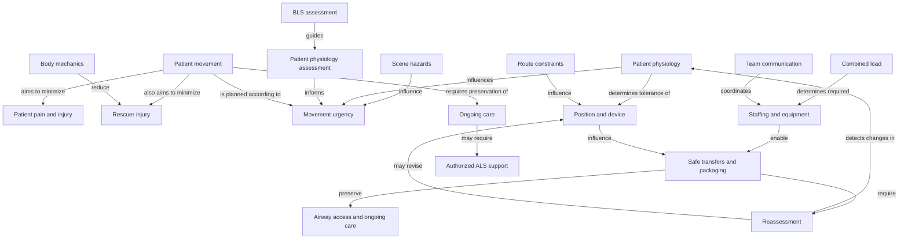

## Rescuer safety and mechanical principles

### Mechanical advantage and spinal protection

```mermaid
flowchart TD
    N1["Body mechanics"]
    N2["Mechanical advantage"]
    N3["Injury risk"]
    N4["Load held close"]
    N5["Long reach and back strain"]
    N6["Leg hip and gluteal muscles"]
    N7["Lifting force"]
    N8["Contracted abdominal and gluteal muscles"]
    N9["Aligned lower back"]
    N10["Normal lumbar curve"]
    N11["Spinal injury risk"]
    N12["Shoulders over hips over feet"]
    N13["Body alignment"]
    N14["Body misalignment"]
    N15["Twisting forces"]
    N16["Lower back"]
    N17["Lifting then turning as a unit"]
    N18["Simultaneous lifting and twisting"]
    N19["Shorter movement distance or height"]
    N20["Manual effort"]
    N21["Staged lifts and repositioning"]
    N22["Movement distance or height"]
    N23["Wheeled equipment"]
    N24["Manual carrying"]
    N25["Neutral wrist and knee alignment"]
    N26["Extremity injury risk"]
    N27["Locked aligned back"]
    N28["Bending at hips rather than waist"]
    N29["Hyperextension and leaning back"]
    N30["Safe carrying mechanics"]

    N1 -->|use the body to achieve| N2
    N2 -->|reduces| N3
    N4 -->|reduces| N5
    N6 -->|generate| N7
    N8 -->|help stabilize| N9
    N10 -->|helps reduce| N11
    N12 -->|maintain| N13
    N14 -->|creates| N15
    N15 -->|may injure| N16
    N17 -->|avoids| N18
    N19 -->|reduces| N20
    N21 -->|reduce| N22
    N23 -->|substitutes rolling for| N24
    N25 -->|reduces| N26
    N27 -->|is maintained by| N28
    N29 -->|compromise| N30
    N1 -->|emphasize| N4
    N1 -->|rely on| N6
    N1 -->|require| N8
    N9 -->|retains| N10
    N1 -->|favor| N12
    N14 -->|disrupts| N13
    N17 -->|helps prevent| N15
    N1 -->|favor| N19
    N21 -->|can reduce| N20
    N23 -->|reduces| N20
    N1 -->|require| N25
    N27 -->|helps maintain| N9
    N29 -->|threaten| N9
```

### Posture, fitness and fatigue

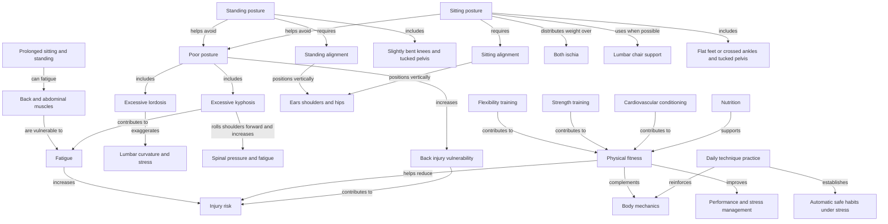

### Load, staffing and fatigue limits

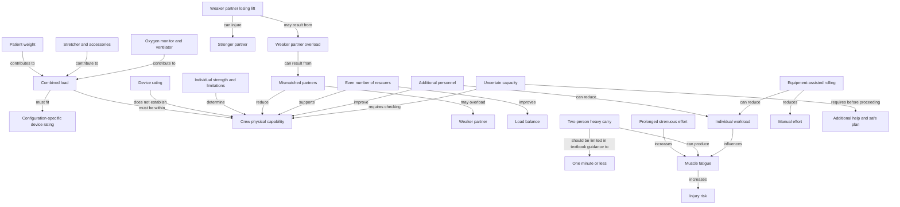

Fatigue estimates (100% effort for 6 seconds and 50% for one minute) and device ratings in the chapter are learning examples, not guaranteed safe-work thresholds.

### Power lift, squat lift and grip

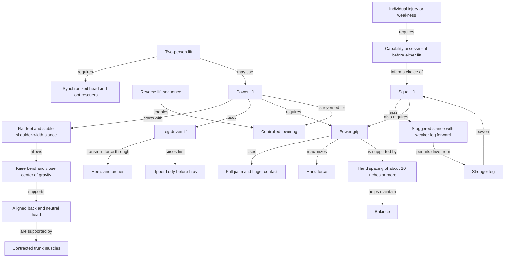

Textbook lift variations for weak knees or legs are not clearance for an injured rescuer to lift.

### Reaching, one-handed handling and horizontal forces

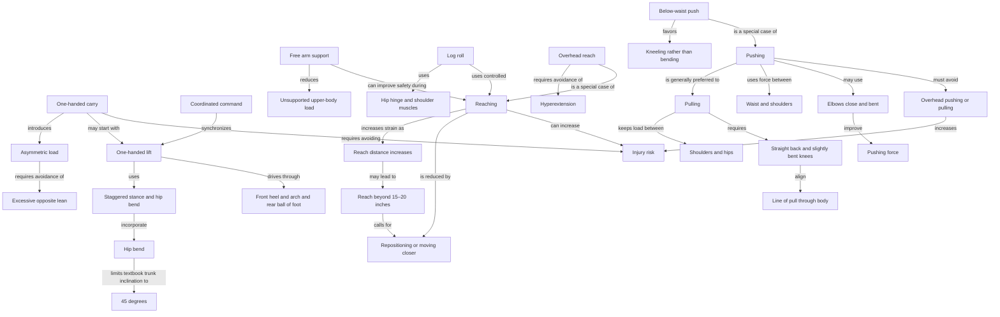

## Teamwork, authority and movement decisions

### Coordinated movement and clinical roles

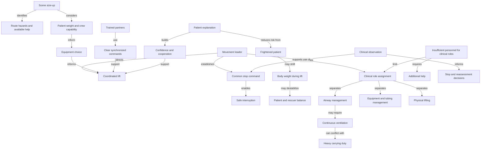

### Scope, evidence and clinical responsibility

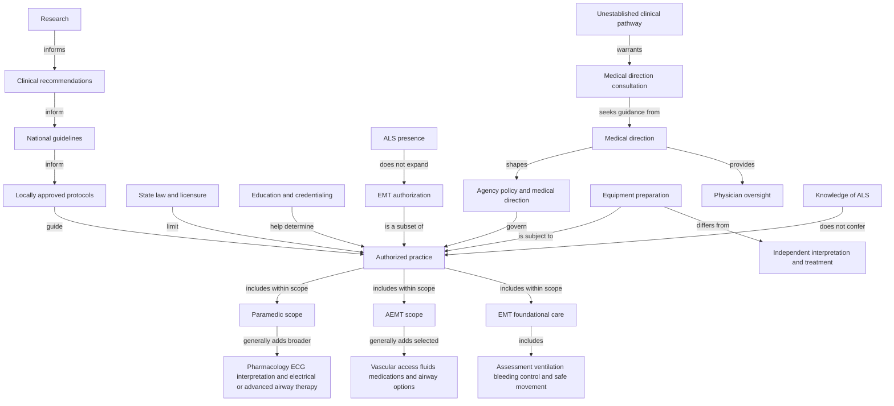

### Urgency and risk-benefit balance

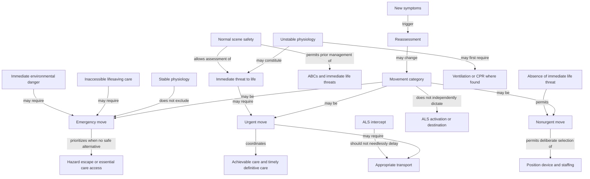

### Emergency drags and spinal risk

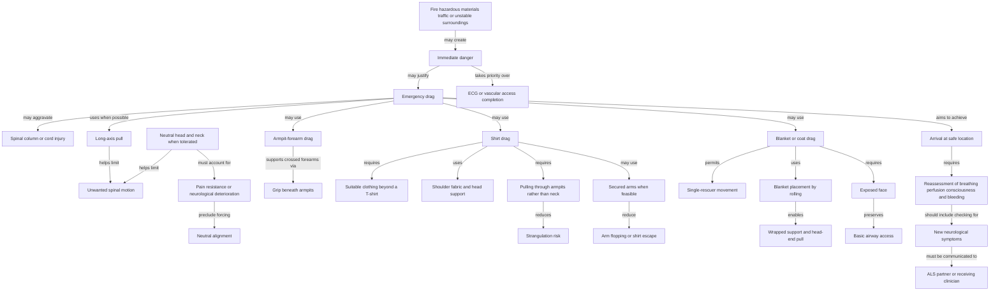

### Cardiac arrest and movement

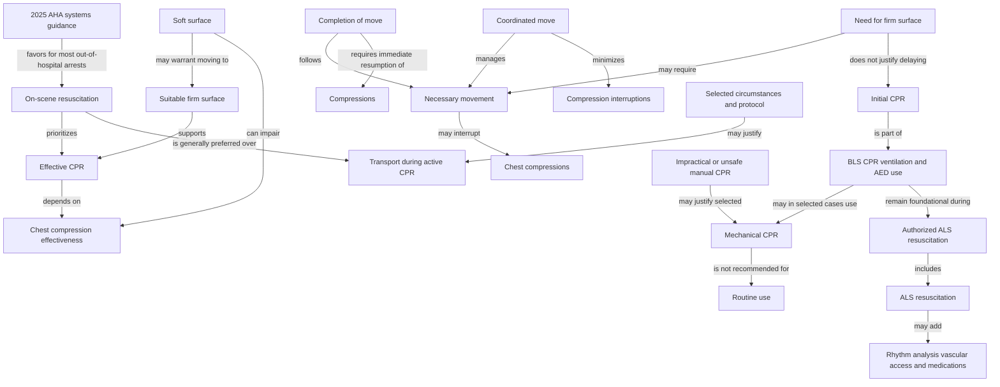

### Extrication method and spinal precautions

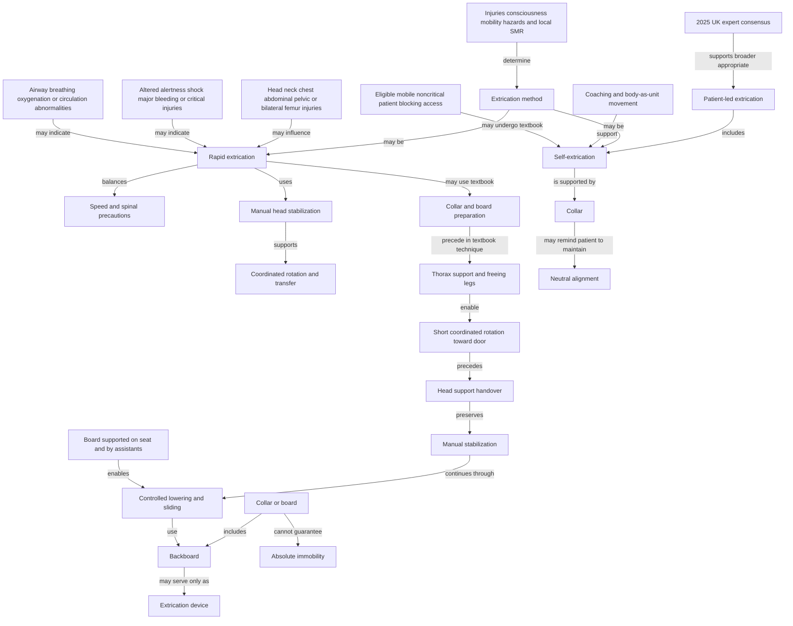

The board-assisted sequence is a textbook technique; newer UK consensus is not a replacement for local US protocols. Rescuers should support their own weight inside vehicles to reduce back strain.

### Clinical integration in critical trauma

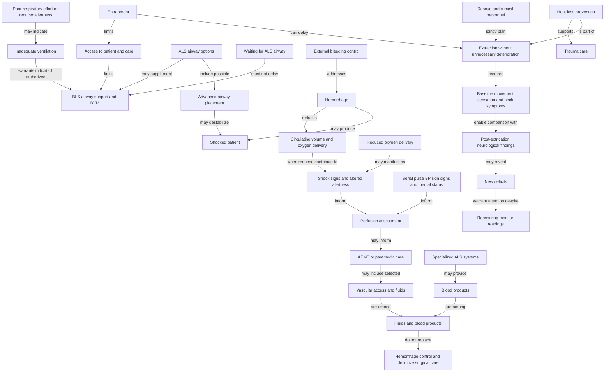

### Nonurgent movement and walking tolerance

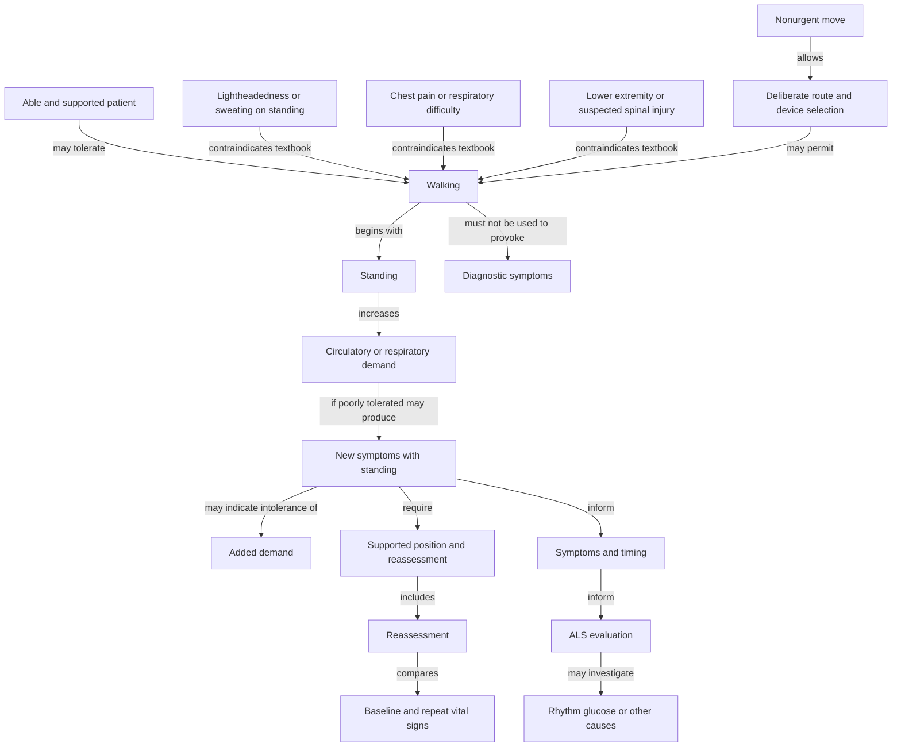

## Nonurgent transfer techniques

### Ground lift and extremity lift

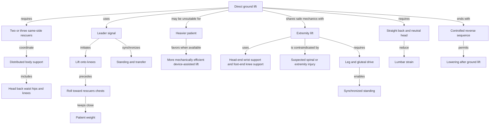

### Bed-to-stretcher transfers

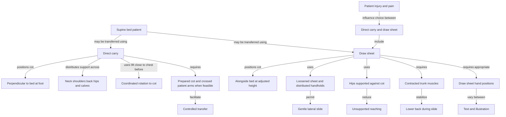

Use the taught transfer method with adequate distributed support; the two hand-position descriptions are not universal requirements.

### Pain, analgesia and attached equipment

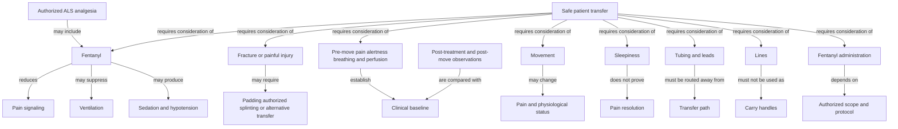

## Packaging and clinical continuity

### Patient and device securement

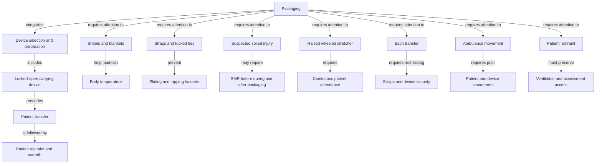

### Monitored or ventilated patient movement

```mermaid
flowchart TD
    N1["Pre-move assessment"]
    N2["Airway breathing SpO2 pulse BP and mental status baseline"]
    N3["Relevant pain and neurological findings"]
    N4["Clinical baseline"]
    N5["Journey duration"]
    N6["Oxygen and battery reserve"]
    N7["Approved mounts and tubing slack"]
    N8["Equipment displacement and interruption"]
    N9["Assigned clinical roles"]
    N10["Authorized treatment during movement"]
    N11["Critical alarm or visible deterioration"]
    N12["Immediate announcement and safe response"]
    N13["Loose oxygen or heavy equipment"]
    N14["Patient and crew safety"]
    N15["After-transfer reassessment"]
    N16["Clinical status and treatment delivery"]
    N17["Authorized ALS clinician"]
    N18["Advanced airway ventilation and infusion function"]
    N19["Unexpected disconnection"]
    N20["Reporting and authorized troubleshooting"]
    N21["Unauthorized clinician"]
    N22["Ventilator settings infusion rates or advanced airway"]
    N23["Reassessment"]
    N24["Movement plan"]
    N25["Clinical continuity during movement"]

    N1 -->|establishes| N2
    N3 -->|extend| N4
    N5 -->|determines needed| N6
    N7 -->|reduce| N8
    N9 -->|maintain| N10
    N11 -->|requires| N12
    N13 -->|threatens| N14
    N15 -->|checks| N16
    N17 -->|verifies as applicable| N18
    N19 -->|requires| N20
    N21 -->|must not independently adjust| N22
    N23 -->|may revise| N24
    N25 -->|depends on| N1
    N25 -->|depends on| N3
    N25 -->|depends on| N5
    N25 -->|depends on| N7
    N25 -->|depends on| N9
    N25 -->|depends on| N11
    N25 -->|depends on| N13
    N25 -->|depends on| N15
    N25 -->|depends on| N17
    N25 -->|depends on| N19
    N25 -->|depends on| N21
    N25 -->|depends on| N23
```

### Monitoring signals versus actual physiology

```mermaid
flowchart TD
    N1["Pulse oximetry"]
    N2["Oxygen saturation"]
    N3["Cold motion and poor perfusion"]
    N4["Pulse oximetry reliability"]
    N5["Supplemental oxygen"]
    N6["Developing hypoventilation"]
    N7["Ventilation"]
    N8["Chest rise respiratory effort and alertness"]
    N9["Ventilation adequacy"]
    N10["ECG"]
    N11["Cardiac electrical activity"]
    N12["Motion"]
    N13["ECG artifact"]
    N14["Palpable pulse"]
    N15["Waveform capnography"]
    N16["Exhaled carbon dioxide over time"]
    N17["Ventilation circulation and metabolism"]
    N18["Capnography trends"]
    N19["Capnography changes"]
    N20["Airway displacement or loss of ventilation"]
    N21["IV or IO access"]
    N22["Authorized fluids and medications"]
    N23["Kinking dislodgement or interruption"]
    N24["Infusion delivery"]
    N25["Unexpected monitor change"]
    N26["Artifact disconnection or real deterioration"]
    N27["Patient assessment"]
    N28["Clinical findings and monitor trends"]
    N29["Reassessment and ALS communication"]
    N30["Clinical reassessment"]

    N1 -->|estimates| N2
    N3 -->|can impair| N4
    N5 -->|may mask| N6
    N2 -->|does not measure| N7
    N8 -->|provide information about| N9
    N10 -->|shows| N11
    N12 -->|may cause| N13
    N11 -->|does not establish| N14
    N15 -->|displays| N16
    N17 -->|influence| N18
    N19 -->|may indicate| N20
    N21 -->|provides route for| N22
    N23 -->|compromises| N24
    N25 -->|may reflect| N26
    N27 -->|helps distinguish| N26
    N28 -->|inform| N29
    N30 -->|interprets| N2
    N30 -->|interprets| N3
    N30 -->|interprets| N5
    N30 -->|interprets| N8
    N30 -->|interprets| N11
    N30 -->|interprets| N12
    N30 -->|interprets| N15
    N30 -->|interprets| N17
    N30 -->|interprets| N19
    N30 -->|interprets| N21
    N30 -->|interprets| N23
    N30 -->|interprets| N25
    N30 -->|interprets| N28
```

## Patient positioning and physiology

### Positioning, airway protection and circulation

```mermaid
flowchart TD
    N1["Patient condition"]
    N2["Appropriate position"]
    N3["Appropriately breathing unresponsive patient without suspected spinal injury"]
    N4["Left lateral recovery position"]
    N5["Recovery position"]
    N6["Drainage of fluids or vomitus"]
    N7["Drainage"]
    N8["Aspiration risk"]
    N9["Airway and breathing assessment"]
    N10["Absent or inadequate breathing"]
    N11["Resuscitation or assisted ventilation rather than recovery position"]
    N12["Alert nauseated or vomiting patient"]
    N13["Sitting or recovery position with airway access"]
    N14["Chest discomfort or dyspnea without hypotension"]
    N15["Position of comfort usually upright"]
    N16["Hypoperfusion"]
    N17["Supine positioning subject to protocol and injuries"]
    N18["Suspected spinal injury"]
    N19["SMR with airway priority"]
    N20["Patient position"]
    N21["Venous return and respiratory mechanics"]
    N22["Weak pulses altered alertness skin changes and BP trends"]
    N23["Perfusion assessment"]
    N24["Rhythm vascular access and cause-specific therapy"]
    N25["Low BP alone"]
    N26["Correct fluid or vasoactive treatment"]

    N1 -->|determines| N2
    N3 -->|may benefit from| N4
    N5 -->|permits| N6
    N7 -->|may reduce but not eliminate| N8
    N5 -->|requires ongoing| N9
    N10 -->|requires| N11
    N12 -->|may benefit from| N13
    N14 -->|may favor| N15
    N16 -->|generally favors per source| N17
    N18 -->|requires consideration of| N19
    N20 -->|changes| N21
    N22 -->|inform| N23
    N23 -->|may guide ALS evaluation of| N24
    N25 -->|does not establish| N26
    N1 -->|guides evaluation of| N3
    N1 -->|guides evaluation of| N5
    N1 -->|guides evaluation of| N7
    N1 -->|guides evaluation of| N10
    N1 -->|guides evaluation of| N12
    N1 -->|guides evaluation of| N14
    N1 -->|guides evaluation of| N16
    N1 -->|guides evaluation of| N18
    N1 -->|guides evaluation of| N20
    N1 -->|guides evaluation of| N23
    N1 -->|guides evaluation of| N25
```

### Respiratory distress, orthopnea and positive pressure

```mermaid
flowchart TD
    N1["Elevated pulmonary vascular pressure"]
    N2["Fluid into lung tissue"]
    N3["Gas exchange"]
    N4["Cardiogenic pulmonary edema"]
    N5["Lying flat"]
    N6["Orthopnea"]
    N7["Breathing difficulty when lying flat"]
    N8["Heart failure or other causes"]
    N9["Upright position when tolerated"]
    N10["Respiratory mechanics"]
    N11["CPAP"]
    N12["Continuous positive airway pressure"]
    N13["Gas exchange and work of breathing"]
    N14["Positive pressure"]
    N15["Venous return"]
    N16["Hypotension vomiting inability to protect airway or exhaustion"]
    N17["Noninvasive positive pressure"]
    N18["Clinical assessment"]
    N19["Effort alertness SpO2 pulse BP and history"]
    N20["Device and ventilatory support choice"]
    N21["EMTs in some systems"]
    N22["Authorized ALS evaluation"]
    N23["ECG and cause-directed treatment"]
    N24["Worsening alertness ventilation or perfusion"]
    N25["Revised movement plan"]
    N26["Reassuring saturation alone"]
    N27["Adequate ventilation"]
    N28["Respiratory support planning"]

    N1 -->|can drive| N2
    N2 -->|impairs| N3
    N4 -->|may worsen when| N5
    N6 -->|describes| N7
    N6 -->|may occur with| N8
    N9 -->|may improve| N10
    N11 -->|supplies| N12
    N12 -->|may improve| N13
    N14 -->|may decrease| N15
    N16 -->|may make unsuitable| N17
    N18 -->|includes| N19
    N18 -->|informs| N20
    N11 -->|may be authorized for| N21
    N22 -->|may add| N23
    N24 -->|requires| N25
    N26 -->|does not establish| N27
    N28 -->|requires consideration of| N2
    N28 -->|requires consideration of| N4
    N28 -->|requires consideration of| N6
    N28 -->|requires consideration of| N9
    N28 -->|requires consideration of| N11
    N28 -->|requires consideration of| N14
    N28 -->|requires consideration of| N16
    N28 -->|requires consideration of| N18
    N28 -->|requires consideration of| N22
    N28 -->|requires consideration of| N24
    N28 -->|requires consideration of| N26
```

### Pregnancy: venous return and arrest distinctions

```mermaid
flowchart TD
    N1["Later pregnancy uterus"]
    N2["Major abdominal vessels"]
    N3["Inferior vena cava"]
    N4["Midline"]
    N5["Vessel compression"]
    N6["Venous return"]
    N7["Reduced venous return"]
    N8["Cardiac output and BP"]
    N9["Decreased cardiac output and BP"]
    N10["Dizziness and supine hypotensive syndrome"]
    N11["Left side or right hip elevation after 20 weeks"]
    N12["Right-side positioning"]
    N13["Preferred left-side position"]
    N14["Suspected prolapsed cord"]
    N15["Supine position with hips elevated"]
    N16["Cardiac arrest with fundus at or above umbilicus"]
    N17["CPR with manual leftward uterine displacement"]
    N18["Manual uterine displacement"]
    N19["Simply rolling arrest patient onto side"]
    N20["Chest compressions"]
    N21["Resuscitation positioning"]
    N22["Positioning an appropriately breathing pregnant patient"]
    N23["Pregnancy positioning"]

    N1 -->|may compress when supine| N2
    N3 -->|lies slightly right of| N4
    N5 -->|reduces| N6
    N7 -->|can decrease| N8
    N9 -->|may cause| N10
    N11 -->|reduces| N5
    N12 -->|is a textbook alternative if necessary to| N13
    N14 -->|calls for per local protocol| N15
    N16 -->|requires per 2025 AHA guidance| N17
    N18 -->|aims to relieve| N5
    N19 -->|may compromise| N20
    N21 -->|differs from| N22
    N23 -->|depends on| N1
    N23 -->|depends on| N3
    N23 -->|depends on| N5
    N23 -->|depends on| N7
    N23 -->|depends on| N9
    N23 -->|depends on| N12
    N23 -->|depends on| N14
    N23 -->|depends on| N16
    N23 -->|depends on| N19
    N23 -->|depends on| N21
```

### Pediatric, older adult and disability adaptations

```mermaid
flowchart TD
    N1["Small child"]
    N2["Size and weight appropriate restraint"]
    N3["Child restraint"]
    N4["Approved mounting configuration"]
    N5["Personal undamaged car seat"]
    N6["Child fear"]
    N7["Personal car seat"]
    N8["Ambulance cot mounting"]
    N9["Rolled towels or sheets"]
    N10["Positioning support"]
    N11["Approved pediatric transport restraint"]
    N12["2025 pediatric interim guidance"]
    N13["Approved secure transport"]
    N14["Unsecured child or adult arms"]
    N15["Ambulance transport"]
    N16["Osteoporosis"]
    N17["Fracture vulnerability"]
    N18["Older adult"]
    N19["Gentle handling and explanation"]
    N20["Fixed joints and deformities"]
    N21["Tolerable positions"]
    N22["Patient-reported usual posture"]
    N23["Padding and strap adaptation"]
    N24["Forcing painful fixed posture"]
    N25["Injury and pain"]
    N26["Baseline function"]
    N27["New pain movement or alertness changes"]
    N28["New changes"]
    N29["Analgesia monitoring and equipment needs"]
    N30["Patient-specific movement"]

    N1 -->|requires| N2
    N3 -->|must use| N4
    N5 -->|may reduce| N6
    N7 -->|is not automatically approved for| N8
    N9 -->|may provide| N10
    N10 -->|cannot substitute for| N11
    N12 -->|emphasizes| N13
    N14 -->|are not acceptable for| N15
    N16 -->|increases| N17
    N18 -->|may require| N19
    N20 -->|limit| N21
    N22 -->|guides| N23
    N24 -->|risks| N25
    N26 -->|enables recognition of| N27
    N28 -->|may affect| N29
    N30 -->|requires consideration of| N1
    N30 -->|requires consideration of| N3
    N30 -->|requires consideration of| N5
    N30 -->|requires consideration of| N7
    N30 -->|requires consideration of| N10
    N30 -->|requires consideration of| N12
    N30 -->|requires consideration of| N14
    N30 -->|requires consideration of| N16
    N30 -->|requires consideration of| N18
    N30 -->|requires consideration of| N20
    N30 -->|requires consideration of| N22
    N30 -->|requires consideration of| N24
    N30 -->|requires consideration of| N26
    N30 -->|requires consideration of| N28
```

## Devices and equipment selection

### Wheeled stretchers and powered handling

```mermaid
flowchart TD
    N1["Smooth traversable route"]
    N2["Wheeled stretcher"]
    N3["Manual carrying"]
    N4["Adjustable cot"]
    N5["Clinically appropriate positions and heights"]
    N6["Uneven ground or narrow stairs"]
    N7["Additional rescuers or alternative device"]
    N8["Manual stretcher"]
    N9["Raising lowering and loading"]
    N10["Manual roll-in wheels"]
    N11["Lifting and twisting during loading"]
    N12["Powered stretcher"]
    N13["Hydraulic pneumatic or electric assistance"]
    N14["Powered assistance"]
    N15["Repetitive spinal loading"]
    N16["Device weight"]
    N17["Powered loading"]
    N18["Crew manual workload"]
    N19["Airway support and monitoring"]
    N20["Powered equipment"]
    N21["Pinch tip battery and loading hazards"]
    N22["Observational pre-post study"]
    N23["Stretcher-related injuries after powered introduction"]
    N24["Observational findings"]
    N25["Injury prevention"]
    N26["Actual configuration and accessories"]
    N27["Permissible combined load"]
    N28["Wheeled stretcher selection"]

    N1 -->|favors| N2
    N2 -->|reduces need for| N3
    N4 -->|accommodates| N5
    N6 -->|may require| N7
    N8 -->|requires crew force for| N9
    N10 -->|reduce| N11
    N12 -->|uses| N13
    N14 -->|reduces| N15
    N12 -->|adds| N16
    N17 -->|can reduce| N18
    N18 -->|may free personnel for| N19
    N20 -->|retains| N21
    N22 -->|found fewer| N23
    N24 -->|do not guarantee| N25
    N26 -->|determine| N27
    N28 -->|depends on consideration of| N2
    N28 -->|depends on consideration of| N4
    N28 -->|depends on consideration of| N6
    N28 -->|depends on consideration of| N8
    N28 -->|depends on consideration of| N10
    N28 -->|depends on consideration of| N12
    N28 -->|depends on consideration of| N14
    N28 -->|depends on consideration of| N18
    N28 -->|depends on consideration of| N20
    N28 -->|depends on consideration of| N22
    N28 -->|depends on consideration of| N24
    N28 -->|depends on consideration of| N26
```

Textbook examples: manual roll-in 70–95 lb, powered up to 140 lb, many cots rated up to 650 lb. Check actual ratings; X-ray opacity and rough terrain are limitations.

### Loading and rolling configurations

```mermaid
flowchart TD
    N1["Smooth terrain"]
    N2["Head rescuer pushing and foot rescuer guiding"]
    N3["Rough terrain"]
    N4["Four corner rescuers for stability"]
    N5["Narrow space or stairs"]
    N6["Two end rescuers and substantial strength"]
    N7["Manual roll-in loading"]
    N8["Head-first approach and supported loading wheels"]
    N9["Supported loading wheels"]
    N10["Release lever and carriage collapse"]
    N11["Collapsed carriage"]
    N12["Advance into securing mechanism"]
    N13["Front and rear lock verification"]
    N14["Powered loading"]
    N15["Support engagement and locking checks"]
    N16["Fully powered loading"]
    N17["Cot horizontally"]
    N18["Green indicator"]
    N19["Illustrated model"]
    N20["Hanging stretchers"]
    N21["Wheeled stretchers"]
    N22["Manufacturer instructions"]
    N23["Inspection cleaning repair and loading procedures"]
    N24["Patient attendance"]
    N25["Secured stretcher"]
    N26["Safe cot handling"]

    N1 -->|uses| N2
    N3 -->|favors| N4
    N5 -->|may require| N6
    N7 -->|begins with| N8
    N9 -->|precede| N10
    N11 -->|enables| N12
    N12 -->|requires| N13
    N14 -->|requires model-specific| N15
    N16 -->|may fold and draw in| N17
    N18 -->|confirms engagement only for| N19
    N20 -->|are loaded before in textbook procedure| N21
    N22 -->|govern| N23
    N24 -->|remains necessary despite| N25
    N26 -->|requires consideration of| N1
    N26 -->|requires consideration of| N3
    N26 -->|requires consideration of| N5
    N26 -->|requires consideration of| N7
    N26 -->|requires consideration of| N9
    N26 -->|requires consideration of| N12
    N26 -->|requires consideration of| N14
    N26 -->|requires consideration of| N16
    N26 -->|requires consideration of| N18
    N26 -->|requires consideration of| N20
    N26 -->|requires consideration of| N22
    N26 -->|requires consideration of| N24
```

### Bariatric equipment and respiratory reserve

```mermaid
flowchart TD
    N1["Larger patient and equipment"]
    N2["Combined load"]
    N3["Wider frame and base"]
    N4["Accommodation and stability"]
    N5["Ramp and winch or specialized ambulance"]
    N6["Manual loading demand"]
    N7["Bariatric cot rating"]
    N8["Wheels-down or other configuration"]
    N9["Textbook Stryker example"]
    N10["850 to 1600 pounds"]
    N11["High rated capacity"]
    N12["Crew ability to lift"]
    N13["Obesity"]
    N14["Respiratory reserve"]
    N15["Patient respiratory tolerance"]
    N16["Position choice"]
    N17["Secure restraint and airway access"]
    N18["Early route staffing and equipment planning"]
    N19["Safe bariatric transfer"]
    N20["Breathing alertness and perfusion assessment"]
    N21["Patient size"]

    N1 -->|increase| N2
    N3 -->|improve| N4
    N5 -->|can reduce| N6
    N7 -->|varies with| N8
    N9 -->|ranges by configuration from| N10
    N11 -->|does not establish| N12
    N13 -->|may reduce especially supine| N14
    N15 -->|guides| N16
    N16 -->|must preserve| N17
    N18 -->|supports| N19
    N20 -->|supersede assumptions from| N21
    N19 -->|requires consideration of| N1
    N19 -->|requires consideration of| N3
    N19 -->|requires consideration of| N5
    N19 -->|requires consideration of| N7
    N19 -->|requires consideration of| N9
    N19 -->|requires consideration of| N11
    N19 -->|requires consideration of| N13
    N19 -->|requires consideration of| N16
    N19 -->|requires consideration of| N20
```

### Portable, flexible and basket devices

```mermaid
flowchart TD
    N1["Restricted hallway or stairs"]
    N2["Wheeled stretcher"]
    N3["Portable stretcher"]
    N4["Compact auxiliary carrying surface"]
    N5["Basic portable model"]
    N6["350 pounds not recommended at that load"]
    N7["Manual carrying"]
    N8["Pole stretcher"]
    N9["Fabric between poles and locking crosspieces"]
    N10["Spinal immobilization per textbook"]
    N11["Rocky ground"]
    N12["Soft tissue injury"]
    N13["Four or more rescuers"]
    N14["Flexible Reeves stretcher"]
    N15["Six side handles and three straps"]
    N16["Narrow hallways and board-assisted movement"]
    N17["Basket stretcher"]
    N18["Rough terrain transport"]
    N19["Scoop or Ohio board"]
    N20["Flotation harness"]
    N21["Water rescue"]
    N22["Rope or ladder basket rescue"]
    N23["Specific training"]
    N24["Mattress and padding"]
    N25["Comfort and cold insulation"]
    N26["Basket or portable device"]
    N27["Alternative device selection"]

    N1 -->|may preclude| N2
    N3 -->|provides| N4
    N5 -->|has textbook rating up to| N6
    N3 -->|requires| N7
    N8 -->|uses| N9
    N8 -->|requires board if needed for| N10
    N11 -->|risks with pole stretcher| N12
    N13 -->|are preferred for| N8
    N14 -->|uses| N15
    N14 -->|accommodates| N16
    N17 -->|protects during| N18
    N17 -->|can accommodate| N19
    N20 -->|adapts basket for| N21
    N22 -->|requires| N23
    N24 -->|provide| N25
    N26 -->|must be secured if placed on| N2
    N27 -->|requires consideration of| N1
    N27 -->|requires consideration of| N3
    N27 -->|requires consideration of| N5
    N27 -->|requires consideration of| N8
    N27 -->|requires consideration of| N11
    N27 -->|requires consideration of| N14
    N27 -->|requires consideration of| N17
    N27 -->|requires consideration of| N20
    N27 -->|requires consideration of| N22
    N27 -->|requires consideration of| N24
```

### Stair chairs and clinical tolerance

```mermaid
flowchart TD
    N1["Narrow stairs corridors and small elevators"]
    N2["Stair chair"]
    N3["Altered mental status suspected spinal injury or lower extremity injury"]
    N4["Alert cooperative patient with positional dyspnea"]
    N5["Seated movement"]
    N6["Severe fatigue vomiting poor perfusion or reduced alertness"]
    N7["Sustained BVM requirement"]
    N8["Stair chair clinical access"]
    N9["CPAP in use"]
    N10["Safe continuity during carry or alternative plan"]
    N11["Manual stair chair"]
    N12["Secure straps and patient instructions"]
    N13["Head rescuer tilting chair"]
    N14["Foot rescuer grasping chair legs"]
    N15["Synchronized manual carry"]
    N16["Wheels off steps"]
    N17["Spotter"]
    N18["Hazards"]
    N19["Tracked chair"]
    N20["Descent"]
    N21["Two stabilizing rescuers"]
    N22["Power track example"]
    N23["500 pounds"]
    N24["Clinical reassessment"]
    N25["Continued stair chair suitability"]

    N1 -->|favor when appropriate| N2
    N3 -->|contraindicate textbook| N2
    N4 -->|may tolerate| N5
    N6 -->|may make unsafe| N5
    N7 -->|may conflict with| N8
    N9 -->|requires| N10
    N11 -->|requires| N12
    N13 -->|permits| N14
    N15 -->|keeps| N16
    N17 -->|counts steps and identifies| N18
    N19 -->|reduces need to lift during| N20
    N20 -->|still requires| N21
    N22 -->|accommodates up to textbook| N23
    N24 -->|determines before commitment| N25
    N2 -->|requires consideration of| N4
    N2 -->|requires consideration of| N7
    N2 -->|requires consideration of| N9
    N2 -->|requires consideration of| N11
    N2 -->|requires consideration of| N13
    N2 -->|requires consideration of| N15
    N2 -->|requires consideration of| N17
    N2 -->|requires consideration of| N20
    N2 -->|requires consideration of| N22
    N2 -->|requires consideration of| N24
```

### SMR and device-related trade-offs

```mermaid
flowchart TD
    N1["Suspected spinal injury"]
    N2["Spinal motion restriction"]
    N3["Unwanted movement"]
    N4["Ventilation perfusion and comfort"]
    N5["Backboard"]
    N6["Extrication and transfer"]
    N7["Firm CPR surface"]
    N8["Breathing and comfort"]
    N9["Prolonged board use"]
    N10["Pressure injury pain and heat loss"]
    N11["Ohio board taper"]
    N12["Vehicle and basket maneuverability"]
    N13["Vacuum mattress"]
    N14["Supine body contours"]
    N15["Air removal"]
    N16["Rigid conforming support"]
    N17["Padding voids"]
    N18["SMR and basket transport"]
    N19["Board removal onto cot or vacuum mattress"]
    N20["Coordinated precautions and reassessment"]
    N21["Neurological and respiratory checks"]
    N22["Transfer-related changes"]
    N23["Absolute immobilization"]
    N24["SMR devices"]

    N1 -->|may indicate under protocol| N2
    N2 -->|aims to limit| N3
    N2 -->|must preserve| N4
    N5 -->|facilitates| N6
    N5 -->|can serve as| N7
    N5 -->|may impair| N8
    N9 -->|may contribute to| N10
    N11 -->|improves| N12
    N13 -->|conforms around| N14
    N15 -->|produces| N16
    N16 -->|reduces need for| N17
    N13 -->|can support| N18
    N19 -->|requires| N20
    N21 -->|assess| N22
    N23 -->|is not guaranteed by| N24
    N2 -->|requires consideration of| N5
    N2 -->|requires consideration of| N9
    N2 -->|requires consideration of| N11
    N2 -->|requires consideration of| N13
    N2 -->|requires consideration of| N16
    N2 -->|requires consideration of| N19
    N2 -->|requires consideration of| N21
    N2 -->|requires consideration of| N23
```

### Scoop stretcher and evolving guidance

```mermaid
flowchart TD
    N1["Scoop stretcher"]
    N2["Adjustable halves around patient"]
    N3["Pelvic and bilateral femur fractures"]
    N4["Scoop-assisted movement"]
    N5["Confined areas"]
    N6["Scoop placement"]
    N7["Access from both sides and at least two rescuers"]
    N8["Length adjustment"]
    N9["Placement of separated halves"]
    N10["Gentle coordinated rolling"]
    N11["Insertion and back assessment"]
    N12["Head-end assembly"]
    N13["Foot-end latching"]
    N14["Verified latches"]
    N15["Secure lift"]
    N16["Padding head and bony prominences"]
    N17["Comfort and pressure protection"]
    N18["At least three body straps"]
    N19["Patient to scoop"]
    N20["Cold metal"]
    N21["Prewarming"]
    N22["Textbook spinal injury prohibition"]
    N23["2018 joint SMR consensus"]
    N24["Transfer options to minimize motion"]
    N25["Device instructions patient injury and tolerance"]
    N26["Appropriate scoop use"]

    N1 -->|separates into| N2
    N3 -->|may benefit from| N4
    N5 -->|may favor| N4
    N6 -->|requires| N7
    N8 -->|precedes| N9
    N10 -->|permits| N11
    N12 -->|precedes in textbook method| N13
    N14 -->|enable| N15
    N16 -->|supports| N17
    N18 -->|secure| N19
    N20 -->|may require| N21
    N22 -->|differs from| N23
    N23 -->|recognizes scoop among| N24
    N25 -->|determine with local protocol| N26
    N1 -->|requires consideration of| N3
    N1 -->|requires consideration of| N6
    N1 -->|requires consideration of| N8
    N1 -->|requires consideration of| N10
    N1 -->|requires consideration of| N12
    N1 -->|requires consideration of| N14
    N1 -->|requires consideration of| N16
    N1 -->|requires consideration of| N18
    N1 -->|requires consideration of| N20
    N1 -->|requires consideration of| N23
    N1 -->|requires consideration of| N25
```

The 300-pound rating is a textbook example. Consensus does not endorse every scoop model or prolonged scoop transport.

## Confined spaces, stairs and practical integration

### Carry configurations and fall prevention

```mermaid
flowchart TD
    N1["Narrow route or rough ground"]
    N2["Portable flexible or board-assisted carry"]
    N3["Patient straps"]
    N4["Sliding out of device"]
    N5["Textbook confined carry"]
    N6["At least three straps"]
    N7["Safe hand positioning"]
    N8["Grabbing rails and destabilizing crew"]
    N9["Improvised behavioral restraints"]
    N10["Two-person carry"]
    N11["Heavier head end"]
    N12["Side stabilization"]
    N13["Backward-moving rescuer"]
    N14["Unseen trip hazards"]
    N15["Spotter"]
    N16["Four-person diamond"]
    N17["Head foot and two side supports"]
    N18["Four-person rectangular carry"]
    N19["Two supports at each end"]
    N20["Four-person configurations"]
    N21["Forward-facing rescuers"]
    N22["Load close to body"]
    N23["Back strain"]
    N24["High-angle or unstable terrain"]
    N25["Trained rescue resources"]
    N26["Safe confined-space carry"]

    N1 -->|may require| N2
    N3 -->|prevent| N4
    N5 -->|specifies| N6
    N7 -->|reduces| N8
    N7 -->|does not authorize| N9
    N10 -->|places stronger rescuer at| N11
    N10 -->|lacks| N12
    N13 -->|faces| N14
    N15 -->|guides| N13
    N16 -->|adds| N17
    N18 -->|distributes| N19
    N20 -->|allow| N21
    N22 -->|reduces| N23
    N24 -->|warrants| N25
    N26 -->|requires consideration of| N1
    N26 -->|requires consideration of| N3
    N26 -->|requires consideration of| N5
    N26 -->|requires consideration of| N7
    N26 -->|requires consideration of| N10
    N26 -->|requires consideration of| N13
    N26 -->|requires consideration of| N16
    N26 -->|requires consideration of| N18
    N26 -->|requires consideration of| N20
    N26 -->|requires consideration of| N22
    N26 -->|requires consideration of| N24
```

### Stair orientation and access to treatment

```mermaid
flowchart TD
    N1["Supine stair carry"]
    N2["Sliding from either end"]
    N3["Downstairs or downhill"]
    N4["Feet-first orientation"]
    N5["Foot end below patient"]
    N6["Upstairs or uphill"]
    N7["Head-first orientation"]
    N8["Head end above patient"]
    N9["Spotter below on descent"]
    N10["Foot-end rescuer"]
    N11["Spotter above on ascent"]
    N12["Head-end rescuer"]
    N13["Stair width"]
    N14["Side support and clinician access"]
    N15["Narrow route"]
    N16["Continuous ventilation and monitoring"]
    N17["Loss of essential clinical access"]
    N18["Alternative device or staged movement"]
    N19["Safe reassessment points"]
    N20["Staged movement"]
    N21["Device instructions"]
    N22["Actual orientation restraints and staffing"]
    N23["Safe stair movement"]

    N1 -->|requires restraint against| N2
    N3 -->|uses textbook| N4
    N4 -->|places backward-moving rescuer at| N5
    N6 -->|uses textbook| N7
    N7 -->|places backward-moving rescuer at| N8
    N9 -->|guides| N10
    N11 -->|guides| N12
    N13 -->|limits| N14
    N15 -->|can interrupt| N16
    N17 -->|may require| N18
    N19 -->|support| N20
    N21 -->|govern| N22
    N23 -->|requires consideration of| N1
    N23 -->|requires consideration of| N4
    N23 -->|requires consideration of| N7
    N23 -->|requires consideration of| N9
    N23 -->|requires consideration of| N11
    N23 -->|requires consideration of| N13
    N23 -->|requires consideration of| N15
    N23 -->|requires consideration of| N17
    N23 -->|requires consideration of| N19
    N23 -->|requires consideration of| N21
```

### Dialysis transfer and change from baseline

```mermaid
flowchart TD
    N1["Snow and ice"]
    N2["Slip hazards"]
    N3["Clearing and salting walkway"]
    N4["Limited baseline mobility and narrow stairs"]
    N5["Supported stair chair transfer if suitable"]
    N6["Patient explanation and agreement"]
    N7["Cooperation"]
    N8["Blankets and appropriate clothing"]
    N9["Warmth and comfort"]
    N10["Bulky clothing"]
    N11["Safe restraint"]
    N12["Spotter and coordinated pace"]
    N13["Stairway stability"]
    N14["Rest after descent"]
    N15["Accumulated rescuer fatigue"]
    N16["Clear walkway"]
    N17["Rolling to ambulance"]
    N18["Post-transfer reassessment"]
    N19["Baseline clinical status"]
    N20["Stable routine dialysis patient"]
    N21["Authorized BLS care"]
    N22["Missed dialysis"]
    N23["Fluid overload or hyperkalemia"]
    N24["Hyperkalemia"]
    N25["Cardiac electrical function"]
    N26["New dyspnea palpitations weakness or near-syncope"]
    N27["Reassessment and revised transfer plan"]
    N28["New symptoms"]
    N29["Hyperkalemia diagnosis"]
    N30["ALS evaluation"]
    N31["ECG and destination reconsideration"]
    N32["Normal ECG"]
    N33["Dialysis access"]
    N34["Compression and trauma"]
    N35["Last dialysis and baseline trends"]
    N36["Handoff and care decisions"]
    N37["Dialysis transfer planning"]

    N1 -->|create| N2
    N3 -->|reduce| N2
    N4 -->|favor| N5
    N6 -->|promote| N7
    N8 -->|protect| N9
    N10 -->|may interfere with| N11
    N12 -->|support| N13
    N14 -->|reduces| N15
    N16 -->|enables| N17
    N18 -->|compares with| N19
    N20 -->|may need only| N21
    N22 -->|may be associated with| N23
    N24 -->|can disrupt| N25
    N26 -->|warrant| N27
    N28 -->|do not establish| N29
    N30 -->|may include| N31
    N32 -->|does not exclude| N24
    N33 -->|requires protection from| N34
    N35 -->|inform| N36
    N37 -->|requires consideration of| N1
    N37 -->|requires consideration of| N4
    N37 -->|requires consideration of| N6
    N37 -->|requires consideration of| N8
    N37 -->|requires consideration of| N10
    N37 -->|requires consideration of| N12
    N37 -->|requires consideration of| N14
    N37 -->|requires consideration of| N16
    N37 -->|requires consideration of| N18
    N37 -->|requires consideration of| N20
    N37 -->|requires consideration of| N22
    N37 -->|requires consideration of| N24
    N37 -->|requires consideration of| N26
    N37 -->|requires consideration of| N28
    N37 -->|requires consideration of| N30
    N37 -->|requires consideration of| N33
    N37 -->|requires consideration of| N35
```

The case's initial spotter location differs from the general descent procedure. Follow approved device-specific spotter positioning; protect dialysis access and follow local BP and access restrictions. The deterioration scenario is an illustrative extension, not a finding in the original patient.

### Seated respiratory transfer integration

```mermaid
flowchart TD
    N1["Second-floor bedroom and narrow hallway"]
    N2["Device selection"]
    N3["Orthopnea"]
    N4["Supine tolerance"]
    N5["Seated position"]
    N6["Respiratory tolerance"]
    N7["Stair chair"]
    N8["Alertness perfusion ventilation and cooperation"]
    N9["Safe seated transfer"]
    N10["History vital trends and respiratory effort"]
    N11["BLS assessment"]
    N12["Authorized oxygen or ventilation and early help request"]
    N13["ALS evaluation"]
    N14["ECG or noninvasive support when appropriate"]
    N15["Specific diagnosis or drug choice"]
    N16["Movement plan"]
    N17["Respiratory support"]
    N18["Worsening ventilation perfusion or alertness"]
    N19["Reassessment and revised movement plan"]

    N1 -->|constrain| N2
    N3 -->|limits| N4
    N5 -->|may improve| N6
    N7 -->|may accommodate| N5
    N8 -->|determine| N9
    N10 -->|inform| N11
    N11 -->|guides| N12
    N13 -->|may add| N14
    N3 -->|does not establish| N15
    N16 -->|must preserve| N17
    N18 -->|triggers| N19
    N9 -->|requires consideration of| N1
    N9 -->|requires consideration of| N3
    N9 -->|requires consideration of| N5
    N9 -->|requires consideration of| N11
    N9 -->|requires consideration of| N13
    N9 -->|requires consideration of| N16
    N9 -->|requires consideration of| N18
```

## Specialized transport

### Air medical activation and handoff

```mermaid
flowchart TD
    N1["Air medical activation"]
    N2["Expected benefit time to appropriate care and transport risk"]
    N3["Available capabilities"]
    N4["Early ground-flight coordination"]
    N5["Delays and duplicate procedures"]
    N6["Airway strategy"]
    N7["Patient physiology and authorized clinician judgment"]
    N8["Endotracheal intubation"]
    N9["Every flight"]
    N10["Adequate BLS ventilation"]
    N11["Delaying or harmful invasive airway intervention"]
    N12["Advanced airway when used"]
    N13["Securement monitoring and chest access"]
    N14["Ground team handoff"]
    N15["Airway oxygen needs trends injuries treatments and response"]
    N16["Flight team"]
    N17["Equipment compatibility and loading"]
    N18["Infusions"]
    N19["Approved secure mounts and delivery continuity"]
    N20["Laying an IV bag flat"]
    N21["Gravity-dependent or pump therapy"]
    N22["Unauthorized personnel"]
    N23["Running infusion"]
    N24["Ground-to-air transfer"]

    N1 -->|depends on| N2
    N3 -->|influence| N1
    N4 -->|can reduce| N5
    N6 -->|depends on| N7
    N8 -->|is not prerequisite for| N9
    N10 -->|may be preferable to| N11
    N12 -->|requires| N13
    N14 -->|communicates| N15
    N16 -->|directs| N17
    N18 -->|require| N19
    N20 -->|may disrupt| N21
    N22 -->|must not manipulate| N23
    N24 -->|requires coordination of| N1
    N24 -->|requires coordination of| N4
    N24 -->|requires coordination of| N6
    N24 -->|requires coordination of| N8
    N24 -->|requires coordination of| N10
    N24 -->|requires coordination of| N12
    N24 -->|requires coordination of| N14
    N24 -->|requires coordination of| N16
    N24 -->|requires coordination of| N18
    N24 -->|requires coordination of| N20
    N24 -->|requires coordination of| N22
```

### Aircraft environment and operational safety

```mermaid
flowchart TD
    N1["Hazmat contamination"]
    N2["Hazardous cabin fumes"]
    N3["Decontamination and flight program policy"]
    N4["Safe acceptance"]
    N5["Rotor wash"]
    N6["Loose equipment dust and debris"]
    N7["Secured equipment and removed loose clothing"]
    N8["Rotor and engine hazards"]
    N9["Landing zone wetting when appropriate"]
    N10["Blowing dust"]
    N11["Eye ear and wound protection"]
    N12["Noise and rotor wash"]
    N13["Patient explanation"]
    N14["Crew authorization"]
    N15["Aircraft approach"]
    N16["Aircraft-specific approach and placards"]
    N17["Safe loading"]
    N18["Tail rotor"]
    N19["Safe clearance"]
    N20["Minimum essential personnel"]
    N21["Exposure under rotors"]
    N22["Board cot and restraints"]
    N23["Aircraft compatibility checks"]
    N24["Flight-team instructions"]
    N25["Ground-to-air transfer"]
    N26["Aircraft loading safety"]

    N1 -->|may expose crew to| N2
    N3 -->|determine| N4
    N5 -->|can mobilize| N6
    N7 -->|reduce| N8
    N9 -->|may reduce| N10
    N11 -->|reduces exposure to| N12
    N13 -->|prepares patient for| N12
    N14 -->|precedes| N15
    N16 -->|guide| N17
    N18 -->|requires| N19
    N20 -->|limits| N21
    N22 -->|require| N23
    N24 -->|govern| N25
    N26 -->|requires consideration of| N1
    N26 -->|requires consideration of| N3
    N26 -->|requires consideration of| N5
    N26 -->|requires consideration of| N7
    N26 -->|requires consideration of| N9
    N26 -->|requires consideration of| N11
    N26 -->|requires consideration of| N14
    N26 -->|requires consideration of| N16
    N26 -->|requires consideration of| N18
    N26 -->|requires consideration of| N20
    N26 -->|requires consideration of| N22
    N26 -->|requires consideration of| N24
```

### Neonatal isolette transport and thermal physiology

```mermaid
flowchart TD
    N1["Newborn high surface area relative to mass"]
    N2["Heat loss"]
    N3["Prematurity"]
    N4["Thermal reserves"]
    N5["Cold stress"]
    N6["Metabolic demand"]
    N7["Low glucose and inadequate oxygen delivery"]
    N8["Isolette"]
    N9["Controlled thermal environment"]
    N10["Approved transport platform"]
    N11["2025 neonatal resuscitation guidance"]
    N12["Temperature monitoring and avoiding overcooling or overheating"]
    N13["Interfacility isolette protocol"]
    N14["Specialty team"]
    N15["Oxygen ventilation glucose and IV infusions"]
    N16["Specific training and authorization"]
    N17["EMT support"]
    N18["Clear route secured equipment supplies and observation"]
    N19["Isolette and attached equipment"]
    N20["Compatible ambulance mounts and verified securement"]
    N21["Unauthorized changes"]
    N22["Isolette or ventilation settings"]
    N23["Neonatal transport"]

    N1 -->|promotes| N2
    N3 -->|limits| N4
    N2 -->|may cause| N5
    N5 -->|increases| N6
    N6 -->|can worsen| N7
    N8 -->|provides| N9
    N8 -->|also provides| N10
    N11 -->|emphasizes| N12
    N11 -->|is not a complete| N13
    N14 -->|may manage| N15
    N15 -->|require| N16
    N17 -->|includes| N18
    N19 -->|require| N20
    N21 -->|must not be made to| N22
    N23 -->|requires consideration of| N2
    N23 -->|requires consideration of| N3
    N23 -->|requires consideration of| N8
    N23 -->|requires consideration of| N11
    N23 -->|requires consideration of| N15
    N23 -->|requires consideration of| N17
    N23 -->|requires consideration of| N19
    N23 -->|requires consideration of| N21
```

## Cross-concept integration

### Reassessment as a movement safety feedback loop

```mermaid
flowchart TD
    N1["Baseline clinical assessment"]
    N2["Physiological and neurological reference"]
    N3["Route device staffing and position"]
    N4["Movement plan"]
    N5["Clinical access and patient physiology"]
    N6["Ongoing treatment delivery"]
    N7["Reassessment"]
    N8["New symptoms device issues or deterioration"]
    N9["Safe stop and authorized corrective action"]
    N10["Movement and clinical team"]
    N11["BLS care and authorized ALS support"]
    N12["Continuous reassessment"]
    N13["Handoff and documentation"]
    N14["Baseline trends movement and treatment response"]

    N1 -->|establishes| N2
    N3 -->|define| N4
    N4 -->|affects| N5
    N5 -->|influence| N6
    N6 -->|is checked by| N7
    N7 -->|compares findings with| N2
    N7 -->|identifies| N8
    N8 -->|may require| N9
    N9 -->|revise when needed| N4
    N4 -->|is communicated to| N10
    N10 -->|coordinates| N11
    N11 -->|depend on| N12
    N13 -->|communicate| N14
    N7 -->|informs| N13
```

This is a clinical reasoning and safety feedback model, not a mandatory care sequence or treatment protocol.
