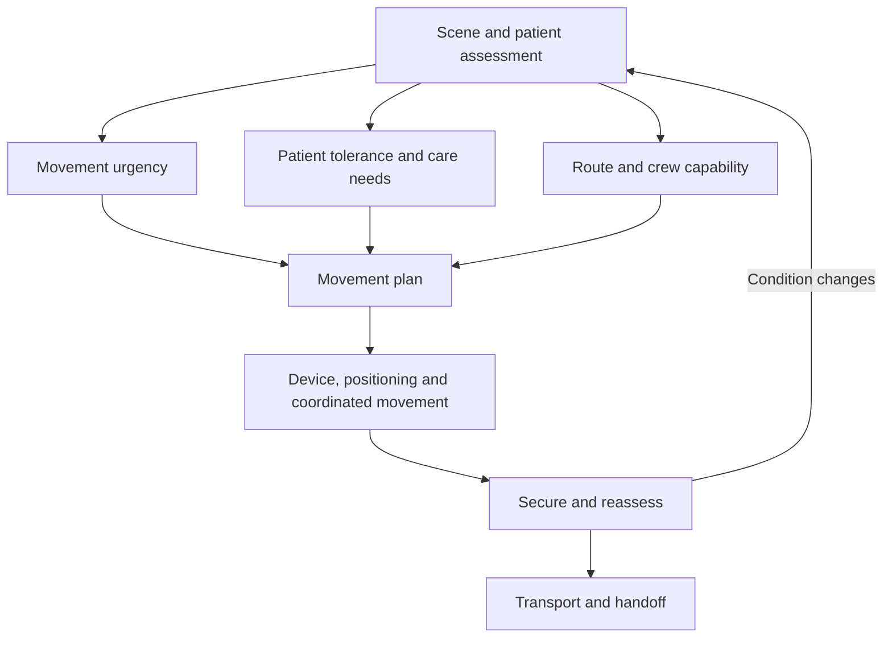
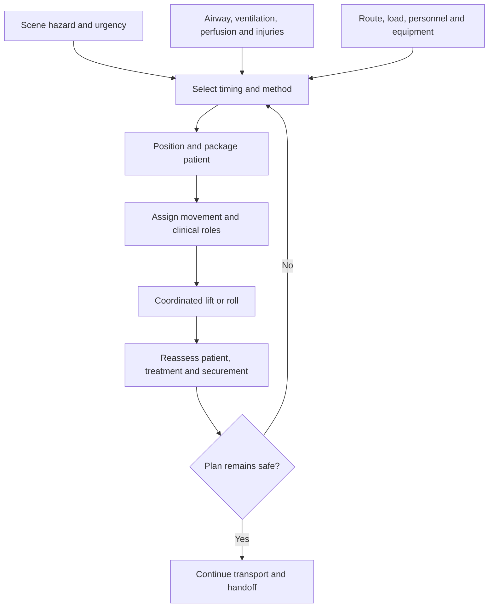

# Chapter 6: Lifting and Moving Patients — PQ4RS

## Preview

Lifting and moving patients is both a mechanical task and a clinical intervention. The EMT must protect the patient and crew while maintaining access to lifesaving care throughout extrication, transfer, packaging and transport. The safest method is not necessarily the quickest or the one requiring the least equipment.

The chapter brings together five central decisions:

- **Why and when to move:** distinguish environmental danger, immediate threats to life and routine transport.
- **How to move safely:** apply body mechanics, assess the combined load, coordinate personnel and use equipment to reduce manual effort.
- **Which device and route to use:** match the patient's injuries, mobility, physiological tolerance and the physical environment to available equipment.
- **How to maintain care:** choose appropriate positioning, secure the patient and equipment, preserve airway and treatment access, and reassess after movement.
- **How to adapt to special circumstances:** integrate spinal motion restriction (SMR), bariatric and pediatric needs, stair carries, air medical transport and neonatal transfers with BLS and authorized ALS care.

## Question

- **Q01.** How do environmental danger and physiological instability independently influence when and how a patient should be moved?
- **Q02.** Why do body alignment, load distance, equipment and teamwork matter more than simply having strong rescuers?
- **Q03.** How should the crew reconcile the patient's position of comfort, injury precautions, route constraints and device limitations?
- **Q04.** Why is securing a patient to a stretcher insufficient to establish readiness for transport?
- **Q05.** How do BLS and ALS personnel preserve treatment continuity without exceeding scope of practice or delaying necessary movement?
- **Q06.** How do specialized transport situations change the movement plan while leaving the core safety principles intact?

## Read

### Principles of Safe Patient Movement

Lifting and moving patients is a fundamental EMS responsibility, performed during nearly every patient contact—from the original location to a carrying device, ambulance and receiving facility. Patients may be upstairs, in a basement, around a bedroom corner or down a narrow hallway. The safest route and equipment depend on both the environment and the patient’s condition. Improper lifting of patients or equipment injures many EMTs and may cause lasting pain, so safe movement is a component of workforce safety and wellness under the National EMS Education Standards (Preparatory: Workforce Safety and Wellness), which connect EMS system knowledge, provider safety and well-being, and medical, legal and ethical considerations to emergency care. [Education standards][education].

The general principles are:
- The best way to move a patient in any circumstance is generally the easiest way that will not cause injury or pain to the patient or to yourself.
- Let your **equipment do the work** whenever possible.
- If you must lift, use a **device designed for that purpose** if possible.
- Get **as much help as you can** to carry patients and equipment.
- Never risk falling or injuring yourself.
- Always follow the rules of **body mechanics**.

> [!IMPORTANT]
> **ALS Connection — Movement is part of treatment.** A safe move preserves access to the airway, supports circulation, minimizes pain and prevents interruption of care. The crew should consider the patient's current physiology, not simply the shortest route to the ambulance. A stable patient may require only BLS care; the presence of a monitor or IV does not itself make a patient unstable. Conversely, a patient with failing ventilation or poor perfusion may require a different device, more personnel and early ALS coordination. [Model clinical guidelines][model]; [Trauma airway guidance][traumaair].

#### Scope of practice and clinical responsibility

EMTs provide foundational assessment, airway support, ventilation, bleeding control, safe movement and reassessment. AEMTs generally add selected vascular access, fluid and medication capabilities and certain advanced airway options. Paramedics generally have broader pharmacology, ECG interpretation, advanced airway and electrical therapy capabilities. Actual authority depends on state law, licensure, education, credentialing, agency policy and medical direction. Preparing equipment, acquiring a reading, interpreting it and independently delivering treatment are distinct activities. An ALS partner's presence does not expand an EMT's scope. [National scope model][scope]; [Education standards][education].

**Evidence versus authorization:** Research informs recommendations; national guidelines inform locally approved protocols; licensure and credentialing determine what an individual may do. Medical direction provides physician oversight. Follow your agency's approved procedures and consult medical direction for situations outside established pathways.

### Body Mechanics and Injury Prevention

* EMTs routinely lift and carry patients and heavy equipment; improper technique can cause bodily injury, strain, and lifelong pain.
* Conscious planning, good physical health, and proper skill minimize injury risk.
* Apply proper lifting and moving techniques daily until they become automatic habits—even in high-stress emergency situations.

#### Four principles of body mechanics

* **Body Mechanics:** The safest and most efficient methods of using your body to gain a mechanical advantage.

1. **Keep the weight as close to your body as possible:**
   * Back injury is much more likely when reaching a long distance to lift a light object than when reaching a short distance to lift a heavy object.
   * When lifting a stretcher from the head end, keep the elbows close, bend the knees outward and squat with feet flat.
2. **Use the leg, hip, and gluteal (buttocks) muscles plus contracted abdominal muscles:**
   * Generates a large amount of power safely.
   * **Never** use back muscles to move a heavy object.
3. **"Stack" your body:**
   * Visualize shoulders stacked directly over hips, and hips stacked directly over feet (base), moving them together as a single unit.
   * Misalignment among shoulders, hips, and feet creates twisting forces that can injure the lower back.
4. **Reduce the height or distance the object must be moved:**
   * Move closer to the object, reposition it before lifting, or lift in stages if needed.
   * For example, bend the knees and grasp the straps of an equipment bag to roll it across the ground rather than lifting it vertically.

##### Additional Injury-Prevention Mechanics

* Apply proper body mechanics to **all** physical tasks: lifting, carrying, moving, reaching, pushing, and pulling.
* **Spinal alignment:** Maintain the normal inward curve of the lower back to significantly reduce spinal injury risk.
* **Extremity alignment:** Keep wrists and knees in normal alignment to prevent extremity injuries.
* **Equipment first:** Substitute equipment for manual force whenever possible.

#### Posture and Fitness

* Because EMTs spend extensive time sitting and standing, poor posture fatigues back and abdominal muscles and increases vulnerability to back injury.

##### Two Extremes of Poor Posture

* **Excessive Lordosis (Swayback):** Stomach is too anterior and buttocks are too posterior -> places excessive stress on the lumbar region of the back.
* **Excessive Kyphosis (Slouch):** Shoulders are rolled forward -> fatigues the lower back and increases pressure on every region of the spine.

In sagittal view, excessive kyphosis produces a posterior upper-spine hunch, whereas excessive lordosis exaggerates the anterior lumbar curve.

##### Proper Standing & Sitting Posture

* **Proper Standing Posture:**
  * Ears, shoulders, and hips in **vertical alignment**
  * Knees **slightly bent**
  * Pelvis **slightly tucked forward**
* **Proper Sitting Posture:**
  * Weight evenly distributed on **both ischia** (lower portion of the pelvic bones)
  * Ears, shoulders, and hips in **vertical alignment**
  * Pelvis **slightly tucked forward**
  * Feet **flat on the floor** or **crossed at the ankles**
  * Lower back in contact with the chair's support when possible

##### Physical Fitness

* Body mechanics alone cannot fully protect an EMT who is not physically fit.
* A proactive, well-balanced fitness program prevents injury, enhances performance, and helps manage stress; it should include:
  * **Flexibility training**
  * **Cardiovascular conditioning**
  * **Strength training**
  * **Nutrition**

#### Planning, staffing and load assessment

* **Know Your Limits:** Know your own physical abilities and limitations; do not overestimate yourself or other rescuers.
* **Pre-Lift Check:** Know or determine the **patient's weight** and the **equipment's weight limitations** before lifting. Call for additional help whenever necessary—do not proceed until you know you can do so safely.
* **Rescuer Balance & Fatigue:**
  * Always try to use an **even number of rescuers** to maintain balance.
  * Two-rescuer teams should carry heavy loads for **1 minute or less** (longer carries generate high muscle fatigue and significantly increase injury risk).
* **Use Rolling Devices:** Transport patients and equipment on wheeled stretchers or other rolling devices whenever possible.
* **Carrying Mechanics:**
  * Keep weight as close to your body as possible.
  * Keep your back in a locked-in position; do **not** hyperextend or lean back from the waist.
  * Refrain from twisting; **never lift and twist simultaneously**—first lift, then turn as a unit.

#### Communication and Teamwork

* **Partner Matching:**
  * All team members must be trained in proper techniques.
  * Greatly mismatched partners create injury risks for **both** rescuers—the weaker partner can be overloaded, and the stronger partner can be injured if the weaker partner fails to lift.
  * Ideally, partners should have **adequate and equal strength and height** (two adequately strong but lighter/weaker rescuers are just as safe and efficient as two stronger rescuers).
* **Team Coordination:**
  * Use clear, easy-to-understand commands and verbally coordinate every lift from start to finish.
  * Good teamwork allows you to:
    1. Size up the scene immediately and accurately.
    2. Consider the patient's weight and recognize when additional help is needed.
    3. Account for the physical abilities and limitations of each team member.
    4. Select the most appropriate equipment for the job.
* **Communicating with the Patient:**
  * Startled or frightened patients may shift their body weight mid-lift, which can cause disabling injuries to rescuers and significant additional injury to the patient.
  * Whenever the patient can understand, **explain the plan before taking action** to build confidence and allow the patient to assist in their own move/rescue.

> [!NOTE]
> **ALS Connection — Assign clinical and movement roles before lifting.** Use one movement leader and a common stop command. In a mixed-level crew, decide who will manage the airway, observe the patient, carry the monitor and manage IV tubing while others lift. An airway clinician should not be expected to simultaneously carry a heavy device and provide continuous ventilation. Request additional personnel when those roles cannot be safely covered.
>
> A short pre-move briefing might be: “Patient is maintaining their airway but needs assisted ventilation. I will lead the carry; you manage the airway; the third rescuer controls the monitor and oxygen. Stop if ventilation or footing becomes unsafe.” This is a teamwork example, not a required script. [NIOSH worker safety][niosh]; [Airway physiology][airway].

> [!CAUTION]
> **ALS Connection — The real load includes equipment.** Count the patient, stretcher, oxygen, monitor, ventilator and any approved attachments when checking the applicable load limits. A rated stretcher is not proof that two rescuers can safely lift it. Equipment ratings can differ by loading, rolling or carrying configuration. Follow the specific manufacturer's instructions; the chapter's capacity and fatigue figures are textbook learning aids, not universal safe-work thresholds. [NIOSH worker safety][niosh].

### Practical Lifting and Handling Techniques

For all lifts, carries and drags, maintain a rigid, aligned back by contracting the abdominal and gluteal muscles, bend at the hips rather than the waist, keep the head neutral, and drive with the legs. Use teamwork, equipment and creative repositioning to maintain sound mechanics, even when an individual procedure does not repeat these principles.

#### The Power Lift

* Offers the best defense against injury and provides a safe, stable move for the patient; also useful for rescuers with **weak knees or thighs**.
* Keep your back locked and avoid bending at the waist.
* **Steps:**
  1. Place feet a comfortable distance apart (about **shoulder width** for an average-sized person; slightly wider for taller rescuers to get closer to the object).
  2. Turn feet slightly outward for comfort and stability.
  3. Bend your knees to bring your center of gravity closer to the object (feel as though you are sitting down, not falling forward).
  4. Tighten back and abdominal muscles to splint the vulnerable lower back; keep back as straight as comfortable (slight inward curve) with head facing forward in a neutral position.
  5. Straddle the object; keep feet flat with weight evenly distributed just forward of the heels.
  6. Place hands a comfortable distance apart for balance—usually **at least 10 inches apart**.
  7. Always use a **power grip** for maximum hand force: palms and fingers in complete contact with the object, with all fingers bent at the same angle.
     * On the stretcher frame, wrap the thumb around the top and the fingers fully around the bottom, parallel to one another.
  8. Begin lifting with back locked in, driving force through the **heels and arches** of your feet; **upper body comes up before the hips**.
  9. Reverse these steps to lower the wheeled stretcher or other object.

For a two-person manual stretcher lift, rescuers face each other at the head and foot of the secured patient, starting with the stretcher lowered. Use the power grip with both hands, keep the arms close, then stand together.

#### The Squat Lift

* Alternative technique for rescuers with **one weak leg**, **one weak ankle**, or **strong, healthy knees and legs**. Avoid bending at the waist.
* For a two-person stretcher lift, position one rescuer at each end, using a staggered flat-foot stance and two-handed power grip.
* **Steps:**
  1. Place your **weaker leg slightly forward**; keep this foot flat on the ground throughout the lift.
  2. Squat down until you can grasp the stretcher or patient-moving device using the **power grip**.
  3. Push up with your **stronger leg**; keep back locked, raise upper body before hips, and lead with your head.
* **Universal Lift Reminders:** Use leg muscles (not back), keep weight close to your body, position yourself correctly, and communicate clearly and frequently with your partner.

> [!CAUTION]
> The textbook describes power and squat lift variations for rescuers with weak knees, thighs, legs or ankles. These descriptions do not establish that a particular injured or impaired rescuer can safely perform a lift; use the chapter’s staffing and individual capability checks before attempting it.

#### One-Handed Equipment-Carrying Technique

* Keep your back in a locked position, maintain proper body mechanics, and avoid leaning too far to the opposite side to compensate for the imbalance.
* **Steps for Lifting/Moving a Patient-Carrying Device:**
  1. Stagger your feet with one knee up and one knee pointing toward the ground.
  2. Bend at the **hips** (not the waist), and do not let your trunk go farther forward than **45 degrees**.
  3. On command from the rescuer at the patient's head, simultaneously drive upward through the **arch and heel of the front foot** and the **ball of the back foot**.
* For a one-handed equipment bag lift, grip the straps, stagger the feet, bend the legs and maintain a flat back.

#### Reaching

* **Textbook fatigue estimates:** A person can sustain **100% effort for 6 seconds** and **50% effort for only 1 minute** before becoming fatigued (injury potential greatly increases after 1 minute). Avoid prolonged strenuous effort (**more than 1 minute**). These figures are instructional estimates, not guaranteed safe-work thresholds.
* **Reaching Rules:**
  * Reposition the object or move closer to avoid or reduce reaching and lifting.
  * Reach **no more than 15–20 inches** in front of your body (if more than 20 inches away, move closer first).
  * Keep your back locked and do **not** twist.
  * Use your free arm to support your upper body weight whenever possible.
  * **Overhead reaching:** Avoid hyperextending (do not lean back from the waist).
* **Log Roll Mechanics:** Lean from the **hips** (not the waist), keep the back straight, and use the stronger **shoulder muscles** to assist whenever possible.

#### Pushing and Pulling

* **General Rule:** Whenever possible, **push rather than pull**.
* For a two-person stretcher move with the patient secured supine:
  * *Foot EMT (pulling):* Stands facing away from the patient, pulling the stretcher frame with straight arms, both hands, and a staggered stance.
  * *Head EMT (pushing):* Stands facing the patient, pushing the stretcher frame with a staggered stance and a power grip.
* **Pulling Rules:**
  * Keep the load **between your shoulders and hips** and close to your body.
  * Keep your back straight and knees slightly bent to keep the line of pull through the center of your body.
* **Pushing Rules:**
  * Push from the area **between your waist and shoulders** if possible.
  * If the weight is **below waist level**, use a **kneeling position** to avoid bending.
  * Keep elbows bent with arms close to the sides of your body to increase applied force.
* **Overhead Rule:** Avoid pushing or pulling any object **overhead** due to the inherent danger and likelihood of injury.

### Choosing the Urgency and Method of Movement

#### Three Categories of Patient Moves

1. **Emergency Move:** Performed when there is **immediate danger to the patient or rescuer**.
2. **Urgent Move:** Performed when the patient faces an **immediate threat to life** and must be moved quickly and transported for care.
3. **Nonurgent Move:** Performed when **no immediate threat to life** exists and the patient can be moved normally when ready for transport.

> [!NOTE]
> **ALS Connection — Decide when movement changes the risk-benefit balance.**
>
> - **Emergency:** Escape an immediate hazard or gain essential access to lifesaving care; avoid bringing extra clinicians into an unsafe environment.
> - **Urgent:** Identify the life threat, provide immediately achievable care, coordinate rapid movement and continue resuscitation toward appropriate definitive care. An ALS intercept should not needlessly delay transport.
> - **Nonurgent:** Plan positioning, equipment and staffing deliberately. Check for new symptoms before and after movement; a patient's category can change.
>
> The category describes the *move*, not a universal ALS activation or destination rule. A stable patient can require immediate relocation because of a hazard; an unstable patient may first need effective ventilation or CPR where found. [Model clinical guidelines][model]; [AHA systems of care][system].

#### Emergency Moves

* **Priority Shift:** Normally, ABCs and immediate life-threats are managed *before* moving the patient. If the scene is unstable or life-threatening, **move the patient first** (only when no other options exist; follow local protocol; do not become an additional victim).
* **Indications for an Emergency Move:**
  * **Immediate environmental danger** to patient or rescuer:
    * Fire or danger of fire
    * Exposure to explosives or other hazardous materials
    * Inability to protect the patient from other scene hazards (uncontrolled traffic, physically unstable surroundings, extreme weather, hostile crowds)
  * **Inability to provide lifesaving care** due to patient location or position (e.g., needing to reposition to control hemorrhage, defibrillate, or perform CPR).
* **Greatest Danger:** Aggravating a **spinal column or spinal cord injury** (rapid movement prevents full spinal protection).
  * *Mitigation:* Keep head and neck in a **neutral position** (nose in line with umbilicus/navel) and **always pull along the long axis of the body**.

##### The Armpit-Forearm Drag

* **Technique:** From behind a supine patient on the floor/ground, slide hands under the patient's armpits, grasp the **left forearm with your right hand** and the **right forearm with your left hand**, and drag along the **long axis** of the body.
* Squat behind the patient, supporting the crossed forearms at the chest during the backward drag.

##### The Shirt Drag

* **Limitation:** Cannot be used if the patient is wearing **only a T-shirt**.
* Squat behind the patient’s head to grasp the shirt at the shoulders.
* **Steps:**
  1. Loosely fasten the patient's hands or wrists together (if possible, link them to a belt or pants with a small Velcro strap or self-adherent bandage) to keep arms from flopping or slipping out of the shirt.
  2. Grasp the neck and shoulders of the shirt so the patient's **head rests on your fists**.
  3. Pull using the shirt as a handle. Ensure pulling force engages the **armpits, not the neck**—reposition hands if excessive pressure/strain appears on the neck to avoid strangulation.

##### The Blanket Drag

* Effective for a **single rescuer** (use a **coat** if no blanket is available).
* Kneel at the head and keep the patient’s face exposed.
* **Steps:**
  1. Spread a blanket alongside the patient and gather about half into lengthwise pleats.
  2. Roll the patient away from you onto their side and tuck the pleated blanket as far underneath as possible.
  3. Roll the patient back onto the center of the blanket and onto their back.
  4. Wrap the blanket securely around the patient.
  5. Grasp the blanket beneath the patient's head and drag toward you.

> [!WARNING]
> **ALS Connection — Rescue first, advanced equipment second when danger is immediate.** During an emergency drag, maintaining a safe exit and basic airway access matters more than completing an ECG or establishing vascular access. Once safe, immediately reassess consciousness, breathing, pulse/perfusion and hemorrhage; tell the ALS partner how the patient was moved and whether new neck pain, weakness or sensory changes appeared. Do not force the spine into neutral alignment against pain, resistance or neurological deterioration. Use approved SMR practice and prioritize lifesaving care. [SMR consensus][smr]; [Trauma airway guidance][traumaair].

#### Urgent Moves

* Used when a patient must be moved quickly for immediate lifesaving care or rapid transport (e.g., motor vehicle crash extrication, or moving a cardiac arrest patient from a couch onto a hard floor for effective CPR).

> [!IMPORTANT]
> **ALS Connection — Moving a patient in cardiac arrest is not automatically rapid transport.** Moving from a soft couch to a suitable firm surface can improve compression effectiveness, but do not postpone starting CPR for the move. Once access is adequate, coordinate brief unavoidable interruptions, resume compressions immediately, maintain ventilation and use the AED or authorized manual defibrillation.
>
> For most out-of-hospital arrests, the 2025 AHA systems guidance favors resuscitation at the scene rather than routine departure during active CPR. Selected exceptions depend on the circumstances and system protocol. An ALS clinician may add rhythm analysis, vascular access and medications while BLS providers maintain the core resuscitation. Routine mechanical CPR is not recommended; selected uses may be appropriate when manual CPR is impractical or unsafe. [2025 adult BLS][bls]; [2025 systems of care][system]; [2025 adult ALS][als].

##### Rapid Extrication

* Used for patients with abnormalities of **airway, breathing, oxygenation, or circulation**, or other critical injuries/illnesses.
* **Indications (include but are not limited to):**
  * Altered mental status
  * Inadequate respiratory rate or tidal volume
  * Signs of shock (altered mental status; pale, cool, clammy skin; tachycardia; increased respiratory rate)
  * Injuries to the head, neck, chest, abdomen, or pelvis
  * Bilateral femur fractures
  * Major bleeding
* **7-Step Procedure (from a Motor Vehicle):**
  1. **Rescuer 1** brings the head into a neutral in-line position and maintains manual stabilization (best from behind or beside the patient).
  2. **Rescuer 2** applies a cervical-spine immobilization collar while **Rescuer 3** places a long backboard near the door, then moves to the passenger seat.
  3. **Rescuer 2** supports the thorax while **Rescuer 3** frees the legs from pedals or under the dashboard.
  4. **Rescuers 2 and 3** rotate the patient in short, coordinated moves until the patient's back faces the open doorway and feet rest on the seat.
  5. Another rescuer temporarily supports the head while **Rescuer 1** exits the vehicle and resumes head stabilization from the doorway.
  6. Place the end of the long backboard on the seat next to the buttocks; assistants support the far end while **Rescuers 1 and 2** lower the patient onto the board (Rescuer 1 maintaining in-line stabilization).
  7. **Rescuers 2 and 3** slide the patient into position on the board in short, coordinated moves while **Rescuer 1** maintains manual stabilization.
* **Additional Considerations:**
  * Must be done rapidly **without compromising the spine**.
  * Protect your lower back inside the vehicle by supporting your weight with a free arm or resting your chest against seat backs.
  * Depending on local protocol, once on the stretcher, the patient may be moved off the backboard onto a vacuum mattress or directly onto the stretcher mattress (using the backboard **only** as an extrication/movement device).

##### ALS Connection: Critical trauma and extrication

A trapped patient's condition may deteriorate while physical access is limited. Movement and clinical management should be planned together with rescue personnel.

- **Ventilation:** Poor respiratory effort or reduced alertness can indicate failure to move adequate air. Continue authorized airway opening, suction, oxygen and BVM ventilation as indicated; ALS may consider a supraglottic airway, tracheal intubation or ventilatory support depending on the clinician's scope and the patient. Advanced airway placement may itself destabilize a shocked patient. Do not delay achievable BLS ventilation while waiting for an advanced airway.
- **Perfusion:** Significant hemorrhage reduces circulating volume and oxygen delivery. Report bleeding, skin signs, mental status and serial pulse/BP; control external bleeding and prevent heat loss. AEMT/paramedic vascular access and carefully selected fluid therapy may be appropriate. Some specialized ALS systems carry blood products. They do not replace hemorrhage control or definitive surgical care.
- **Neurological status:** Record baseline movement and sensation when feasible, neck/back symptoms and changes after extrication. New deficits are important even if the monitor looks reassuring.

The aim is efficient extraction without unnecessary deterioration, not completing every possible advanced procedure inside the vehicle. [Trauma airway guidance][traumaair]; [Trauma fluids][fluid]; [Trauma blood products][blood]; [SMR consensus][smr].

##### Self-Extrication

* Used as an urgent move when a **non-critically injured** patient (with no injuries preventing self-movement) is blocking immediate access to another patient in the vehicle.
* **Procedure:**
  1. Instruct the patient to keep their head and neck in a **neutral in-line position** (no flexion, extension, or lateral movement; nose aligned with umbilicus).
  2. Apply a rigid or soft **cervical collar** (primarily as a reminder not to move the head/neck out of neutral alignment).
  3. Instruct the patient to move their body as one unit, swing their legs out so the front of their body faces outside the door, and then stand and exit the vehicle.
  4. Continuously coach the patient to maintain neutral in-line head/neck alignment while assisting them to stand and exit.

> [!CAUTION]
> **ALS Connection — Evolving extrication guidance.** The preceding board-assisted procedure and narrow indication for self-extrication are retained as textbook techniques. A 2025 UK Faculty of Pre-Hospital Care consensus supports greater use of patient-led self-extrication when appropriate, with attention to reducing entrapment time instead of seeking absolute immobility. This is expert consensus informed by emerging evidence, not an automatic replacement for US agency protocols. Select the method jointly with rescue personnel according to injuries, consciousness, mobility, hazards and local SMR requirements. A cervical collar or backboard does not guarantee that spinal movement is eliminated. [2025 extrication consensus][extrication]; [SMR consensus][smr].

#### Nonurgent Moves

* **General Guidelines:**
  * Take time to choose the safest equipment and positioning; move the patient as a unit with head/neck neutral, taking spinal precautions if suspected.
  * Ensure all rescuers understand the plan beforehand, with **one rescuer giving commands**.
  * **Walking the Patient:** Acceptable if able and supported—**NEVER** walk a patient who:
    * Becomes light-headed or sweaty upon standing
    * Has chest pain or respiratory problems
    * Has an injured lower extremity
    * Has a suspected spinal injury

> [!NOTE]
> **ALS Connection — Do not use walking as a diagnostic stress test.** A patient who develops dizziness, sweating, breathlessness or chest discomfort on standing may not tolerate the added circulatory or respiratory demand. Return the patient to a safe, supported position; reassess and report symptoms, timing, baseline and repeat vital signs. ALS may investigate rhythm, glucose or other causes as indicated. Do not intentionally reproduce symptoms to obtain a finding, and do not make the patient walk simply to simplify the carry. [Model clinical guidelines][model].

### Nonurgent Lifting and Transfer Techniques

#### Direct Ground Lift

* **Limitation:** Not recommended for heavier patients (a long backboard is usually safer and more mechanically efficient when available).
* **Steps:**
  1. Two or three rescuers line up on the **same side** of the patient.
  2. Each rescuer kneels on one knee (preferably the **same knee** for all).
  3. Rescuer 2 places the patient's arms on the chest if possible.
  4. Rescuer 1 cradles the head (one arm under neck/shoulder) and places the other arm under the lower back.
  5. Rescuer 2 places one arm under the knees and one arm above the buttocks.
  6. *(If 3rd rescuer is available)* Rescuer 3 places both arms under the waist; Rescuers 1 and 2 slide their arms to the midback and buttocks respectively.
  7. On Rescuer 1's signal, lift the patient onto the rescuers’ knees and **roll the patient in toward their chests**. The illustration shows the rescuers supporting the shoulders and hips on their thighs while cradling the upper body, waist, hips and knees.
  8. On Rescuer 1's signal, stand and move to the stretcher/device.
  9. Reverse steps to lower. *(Bend at hips, straight back, lift with legs/buttocks.)*

#### Extremity Lift

* **Contraindication:** Do **not** use on patients with suspected **spinal or extremity injuries**.
* **Steps:**
  1. Rescuer 1 kneels at the patient's head; Rescuer 2 kneels at the patient's side by the knees.
  2. Rescuer 1 places one hand under each shoulder; Rescuer 2 grasps the patient's wrists.
  3. Rescuer 1 slips hands under the patient's arms and grasps the patient's wrists.
  4. Rescuer 2 slips hands under the patient's knees.
  5. Both move to a crouching position (straight backs, neutral heads).
  6. On Rescuer 1's signal, stand simultaneously and move to the stretcher/device.
* **Body Mechanics Note:** Keep head in line with the back—extending the head backward forces use of lower back muscles, and flexing the head forward puts undue force on lumbar disks. Drive upward with leg and gluteal muscles.

#### Direct Carry Method

* Transfers a supine patient from a bed to a wheeled stretcher (or between carrying devices).
* **Steps:**
  1. Position the wheeled stretcher **perpendicular** to the bed, with the **head of the stretcher at the foot of the bed**.
  2. Prepare the stretcher (unbuckle straps, clear items). Both rescuers stand between the bed and stretcher facing the patient.
  3. Rescuer 1 slides an arm under the patient's neck and cups the shoulder.
  4. Rescuer 2 slides a hand under the hip and lifts slightly so Rescuer 1 can slide an arm under the back; Rescuer 2 then places arms under the hips and calves.
  5. With the patient’s arms crossed over the chest if possible, slide the patient to the edge of the bed, lift and curl the patient to your chests, rotate, and place gently onto the wheeled stretcher.

#### Draw Sheet Method

* Alternative method for transferring a supine patient from a bed to a wheeled stretcher (or between carrying devices).
* **Steps:**
  1. Loosen the bottom sheet of the bed.
  2. Position the wheeled stretcher **next to the bed** and prepare it (adjust height, lower rails, unbuckle straps).
  3. Reach across the stretcher and grasp the sheet firmly at the **head, chest, hips, and knees**, supporting your body with your hips against the stretcher.
  4. Slide the patient gently onto the wheeled stretcher while contracting abdominal and gluteal muscles to splint the lower back.

The draw-sheet skill illustration additionally shows the rescuers gripping the sheet at the shoulders, waist, thighs and ankles, with the foot-end rescuer supporting the calves. The source describes two sets of hand positions; use the taught technique and sufficient support for the patient rather than treating either set as universally required.

> [!NOTE]
> **ALS Connection — Transfers with pain or invasive equipment.** Before direct carry, extremity lift or draw-sheet transfer, check injury location, pain and ability to tolerate the required posture. A patient with fractures may benefit from padding, authorized splinting, a different transfer technique or additional help. An ALS clinician may consider analgesia such as fentanyl, an opioid that reduces pain signaling but may suppress ventilation or cause sedation and hypotension. Its use is typically paramedic-level, with some other authorized providers depending on jurisdiction; no dose or administration instruction is implied.
>
> Obtain and report pain, alertness, breathing and perfusion before and after treatment or movement. Do not interpret a quiet or sleepy patient as proof that pain has resolved. Route tubing and leads out of the transfer path; never use a line as a handle. [Prehospital pain guidelines][pain]; [National scope model][scope].

### Preparing the Patient for Transport

* **Packaging:** Readying the patient for transport—selecting and preparing the appropriate carrying device, safely transferring and securing the patient to it, and moving the patient and device to the ambulance for loading and unloading.
* **General Steps:**
  * Ensure the carrying device is **locked in the open position** before positioning the patient.
  * Use an appropriate lifting, moving, or carrying technique to place the patient on the device.
  * Place a sheet or blanket on the device, and cover the patient as appropriate to **maintain body temperature**.
  * Secure the patient with straps; tuck in all straps and ties so they do not become tripping hazards.
  * Once inside the ambulance, ensure **both the patient and the carrying device** are properly secured before the ambulance moves.
* **Spinal motion restriction (SMR):** If head, neck, or spinal injury is suspected, take all necessary precautions to limit spine movement before, during, and after packaging.

Never leave a patient alone on a wheeled stretcher, particularly when raised. Recheck strap and device security after every move.

#### ALS Connection: Packaging a monitored or ventilated patient

Packaging is not complete just because the straps are fastened. The team must also preserve ongoing clinical care.

**Before moving:** Reassess airway, respiratory effort, oxygen saturation (SpO₂), pulse, blood pressure, mental status and relevant pain or neurological findings. Identify all equipment attached to the patient, ensure enough oxygen and battery capacity for the journey, secure approved mounts, provide enough tubing slack, and assign a clinician to manage equipment. Confirm that straps do not interfere with ventilation or needed assessment.

**During movement:** Continue authorized BLS care and observe the patient; if a critical alarm or visible deterioration occurs, announce it immediately and coordinate a safe stop or the safest feasible response. Keep equipment and oxygen cylinders secure; do not balance loose heavy equipment on the patient.

**After each transfer:** Recheck clinical status, strap and device security, and whether treatment is still reaching the patient. An ALS clinician verifies advanced airway position, ventilation, vascular access and infusion function as applicable. Report any suspected disconnection or new abnormality; do not independently change ventilator settings, medication infusion rates or an advanced airway unless specifically authorized.

| Equipment | What it tells the team |
| --- | --- |
| Pulse oximeter | Estimates oxygen saturation; movement, cold and poor perfusion can impair reliability. Does not measure ventilation; supplemental oxygen can mask developing hypoventilation. Assess chest rise, effort and alertness as well. |
| ECG monitor | Shows electrical heart activity; movement can create artifact, and electrical activity does not prove a palpable pulse. |
| Waveform capnography | Displays exhaled CO₂ over time; trends reflect ventilation, circulation and metabolism. Can help detect airway displacement or loss of ventilation. |
| IV/IO access and infusion equipment | Provides a route for authorized fluids or medications; kinking, dislodgement or interruption can compromise delivery. |

**Teamwork:** Compare equipment readings with actual patient findings. An unexpected waveform or saturation change during lifting may be artifact, disconnection or real deterioration. Assess the patient, notify the ALS clinician and help troubleshoot only within training and authority. [Airway physiology][airway]; [Mechanical ventilation][vent]; [Model clinical guidelines][model]; [National scope model][scope].

### Patient Positioning and Physiological Tolerance

#### Standard medical and trauma positioning

* **General:** Supine or sitting unless condition dictates otherwise.
* **Unresponsive (no suspected head, neck, or spinal injury):** **Left lateral recumbent (coma/recovery) position** facing the rescuer in the ambulance—allows drainage of fluids or vomitus and can reduce aspiration risk.
* **Chest pain/discomfort or breathing difficulties:** **Position of comfort** (usually sitting up), provided **hypotension is not present**.
* **Suspected spinal injury:** Immobilized on a long backboard, vacuum mattress, or secured to the stretcher mattress per local protocol (backboard may be used for extrication only, then removed once on the stretcher).
* **Shock (hypoperfusion):** **Supine position** unless local protocol indicates otherwise.
* **Alert, nauseated, or vomiting:** **Sitting or recovery position** that allows airway management.
* **Pregnant (after 20th week of gestation):** **Left side** (or supine with **right hip elevated**).

#### ALS Connection: Patient position changes physiology

Positioning can change venous return, respiratory mechanics and the ability to protect the airway. An ALS clinician's treatment plan should account for the position used during movement, not just the patient's initial assessment.

- **Breathing difficulty:** Upright positioning may improve respiratory mechanics when tolerated. In cardiogenic pulmonary edema, elevated pressure in pulmonary vessels drives fluid into lung tissue, making gas exchange harder; lying flat may worsen symptoms. CPAP supplies continuous positive airway pressure, which can improve gas exchange and reduce breathing effort in selected patients. Positive pressure can also decrease venous return, so hypotension, vomiting, inability to protect the airway or exhaustion may make noninvasive support unsuitable. ALS may seek ECG and additional assessment; continue authorized oxygen or assisted ventilation as indicated. [Noninvasive ventilation][niv]; [Model clinical guidelines][model].
- **Hypoperfusion:** Position for airway safety, circulation and injuries. Report deteriorating alertness, weak pulses, skin changes and BP trends. Advanced management may include evaluation of rhythm, vascular access and selected fluid or vasoactive therapy depending on cause and scope; a low BP alone does not establish the correct therapy. [Model clinical guidelines][model]; [Trauma fluids][fluid].

> [!WARNING]
> **Clinical-practice clarification — Recovery position.** Side-lying can reduce aspiration risk but cannot guarantee prevention. Use it for an appropriately breathing patient when indicated; continue to assess breathing and airway patency. If breathing is absent or inadequate, prioritize appropriate resuscitation or assisted ventilation instead of leaving the patient on their side. If spinal injury is suspected, coordinate movement while prioritizing airway safety. [2024 first aid][firstaid]; [2025 adult BLS][bls].

#### Pregnancy and other special positioning needs

* **Pregnant (>20 weeks):**
  * Left side (preferred because the **inferior vena cava** lies slightly to the right of midline) or supine with right hip elevated takes the baby's weight off the inferior vena cava, preventing **supine hypotensive syndrome** (dizziness, drop in BP, decreased cardiac output). If left side is impossible, use right side or elevate right hip.
  * *Suspected prolapsed umbilical cord:* Place on her **back** and **elevate her hips with a pillow** (follow local protocol).

> [!IMPORTANT]
> **ALS Connection — Pregnancy and cardiac arrest.** In later pregnancy, the uterus can compress major abdominal vessels and reduce blood return to the heart when supine. Positioning an appropriately breathing patient to reduce compression is distinct from resuscitating a patient in cardiac arrest. For arrest with the uterine fundus at or above the umbilicus, the 2025 AHA guidance calls for manual leftward uterine displacement together with CPR, rather than compromising compressions by simply rolling the patient onto her side. Coordinate roles and follow local resuscitation and obstetric protocols. [AHA special circumstances 2025][special].

* **Infants and Toddlers:** Non-critically injured children can be carried in their own **undamaged infant car seat** (reduces fear) and immobilized by packing rolled towels or folded sheets taped around the child.

> [!CAUTION]
> **Clinical-practice update — Pediatric ambulance restraint.** The original car-seat and rolled-padding description is not blanket permission to improvise an ambulance restraint or spinal immobilization system. NASEMSO's August 2025 interim guidance emphasizes appropriate child restraint during EMS transport. Use an agency-approved, size- and weight-appropriate system in a permitted mounting configuration, following its instructions. A child's personal car seat is not automatically suitable for ambulance cot mounting. Never transport a child unsecured or in an adult's arms. Maintain airway access and accommodate necessary care safely. [2025 pediatric transport guidance][pediatric].

* **Elderly Patients:** May have **osteoporosis** (brittle bones prone to fracture); handle with extra care and clearly explain what is happening and where they are going.
* **Patients with Physical Disabilities:** Compensate for fused joints or twisted limbs by positioning for greatest comfort, taking extra care with strapping, supporting areas with rolled towels/padding, and asking the patient what positions are possible and comfortable.

> [!NOTE]
> **ALS Connection — Older adults and disabilities.** Establish baseline function and usual posture before moving. Avoid forcing a fixed deformity or painful joint into a textbook position; seek appropriate support and padding. Communicate new pain, reduced movement, altered alertness and changes from baseline. These may affect whether additional analgesia, monitoring or specialized equipment is needed. [Model clinical guidelines][model]; [SMR consensus][smr].

### Patient-Carrying Devices and Equipment Selection

Choose a device that fits the route, supports the patient’s condition and can be handled by the available crew. Follow the manufacturer’s instructions for inspection, cleaning, repair and maintenance. The capacities and equipment features below are textbook examples, not universal specifications.

> [!CAUTION]
> **Clinical-practice clarification — Skill illustrations are model-specific.** The loading mechanism, status indicator, weight ratings, attachment points and carry method described in this chapter describe textbook examples. Confirm the actual equipment instructions and agency training, including whether accessories or powered loading systems reduce the permissible combined load. Do not assume the device will lock automatically. [NIOSH worker safety][niosh].

#### Wheeled Stretchers (Ambulance Gurney)

* *Advantages:* Enables movement without carrying; accommodates a variety of positions, heights, and lengths; safe traversal of stairways and curbs; can be lifted or lowered from ends or sides; durable; mechanically simple; comfortable.
- **Disadvantages:** X-ray opacity; difficult to maneuver over uneven ground; adds significant weight when lifting is necessary.

* Most commonly used, safest, and most comfortable device; most accommodate weights up to **650 pounds**, adapt to almost any position, and can carry equipment to the patient.
* **Two Basic Types:**
  * **Manual Stretcher:** EMTs perform all lifting to raise, lower, load, and unload.
    * *Roll-in / Self-loading manual stretcher:* Weighs **70–95 pounds** (aluminum alloy); has special wheels at the head to simplify loading/unloading and significantly reduce twisting and lifting compared to older lift-in stretchers.
  * **Power Stretcher (Hydraulic/Electric):** Uses pneumatic, hydraulic, battery, or combined mechanisms to raise/lower at the touch of a button. Weighs more (up to **140 pounds**), but reduces **repetitive spinal loading** (a frequent cause of back injury). Some systems include a **power loading device** to load/unload in and out of the ambulance.
* **Rolling & Carrying Techniques:**
  * *Rolling (smooth terrain):* Rescuer at the **head pushes**; rescuer at the **foot guides**. The patient may be secured supine or in a left lateral recumbent position when clinically indicated.
  * *Rough ground:* Use **four rescuers** (one at each corner) to keep it stable. In the illustrated carry, the head-end rescuers face away from the patient.
  * *Narrow spaces / stairs:* Two rescuers facing each other from opposite ends, though it is easily unbalanced and requires considerable strength.
* **Safety Rules:**
  * **Never leave a patient unattended** on a wheeled stretcher, even when secured.
  * Ensure enough lifting power before loading; **load hanging stretchers before wheeled stretchers**.
  * Secure both stretchers and patients before the ambulance moves.

> [!NOTE]
> **ALS Connection — Powered loading protects the whole crew.** Reduced manual handling can free personnel to maintain airway support and monitoring, but the powered mechanism does not remove pinch, tip, battery or loading hazards. A pre/post observational EMS study found fewer stretcher-related injuries after powered stretchers were introduced; this supports safer equipment systems but is not a guarantee of injury prevention. Follow model-specific locking checks rather than assuming a green indicator or a generic loading sequence applies to all equipment. [Powered stretcher study][power]; [NIOSH worker safety][niosh].

##### Loading a manual roll-in stretcher

1. Roll the stretcher head-first toward the open rear of the ambulance. One rescuer pushes from the foot while the other guides from the head, positioning the loading wheels securely on the interior floor.
2. After the loading wheels are supported, the rear rescuer operates the release lever; a slight lift may be necessary to remove weight from the wheels. The second rescuer guides the collapsing carriage if needed.
3. Raise the wheel frame against the base, roll the stretcher into the securing device, and verify front and rear securement.

##### Powered loading examples

For the illustrated powered stretcher, two EMTs (one at the foot and one at the side) withdraw it and place needed equipment on it. Ensure approved equipment is secured. During loading, confirm that the head is supported inside the ambulance before raising the legs and advancing from the foot end; secure the locking mechanism once loaded.

A fully powered (“no-lift”) example engages the ambulance loading mechanism with one EMT at the foot and another at the side. The power control activates the mechanism, which folds the stretcher and pulls it horizontally into the cabin. In the illustrated model, a green light confirms engagement; verify actual model-specific locking checks.

#### Bariatric Stretchers and Devices

* Designed for larger/overweight patients; some hold up to **1,600 pounds** in a wheels-down position.
* Features: Larger wheels for stability, wider dimensions, heavier frames; some systems include an ambulance **ramp and winch** or specialized bariatric transport ambulances.

> [!NOTE]
> **ALS Connection — Bariatric movement and respiratory reserve.** Obesity can reduce respiratory reserve, particularly while supine. Choose a position the patient can tolerate while maintaining secure restraint and access to the airway. Plan staff, route, approved equipment and combined load early; a cot with high capacity may have a lower permissible capacity in another configuration. Monitor breathing, alertness and perfusion rather than making assumptions based on size. [2024 first aid positioning evidence][firstaid]; [2025 adult BLS][bls].

The illustrated Stryker MX-PRO® Bariatric Transport stretcher is described as accommodating **850–1,600 pounds** depending on configuration, with a wide patient surface and base, wider horizontal straps, adjustable reclining back, longer end handles, extra wheeled panels and optional ramp/winch loading equipment. Confirm the actual rating and configuration before use.

#### Portable Stretcher (Soft Stretcher)

* *Advantages:* Lightweight; compact; appropriate as an auxiliary stretcher; usable in spaces too confined/narrow for a wheeled stretcher; some models have folding wheels and posts for easier movement; easily loaded and off-loaded; folds for storage.
- **Disadvantages:** Must be carried; metal styles interfere with some X-rays.

* Continuous tubular metal frame, canvas or coated fabric bottom, and straps. One example has a rounded rectangular frame, two wheels at one end, rubber-pegged legs at the other and two horizontal straps.
* Useful in spaces too confined/narrow for a wheeled stretcher or as an auxiliary stretcher for multiple patients; easy to load/off-load.
* **Three Styles:**
  1. *Basic model:* Auxiliary stretcher placed on squad bench or suspended from hanging hardware; lightweight; load capacity up to **350 pounds** (not recommended for that much weight); folds in half for storage.
  2. *Basic with folding wheels and posts*
  3. *Breakaway*
* **Pole Stretcher / Canvas Litter:** Two poles connected by fabric, two horizontal straps, and fold-out legs. Lightweight, folds compactly, vinyl-coated models are easy to clean, comfortable (especially with head padded).
  * *Limitations:* Do **not** use when spinal immobilization is needed unless paired with a long backboard; avoid leaving on rocky ground (risk of soft tissue injury); verify crosspieces are locked; **four or more rescuers** preferred for lifting.

#### Stair Chair & Tracked Stair Chair

* *Advantages:* Good for stairways, narrow corridors/doorways, and small elevators; some models convert into portable stretchers; newer models have tracks that eliminate carrying down steps.
- **Disadvantages:** Must be carried (older models); does not accommodate trauma patients; should **not** be used for patients with altered mental status or lower extremity injury; fairly complex; consumes considerable space.

* Useful for narrow corridors/doorways, small elevators, and stairways; some convert into portable stretchers.
* **Contraindications:** Do **not** use for patients with **altered mental status**, **suspected spinal injury**, or **lower extremity injuries**.
* **Steps for Moving Up/Down Stairs:** Explain plan to patient -> verify straps are secure ->
  1. One rescuer stands behind the chair at the head; second stands at the foot facing the patient; third rescuer (if available) acts as a **spotter** behind the rescuer moving backward. Instruct patient **not to reach out**.
  2. Head rescuer tilts chair back; foot rescuer grasps chair by its legs.
  3. Both lift and carry simultaneously (do **not** let wheels touch the steps).
  4. Spotter counts out steps and identifies upcoming conditions.
* **Tracked Stair Chair:**
  * *(a)* Features a mechanical track lowered at ~45° behind the chair that glides down steps, eliminating the need to lift while descending (still requires **two rescuers**—head and foot—for stabilization).
  * *(b)* Power stair chair with a motorized track system capable of moving patients up to **500 pounds**.

> [!IMPORTANT]
> **ALS Connection — Stair chairs and respiratory emergencies.** An alert, cooperative patient who cannot tolerate lying flat may benefit from a seated move if their condition, device and staffing permit. Severe respiratory fatigue, vomiting, reduced alertness, poor perfusion or a need for sustained BVM ventilation can make that plan unsafe. Reassess before committing to the stairwell. If CPAP is in use, ensure it can be maintained safely during the carry; otherwise coordinate a suitable alternative and adequate staff. CPAP is authorized for EMTs in some systems, so it is not inherently ALS-only. [Noninvasive ventilation][niv]; [National scope model][scope].

For manual stair-chair ascent, the spotter is above the chair and may guide the upper rescuer by touching their shoulder. During descent, the illustrated spotter is below the chair and may guide the lower rescuer by touching their back. Follow approved equipment and team procedures.

##### Clinical example: Seated movement for respiratory distress

A 76-year-old woman is found propped up on several pillows in a second-floor bedroom at the end of a narrow hallway. She reports inability to breathe when lying flat. The route and positional intolerance must both inform device selection; a stair chair may be appropriate if she can safely tolerate it.

**ALS Connection — illustrative clinical reasoning, not a treatment protocol.** The patient has orthopnea (breathing difficulty when lying flat). This may be associated with heart failure, but other causes are possible. First determine whether she can tolerate a seated transfer and whether the stair chair is appropriate for her alertness, perfusion and ventilation.

- **EMT assessment and action:** Obtain history, respiratory rate and effort, SpO₂, pulse, BP, lung sounds if trained, and mental status. Provide authorized oxygen or ventilation as indicated; communicate the inability to lie flat and any worsening symptoms. Request additional personnel or ALS early if needed.
- **Potential advanced care:** An authorized clinician may evaluate rhythm/12-lead ECG, consider noninvasive positive pressure or other treatment based on the suspected cause and hemodynamics. CPAP may be available at BLS level under local protocol. There is no automatic diagnosis or drug selection from orthopnea alone.
- **Movement and reassessment:** Choose a route and device that preserve respiratory support. If she becomes less alert, cannot maintain ventilation or shows worsening perfusion, reassess and change the movement plan. A reassuring saturation alone does not establish that breathing is adequate. [Noninvasive ventilation][niv]; [Model clinical guidelines][model]; [Airway physiology][airway].

#### Backboard & Full Body Vacuum Mattress

* *Advantages:* Good lifting device; can float; lightweight; compact; can serve as a CPR surface; mechanically simple; X-ray translucency; can be carried and loaded from ends or sides; integrates well with other equipment.
- **Disadvantages:** Must be carried; usually left with the patient; unstable for moves up or down inclines; uncomfortable; can reduce the patient's ability to breathe effectively; may decrease core body temperature in cool/cold environments; can lead to pressure sores; may produce pain.

* **Backboard / Long Spineboard:** Lightweight plastic or composite with molded handholds; protects from rocky ground and serves as an SMR device to move the patient until removed onto the stretcher mattress.
  * *Common Styles:* **Farrington** (rectangular with round corners) and **Ohio** (mitered corners and tapering sides—fits into most basket stretchers and maneuvers more easily in/out of cars).
* **Full Body Vacuum Mattress:**
  * *(a)* Shaped around the supine patient and air is pumped out.
  * *(b)* Becomes rigid and conforms to the patient's body shape as straps are secured at ankles and hips.
  * *Benefits:* Eliminates need to pad voids, lightweight, fits inside a basket stretcher, has multiple hand grips for lifting, and can be used for **SMR**.

> [!NOTE]
> **ALS Connection — SMR is different from absolute immobilization.** The objective is limiting unwanted motion while protecting ventilation, perfusion and comfort. A board may facilitate extraction without being the best surface for the entire journey. When transferring from a board to a cot or vacuum mattress, the team should maintain the indicated precautions, coordinate movement and reassess neurological function and breathing. Patient-specific and local SMR criteria determine when this is needed. [SMR consensus][smr].

#### Scoop (Orthopedic) Stretcher

* *Advantages:* Usable in confined areas where other stretchers will not fit; allows easy application of restraints; integrates well with other equipment.
- **Disadvantages:** Must be carried; requires padding of head and body prominences; metal style should be prewarmed if air temperature is cold; **not recommended for patients with suspected spinal injury**; consumes considerable space.

* Designed for patients up to **300 pounds**; assembles and disassembles around the patient. An illustrated model has a flat plastic four-piece breakaway design, two upper straps, one lower-leg strap and multiple handholds.
* **Uses & Limitations:** Good for confined areas, **pelvic fractures**, and **bilateral femur fractures**. Metal models pick up ambient temperature. **Not recommended for patients with suspected spinal injury.** Requires access from all sides and at least **two rescuers**.
* **7-Step Procedure:**
  1. Adjust stretcher to patient's length.
  2. Separate halves and place one on each side; keeping spine in-line, gently roll patient onto one side and slide half underneath.
  3. Examine the patient's back if not already done, then return patient to supine position.
  4. Assemble the **head end** of the scoop stretcher.
  5. Roll patient to the other side, swing remaining half into closed position, and latch the **foot end**.
  6. Pad the head and bony prominences with a pillow or folded sheet.
  7. Secure the patient with **at least three body straps**.

> [!CAUTION]
> **Clinical-practice update — Scoop stretchers and suspected spinal injury.** The textbook’s prohibition is retained to distinguish its historical instructional recommendation from the consensus guidance, but the 2018 joint ACS-COT/ACEP/NAEMSP position statement explicitly recognizes scoop stretchers among options to assist transfers when spinal motion should be minimized. It is not a blanket endorsement of all models or prolonged scoop transport. Select according to the injury, patient tolerance, device-specific instructions and local protocol. The quoted 300-pound capacity is a textbook example, not a universal limit. [SMR consensus][smr].

After both end latches are snapped closed and checked, the illustrated two-person lift uses a squat with wide knees and flat backs, gripping the handle openings at the head and foot.

#### Basket Stretcher (Stokes Basket)

* *Advantages:* Good for traversing rough terrain; can be fitted with a flotation harness for water rescue; extremely durable; can be carried from sides or ends; integrates well with other equipment.
- **Disadvantages:** Must be carried; bulky; high cost; usually left with the patient; metal style interferes with some X-rays; requires special training for rope or ladder rescues.

* **Two Styles:** (1) Welded metal frame with contoured chicken-wire web; (2) Tubular aluminum frame riveted to a molded polyethylene shell. The illustrated shell has a raised cupped border, handle holes and four horizontal straps.
* **Uses:** Accommodates a scoop stretcher or Ohio backboard; fits onto a wheeled stretcher (secure before moving); polyethylene style slides smoothly over snow and rough terrain while protecting from branches/twigs. A four-person carry can use two rescuers per side.
* **Safety & Comfort:** Do **not** use for rope or ladder rescues without specific training. Place a wheeled stretcher mattress inside for comfort and cold insulation (or pad the head); pad edges with rolled blankets and secure with nylon webbing for rough transport.

#### Flexible Stretcher (Reeves Stretcher)

* *Advantages:* Especially useful for narrow and restricted hallways; can be carried from sides or ends.
- **Disadvantages:** Must be carried.

* Made of canvas or synthetic materials with **six large handles (three per side)**, vertical boning, and three horizontal straps (**Figure 6-22**).
* Especially useful for **narrow, restricted hallways** (e.g., mobile homes); a patient on a backboard can be placed inside for stairs or rough terrain; designed for **rapid SMR in tight spaces**.

### Carrying Patients Through Confined Spaces and on Stairs

* **Preference:** Use a wheeled device whenever possible. Use a **backboard, portable stretcher, or flexible stretcher** when a wheeled device is not feasible (e.g., going up/down steps, narrow hallways with angles, or rough terrain) to move the patient to the wheeled stretcher or directly to the ambulance.
* **Rescuer Positioning:** Depends on the number of EMTs or emergency personnel available on scene.
* **Core Carrying Rules:**
  * Secure the patient to the device using a **minimum of three straps**.
  * Secure the patient's **hands** in the device so they cannot reach out and grab you, your partner, a railing, or other objects that could throw you off balance.
  * Always carry the device **feet first** when going **down steps or downhill**.
  * Always carry the device **head first** when going **up steps or uphill**.
  * Consider your and your partner's **weight limitations** and ability to move the patient safely without further injury.
  * Know your limitations in unique situations (hillsides, unstable areas, high angles) and seek assistance from properly trained rescuers.
  * Constantly **communicate** with your partner or team to coordinate the move.
  * Keep the patient's weight **as close to your body as possible**.

> [!NOTE]
> **ALS Connection — Narrow spaces and clinical access.** A carry plan must account for whether someone can continue ventilation or observe the patient throughout the route. If stairs or a tight hallway prevent essential treatment, consider another device, rescue resources or staged movement with safe reassessment points. Follow the device instructions for straps, carry orientation and staffing. Securing hands for safe positioning is not authority to use improvised behavioral restraints; follow the applicable restraint policy. [NIOSH worker safety][niosh]; [Model clinical guidelines][model].

#### Carrying configurations

##### Two-Person Carry

* **Positioning:** One EMT at the **head** and one at the **foot**.
  * The **stronger person** should be at the **head** (most of the patient's weight is at that end).
  * The EMT at the foot end faces the EMT at the head end, requiring the foot-end EMT to **walk backward**.
* **Hazards & Mitigation:**
  * *Tripping hazard:* The foot-end EMT walking backward can trip over unseen objects. If a **third person** is available, place them behind the foot-end EMT as a **spotter** (often grasping the foot-end EMT's belt for balance/stabilization and calling out obstacles).
  * *Side-to-side instability:* No rescuer stabilizes the sides, so the device can easily become unbalanced.
  * *Rapid fatigue:* Only two EMTs carrying the full weight causes quick fatigue and increases injury risk.

##### Four-Person Carry

* **Diamond Configuration (All Rescuers Facing Forward):**
  * 1 rescuer at the **head**.
  * 1 rescuer at the **foot**, facing forward with hands behind their body grasping the device.
  * 2 rescuers, one at **each side**, facing forward and grasping the device with the hand closest to the patient.
* **Alternative Rectangular Configuration (All Rescuers Facing Forward):**
  * 2 rescuers on opposite sides at the **head end**.
  * 2 rescuers on opposite sides at the **foot end**.
  * All rescuers face forward and grasp the device with the hand closest to the patient.

#### Carrying a Supine Patient on Stairs

* **Device Preference:** Use a **stair chair** if the patient's mental status and condition allow.
* **Securing the Supine Patient:** Secure so the patient cannot slide out from either the head or foot end, and secure the patient's **hands** inside the device so they cannot grab rescuers, railings, or objects.
* **Going Downstairs (Feet First):**
  * 1 EMT at the **head end** facing the patient; 1 EMT at the **foot end** facing the patient with their **back to the stairs** (foot-end EMT goes down first).
  * Used because narrow stairwells do not allow EMTs on both sides.
  * Place a **spotter** behind the foot-end EMT if available to guide, stabilize, and count off steps.
* **Going Upstairs (Head First):**
  * Same EMT configuration, but the patient goes **head first**; the **head-end EMT moves backward** up the steps.
  * Place a **spotter** ahead of and guiding the head-end EMT if available.

#### Clinical example: Routine dialysis transfer

A 72-year-old woman receives three scheduled hospital dialysis treatments per week. She cannot walk without assistance, uses a walker and must descend a narrow flight of stairs from her bedroom. Snow and possible ice on the approach to the house create an additional movement hazard. The crew includes a probationary EMT, a training officer familiar with the patient, and an experienced EMT.

1. While the other crew members unload the stair chair and blankets, one EMT shovels the short walkway and applies salt to allow ice to melt before the carry.
2. Upstairs, the crew prepares the stair chair while the probationary EMT obtains a history and vital signs.
3. Explain the move, place a hospital blanket in the chair, tuck the patient in for warmth and secure her. A hat and scarf can be worn if safe; in this example the winter overcoat is too bulky for the move, so it is carried separately.
4. At the stairwell, recheck straps, explain the sensation of tilting, reassure the patient and obtain her agreement to begin. One rescuer stands behind the chair at the head; the taller partner stands at the foot facing the patient.
5. Tilt the chair back; the foot-end rescuer grasps the chair legs. Both open their stance, tighten muscles to stabilize the back, check hand and finger placement, bend at the hips, keep arms and weight close and confirm readiness. The spotter announces the number of steps and counts each one; the carriers check in and adjust their pace when necessary.
6. At the bottom, set the chair down for a one-minute rest. Verify the walkway is clear of obstacles and ice, wheel the chair to the ambulance and transfer the patient onto the ambulance stretcher.
7. In the ambulance, loosen the scarf and blankets as appropriate for comfort, reassess en route, and transfer care to hospital staff. In this illustrative case, the patient's condition remains unchanged. Complete documentation and ready the ambulance for the next call.

> [!CAUTION]
> The source case describes the training officer initially at the top of the steps as spotter, whereas the general descent procedure places the spotter below the backward-moving rescuer. Follow the approved spotter positioning for the actual device and movement; the example does not override that procedure.

##### ALS Connection: Changes from baseline during dialysis transfers

**Illustrative extension — not additional facts about the patient.** A scheduled dialysis trip does not automatically need ALS. If the patient remains at her baseline and the transfer is within BLS protocols, good positioning, warmth, coordinated movement and repeat assessment may be sufficient.

If instead she reports missed dialysis, new breathlessness, palpitations, weakness or near-syncope, pause the routine transfer plan at a safe point and reassess. Missed dialysis can be associated with excess fluid or elevated potassium (hyperkalemia), which can disrupt cardiac electrical function. These symptoms are nonspecific. An ALS clinician may consider ECG and further evaluation or a change in destination; a normal-looking ECG does not exclude hyperkalemia. Report the last dialysis session, baseline mobility, symptoms and vital-sign trends. Protect any dialysis vascular access from compression or accidental trauma; avoid using it for routine access and follow local restrictions for BP measurement on an access arm. Provide indicated BLS care and coordinate the next move; do not let an ECG unnecessarily delay appropriate transport. [Model clinical guidelines][model]; [2025 special circumstances][special].

### Air Medical Transport

#### Packaging and aircraft safety

*Used when distance to the appropriate hospital is great or the patient's condition is critical; follow local protocols.*

1. **Hazmat decontamination:** Ensure thoroughly decontaminated; hazardous fumes in a confined cabin can overcome the crew, and contaminated aircraft may be permanently taken out of service (some programs refuse all hazmat-exposed patients).
2. **Airway management:** If possible and appropriate, manage airway with an **endotracheal tube** prior to aircraft arrival.
3. **Chest access:** Leave the chest accessible on intubated patients so the flight crew can assess breath sounds before transport.
4. **Backboard compatibility:** Verify the backboard fits the responding helicopter model.
5. **Secure patient:** Firmly secure to the backboard to prevent jostling during loading and flight.
6. **Secure loose items:** Tape or strap all equipment, blankets, and sheets so nothing blows into the rotor or engine; secure all loose scene equipment.
7. **Prepare the patient:** Explain what you are doing and warn them about the **noise and rotor wash**.
8. **Protect the patient:** Cover the patient's **eyes, ears, and exposed wounds** from noise and rotor wash.
9. **Wet the landing zone:** Consider having an engine company wet down the LZ to prevent blowing dust and debris.
10. **Rescuer gear:** Remove loose clothing or hats so they cannot blow into the rotor or engine.
11. **Approaching & loading:** Do **not** approach until instructed by the pilot or crew; let the crew assist with loading; stay well clear of the **tail rotor**; observe all safety/danger placards; learn aircraft-specific approach methods *before* an emergency call.
12. **IV bags:** Lay the IV bag **on the patient's chest** while moving to load (do **not** hold it up).
13. **Minimize personnel:** Keep the number of people under the rotors to a minimum at all times.

#### ALS Connection: Ground-to-air transfer is a clinical handoff

Air medical activation depends on anticipated clinical benefit, time to appropriate care, transport risk and the capabilities of available resources—not distance or acuity alone. Early coordination can avoid delays and duplicate procedures. [Air medical utilization consensus][airmedical].

> [!CAUTION]
> **Clinical-practice clarification — Intubation before flight.** The textbook recommendation is qualified by “if possible and appropriate.” Endotracheal intubation is not a prerequisite for every flight. Adequate BLS ventilation or another airway strategy may be preferable when an invasive intervention would cause delay or physiological harm. The authorized clinician and receiving flight team determine the appropriate strategy. Secure and monitor advanced airways when used; maintain effective ventilation throughout the transfer. [Airway physiology][airway]; [Trauma airway guidance][traumaair].

**EMT support:** Coordinate with the flight team before moving the patient. Communicate current airway support, oxygen needs, trends, injuries, treatments, response and any recent changes. Help identify and secure equipment, with approved personnel managing infusions and ventilation. Do not assume an IV bag can be laid down safely if therapy depends on gravity or a pump; use flight-team instructions and secure approved mounts. Do not manipulate a running infusion without authorization. Confirm board, cot and restraint compatibility; follow crew directions for approach, loading, decontamination and landing-zone preparation. [Air medical utilization consensus][airmedical]; [Mechanical ventilation][vent].

### Neonatal Transport

#### Neonatal isolette

* Used to transport a neonate from one medical facility to another.
* **Purpose:** Keeps the neonate in a **warm environment** to prevent hypothermia.
* **Ambulance Loading:** Wheeled device that engages typical ambulance stretcher mounts; either lifted into the ambulance or rolled in up a ramp. Ensure it is **properly secured** inside the ambulance. The illustrated transport platform carries an incubator and attached medical equipment connected by cables and wires.

#### ALS Connection: Neonatal transport and thermal stability

Newborns lose heat quickly because of their high surface area relative to body mass; preterm infants have especially limited thermal reserves. Cold stress increases metabolic demand and can worsen vulnerability to low glucose and inadequate oxygen delivery. An isolette provides a controlled environment and an approved transport platform. The 2025 AHA/AAP neonatal resuscitation guideline emphasizes temperature monitoring and avoiding both excessive cooling and overheating during stabilization after birth. It is not a complete interfacility isolette protocol. [Neonatal resuscitation 2025][neonatal].

The neonatal specialty team may manage oxygen concentration, ventilation, glucose monitoring and IV infusions; these specialized tasks are not automatically within even a paramedic's ordinary field scope. An EMT can help verify the transport unit is secured, the route is clear, equipment is protected and supplies are available, and report observable changes. Avoid disconnecting equipment, changing isolette settings or adjusting ventilatory support unless expressly authorized and trained. Follow the specialty team's transfer plan and agency-approved equipment procedures.

## Reflect

### Mechanical advantage and clinical risk

The chapter's body-mechanics rules are interdependent. Keeping a load close reduces the leverage acting against the rescuer's back, but proximity alone cannot compensate for twisting, fatigue or excessive load. A powered cot reduces repetitive lifting but still requires a compatible route, secure attachments and adequate personnel. Equipment selection is therefore an injury-prevention decision, not merely a convenience.

Movement also changes the patient's physiology. A seated position may help a patient who cannot tolerate lying flat, yet the same device may obstruct effective ventilation if the patient's alertness or respiratory effort deteriorates. SMR seeks to limit unwanted spinal motion while preserving other physiological priorities; the most rigid surface is not necessarily the best transport surface.

### Relationships that guide decisions

| Tension | Integrated reasoning |
| --- | --- |
| Speed versus protection | Immediate hazards can justify movement before usual assessment; once safe, reassess and resume appropriate care. |
| Equipment rating versus crew capability | A device's rated capacity does not establish the crew's ability to lift the combined patient and equipment load. |
| Comfort versus physiological tolerance | Positioning must support airway, breathing, circulation and injuries, not just comfort or convenience. |
| Monitoring versus direct observation | A changing reading may reflect artifact, disconnection or deterioration; assess the patient rather than treating the display alone. |
| Advanced treatment versus movement | Advanced procedures can support care, but cannot replace achievable BLS interventions, safe staffing or access to definitive care. |

### Reflection prompts

These are educational interpretations of the supplied material, not additional protocols.

- **F01.** An alert patient with orthopnea initially tolerates a stair chair but becomes less responsive before descent. Explain why both the clinical and mechanical plans must be reconsidered rather than merely adding a monitor.
- **F02.** Two rescuers have a powered stretcher rated for the patient's weight, but the route requires carrying it and one rescuer must maintain assisted ventilation. Explain why the rating does not resolve the safety problem.
- **F03.** Compare moving a patient from a hazardous scene with moving a patient in cardiac arrest from a couch to a firm surface. Why does the need to move quickly not establish that immediate ambulance departure is appropriate in either case?
- **F04.** Explain why the chapter retains historical textbook descriptions of scoop stretcher use and self-extrication alongside newer consensus guidance rather than treating either as universally binding.

## Recite

Retrieve the answers without consulting Read, then compare them with the consolidated Review section. These questions are newly generated from the supplied chapter.

### Safety, mechanics and teamwork

- **R01.** Explain the four principles of body mechanics and the general rules for safe patient movement. Include the role of equipment, spinal and extremity alignment, and turning with a load.
- **R02.** Contrast excessive lordosis and kyphosis. Describe proper standing and sitting posture and the four components of a well-balanced fitness program.
- **R03.** Describe the pre-lift assessment, ideal team characteristics, communication with the patient and team, and the source's fatigue estimates and two-rescuer heavy-carry recommendation. What limits their applicability?
- **R04.** Reconstruct the power lift, including stance, grip, hand spacing, muscle engagement, rising and lowering. How does a squat lift differ, and what qualification applies to rescuers with physical limitations?
- **R05.** Explain the one-handed carry, reaching, log-roll, pushing and pulling mechanics. Recall the trunk-angle and reaching-distance limits presented in the source.

### Movement urgency and transfers

- **R06.** Define emergency, urgent and nonurgent moves. Give indications for each and explain when usual ABC-first priorities change. What is the principal injury risk of emergency movement, and how may it be reduced?
- **R07.** Reconstruct the armpit-forearm, shirt and blanket drags, including the key limitations and protections for each.
- **R08.** List indications for rapid extrication and reconstruct the seven-step board-assisted vehicle technique, assigning the three rescuers' roles. Explain the possible post-extrication use of the board.
- **R09.** Describe the textbook self-extrication indication and technique, then explain how the 2025 UK consensus qualifies the approach. When should a patient not be walked during a nonurgent move?
- **R10.** Compare and reconstruct the direct ground lift and extremity lift, including rescuer positions, support points, coordinated lifting and contraindications or limitations.
- **R11.** Compare direct carry with draw-sheet transfer. Describe device placement, support or grip locations, and movement sequence. What should be checked when pain, fractures or invasive equipment are present?

### Packaging, positioning and ongoing care

- **R12.** Explain packaging from device preparation to ambulance securement. What clinical and equipment checks are needed before, during and after moving a monitored or ventilated patient?
- **R13.** Compare pulse oximetry, ECG, waveform capnography and IV/IO equipment. What can each indicate, and what cannot be concluded from its readings alone?
- **R14.** Reconstruct standard positioning for an appropriately breathing unresponsive patient, chest pain or dyspnea, suspected spinal injury, shock and vomiting. Explain the recovery-position and hypotension qualifications.
- **R15.** Explain the rationale for later-pregnancy positioning, the source's prolapsed-cord position and the distinct approach to cardiac arrest in pregnancy.
- **R16.** Describe movement adaptations for infants and toddlers, older adults and patients with disabilities. Explain why a personal car seat is not automatically an approved ambulance restraint.
- **R17.** Explain the BLS priorities for a critically injured trapped patient and how ALS may address ventilation, perfusion and neurological changes. Why can advanced airway placement or fluid treatment require careful selection?

### Devices, stairs and specialized transport

- **R18.** Compare manual and powered wheeled stretchers, their example weights and capacity, advantages and limitations. Describe the manual roll-in loading sequence, powered loading checks and staffing for smooth terrain, rough ground and narrow routes.
- **R19.** Describe bariatric equipment features and example ratings, portable stretcher styles and example capacity, and pole-stretcher limitations. Why do load configuration and patient tolerance matter?
- **R20.** State stair-chair indications and contraindications; reconstruct a coordinated manual stair-chair move and contrast tracked and powered models, including the source's example track angle and capacity.
- **R21.** Compare long backboards, vacuum mattresses and scoop stretchers. Explain their features, indications, disadvantages, relevant example ratings and the historical versus consensus distinction concerning scoop use for SMR. Reconstruct scoop assembly and securing.
- **R22.** Compare basket and flexible stretchers. Describe their construction, uses, integration with other equipment and special safety limitations.
- **R23.** Explain core confined-space carry rules, two-person hazards, four-person configurations, stair orientation and spotter positioning.
- **R24.** Reconstruct the routine dialysis transfer example from walkway preparation through reassessment and handoff. How would missed dialysis and new weakness, palpitations or dyspnea alter the plan?
- **R25.** Describe air medical packaging and landing-zone safety, including decontamination, airway and IV considerations, loose equipment and aircraft approach. What information should the ground crew hand off?
- **R26.** Explain why newborns need temperature control, the function and securement of an isolette, and the distinction between EMT support and neonatal specialty-team interventions.
- **R27.** Explain the distinction between EMT, AEMT and paramedic capabilities, evidence, protocol and individual authorization. Use CPAP, analgesia or advanced airway management as an example of why an intervention's availability does not establish your authority to perform it.

## Review

### Guiding questions

- **Q01.** Environmental danger may require immediate escape even if the patient is stable. A life threat may require rapid access to treatment or transport, but immediately achievable ventilation or CPR may take priority. When neither exists, plan a nonurgent move deliberately and reassess for changes.
- **Q02.** Close loads, aligned joints, leg-driven lifting and coordinated movement reduce harmful leverage and twisting. Equipment reduces manual effort, while realistic staffing and clear commands reduce overload, fatigue and unexpected weight shifts.
- **Q03.** Select a device and route that jointly accommodate injuries, alertness, ventilation, perfusion, posture, space and crew capacity. Reconsider the plan if any condition makes the initially preferred method unsafe.
- **Q04.** Packaging includes safe positioning, patient and device restraints, temperature protection, airway access, ongoing treatment, secure equipment and rechecking clinical status and locks after transfers.
- **Q05.** Assign movement and clinical roles, maintain BLS care, communicate changes and let appropriately authorized clinicians manage advanced therapies. An ALS presence does not expand EMT authority, and an advanced procedure or intercept should not unnecessarily delay needed care.
- **Q06.** Bariatric, pediatric, aircraft and neonatal situations require compatible equipment, staffing, restraint and specialist coordination, but the same principles of assessment, mechanical safety, clinical continuity, reassessment and handoff remain applicable.

### Reflection feedback

- **F01.** Reduced alertness can compromise airway protection and indicate deterioration. A narrow stairway and seated device can make sustained ventilation difficult. Reassess at a safe point, provide indicated BLS support, request help and choose a plan that permits necessary care. A monitor does not correct the underlying problem.
- **F02.** The rating may apply only to a particular configuration; it must account for attached equipment. A rescuer assigned continuous ventilation cannot also safely carry a heavy device. Obtain appropriate personnel, consider another device or route, and verify the actual carry rating and crew capability.
- **F03.** Both moves address barriers to immediate care or safety, not a universal transport mandate. Escape the hazard and reassess; in arrest begin CPR without unnecessary delay, move to a suitable firm surface as needed and resume compressions promptly. The source's 2025 AHA guidance favors on-scene resuscitation for most out-of-hospital arrests, with selected protocol-dependent exceptions.
- **F04.** Historical techniques illustrate textbook learning, while newer consensus supports selected alternatives. The 2018 SMR statement recognizes scoops as transfer options, and the 2025 UK consensus favors appropriate patient-led extrication. Neither establishes universal model compatibility, local authorization or the appropriate technique for every injury.

### Retrieval answer key

- **R01.** Keep the load close; use legs, hips, gluteals and contracted abdominals; stack shoulders over hips over feet; minimize lift height and distance. Preserve normal lumbar, wrist and knee alignment, lift before turning as a unit, use appropriate equipment and help, and never risk a fall or injury.
- **R02.** Excessive lordosis exaggerates the inward lumbar curve and stresses the lower back; kyphosis rolls shoulders forward and increases spinal pressure and fatigue. Stand with ears, shoulders and hips aligned, knees slightly bent and pelvis slightly tucked. Sit with weight evenly on both ischia, similar alignment, supported lower back and feet flat or crossed at the ankles. Fitness includes flexibility, cardiovascular conditioning, strength and nutrition.
- **R03.** Determine patient and equipment load, rating/configuration, route and individual capabilities. Prefer adequately strong, similarly matched partners and an even number of carriers where possible. Explain the plan, use a movement leader and stop command, and assign treatment roles. The source recommends heavy two-rescuer carries of no more than one minute and estimates 100% effort for six seconds and 50% for one minute. These are educational estimates, not guaranteed safety thresholds.
- **R04.** Feet approximately shoulder-width (wider if needed), slightly outward, knees bent, weight just forward of heels, neutral head and aligned braced back. Straddle the load and use a full power grip with hands usually at least 10 inches apart. Drive through heels and arches, raising upper body before hips, and reverse to lower. Squat lift uses staggered feet, weaker leg forward and stronger leg driving upward. Physical impairment descriptions do not certify that an injured rescuer can safely lift.
- **R05.** One-handed lift: stagger feet, bend at hips with trunk no more than 45°, avoid compensatory lean, drive through front heel/arch and rear ball on command. Reach no more than 15–20 inches; move closer beyond that, brace with a free arm, avoid twisting or hyperextension. Log-roll from hips with straight back and shoulder assistance. Push rather than pull when possible; keep pulling load between shoulders and hips, push waist-to-shoulder height, kneel for low pushing and avoid overhead force.
- **R06.** Emergency: immediate danger or inability to access lifesaving care (fire, hazards, inaccessible CPR or bleeding). Urgent: immediate life threat requiring quick movement or care (critical extrication, firm CPR surface). Nonurgent: no immediate life threat. Normally manage ABCs first; when scene danger or essential care access makes this impossible, move only as necessary without becoming another victim. Spinal aggravation is a key risk; pull along the long axis, maintain neutral alignment when tolerated, never force against pain, resistance or neurological deterioration.
- **R07.** Armpit-forearm: from behind, cross-grasp opposite forearms beneath armpits and drag lengthwise. Shirt: not for a T-shirt alone; secure arms if feasible, grasp shoulders/neck of garment supporting head on fists, pull through armpits rather than neck. Blanket: pleat half alongside patient, roll away, tuck, roll onto center, wrap securely and drag from head with face exposed.
- **R08.** Indications include altered mentation, inadequate respiratory rate/tidal volume, shock signs, head/neck/chest/abdominal/pelvic injury, bilateral femur fractures and major bleeding. Rescuer 1 stabilizes head; 2 applies collar, 3 stages board; 2 supports thorax, 3 frees legs; 2/3 rotate in coordinated increments; temporary head support allows 1 to reposition to doorway; board end goes onto seat, 1/2 lower patient with support; 2/3 slide patient into position while 1 maintains stabilization. Protect rescuers' backs and use the board for extrication only if local protocol calls for transfer to cot or vacuum mattress.
- **R09.** Textbook indication: noncritically injured mobile patient blocking access to another casualty. Coach neutral head/neck, apply described collar as a reminder, turn body as a unit, swing legs out and assist standing/exit. UK consensus supports broader appropriate patient-led extrication with reduced entrapment time, subject to local rules. Do not walk patients with lightheadedness or sweating on standing, chest pain or respiratory problems, lower-extremity injury or suspected spinal injury.
- **R10.** Direct ground lift: two or three same-side kneeling rescuers support head/neck, lower back, knees and buttocks; with three, middle rescuer supports waist and others shift to midback/buttocks. Arms on chest, lift to knees, roll toward chests, stand and transfer on leader's commands; reverse to lower. Avoid for heavy patients. Extremity lift: head rescuer supports shoulders then grasps wrists beneath arms, knee rescuer supports knees; crouch and stand together with neutral head and back. Contraindicated with suspected spine or extremity injuries.
- **R11.** Direct carry: cot perpendicular, head at bed foot; two rescuers between bed and cot support neck/shoulder/back and hips/calves, slide to edge, curl toward chests, turn and lower. Draw sheet: loosen sheet, cot alongside with height/rails/straps prepared, grasp distributed support points and slide using braced mechanics. Source gives two illustrative grip patterns; use taught technique and sufficient support. Assess pain, injury and posture tolerance, pad or splint as indicated, protect lines and reassess breathing, alertness and perfusion after movement or analgesia.
- **R12.** Lock device open, choose transfer, add sheet/blanket, secure straps and tuck loose ends, maintain SMR if indicated, attend patient continuously and secure device and patient before driving. Before moving assess clinical status and check oxygen, batteries, mounts, lines, slack and roles. During movement continue care, observe and coordinate a safe response to alarms. Afterward reassess, verify restraints/locks and treatment delivery; authorized ALS personnel verify advanced airways, ventilation and infusions.
- **R13.** SpO₂ estimates oxygen saturation, not ventilation; motion, cold and poor perfusion affect reliability, and oxygen can mask hypoventilation. ECG indicates electrical activity, not proof of a pulse; movement causes artifact. Capnography tracks exhaled CO₂ and reflects ventilation, circulation and metabolism, including possible airway displacement. IV/IO provides treatment access; kinks, interruption or dislodgement can compromise delivery. Interpret equipment with clinical findings.
- **R14.** Appropriately breathing unresponsive without suspected spinal injury: left lateral recovery position with airway observation. Chest pain/dyspnea: comfort, usually upright, if not hypotensive. Suspected spinal injury: approved SMR device or cot. Shock: supine unless protocol/condition requires otherwise. Alert vomiting: sitting or recovery position allowing airway care. Side-lying does not guarantee aspiration prevention; inadequate or absent breathing requires appropriate ventilation/resuscitation.
- **R15.** After 20 weeks, left side or right hip elevation reduces uterine compression of the inferior vena cava and associated reduced venous return, cardiac output and BP. Right side is a source alternative if left is impossible. Suspected prolapsed cord: source describes supine with hips elevated, per protocol. In cardiac arrest with fundus at/above umbilicus, manual leftward uterine displacement accompanies CPR rather than compromising compressions with lateral positioning.
- **R16.** Pediatric transport: approved size/weight-appropriate restraint and permitted mounting, airway access, no unsecured child or carrying in an adult's arms during transport. Historical car-seat/padding technique is not blanket approval. Older adults may have osteoporosis; handle gently and explain the move. For disabilities, ask about baseline and comfortable positions, support fixed deformities and pad without forcing alignment.
- **R17.** Maintain airway opening, suction, indicated oxygen/BVM ventilation, bleeding control, warmth and serial assessment. ALS may consider advanced airways, ventilation, vascular access, selected fluids or blood products in specialized systems. Advanced airway placement may destabilize shock; fluids depend on cause and do not replace hemorrhage control or definitive care. Report baseline and new neurological deficits even if monitor readings appear reassuring.
- **R18.** Example common capacity 650 lb; manual roll-in 70–95 lb, powered up to 140 lb. Wheeled cots avoid carrying and allow adjustable positions but are heavy to lift and challenging on uneven terrain. Powered equipment reduces repetitive spinal loading, not all hazards. Manual loading: head wheels supported inside, operate release, raise carriage, roll into securing device and verify front/rear locks. Powered systems require model-specific engagement and locking checks. Head pushes/foot guides on smooth ground; four at corners on rough ground; two at ends in narrow spaces only when safely feasible.
- **R19.** Bariatric systems have wide surfaces/bases, larger wheels, heavier frames and possible ramp/winch. Source example 850–1,600 lb by configuration; some reach 1,600 lb wheels-down. Portable styles: basic (example up to 350 lb, not recommended to carry that much), folding wheels/posts, breakaway. Pole litter: lock crosspieces, avoid rocky ground, use board when spinal precautions require it, preferably four or more carriers. Count attachments and assess respiratory tolerance and route.
- **R20.** Stair chairs suit alert cooperative patients in tight routes/stairs; not for altered mentation, suspected spinal injury or lower-extremity injury. Explain, secure, patient does not reach out; head rescuer behind chair, foot rescuer facing patient, spotter where approved; tilt, grasp legs, lift together without wheels touching steps, spotter counts. Tracked example descends on a track lowered about 45° with two stabilizing rescuers; powered example handles up to 500 lb. Verify actual specifications and suitability for respiratory care.
- **R21.** Backboards are lightweight rigid transfer/extrication surfaces (Farrington rectangular, Ohio tapered/mitered); prolonged use can cause pain, pressure, breathing and thermal problems. Vacuum mattress conforms and stiffens when evacuated, supports SMR and fits a basket. Scoop assembles around patient, example 300 lb, useful for pelvic/bilateral femur fractures and confined spaces; access all sides, at least two rescuers, pad prominences. Adjust length, split, roll gently to insert first half, inspect back if needed, return supine, latch head, insert other half and latch foot, pad, secure with at least three straps and verify latches. Historical spinal-injury prohibition is qualified by 2018 consensus supporting selected SMR transfers.
- **R22.** Basket: metal web or molded polyethylene shell, suitable for rough terrain, can integrate Ohio board or scoop and secure onto cot; pad and insulate, flotation harness where appropriate, no rope/ladder rescue without training. Flexible Reeves-type: canvas/synthetic construction, six handles, vertical boning and three straps; suitable for narrow hallways and can accommodate a backboard. Both require carrying.
- **R23.** Prefer rolling devices; select portable devices for tight spaces. Source describes minimum three straps, hands safely positioned, feet first downhill/downstairs and head first uphill/upstairs; verify device instructions and restraint policy. Two-person carry: stronger at head, foot rescuer backward, spotter assists, side instability and fatigue are hazards. Four-person diamond: head, foot and one per side; rectangular: two at each end on opposite sides, all forward. Stair spotter guides backward-moving rescuer according to approved method.
- **R24.** Clear/salt snowy walkway, assess baseline and vitals, explain, warm and secure patient, coordinate stair-chair carry with spotter and pace checks, rest one minute in the example, wheel across cleared walkway, transfer to cot, reassess and hand off/document. New symptoms or missed dialysis require safe reassessment; excess fluid or hyperkalemia is possible but nonspecific. Report trends and last dialysis, protect access, coordinate ALS if indicated; normal ECG does not exclude hyperkalemia. Source notes inconsistent case versus general spotter positioning; use approved technique.
- **R25.** Coordinate anticipated clinical benefit and flight risk, decontaminate, secure compatible devices and loose items, warn patient about noise/wash and protect eyes/ears/wounds. Maintain airway/ventilation and chest access if intubated; intubation is not a universal prerequisite. Follow crew direction for landing-zone preparation, approach/loading, stay clear of tail rotor, minimize personnel and secure infusions according to flight instructions rather than blindly laying IV bags down. Report airway support, oxygen needs, findings/trends, injuries, treatments and response.
- **R26.** Newborns' high surface area relative to mass and limited reserves increase heat loss; cold stress raises metabolic demand and risks low glucose and inadequate oxygen delivery. Isolette provides controlled warmth and secured transport platform; avoid overheating too. EMT supports route, securement, supplies and observation. Specialty clinicians manage oxygen concentration, ventilation, glucose and infusions; do not change settings unless expressly trained and authorized.
- **R27.** EMT care centers on assessment, airway/ventilation, bleeding control, movement and reassessment. AEMTs add selected vascular access, fluids, medications and airway options; paramedics generally have broader ECG, drugs, advanced airway and electrical therapy capabilities. Research informs guidance; local protocols and medical direction govern practice within licensure and credentialing. CPAP may be BLS-authorized in some systems; fentanyl is generally paramedic-level with local exceptions. Acquiring data, interpreting it and independently treating are distinct activities.

### Distinctions worth reinforcing

- **Urgent movement is not synonymous with immediate transport.** CPR and effective ventilation remain essential; movement must support rather than interrupt them unnecessarily.
- **A capacity rating is not a staffing standard.** Model, configuration, attachments, route and crew ability determine safe use.
- **SMR is not absolute immobilization.** Maintain indicated precautions while preserving airway and physiological tolerance; distinguish historical instructions from later consensus and local protocols.
- **SpO₂ is not ventilation, and ECG is not a pulse.** Confirm clinical status directly.
- **Advanced equipment is not authorization.** Preserve BLS care and coordinate authorized ALS actions.

## Synthesize

Patient movement can be understood as a continuous risk-management process in which the clinical condition determines the care that must be preserved, the environment determines the available routes, and the crew and equipment determine which plans are physically feasible. A safe move exists only where those requirements overlap.

### Apply the framework across different patients

| Situation | Central movement decision | Clinical continuity |
| --- | --- | --- |
| Immediate environmental hazard | Escape by the safest feasible method without creating another casualty. | Reassess and restore indicated care once safe. |
| Critical trauma with limited access | Coordinate extrication and SMR with rescue personnel; avoid unnecessary entrapment. | Maintain ventilation, hemorrhage control, warmth and serial neurological/perfusion assessment. |
| Orthopnea in a narrow upstairs room | Evaluate seated-device suitability and alternative routes before committing to stairs. | Preserve respiratory support; change the plan if alertness or ventilation worsens. |
| Routine dialysis transfer | Prepare the walkway, coordinate a suitable device and protect against cold. | Compare with baseline, protect vascular access and respond to new symptoms. |
| Neonatal or air medical transfer | Verify specialty platform, restraint and transport compatibility. | Coordinate specialty personnel and maintain treatment during handoff. |

These examples share a common principle: a mechanically successful transfer can still be clinically unsuccessful if treatment is interrupted, and a clinically desirable intervention can still be unsafe if the crew cannot execute the move. Safe movement integrates BLS fundamentals, equipment-specific procedures, authorized advanced care and reassessment into a single process rather than treating transport as a separate task after patient care.

## References

Sources below support the labeled additions; they are not citations for every preexisting textbook-derived statement. Version dates reflect the documents identified during the review. National models and consensus statements are not locally binding protocols. Device-specific instructions, the original textbook edition and local agency rules were not supplied; their exact requirements have not been independently verified. The source document reports checking clinical guidance against accessible official pages, abstracts and available guideline text, not every full-text article or original study. The references are retained as supplied.

- [NHTSA / NASEMSO. National EMS Scope of Practice Model (2019; August 2021 change notices). Official resource page.](https://nasemso.org/content.aspx?club_id=157064&module_id=701418&page_id=22)
- [NHTSA. National EMS Education Standards (2021; updated February 2025).](https://www.ems.gov/assets/EMS_Education_Standards_2021_Updated2_24_25forEO.pdf)
- [NASEMSO. National Model EMS Clinical Guidelines, version 3 (March 2022). Official guideline listing identifies v3 as the latest published version.](https://www.nasemso.org/content.aspx?club_id=157064&module_id=701974&page_id=22)
- [CDC/NIOSH. EMS Worker Safety (2024). Occupational safety resource.](https://www.cdc.gov/niosh/ems/about/index.html)
- [Evaluation of occupational injuries in an urban emergency medical services system before and after implementation of electrically powered stretchers (2012). Observational study.](https://pubmed.ncbi.nlm.nih.gov/21632034/)
- [Fischer et al. Spinal Motion Restriction in the Trauma Patient – A Joint Position Statement of ACS-COT, ACEP and NAEMSP (2018). Consensus statement.](https://doi.org/10.1080/10903127.2018.1481476)
- [Faculty of Pre-Hospital Care, Royal College of Surgeons of Edinburgh. Extrication following a motor vehicle collision: a consensus statement (2025). UK consensus, not a US protocol.](https://pmc.ncbi.nlm.nih.gov/articles/PMC11706170/)
- [NAEMSP. Optimizing Physiology During Prehospital Airway Management: Position Statement and Resource Document (2022).](https://doi.org/10.1080/10903127.2021.1992056)
- [NAEMSP. Prehospital Trauma Airway Management: Position Statement and Resource Document (2022).](https://pubmed.ncbi.nlm.nih.gov/35001817/)
- [NAEMSP. Prehospital Mechanical Ventilation: Position Statement and Resource Document (2022).](https://naemsp.org/position-statement/prehospital-mechanical-ventilation/)
- [McCoy et al. Prehospital Noninvasive Ventilation: NAEMSP Position Statement and Resource Document (2022).](https://pubmed.ncbi.nlm.nih.gov/35001825/)
- [Evidence-Based Guidelines for Prehospital Pain Management: Recommendations (2023; online 2021). Evidence-based guideline; certainty varies by recommendation.](https://pubmed.ncbi.nlm.nih.gov/34928760/)
- [NAEMSP. Prehospital Trauma Compendium: Fluid Resuscitation in Trauma (2024 online publication). Position statement and resource document.](https://pubmed.ncbi.nlm.nih.gov/39576138/)
- [NAEMSP. Prehospital Trauma Compendium: Transfusion of Blood Products in Trauma (2025). Position statement and resource document.](https://pubmed.ncbi.nlm.nih.gov/40131241/)
- [AHA. 2025 CPR and ECC Guidelines, Part 7: Adult Basic Life Support.](https://cpr.heart.org/en/resuscitation-science/cpr-and-ecc-guidelines/adult-basic-life-support)
- [AHA. 2025 CPR and ECC Guidelines, Part 9: Adult Advanced Life Support.](https://cpr.heart.org/en/resuscitation-science/cpr-and-ecc-guidelines/adult-advanced-life-support)
- [AHA. 2025 CPR and ECC Guidelines, Part 4: Systems of Care.](https://cpr.heart.org/en/resuscitation-science/cpr-and-ecc-guidelines/systems-of-care)
- [AHA. 2025 CPR and ECC Guidelines, Part 10: Adult and Pediatric Special Circumstances of Resuscitation.](https://cpr.heart.org/en/resuscitation-science/cpr-and-ecc-guidelines/adult-and-pediatric-special-circumstances-of-resuscitation)
- [AHA and American Red Cross. 2024 Guidelines for First Aid. First aid evidence supports general positioning principles, not a complete EMS protocol.](https://cpr.heart.org/en/resuscitation-science/2024-first-aid-guidelines)
- [NASEMSO. Safe Transport of Children by EMS: Interim Guidance (August 2025). Official resource listing.](https://nasemso.org/content.aspx?club_id=157064&module_id=683560&page_id=22)
- [NAEMSP, ACEP and AMPA. Appropriate Air Medical Services Utilization and Recommendations for Integration of Air Medical Services Resources into the EMS System of Care (2021). Joint position statement.](https://doi.org/10.1080/10903127.2021.1967534)
- [AHA/AAP. 2025 CPR and ECC Guidelines, Part 5: Neonatal Resuscitation.](https://cpr.heart.org/en/resuscitation-science/cpr-and-ecc-guidelines/neonatal-resuscitation)

[scope]: https://nasemso.org/content.aspx?club_id=157064&module_id=701418&page_id=22
[education]: https://www.ems.gov/assets/EMS_Education_Standards_2021_Updated2_24_25forEO.pdf
[model]: https://www.nasemso.org/content.aspx?club_id=157064&module_id=701974&page_id=22
[niosh]: https://www.cdc.gov/niosh/ems/about/index.html
[power]: https://pubmed.ncbi.nlm.nih.gov/21632034/
[smr]: https://doi.org/10.1080/10903127.2018.1481476
[extrication]: https://pmc.ncbi.nlm.nih.gov/articles/PMC11706170/
[airway]: https://doi.org/10.1080/10903127.2021.1992056
[traumaair]: https://pubmed.ncbi.nlm.nih.gov/35001817/
[vent]: https://naemsp.org/position-statement/prehospital-mechanical-ventilation/
[niv]: https://pubmed.ncbi.nlm.nih.gov/35001825/
[pain]: https://pubmed.ncbi.nlm.nih.gov/34928760/
[fluid]: https://pubmed.ncbi.nlm.nih.gov/39576138/
[blood]: https://pubmed.ncbi.nlm.nih.gov/40131241/
[bls]: https://cpr.heart.org/en/resuscitation-science/cpr-and-ecc-guidelines/adult-basic-life-support
[als]: https://cpr.heart.org/en/resuscitation-science/cpr-and-ecc-guidelines/adult-advanced-life-support
[system]: https://cpr.heart.org/en/resuscitation-science/cpr-and-ecc-guidelines/systems-of-care
[special]: https://cpr.heart.org/en/resuscitation-science/cpr-and-ecc-guidelines/adult-and-pediatric-special-circumstances-of-resuscitation
[firstaid]: https://cpr.heart.org/en/resuscitation-science/2024-first-aid-guidelines
[pediatric]: https://nasemso.org/content.aspx?club_id=157064&module_id=683560&page_id=22
[airmedical]: https://doi.org/10.1080/10903127.2021.1967534
[neonatal]: https://cpr.heart.org/en/resuscitation-science/cpr-and-ecc-guidelines/neonatal-resuscitation