# EMS Foundations: Systems, Professional Practice, Safety and Patient Care

## EMS as a coordinated system of care

### Module overview: the EMS continuum

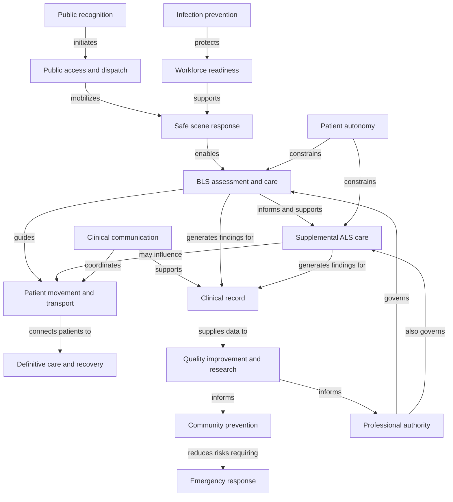

### Evolution of EMS and educational standards

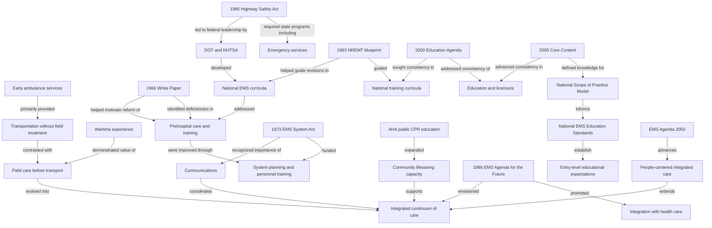

### System governance and service models

```mermaid
flowchart TD
    N01["State EMS agency"]
    N02["Statewide EMS system"]
    N03["Local services and personnel"]
    N04["NHTSA assessment standards"]
    N05["Resource management"]
    N06["Equitable access"]
    N07["Human resources and training"]
    N08["Clinical capability"]
    N09["Transportation and facilities"]
    N10["Appropriate definitive care"]
    N11["Communications"]
    N12["Dispatch, field and hospital"]
    N13["Public education"]
    N14["Prevention and public access"]
    N15["Medical direction"]
    N16["Trauma systems"]
    N17["Evaluation"]
    N18["System improvement"]
    N19["Fire-based EMS"]
    N20["Fire service infrastructure"]
    N21["Municipal third service"]
    N22["Police and fire"]
    N23["Private EMS"]
    N24["Private ownership and applicable rules"]
    N25["Hospital-based EMS"]
    N26["Hospital organization"]
    N27["Law enforcement EMS"]
    N28["Police operations"]
    N29["Public safety officer model"]
    N30["Fire, police and EMS roles"]
    N31["Administrative service model"]
    N32["Credentialed staff and equipment"]
    N33["Clinical quality, service quality and efficiency"]
    N34["Resilience"]
    N35["Adaptation to operational change"]

    N01 -->|plans and coordinates| N02
    N01 -->|regulates and licenses| N03
    N04 -->|recommend elements for| N02
    N05 -->|promotes| N06
    N07 -->|support| N08
    N09 -->|connect patients to| N10
    N11 -->|connects| N12
    N13 -->|supports| N14
    N15 -->|oversees| N08
    N16 -->|coordinate| N10
    N17 -->|drives| N18
    N19 -->|uses| N20
    N21 -->|operates separately from| N22
    N23 -->|operates under| N24
    N25 -->|is controlled by| N26
    N27 -->|may integrate with| N28
    N29 -->|combines| N30
    N31 -->|does not establish| N08
    N08 -->|depends on| N32
    N18 -->|evaluates| N33
    N34 -->|supports| N35
    N02 -->|coordinates| N05
    N02 -->|includes| N09
    N02 -->|relies on| N11
    N02 -->|promotes| N13
    N02 -->|uses| N17
    N18 -->|promotes| N34
    N02 -->|may use| N31
    N19 -->|is a type of| N31
    N21 -->|is a type of| N31
    N23 -->|is a type of| N31
    N25 -->|is a type of| N31
    N27 -->|is a type of| N31
    N29 -->|is a type of| N31
```

### Tiered response and definitive care

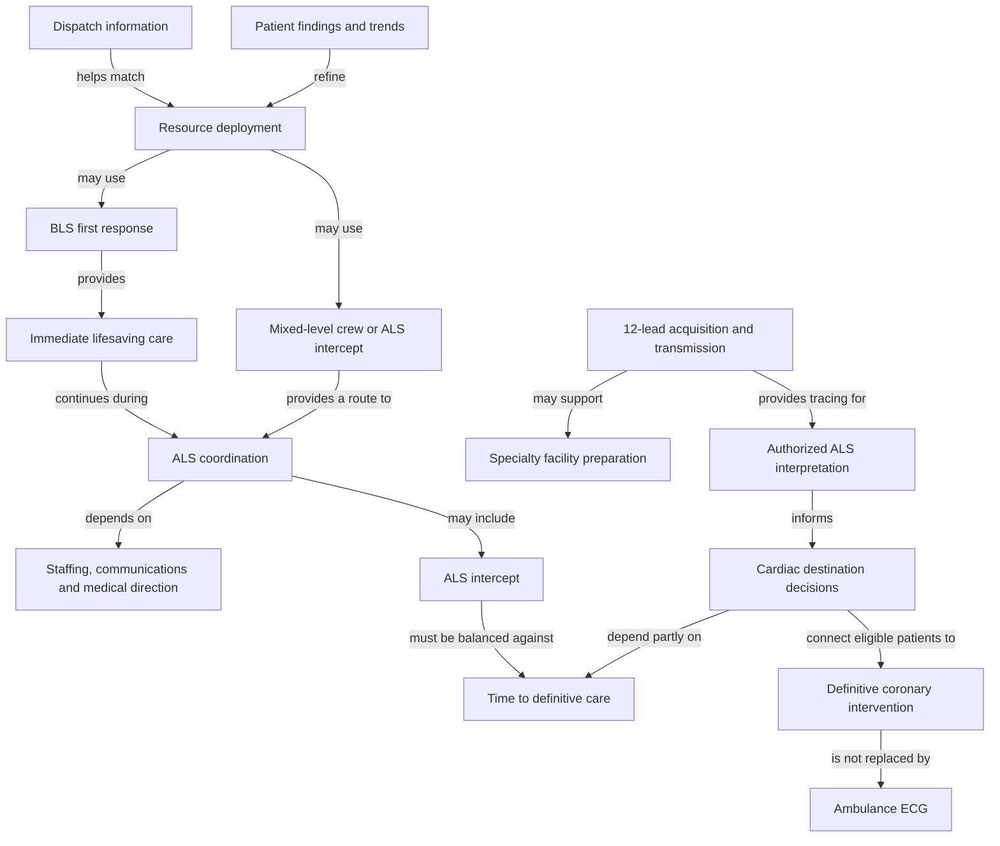

## Professional authority, clinical governance and scope of practice

### Knowledge, authorization and performance

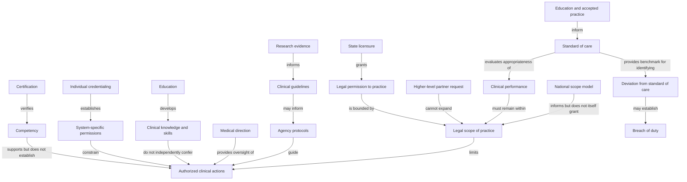

### Provider levels and mixed-level teamwork

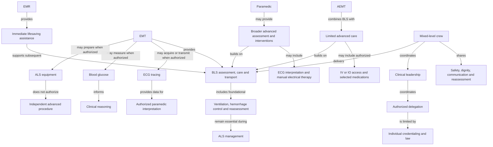

The textbook lists glucose monitoring at AEMT level; the supplied national model clarification also includes it at EMT level. These are illustrative capabilities, not local permission lists. Acquisition, interpretation, assistance and independent performance are distinct.

### Medical oversight and orders

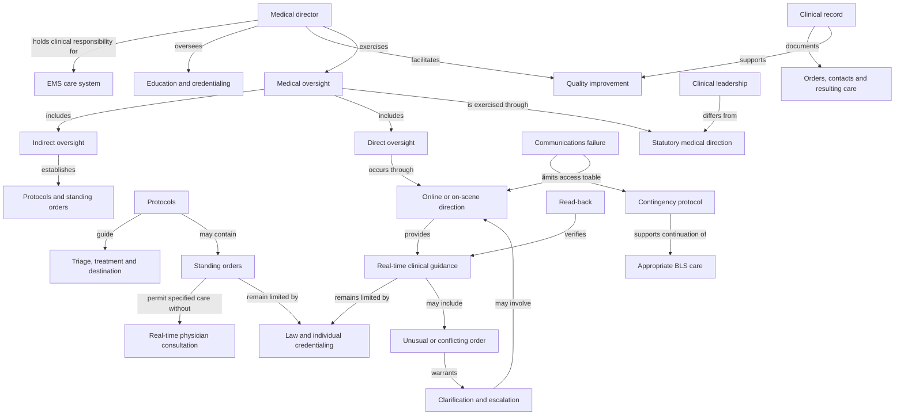

### Clinical integration: chest discomfort and orders

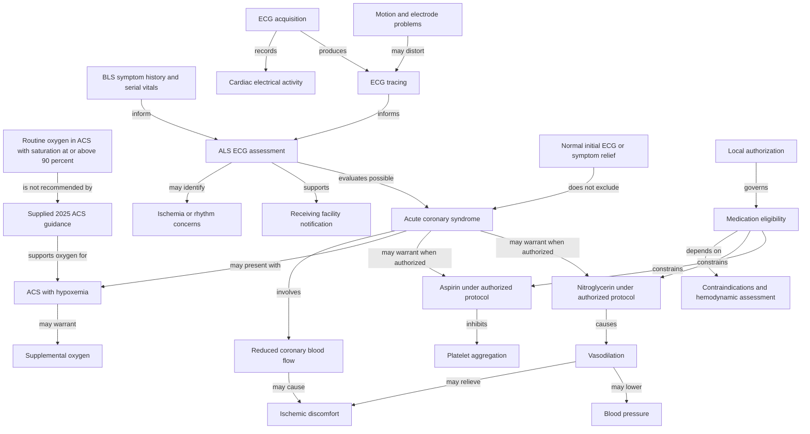

The historical standing-order example is not a current treatment protocol. Nitroglycerin requires consideration of hypotension, possible right ventricular infarction and recent PDE-5 inhibitor use; aspirin requires attention to allergy and active bleeding. Oxygen guidance here is ACS-specific.

## Professional conduct, ethics and legal accountability

### Professional responsibilities and readiness

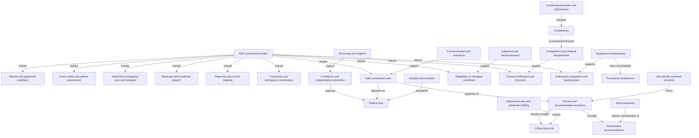

### Duty, ethics and patient advocacy

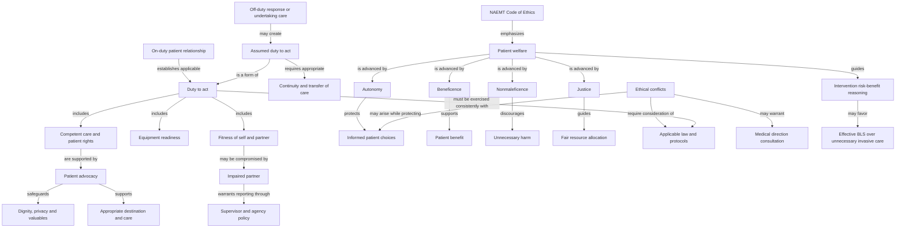

Off-duty duty and assumed duty vary by jurisdiction. Ethics does not override applicable law; additional intervention is not necessarily additional benefit.

### Civil liability and negligence

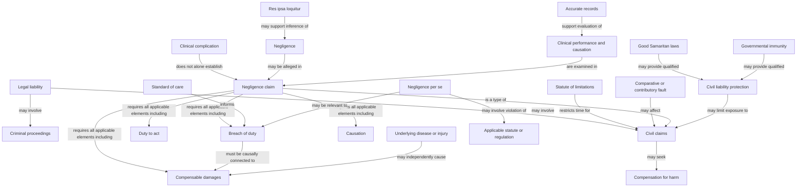

Definitions of gross negligence, negligence per se, immunity and fault are jurisdiction-specific. A protocol violation alone does not establish all negligence elements.

### Intentional torts and continuity

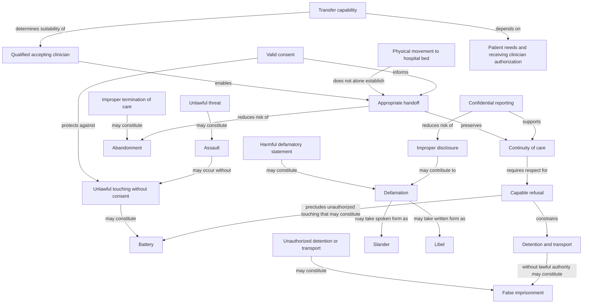

## Workforce readiness, wellness and injury prevention

### Occupational stress and support

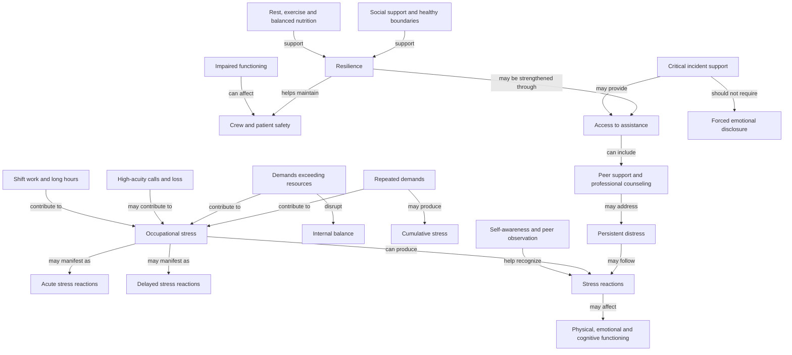

Stress reactions vary. Support should be individualized; a formal debriefing is not guaranteed to prevent PTSD.

### Fitness, fatigue and clinical readiness

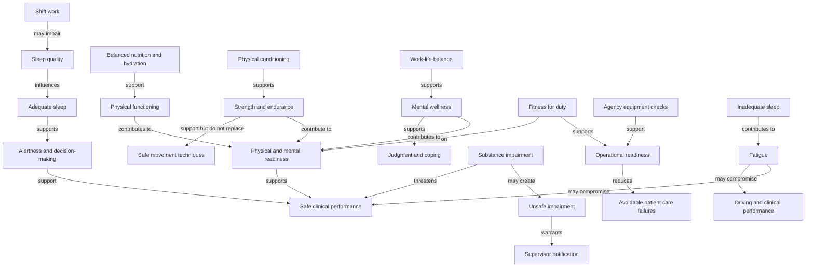

## Public access, dispatch and communications infrastructure

### Dispatch, risk information and resource allocation

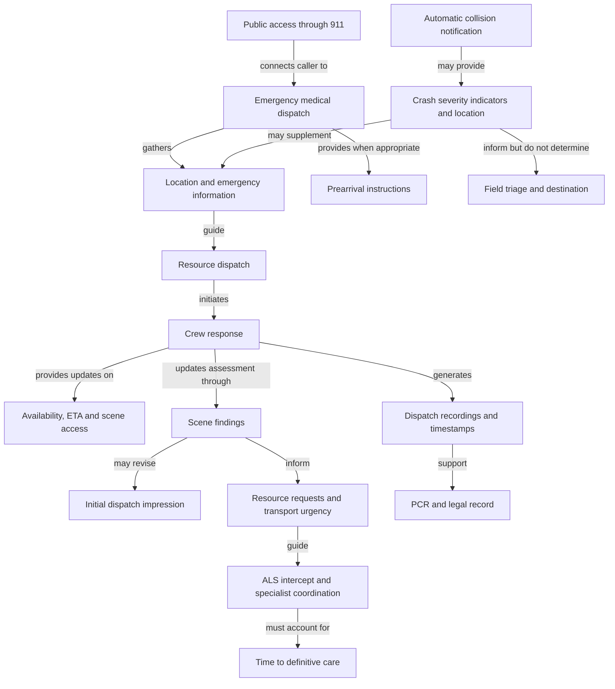

### Communication infrastructure and reliability

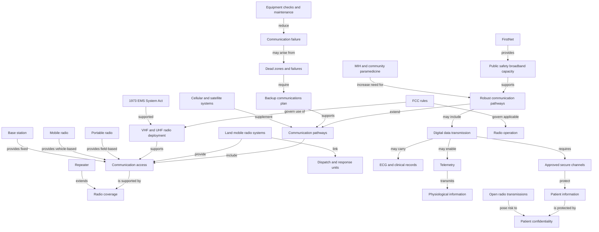

### Communication technique and shared time

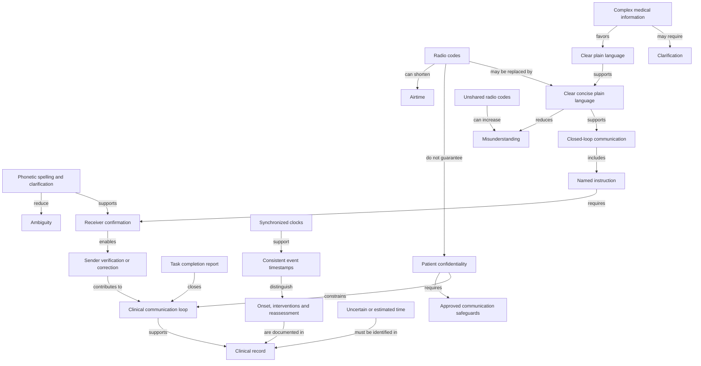

## Scene safety, incident coordination and rescue interfaces

### Dynamic scene safety and specialized response

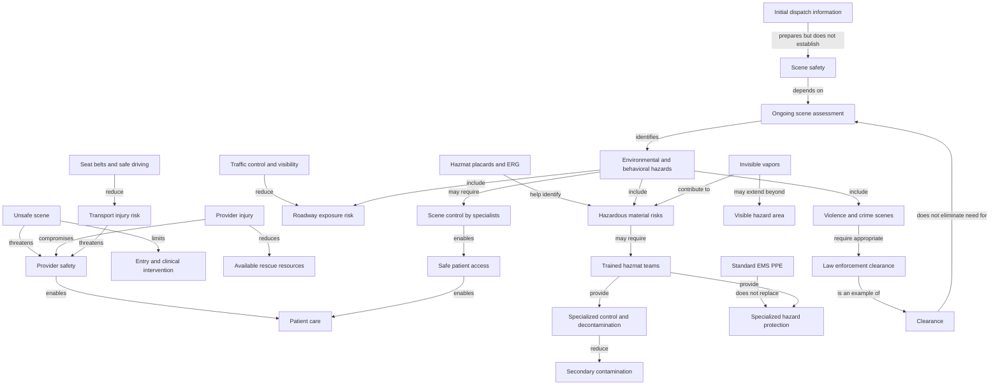

### Rescue coordination and evidence preservation

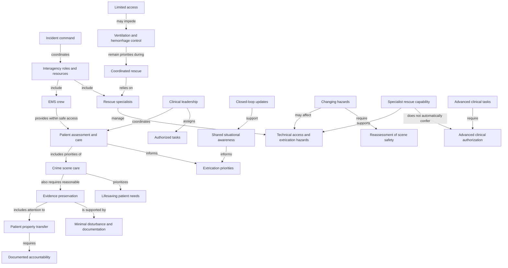

## Infection prevention and occupational exposure

### Transmission and barrier protection

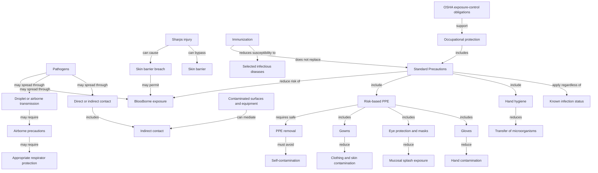

### Infection-specific risk and preventive measures

```mermaid
flowchart TD
    N01["Bloodborne pathogens such as HBV, HCV and HIV"]
    N02["Contaminated sharps or blood exposure"]
    N03["Tuberculosis"]
    N04["Airborne particles"]
    N05["Respiratory infections"]
    N06["Transmission-based respiratory precautions"]
    N07["Contact with contaminated materials"]
    N08["Contact-spread pathogens"]
    N09["Infection"]
    N10["Incubation period"]
    N11["Unrecognized infection"]
    N12["Standard Precautions"]
    N13["Initial TB screening"]
    N14["Risk assessment, symptom evaluation and TST or IGRA"]
    N15["Known exposure or ongoing transmission"]
    N16["Additional TB evaluation"]
    N17["Hepatitis B vaccination"]
    N18["Occupational HBV infection"]
    N19["Employer"]
    N20["Hepatitis B vaccination within 10 working days"]
    N21["Vaccination and immunity history"]
    N22["Occupational health recommendations"]
    N23["Current vaccine guidance"]
    N24["Individual immunization needs"]
    N25["Occupational HBV infection risk"]

    N01 -->|may spread through| N02
    N03 -->|can spread through| N04
    N05 -->|may require| N06
    N07 -->|may transmit| N08
    N09 -->|may be unrecognized during| N10
    N11 -->|reinforces need for| N12
    N13 -->|may use| N14
    N15 -->|may warrant| N16
    N17 -->|helps prevent| N18
    N19 -->|must offer eligible workers| N20
    N21 -->|informs| N22
    N23 -->|governs| N24
    N01 -->|can create| N25
    N17 -->|addresses| N25
    N03 -->|is assessed through| N13
    N15 -->|changes need for| N13
    N23 -->|informs| N22
    N22 -->|may include| N17
    N04 -->|are addressed by appropriate| N06
    N05 -->|may spread through| N04
    N12 -->|help prevent| N08
    N12 -->|help reduce risk from| N02
    N09 -->|may spread through| N04
    N12 -->|apply even in| N10
    N12 -->|complement| N06
    N19 -->|provides eligible workers access to| N17
```

Routine annual TB testing is generally not recommended absent exposure or ongoing transmission. Vaccine recommendations depend on immunity, risk, contraindications and current guidance.

### Equipment reprocessing and invasive-procedure safety

```mermaid
flowchart TD
    N01["Cleaning"]
    N02["Blood, tissue and other soil"]
    N03["Disinfection or sterilization"]
    N04["Noncritical equipment"]
    N05["Intact skin"]
    N06["Cleaning and disinfection"]
    N07["Semicritical equipment"]
    N08["Mucous membranes"]
    N09["High-level disinfection"]
    N10["Critical equipment"]
    N11["Sterile tissue or bloodstream"]
    N12["Sterility"]
    N13["Reusable equipment"]
    N14["Manufacturer and agency instructions"]
    N15["Single-use sterile equipment"]
    N16["Use"]
    N17["ALS invasive procedures"]
    N18["Sharps hazards"]
    N19["Immediate sharps disposal without recapping"]
    N20["Clean supply area"]
    N21["Sterile components"]
    N22["Contaminated laundry and waste"]
    N23["Approved containment and handling"]
    N24["Compatible disinfectants and contact times"]
    N25["Effective surface disinfection"]

    N01 -->|removes| N02
    N01 -->|precedes effective| N03
    N04 -->|contacts| N05
    N04 -->|requires appropriate| N06
    N07 -->|contacts| N08
    N07 -->|requires at least| N09
    N10 -->|enters| N11
    N10 -->|requires| N12
    N13 -->|is reprocessed according to| N14
    N15 -->|is discarded after| N16
    N17 -->|introduce| N18
    N18 -->|are reduced by| N19
    N20 -->|protects| N21
    N22 -->|require| N23
    N24 -->|determine| N25
    N04 -->|requires| N01
    N07 -->|requires| N01
    N03 -->|is guided by| N14
    N06 -->|depend on| N24
    N17 -->|may use| N10
    N10 -->|may include| N15
    N20 -->|protects| N15
    N22 -->|may result from| N17
    N10 -->|when reusable must undergo| N01
```

### Exposure response and notification

```mermaid
flowchart TD
    N01["Suspected occupational exposure"]
    N02["Immediate washing or flushing as appropriate"]
    N03["Supervisor or designated officer notification"]
    N04["Urgent occupational-health evaluation"]
    N05["Exposure details"]
    N06["Risk assessment and documentation"]
    N07["Facility determination of qualifying airborne infection"]
    N08["Designated officer notification pathway"]
    N09["Exposed responder and employer"]
    N10["Federal airborne notification"]
    N11["48 hours after facility determination"]
    N12["Notification pathway"]
    N13["Bloodborne exposure"]
    N14["Source and exposure risk assessment"]
    N15["HIV exposure when indicated"]
    N16["Clinician-selected PEP"]
    N17["PEP"]
    N18["Establishment of HIV infection"]
    N19["72 hours"]
    N20["Prophylaxis and follow-up"]

    N01 -->|requires| N02
    N01 -->|requires prompt| N03
    N01 -->|warrants| N04
    N05 -->|support| N06
    N07 -->|triggers| N08
    N08 -->|informs| N09
    N10 -->|is due as soon as practicable within| N11
    N12 -->|does not replace| N04
    N13 -->|may warrant| N14
    N15 -->|may warrant| N16
    N17 -->|aims to inhibit| N18
    N17 -->|is time-sensitive and generally begins within| N19
    N04 -->|guides| N20
    N01 -->|may involve| N13
    N01 -->|may require follow-up through| N08
    N05 -->|inform| N14
    N14 -->|informs| N20
    N15 -->|is evaluated during| N04
    N10 -->|governs| N08
    N17 -->|is considered during| N04
```

The source corrects the textbook's 24-hour airborne notification claim. Do not wait for source testing or notification before seeking care; unusually late high-risk HIV exposures require specialist consultation.

## Therapeutic communication, assessment and clinical reasoning

### Therapeutic communication and the patient interview

```mermaid
flowchart TD
    N01["Therapeutic communication"]
    N02["Rapport and trust"]
    N03["Accurate history gathering"]
    N04["Communication process"]
    N05["Sender, message and receiver"]
    N06["Feedback"]
    N07["Shared understanding"]
    N08["Active listening and silence"]
    N09["Patient expression"]
    N10["Open questions"]
    N11["Patient narrative"]
    N12["Focused questions"]
    N13["Pertinent clinical details"]
    N14["Reflection and clarification"]
    N15["Intended meaning"]
    N16["Empathy and reassurance"]
    N17["Emotional security"]
    N18["False reassurance"]
    N19["Trust"]
    N20["Nonverbal observations"]
    N21["Clinical assessment"]
    N22["Cultural differences and disability"]
    N23["Capacity or deception"]
    N24["Patient interview"]
    N25["Symptoms, onset and relevant history"]
    N26["Parallel interviewing"]
    N27["Immediate lifesaving care"]
    N28["Working clinical impression"]

    N01 -->|builds| N02
    N02 -->|facilitates| N03
    N04 -->|involves| N05
    N06 -->|checks| N07
    N08 -->|encourage| N09
    N10 -->|elicit| N11
    N12 -->|clarify| N13
    N14 -->|verify| N15
    N16 -->|support| N17
    N18 -->|may undermine| N19
    N20 -->|provide clues for| N21
    N22 -->|may affect| N20
    N20 -->|do not alone establish| N23
    N24 -->|obtains| N25
    N26 -->|supports timely| N27
    N11 -->|informs| N28
    N24 -->|benefits from| N02
    N24 -->|uses| N10
    N24 -->|uses| N12
    N24 -->|uses| N08
    N24 -->|uses| N14
    N14 -->|provide| N06
    N04 -->|requires| N06
    N17 -->|supports| N02
    N21 -->|integrates| N25
    N26 -->|is an adaptation of| N24
    N19 -->|contributes to| N02
```

### Communication access, family and emotional care

```mermaid
flowchart TD
    N01["Language barriers"]
    N02["Shared understanding"]
    N03["Qualified interpretation"]
    N04["Communication access"]
    N05["Informed consent"]
    N06["Hearing or sensory impairment"]
    N07["Adapted communication"]
    N08["Children"]
    N09["Age-appropriate explanations"]
    N10["Older adults"]
    N11["Clear respectful communication and time"]
    N12["Caregiver history"]
    N13["Baseline function and care needs"]
    N14["Acute changes"]
    N15["Family-centered care"]
    N16["Patient and family participation"]
    N17["Patient autonomy"]
    N18["Family participation in decisions"]
    N19["Death and dying"]
    N20["Varied grief responses"]
    N21["Grief responses"]
    N22["Denial, anger, bargaining, depression or acceptance"]
    N23["Sequence"]
    N24["Emotional support"]
    N25["Patient and family distress"]
    N26["Altered behavior"]
    N27["Acute medical causes"]
    N28["Facilitator-dependent communication"]
    N29["Facilitator-authored message"]
    N30["Patient consent or preferences"]

    N01 -->|may limit| N02
    N03 -->|supports| N04
    N04 -->|supports| N05
    N06 -->|may require| N07
    N08 -->|may benefit from| N09
    N10 -->|may benefit from| N11
    N12 -->|provides| N13
    N13 -->|help identify| N14
    N15 -->|supports| N16
    N17 -->|limits| N18
    N19 -->|may produce| N20
    N21 -->|may include| N22
    N21 -->|do not follow a required| N23
    N24 -->|acknowledges| N25
    N26 -->|warrants consideration of| N27
    N28 -->|risks substituting| N29
    N29 -->|cannot establish| N30
    N04 -->|may require| N07
    N09 -->|are a form of| N07
    N11 -->|support| N04
    N15 -->|uses| N12
    N16 -->|may benefit from| N24
    N21 -->|may manifest as| N25
    N26 -->|may be noted as| N14
    N17 -->|underlies| N05
    N29 -->|undermines| N04
    N01 -->|may require| N03
    N20 -->|are examples of| N21
    N15 -->|benefits from| N04
```

### BLS assessment as the foundation of advanced reasoning

```mermaid
flowchart TD
    N01["Scene assessment"]
    N02["Mechanism, hazards and patient count"]
    N03["Primary assessment"]
    N04["Immediate life threats"]
    N05["Patient interview"]
    N06["Subjective symptoms"]
    N07["Physical examination"]
    N08["Objective signs"]
    N09["Symptoms and objective signs"]
    N10["Working clinical impression"]
    N11["Authorized care and resource decisions"]
    N12["BLS airway and ventilation assessment"]
    N13["Advanced airway considerations"]
    N14["BLS perfusion findings"]
    N15["Advanced circulatory assessment"]
    N16["Effective BVM ventilation"]
    N17["Oxygenation and ventilation"]
    N18["Advanced airway placement"]
    N19["Placement complications and interruptions"]
    N20["BLS reassessment"]
    N21["Response or deterioration"]
    N22["Definitive diagnosis"]

    N01 -->|identifies| N02
    N03 -->|identifies| N04
    N05 -->|provides| N06
    N07 -->|provides| N08
    N09 -->|inform| N10
    N06 -->|contribute to| N09
    N08 -->|contribute to| N09
    N10 -->|guides| N11
    N12 -->|informs| N13
    N14 -->|inform| N15
    N16 -->|may support| N17
    N16 -->|may avoid or bridge need for| N18
    N18 -->|introduces potential| N19
    N20 -->|detects| N21
    N21 -->|revises| N10
    N11 -->|require| N20
    N10 -->|is not equivalent to| N22
    N01 -->|provides context for| N03
    N04 -->|inform| N10
    N07 -->|includes| N12
    N07 -->|includes| N14
    N13 -->|may include| N18
    N12 -->|guides use of| N16
```

### Monitoring and resuscitation as complementary processes

```mermaid
flowchart TD
    N01["Cardiac rhythm tracing"]
    N02["Electrical activity"]
    N03["Perfusing pulse"]
    N04["Pulse and perfusion assessment"]
    N05["Circulatory status"]
    N06["Pulse oximetry"]
    N07["Oxygen saturation"]
    N08["Motion, cold and poor perfusion"]
    N09["Pulse oximetry readings"]
    N10["Capnography"]
    N11["Exhaled carbon dioxide"]
    N12["Ventilation, pulmonary blood flow and metabolism"]
    N13["Waveform capnography"]
    N14["Authorized advanced airway verification and monitoring"]
    N15["Low exhaled carbon dioxide"]
    N16["Underlying cause"]
    N17["Clinical examination"]
    N18["Monitor readings"]
    N19["High-quality compressions"]
    N20["Circulation during arrest"]
    N21["Early defibrillation"]
    N22["Shockable rhythms"]
    N23["Effective ventilation"]
    N24["Gas exchange"]
    N25["ALS rhythm analysis and medications"]
    N26["Foundational resuscitation"]
    N27["Advanced airway attempts"]

    N01 -->|records| N02
    N02 -->|does not establish| N03
    N04 -->|helps establish| N05
    N06 -->|estimates| N07
    N08 -->|may degrade| N09
    N10 -->|measures| N11
    N12 -->|influence| N11
    N13 -->|supports| N14
    N15 -->|does not independently identify| N16
    N17 -->|contextualizes| N18
    N19 -->|support| N20
    N21 -->|addresses| N22
    N23 -->|supports| N24
    N25 -->|supplement| N26
    N19 -->|remain central to| N26
    N21 -->|remains central to| N26
    N23 -->|remains central to| N26
    N27 -->|should minimize interruption of| N19
    N17 -->|includes| N04
    N01 -->|is a type of| N18
    N09 -->|are a type of| N18
    N06 -->|produces| N09
    N11 -->|is represented in| N18
    N10 -->|may provide| N13
    N18 -->|inform| N25
    N05 -->|helps guide| N26
    N27 -->|may use| N14
    N15 -->|is a possible finding when measuring| N11
```

## Patient autonomy, consent, refusal and safeguarding

### Consent and intervention-specific authority

```mermaid
flowchart TD
    N01["Patient autonomy"]
    N02["Right to accept or refuse care"]
    N03["Expressed consent"]
    N04["Capacity and understandable information"]
    N05["Informed consent"]
    N06["Proposed care, risks and alternatives"]
    N07["Verbal or nonverbal agreement"]
    N08["Consent to BLS examination"]
    N09["Consent to advanced intervention or transport"]
    N10["Implied consent"]
    N11["Capacity absent and serious risk present"]
    N12["Applicable emergency doctrine"]
    N13["Minor consent"]
    N14["Parent or authorized guardian"]
    N15["Unavailable guardian and urgent risk"]
    N16["Emergency exception for minors"]
    N17["Immediate emergency needs"]
    N18["Emancipation and exceptions"]
    N19["Applicable state law"]
    N20["Custody"]
    N21["Patient decision-making rights"]
    N22["Surrogate consent"]
    N23["Actual legal decision-making authority"]
    N24["Capacity changes"]
    N25["Reassessment of consent"]
    N26["Consent documentation"]
    N27["Accepted and declined care"]

    N01 -->|protects| N02
    N03 -->|requires| N04
    N05 -->|addresses| N06
    N03 -->|may be communicated by| N07
    N08 -->|does not imply| N09
    N10 -->|may authorize emergency care when| N11
    N10 -->|is limited by| N12
    N13 -->|generally depends on| N14
    N15 -->|may permit| N16
    N16 -->|limits treatment to| N17
    N18 -->|depend on| N19
    N20 -->|does not automatically remove| N21
    N22 -->|requires| N23
    N24 -->|warrant| N25
    N26 -->|records| N27
    N01 -->|is exercised through| N03
    N05 -->|informs| N03
    N02 -->|applies to| N09
    N08 -->|is an example of| N03
    N12 -->|governs| N16
    N13 -->|may be affected by| N18
    N14 -->|may provide| N22
    N20 -->|must be distinguished from| N23
    N21 -->|reflect| N01
    N24 -->|require rechecking| N04
    N27 -->|reflects| N02
    N10 -->|is an exception to ordinary| N03
```

### Capacity, reversible impairment and refusal

```mermaid
flowchart TD
    N01["Decision-making capacity"]
    N02["Court-determined competence"]
    N03["Understanding"]
    N04["Appreciation"]
    N05["Reasoning"]
    N06["Communicating a choice"]
    N07["Orientation"]
    N08["Hypoglycemia"]
    N09["Glucose available to brain"]
    N10["Hypoxia or hypoperfusion"]
    N11["Cognition"]
    N12["Head injury or intoxication"]
    N13["Reduced glucose available to brain"]
    N14["BLS history, vitals and neurologic assessment"]
    N15["Reversible causes"]
    N16["ALS assessment and authorized treatment"]
    N17["Improved cognition"]
    N18["Capacity reassessment"]
    N19["Risky or unconventional choice"]
    N20["Incapacity"]
    N21["Mental illness or disability"]

    N01 -->|is a clinical determination distinct from| N02
    N01 -->|requires| N03
    N01 -->|requires| N04
    N01 -->|requires| N05
    N01 -->|requires| N06
    N07 -->|informs but cannot alone establish| N01
    N08 -->|reduces| N09
    N10 -->|may impair| N11
    N12 -->|may impair| N11
    N13 -->|may impair| N11
    N11 -->|influences| N01
    N14 -->|help identify| N15
    N16 -->|may address| N15
    N17 -->|warrants| N18
    N18 -->|updates| N01
    N19 -->|does not alone establish| N20
    N21 -->|does not automatically establish| N20
    N15 -->|may impair| N11
    N01 -->|is reassessed through| N18
    N20 -->|is assessed through| N18
    N08 -->|is an example of| N15
```

### High-risk refusal and restraint

```mermaid
flowchart TD
    N01["Capable patient"]
    N02["Informed refusal"]
    N03["Risks, consequences and alternatives"]
    N04["Teach-back"]
    N05["Understanding"]
    N06["Assessment findings and trends"]
    N07["Risk of refusal"]
    N08["High-risk findings or uncertain capacity"]
    N09["Medical direction consultation"]
    N10["Lawful disposition decisions"]
    N11["Return precautions and alternatives"]
    N12["Refusal documentation"]
    N13["Assessment, capacity and explained risks"]
    N14["Patient response, witnesses and consultation"]
    N15["Signed refusal form"]
    N16["Valid informed refusal"]
    N17["Immediate safety threat"]
    N18["De-escalation and authorized assistance"]
    N19["Restraint or sedation"]
    N20["Lawful authority and clinical indication"]
    N21["Airway, ventilation or circulation"]
    N22["Monitoring and reassessment"]
    N23["Law enforcement convenience"]
    N24["Medical restraint or sedation"]

    N01 -->|may exercise| N02
    N02 -->|requires understanding of| N03
    N04 -->|helps assess| N05
    N06 -->|inform| N07
    N08 -->|may warrant| N09
    N09 -->|supports| N10
    N02 -->|should include| N11
    N12 -->|records| N13
    N12 -->|records| N14
    N15 -->|does not establish by itself| N16
    N17 -->|may require| N18
    N19 -->|requires| N20
    N19 -->|may compromise| N21
    N21 -->|require close| N22
    N23 -->|does not justify| N24
    N01 -->|demonstrates| N05
    N06 -->|support| N12
    N07 -->|may contribute to| N08
    N09 -->|may inform| N02
    N16 -->|requires| N02
    N17 -->|may warrant consideration of| N19
    N22 -->|contributes to| N06
    N24 -->|is a form of| N19
```

A refusal is not necessarily a refusal of every intervention. If an assessment is declined, document the limits of the assessment. Do not infer capacity or incapacity solely from a signature, orientation or diagnosis.

### Safeguarding and vulnerable patients

```mermaid
flowchart TD
    N01["Suspected abuse or neglect"]
    N02["Mandatory reporting"]
    N03["State law and protected population"]
    N04["Objective findings and exact statements"]
    N05["Safeguarding report"]
    N06["Legally designated authority"]
    N07["Handoff to ALS or hospital"]
    N08["Patient confidentiality"]
    N09["Applicable legal conditions"]
    N10["Safe-haven surrender"]
    N11["State-authorized procedures"]
    N12["Infant assessment and safety"]
    N13["Warmth, breathing, responsiveness and injury"]
    N14["Infant instability"]
    N15["ALS or neonatal resources"]
    N16["Invasive care"]

    N01 -->|may trigger| N02
    N02 -->|depends on| N03
    N04 -->|support| N05
    N05 -->|goes to| N06
    N07 -->|does not necessarily fulfill| N02
    N08 -->|permits or requires disclosure only under| N09
    N10 -->|depends on| N11
    N10 -->|requires appropriate| N12
    N12 -->|evaluates| N13
    N14 -->|may require| N15
    N10 -->|does not alone justify| N16
    N02 -->|requires appropriate| N05
    N11 -->|govern| N10
    N12 -->|may identify| N14
    N12 -->|may uncover| N01
    N09 -->|govern| N02
```

## Treatment limitations, death and special medicolegal responsibilities

### Advance directives and goals of care

```mermaid
flowchart TD
    N01["Patient goals and applicable law"]
    N02["Treatment limitations"]
    N03["Living will"]
    N04["Future treatment preferences"]
    N05["Health care proxy"]
    N06["Authorized surrogate decision-maker"]
    N07["DNR order"]
    N08["Resuscitation when applicable"]
    N09["DNI order"]
    N10["Specified intubation intervention"]
    N11["POLST or MOLST"]
    N12["Portable medical orders"]
    N13["Care before cardiac arrest"]
    N14["Serious illness or advanced frailty"]
    N15["Field verification"]
    N16["Identity, validity and applicability of orders"]
    N17["Uncertain or disputed orders"]
    N18["Medical direction and protocol guidance"]
    N19["Withhold all treatment"]
    N20["Comfort-focused care"]
    N21["Symptoms and patient goals"]
    N22["Valid treatment limitations"]
    N23["Authorized BLS and ALS care"]
    N24["Family distress"]

    N01 -->|inform| N02
    N03 -->|expresses| N04
    N05 -->|designates| N06
    N07 -->|limits| N08
    N09 -->|limits| N10
    N11 -->|constitutes| N12
    N12 -->|may address| N13
    N14 -->|may make appropriate| N11
    N15 -->|checks| N16
    N17 -->|warrant| N18
    N07 -->|does not mean| N19
    N20 -->|addresses| N21
    N22 -->|guide| N23
    N24 -->|does not alone override| N22
    N02 -->|may be expressed through| N03
    N02 -->|may be specified by| N07
    N02 -->|may be specified by| N09
    N02 -->|may be specified by| N12
    N06 -->|may help clarify| N01
    N15 -->|helps establish| N22
    N17 -->|may arise during| N15
    N20 -->|is compatible with| N07
    N22 -->|reflect| N02
```

### Comfort care and advanced intervention risk

```mermaid
flowchart TD
    N01["Comfort-focused care"]
    N02["Positioning, emotional support and symptom relief"]
    N03["Oxygen"]
    N04["Oxygenation or symptom needs when indicated"]
    N05["Authorized ALS analgesia"]
    N06["Severe pain and distress"]
    N07["Opioid analgesia"]
    N08["Opioid receptors"]
    N09["Sedation, respiratory depression or hypotension"]
    N10["BLS baseline assessment"]
    N11["Alertness, breathing and perfusion before treatment"]
    N12["Serial reassessment"]
    N13["Symptom response or adverse effects"]
    N14["Further authorized management"]
    N15["DNR status"]
    N16["Opioid administration"]
    N17["Patient goals"]
    N18["Burdens of intervention"]

    N01 -->|may include| N02
    N03 -->|may address| N04
    N05 -->|may reduce| N06
    N07 -->|acts through| N08
    N07 -->|may cause| N09
    N10 -->|establishes| N11
    N12 -->|detects| N13
    N13 -->|informs| N14
    N15 -->|does not independently indicate| N16
    N17 -->|constrain| N18
    N01 -->|may include| N05
    N01 -->|may include| N03
    N05 -->|may use| N07
    N09 -->|may be detected through| N12
    N10 -->|informs| N12
    N17 -->|guide| N01
    N15 -->|may coexist with| N01
```

### Death determination and special circumstances

```mermaid
flowchart TD
    N01["Clinical assessment"]
    N02["Signs suggesting death"]
    N03["Obvious irreversible death findings"]
    N04["Withholding resuscitation under applicable protocol"]
    N05["Uncertain death status"]
    N06["Applicable resuscitation and medical direction guidance"]
    N07["Termination of resuscitation"]
    N08["Authorized criteria and oversight"]
    N09["Valid treatment limitations"]
    N10["Resuscitation decisions"]
    N11["Medical identification"]
    N12["Relevant history or medical conditions"]
    N13["Valid treatment-limiting order"]
    N14["Organ donor status"]
    N15["Resuscitation indication"]
    N16["Patient benefit and valid orders"]
    N17["Medical examiner or coroner"]
    N18["Reportable deaths"]
    N19["Scene and evidence preservation"]
    N20["Death documentation"]
    N21["Findings, decisions and notifications"]

    N01 -->|identifies| N02
    N03 -->|may justify| N04
    N05 -->|warrants| N06
    N07 -->|depends on| N08
    N09 -->|may govern| N10
    N11 -->|provides clues about| N12
    N11 -->|does not alone establish| N13
    N14 -->|does not determine| N15
    N15 -->|is based on| N16
    N17 -->|may require notification of| N18
    N18 -->|require appropriate| N19
    N20 -->|records| N21
    N02 -->|may include| N03
    N01 -->|may identify| N05
    N06 -->|informs| N07
    N09 -->|influence| N15
    N11 -->|may help locate| N09
    N01 -->|informs| N20
    N18 -->|may be identified through| N01
    N15 -->|is evaluated through| N01
```

Death determination, termination and reportable-death requirements vary by jurisdiction and protocol; donor suitability does not change the patient's care goals.

### Arrest, irreversible death and termination decisions

```mermaid
flowchart TD
    N01["Apnea and pulselessness"]
    N02["Cardiac arrest"]
    N03["Irreversible death"]
    N04["Rigor mortis, dependent lividity or decomposition"]
    N05["Valid DNR or recognized irreversible death"]
    N06["Withholding resuscitation under protocol"]
    N07["Termination of resuscitation already underway"]
    N08["Approved criteria and medical direction when required"]
    N09["ALS rhythm and response data"]
    N10["Single ECG rhythm or ETCO2 value"]
    N11["Futility"]
    N12["Hypothermia, drowning and toxic exposures"]
    N13["Resuscitation decisions"]
    N14["Special-circumstance protocols"]
    N15["Pronouncement"]
    N16["Legally authorized decision-maker"]
    N17["Determination of cause and manner of death"]

    N01 -->|indicate| N02
    N02 -->|is not by itself proof of| N03
    N03 -->|may be evidenced by| N04
    N05 -->|may justify| N06
    N06 -->|differs from| N07
    N07 -->|requires| N08
    N09 -->|may inform| N08
    N10 -->|cannot alone establish| N11
    N11 -->|cannot be inferred solely from| N02
    N12 -->|may alter| N13
    N13 -->|must consider| N14
    N14 -->|may modify application of| N08
    N15 -->|requires| N16
    N15 -->|differs from| N17
    N07 -->|differs from| N15
    N02 -->|ordinarily calls for| N13
    N03 -->|may qualify as| N05
```

The source's timing estimates for rigor or decomposition are not stand-alone death-time determinations. Routine TOR rules are not universally applicable. Formal neurologic death determination is distinct from recognition of obvious irreversible injury.

## Patient movement: clinical priorities, mechanics and equipment

### Movement risk, biomechanics and crew coordination

```mermaid
flowchart TD
    N01["Patient movement"]
    N02["Patient condition and environment"]
    N03["Musculoskeletal loading"]
    N04["Load held close to body"]
    N05["Lever arm and back strain"]
    N06["Neutral spine and stable stance"]
    N07["Unsafe spinal loading"]
    N08["Leg and hip engagement"]
    N09["Controlled lifting"]
    N10["Twisting and extended reaching"]
    N11["Injury risk"]
    N12["Pivoting feet"]
    N13["Trunk twisting under load"]
    N14["Pushing or pulling"]
    N15["Stable posture and controlled force"]
    N16["Patient weight and equipment"]
    N17["Staffing and mechanical aid needs"]
    N18["Movement plan"]
    N19["Route, obstacles and roles"]
    N20["Single designated leader"]
    N21["Synchronized commands"]
    N22["Uneven lifting and unexpected movement"]
    N23["Reassessment"]
    N24["Movement-related patient deterioration"]
    N25["Reduced movement distance"]

    N01 -->|requires assessment of| N02
    N01 -->|exposes crew to| N03
    N04 -->|reduces| N05
    N06 -->|reduce| N07
    N08 -->|supports| N09
    N10 -->|increase| N11
    N12 -->|avoids| N13
    N14 -->|requires| N15
    N16 -->|determine| N17
    N17 -->|inform| N18
    N18 -->|includes| N19
    N20 -->|coordinates| N21
    N21 -->|reduce| N22
    N23 -->|detects| N24
    N03 -->|may contribute to| N11
    N04 -->|helps manage| N03
    N06 -->|support| N09
    N08 -->|helps manage| N03
    N09 -->|reduces| N11
    N14 -->|may involve| N03
    N18 -->|accounts for| N02
    N18 -->|requires| N20
    N18 -->|includes| N23
    N13 -->|contributes to| N11
    N25 -->|reduces| N03
```

### Lifting and transfer techniques

```mermaid
flowchart TD
    N01["Power lift"]
    N02["Legs with controlled spinal alignment"]
    N03["Squat lift"]
    N04["Close load handling"]
    N05["One-handed equipment carrying"]
    N06["Balanced posture and controlled loading"]
    N07["Direct ground lift"]
    N08["Nonurgent supine patient transfers"]
    N09["Extremity lift"]
    N10["Suitable patient condition and absence of relevant injury"]
    N11["Direct carry"]
    N12["Bed and stretcher"]
    N13["Draw sheet transfer"]
    N14["Unsupported manual lifting"]
    N15["Technique selection"]
    N16["Suspected injury, weight and available access"]
    N17["Suspected spinal injury"]
    N18["Selective spinal motion restriction"]
    N19["Adequate helpers"]
    N20["Controlled synchronized transfer"]
    N21["Mechanical aids"]
    N22["Manual load"]
    N23["Transfer plan"]
    N24["Height, brakes, restraints and obstacles"]
    N25["Patient and responder safety"]

    N01 -->|uses| N02
    N03 -->|supports| N04
    N05 -->|requires| N06
    N07 -->|supports selected| N08
    N09 -->|requires| N10
    N11 -->|transfers selected patients between| N12
    N13 -->|reduces need for| N14
    N15 -->|depends on| N16
    N17 -->|may warrant| N18
    N19 -->|support| N20
    N21 -->|reduce| N22
    N23 -->|addresses| N24
    N23 -->|protects| N25
    N01 -->|is selected through| N15
    N03 -->|is selected through| N15
    N05 -->|requires appropriate| N15
    N07 -->|is selected through| N15
    N09 -->|is selected through| N15
    N11 -->|is selected through| N15
    N13 -->|is selected through| N15
    N23 -->|includes| N15
    N23 -->|accounts for| N18
    N23 -->|includes| N19
    N23 -->|may use| N21
```

Specific technique steps, staffing and equipment limits require practical training, local policy and manufacturer instructions. No single technique fits every patient.

### Movement urgency and competing priorities

```mermaid
flowchart TD
    N01["Immediate scene hazard"]
    N02["Emergency move"]
    N03["Inability to access lifesaving care"]
    N04["Immediate clinical life threat"]
    N05["Urgent move"]
    N06["Absence of immediate threat"]
    N07["Planned nonurgent move"]
    N08["Escape or lifesaving access"]
    N09["Armpit-forearm, shirt and blanket drags"]
    N10["Emergency movement techniques"]
    N11["Shirt drag"]
    N12["Neck compression if performed improperly"]
    N13["Rapid movement"]
    N14["Spinal injury"]
    N15["Long-axis movement and supported alignment"]
    N16["Unnecessary spinal motion"]
    N17["Immediate care and rapid access to definitive care"]
    N18["Rapid extrication"]
    N19["Critical illness or injury"]
    N20["Nonurgent move"]
    N21["Deliberate device and staffing selection"]
    N22["Changes in patient condition"]
    N23["Movement urgency"]
    N24["Safe access after relocation"]
    N25["Immediate reassessment"]

    N01 -->|may necessitate| N02
    N03 -->|may necessitate| N02
    N04 -->|may necessitate| N05
    N06 -->|supports| N07
    N02 -->|prioritizes| N08
    N09 -->|are examples of| N10
    N11 -->|risks| N12
    N13 -->|may aggravate| N14
    N15 -->|help limit| N16
    N05 -->|balances| N17
    N18 -->|may be indicated by| N19
    N20 -->|permits| N21
    N22 -->|may alter| N23
    N24 -->|enables| N25
    N10 -->|are used for| N02
    N11 -->|is an example of| N10
    N02 -->|may involve| N13
    N13 -->|benefits from| N15
    N05 -->|may use| N18
    N23 -->|determines selection among| N02
    N23 -->|determines selection among| N05
    N23 -->|determines selection among| N07
    N08 -->|enables| N24
    N20 -->|is appropriate in| N06
```

Do not force alignment against pain, resistance or new neurologic findings. Move category does not automatically determine ALS activation or transport priority.

### Extrication, hemorrhage and ventilation

```mermaid
flowchart TD
    N01["Entrapment"]
    N02["Patient access"]
    N03["Limited patient access"]
    N04["Ventilation and hemorrhage control"]
    N05["Rescue personnel"]
    N06["Safe disentanglement and extraction"]
    N07["Rapid extrication when indicated"]
    N08["Coordinated head, trunk and limb support"]
    N09["Unnecessary motion"]
    N10["Backboard"]
    N11["Extrication and movement"]
    N12["Continued transport"]
    N13["Self-extrication"]
    N14["Selected patients able to move safely"]
    N15["Poor respiratory effort"]
    N16["Inadequate ventilation"]
    N17["BLS airway opening and BVM"]
    N18["Inadequate ventilation when indicated"]
    N19["ALS airway intervention"]
    N20["Hemodynamic or procedural risk"]
    N21["Major hemorrhage"]
    N22["Circulating volume and oxygen delivery"]
    N23["BLS bleeding control and heat conservation"]
    N24["Trauma stabilization"]
    N25["ALS vascular access and selected fluids or blood"]
    N26["Trauma resuscitation"]
    N27["Hemorrhage control and definitive care"]
    N28["Pre- and post-movement neurologic findings"]
    N29["New injury-related changes"]

    N01 -->|limits| N02
    N03 -->|may delay| N04
    N05 -->|coordinate| N06
    N07 -->|requires| N08
    N08 -->|minimizes| N09
    N10 -->|may facilitate| N11
    N10 -->|is not necessarily required for| N12
    N13 -->|may be appropriate for| N14
    N15 -->|may indicate| N16
    N17 -->|address| N18
    N19 -->|may introduce| N20
    N21 -->|reduces| N22
    N23 -->|support| N24
    N25 -->|may support| N26
    N26 -->|does not replace| N27
    N28 -->|reveal possible| N29
    N01 -->|may require| N06
    N06 -->|may involve| N07
    N07 -->|may use| N10
    N13 -->|is an alternative for selected patients to| N07
    N16 -->|is a concern during| N03
    N04 -->|address threats including| N21
    N04 -->|may include| N17
    N16 -->|may warrant| N19
    N21 -->|may warrant| N23
    N24 -->|may involve| N25
    N06 -->|requires consideration of| N28
    N02 -->|when restricted creates| N03
```

### Positioning and physiological tolerance

```mermaid
flowchart TD
    N01["Patient position"]
    N02["Airway, breathing and circulation"]
    N03["Respiratory distress"]
    N04["Position of comfort when tolerated"]
    N05["Reduced consciousness"]
    N06["Airway protection and ventilation"]
    N07["Suspected trauma"]
    N08["Motion restriction and supported alignment"]
    N09["Supine late pregnancy"]
    N10["Uterine compression of major vessels"]
    N11["Venous return"]
    N12["Appropriate pregnancy positioning"]
    N13["Maternal cardiac arrest with fundus at or above umbilicus"]
    N14["Manual leftward uterine displacement with CPR"]
    N15["Osteoporosis"]
    N16["Fracture vulnerability"]
    N17["Fixed joints and disabilities"]
    N18["Tolerable positioning"]
    N19["Padding and baseline history"]
    N20["Safe individualized positioning"]
    N21["Position changes"]
    N22["Vital signs and symptoms"]
    N23["Position reassessment"]

    N01 -->|influences| N02
    N03 -->|may benefit from| N04
    N05 -->|requires attention to| N06
    N07 -->|may require| N08
    N09 -->|may produce| N10
    N10 -->|may reduce| N11
    N12 -->|can reduce| N10
    N13 -->|calls for| N14
    N15 -->|increases| N16
    N17 -->|constrain| N18
    N19 -->|support| N20
    N21 -->|may alter| N22
    N22 -->|guide| N23
    N02 -->|may be compromised by| N03
    N02 -->|may be compromised with| N05
    N01 -->|may require adaptation for| N07
    N01 -->|may be affected by| N15
    N01 -->|must account for| N18
    N01 -->|includes special consideration of| N09
    N12 -->|differs from management during| N13
    N11 -->|influences| N02
    N20 -->|respects| N18
    N21 -->|alter| N01
```

### Movement in cardiac arrest

```mermaid
flowchart TD
    N01["Cardiac arrest"]
    N02["Immediate high-quality CPR"]
    N03["Soft surface"]
    N04["Compression effectiveness"]
    N05["Movement to firm surface"]
    N06["Interruptions in compressions"]
    N07["Effective ventilation and defibrillation"]
    N08["High-quality CPR"]
    N09["ALS interventions"]
    N10["Routine transport during active arrest"]
    N11["Resuscitation quality"]
    N12["On-scene resuscitation"]
    N13["Supplied 2025 systems guidance"]
    N14["Selected circumstances and protocols"]
    N15["Transport during resuscitation"]
    N16["Mechanical CPR"]
    N17["Manual CPR impractical or unsafe"]
    N18["Routine use"]

    N01 -->|requires| N02
    N03 -->|may impair| N04
    N05 -->|may improve| N04
    N05 -->|should minimize| N06
    N07 -->|complement| N08
    N09 -->|supplement| N08
    N10 -->|may compromise| N11
    N12 -->|is favored for most arrests by| N13
    N14 -->|may justify| N15
    N16 -->|may be considered when| N17
    N16 -->|is not recommended for| N18
    N02 -->|requires| N04
    N02 -->|is an example of| N08
    N12 -->|facilitates| N08
    N10 -->|may interrupt| N08
    N15 -->|may require consideration of| N16
    N15 -->|must preserve| N08
```

### Selecting movement devices

```mermaid
flowchart TD
    N01["Wheeled stretcher"]
    N02["Routine ambulance movement and transport"]
    N03["Bariatric equipment"]
    N04["Higher load and size requirements"]
    N05["Portable or flexible stretcher"]
    N06["Restricted access"]
    N07["Stair chair"]
    N08["Seated patients able to tolerate posture"]
    N09["Tracked stair chair"]
    N10["Manual carrying load"]
    N11["Scoop stretcher"]
    N12["Lifting with limited rolling"]
    N13["Vacuum mattress"]
    N14["Conforming support and motion restriction"]
    N15["Backboard"]
    N16["Extrication and movement"]
    N17["Basket stretcher"]
    N18["Technical rescue movement"]
    N19["Device selection"]
    N20["Patient condition, route and weight"]
    N21["Manufacturer limits and approved use"]
    N22["Device restraints and securement"]
    N23["Falls and transport injury"]
    N24["Clinical needs"]

    N01 -->|supports| N02
    N03 -->|addresses| N04
    N05 -->|may help with| N06
    N07 -->|suits selected| N08
    N09 -->|may reduce| N10
    N11 -->|facilitates| N12
    N13 -->|provides| N14
    N15 -->|primarily assists selected| N16
    N17 -->|supports| N18
    N19 -->|depends on| N20
    N19 -->|requires checking| N21
    N22 -->|protect against| N23
    N24 -->|constrain| N19
    N01 -->|is an option for| N19
    N03 -->|is an option for| N19
    N05 -->|is an option for| N19
    N07 -->|is an option for| N19
    N09 -->|is a variant of| N07
    N11 -->|is an option for| N19
    N13 -->|is an option for| N19
    N15 -->|is an option for| N19
    N17 -->|is an option for| N19
    N19 -->|must account for| N22
```

Pediatric transport requires a size- and weight-appropriate approved restraint in a permitted mounting configuration; personal car seats, improvised padding and adult arms are not blanket alternatives.

### Stairs, packaging and monitored patients

```mermaid
flowchart TD
    N01["Confined spaces and stairs"]
    N02["Carrying configuration and device selection"]
    N03["Route assessment"]
    N04["Obstacles and safe footing"]
    N05["Stair movement"]
    N06["Coordinated personnel and controlled load"]
    N07["Patient condition"]
    N08["Tolerable carrying posture"]
    N09["Packaging"]
    N10["Patient and equipment"]
    N11["Airway and ongoing care"]
    N12["Patient restraint"]
    N13["Falls during movement and transport"]
    N14["ALS devices and infusions"]
    N15["Securement and continuity of support"]
    N16["Device displacement or interruption"]
    N17["Ongoing treatment or monitoring"]
    N18["BLS team observations"]
    N19["Device problems or patient changes"]
    N20["Communication with authorized clinician"]
    N21["Appropriate crew capability"]
    N22["Post-movement reassessment"]
    N23["New symptoms or instability"]

    N01 -->|constrain| N02
    N03 -->|identifies| N04
    N05 -->|requires| N06
    N07 -->|determines| N08
    N09 -->|secures| N10
    N09 -->|preserves access to| N11
    N12 -->|reduces| N13
    N14 -->|require| N15
    N16 -->|may disrupt| N17
    N18 -->|identify| N19
    N19 -->|require| N20
    N17 -->|requires| N21
    N22 -->|detects| N23
    N02 -->|depends on| N03
    N05 -->|is constrained by| N01
    N08 -->|informs| N02
    N09 -->|includes| N12
    N09 -->|includes securing| N14
    N14 -->|are vulnerable to| N16
    N19 -->|may be identified through| N22
    N09 -->|depends on| N02
    N09 -->|is followed by| N22
```

### Extrication coordination: procedural dependencies

```mermaid
flowchart TD
    N01["Initial scene and patient assessment"]
    N02["Rapid extrication when indicated"]
    N03["Coordinated rescue team"]
    N04["Manual head support when indicated"]
    N05["Trunk and limb support are established"]
    N06["Freeing legs and coordinated rotation"]
    N07["Supported placement of movement device"]
    N08["Controlled transfer out of vehicle"]
    N09["Continuous coordinated support"]
    N10["Reassessment and transport packaging"]
    N11["Rigid extrication board"]
    N12["Immediate lifesaving BLS care"]

    N01 -->|establishes need for| N02
    N02 -->|requires| N03
    N03 -->|establishes| N04
    N04 -->|is maintained while| N05
    N05 -->|enables| N06
    N06 -->|precedes| N07
    N07 -->|enables| N08
    N08 -->|requires| N09
    N04 -->|is transferred only with| N09
    N08 -->|is followed by| N10
    N10 -->|may include transition off| N11
    N11 -->|assists| N07
    N12 -->|remains a priority throughout| N02
```

This represents dependencies in the textbook's illustrative three-rescuer rapid-extrication technique, not a universal sequence. Follow actual rescue conditions, selective spinal motion restriction guidance, practical training and local protocol.

## Transport, destination selection and escalation of care

### Destination selection and regionalized care

```mermaid
flowchart TD
    N01["Patient assessment and time-sensitive findings"]
    N02["Destination selection"]
    N03["Regional specialty systems"]
    N04["Trauma, stroke and cardiac resources"]
    N05["Suspected stroke findings and last known well"]
    N06["Stroke destination and prenotification"]
    N07["Injury severity and field triage"]
    N08["Trauma destination and transport mode"]
    N09["ACS concern and authorized ECG interpretation"]
    N10["Cardiac receiving facility selection"]
    N11["Appropriate facility"]
    N12["Patient needs and available capabilities"]
    N13["Local protocols and medical direction"]
    N14["Patient preferences"]
    N15["Ability to pay"]
    N16["Emergency destination selection"]
    N17["Bypass of closer facility"]
    N18["Applicable authorization and documented rationale"]
    N19["ALS intercept"]
    N20["Definitive care"]
    N21["Prenotification"]
    N22["Receiving team preparation"]

    N01 -->|guide| N02
    N03 -->|provide| N04
    N05 -->|inform| N06
    N07 -->|inform| N08
    N09 -->|inform| N10
    N11 -->|depends on| N12
    N02 -->|is governed by| N13
    N14 -->|may influence| N02
    N15 -->|must not determine| N16
    N17 -->|requires| N18
    N19 -->|should not needlessly delay| N20
    N21 -->|supports| N22
    N02 -->|considers| N03
    N02 -->|uses| N11
    N06 -->|is an application of| N02
    N08 -->|is an application of| N02
    N10 -->|is an application of| N02
    N16 -->|is a form of| N02
    N17 -->|may be part of| N02
    N19 -->|may be coordinated during| N02
    N21 -->|supports| N06
```

### Interfacility transfer and capability matching

```mermaid
flowchart TD
    N01["EMTALA"]
    N02["Covered hospital screening and stabilization duties"]
    N03["Appropriate transfer"]
    N04["Personnel, equipment and life support"]
    N05["Patient care requirements"]
    N06["Necessary transport capability"]
    N07["Continuous infusions or ventilation"]
    N08["Advanced or critical-care monitoring"]
    N09["AEMT or paramedic licensure"]
    N10["Critical-care credentialing"]
    N11["Transport capability"]
    N12["Actual skills, authorization and equipment"]
    N13["Sending facility report"]
    N14["Transport capability assessment"]
    N15["Transfer documentation and consent"]
    N16["Lawful and coordinated transfer"]
    N17["Ongoing support needs"]
    N18["Receiving facility handoff"]
    N19["Independent ambulance clinicians"]

    N01 -->|primarily establishes| N02
    N02 -->|include requirements for| N03
    N03 -->|requires suitable| N04
    N05 -->|determine| N06
    N07 -->|may require| N08
    N09 -->|does not alone establish| N10
    N11 -->|depends on| N12
    N13 -->|informs| N14
    N15 -->|support| N16
    N17 -->|must be communicated at| N18
    N01 -->|does not universally impose identical duties on| N19
    N03 -->|depends on| N11
    N11 -->|must meet| N06
    N05 -->|may include| N07
    N10 -->|may be required for| N08
    N14 -->|checks| N11
    N15 -->|supports| N03
    N17 -->|reflect| N05
```

Transfer paperwork and hospital-owned ambulance rules depend on circumstances; the textbook checklist is not a complete legal test.

### ALS escalation and downgrade

```mermaid
flowchart TD
    N01["BLS assessment trends"]
    N02["Need for additional capability"]
    N03["ALS request or intercept"]
    N04["ALS clinician"]
    N05["Advanced clinical leadership"]
    N06["EMT responsibilities"]
    N07["Advanced interventions"]
    N08["Ongoing monitoring or treatment needs"]
    N09["Recent deterioration or medication"]
    N10["Single stable vital sign"]
    N11["Safe downgrade"]
    N12["Remaining patient needs and trends"]
    N13["Receiving clinician capability and acceptance"]
    N14["Local criteria and medical direction"]
    N15["Contingency planning"]
    N16["Potential deterioration after transfer"]
    N17["Unmet advanced care needs"]
    N18["Sole BLS responsibility"]

    N01 -->|identify| N02
    N02 -->|may prompt| N03
    N04 -->|may assume| N05
    N05 -->|does not remove| N06
    N07 -->|may create| N08
    N09 -->|may indicate| N08
    N10 -->|does not establish| N11
    N11 -->|depends on| N12
    N11 -->|requires| N13
    N11 -->|follows| N14
    N15 -->|addresses| N16
    N17 -->|preclude| N18
    N03 -->|may bring an| N04
    N05 -->|may involve| N07
    N08 -->|influence| N11
    N02 -->|may indicate| N17
    N11 -->|requires| N15
```

### Specialty transport: air and neonatal

```mermaid
flowchart TD
    N01["Air transport"]
    N02["Timely access to specialized resources"]
    N03["Flight environment"]
    N04["Aircraft and loading hazards"]
    N05["Flight crew instructions"]
    N06["Safe aircraft approach and loading"]
    N07["Ground-to-air transfer"]
    N08["Clinical handoff and continuity"]
    N09["Airway, monitoring and treatment information"]
    N10["Neonatal transport"]
    N11["Specialized isolette and neonatal team"]
    N12["Isolette"]
    N13["Thermal stability"]
    N14["Neonates"]
    N15["Heat loss and physiological deterioration"]
    N16["Safe neonatal transport"]
    N17["Specialized equipment"]
    N18["Trained and authorized personnel"]
    N19["Clinical and logistical factors"]
    N20["Suitability of specialty transport"]

    N01 -->|may provide| N02
    N03 -->|introduces| N04
    N05 -->|govern| N06
    N07 -->|requires| N08
    N08 -->|preserve| N09
    N10 -->|may require| N11
    N12 -->|supports| N13
    N14 -->|are vulnerable to| N15
    N13 -->|supports| N16
    N17 -->|requires| N18
    N19 -->|determine| N20
    N20 -->|may favor| N01
    N20 -->|may favor| N10
    N01 -->|occurs within| N03
    N04 -->|are managed through| N06
    N01 -->|may require| N07
    N11 -->|may use an| N12
    N11 -->|provides| N17
    N14 -->|may need| N10
```

## Clinical reporting, medical orders and transfer of responsibility

### Clinical reports, medical direction and orders

```mermaid
flowchart TD
    N01["Patient assessment"]
    N02["Pertinent clinical information"]
    N03["Clinical information"]
    N04["Medical direction consultation"]
    N05["Receiving facility notification"]
    N06["Structured report"]
    N07["Patient concern, history and findings"]
    N08["Treatment, response and ETA"]
    N09["SBAR"]
    N10["Situation, background, assessment and recommendation"]
    N11["Clear clinical report"]
    N12["Informed physician guidance"]
    N13["Medication order"]
    N14["Drug, dose, route and relevant conditions"]
    N15["Read-back"]
    N16["Order discrepancies"]
    N17["Clarification before action"]
    N18["Medical direction orders"]
    N19["Scope and credentialing"]
    N20["Clinical deterioration"]
    N21["Updated receiving facility report"]
    N22["Preparation for changed patient needs"]

    N01 -->|generates| N02
    N03 -->|supports| N04
    N03 -->|supports| N05
    N06 -->|includes| N07
    N06 -->|includes| N08
    N09 -->|organizes| N10
    N11 -->|enables| N12
    N13 -->|requires verification of| N14
    N15 -->|permits correction of| N16
    N16 -->|require| N17
    N18 -->|remain limited by| N19
    N20 -->|warrants| N21
    N21 -->|enables| N22
    N02 -->|forms| N03
    N06 -->|conveys| N03
    N09 -->|is a form of| N06
    N06 -->|supports| N11
    N12 -->|may include| N18
    N13 -->|is an example of| N18
    N13 -->|is verified through| N15
    N20 -->|requires an update to| N03
```

Communicate what is observed, what is measured and what is inferred distinctly; avoid guessing an unclear medication instruction.

### Handoff and transfer of clinical responsibility

```mermaid
flowchart TD
    N01["Initial and latest assessments"]
    N02["Patient trajectory"]
    N03["Treatment times and responses"]
    N04["Clinical course"]
    N05["Consent, refusal and treatment limits"]
    N06["Ongoing care"]
    N07["Structured oral handoff"]
    N08["Ongoing device and therapy needs"]
    N09["Receiving clinician understanding"]
    N10["Explicit acceptance of care"]
    N11["Transfer of responsibility"]
    N12["Clinician able to meet remaining needs"]
    N13["Drop report or PCR"]
    N14["Written continuity of care"]
    N15["Time and receiving clinician identity"]
    N16["Physical placement on bed"]

    N01 -->|establish| N02
    N03 -->|explain| N04
    N05 -->|constrain| N06
    N02 -->|informs| N07
    N04 -->|informs| N07
    N08 -->|inform| N07
    N07 -->|supports| N09
    N09 -->|supports| N10
    N10 -->|establishes| N11
    N11 -->|requires| N12
    N13 -->|preserves| N14
    N15 -->|document| N11
    N16 -->|does not alone establish| N11
    N06 -->|may involve| N08
    N14 -->|complements| N07
```

## Clinical documentation, confidentiality and the patient record

### PCR purposes and clinical accountability

```mermaid
flowchart TD
    N01["Patient care report"]
    N02["Clinical timeline"]
    N03["Continuity of medical care"]
    N04["Legal accountability"]
    N05["Administrative and billing information"]
    N06["Education, research and QI data"]
    N07["Initial baseline"]
    N08["Subsequent findings"]
    N09["Improvement or deterioration"]
    N10["Interventions and event times"]
    N11["Temporal association"]
    N12["Treatment causation"]
    N13["Objective findings and quoted statements"]
    N14["Factual record"]
    N15["Individual provider attribution"]
    N16["BLS and ALS actions"]
    N17["Missing data or falsification"]
    N18["Record reliability"]
    N19["Clinical, legal and research uses"]

    N01 -->|preserves| N02
    N02 -->|supports| N03
    N02 -->|supports| N04
    N01 -->|supplies| N05
    N01 -->|supplies| N06
    N07 -->|enables comparison with| N08
    N08 -->|establish| N09
    N10 -->|contextualize| N09
    N11 -->|does not prove| N12
    N13 -->|support| N14
    N15 -->|distinguishes| N16
    N17 -->|undermines| N18
    N18 -->|supports| N19
    N02 -->|includes| N07
    N02 -->|includes| N10
    N02 -->|documents| N11
    N01 -->|requires| N15
    N01 -->|contains| N14
    N14 -->|supports| N18
```

### Record integrity and electronic systems

```mermaid
flowchart TD
    N01["Accurate documentation"]
    N02["Truthful and complete reporting"]
    N03["Unperformed intervention"]
    N04["Completed care"]
    N05["Unknown or unmeasured information"]
    N06["Normal or negative findings"]
    N07["Paper corrections"]
    N08["Original entry and traceability"]
    N09["Electronic amendment"]
    N10["Audit trail and author identity"]
    N11["Late entry"]
    N12["Actual event and entry times"]
    N13["Monitor-imported data"]
    N14["Artifacts or missing context"]
    N15["Imported measurements"]
    N16["Verification against patient assessment"]
    N17["Shared PCR"]
    N18["Accurate individual attribution"]
    N19["Electronic record"]
    N20["Standardized data collection"]
    N21["NEMSIS"]
    N22["EMS data elements and exchange"]
    N23["Aggregation and comparison"]
    N24["Local implementation"]
    N25["Available fields and interoperability"]

    N01 -->|requires| N02
    N03 -->|must not be recorded as| N04
    N05 -->|should be distinguished from| N06
    N07 -->|preserve| N08
    N09 -->|preserves| N10
    N11 -->|identifies| N12
    N13 -->|may contain| N14
    N15 -->|require| N16
    N17 -->|requires| N18
    N19 -->|supports| N20
    N21 -->|standardizes| N22
    N20 -->|enables| N23
    N24 -->|affects| N25
    N19 -->|requires| N01
    N01 -->|distinguishes| N05
    N02 -->|prohibits false recording of| N03
    N17 -->|is governed by| N01
    N11 -->|may be recorded through| N09
    N09 -->|preserves integrity of| N19
    N07 -->|serve similar integrity purpose to| N09
    N13 -->|may populate| N19
    N13 -->|contain| N15
    N21 -->|supports| N20
    N24 -->|affects| N20
```

Do not silently alter another clinician's record or document actions you did not perform. NEMSIS version and implementation vary; the minimum dataset is not the complete clinical record.

### Narrative formats and reasoning

```mermaid
flowchart TD
    N01["Patient report"]
    N02["Subjective symptoms"]
    N03["Physical examination"]
    N04["Objective signs"]
    N05["Field impression"]
    N06["Care plan"]
    N07["Authorized treatment"]
    N08["Evaluation of response"]
    N09["SOAP"]
    N10["Subjective, objective, assessment and plan"]
    N11["SOAPIE"]
    N12["Intervention and evaluation"]
    N13["CHART"]
    N14["Complaint, history, assessment, treatment and transport"]
    N15["CHEATED"]
    N16["Complaint, history, exam, assessment, treatment, evaluation and disposition"]
    N17["Narrative organization"]
    N18["Clinical reasoning and sequence"]
    N19["Disposition"]
    N20["Destination and transfer of responsibility"]

    N01 -->|supplies| N02
    N03 -->|supplies| N04
    N02 -->|inform| N05
    N04 -->|inform| N05
    N05 -->|guides| N06
    N06 -->|leads to| N07
    N07 -->|requires| N08
    N08 -->|updates| N05
    N09 -->|organizes| N10
    N11 -->|extends SOAP with| N12
    N13 -->|organizes| N14
    N15 -->|separates| N16
    N17 -->|preserves| N18
    N19 -->|records| N20
    N09 -->|separates evidence for| N05
    N11 -->|adds detail to| N09
    N13 -->|is a form of| N17
    N15 -->|is a form of| N17
    N09 -->|is a form of| N17
    N17 -->|documents| N19
```

### Terminology, abbreviations and medication safety

```mermaid
flowchart TD
    N01["Medical terminology"]
    N02["Precise clinical communication"]
    N03["Accepted abbreviations"]
    N04["Charting time"]
    N05["Ambiguous abbreviations"]
    N06["Misinterpretation"]
    N07["PE"]
    N08["Physical examination or pulmonary embolism"]
    N09["PO"]
    N10["Oral route or postoperative in historical charting"]
    N11["Explicit terminology"]
    N12["Error-prone dose notation"]
    N13["Medication error"]
    N14["Leading zero for fractional doses"]
    N15["Decimal misreading"]
    N16["Omitting trailing zeros"]
    N17["Writing daily and mL"]
    N18["QD and cc ambiguity"]
    N19["Unclear orders"]
    N20["Clarification"]
    N21["Correct spelling and plain language"]
    N22["Record clarity"]
    N23["Clinical continuity and billing accuracy"]

    N01 -->|supports| N02
    N03 -->|may reduce| N04
    N05 -->|may cause| N06
    N07 -->|may mean| N08
    N09 -->|may mean| N10
    N11 -->|reduces| N06
    N12 -->|may produce| N13
    N14 -->|reduces| N15
    N16 -->|reduces| N15
    N17 -->|avoids| N18
    N19 -->|require| N20
    N21 -->|improve| N22
    N22 -->|supports| N23
    N01 -->|may be shortened through| N03
    N03 -->|may include| N05
    N07 -->|exemplifies| N05
    N09 -->|exemplifies| N05
    N11 -->|includes| N17
    N12 -->|can cause| N15
    N06 -->|may produce| N13
    N19 -->|may result from| N05
    N22 -->|is strengthened by| N11
```

### Documenting assessment, intervention and response

```mermaid
flowchart TD
    N01["Clinical baseline"]
    N02["Initial mental status, vitals and relevant exam"]
    N03["Relevant negative findings"]
    N04["Clinical reasoning and contraindications"]
    N05["Medication documentation"]
    N06["Drug, dose, route, time and authorizing order"]
    N07["Procedure documentation"]
    N08["Actual action, performer and time"]
    N09["Advanced device documentation"]
    N10["Settings, verification and complications"]
    N11["Treatment response"]
    N12["Benefit, no change or adverse effects"]
    N13["Repeat assessment"]
    N14["Further management and escalation"]
    N15["Clinical deterioration"]
    N16["Prompt communication and timed documentation"]
    N17["Monitor limitations"]
    N18["True patient findings"]
    N19["BLS observations"]
    N20["ALS decisions and clinical record"]
    N21["Clinical record"]
    N22["Preparation from actual administration"]
    N23["Patient status at handoff"]
    N24["Clinical timeline"]

    N01 -->|includes| N02
    N03 -->|clarify| N04
    N05 -->|identifies| N06
    N07 -->|identifies| N08
    N09 -->|may include| N10
    N11 -->|may include| N12
    N13 -->|measures| N11
    N11 -->|informs| N14
    N15 -->|requires| N16
    N17 -->|must be distinguished from| N18
    N19 -->|inform| N20
    N21 -->|distinguishes| N22
    N23 -->|completes| N24
    N01 -->|provides comparison for| N13
    N21 -->|includes| N01
    N21 -->|includes| N05
    N21 -->|includes| N07
    N21 -->|includes| N09
    N21 -->|includes| N03
    N21 -->|documents| N17
    N21 -->|records| N11
    N21 -->|preserves| N24
    N15 -->|is detected by| N13
    N19 -->|contribute to| N13
```

### Privacy, disclosure and special reports

```mermaid
flowchart TD
    N01["Confidentiality"]
    N02["Patient information"]
    N03["HIPAA"]
    N04["Protected health information use and disclosure"]
    N05["Provider-to-provider treatment disclosure"]
    N06["Separate HIPAA authorization"]
    N07["Treatment disclosure"]
    N08["Reasonable safeguards"]
    N09["Minimum necessary rule"]
    N10["Provider-to-provider treatment disclosures"]
    N11["Law enforcement request"]
    N12["Unrestricted PCR disclosure"]
    N13["Mandatory reporting and legal processes"]
    N14["Conditional disclosure"]
    N15["Privacy notice acknowledgment"]
    N16["Consent to treatment"]
    N17["Emergency care"]
    N18["Privacy notice paperwork"]
    N19["Approved records distribution"]
    N20["MCI patient identifiers and triage tags"]
    N21["Patient tracking and clinical records"]
    N22["Special incident reports"]
    N23["Unusual events and equipment failures"]
    N24["Quality and safety follow-up"]
    N25["Patient care report"]

    N01 -->|protects| N02
    N03 -->|governs applicable| N04
    N05 -->|is generally permitted without| N06
    N07 -->|still requires| N08
    N09 -->|generally does not apply to| N10
    N11 -->|does not alone authorize| N12
    N13 -->|may permit or require| N14
    N15 -->|differs from| N16
    N17 -->|should not be delayed for| N18
    N19 -->|protects| N01
    N20 -->|link| N21
    N22 -->|document| N23
    N22 -->|support| N24
    N22 -->|do not substitute for| N25
    N02 -->|is subject to rules governing| N04
    N03 -->|permits qualifying| N05
    N05 -->|is a type of| N07
    N09 -->|is part of| N03
    N11 -->|may involve| N14
    N14 -->|is governed by| N03
    N15 -->|concerns| N01
    N17 -->|requires appropriate| N16
    N21 -->|contain| N02
    N22 -->|may contain| N02
```

## Medical necessity and reimbursement

### Clinical need versus billing classification

```mermaid
flowchart TD
    N01["Patient-specific medical condition"]
    N02["Clinically appropriate transport and care"]
    N03["Medical condition"]
    N04["Alternative transportation"]
    N05["Alternative transportation unsuitability"]
    N06["Ambulance medical necessity"]
    N07["Medical necessity"]
    N08["Applicable payer coverage criteria"]
    N09["Actual care and monitoring needs"]
    N10["Billed service level"]
    N11["Paramedic presence"]
    N12["Medical necessity or ALS billing eligibility"]
    N13["Payer requirements"]
    N14["Medicare, Medicaid and commercial coverage"]
    N15["Accurate PCR"]
    N16["Patient condition and transport rationale"]
    N17["Services, treatments and responses"]
    N18["Transport rationale and actual services"]
    N19["Coverage evaluation"]
    N20["Billing incentives"]
    N21["Unnecessary interventions"]
    N22["Clinical scope"]
    N23["Billing classification"]

    N01 -->|determines| N02
    N03 -->|may make unsafe| N04
    N05 -->|supports| N06
    N07 -->|is evaluated under| N08
    N09 -->|inform| N10
    N11 -->|does not establish alone| N12
    N13 -->|differ across| N14
    N15 -->|documents| N16
    N15 -->|documents| N17
    N18 -->|support| N19
    N20 -->|must not drive| N21
    N22 -->|differs from| N23
    N01 -->|is evaluated for| N06
    N06 -->|is a form of| N07
    N03 -->|is documented as| N01
    N04 -->|may be excluded due to| N05
    N13 -->|establish| N08
    N10 -->|is a component of| N23
    N22 -->|governs| N09
    N12 -->|depends on applicable| N13
    N19 -->|applies| N08
    N21 -->|are not justified by| N23
    N09 -->|inform| N17
    N10 -->|must satisfy| N08
```

## Quality improvement, research and evidence-based practice

### Continuous quality improvement and patient safety

```mermaid
flowchart TD
    N01["PCRs and event data"]
    N02["Quality review"]
    N03["Patient and receiving staff feedback"]
    N04["System weaknesses and effective practices"]
    N05["System weaknesses"]
    N06["Corrective action"]
    N07["Training, deployment or protocol change"]
    N08["Equipment maintenance and decision aids"]
    N09["Care processes"]
    N10["New outcomes and event data"]
    N11["Handoff and movement"]
    N12["Patient harm"]
    N13["Interruptions and unclear assignments"]
    N14["Clinical errors"]
    N15["Closed-loop communication and named roles"]
    N16["Speaking up and reporting discrepancies"]
    N17["Early error correction"]
    N18["QI"]
    N19["System improvement"]
    N20["Individual accountability"]
    N21["Unsafe practice"]

    N01 -->|supply| N02
    N03 -->|supplies| N02
    N02 -->|identifies| N04
    N05 -->|guide| N06
    N06 -->|may include| N07
    N06 -->|may include| N08
    N06 -->|changes| N09
    N09 -->|produce| N10
    N10 -->|feed| N02
    N11 -->|are high-risk for| N12
    N13 -->|increase risk of| N14
    N15 -->|reduce| N14
    N16 -->|support| N17
    N18 -->|emphasizes| N19
    N20 -->|remains applicable to| N21
    N18 -->|uses| N02
    N12 -->|may trigger| N02
    N14 -->|may cause| N12
    N17 -->|can reduce| N12
    N21 -->|may cause| N12
```

### Evidence, research and implementation

```mermaid
flowchart TD
    N01["Clinical question"]
    N02["Hypothesis or research design"]
    N03["Scientific method"]
    N04["Data collection and analysis"]
    N05["Research findings"]
    N06["Evidence base"]
    N07["Study quality and limitations"]
    N08["Confidence in evidence"]
    N09["Evidence-based medicine"]
    N10["Evidence, clinical expertise and patient needs"]
    N11["Evidence-based guidelines"]
    N12["Local protocols"]
    N13["Law, scope and medical direction"]
    N14["Training and credentialing"]
    N15["Authorized implementation"]
    N16["Outcomes and registry data"]
    N17["Further research"]
    N18["NEMSIS and condition-specific registries"]
    N19["System-level data collection"]
    N20["EMT accurate documentation"]
    N21["Research validity"]
    N22["Research participation"]
    N23["Applicable ethical and consent safeguards"]

    N01 -->|guides| N02
    N03 -->|tests| N02
    N04 -->|generate| N05
    N05 -->|contribute to| N06
    N07 -->|affect| N08
    N09 -->|integrates| N10
    N06 -->|informs| N11
    N11 -->|support development of| N12
    N12 -->|require alignment with| N13
    N14 -->|enable| N15
    N15 -->|generates| N16
    N16 -->|inform| N17
    N18 -->|enable| N19
    N20 -->|supports| N21
    N22 -->|requires| N23
    N02 -->|directs| N04
    N07 -->|influence interpretation of| N05
    N08 -->|informs application of| N06
    N09 -->|uses| N06
    N11 -->|are implemented through| N15
    N21 -->|supports confidence in| N05
    N19 -->|supplies| N16
    N22 -->|may contribute to| N04
```

### Clinical integration: resuscitation, stroke and pain quality

```mermaid
flowchart TD
    N01["Early arrest recognition"]
    N02["Timely CPR and defibrillation"]
    N03["CPR interruptions and defibrillation timing"]
    N04["Resuscitation quality"]
    N05["BLS and ALS resuscitation documentation"]
    N06["Whole-pathway review"]
    N07["Stroke recognition and last known well"]
    N08["Appropriate stroke destination"]
    N09["Prenotification and scene time"]
    N10["Timely specialty access"]
    N11["Correctable system delays"]
    N12["Initial pain assessment"]
    N13["Baseline symptom severity"]
    N14["Authorized analgesia"]
    N15["Pain and distress"]
    N16["Breathing, mentation or perfusion"]
    N17["BLS repeat assessment"]
    N18["Benefits and adverse effects"]
    N19["Pain relief"]
    N20["Resolution of underlying injury"]
    N21["Clinical management and quality data"]

    N01 -->|supports| N02
    N03 -->|affect| N04
    N05 -->|enables| N06
    N07 -->|support| N08
    N09 -->|influence| N10
    N06 -->|identifies| N11
    N12 -->|establishes| N13
    N14 -->|may improve| N15
    N14 -->|may impair| N16
    N17 -->|detects| N18
    N19 -->|does not establish| N20
    N17 -->|informs| N21
    N02 -->|contribute to| N04
    N06 -->|evaluates| N04
    N06 -->|evaluates| N10
    N08 -->|supports| N10
    N13 -->|informs| N14
    N15 -->|may be evaluated through| N17
    N16 -->|are monitored through| N17
    N19 -->|is a potential benefit assessed during| N17
    N21 -->|inform| N06
```

### Registry data and research feedback

```mermaid
flowchart TD
    N01["CARES cardiac arrest registry"]
    N02["Dispatch, first response, EMS and hospital"]
    N03["Bystander CPR, defibrillation and later care"]
    N04["Survival and other outcomes"]
    N05["Outcome benchmarking"]
    N06["Quality improvement priorities"]
    N07["Registry associations"]
    N08["Intervention causation"]
    N09["Accurate event timestamps"]
    N10["Registry data quality"]
    N11["NEMSIS crash-related data"]
    N12["Injury patterns"]
    N13["Crash prevention and EMS care improvement"]

    N01 -->|links data from| N02
    N02 -->|provide information about| N03
    N03 -->|can be studied alongside| N04
    N04 -->|support| N05
    N05 -->|guides| N06
    N07 -->|do not alone establish| N08
    N01 -->|reveals| N07
    N09 -->|improve| N10
    N10 -->|supports| N05
    N11 -->|help identify| N12
    N12 -->|inform| N13
    N13 -->|are examples of| N06
```

## Public health, prevention and community-based EMS

### Population health, individual medicine and prevention

```mermaid
flowchart TD
    N01["Public health"]
    N02["Population health and prevention"]
    N03["Individual medicine"]
    N04["Individual diagnosis and treatment"]
    N05["Epidemiology and biostatistics"]
    N06["Patterns of disease, injury and risk"]
    N07["Prevention strategies"]
    N08["Primary prevention"]
    N09["Illness or injury occurrence"]
    N10["Secondary prevention"]
    N11["Early detection and intervention"]
    N12["Tertiary prevention"]
    N13["Disability and complications"]
    N14["Vaccination and injury prevention education"]
    N15["Screening and early recognition"]
    N16["Rehabilitation and continued care"]
    N17["EMS"]
    N18["Individual care and population health"]
    N19["EMS encounters and records"]
    N20["Community risk patterns"]

    N01 -->|focuses on| N02
    N03 -->|focuses on| N04
    N02 -->|use| N05
    N05 -->|identify| N06
    N06 -->|inform| N07
    N08 -->|aims to prevent| N09
    N10 -->|aims at| N11
    N12 -->|aims to reduce| N13
    N14 -->|support| N08
    N15 -->|support| N10
    N16 -->|support| N12
    N17 -->|connects| N18
    N19 -->|reveal| N20
    N20 -->|inform| N07
    N07 -->|may focus on| N08
    N07 -->|may focus on| N10
    N07 -->|may focus on| N12
    N03 -->|contributes to| N18
    N01 -->|contributes to| N18
    N17 -->|generates| N19
```

### Public health functions, governance and equity

```mermaid
flowchart TD
    N01["Assessment"]
    N02["Community health information"]
    N03["Health needs and inequities"]
    N04["Policy development"]
    N05["Plans, partnerships and protective policies"]
    N06["Assurance"]
    N07["Accessible and competent health services"]
    N08["Effectiveness and accessibility"]
    N09["Evaluation"]
    N10["Research"]
    N11["Assessment, policy development and assurance"]
    N12["State and local agencies"]
    N13["Public health implementation"]
    N14["Community partners"]
    N15["Cross-sector prevention and service access"]
    N16["Revised 2020 essential services framework"]
    N17["Health equity"]
    N18["Barriers to response, prevention and specialty care"]
    N19["EMS system resource planning"]
    N20["Equitable access"]

    N01 -->|collects and analyzes| N02
    N02 -->|identifies| N03
    N03 -->|inform| N04
    N04 -->|establishes| N05
    N06 -->|promotes| N07
    N06 -->|evaluates| N08
    N09 -->|supplies feedback to| N01
    N10 -->|informs| N11
    N12 -->|coordinate| N13
    N14 -->|support| N15
    N16 -->|centers| N17
    N17 -->|emphasizes| N18
    N19 -->|affects| N20
    N04 -->|guides| N13
    N06 -->|includes| N09
    N10 -->|supports| N01
    N14 -->|contribute to| N05
    N17 -->|informs| N03
    N19 -->|supports| N13
    N20 -->|advances| N17
```

### Social determinants, prevention and EMS partnerships

```mermaid
flowchart TD
    N01["Social determinants of health"]
    N02["Access, risks and health outcomes"]
    N03["Housing, transportation and economic barriers"]
    N04["Follow-up and treatment access"]
    N05["EMS home and scene observations"]
    N06["Social and environmental barriers"]
    N07["Objective clinical documentation"]
    N08["Relevant barriers to care"]
    N09["Referrals and care planning"]
    N10["Public health partnerships"]
    N11["Education, prevention and outreach"]
    N12["Community CPR and AED education"]
    N13["Early bystander response"]
    N14["Resuscitation continuum"]
    N15["Injury prevention and wellness education"]
    N16["Preventable illness and injury"]
    N17["EMS data"]
    N18["Targeted community interventions"]
    N19["Patient confidentiality"]
    N20["Sharing identifiable social and health data"]
    N21["Follow-up and treatment access barriers"]

    N01 -->|influence| N02
    N03 -->|may impede| N04
    N05 -->|can identify| N06
    N07 -->|may communicate| N08
    N08 -->|inform| N09
    N10 -->|coordinate| N11
    N12 -->|supports| N13
    N13 -->|strengthens| N14
    N15 -->|may reduce| N16
    N17 -->|informs| N18
    N19 -->|constrains| N20
    N03 -->|are examples of| N01
    N06 -->|may include| N03
    N05 -->|inform| N07
    N08 -->|may include| N21
    N21 -->|may arise from| N03
    N10 -->|support| N09
    N11 -->|may include| N12
    N11 -->|may include| N15
    N18 -->|may use| N11
    N07 -->|must respect| N19
    N17 -->|may include aggregated| N07
```

### MIH, community paramedicine and telehealth

```mermaid
flowchart TD
    N01["Mobile integrated healthcare"]
    N02["Mobile out-of-hospital services and health partners"]
    N03["Community paramedicine"]
    N04["Other health care entities"]
    N05["Chronic disease and post-discharge needs"]
    N06["Specially trained clinicians"]
    N07["Program-authorized community services"]
    N08["Social service and primary care partnerships"]
    N09["Access and follow-up barriers"]
    N10["Authorized EMT contributions"]
    N11["Observation, education and referrals"]
    N12["Paramedic licensure"]
    N13["Community paramedicine credentialing"]
    N14["Telehealth"]
    N15["Remote clinician assessment and consultation"]
    N16["Authorized alternative care pathways"]
    N17["Acute emergency"]
    N18["Scheduled community visit"]
    N19["Clinical escalation"]
    N20["Patient findings and program protocols"]

    N01 -->|integrates| N02
    N03 -->|integrates EMS-delivered care with| N04
    N03 -->|may address| N05
    N06 -->|provide| N07
    N08 -->|address| N09
    N10 -->|may include| N11
    N12 -->|does not automatically confer| N13
    N14 -->|enables| N15
    N15 -->|may support| N16
    N17 -->|remains possible during| N18
    N19 -->|is guided by| N20
    N03 -->|is a related EMS-delivered model within| N01
    N03 -->|requires appropriate| N13
    N07 -->|may be delivered through| N03
    N07 -->|may involve| N10
    N08 -->|support| N03
    N14 -->|may be used in| N01
    N19 -->|may be necessary for| N17
    N18 -->|may be part of| N03
    N19 -->|may alter| N16
```

### Historical ET3 and alternative care pathways

```mermaid
flowchart TD
    N01["ET3 Medicare pilot"]
    N02["Eligible alternative destinations"]
    N03["Eligible treatment in place or telehealth"]
    N04["Alternative care pathways"]
    N05["Unnecessary ED utilization"]
    N06["ET3 first performance period"]
    N07["January 1, 2021"]
    N08["December 31, 2023"]
    N09["Historical pilot"]
    N10["Ongoing universal Medicare entitlement"]
    N11["Local alternative care programs"]
    N12["Independent authorization and coverage"]
    N13["Patient assessment and consent"]
    N14["Alternative care eligibility"]
    N15["Escalation plan and documentation"]
    N16["Legal authorization"]
    N17["Payer coverage"]
    N18["Clinical appropriateness"]

    N01 -->|tested reimbursement for| N02
    N01 -->|tested reimbursement for| N03
    N04 -->|aimed to reduce| N05
    N06 -->|began on| N07
    N01 -->|terminated on| N08
    N09 -->|does not establish| N10
    N11 -->|may operate under| N12
    N13 -->|inform| N14
    N14 -->|requires| N15
    N16 -->|differs from| N17
    N17 -->|does not determine alone| N18
    N02 -->|were part of| N04
    N03 -->|were part of| N04
    N06 -->|was part of| N01
    N01 -->|is a| N09
    N11 -->|may provide| N04
    N14 -->|is governed by| N12
    N12 -->|includes consideration of| N16
    N18 -->|informs| N14
```

The supplied outline resolves conflicting textbook dates and terminology using the inherited CMS clarification: Emergency Triage, Treat, and Transport. This was a historical pilot, not a standing authorization to treat in place.

### Public health achievements and changing community needs

```mermaid
flowchart TD
    N01["Vaccination"]
    N02["Vaccine-preventable disease"]
    N03["Sanitation and safe water"]
    N04["Infectious disease"]
    N05["Food sanitation and pasteurization"]
    N06["Microbial contamination"]
    N07["Motor vehicle safety policies"]
    N08["Crash injury risks"]
    N09["Workplace safety measures"]
    N10["Occupational injury risks"]
    N11["Health promotion and emergency care"]
    N12["Cardiovascular and stroke mortality"]
    N13["Prenatal care and improved nutrition"]
    N14["Maternal and infant health"]
    N15["Family planning"]
    N16["Reproductive choices"]
    N17["Water fluoridation"]
    N18["Dental decay"]
    N19["Tobacco risk recognition"]
    N20["Tobacco prevention policies and education"]
    N21["Public health achievements"]
    N22["Historical mortality patterns"]
    N23["Chronic disease and injury burden"]
    N24["Changing disease burden"]
    N25["Community health planning"]

    N01 -->|contributed to control of| N02
    N03 -->|reduced risks of| N04
    N05 -->|reduced| N06
    N07 -->|reduced| N08
    N09 -->|reduced| N10
    N11 -->|contributed to reductions in| N12
    N13 -->|supported| N14
    N15 -->|enabled greater control of| N16
    N17 -->|helped prevent| N18
    N19 -->|drove| N20
    N21 -->|include| N01
    N21 -->|include| N03
    N21 -->|include| N05
    N21 -->|include| N07
    N21 -->|include| N09
    N21 -->|include| N11
    N21 -->|include| N13
    N21 -->|include| N15
    N21 -->|include| N17
    N21 -->|include| N19
    N22 -->|shifted from prominent infectious causes toward| N23
    N21 -->|helped shape| N22
    N24 -->|informs| N25
    N22 -->|provide context for| N24
```

The source's mortality and life-expectancy figures describe specific historical years, not present-day estimates. Regional disease elimination is distinct from global eradication; the source does not establish worldwide polio eradication.

## Cross-concept integration

### From access to outcome: clinical, legal and system feedback

```mermaid
flowchart TD
    N01["Community risk and prevention"]
    N02["EMS demand"]
    N03["Dispatch and resource planning"]
    N04["Response and access to care"]
    N05["Scene safety"]
    N06["Patient assessment"]
    N07["Authorized BLS and ALS decisions"]
    N08["Consent and treatment limitations"]
    N09["Medical direction and credentialing"]
    N10["Movement, transport and destination"]
    N11["Definitive care"]
    N12["Clinical communication"]
    N13["Handoff continuity"]
    N14["Reassessment"]
    N15["Clinical record"]
    N16["Findings, decisions, treatment and outcomes"]
    N17["Quality review and research"]
    N18["Training, protocols and resource planning"]
    N19["Legal accountability and public health assessment"]
    N20["Public health assessment"]

    N01 -->|influence| N02
    N02 -->|informs| N03
    N03 -->|influence| N04
    N05 -->|enables| N06
    N06 -->|informs| N07
    N08 -->|constrain| N07
    N09 -->|govern| N07
    N07 -->|influence| N10
    N10 -->|connect patient to| N11
    N12 -->|coordinates| N07
    N12 -->|preserves| N13
    N13 -->|supports| N11
    N06 -->|establishes baseline for| N14
    N14 -->|updates| N07
    N15 -->|captures| N16
    N14 -->|contributes to| N15
    N15 -->|informs| N17
    N17 -->|guide| N18
    N18 -->|improve| N03
    N15 -->|supports| N19
    N20 -->|informs| N01
```
