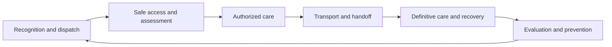

# EMS Foundations — Module 02 Rapid Review (TL;DR)

## EMS as a coordinated system of care

Emergency medical services (EMS) connects community recognition and prevention, public access, dispatch, first response, BLS/ALS care, transportation, definitive treatment, rehabilitation and recovery. Modern EMS is a continuum of care, not merely ambulance transportation. Early recognition and effective field treatment matter because they connect patients with the resources required to improve outcomes. Documentation, research and quality improvement feed back into system design.

### Development and organization

Military experience in Korea and Vietnam demonstrated the importance of treating patients before hospital arrival; subsequent military experience continues to inform trauma care. Key national milestones include:

| Milestone | Significance |
| --- | --- |
| 1966 White Paper (*Accidental Death and Disability*) | Identified serious deficiencies in prehospital care and recommended system and educational improvements. |
| Highway Safety Act of 1966 | Required state highway safety programs; DOT/NHTSA led development of national EMS curricula. |
| EMS Systems Act of 1973 | Funded EMS planning, staffing, training and communications. |
| EMS Agenda for the Future (1996); Education Agenda (2000) | Promoted integration with health care and national consistency in education, certification and licensure. |
| National EMS Core Content (2005); Scope of Practice Model (2006, revised 2019) | Defined knowledge domains and national provider-level capabilities. |
| EMS Agenda 2050 | People-centered framework for the long-term evolution of EMS. |

State EMS agencies plan, coordinate, regulate and license agencies and personnel. The NHTSA assessment framework identifies ten system elements: **regulation and policy, resource management, human resources and training, transportation, facilities, communications, public education, medical direction, trauma systems and evaluation**. Effective systems also balance clinical and service quality, economic efficiency, accountability, improvement and resilience.

Fire-based EMS may provide first response, transport or both; municipal/third-service EMS is separate from fire and police; private and hospital-based services may combine 911 response and interfacility transportation. Law enforcement EMS and cross-trained public safety officer systems are less common. Administrative models do not determine clinical capabilities. Services may also provide event coverage, disaster response, specialty transport, community paramedicine and prevention.

> [!NOTE]
> **ALS connection:** Tiered response may involve BLS first response with a separate ALS unit or a mixed-level ambulance. Request the capability needed, describe patient findings and coordinate intercepts without unnecessarily delaying definitive care. A prehospital ECG is useful partly because it connects a patient with an appropriate receiving facility.

## Professional authority, scope and clinical governance

### What authorizes clinical care?

| Concept | Essential distinction |
| --- | --- |
| Education | Acquisition of knowledge and skills. |
| Certification | Verification of competency. |
| Licensure | Legal permission to practice. |
| Credentialing | Individual authorization to practice within a particular system. |
| Scope of practice | Legal boundaries on permitted activities. |
| Standard of care | What a reasonably prudent similarly trained clinician would do under comparable circumstances. |
| Protocol | Approved operational guidance for care, transport and destination. |

The National EMS Scope of Practice Model and Education Standards support consistency but do not replace state law or local credentialing. Standard of care is informed by training, accepted practice, applicable protocols and agency policies; a deviation can constitute breach of duty, but negligence requires additional elements.

| Level | Representative clinical capability |
| --- | --- |
| EMR | Immediate lifesaving first response: CPR/AED, basic ventilation, bleeding control and stabilization. |
| EMT | BLS assessment, emergency care and ambulance transport; oxygen/ventilation equipment, pulse oximetry and authorized medications. |
| AEMT | BLS plus limited advanced care, including IV/IO access, selected parenteral medications and advanced airway adjuncts. |
| Paramedic | Broader advanced assessment, ECG interpretation, manual electrical therapy, advanced airway management and pharmacology. |

The national model includes glucose measurement and ECG acquisition/transmission at EMT level; interpretation of the 12-lead ECG is distinct from acquisition. Local implementation varies. [National scope model, 2019/2021][ref-001] · [Education standards][ref-002]

> [!IMPORTANT]
> Knowledge, equipment familiarity, national certification and a higher-level partner's request do not independently authorize a skill. Preparing supplies, acquiring a measurement, interpreting it and performing an intervention are separate activities. Even assistance must be permitted and appropriately supervised.

### Medical oversight

The physician **medical director** provides clinical governance: protocols, education, credentialing, oversight and quality improvement. The EMT operates as the medical director's designated agent within applicable legal limits.

- **Indirect/off-line medical oversight:** Predetermined protocols, standing orders, education, credentialing and quality review. Standing orders allow specified care without immediate physician contact.
- **Direct medical oversight:** Real-time direction through online communication (radio, telephone, video or other approved channels) or an authorized physician physically on scene.
- **Crew leadership:** Coordinates patient care and assigns permitted tasks; it does not replace physician oversight or legal authority.

Consult medical direction when required or when the appropriate course of care is uncertain. Confirm and read back orders, document the clinician, time, order and resulting actions. Clarify an unsafe or unauthorized instruction; use communication-failure contingencies rather than assuming approval.

> [!CAUTION]
> The textbook chest-pain example illustrates standing versus online orders, not a universal treatment protocol. The inherited 2025 ACS clarification recommends oxygen for ACS with SpO₂ below 90%, not routine oxygen at or above 90%. Nitroglycerin can reduce blood pressure and requires assessment for contraindications; aspirin inhibits platelet aggregation but also requires contraindication screening. Normal initial ECG or pain relief does not exclude ACS. Follow actual protocols. [2025 ACS guideline](https://doi.org/10.1161/CIR.0000000000001309)

## Professional conduct, ethics and legal accountability

### The EMT's responsibilities

Responsibilities extend across the entire call: equipment and vehicle readiness, safety, assessment, emergency care, safe lifting and transport, transfer, documentation, advocacy, emotional support, interagency cooperation, and professional development. Competence, confidence, compassion, integrity, judgment, teamwork, hygiene, respect and lifelong learning sustain public trust. Maintain certification/licensure and skill proficiency; know local territory, emergency driving rules and equipment limitations. Physical job requirements vary; the source's 125-pound lifting example is not a universal minimum or safe individual lifting target. The ADA addresses reasonable accommodations for qualified workers.

### Duty, ethics and advocacy

**Duty to act** is the legal obligation to provide care. On-duty responders must provide competent care to patients who require and consent to it. Off-duty obligations vary by jurisdiction; voluntarily undertaking care may create a duty and responsibility not to abandon the patient. Transfer responsibility to an appropriate clinician rather than leaving a patient without necessary care.

Duties also extend to maintaining personal fitness and credentials, reporting an impaired partner, checking assigned equipment before the shift, safeguarding patient belongings and protecting patient privacy. Provide accurate information and emotional support; preserve dignity, communicate concerns, and do not allow personal bias to influence care.

Ethical practice places the patient's welfare first. **Autonomy** respects informed decisions; **beneficence** promotes benefit; **nonmaleficence** avoids unnecessary harm; **justice** concerns fair treatment and allocation. Legal and ethical obligations may conflict, especially with treatment limitations, refusals or scarce resources; follow applicable law and consult medical direction. More invasive care is not automatically more beneficial. [AHA ethics guideline][ref-035]

### Liability and legal protections

Criminal liability involves government prosecution; civil liability involves a plaintiff seeking a remedy from a defendant. A tort is a civil wrong. **Negligence** generally involves unintended harm from a breach of duty; gross negligence involves substantially more reckless conduct. Intentional wrongdoing is a distinct legal category.

All four negligence elements must be established: **duty to act → breach of duty/standard of care → actual damages → proximate causation**. A poor outcome alone does not establish negligence. Legal doctrines discussed in the source include *res ipsa loquitur* (circumstances may support an inference of negligence) and *negligence per se* (violation of an applicable law may establish negligence elements, depending on jurisdiction).

| Intentional tort or concern | Meaning in EMS practice |
| --- | --- |
| Assault | Creating reasonable apprehension of harmful or offensive contact. |
| Battery | Unauthorized harmful or offensive contact; treatment without valid consent or other legal authority may qualify. |
| False imprisonment | Unlawful restriction of a patient's freedom, including improper detention or restraint. |
| Abandonment | Improper termination of a patient-care relationship without appropriate continuation of care. |
| Defamation | False damaging statements; libel is written, slander spoken. |

Good Samaritan statutes, governmental immunity and other protections vary by jurisdiction, employment context and conduct; they do not provide blanket immunity. Statutes of limitations establish jurisdiction-specific filing deadlines; comparative or contributory fault concerns the patient’s contribution to harm and may affect recovery. Good documentation, authorized practice and appropriate patient transfer are essential risk controls.

## Workforce readiness, wellness and injury prevention

EMS exposes responders to dangerous scenes, traumatic events, irregular schedules, physical work, interpersonal conflict and uncertainty. Responder safety is a prerequisite for patient care. Wellness includes physical, intellectual, emotional, social, environmental and spiritual dimensions; impairment in one can affect others.

### Stress recognition and support

| Stress reaction | Pattern |
| --- | --- |
| Acute | During or shortly after a stressful event; sympathetic activation, anxiety, altered concentration and physical symptoms may occur. |
| Delayed | Symptoms emerge days, months or longer afterward; PTSD may involve nightmares, flashbacks, irritability and impaired functioning. |
| Cumulative | Repeated stress builds over time, contributing to burnout, exhaustion, irritability and declining performance. |

Watch for cognitive changes (poor concentration/judgment), emotional changes (anxiety, anger, depression), physical symptoms (fatigue, headaches, palpitations), behavioral changes (substance use, sleep/appetite changes) and social withdrawal. Do not assume chest pain, syncope or respiratory distress in a colleague is merely anxiety; concerning symptoms require evaluation.

Support includes realistic priorities, sleep, nutrition, exercise, relaxation, time away from work, supportive relationships, buddy systems, rotation or relief from unsafe work, and confidential professional assistance/EAP when needed. Crew resource management reduces error through explicit assignments, cross-checks and closed-loop communication.

**CISM** is a broad framework including preincident education, peer support, practical assistance, follow-up, family support and referral. Traditional CISD is described as a structured meeting 24–72 hours after an event; defusing is a smaller, less structured meeting within approximately 8 hours, lasting 30–45 minutes. These are historical descriptions, not evidence-based requirements.

> [!CAUTION]
> Compulsory psychologically focused debriefing is not recommended for PTSD prevention or treatment. Distinguish voluntary supportive contact and operational review from mandatory emotional disclosure. Offer follow-up and access to professional care. [NICE PTSD guidance][ref-010] · [WHO][ref-011]

### Fitness, fatigue and mental health

The five physical fitness components are cardiovascular endurance (sustained oxygen/nutrient delivery), strength (force per contraction), muscular endurance (repeated work without undue fatigue), flexibility (joint range of motion) and body composition. Safe lifting, equipment use, appropriate nutrition and adequate recovery complement fitness.

The source's illustrative exercise target uses heart-rate reserve: `Target HR = resting HR + 0.70 × [(220 − age) − resting HR]` in bpm. The estimated maximum HR and intensity are educational examples, not individualized exercise prescriptions.

Shift work disrupts circadian rhythms and sleep deprivation impairs driving, judgment and coordination. The inherited CDC clarification recommends at least seven hours for adults aged 18–60; needs vary. The five EMS fatigue recommendations are fatigue monitoring, shifts shorter than 24 hours, access to caffeine, opportunities to nap on duty, and fatigue education. Caffeine and naps are countermeasures, not substitutes for safe staffing or sufficient sleep. [EMS fatigue guidelines][ref-029] · [CDC sleep guidance][ref-030]

Resilience is the ability to cope with adversity without lasting harm, not immunity from mental illness. Avoid using alcohol or drugs as coping mechanisms. Seek peer, supervisory or professional support when functioning or safety is affected. In the U.S., **988** provides suicide and mental-health crisis support; **911** is appropriate for immediate life-threatening emergencies. [SAMHSA][ref-031]

## Public access, dispatch and communications infrastructure

Public access (usually 911) connects callers to emergency medical dispatchers (EMDs), who gather information, coordinate response and may give prearrival instructions such as CPR. Dispatch information guides preparation but does not establish a diagnosis. Update dispatch about access, hazards, patient count, acuity, resources and delays after actual assessment.

Communications were established as an essential EMS component in the 1973 EMS Systems Act. Modern systems support voice, digital data, GPS, ECG transmission and integration with electronic records where available. FirstNet was established in 2012 to provide a nationwide public safety broadband network.

| Equipment | Role and limitations |
| --- | --- |
| Base station | Dispatch/coordination; source example 80–150 W, with coverage affected by antenna and terrain. |
| Mobile radio | Vehicle-mounted; example 20–50 W and 10–15 mi average range, variable with terrain and infrastructure. |
| Portable radio | Handheld, example 1–5 W; useful away from ambulance; limited range. |
| Repeater | Receives a signal and retransmits it, usually at different frequency/higher power, extending coverage. |
| Mobile data terminal | Displays calls, GPS and status messages; supplements voice communication. |
| Cellular/satellite | Alternative or backup communication; cellular networks may be overloaded or have dead zones; satellite can support remote coverage. |
| Telemetry | Automated transfer of data such as ECGs and vital signs. |

The FCC regulates radio operations, licensing, frequency assignments, equipment and transmitter limits. Maintain communication equipment and charged batteries, and know backup channels or approved telephone options. Use synchronized clocks and 24-hour event times; distinguish actual, estimated and unknown times, and document last known well separately from symptom discovery.

### Radio and dispatch practice

Select the correct channel, listen first, reduce background noise, identify the called unit and your own, wait for acknowledgment, then speak briefly and clearly. The chapter describes a one-second PTT pause, microphone approximately 2–3 inches away and a break during transmissions exceeding 30 seconds; follow system-specific equipment procedures. Plain language is generally preferable to codes, especially across agencies. Read back numbers and orders, document essential details and confirm receipt. Open radio is not confidential; use approved secure channels for identifiable details. Codes are not security measures.

Typical status sequence: acknowledge dispatch → en route/ETA → scene arrival/resource request → departure/destination/ETA → facility or rendezvous arrival → clear/available → return to station. Report prolonged scene time or changed circumstances. Dispatch recordings and times may become legal records.

> [!NOTE]
> **ALS connection:** Collision notification data, ECG telemetry and vital-sign transmission inform triage but do not replace clinical findings. The source's older CDC trauma-triage reference is superseded by the 2021 national field-triage guideline (published 2022); follow locally adopted criteria. [Field triage][ref-067]

## Scene safety, incident coordination and rescue interfaces

### Safety and hazard recognition

Approach cautiously, continually assess hazards and preserve a route of escape. Safety priorities include yourself, partner, other responders, patient and bystanders. Do not enter a scene beyond your training or protective equipment; request specialized resources and stage until hazards are controlled. Scene safety is dynamic, not a one-time declaration.

- **Hazardous materials:** Recognize possible contamination from placards, containers, odors, multiple patients or unusual circumstances without entering to investigate. Position safely, notify dispatch and request HazMat personnel. Remain outside contaminated zones unless trained and authorized. Decontamination and transport coordination protect both responders and receiving facilities.
- **Rescue and extrication:** Fire, technical rescue and other specialists control hazards and access. Coordinate care with incident command; do not enter confined spaces, unstable structures, water or other technical hazards without proper training and equipment. Provide care within the safe area; plan patient packaging with rescuers.
- **Roadways:** Use protective vehicle placement under incident command, high-visibility apparel where appropriate, and remain alert to traffic. Do not assume traffic stops because emergency lights are visible.
- **Violence:** Stage for law enforcement clearance, avoid escalating conflict, maintain distance and exit access, and withdraw if safety changes. A law enforcement presence does not guarantee a safe scene.

### Scene leadership and crime scenes

Coordinate with incident command and other agencies; communicate priorities, resources and hazards. Take charge of the clinical responsibilities appropriate to your role. Use a shared mental model, clear task assignments, repeat-back and confirmation of completion. A team member should raise an unexpected finding or safety concern immediately regardless of provider level.

Patient care and rescuer safety take priority over evidence preservation. Minimize unnecessary disturbance, avoid cutting through suspected evidence when feasible, do not move weapons unnecessarily, and preserve/document belongings and changes required for patient care. Coordinate with law enforcement and the medical examiner/coroner. Do not offer speculative conclusions about the event or disclose unrelated patient information.

## Infection prevention and occupational exposure

### Transmission and disease categories

An infectious disease results from a pathogen; a communicable disease can spread between people. Transmission may occur through direct contact (blood, mucous membranes, wounds), indirect contact (contaminated objects or sharps), respiratory particles, or other routes such as vectors and fecal–oral exposure.

| Pathogen | Mechanism and representative examples |
| --- | --- |
| Bacteria | Single-celled organisms; bacterial pneumonia, TB, strep infections. Antibiotic susceptibility varies. |
| Viruses | Require host cells to reproduce; influenza, HIV, hepatitis viruses, COVID-19 and varicella. Antibiotics do not treat viruses. |
| Fungi | Can cause infections, including opportunistic infections in immunocompromised patients; not limited to those patients. |
| Protozoa | Single-celled organisms; some spread through fecal–oral routes or vectors (e.g., malaria). |
| Helminths | Parasitic worms acquired through ingestion or skin penetration; hookworm can cause blood loss/anemia. |

Bloodborne exposure is particularly relevant to HIV, HBV and HCV; respiratory precautions vary by disease. Pulmonary/laryngeal TB is primarily airborne. Varicella requires airborne, contact and standard precautions. Influenza, rubella, pertussis and meningococcal disease have respiratory transmission implications; pneumonia is a syndrome with variable causes. Ebola requires specialized assessment, PPE and transport procedures; Zika can spread through mosquito bites, sexual contact and from pregnant patient to fetus. Incubation periods and PPE selection are organism-specific, not inferred from symptoms alone. [CDC isolation guidance][ref-013] · [VHF EMS guidance][ref-015]

### Standard Precautions and protective barriers

Apply Standard Precautions regardless of known infection status. Employers provide an exposure-control plan, training, appropriate PPE and required occupational protections; employees follow procedures and report exposures. Add transmission-based precautions for the suspected pathogen and procedure.

- **Hand hygiene:** Before patient contact/clean tasks and after patient contact, contaminated surfaces or glove removal. Alcohol-based hand rub is generally appropriate when hands are not visibly soiled; use soap/water when visibly dirty or otherwise indicated. Gloves do not replace hand hygiene.
- **Gloves:** Change between patients and contaminated/clean tasks, never reuse, replace damaged gloves safely. Use utility gloves for cleaning. Remove by containing contaminated outer surfaces inside the gloves; touch the clean interior only with bare hands.
- **Eye/face protection and gowns:** Select based on anticipated splashes or contamination; handle clothing and equipment through approved procedures.
- **Masks and respirators:** A surgical mask can provide splash protection/source control but is not equivalent to a fit-tested respirator. Tight-fitting respirators require fit testing before use and at least annually, a seal check each donning and no hair interfering with the seal. Select respiratory protection based on exposure and current pathogen-specific procedures. [OSHA respiratory protection][ref-018]

**Cleaning** removes physical contamination; **disinfection** kills many microorganisms on surfaces; **sterilization** eliminates all microorganisms on critical devices. Noncritical equipment such as BP cuffs requires appropriate disinfection; semicritical equipment touching mucous membranes requires at least high-level disinfection; critical equipment entering sterile tissue or the bloodstream requires sterilization. Follow manufacturer instructions and approved spill procedures. Never reuse disposable supplies, improvise disinfectant mixtures or take contaminated work clothing home. Place sharps directly into an appropriate puncture-resistant container; do not recap. Waste containment depends on contamination and leakage risk, not diagnosis alone. [OSHA bloodborne pathogens][ref-017] · [CDC hand hygiene][ref-022]

### Screening, immunization and exposure response

Occupational health programs address TB screening and vaccinations such as hepatitis B, influenza, MMR, varicella and tetanus/pertussis according to worker history and current guidance. OSHA requires eligible exposed-risk employees to be offered hepatitis B vaccination at no cost within 10 days of initial assignment. TB testing may use an IGRA or TST; routine repeat testing depends on risk and applicable guidance.

After a needlestick, splash or other significant exposure: wash injured skin or flush exposed mucous membranes, notify the supervisor/designated officer, document circumstances and seek prompt occupational-health evaluation. Do not wait for source testing or hospital notification. The inherited Ryan White Act clarification gives notification as soon as practicable and no later than **48 hours after the facility determines** the relevant airborne infectious disease, not a universal 24-hour limit. [Federal statute][ref-020]

> [!WARNING]
> Occupational HIV PEP, when indicated, is time-sensitive: start as soon as possible and within 72 hours under the 2025 U.S. PHS guideline; unusual later high-risk exposures require specialist advice. HBV/HCV exposures need their own evaluation. PEP decisions belong to occupational-health clinicians. [2025 PHS guidance][ref-019]

> [!NOTE]
> **ALS connection:** BVM ventilation, suction and advanced airway procedures may expose the crew to respiratory secretions/aerosols. Prepare appropriate barriers and limit unnecessary personnel. Vascular access adds sharps risks. Infection prevention depends on exposure, not how sick a patient looks; report changes in respiratory effort, mental status, perfusion and vital signs that may indicate deterioration.

## Therapeutic communication, assessment and clinical reasoning

### Patient-centered communication

Communication combines verbal and nonverbal messages. A sender encodes information; a receiver decodes it through personal experiences, culture and perceptions; feedback helps confirm that the intended message was understood. Establish trust to improve the accuracy of assessment and cooperation with care.

| Technique | Purpose |
| --- | --- |
| Facilitation | Encourage the patient to continue speaking. |
| Clarification | Resolve unclear statements or meanings. |
| Summary | Restate what was understood and confirm accuracy. |
| Explanation | Describe the situation or proposed care in understandable language. |
| Silence | Allow time to process information or respond. |
| Reflection | Recognize and reflect the patient's feelings. |
| Empathy | Understand the patient's perspective without judgment. |
| Confrontation | Respectfully address inconsistencies without aggression. |

The source also describes historical **facilitated communication** involving physical guidance of letter selection. This is not a recommended method of establishing a person's independent message or consent; use appropriate independent communication supports. [ASHA position][ref-069]

Convey the three Cs: **competence, confidence and compassion**. Introduce yourself and the team, ask what the patient wishes to be called, obtain consent, explain actions before performing them, protect privacy, and avoid false reassurance or jargon. Position yourself at a comfortable level and distance, reduce distractions, listen actively, allow response time and avoid leading or blaming questions. Nonverbal cues (posture, facial expressions, gaze and touch) are influenced by culture, disability, fear and illness; they do not prove a patient's honesty or capacity. Ask permission before entering intimate space or using comforting touch.

Open-ended questions allow the patient's narrative; closed-ended questions clarify specific facts and help prioritize in time-critical situations. Begin broadly, then narrow to relevant symptoms, events, medications, allergies and baseline function. Obtain a history in parallel with lifesaving care when staffing permits. Distinguish what the patient or witness reports from independently verified findings.

### Adaptations and emotional support

Avoid ethnocentrism and cultural imposition. Use qualified interpreters or accessible communication services whenever possible; family members may assist in urgent circumstances but are not an automatic substitute for qualified interpretation. [ADA effective communication][ref-070] · [Language access][ref-071]. Speak to the patient directly. Hearing impairment may require visible lips, written communication or qualified sign-language interpretation. Do not equate communication barriers with impaired cognition. Give older adults adequate time and respect; communicate honestly at a child's eye level using developmentally appropriate language. Family-centered care values caregiver knowledge of the patient's baseline, conditions, devices and individual care plans while respecting the patient's privacy and decisions.

The Kübler-Ross model describes possible reactions to dying or loss: **denial, anger, bargaining, depression and acceptance**. These are not a required sequence or diagnostic criteria. Maintain dignity, listen empathetically, explain care in plain language, support families and permit safe expression of grief. Where a death is a potential crime scene, do not disturb evidence or allow contact with the body until authorized. Support patient and family needs even if resuscitation is withheld or terminated under valid orders.

### Assessment and clinical reasoning

After scene safety and access, the **primary assessment** identifies and addresses immediate threats such as airway compromise, inadequate breathing, cardiac arrest and severe bleeding. The **secondary assessment** gathers additional history, examination findings and vital signs, identifies other problems and guides care. Reassess after interventions, movement or deterioration and during transport. Work efficiently without unsafe haste.

A **symptom** is subjective (reported experience); a **sign** is objective (observable or measurable finding). A **field impression** is a working clinical explanation supported by history and examination, not a confirmed diagnosis. Use the most acute clinical problem as the primary impression rather than automatically copying the dispatch complaint.

| BLS finding | Supplemental ALS reasoning |
| --- | --- |
| Inadequate ventilation, declining alertness | Assess ventilation and airway support; capnography may provide additional information. Effective BVM ventilation remains important. |
| Chest discomfort, syncope, abnormal pulse | ECG acquisition and authorized interpretation may reveal concerning ischemic or rhythm patterns. |
| Weak pulses, cool skin, falling BP, confusion | Consider compromised perfusion; additional evaluation and vascular access may be indicated according to cause and protocol. |
| Altered mental status | Glucose testing, neurologic assessment and targeted evaluation may identify reversible causes. |

### Supplemental monitoring: what the measurement means

| Tool | Information and limitations |
| --- | --- |
| Pulse oximetry | Estimates arterial oxygen saturation, not ventilation. Motion, cold and poor perfusion can impair reliability. Supplemental oxygen may mask developing hypoventilation. |
| Continuous ECG | Displays electrical rate and rhythm; electrical activity alone does not prove a perfusing pulse. |
| 12-lead ECG | Samples electrical activity from multiple views; acquisition and interpretation are separate. Artifact or a normal initial tracing does not exclude serious illness. |
| Waveform capnography | Exhaled CO₂ (EtCO₂) and waveform reflect ventilation, pulmonary blood flow and metabolism; a low value does not identify one specific cause. |
| Noninvasive BP | Estimates arterial pressure; interpret trends alongside pulse quality, mentation and other findings. |

Report trends, measurement quality and patient changes to the treating clinician. Advanced data complement, not replace, clinical examination. Effective compressions, appropriate early defibrillation and effective ventilation remain fundamental in cardiac arrest regardless of advanced equipment. [AHA adult ALS][ref-004] · [NAEMSP airway care][ref-007]

## Patient autonomy, consent, refusal and safeguarding

### Consent and legal authority

Consent is permission for assessment or treatment. Explain who you are, the proposed care, relevant risks and alternatives at a level the patient understands; consent is intervention-specific and may be withdrawn. A cooperative patient may agree to assessment but refuse transport or a particular procedure.

| Consent category | Meaning and limits |
| --- | --- |
| Expressed | A patient with decision-making capacity communicates agreement verbally or through clear conduct. |
| Informed | Agreement after adequate explanation and understanding of proposed care, material risks and alternatives. |
| Implied/emergency | Necessary emergency care may proceed under applicable law when a patient lacks capacity and delaying for consent would threaten life or health. |
| Consent for minors | Ordinarily involves a parent/guardian; emergency exceptions, emancipation and other minor-consent rules vary. Do not delay necessary emergency care where lawful emergency authority applies. |
| Involuntary treatment | Requires specific legal authority and applicable clinical circumstances; custody, arrest, intoxication or mental illness alone does not eliminate decision-making rights. |

### Capacity and informed refusal

**Capacity** is a clinical, decision-specific assessment; **competence** is a legal determination. Orientation to person, place, time and event is useful but insufficient to establish capacity. A patient may have capacity for one choice and lack it for another. Assess four abilities:

1. **Understanding:** Explain the problem, proposed care, alternatives and significant risks.
2. **Appreciation:** Recognize how the information applies personally.
3. **Reasoning:** Compare choices and their likely consequences meaningfully.
4. **Communication:** Express a sufficiently clear and consistent choice.

Hypoxia, hypoglycemia, shock, head injury, intoxication, severe distress and other conditions can impair these abilities; their presence is a reason to evaluate, not automatic proof of incapacity. A capable patient may refuse even potentially lifesaving treatment. Use teach-back to establish understanding rather than relying on a signature or apparent alertness.

### Refusal workflow

- Maintain scene safety and perform the assessment the patient permits. Identify and explain concerning findings, recommended care, alternatives and consequences of refusal, including serious harm or death where relevant.
- Evaluate and document decision-specific capacity; address communication barriers and potentially reversible impairment within lawful authority. Encourage appropriate evaluation without coercion.
- Consult medical direction for high-risk or uncertain cases and as required by protocol. If capacity is absent and an emergency cannot wait, use the applicable emergency-consent process.
- Document the findings, specific care refused, risks discussed, patient responses/teach-back, alternatives, consultation, decision, witnesses and any permitted treatment. Obtain the refusal signature and witness statement when possible; document if either is unavailable.
- Offer safe alternatives appropriate to the condition and clear instructions about deterioration or calling EMS again. Do not suggest an unsafe alternative solely to obtain agreement.

> [!IMPORTANT]
> A signed refusal is documentation, not a substitute for informed refusal and capacity assessment. [High-risk refusal review][ref-040] Lawful restraint requires a clinical indication and legal authority, not merely disagreement. [NAEMSP restraint guidance][ref-008] Use de-escalation, appropriate assistance, approved restraint procedures and continued airway, ventilation and circulation monitoring. [Model clinical guidelines][ref-034]

**ALS connection:** A high-risk refusal after a possible head injury or with abnormal vital signs warrants careful assessment and consultation; a normal single measurement does not resolve uncertainty. Advanced findings can inform risk explanations, but the patient must still be assessed for the specific decision. Report what could not be assessed rather than claiming the patient was normal.

### Mandatory reporting and safe-haven surrender

Report suspected abuse/neglect, designated injuries, communicable exposures and other legally reportable events to the appropriate authority under jurisdictional law. Examples include suspected child or elder abuse, certain violent injuries, sexual assault and some other mandated incidents. Record objective findings and exact relevant statements; suspicion is not a confirmed allegation. Notifying a partner alone may not satisfy a reporting obligation. Preserve confidentiality outside authorized disclosures.

Baby safe-haven laws permit surrender of eligible infants at designated sites under state-specific conditions. Texas enacted the first such law in 1999. Know whether your agency is a designated site, applicable age and procedural requirements, and follow infant assessment, warming, safeguarding and transfer procedures. Do not assume every EMS location qualifies.

## Treatment limitations, death and special medicolegal responsibilities

### Advance directives and medical orders

The Patient Self-Determination Act supports patient rights concerning medical decisions. State law determines recognized forms and EMS implementation.

| Document or order | Function |
| --- | --- |
| Living will | Expresses preferences regarding future treatment if the patient becomes unable to decide. May not itself be an immediately actionable prehospital medical order. |
| Durable power of attorney for health care | Designates a legally authorized surrogate for applicable decisions when the patient cannot decide. |
| DNR | Limits resuscitation under the terms of the recognized order. |
| DNI | Limits intubation, not necessarily other respiratory care. |
| POLST/MOLST | Portable medical orders specifying the treatments permitted or limited; distinct from a conventional advance directive. |

Verify identity, recognized form or alternative proof, applicable signatures/authority, validity and the actual interventions limited. Consult medical direction when orders are missing, ambiguous, contradictory or disputed; provide indicated care while resolving uncertainty according to law and protocol. Vague statements such as "no heroics" are not necessarily actionable orders. A capable patient's current informed decisions matter; family preference alone does not automatically invalidate a valid order.

> [!IMPORTANT]
> **DNR does not mean do not treat.** A patient with a pulse may still need assessment, authorized treatment and symptom relief consistent with their goals. Oxygen is not automatically required for comfort care. Valid resuscitation limitations may require withholding CPR or stopping previously initiated CPR under approved procedures. [Model clinical guidelines][ref-034] · [AHA ethics guideline][ref-035]

### Death recognition, withholding and termination

Presumptive findings such as apnea, pulselessness, unresponsiveness and fixed pupils alone do not establish irreversible death. Obvious death findings may include decomposition, rigor mortis, dependent lividity or injuries incompatible with life. Follow jurisdictional criteria; do not infer a precise time of death from one finding.

- **Withholding:** Not initiating resuscitation when a valid recognized exclusion applies, such as a verified treatment-limitation order or unequivocal irreversible death under protocol.
- **Termination (TOR):** Stopping resuscitation already underway according to approved criteria and medical direction when required.
- **Pronouncement:** Formal recognition of death by a legally authorized individual; the cause and manner of death are separate determinations.

> [!CAUTION]
> Hypothermia, drowning, lightning and toxic exposures may change usual resuscitation decisions. Do not apply routine TOR criteria indiscriminately or presume irreversible death from coldness and rigidity. If resuscitation status is uncertain, initiate indicated care and seek direction. [Model clinical guidelines][ref-034] · [AHA adult ALS][ref-004]

The medical examiner or coroner must be notified in situations required by law, such as certain unexpected, violent or suspicious deaths. Preserve the scene, document observations, and follow authorized transfer/disposition procedures. Care for family members without compromising evidence or confidentiality.

### Organ donation and medical identification

Treat a potential organ donor as a patient first; donor designation does not change clinical indications or valid limitations. Coordinate authorized notifications and preserve relevant records. Medical bracelets, necklaces, cards and alert tattoos may offer important clues (e.g., diabetes, anticoagulant therapy), but wording and legal status must be verified as appropriate; a tattoo is not automatically a valid DNR order. Communicate exact relevant information to the clinical team.

## Patient movement: clinical priorities, mechanics and equipment

Safe patient movement balances the urgency of care, physical hazards, patient physiology, suspected injuries, access, available personnel and equipment. Poor lifting technique injures responders and can cause patients to fall or deteriorate. Choose the safest effective method, rather than relying on strength alone.

### Body mechanics and load management

The four principles are: **keep the load close; use legs, hips, gluteal and abdominal muscles; stack shoulders over hips over feet; reduce the distance or height moved.** A load held farther away increases leverage on the lower back. Maintain neutral spinal alignment and stable footing, avoid twisting, move feet to turn, and keep wrists and knees aligned. Use mechanical aids whenever available. Assess the combined weight of the patient and equipment, the route, stairs, terrain, staffing and device weight limits before lifting. Request additional help before an unsafe lift.

- **Power lift:** Stand close with a stable stance, bend at hips and knees, grasp securely, maintain alignment, and rise with the legs while keeping the load close. Avoid bending and twisting under load.
- **Squat lift:** A stable squat-based alternative when access or positioning requires it; use leg and hip power rather than the back.
- **Carrying:** Keep elbows/load close, avoid asymmetrical loading when practical, and coordinate steps. Balance one-handed equipment loads without lateral trunk bending.
- **Reaching:** Move closer rather than reaching far with weight; reposition or use a device when a safe reach is impossible.
- **Pushing/pulling:** Prefer controlled pushing where appropriate, keep the back aligned, use legs and body weight, and avoid twisting or reaching beyond safe limits.

Assign a leader who describes the plan, checks readiness, and gives coordinated commands. Stop when anyone reports a safety concern. Practice device-specific lifting and loading under supervision rather than treating an abbreviated description as competency training.

### Selecting the move

| Category | Indication | Principle |
| --- | --- | --- |
| Emergency | Immediate danger to patient/rescuer, or essential access to lifesaving care | Escape or gain necessary access with minimum delay; protect the patient as feasible. |
| Urgent | Immediate clinical threat requiring rapid movement/transport | Address immediately achievable life threats, minimize unnecessary motion and expedite definitive care. |
| Nonurgent | No immediate threat requiring rapid movement | Plan carefully, use appropriate devices and adequate personnel, protect comfort and injuries. |

Emergency drags include armpit–forearm, shirt and blanket drags. They are rapid relocation methods, not routine transport or optimal spinal-motion restriction. Urgent movement may include rapid extrication from a vehicle when life threats cannot be managed adequately in place; coordinate with rescuers and minimize unwanted movement. Self-extrication may be appropriate for selected patients under local protocols, not for every injured patient. A stable patient can require an emergency move because of environmental danger; an unstable patient may need immediate ventilation or CPR before movement. Reevaluate urgency continuously.

### Position and physiologic tolerance

| Patient situation | General positioning principle (subject to clinical findings and protocol) |
| --- | --- |
| Alert, stable patient | Supine or seated according to condition and comfort. |
| Unresponsive but adequately breathing | Appropriate side-lying/recovery position when indicated; maintain airway and reassess continuously. Coordinate if spinal injury suspected. |
| Chest discomfort or respiratory distress | Upright/position of comfort if tolerated and hemodynamically appropriate. |
| Shock/hypoperfusion | Generally supine if tolerated; consider airway, injury and breathing requirements. |
| Suspected spinal injury | Minimize unwanted spinal motion using indicated equipment and approved SMR procedures. |
| Vomiting/nausea | Position to permit airway protection and suction; adapt to injuries and condition. |
| Pregnancy after approximately 20 weeks | Left lateral positioning or right hip elevation/left displacement when appropriate to reduce vena caval compression and improve venous return. |

Recovery positioning reduces aspiration risk but does not guarantee airway protection. Absent or inadequate breathing requires appropriate resuscitation or ventilation, not passive side-lying. Specific obstetric emergencies require condition-specific protocols. In cardiac arrest with the uterine fundus at or above the umbilicus, the inherited 2025 guidance emphasizes manual leftward uterine displacement with CPR rather than compromising compressions by rolling the patient onto her side. [AHA special circumstances][ref-085] [First aid guideline][ref-086] · [Adult BLS][ref-083]

**ALS connection:** Position affects ventilation and perfusion. Upright positioning may help respiratory distress; lying flat may worsen pulmonary edema. CPAP provides continuous positive airway pressure that can improve gas exchange and reduce breathing effort in selected patients, but positive pressure can reduce venous return. Hypotension, vomiting, inability to protect the airway or exhaustion can make noninvasive support unsuitable. Assess tolerance and report changes rather than treating the position or monitor number alone. [Noninvasive ventilation][ref-080]

### Devices and transfer methods

| Device | Principal use and limitation |
| --- | --- |
| Wheeled ambulance stretcher | Primary patient transport platform; lock into approved mounting system, secure patient with approved restraints, adjust height safely and verify locks. |
| Powered stretcher/loading system | Reduces manual lifting demands; training, rated load and backup procedures still matter. |
| Bariatric device | Supports higher loads and wider patients; requires appropriately rated equipment, suitable vehicle, route and adequate staffing. |
| Portable/soft stretcher | Flexible carrying in restricted spaces; usually requires coordinated personnel and transfer to an approved transport device. |
| Stair chair/tracked chair | Seated movement through stairways or tight spaces when the patient can tolerate sitting; not suitable for every unstable, unconscious or spinal-injury patient. |
| Long backboard | May facilitate extrication and transfer; prolonged use can cause pressure injury, pain and respiratory compromise. |
| Full-body vacuum mattress | Conforms to the patient to restrict movement and distribute pressure; follow equipment and protocol limitations. |
| Scoop stretcher | Separates into halves to lift a patient with reduced rolling; observe manufacturer instructions and secure connections. |
| Basket/Stokes stretcher | Technical rescue or difficult terrain, requiring appropriate rigging and trained rescuers for specialized operations. |
| Flexible/Reeves stretcher | Useful for restricted spaces and coordinated manual movement; select according to patient support needs. |

Spinal motion restriction (SMR) is not absolute immobilization. [Joint SMR statement][ref-075] Prioritize airway, ventilation, perfusion and comfort; a device used for extraction may not be appropriate for the entire transport. Equipment illustrations, lock indicators, load ratings and loading methods are model-specific. [Model clinical guidelines][ref-072]

| Nonurgent transfer | Selection principle |
| --- | --- |
| Direct ground lift | Coordinated lift from the ground to a nearby stretcher when injury pattern and staffing permit. |
| Extremity lift | Two-person technique for an appropriate patient without injuries that make lifting by the extremities unsafe; useful in limited spaces. |
| Direct carry | Coordinated transfer from bed or surface to stretcher with compatible height and personnel. |
| Draw-sheet transfer | Slide across closely aligned surfaces using a sheet/transfer aid and coordinated personnel. |

Select two- or four-person carrying configurations according to weight, route and equipment. Use a stair chair or other appropriate device rather than attempting an unsafe supine carry in a confined space. Clear the route, maintain stable footing, coordinate movement, and use mechanical assistance where available. Specific carry orientation and loading steps depend on device, terrain and patient condition.

### Packaging and reassessment

Before transport, secure the patient, protect warmth and dignity, stabilize indicated injuries, secure necessary equipment, check airway access and ensure restraints are compatible with the transport device. Use approved size- and weight-appropriate pediatric restraints; personal car seats and improvised padding are not automatically suitable for cot mounting. Never transport a child unsecured or in an adult’s arms. Older adults and patients with fixed joints or disabilities may need padding and individualized positioning; avoid forcing painful or deformed limbs into a standard posture. [2025 pediatric transport guidance][ref-087] Never transport a patient on an unapproved crew seat. During and after movement, reassess airway, breathing, circulation, mental status, pain, alignment and device security.

**ALS connection:** A patient with ventilation support, ECG leads, IV/IO access or infusion equipment requires planning for line slack, secure connections, battery/oxygen reserve, access to the airway, continuous monitoring and an appropriate transport crew. Movement can dislodge an airway, kink a line, interrupt infusion or produce ECG/pulse oximetry artifact. Report changes and check the patient before assuming equipment failure. Never independently adjust advanced equipment outside authorization.

> [!CAUTION]
> The source's trauma example uses a traction splint and a 15-minute reassessment interval. The inherited 2025 traction clarification emphasizes uncertain comparative benefit and that static stabilization may be preferable in selected patients ([NAEMSP position statement](https://pubmed.ncbi.nlm.nih.gov/40334120/)); assess associated injuries and follow protocol. Reassess immediately after interventions, movement or deterioration rather than waiting for an example interval. Do not delay urgent transport simply to complete advanced procedures.

## Transport, destination selection and escalation of care

### Destination and continuity

Transport connects field care to definitive treatment. Destination selection considers patient acuity, specialty capabilities (trauma, stroke, cardiac, pediatric or other services), travel time, system policies, resource availability and patient preference when consistent with clinical safety. The closest hospital may not be the most appropriate. Explain why a specialty destination is recommended, communicate findings and consult medical direction when indicated.

For suspected stroke, document last known well and neurologic findings, communicate onset uncertainty, follow approved stroke triage and notify the receiving facility. A stroke scale screens for concerning findings; it does not establish a definitive diagnosis or independently determine eligibility for hospital interventions.

**EMTALA**, associated with COBRA legislation, addresses participating hospitals' obligations to provide an appropriate medical screening examination and stabilizing treatment or an appropriate transfer when required. [CMS EMTALA][ref-052] · [Federal statute][ref-053] Interfacility transfer requires coordination with the sending and receiving facilities, appropriate documentation, qualified personnel and equipment matched to the patient's needs. Do not treat hospital obligations as a universal field destination rule or transport every patient with ongoing advanced care using an unqualified crew.

During interfacility or emergency transport, determine the patient's baseline, ongoing care requirements, potential deterioration, relevant orders, equipment and contingencies. Escalate care when the current crew cannot safely manage the patient. Transfer to a lower level requires clinical appropriateness, lawful authorization, monitoring capability and a plan for changes; it is not justified merely because the patient appears stable at one moment.

### Specialty transport

Air medical transport may reduce time to specialty resources or provide an appropriate critical-care capability in selected circumstances. Consider total time, weather, landing/access hazards, patient needs and crew capability. Follow aircraft crew instructions; secure loose equipment, protect from rotor hazards, and approach or depart only as directed. Plan oxygen, airway, monitoring and access before loading. Intubation is not a universal prerequisite to flight; effective BLS or other airway support may be appropriate. [AHA systems of care][ref-084]

Neonatal transport may require a secured isolette, specialized personnel, thermal protection, age-appropriate respiratory support and monitoring. Infants are vulnerable to temperature instability; cold stress can increase metabolic and oxygen demand. Monitor warmth, breathing, perfusion and device function under the neonatal transport plan. Specialized transport capability is distinct from ordinary paramedic licensure.

At the receiving location, continue care until responsibility is accepted by an appropriate clinician. Transfer the patient's belongings, documentation and relevant clinical information; address unanswered questions. An arrival timestamp is not necessarily the transfer-of-care time.

## Clinical reporting, medical orders and transfer of responsibility

### Communication across the care continuum

Dispatch communication coordinates resources; online medical direction provides individual orders/advice; receiving-facility notification allows preparation; bedside handoff transfers the clinical story and responsibility. A radio report does not replace the formal transfer of care. Report important changes promptly rather than relying on an earlier notification.

A concise patient report includes unit identification, age/sex as relevant, chief complaint and onset/mechanism, pertinent history, assessment and vital signs, working impression, treatment and response, transport destination/ETA, requested resources or orders, and significant limitations. Tailor detail to acuity and the receiving clinician's needs. Use objective observations, clear language and relevant patient-reported symptoms rather than unjustified definitive diagnoses.

**SBAR:** Situation (immediate problem and reason for communication); Background (relevant history and circumstances); Assessment (findings, clinical impression and trends); Recommendation (requested action, resources or next steps). Use an organized format consistent with local handoff practice.

When receiving medical orders, clarify medication name, dose and unit, route, timing and conditions as applicable; repeat back the order, obtain confirmation and document the source/time and actual response. An unclear order is not authorization to guess. Confirm allergies, contraindications and individual authorization. Report completion, inability, unexpected effects and changes in condition.

### Clinical deterioration and handoff example

The source illustrates a patient with worsening perfusion during transport:

| Finding | Initial | En route |
| --- | --- | --- |
| BP | 88/64 mmHg | 82/62 mmHg |
| Heart rate | 128 bpm | 134 bpm |
| Respiratory rate | 24/min | 26/min |
| Mental status | Alert and oriented | Requires verbal prompting |
| Radial pulses | Very weak | Barely palpable |
| SpO₂ | 96% on room air | Device error; no reliable value |

Falling pressure, rising pulse/respiratory rate, poorer mentation and weaker pulses together suggest worsening circulatory compromise. A prior normal saturation does not rule out shock, and an error reading is not a measured low value. Reassess, continue authorized immediate care, update the receiving facility, request resources when appropriate and document the changes. The cause of shock and need for advanced intervention require further clinical reasoning; one pressure does not dictate a specific fluid or medication.

At bedside, identify the patient and chief complaint, establish baseline and progression, report timed findings, treatments, response, allergies/medications, outstanding concerns, and transfer responsibility explicitly. Include prior care, complications and unanswered questions. Provide the PCR or approved transfer-of-care/drop report as required, rather than assuming the recipient can access an ePCR automatically. Document who accepted care and when.

## Clinical documentation, confidentiality and the patient record

### Why the PCR matters

The patient care report (PCR/ePCR) provides continuity of care, a legal record of the encounter, administrative and reimbursement data, education, research and quality-improvement information. Complete records preserve clinical reasoning across dispatch, field assessment, interventions, reassessment and handoff.

Two fundamental principles: **document what actually happened; document it completely and accurately.** Distinguish patient statements (quote when important), observations, field impressions and information from other providers. Include pertinent positives and relevant assessed negatives. Do not document an examination that was not performed, a procedure that was not completed, or a value that was not obtained. If a patient refuses or a device fails, document the actual limitation. Avoid falsification, speculation, criticism of other providers and prejudicial language.

Paper forms use legible writing and approved correction procedures (preserve the original entry, identify and date corrections). Electronic reports require secure credentials and accurate audit trails; correct or amend a signed record through authorized processes rather than deleting or rewriting history. Document late entries and their actual entry times. Check auto-populated fields and monitor-imported values for errors. Use approved downtime processes when systems fail.

### Standardized data and report structure

The historical DOT minimum data set helped standardize EMS reporting. **NEMSIS** provides standardized definitions and data exchange for EMS records, supporting comparisons and quality improvement. It is not a universal list of every locally required element; versions, required fields, validation rules and optional elements vary by state and implementation. [NEMSIS][ref-058]

Core documentation domains include:

- Incident and unit information: call type, dispatch complaint, response/transport mode, locations, delays, crew and roles, synchronized event times, patient contact and disposition (including canceled or no-contact calls where required).
- Patient demographics and history: relevant age, allergies, medications, medical/surgical history, barriers, weight where indicated, baseline status and information sources.
- Complaint and event history: onset/duration, associated symptoms, mechanism, injury risk factors and last known well for suspected stroke.
- Examination and impression: relevant findings, pertinent negatives actually assessed, most acute primary impression, additional problems, initial and final acuity.
- Interventions, serial vital signs, response, complications, transfer/destination and accepting provider.

**SAMPLE** organizes history: signs/symptoms, allergies, medications, past pertinent medical history, last oral intake and events leading to the encounter. Distinguish baseline conditions from acute changes.

### Narrative organization

| Format | Structure |
| --- | --- |
| SOAP | Subjective, Objective, Assessment, Plan. Separates reported symptoms from observed findings, clinical reasoning and management. |
| SOAPIE | SOAP plus Intervention and Evaluation, explicitly tracking care and reassessment. |
| CHART | Chief complaint, History, Assessment, Rx/treatment, Transport. |
| CHEATED | Chief complaint, History, Exam, Assessment, Treatment, Evaluation, Disposition. Separates actual exam findings from the field impression and subsequent response. |

A chronological narrative can supplement structured fields. Explain why care was considered or provided, what changed, why transport decisions were made, and what happened at handoff. The narrative and structured fields should agree; neither excuses missing essential clinical information.

### Terminology and abbreviations

Use precise medical terminology and the intended meaning, not impressive-sounding language. Spell out unclear or nonapproved abbreviations. **CVA** may mean cerebrovascular accident or costovertebral angle; **PT** may mean posterior tibial or physical therapy; **Rx** may indicate prescription or treatment. Medication abbreviations and symbols are especially hazardous. Use approved conventions, explicit units, a leading zero for a dose less than one and no unnecessary trailing zero; write daily instead of QD, mL instead of cc, and avoid ambiguous medication abbreviations. [ISMP error-prone abbreviations][ref-060]

### Assessment, treatment and reassessment fields

Record the time and clinical context for every meaningful measurement. Routine vitals include BP, HR, RR, SpO₂, alertness (AVPU) and pain; additional measurements may include glucose, GCS (eye/verbal/motor components and qualifiers), temperature, pulse rhythm, respiratory effort, EtCO₂, ECG, stroke score or APGAR when relevant. Document actual values, units, measurement method/quality and whether before or after care. A single normal value does not establish stability.

For cardiac arrest, record witnessed status, bystander CPR/AED, first monitored rhythm, interventions, ROSC if any, times, discontinuation and disposition. For suspected stroke, identify last known well, source and uncertainty; note neurologic findings, scale and destination notification. For trauma, record mechanism, exam findings, pertinent negatives and applicable triage criteria. For refusal, document the capacity reasoning and actual discussion, not only orientation and signature.

| Medication or procedure data | Essential details |
| --- | --- |
| Medication | Actual drug, dose and unit, route, time, clinician, indication/order, response and adverse effects. |
| Procedure | Type, time, performing clinician, equipment size/site, each attempt, success/failure, response and complications. |
| Pertinent negatives: medications | Contraindication, already taken, denied by order, refused, allergy or unable to complete. |
| Pertinent negatives: procedures | Contraindication, refused, denied by order or unable to complete. |

An unperformed intervention must not appear as completed. Document each procedure attempt separately according to the applicable reporting system. A medication response may be improved, unchanged or worse; include objective reassessment rather than simply saying "tolerated well." Identify prior care and who delivered it.

**ALS connection:** Document ECG acquisition time and tracing quality separately from interpretation; capnography waveform and airway method; vascular access site/attempts and actual delivery; airway size, confirmation and reassessment; manual electrical therapy and corresponding perfusion/rhythm response; infusion settings and changes by authorized personnel. Record limitations and adverse effects. A placed IV is not proof of fluid administration, and a displayed electrical rhythm is not proof of circulation. [Model documentation guidance][ref-034] · [NEMSIS][ref-058]

### Confidentiality, HIPAA and records distribution

Protect patient identity, clinical findings, records and images from unauthorized disclosure. HIPAA permits appropriate treatment-related exchange with receiving clinicians without a separate authorization, but does not permit unrelated disclosure. Use secure approved systems, avoid public discussion/social media and safeguard paper and electronic reports. [HIPAA privacy summary][ref-048] Apply minimum-necessary requirements where applicable; treatment disclosures have specific exceptions to that standard. Law enforcement requests require the appropriate legal basis; not every request authorizes release of a PCR. [Law enforcement disclosures][ref-049] Mandated reporting follows applicable law. [HHS HIPAA guidance][ref-050]

A notice of privacy practices acknowledgment is not informed consent for care. Emergency circumstances may allow delivery when practical afterward. [Emergency privacy notice][ref-051] Do not delay necessary care merely to obtain acknowledgment. Records distribution, access and retention follow applicable law and agency policy.

For a multiple-casualty incident, use the approved patient identification/triage tracking system and preserve treatment, movement and destination information, even if documentation must initially be abbreviated. Special incident reports address events such as injury, exposure, equipment malfunction, unusual occurrences or suspected misconduct; complete them according to policy without altering the clinical PCR or substituting an incident report for necessary clinical documentation.

## Medical necessity and reimbursement

Billing classifications are distinct from clinical scope and clinical necessity. Determine care by patient need and authorization, not reimbursement incentives. Accurate records explain the condition, why ambulance transport and its actual service level were needed, and why less intensive alternatives were unsafe or contraindicated.

| Payer concept | General framework |
| --- | --- |
| Commercial insurance | The source describes the prudent layperson standard: whether a person with ordinary health knowledge would reasonably anticipate serious harm without emergency evaluation. Coverage terms vary. |
| Medicare | The medical condition must contraindicate other transport and require both ambulance transportation and the service level billed under applicable rules. |
| Medicaid | State-specific medical necessity and coverage requirements. |

The inherited clarification places the Medicare provision at **42 CFR § 410.40(e)(1)** rather than the textbook's former subsection (d). Document patient-specific limitations, care/monitoring needed en route, actual interventions and reasons for resources. A paramedic's presence does not automatically justify an ALS billing classification; invasive procedures must never be added merely to increase reimbursement. [Federal regulation][ref-061] · [CMS compliance guidance][ref-062]

## Quality improvement, research and evidence-based practice

### Quality and patient safety

Quality improvement (QI/CQI) is continuous evaluation and modification of the EMS system to improve care and outcomes. PCRs, dispatch records, clinical reviews, outcome feedback, equipment checks and incident reports identify both individual performance and system-level opportunities. Evaluate clinical quality, service quality, timeliness, safety and patient outcomes rather than counting procedures alone.

A useful improvement cycle identifies a problem, collects and analyzes data, implements a change, measures its effects and adjusts the process. Encourage reporting of errors and near misses, examine contributing system factors and support learning while maintaining accountability. Fatigue, unclear orders, equipment problems, communication failures and incomplete handoffs can combine to create preventable harm. Standardization, education, checklists, cross-checks and closed-loop communication reduce risk.

### Research and evidence

**Evidence-based medicine (EBM)** uses valid research evidence in clinical decision-making; **evidence-based guidelines (EBGs)** translate research and expert judgment into structured recommendations. Research quality, applicability, uncertainty and outcomes matter; strength of a recommendation may vary. More invasive or technologically advanced procedures do not necessarily produce better outcomes.

The scientific method proceeds from a question and literature review to hypothesis, study design, data collection/analysis, interpretation, limitations and reporting. Evidence-based decision-making asks a focused clinical question, searches literature, appraises validity/relevance and implements supported changes through approved governance. Evaluate whether study populations, settings, interventions and outcomes apply to prehospital practice.

FICEMS and NEMSAC supported a national prehospital guideline process linking evidence accumulation, priority setting, guideline and protocol development, dissemination, implementation and outcome evaluation. NEMSIS, cardiac-arrest registries such as CARES and other national data initiatives support research and quality evaluation; meaningful analysis depends on complete, standardized and accurate data. Clinicians participate through accurate documentation, cooperation with authorized research and evaluation of new evidence.

> [!IMPORTANT]
> Research describes what may work; recommendations and guidelines inform general practice; local protocols, law, credentialing and medical direction determine what an individual clinician may do. An EMT or paramedic cannot independently revise standing orders on a call because of a new study. [Model guideline resources][ref-034]

## Public health, prevention and community-based EMS

### Public health as population-level care

Public health protects and improves the health of populations through prevention, surveillance, education, policy, environmental protection and access to services. Individual medicine principally evaluates and treats individual patients; both approaches overlap. EMS links them by observing health problems in the community, treating acute illness and injury, collecting data, participating in disaster response and connecting people with resources.

The three core public health functions are:

| Function | Purpose |
| --- | --- |
| Assessment | Systematically collect and analyze population health information; epidemiology and biostatistics identify risks and trends. |
| Policy development | Use assessment, partnerships, evidence and planning to establish policies and interventions supporting health. |
| Assurance | Ensure access to effective services, a competent workforce, regulatory protection and evaluation. |

The historical ten essential public health services include monitoring health, investigating hazards, informing/educating people, mobilizing partnerships, developing policy, enforcing protective laws, linking people to services, assuring workforce competence, evaluating service effectiveness and researching solutions. The revised 2020 framework places equity at the center. EMS access, response times, specialty care and prevention opportunities can differ across populations. [CDC public health framework](https://www.cdc.gov/public-health-gateway/php/about/)

Public health governance spans federal, state and local agencies, with responsibilities shared across health departments, health care, EMS, schools, public safety, community organizations and other partners. Historic public health achievements include vaccination, safer workplaces and vehicles, infectious disease control, safer food and water, and tobacco-risk recognition. Population surveillance supports intervention priorities; changes in mortality and life expectancy reflect multiple interacting factors rather than one cause.

### Social determinants and levels of prevention

Social determinants of health include conditions in which people live, work and access services. Housing, transportation, finances, education, social support and health care access may affect a patient's risk, ability to follow a care plan or repeated need for EMS. Record relevant observations in approved systems, respect privacy and connect patients with authorized community resources. Do not substitute socioeconomic assumptions for individual assessment.

| Prevention level | Purpose and EMS examples |
| --- | --- |
| Primary | Prevent disease or injury before it occurs: vaccination, fall prevention, seat belt/child restraint/helmet education, fire safety and risk-reduction campaigns. |
| Secondary | Identify problems early and reduce progression/complications: screening, reporting concerns, surveillance and early response planning. |
| Tertiary | Manage established disease or injury and limit disability: emergency treatment, disease management and rehabilitation coordination. |

EMS can identify vulnerable individuals, possible abuse or trafficking, mental health needs and gaps in routine care. Education and referrals require appropriate training and program authorization. Public CPR/AED access connects prevention and emergency response: AEDs treat shockable cardiac arrest rhythms, not uncomplicated heart attacks with a pulse. [AHA adult BLS][ref-083]

### Mobile integrated health and community paramedicine

**Mobile integrated health care (MIH)** delivers coordinated patient-centered out-of-hospital services through multiple integrated health care entities and mobile resources. **Community paramedicine (CP)** specifically involves EMS agency personnel integrated with other health care services. Examples include preventive visits, chronic disease support, post-discharge follow-up, referral coordination and access for underserved or high-risk patients.

Community programs can help address barriers to follow-up and unnecessary emergency-system use. They require defined training, individual credentials, medical oversight, eligibility criteria, consent, escalation pathways and documentation. Scheduled visits and frequent EMS use do not rule out an acute emergency. CP is a specialized role, not simply ordinary ALS practice. Telemedicine can connect patients and field clinicians with qualified remote providers but does not independently expand scope or guarantee payer coverage. [NAEMT MIH-CP](https://naemt.org/resources/mih-cp)

The historical CMS **Emergency Triage, Treat, and Transport (ET3)** pilot was designed to support eligible alternative-destination transports and treatment in place, including telehealth, rather than reimbursement limited to traditional ED transport. The source's inherited CMS clarification resolves conflicting textbook dates: first performance period began **January 1, 2021**, and the model ended **December 31, 2023**. It is not an ongoing national Medicare entitlement or blanket authorization to treat without transport. Local alternative-care programs may operate independently under their own rules. [CMS ET3][ref-063]

## References

Clinical citations are inherited from the supplied module, not independently reverified. National models and guidelines do not replace local law, credentialing, medical direction, approved protocols or equipment instructions. The source reports some historical estimates without specific supporting studies; these were omitted rather than presented as current statistics.

[ref-001]: https://www.ems.gov/assets/National_EMS_Scope_of_Practice_Model_2019_Change_Notices_1_and-_2_August_2021.pdf
[ref-002]: https://www.ems.gov/assets/EMS_Education-Standards_2021_FNL.pdf
[ref-004]: https://cpr.heart.org/en/resuscitation-science/cpr-and-ecc-guidelines/adult-advanced-life-support/
[ref-007]: https://pubmed.ncbi.nlm.nih.gov/35001819/
[ref-008]: https://doi.org/10.1080/10903127.2021.1917736
[ref-010]: https://www.nice.org.uk/guidance/NG116/chapter/recommendations
[ref-011]: https://www.who.int/teams/mental-health-and-substance-use/treatment-care/mental-health-gap-action-programme/evidence-centre/other-significant-emotional-and-medical-unexplained-somatic-complaints/psychological-debriefing-in-people-exposed-to-a-recent-traumatic-event
[ref-013]: https://www.cdc.gov/infection-control/hcp/isolation-precautions/appendix-a-type-duration.html
[ref-015]: https://www.cdc.gov/viral-hemorrhagic-fevers/hcp/emergency-guidance/ems-911.html
[ref-017]: https://www.osha.gov/laws-regs/regulations/standardnumber/1910/1910.1030
[ref-018]: https://www.osha.gov/laws-regs/regulations/standardnumber/1910/1910.134
[ref-019]: https://pmc.ncbi.nlm.nih.gov/articles/PMC12616222/
[ref-020]: https://uscode.house.gov/us/usc/119-124/t42/s300ff-132/
[ref-022]: https://www.cdc.gov/clean-hands/hcp/clinical-safety/
[ref-029]: https://pubmed.ncbi.nlm.nih.gov/29324069/
[ref-030]: https://www.cdc.gov/sleep/about/
[ref-031]: https://www.samhsa.gov/find-support/in-crisis
[ref-034]: https://nasemso.org/content.aspx?module_id=701974&page_id=22
[ref-035]: https://cpr.heart.org/en/resuscitation-science/cpr-and-ecc-guidelines/ethics
[ref-040]: https://pmc.ncbi.nlm.nih.gov/articles/PMC11927591/
[ref-048]: https://www.hhs.gov/hipaa/for-professionals/privacy/laws-regulations/index.html
[ref-049]: https://www.hhs.gov/hipaa/for-professionals/faq/what-does-the-privacy-rule-allow-covered-entities-to-disclose-to-law-enforcement-officials/index.html
[ref-050]: https://www.hhs.gov/hipaa/for-professionals/faq/when-an-ambulance-delivers-a-patient-can-it-report-its-treatment-without-authorization/index.html
[ref-051]: https://www.hhs.gov/hipaa/for-professionals/faq/are-hospitals-required-to-provide-notices-to-patients-they-treat-in-an-emergency/index.html
[ref-052]: https://www.cms.gov/medicare/regulations-guidance/legislation/emergency-medical-treatment-labor-act
[ref-053]: https://www.govinfo.gov/content/pkg/USCODE-2024-title42/html/USCODE-2024-title42-chap7-subchapXVIII-partE-sec1395dd.htm
[ref-058]: https://nemsis.org/technical-resources/version-3/version-3-data-dictionaries/
[ref-060]: https://www.ismp.org/system/files/resources/2024-04/ISMP_ErrorProneAbbreviation_List.pdf
[ref-061]: https://www.law.cornell.edu/cfr/text/42/410.40
[ref-062]: https://www.cms.gov/training-education/medicare-learning-networkr-mln/compliance/medicare-provider-compliance-tips/ambulance-services
[ref-063]: https://www.cms.gov/priorities/innovation/innovation-models/et3/faq
[ref-067]: https://www.facs.org/quality-programs/trauma/systems/field-triage-guidelines/
[ref-069]: https://www.asha.org/policy/ps2018-00352/
[ref-070]: https://www.ada.gov/resources/effective-communication/
[ref-071]: https://www.govinfo.gov/content/pkg/CFR-2024-title45-vol1/xhtml/CFR-2024-title45-vol1-part92.html
[ref-072]: https://www.nasemso.org/content.aspx?club_id=157064&module_id=701974&page_id=22
[ref-075]: https://doi.org/10.1080/10903127.2018.1481476
[ref-080]: https://pubmed.ncbi.nlm.nih.gov/35001825/
[ref-083]: https://cpr.heart.org/en/resuscitation-science/cpr-and-ecc-guidelines/adult-basic-life-support
[ref-084]: https://cpr.heart.org/en/resuscitation-science/cpr-and-ecc-guidelines/systems-of-care
[ref-085]: https://cpr.heart.org/en/resuscitation-science/cpr-and-ecc-guidelines/adult-and-pediatric-special-circumstances-of-resuscitation
[ref-086]: https://cpr.heart.org/en/resuscitation-science/2024-first-aid-guidelines
[ref-087]: https://nasemso.org/content.aspx?club_id=157064&module_id=683560&page_id=22