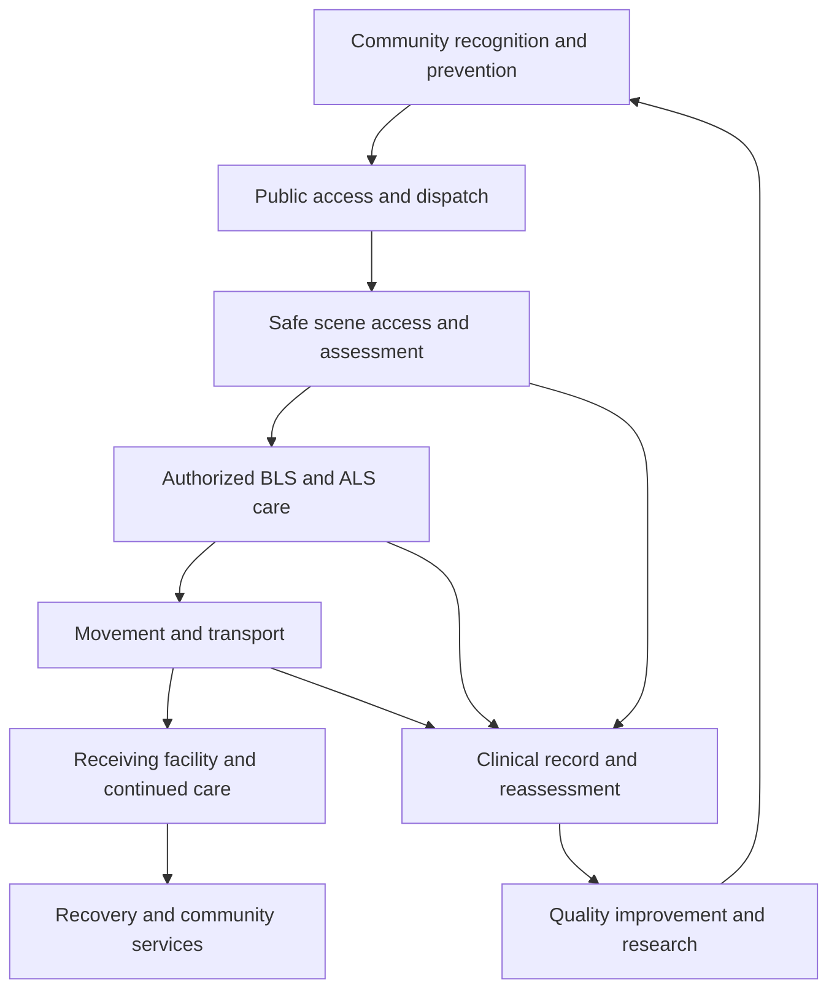
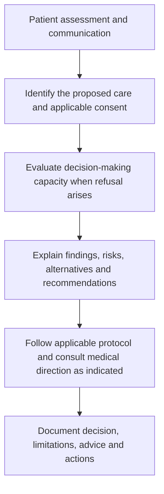
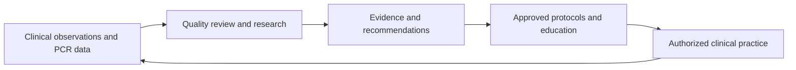

# EMS Foundations: Systems, Professional Practice, Safety and Patient Care

## EMS as a coordinated system of care

The EMS continuum links public access, dispatch, field care, transportation, definitive treatment and recovery. Its design determines not only what clinicians can do, but how quickly patients reach the resources they need.

This is a conceptual model of system relationships, not a clinical treatment algorithm.

### The EMS system and continuum of care

Sudden death and disability caused by catastrophic illness and injury are major public health concerns in the United States. Inadequate or unavailable emergency medical services (EMS) can contribute to death and permanent disability; the source estimates that thousands of people die or suffer permanent harm each year for this reason, without providing a date or supporting statistic. EMTs help improve outcomes by providing emergency care as part of a coordinated system that connects the patient to appropriate resources.

The National EMS Education Standards place EMS systems and research within the preparatory domain and also address public health. These subjects connect safe, legally and ethically responsible emergency care with illness and injury prevention.

Modern EMS evolved from ambulance transportation, often provided by funeral homes with no treatment until arrival at a hospital, into a continuum of care beginning at the scene and extending through transportation, hospital care, rehabilitation or discharge.

#### Historical development of EMS

- **Wartime Influence:**
  - **Korean and Vietnam conflicts:** Demonstrated that injured soldiers benefited from emergency care in the field prior to transport, shifting civilian EMS from fast, untrained transport to trained on-scene and en-route care.
  - **Iraq and Afghanistan wars:** Continue to inform trauma care and drive changes in EMS practice based on patient outcomes.
- **Key Milestones & Legislation:**
  - **1960s:** President's Committee for Traffic Safety identified a need to reduce highway crash injuries and deaths; cardiopulmonary resuscitation (CPR) procedures were developed.
  - **1966 — The "White Paper":** National Academy of Sciences National Research Council published *Accidental Death and Disability: The Neglected Disease of Modern Society*. Detailed traffic crash deaths/injuries, identified severe prehospital care deficiencies, and recommended changes to ambulance systems, training, and prehospital care.
  - **1966 — Highway Safety Act of 1966:** Required each state to establish a highway safety program meeting federal standards, including emergency services. The Department of Transportation (DOT), via the **National Highway Traffic Safety Administration (NHTSA)**, took leadership and developed national standard curricula.
  - **1970s:** American Heart Association (AHA) began teaching CPR and basic life support (BLS) to the public. The source describes CPR course completion as a prerequisite for EMT courses; confirm the requirements of the individual program.
  - **1973 — Emergency Medical Services System Act of 1973:** Provided millions of dollars in funding for EMS system planning, implementation, personnel availability, and training.
  - **1993:** National Registry of EMTs (NREMT) released the *National Emergency Medical Services Education and Practice Blueprint* to define training/education issues and guide national training curricula.
  - **1996:** NHTSA published *EMS Agenda for the Future* to make EMS a greater component of the U.S. health care system.
  - **2000:** Follow-up document *The EMS Education Agenda for the Future: A Systems Approach* released to address national consistency in education, training, certification, and licensure of entry-level EMS personnel.
  - **2005:** NHTSA and Health Resources and Services Administration (HRSA) published *National EMS Core Content*, defining the domain of knowledge in the *National EMS Scope of Practice Model* and promoting universal knowledge/skills.
  - **2006:** NHTSA published the *National EMS Scope of Practice Model*, defining four levels of EMS licensure and their corresponding knowledge and skills.
  - **2006:** Institute of Medicine (IOM) published *The Future of EMS Care: EMS at the Crossroads*, recommending:
    - Common state scope of practice to allow reciprocity between states
    - National accreditation for all paramedic programs
    - National certification as a prerequisite for state licensure and local credentialing
  - **NHTSA National EMS Education Standards:** Outline minimum terminal objectives for entry-level EMS personnel based on the *National EMS Scope of Practice Model*.
  - **2014–2018 — EMS Agenda 2050:** Recommended by the National EMS Advisory Council (2014) to update the 1996 agenda; developed in 2017–2018 through regional meetings, webinars, conferences, and public comment to provide a 30-year framework for EMS advancement.

> [!NOTE]
> **ALS Connection — The system, not just the procedure**
>
> The modern continuum connects early recognition, dispatch, first response, BLS, advanced assessment, transport, hospital intervention and recovery. A 12-lead ECG in the ambulance can be valuable because it connects the patient to an appropriate cardiac receiving facility; the ambulance cannot itself reopen an obstructed coronary artery using catheter-based PCI. The value of a skill depends on how effectively it connects to the rest of the system. [EMS Agenda 2050](https://www.ems.gov/resources/newsletters/may-2019/creating-a-people-centered-ems/) emphasizes integration and patient-centered care.

### Communication in the EMS system

Communication connects every phase of emergency care: a patient, relative or bystander contacts a call taker; dispatch alerts responders verbally or digitally; the crew coordinates with other agencies, assesses the patient, consults medical direction, notifies the receiving facility and transfers care. System communication enables faster response, resource requests, medical oversight, data transmission and hospital preparation. Therapeutic communication is equally important: it establishes rapport, enables accurate information gathering and helps providers adapt care to patients with different needs.

EMS system communication and therapeutic communication are preparatory content areas in the National EMS Education Standards, connecting knowledge of the EMS system, provider safety and well-being, and medical, legal and ethical responsibilities to emergency care.

#### Development of EMS communications

##### Historical Background
* **Early EMS:** Ambulance crews only transported patients to hospitals with no emergency care responsibilities, so sophisticated communications systems were unnecessary.
* **EMS Act of 1973 (Public Law 93-154):**
  * Recognized communications as one of the **15 essential components** of an EMS system.
  * Defined the role of communications to include **public access to EMS**, **dispatch for immediate response**, and **medical oversight**.
  * Provided grant funding that equipped most ambulances with **Very High Frequency (VHF)** and **Ultra High Frequency (UHF)** radio equipment.
  * Despite major technological progress, most EMS systems today still use **narrowband voice radio communication** similar to the 1970s.

##### Modern Advances
* **Field Data Transmission:** Integration of data transmission from EMS personnel in the field to the medical facility or medical direction.
* **Longitudinal Electronic Medical Record (EMR):** The source describes transmitting records to EMS through National EMS Information System (NEMSIS) electronic patient care report (PCR) systems; the availability of such integration depends on the system.
* **12-Lead ECG Transmission:** Capability to transmit 12-lead electrocardiograms (ECGs) to the medical facility or medical direction.
* **MIH and Community Paramedicine:** Increasing availability of **mobile integrated health care (MIH)** and **community paramedicine** requires a more robust communications system to manage both emergency calls and unscheduled/scheduled community health services.
* **FirstNet (First Responder Network Authority):**
  * Established under the **Middle Class Tax Relief and Job Creation Act (Public Law 112-96)**, signed by President Obama in **2012**.
  * Created a **nationwide public safety broadband network** similar to major cellular phone provider networks, but **reserved for public safety** (including EMS communications).

### System governance, organization and resources

#### State EMS Agency Role

- According to the **National Association of State EMS Officials (NASEMSO)**, every U.S. state and territory has a lead EMS agency.
- **Primary Responsibilities:**
  - Overall planning of the statewide EMS system
  - Coordination of the statewide EMS system
  - Regulation of the statewide EMS system
  - Licensing local EMS agencies and personnel

EMS, public safety and public health frequently overlap. The state EMS agency works to ensure high-quality EMS that protects public health and safety.

#### Technical Assistance Program Assessment Standards

*Each state controls its own EMS system design and regulations independently of the federal government, but NHTSA recommends 10 standards:*

1. **Regulation and policy:** State laws, regulations, policies, and procedures governing EMS; a state-level EMS agency must provide leadership to local jurisdictions.
2. **Resource management:** Central state control of EMS resources so all localities and patients have equal access to acceptable emergency care.
3. **Human resources and training:** All personnel staffing ambulances and transporting patients must be trained to at least the EMT level.
4. **Transportation:** Safe, reliable transportation by ground or air ambulance.
5. **Facilities:** Timely delivery of seriously ill or injured patients to an appropriate medical facility.
6. **Communications:** System providing public access and communication among dispatcher, EMS personnel, and the hospital.
7. **Public information and education:** EMS participation in educating the public on injury prevention and how to properly access EMS.
8. **Medical direction:** A physician serving as medical director to provide medical oversight, oversee patient care, and delegate appropriate medical practices.
9. **Trauma systems:** Specialized care system for trauma patients, including trauma center(s), rehabilitation programs, and systems for assigning and transporting patients.
10. **Evaluation:** Quality improvement system for continual evaluation and upgrades.

**Additional Elements of EMS System Design (Gunderson, 2015):**
- **Clinical quality:** Clinical performance achieves set patient outcomes.
- **Service quality:** System performance meets the needs of patients, the public, and communities of interest.
- **Economic efficiency:** High-quality services delivered at a reasonable cost.
- **Accountability:** Ensures the system meets the needs of patients and the public.
- **Improvement:** Continual effort to improve care delivery.
- **Resilience:** Ability to adapt to changes directly or indirectly affecting operations and stability.

**Services Provided by Modern EMS Systems (Gunderson, 2015):**
- Prevention and public education
- Triage
- Medical first response
- Ambulance response and transport
- Medical transportation
- Event coverage
- Disaster services
- Critical care transport
- Air medical transport
- Hazardous materials response medical support
- Tactical response medical support
- Community paramedicine

> [!NOTE]
> **ALS Connection — System design and tiered response**
>
> ALS availability depends on resource management, training, staffing, communications, medical oversight and receiving facilities. A tiered response might send BLS first and an advanced clinician separately, or deploy a mixed EMT/paramedic crew from the outset. Neither configuration is inherently best for every community.
>
> **EMT teamwork:** Know your service's dispatch upgrade criteria, intercept arrangements, radio channels, available specialty resources and destination policies. When requesting additional resources, describe the patient's needs and trends rather than just saying “send ALS.” An intercept should be coordinated so it does not needlessly prolong access to definitive care. [EMS.gov: What is EMS?](https://www.ems.gov/what-is-ems/) · [NASEMSO clinical guideline resources](https://www.nasemso.org/content.aspx?module_id=701974&page_id=22).

#### Types of EMS Services

- **Fire Department EMS:** Uses existing fire suppression structure (paid, part-paid, or volunteer; rural, suburban, or urban); transport or non-transport; often provides 911 emergency responses only.
- **Municipal EMS ("Third Service"):** Separate from police and fire (the first two public safety services); controlled by a public safety director, public health director, or municipal official; often 911 only, though some also provide inter-facility transfers and non-emergency transports.
- **Private EMS:** Private companies; municipalities may set operating rules but do not govern or control them; often provide 911 emergency responses, inter-facility transfers, and non-emergency transports.
- **Hospital-Based EMS:** Controlled by a for-profit or not-for-profit hospital; operates similarly to private EMS (911, inter-facility transfers, non-emergency transports).
- **Law Enforcement EMS:** Rare; found in smaller communities where law enforcement demand is less burdensome.
- **Public Safety Officer:** Cross-trained personnel combining fire, police, and EMS into a single service.

> [!NOTE]
> **ALS Connection — Service model versus clinical capability**
>
> Fire-based, municipal, private and hospital-based organizations describe administrative models, not a guaranteed clinical scope. Determine the actual crew credentials, medical direction, equipment, transport capability and service authorization. An ALS-capable ambulance may still encounter a patient who only needs BLS; conversely a specialty interfacility transfer may require expertise beyond ordinary paramedic training. [ACEP, Medical Direction in Critical Care Transport (2024)](https://www.acep.org/amt/newsroom/june-2024/medical-direction-in-critical-care-transport-a-guide-to-an-emergency-physician-s-involvement).

## Professional authority, clinical governance and scope of practice

The organization of an EMS system establishes its resources; legal scope, credentialing and medical direction establish how individual clinicians may use them. Clinical capability and authorization must be understood together, not as interchangeable concepts.

### Professional authority, scope of practice, and standards of care

Prehospital emergency care has changed significantly since its early days, including major improvements in the training of emergency medical personnel. The public and health care profession expect a competent EMT who understands and accepts legal and ethical responsibilities to the patient, medical director, and public. Medical, legal, and ethical considerations apply throughout emergency care.

The National EMS Education Standards place medical, legal, and ethical issues within the Preparatory content area, alongside knowledge of the EMS system and EMT safety and well-being.

National models and clinical guidelines inform education and practice but do not independently grant legal authority. Actual practice depends on state law, licensure, credentialing, agency policy, and medical direction.

#### Scope of practice versus standard of care

Scope of practice defines the actions and care EMTs are legally permitted to perform in the jurisdiction where they practice. It establishes boundaries among professions and identifies activities that would be illegal without appropriate licensure or certification. Providing oxygen under appropriate circumstances is an EMT skill; suturing a laceration is outside the ordinary EMT scope described in the chapter, even if an EMT knows how to do it.

Sources informing scope of practice include:

- NHTSA's [National EMS Scope of Practice Model][ref-032].
- [National EMS Education Standards][ref-033], which establish national entry-level educational expectations.
- State laws, regulations, and policies.

Standard of care concerns the care expected of a reasonably prudent EMT with similar training managing a patient in similar circumstances. It addresses both whether the appropriate assessment and care were selected and whether they were performed properly.

Sources informing the standard of care include recognized EMT textbooks, expected practice among EMTs in the community or region, local and state protocols, the National EMS Education Standards, and the EMS system's operating policies and procedures.

| Scope of practice | Standard of care |
| --- | --- |
| Was the clinician legally authorized to perform the action? | Was the care appropriate and performed properly? |
| Establishes legal boundaries of practice. | Establishes the expected level of performance. |
| Is not itself a clinical protocol or practice guideline. | May be informed by protocols, education, and accepted professional practice. |

> [!IMPORTANT]
> Falling below the standard of care may establish a breach of duty. A successful civil negligence claim additionally requires the other legally required elements, including injury and causation. The scope of practice does not itself define the standard of care.

### Provider levels, scope and clinical authorization

#### Levels of Training

*Defined by the **National EMS Scope of Practice Model 2019** (originally released by NHTSA in 2006 to improve consistency, patient safety, state reciprocity, and reduce public confusion):*

1. **Emergency Medical Responder (EMR):** Immediate lifesaving care while awaiting higher-level responders.
   - *Skills:* Basic airway, ventilation, and oxygen therapy devices; vital signs; stabilization of spine and suspected extremity injuries; eye irrigation; bleeding control; emergency moves; CPR; automated external defibrillation (AED); emergency childbirth care.
2. **Emergency Medical Technician (EMT):** Basic emergency medical care and ambulance transportation.
   - *Skills:* EMR skills with basic ambulance equipment + advanced oxygen therapy and ventilation equipment, pulse oximetry, automatic blood pressure monitoring equipment, and limited medication administration.
3. **Advanced Emergency Medical Technician (AEMT):** Basic and limited advanced emergency medical care and transportation.
   - *Skills:* EMT skills + advanced airway devices, blood glucose monitoring, intravenous (IV) and intraosseous (IO, in the bone marrow) infusions, and administration of a select number of medications.
4. **Paramedic:** Highest level of prehospital care; designed to reduce disability and death.
   - *Skills:* EMT and AEMT skills + advanced assessments, forming a field impression, invasive and drug interventions, and transport.

##### ALS Connection: How national scope levels fit together

The following are illustrative capabilities from NHTSA's [2019 National EMS Scope of Practice Model, including 2021 changes](https://www.ems.gov/assets/National_EMS_Scope_of_Practice_Model_2019_Change_Notices_1_and-_2_August_2021.pdf), skill tables I–VII. They are **not** a local authorization list.

| Level | Representative role | Examples of additional capability |
| --- | --- | --- |
| EMR | Immediate lifesaving assistance | CPR, AED, basic ventilation and bleeding control |
| EMT | BLS assessment, treatment and transport | Glucose measurement, CPAP, pulse oximetry, authorized medications, ECG acquisition/transmission |
| AEMT | BLS plus limited advanced care | IV/IO access, selected parenteral medications, supraglottic airway and waveform capnography |
| Paramedic | Broader advanced assessment and management | Interpretive ECG, manual defibrillation, pacing, endotracheal intubation and expanded pharmacology |

> [!CAUTION]
> **ALS Connection — Scope clarification:** The textbook AEMT list includes blood glucose monitoring, but the national model also includes it at EMT level. Acquisition/transmission of a 12-lead tracing and its clinical interpretation are different skills. National models include acquisition at EMT and AEMT levels, but interpretive 12-lead ECG at paramedic level. Some jurisdictions authorize additional tasks; others do not implement all model skills. The ability to recognize a problem or prepare equipment does not by itself permit independent intervention.

Four separate prerequisites matter: **education** (learning), **certification** (verified competency), **licensure** (legal permission), and **credentialing** (system-specific approval). Assistance with a higher-level skill must itself be permitted and appropriately supervised. See also the [2021 National EMS Education Standards, updated February 2025](https://www.ems.gov/projects/ems-education-standards.html).

> [!NOTE]
> **ALS Connection — State and system authorization**
>
> Know the difference between a state license and the specific tasks your agency credentials you to perform. When joining a new service, confirm the local scope matrix, medications, standing orders, medical-control requirements and any restrictions on mixed-level assistance. Do not assume reciprocity, national certification or a paramedic partner's approval alone is sufficient. The national scope document is a planning framework, not state law. [NHTSA scope model overview (2019)](https://www.ems.gov/resources/newsletters/may-2019/2019-national-ems-scope-of-practice-model-now-available/).

> [!IMPORTANT]
> Knowledge does not equal authorization. Follow applicable state law, licensure, individual credentialing, agency protocols and medical direction. A higher-level partner cannot automatically expand your scope. The national framework is not a substitute for local authorization.

The level descriptions also include suction and bag-mask ventilation, bleeding control, safe patient movement, observation and reassessment as foundational EMT responsibilities. AEMTs have a limited fluid and medication capability in addition to their BLS foundation; paramedics have broader advanced airway and electrical therapy capabilities. These are educational distinctions, not a local skills list. Preparing equipment, acquiring a measurement, interpreting a result and independently delivering care are separate activities. The patient’s needs determine which capability is appropriate, and individual authorization determines who may provide it. [Scope model][ref-001] · [Education standards][ref-002] · [Model clinical guidelines][ref-034].

### Assisting, performing and interpreting clinical procedures

> [!CAUTION]
> **ALS Connection — Assisting is not the same as performing.** An EMT may retrieve sealed vascular-access supplies, position the patient or report serial blood pressures while an AEMT or paramedic performs an authorized intervention. Starting an IV, administering an IV medication or independently interpreting an ECG is different. Even apparently simple tasks such as applying ECG electrodes, operating a pump or adjusting a device require authorization appropriate to the task. Never assume the paramedic's request expands your scope.

**Application:** A patient with chest discomfort can need rapid transport, serial BLS assessments and a paramedic's ECG assessment. Acquisition records electrical activity; interpretation assesses its clinical meaning. A normal initial tracing does not replace reassessment. Communicate symptoms, onset, changes, vital signs and relevant history without waiting for the tracing to complete basic care.

Sources: [NHTSA national scope model and updates][ref-032], [National EMS Education Standards][ref-033], [AHA adult ALS][ref-004].

### Shared clinical responsibility and evidence versus authorization

A mixed-level crew shares responsibility for scene safety, infection prevention, communication and reassessment. A paramedic may lead advanced clinical decisions while the EMT continues essential care; an AEMT has a distinct scope and is not interchangeable with a paramedic. Actual staffing, clinical leadership and delegation are governed locally.

> [!CAUTION]
> **Knowledge does not equal authorization.** Research evidence describes what may work; professional recommendations and clinical guidelines translate evidence into general care frameworks. Local protocols specify approved actions; legal scope limits what a clinician may perform; credentialing determines which skills that individual may use. Medical direction provides clinical oversight within these limits. A partner cannot expand your legal scope by asking you to do something. Preparing equipment, observing a procedure and independently performing it are different activities. [National scope model][ref-001].

### Medical oversight and clinical governance

#### Medical Oversight of EMS

- **Medical oversight:** Comprehensive term for the clinical and administrative functions and activities performed by the EMS system's medical director to exercise ultimate responsibility for emergency care provided by individual personnel and the entire EMS system.
- **Indirect medical oversight:** Makes up the majority of the medical director's responsibilities; encompasses the processes, routine duties, and activities that influence and control prehospital care and daily EMS system operations.
- **Direct medical oversight:** Real-time oversight or medical direction provided by a physician to an EMS provider seeking immediate feedback or direction impacting patient care. Two forms:
  - **On-line medical direction:** EMS provider and physician (or authorized designee, where applicable) communicate via cell phone, telephone, radio, or video technology for immediate feedback and direction regarding the patient's diagnosis, condition, and emergency care.
  - **On-scene medical direction:** Feedback and medical direction regarding the patient's diagnosis, condition, and emergency care provided by an EMS medical director physician who is physically on-scene with the EMS crew.

#### The medical director, protocols and standing orders

- **Designated Agent:** As an EMT, you are the designated agent of your EMS system's physician **medical director**; your emergency care is an extension of the medical director's authority (always learn your state's laws, statutes, and regulations regarding medical direction).
- **Medical Director Responsibilities:**
  - Legally responsible for the clinical and patient care aspects of the EMS system
  - Providing medical direction
  - Overseeing and providing EMS education programs, refresher courses, and continuing education
  - Credentialing providers for the system
  - Facilitating the quality improvement system
  - *Requirement:* Every EMS system must have a medical director to provide any level of prehospital care.
- **Protocols:** A full set of guidelines defining the entire scope of medical care (triage, treatment, transport, destination). Often referred to as *orders*; may consist of clinical care guidelines provided by both off-line and on-line medical direction.
- **Off-line medical direction:** A function of indirect medical oversight provided through predetermined, written guidelines (often called standing orders) that allow EMTs to use their judgment to administer emergency care without having to contact a physician.

- **Standing orders:** A subset of protocols that do not require real-time physician input.
  - In some systems, synonymous with *off-line medical direction*.
  - In other systems, refers specifically to treatments that can be performed if communication cannot be established or is lost with medical direction.

##### Historical chest-pain protocol example: standing versus on-line orders

The following is the textbook's illustrative protocol, retained to distinguish standing orders from orders requiring physician contact. It is **not** a current universal treatment protocol or an authorization to administer medications.

1. Administer oxygen via nonrebreather mask at **15 lpm**
2. Place patient in position of comfort
3. Administer one patient-prescribed nitroglycerin tablet if systolic blood pressure is **greater than 90 mmHg**
4. Administer one **160–325 mg aspirin**
5. Contact advanced life support
6. If the patient does not experience relief of chest pain from one nitroglycerin tablet, contact medical direction to consider administering additional doses.

**How it applies:** Items **1–5** are **off-line medical direction / standing orders** (performed without contacting a physician). Item **6** is **on-line medical direction** (requires direct communication and permission from a physician).

##### ALS Connection: Medical direction and the chest-pain example

> [!WARNING]
> **Current-practice clarification — the historical chest-pain example above is not a current universal protocol.** The 2025 multisociety acute coronary syndromes (ACS) guideline recommends oxygen for ACS with hypoxemia (SpO₂ below 90%) and does not recommend routine oxygen for ACS with saturation at or above 90%. This is specific to ACS, not a universal oxygen target for every illness. Assess ventilation, oxygenation, distress and reliability of the reading; follow local orders. The historical fixed 15 L/min example and medication instructions are retained solely to illustrate standing versus on-line orders.
>
> Nitroglycerin requires more than a single BP check; hemodynamic stability, possible right ventricular infarction, recent phosphodiesterase-5 inhibitor use and local medication rules matter. Aspirin also requires attention to contraindications such as serious allergy or active bleeding. Do not treat the example as independent permission to administer medications. [2025 ACS guideline](https://doi.org/10.1161/CIR.0000000000001309).

**Clinical rationale:** In ACS, coronary blood flow is reduced. Aspirin inhibits platelet aggregation, whereas nitroglycerin is a vasodilator that can relieve ischemic discomfort but may lower blood pressure. Neither symptom relief nor a normal initial ECG excludes ACS.

**Potential ALS contribution:** A 12-lead ECG samples electrical activity from multiple views of the heart. A paramedic may use the tracing and clinical findings to identify concerning ischemia or rhythm disturbances, communicate with the receiving center and plan further monitoring. Motion and electrode problems may distort the tracing; acquisition is different from interpretation. Additional treatment is individualized, not automatic. [2025 ACS guideline](https://doi.org/10.1016/j.jacc.2024.11.009).

**EMT contribution:** Obtain symptom onset and character, relevant cardiac history, vital sign trends, medications/allergies and any medication already taken. Continue authorized care, help acquire or transmit ECG if trained and credentialed, report worsening pain, dyspnea, hypotension or altered consciousness and facilitate appropriate transport.

> [!CAUTION]
> **ALS Connection — Orders versus authorization:** A standing order is permission to act under stated conditions within the applicable scope. On-line medical direction provides real-time physician guidance; neither automatically overrides law or individual credentialing. If an order conflicts with your authorization or appears unsafe, clarify it through your chain of clinical oversight. [NHTSA national scope model (2019/2021)](https://www.ems.gov/assets/National_EMS_Scope_of_Practice_Model_2019_Change_Notices_1_and-_2_August_2021.pdf).

### Medical direction

- An EMT’s authority to function in the prehospital setting is contingent on medical direction, which provides medical oversight throughout the EMS system.
- **Required Practices:**
  - Follow standing orders and protocols as approved by medical direction.
  - Establish cell phone, video chat, telephone, and radio communications with medical direction when appropriate.
  - Communicate clearly and completely with medical direction, and follow orders given in response.
  - Consult medical direction any time there is a question about the scope or direction of care.
- **Interagency Cooperation & Body Cameras:** Most areas have protocols for cooperation between EMS and other public safety services. Body cameras used by law enforcement and some EMS systems often record these interactions and can be reviewed later if issues occur.

### ALS Connection: Medical direction in a mixed-level crew

- **Offline medical direction:** approved protocols, training, credentialing, equipment standards and quality review establish the system in which clinicians work.
- **Online medical direction:** real-time physician consultation or orders address individual situations, such as a disputed refusal, uncertainty about a treatment limitation, or a proposed change in transport level.
- **Crew clinical leadership:** the designated clinician coordinates care and delegates only authorized tasks. Clinical leadership is not the same as the statutory authority of medical direction.

When an unusual order or conflicting instruction is received, clarify what is being requested, identify who is authorized to perform it, use read-back when applicable, and follow the escalation policy. Do not perform a prohibited skill simply because an order was given. Record the clinician contacted, the time, the order or advice, and the resulting care. If communications fail, follow the applicable contingency protocol and continue appropriate BLS care.

Sources: [NHTSA national scope model][ref-032], [NAEMSP physician oversight statement (2017)][ref-037], [NASEMSO model guidelines][ref-034].

## Professional conduct, ethics and legal accountability

The duty to provide competent care connects professional behavior, patient advocacy, equipment readiness and legal accountability. These obligations apply before, during and after direct patient contact.

### EMT responsibilities and professional practice

#### Roles and Responsibilities

An EMT is responsible for safety, assessment and emergency care, safe patient movement, transport and transfer, documentation and advocacy. The specific responsibilities vary by system.

The EMT’s responsibilities include:
- Maintain vehicle and equipment readiness
- Ensure safety of the EMS crew, the patient, and bystanders at the scene
- Operate the emergency vehicle
- Assess the patient
- Provide emergency care
- Safely lift and move the patient
- Prepare oral and written reports
- Safely transport the patient
- Transfer patient care
- Perform record keeping and data collection
- Serve as the patient's advocate
- Provide emotional support to the patient, relatives, and others at the scene
- Integrate the EMS service with other emergency and nonemergency services
- Resolve the emergency incident
- Maintain medical and legal standards
- Provide administrative support
- Enhance professional development
- Develop and maintain community relations
- **Americans with Disabilities Act (ADA) of 1990:** Protects individuals with a documented disability from being denied initial or continued employment based on their disability. Employers must make necessary and reasonable adjustments so individuals with disabilities are not precluded from employment (check state EMS office and ADA representative for details).

> [!TIP]
> **ALS Connection — Mixed-level crew readiness**
>
> Before the shift, agree on equipment locations, how to request assistance, roles during resuscitation and how you will transfer clinical leadership. Check authorized BLS equipment independently; learn where ALS supplies are kept without assuming permission to use them. Know how to locate a monitor, IV kit or airway bag without interrupting the higher-level provider. Both clinicians remain responsible for patient dignity, safe movement and accurate reporting.

#### Professional Attributes

Professional practice depends on appearance, knowledge, skills, physical capabilities, interests and temperament, and maintaining certification and licensure.

Professional behavior includes:
- Integrity
- Empathy
- Self-motivation
- Professional appearance and hygiene
- Self-confidence
- Effective time management
- Good verbal and written communication skills
- Teamwork and diplomacy
- Respect for patients, coworkers, and other health care professionals
- Patient advocate
- Careful delivery of service
- Life-long learner

##### Appearance

- Excellent personal grooming and a neat, clean appearance instill confidence and protect patients from contamination (dirty hands, dirty fingernails, soiled clothing).
- Respond in complete uniform or appropriate dress to project competence and trustworthiness as part of a medical team.

##### Knowledge and Skills

- Complete the basic EMT training program outlined by the U.S. Department of Transportation (DOT).
- **Additional Required Knowledge:**
  - Use and maintenance of common emergency equipment (suction machines, oxygen-delivery systems, airway adjuncts, AEDs, spinal immobilization equipment, splints, obstetrical kits, patient-moving devices, access tools).
  - Assisting with medication administration approved by medical direction.
  - Cleaning, disinfecting, and sterilizing non-disposable equipment.
  - Safety and security measures for self, partner, other rescuers, patient, and bystanders.
  - Territory and terrain within the service area for expedient response to the scene and receiving facility.
  - State and local traffic laws and ordinances concerning emergency transport (ambulances have certain privileges, but are not immune from all traffic laws).
- **Ongoing Education:** Use continuing education to learn advances in care/equipment, take refresher courses to renew knowledge/skills, and stay current on local, state, and federal legislation, regulations, standards, guidelines, and EMS issues.

> [!CAUTION]
> **ALS Connection — Equipment familiarity is not procedural competence**
>
> An EMT may learn the purpose of a monitor/defibrillator, capnograph, supraglottic airway, IV/IO kit or infusion pump without being authorized to use it. An IV provides access to a vein; IO access delivers medications or fluids through the marrow circulation. Neither establishes why the patient is sick. A pump controls delivery of an infusion and its alarms warrant attention, not unauthorized adjustment. An AED selects a shock recommendation automatically; manual electrical therapy involves separate interpretation and decisions. Ask the agency to train you on permitted equipment preparation and emergency contingencies before a call.

##### Physical Demands

- **Strength:** Good physical health; able to lift and carry up to **125 pounds**.
- **Vision:** Good eyesight (corrective lenses permitted) and good **color vision** to drive safely and assess color changes in skin, nail beds, lips, and inside the mouth (critical indicators of severity/condition).
- **Communication:** Effective oral and written communication with patients, crew members, other emergency responders, and medical staff.
- **Hearing:** Good enough to accurately hear radio communications, patient/bystander responses, auscultated blood pressure, auscultated/abnormal patient noises, crew communication at the scene, and oral instructions.

> [!CAUTION]
> **Current-practice clarification — Physical demands**
>
> The 125-pound figure above is retained as the textbook's example, not a universal nationwide lifting requirement or a safe single-person lifting target. Job-specific essential functions, reasonable accommodations, equipment and safe-lifting policies vary. Use adequate personnel and mechanical aids; do not attempt an unsafe lift to prove fitness.

##### Personal Traits

- **Calm and reassuring personality:** Perform skills/procedures while speaking calmly and reassuringly to agitated, in-shock, or in-pain patients.
- **Leadership ability:** Assess quickly, take control when appropriate, set priorities, give clear/concise directions, be confident/persuasive enough to be obeyed, and carry through.
- **Good judgment:** Make appropriate decisions quickly in unsafe or stressful crisis situations.
- **Good moral character:** Fulfill ethical obligations beyond statute or case law; uphold a position of public trust.
- **Stability and adaptability:** Manage stress (exhaustion, frustration, anger, grief); delay expressing feelings until the emergency is over; recognize intense emotional reactions are normal and seek support (coworkers, counselors, friends, family) to stay mentally and physically fit.
- **Ability to listen:** Gather information effectively from patients/bystanders and receive orders from medical direction/others; show empathy and compassion while maintaining professionalism, confidence, and competence.
- **Resourcefulness and ability to improvise:** Think quickly and adapt when equipment, tools, or techniques don't work as planned (e.g., gaining entry to an overturned vehicle to ventilate an entrapped patient in an awkward position and continuing ventilation during extrication).
- **Cooperativeness:** Act as a leader while fully cooperating with other emergency services (fire, police) to provide the best patient care.

##### Maintenance of Certification and Licensure

- Personal responsibility of each EMT.
- Requires meeting continuing education requirements, verifying skill competency, avoiding criminal or unethical behavior, and submitting all necessary fees.

### Professional duties and ethics

#### Duty to act

Duty to act is the legal obligation to provide service, regardless of whether the EMT personally believes an ambulance is necessary.

- **On Duty:** Legally obligated to care for a patient who requires and consents to it, rendering necessary emergency care to the best of your ability and training.
- **Off Duty:**
  - In most states, if not functioning in an EMS capacity, you have no more legal obligation to act than any other citizen. In these states, you may legally:
    - Stop and help the accident victim at the scene.
    - Pass the scene and call for help.
    - Pass the scene and make no attempt to call for help.
  - *Exception:* Some states **do** require EMTs to stop and render aid even when off duty.
- **Assumed Duty to Act:**
  - If off duty (paid or volunteer) and you publicly respond to a page for assistance, or stop at a scene to provide emergency care, you **create a duty to act**.
  - *Reason:* Others may not respond because they assume your response covers the call adequately; leaving after starting care could place the patient in a worse situation than if you had not responded.
  - *Resulting Legal Responsibilities:*
    - Cannot leave until someone with appropriate expertise (typically an **equal or higher level of training**) takes over care.
    - Legally responsible for any of the patient's **personal property** that you pick up.
- **Specific Areas of Duty:**
  - **Duty to the Patient:** Respect and protect patient rights as an advocate; maintain privacy and confidentiality of medical status, history, and records; lessen suffering; provide complete and competent care for both physical injuries/illness and emotional needs; do no further harm.
  - **Duty to Self:** Obtain and keep current the necessary certifications, licensure, and credentials to practice as an EMT, maintain skills to a level of proficiency, maintain mental health, and remain physically able to perform job duties.
  - **Duty to Your Partner:** Ensure your partner is physically and mentally fit to provide emergency medical care and job responsibilities. If your partner reports for work under the influence of alcohol or drugs, you have a **duty to report** the situation to your supervisor (protects you and the public).
  - **Duty Regarding Equipment:** Legal responsibility to ensure equipment is in proper working order at the **beginning of each shift**. If equipment malfunctions due to improper maintenance, or if you lack necessary equipment to treat a patient, this may constitute a breach of the standard of care.

> [!NOTE]
> **ALS teamwork — Shared duty during a mixed-level shift.** Check BLS oxygen, suction, bag-mask equipment, AED access and other assigned equipment; coordinate with your partner on monitor readiness, batteries, advanced supplies and medication security according to agency policy. Know where backup equipment is located. A paramedic's presence does not excuse an EMT's missed assessment or failed equipment check. During an emergency, report failures early, use authorized backups, and document actual limitations instead of implying a procedure was completed.
>
> Source: [Joint essential ambulance equipment statement (2021)][ref-038].

> [!CAUTION]
> **Current-practice clarification — Duty and liability.** Off-duty duties, the effect of volunteering, and protections depend on jurisdiction. Do not treat the national scope model as a liability statute.

#### Ethical responsibilities

Ethics is the branch of philosophy concerned with morality; morals are concepts of right and wrong. A code of ethics expresses rules of ideal conduct. The National Association of Emergency Medical Technicians (NAEMT) issued the Code of Ethics for EMTs in 1978. Placing the patient's welfare first is a central guide to ethical care.

EMT ethical responsibilities include:

- Serve the needs of the patient with respect for human dignity, without regard to nationality, race, gender, creed, or status.
- Maintain skill mastery; demonstrate respect for the competence of other medical professionals.
- Keep abreast of changes in EMS that affect patient care; assume responsibility in defining and upholding professional standards.
- Critically review performances, seeking ways to improve response time, patient outcome, and communication; assume responsibility for individual professional actions and judgment.
- Report with honesty; hold in confidence all information obtained in the course of professional work unless required by law to divulge it.
- Work harmoniously with other EMTs, nurses, physicians, and other members of the health care team.

- **Ethical and Moral Conflicts:**
  - *Expired DNR Example:* Responding to a terminally ill patient requesting no treatment, but the presented **do not resuscitate (DNR)** orders have expired -> creates a conflict between **legal obligation** (provide care), **ethical obligation** (honor patient's wishes), and **moral obligation** (preserve life under any circumstances).
  - *Other Examples:* Mass casualty events where medical care is rationed during triage; cardiac arrest in the wilderness with limited resources and extended transport time to definitive care.
  - *Resolution:* Always follow **local protocols and applicable laws**, and contact **medical direction** at any time to assist with decisions.

> [!NOTE]
> **ALS Connection — Ethics of advanced intervention.** Autonomy (respecting informed patient choices), beneficence (acting for patient benefit), nonmaleficence (avoiding unnecessary harm), and justice (fair allocation of care) help explain why a clinician might choose not to perform an available invasive procedure. For example, effective basic ventilation may be the priority during CPR when advanced airway placement would interrupt compressions. More intervention is not necessarily more benefit. Discuss the patient's goals, the expected benefit, burdens and alternatives rather than assuming ALS means maximal treatment. Follow actual orders and applicable law rather than treating the expired-DNR example as universal.
>
> Sources: [AHA ethics guidelines (2025)][ref-035], [AHA adult ALS guidelines (2025)][ref-004].

### Patient advocacy

- **Protecting Rights & Valuables:** Collect and safeguard valuables on the patient's person, transport them with the patient, and document what was given to ED personnel.
- **Privacy & Dignity:** Protect privacy in the field, shield from curious bystanders, answer questions truthfully, and conceal the body of a deceased patient from curious onlookers.
- **Family/Friends:** Ensure they know how to get to the destination facility (some systems allow a relative in the operator's section of the ambulance).
- **At Receiving Facility:** Provide necessary information, especially regarding circumstances hospital personnel did not witness. Honor reasonable patient requests (e.g., notifying a relative, securing the patient's home) while adhering to all confidentiality rules.

> [!TIP]
> **ALS Connection — Advocacy during advanced care**
>
> Explain what is happening in plain language within your competence, preserve privacy, relay patient questions to the treating clinician and report discomfort or deterioration. Do not dismiss a patient because monitoring appears normal or promise that a procedure will cure the underlying illness. If you notice a safety issue, speak up promptly and respectfully even when a higher-level clinician is leading care.

### Legal liability and professional protections

#### Criminal liability, civil liability, and negligence

- **Liability:** Breaching a legal duty creates liability. Two types:
  - **Criminal liability:** The government, on behalf of the public, brings legal action against the EMT; may result in a fine or incarceration.
  - **Civil action:** An individual (**plaintiff**) files a lawsuit against an individual EMT, the EMS agency/company, or others indirectly involved (e.g., supervisor, medical director) — known as the **defendants**.
- **Tort:** A wrongful act, injury, or damage. In civil/tort cases, the plaintiff usually seeks monetary compensation.
- **Negligence:** A tort in which there is **no intent to do harm** to the patient, but a **breach in the duty to act** occurred (most common basis for lawsuits against EMS).
- **Four Elements the Plaintiff Must Prove (all four required, or the suit fails):**
  1. **Duty to Act:** The EMT had a legal obligation to respond to the scene and provide emergency care. Once a patient relationship is established (simply by contacting the patient with intent to provide emergency care), it cannot be terminated without the patient's consent.
  2. **Breach of Duty to Act:** The EMT deviated from the standard of care.
     - *Simple negligence:* Failing to perform care or making a mistake in treatment.
     - *Gross negligence:* Willful, wanton, or extremely reckless patient care far beyond being negligent or careless; construed as dangerous to the patient. The original text also associates intentionally caused harm with gross negligence and possible criminal charges; intentional wrongdoing and gross negligence are distinct legal categories whose definitions and consequences depend on jurisdiction.
  3. **Damages:** The patient suffered real, demonstrable injuries/harm recognized by law as a compensable injury (cannot be trivial or minor).
  4. **Proximate Cause (Causation):** The injuries were the direct result of the EMT's breach of duty (as opposed to resulting from the traumatic event or underlying disease).
- **Two Common Legal Principles in EMS Negligence Claims:**
  - ***Res ipsa loquitur*** ("the thing speaks for itself"): Used when a caregiver's inappropriate actions are obviously the cause of patient harm.
  - ***Negligence per se***: An act is considered negligent simply because it violates a statute or regulation (e.g., written EMS protocols or approved scope of practice).

> [!NOTE]
> **ALS Connection — Individual accountability and the care record.** A shared call does not make all actions interchangeable. If an ALS intervention is performed, the EMT can still be responsible for assigned observations and timely reporting. For example, an EMT who notices a new breathing change after an advanced medication should communicate it promptly and provide authorized support. Document what you observed, performed, reported and when; distinguish your actions from the partner's. A complication is not by itself proof of negligence. The legal elements remain separate; the exact definitions of gross negligence, intentional wrongdoing and negligence per se vary by jurisdiction. A protocol deviation is not automatically a complete negligence claim.

#### Intentional torts

- **Definition:** An action **knowingly committed** by an individual that is considered civilly wrong according to the law.
- **Difference from Negligence:** Negligence is a failure to meet the standard of care; an intentional tort is knowingly committed.
- **Best Defense:** Provide emergency care to the best of your ability and clearly understand your scope of practice and expected standard of care.

##### Common intentional torts in EMS

1. **Abandonment:**
   - Stopping treatment without transferring care to another competent professional of an **equal or higher level** of training and certification/licensure.
   - *ED Example:* Placing a patient in an ED room, notifying the unit clerk/secretary, and leaving = abandonment. Moving the patient from stretcher to hospital bed does **not** constitute transfer of care; you must give an **oral report** to a qualified physician, nurse, or health care worker.
   - Transfer to an appropriately qualified flight crew is another example of maintaining continuity of care.
   - *Appropriate Transfer Rules:* An EMT can assume care from a paramedic/AEMT at the scene **only** if the condition can be managed by an EMT and no ALS skills are needed. Conversely, transferring a multisystem trauma patient to a dermatologist (a physician not qualified to manage multisystem trauma) is potentially abandonment.
2. **Assault:**
   - A willful **threat** to inflict harm on a patient; can occur **without actually touching** the patient.
   - Requires the patient to have apprehension of bodily harm and the EMT to have the ability to do so (e.g., threatening to stick a patient with an epinephrine auto-injector while holding it up in front of them).
3. **Battery:**
   - The act of **touching a patient unlawfully without consent**.
   - Even with good intentions, providing emergency care without seeking and obtaining consent can be construed as battery.
4. **False Imprisonment or Kidnapping:**
   - Intentionally transporting a patient who has the capacity to make a rational decision **against their wishes / without consent**.
   - Does not require physical restraint—simply not allowing a patient with capacity to withdraw from treatment and transport when they desire to do so.
5. **Defamation:**
   - Releasing information to the public (written or spoken) construed as damaging to a person's character, reputation, or standing in the community.
   - **Slander:** Spoken form of defamation (always discuss patient, partner, and emergency issues privately, never in public).
   - **Libel:** Putting a false or damaging statement in written form or via mass media.

#### Good Samaritan laws

- **Origin:** First enacted in **1959 in California** to protect from liability *"persons licensed (such as a physician or surgeon) who in good faith render emergency care at the scene of the emergency . . . for civil damages as a result of any acts or omissions."*
- **General Protection:** Protects a person who is **not being paid** for their services from liability for acts performed in **good faith**, unless those acts constitute **gross negligence**.
  - The person suing must prove care was markedly below the standard of care and, in some cases, involved willful or wanton intent to harm the patient.
- **State Authorizations & Immunities:** Most states have laws authorizing EMTs to perform prehospital emergency procedures without a medical license, and provide some immunity to nurses, physicians, supervisors, and other personnel giving directions to EMTs by cell phone, telephone, or radio (laws vary for private vs. public providers—learn local laws).
- **Limitations & Best Defense:**
  - A Good Samaritan law **does not prevent you from being sued**, though it may help protect against losing if you performed within the standard of care.
  - *Best Defense (Prevention):* Render care to the best of your ability, work within your scope of practice and standard of care, behave professionally, keep the patient's best interests in mind, and maintain adequate liability insurance or other protection (e.g., sovereign immunity).

#### Other legal protections

- **Sovereign immunity (governmental immunity):** The original text describes protection from civil liability claims against government-operated EMS systems and distinguishes private EMS companies from government agencies. This protection is qualified by jurisdiction-specific exceptions and waivers; private providers may have other protections.
- **Statute of Limitations:** State-determined time limit (typically measured in **years**) within which a patient must file a negligence claim following either the event causing the injury/illness or the point of discovering the problem existed.
- **Contributory Negligence:** Exists when a finding determines that the patient, through their own negligence, caused or contributed to the damage done to them.

> [!CAUTION]
> **Current-practice clarification — Immunity is not blanket protection.** Good Samaritan coverage, governmental immunity, limitations periods, and comparative or contributory fault are jurisdiction-specific. Public agencies and employees may have qualified protections, statutory waivers or exceptions; private providers may have other protections. A patient's contribution to harm does not necessarily eliminate a claim. Neither an ALS license nor a physician's order guarantees immunity. The liability statutes of individual states were not independently verified in the supplied material.

## Workforce readiness, wellness and injury prevention

A clinician must be fit for duty to provide reliable care. Readiness includes physical capacity, psychological health, fatigue management and access to organizational support; it also underpins safe driving and patient movement.

### Workforce safety and shared clinical responsibilities

Workforce safety and wellness are part of the preparatory content of the National EMS Education Standards; infectious disease is also addressed under medicine. EMTs apply knowledge of the EMS system, their own safety and well-being, and medical, legal and ethical issues when providing emergency care. Assessment findings guide basic emergency care and transportation for acutely ill patients. [National EMS Education Standards][ref-002].

Safety involves protecting oneself from infectious disease, following appropriate rescue procedures, managing the hazards of violence and crime scenes, and preventing occupational injuries. Advocate for protective measures for yourself and fellow responders. Unless separately trained and authorized, an EMT is a medical responder, not a technical rescuer or tactical responder.

Everyday injury prevention includes vehicle restraint systems, safe lifting and moving techniques, adequate sleep, physical fitness, proper nutrition, and Standard Precautions.

### Occupational stress and critical incident support

#### High-Stress Situations

* Stress involves a change in the body’s internal balance and can occur when external demands exceed personal resources. EMS personnel may experience a concentration of stressful events in a relatively short time, with physical, emotional, psychological and social consequences.
* **Top Sources of Stress for EMTs:**
  * Long hours and shift work
  * Boredom between calls
  * Working too much and too hard
  * Getting little recognition
  * Having to respond instantly
  * Making life-and-death decisions
  * Fearing serious errors
  * Dealing with dying people and grieving survivors
  * Being responsible for someone's life
* **Calls That Produce Extreme Stress:**
  * Multiple-casualty incidents (MCIs) involving multiple patients at a single scene
  * Abuse and neglect of infants, children, adults, and the elderly
  * Emergencies involving infants and children
  * Injury or death of a coworker
  * Responding and providing emergency care to a relative or bystander
  * Severe traumatic injuries, such as amputations

#### Stress Reactions

*Three basic types of stress reactions:*

1. **Acute Stress Reaction:**
   * Results from exposure to a high-stress situation (can occur in patients, bystanders, you, your partner, or other responders).
   * Signs and symptoms occur **immediately or shortly after** the incident and may involve cognitive, physical, behavioral, or psychological functions.
   * *Medical Emergency Signs:* If anyone (patient or responder) shows signs like chest pain or shortness of breath, seek immediate medical treatment.
   * *Possible acute stress findings:* Nausea, elevated heart rate, sweating, tremors, loss of appetite or excessive eating, trouble concentrating, inability to sleep.
   * *Note:* Having none of these responses is also normal (indicates different coping mechanisms, not being a stronger or better provider).
2. **Delayed Stress Reaction:**
   * **Posttraumatic stress disorder (PTSD)** is a typical example; signs and symptoms are not evident immediately and may take **days, months, or even years** to appear.
   * Because of the delay, it can be difficult to connect symptoms to the specific past incident.
   * *Typical Symptoms:* Nightmares, irritability, insomnia, inability to think clearly or concentrate, flashbacks, increased interpersonal conflicts, decreased ability to relate to others.
   * *Risk & Care:* Sufferers may seek relief through drugs or alcohol; requires help from a **mental health professional**.
3. **Cumulative Stress Reaction:**
   * Results from **constant exposure** to stressful situations that build over time.
   * Common cause of **burnout** (a state of exhaustion and irritability).
   * *Progression:* Initially unrecognized (increased anxiety and irritability) -> emotional exhaustion -> more severe physical ailments.
   * *Impact:* Markedly decreases EMS provider effectiveness and has caused some of the best providers to leave the profession.

> [!NOTE]
> **ALS Connection — stress symptoms versus medical emergencies.** Sympathetic activation can increase heart rate, sweating and respiratory rate. Similar findings may occur with hypoglycemia, cardiac ischemia, hypoxemia or other acute illness. A responder with concerning symptoms is also a potential patient: stop unsafe work, request evaluation and do not assume anxiety explains chest pain, syncope or breathing difficulty. The ALS clinician may use ECG, glucose testing or additional monitoring according to the presentation; report onset, associated symptoms and baseline observations. [National education standards][ref-002].

#### Recognizing stress in yourself and others

* **Warning signs of stress:**
  * Irritability with coworkers, patients, family, and friends
  * Inability to concentrate
  * Difficulty sleeping and nightmares
  * Anxiety
  * Indecisiveness / inability to make decisions
  * Guilt
  * Loss of appetite
  * Loss of sexual desire or interest
  * Isolation / desire to be left alone
  * Loss of interest in work
* **General Categories of Stress Signs and Symptoms:**
  * **Thinking:** Confusion, inability to make judgments or decisions, loss of motivation, chronic forgetfulness, loss of objectivity.
  * **Psychological:** Depression, excessive anger, negativism, hostility, defensiveness, mood swings, feelings of worthlessness.
  * **Physical:** Persistent exhaustion, headaches, gastrointestinal distress, dizziness, pounding heart.
  * **Behavioral:** Overeating, increased alcohol or drug use, grinding teeth, hyperactivity, lack of energy.
  * **Social:** Increased interpersonal conflicts, decreased ability to relate to patients as individuals.

#### Stress management and work-life balance

Address stress early, before it progresses and interferes with functioning both in and outside the field.

##### Keep Balance in Your Life

* **Assess Priorities:** List all activities on paper, number them in priority order (1, 2, etc.), and address them in that order.
* **Share Your Worries:** Talk to a trusted, respected confidante or loved ones to relieve stress, discover alternatives, and help loved ones understand and feel included.
* **Accept Mistakes:** Admit no one is right all the time; a mistake does not reduce your value. Prehospital care is like a contact sport—experience makes you better, and it takes dedication, time, and practice.

##### Recognize the Response of Your Family and Friends

* **Common Family/Friend Stressors:**
  * *Lack of understanding:* Little/no knowledge of EMS; misinformation from movies, TV, and the Internet.
  * *Fear of separation or being ignored:* Distress over long hours and absences ("Your job is more important to you than your family!").
  * *Worry about on-call situations:* Overemphasizing or exaggerating the danger you face.
  * *Inability to plan:* Frustration over staying in call area or leaving events early ("You're not the only one on call. Let someone else go this time.").
  * *Frustrated desire to share:* You find it hard to talk about your shift, leaving them frustrated in their desire to support you.
* **How to Help Them:** Talk about your work and feelings, answer questions, explain daily safety precautions to ease anxiety, invite them to stay fit with you (daily exercise, healthy meals), and put time with them on your priority list.

##### Make Changes in Your Work Environment

* **Develop a "buddy" system** with a coworker to watch out for each other and suggest relaxation/diversions.
* **Encourage and support coworkers** with positive remarks; resist criticizing or dwelling on the negative.
* **Take periodic exercise breaks** (brisk walk, exercise bike, treadmill, elliptical).
* **Request work shifts** that allow more time to relax with family and friends.
* **Request a rotation of duty assignment** (e.g., move from a high-crime/violence station to a station responding to more illnesses).

> [!TIP]
> **ALS teamwork — reducing error under stress.** Use a brief pre-task plan, explicit task assignments and closed-loop communication: the receiver repeats the request and confirms completion. For an unfamiliar medication or piece of equipment, state what you can safely do and ask the authorized clinician to verify the rest. Report an unexpected finding immediately. Stop and clarify an ambiguous instruction rather than guessing. These are practical team habits consistent with the team-based approach to prehospital airway care described by [NAEMSP (2022)][ref-007].

##### Seek Professional Help

* Mental health professionals help normalize reactions, mobilize coping strategies, and build more effective stress management tools.
* **NOT a sign of personal weakness:** It is the strong EMT who seeks professional help to perform duties effectively; extreme stress, anxiety, or depression impairs clear thinking and patient care.

#### Critical Incident Stress Management (CISM)

* **Effects of critical incident stress:** Burnout signs/symptoms, repeated mental images of the incident, fear of continuing in EMS, and inability to function at subsequent emergencies.
* **Two traditional approaches described in the chapter (see the evidence limitation below):**

1. **Critical Incident Stress Debriefing (CISD):**
   * Traditionally described as being held within **24 to 72 hours** of a critical incident.
   * Led by peer counselors and mental health professionals guiding participants through **seven phases**:
     1. Review the facts of the event
     2. Share feelings
     3. Identify signs and symptoms being experienced
     4. Sort through feelings with a mental health professional
     5. Receive suggestions for overcoming stress
     6. Develop a plan of action for returning to the job
     7. Obtain follow-up assistance if lingering issues remain
   * *Rules:* Not meant to assign blame; information is intended to remain confidential, subject to applicable limits.
   * *Participants:* Anyone involved (law enforcement, firefighters, EMS, communications, hospital ED personnel, and sometimes family members; multiple meetings for mass-casualty disasters).
   * *Note:* Even with professional counselors present, CISD is **not** professional counseling—it is a means to relieve stress.
2. **Defusing:**
   * A less-structured version of CISD held up to **8 hours** following a critical incident.
   * Attended only by those **most directly involved**; lasts **30 to 45 minutes**.
   * Allows the smaller group to vent emotions and get needed information before the larger CISD meeting.

##### Evidence and comprehensive CISM programs

* **Controversy:** Centers on the need for scientific evidence proving CISD truly helps emergency personnel resolve stress issues; stay current with the literature.
* **Components of a Comprehensive CISM Program:**
  * Preincident stress education
  * On-scene peer support
  * One-on-one support
  * Disaster support services
  * Defusing
  * CISD
  * Follow-up services
  * Spouse and family support
  * Community outreach programs
  * Other health and welfare programs

> [!CAUTION]
> **Current evidence — CISM and psychological debriefing.** The traditional CISD phases and timing are descriptive, not evidence that compulsory emotional debriefing prevents PTSD. [NICE NG116 (2018)][ref-010] recommends against psychologically focused debriefing for PTSD prevention or treatment; [WHO (2012)][ref-011] likewise advises against using it to prevent post-traumatic symptoms. This does not mean all components of CISM are ineffective or that supportive peer contact is harmful. Distinguish voluntary support and an operational quality-improvement review from a session requiring participants to recount traumatic experiences. Offer confidential support within applicable limits, practical help, access to professional evaluation and follow-up. Avoid pressuring a colleague to disclose feelings or promising that one meeting will prevent later symptoms.

##### Clinical example: Recognizing an acute stress reaction after violence

Following the domestic-violence incident described under scene safety, one partner becomes quiet and tense on the drive back. At the station, the partner responds angrily to an attempt to discuss the call and expresses an intention to leave EMS. Both crew members contact their supervisor, who recognizes signs of an acute stress reaction and encourages the affected EMT to contact the Employee Assistance Program (EAP). The EMT speaks with a mental health professional and returns for the next shift appearing relaxed and confident in the ability to perform competently.

This case illustrates recognition, supportive supervision and referral, not a guaranteed recovery timeline. Use factual operational review, confidential voluntary support and further follow-up when indicated. An apparent initial improvement does not establish that no further follow-up is necessary. [NICE PTSD guidance][ref-010].

### Physical, mental and social wellness

Wellness is fundamental to performing EMT duties effectively; it extends beyond the absence of illness. Its six interrelated dimensions are physical, intellectual, emotional, social, environmental and spiritual. An imbalance in any dimension may contribute to poor health.

#### Physical Well-Being

Physical well-being supports the ability to perform the physical demands of EMS. Its core areas include physical fitness, adequate sleep, disease prevention and injury prevention.

##### Nutrition, exercise and relaxation

The chapter recommends reducing sugar, caffeine, alcohol and saturated fat, increasing lean protein, limiting carbohydrates, and eating small amounts frequently while at work. These are general textbook suggestions rather than an individualized diet. Aerobic exercise provides a physical outlet for accumulated emotions, helps prevent injury and promotes endorphin release, which the chapter describes as a natural antidepressant effect.

Relaxation strategies include deep breathing (the source describes taking a deep breath, holding it and exhaling forcefully), meditation, visual imagery and temporary diversions such as a funny movie, a good book or attending a concert with a friend. Alcohol or pills used to self-medicate do not resolve the underlying problem and may compound stress.

##### Physical Fitness

* **Five Core Components:** Cardiovascular endurance, muscle strength, muscle endurance, muscle flexibility, and body composition.
* **Cardiovascular Endurance:**
  * Gained through **aerobic exercise** to improve the ability of the heart, lungs, and vessels to supply muscles and organs with oxygen and nutrients during prolonged work (e.g., walking, jogging, swimming, elliptical, step machine).
  * *Target:* Reach and maintain your **target heart rate** for **30–40 minutes** at least **three days a week**.
  * *Estimated Target Heart Rate Formula (chapter exercise example, not an individualized prescription):*
    1. Measure your resting heart rate.
    2. Subtract your age from **220** to get your estimated maximum heart rate.
    3. Subtract your resting heart rate from your maximum heart rate, then multiply by **70% (0.70)**.
    4. Add the result from step 3 to your resting heart rate.
  * *Worked Example (28-year-old with a resting heart rate of 62 bpm):*
    1. Resting heart rate = **62 bpm**
    2. Estimated maximum heart rate = `220 - 28` = **192 bpm**
    3. `(192 - 62) = 130 bpm`; `130 x 0.70` = **91 bpm**
    4. Target heart rate = `91 + 62` = **153 bpm**
* **Muscle Strength:**
  * The amount of force a muscle can produce through a single contraction (tested by the amount of weight that can be lifted).
  * Built primarily through weight lifting or resistance exercises; essential for repeatedly lifting patients and equipment.
* **Muscle Endurance:**
  * The ability of the muscle to function repeatedly without unwarranted fatigue.
  * Improved through weight training by forcing muscles to lift greater weight than they are used to; necessary for carrying patients and equipment for long periods (e.g., from a bedroom to the ambulance).
* **Muscle Flexibility:**
  * Allows you to move your joints through the full range of motion; achieved primarily through **stretching**.
  * Key to lifting and moving patients/equipment properly; without it, you are prone to muscle and joint injury.
* **Body Composition:**
  * Evaluated primarily by the ratio of body fat to total weight.
  * The chapter associates a lower body fat ratio with better health and higher body fat with increased risk for chronic conditions such as **heart disease, hypertension, and diabetes**.
  * Maintained/reduced through proper nutrition and exercise.

##### Adequate Sleep

* **Circadian Rhythms:** EMS operates 24/7; working shifts outside your normal awake/alert span interrupts your body's natural timing system (**circadian rhythms**), causing difficulty with physical coordination, thought processes, and social functions.
* **Sleep Deprivation Risks:**
  * Puts you at risk for accidents and injury and puts patients at risk of improper care.
  * The chapter reports **8–10 hours** as a daily minimum and cites research indicating that **half of EMS personnel obtain less than 6 hours** per day. The 8–10-hour figure is not a universal adult minimum (see sleep-duration clarification below); the prevalence estimate is source-reported, not independently verified.
  * Regular lack of sleep contributes to chronic diseases such as heart disease, weight gain, and poor mental function.
* **Methods to Improve Sleep Quality and Duration:**
  * Select an environment that mimics nighttime (cool and dark).
  * Select a regular time to sleep when an uninterrupted block of sleep can be achieved.
  * Prepare for sleep by avoiding heavy meals, caffeine, or exercise immediately before sleep time.
  * Reduce interruptions by turning off phone ringers, shutting off pagers, setting cell phones to silent, and posting a sign on your door indicating you are sleeping.
* **Five Evidence-Based Guidelines to Minimize Fatigue During EMS Shifts** *(NASEMSO: `https://nasemso.org/projects/fatigue-in-ems/`)*:
  1. Use reliable and/or valid fatigue/sleepiness surveys to measure and monitor personal fatigue.
  2. Work shifts shorter than **24 hours**.
  3. EMS personnel should have access to **caffeine** as a fatigue countermeasure.
  4. EMS personnel should have opportunities to **nap while on duty** to mitigate fatigue.
  5. EMS personnel should receive **education and training** to mitigate fatigue and fatigue-related risks.

> [!NOTE]
> **ALS Connection — fatigue as a patient safety issue.** Fatigue impairs attention and performance regardless of certification level. In a mixed crew, this can affect medication verification, monitoring, airway decisions, driving and handoff. Agree on relief or escalation when a crew member cannot work safely, use explicit cross-checks, and follow agency fatigue-management procedures. Caffeine and naps are countermeasures, not substitutes for adequate sleep or safe staffing. The textbook's five fatigue recommendations match the [2018 evidence-based EMS fatigue guidelines][ref-029].
>
> **Sleep-duration clarification:** CDC generally recommends at least seven hours for adults aged 18–60, with age-specific recommendations for older adults. The chapter's 8–10-hour statement is not a universal adult minimum; individual sleep requirements and shift-related recovery vary. [CDC sleep guidance][ref-030].

##### Smoking Cessation

* As part of the public health system, EMTs are responsible for promoting a healthy lifestyle to reduce disease, illness, and injury.
* Smoking violates this responsibility and increases your own risk of **cardiovascular disease, pulmonary disease, and cancer**.
* Quitting improves both your public image and your health.

##### Alcohol- and Drug-Related Issues

* Overindulgence in alcohol to relieve stress must be avoided—it harms health and mental function and does not eliminate stress.
* Using prescription medications or illegal drugs to cope with stress is a **grave warning sign**.
* Seek professional assistance immediately if you or a fellow EMT is relying on drugs or alcohol; many EMS agencies offer **Employee Assistance Programs (EAP)** for these situations.

#### Mental Well-Being

* EMS stress can lead to chronic physical illness, emotional issues, relationship difficulties, and personal-life imbalance (friends/family outside EMS may not understand job stress).
* **Coping Strategies:** Talk to family members or loved ones about how you feel; use exercise, relaxation, and enjoyable hobbies (e.g., fishing, hiking).
* **Professional Support:** If self-help methods are not enough, use your agency's **EAP** or seek professional counseling.
* **Source-reported prevalence:** Researchers have found that a significant number of EMS personnel experience traumatic events on the job, and **over 30%** of first responders have received a formal diagnosis of a mental health disorder (such as **depression** or **PTSD**).

##### Resilience and the EMT

* **Definition (NAEMT):** *Resilience* is the ability to cope with stress and adversity without suffering lasting physical or psychological harm.
* **Influencing Personal Habits:** Nutrition, exercise, sleep habits, smoking/drinking habits, and social interaction.
* **Characteristics of a Resilient EMT:** Relaxed, engaged in work, flexible, happy, satisfied, and able to manage stressors without significant compromise or psychological/emotional damage.

##### Suicide in the EMT

* The chapter reports an increasing suicide rate among EMS professionals.
* The chapter reports that EMS professionals with PTSD (which may go undiagnosed) have a suicide rate **six times higher** than the general population; the supplied material does not identify the specific study.
* The chapter emphasizes improving resilience as a suicide-prevention strategy; it is only one component of prevention.
* **Historical crisis number:** The chapter lists 1-800-273-8255. The current U.S. crisis access number identified in the supplied clarification is **988** (call or text).

> [!IMPORTANT]
> **Current wellness and crisis-support clarification:** In the United States, call or text **988** for suicide or mental-health crisis support; call 911 for an immediate life-threatening emergency. [SAMHSA crisis resources][ref-031]. Resilience is one part of prevention, not a guarantee against illness or a substitute for accessible clinical care, supportive leadership, safe staffing and timely intervention. An EMT, AEMT or paramedic who is impaired by distress should be supported in obtaining help rather than expected to manage alone. The numerical claims about diagnosis prevalence and suicide risk cannot be attributed to a specific study from the supplied chapter; do not generalize them as current population estimates.

## Public access, dispatch and communications infrastructure

A call for help becomes a coordinated response through communications infrastructure, resource selection and dispatch. The same network later supports medical consultation, destination preparation and continuity of care.

### Access, dispatch and response

EMS can be accessed through 911, the universal number for police, fire and EMS, or through a non-911 access system. Most EMS systems use 911. Its advantages are described below.
- **Enhanced 911 (E-911):** Automatically displays **ANI** (Automatic Number Identification) and **ALI** (Automatic Location Identification) on the call taker's screen (landline records can also provide the associated name)—even if the caller hangs up or cannot communicate (e.g., stroke, confusion, young child).
- **PSAP (Public Service Answering Point):** Receives calls, collects/verifies/records information, decides which service responds, and alerts the necessary service.
- **Two Main Benefits of 911:**
  1. Staffed by trained communications personnel, many trained as **Emergency Medical Dispatchers (EMDs)** who both dispatch services and give lifesaving pre-arrival instructions (e.g., bleeding control, CPR).
  2. Reduces access time (no 10-digit lookup, easy for children to dial) and allows simultaneous dispatch of police, fire, and EMS.
- **Wireless (Cell Phone) 911 Calls:**
  - The source reports a historical FCC estimate that **approximately 70%** of 911 calls came from wireless phones, with the proportion increasing at the time. This is not a verified current statistic.
  - *Challenges:* No fixed address; closest cell site (tower) may be the only location identifier; calls near geographic boundaries can route to the wrong PSAP.
  - *FCC wireless rules as described in the source (historical E-911 framework; current requirements may differ):*
    - **Basic 911:** Wireless provider must transmit all 911 calls to a PSAP regardless of whether the caller subscribes to the provider.
    - **Phase I Enhanced 911:** Provider must supply the device's phone number and the location of the transmitting cell site/base station.
    - **Phase II Enhanced 911:** Provider must supply the caller's latitude and longitude, accurate within **50 to 300 meters** depending on technology.
  - GPS tracking for exact cell phone location is used by many, but not all, EMS systems.
- **VoIP (Voice over Internet Protocol):** FCC requires VoIP providers to include 911 as a standard feature, obtain the subscriber's physical location, and transmit all 911 calls (with callback number and registered location) to the appropriate PSAP.

> [!TIP]
> **ALS Connection — Dispatch information and reassessment**
>
> Dispatch information helps a crew anticipate likely equipment and resources, but it is not a confirmed clinical diagnosis. A dispatch for weakness may ultimately involve stroke, hypoglycemia, infection or another process. Update dispatch when assessment changes the apparent acuity; communicate observed findings, location/access problems, patient count and resource needs. Dispatcher-assisted CPR is already meaningful care before any advanced provider arrives.

### Communication infrastructure

An EMS communication system combines radio, digital and other technologies so dispatch, field crews and medical facilities can exchange information. The equipment differs in power, portability, coverage and the types of information transmitted.

#### Base Station
* Serves as the **dispatch and coordination area**; ideally in contact with all other elements of the EMS system.
* **Location:** Should be on suitable terrain (preferably a hill) and in proximity to the hospital serving as a medical command center.
* **Power & Antenna:**
  * Uses relatively high-power output (**80–150 watts**).
  * Equipped with a suitable antenna within a short distance (critical for transmission and reception efficiency).
  * Transmission power levels are limited by the **Federal Communications Commission (FCC)**, and minimum usable reception signal level is limited by **man-made noise**; a good antenna system helps compensate for these limits.
* **Modern Trend:** Newer systems use cellular and Internet-based communication systems.

#### Land Mobile Radio Systems (LMRS)
* Typically **UHF**, **VHF**, or **700- to 800-MHz** systems.
* Enables four communication pathways:
  * Dispatch base-to-vehicle (mobile and portable radios)
  * Vehicle-to-vehicle
  * Vehicle-to-medical facility
  * Medical facility-to-medical facility

#### Mobile Radios (Transmitter/Receivers)
* Vehicle-mounted devices used to communicate within the EMS system.
* **Power & Range:**
  * Transmit at lower power than base stations—typically **20–50 watts**.
  * Average range of **10 to 15 miles** on average terrain.
  * Range is reduced by mountainous terrain or tall buildings; higher-output transmitters generally have greater range; the source describes the relationship as proportional, although actual coverage also depends on terrain and the antenna system.

#### Portable Radios (Transmitter/Receivers)
* Handheld devices used when outside the vehicle or inside the patient compartment to stay in contact with the base, other crew members, and medical direction.
* May also be used by medical direction when stationed at a hospital without a radio.
* **Power & Range:** Typically **1 to 5 watts**, giving limited range; signal can be boosted by retransmission through a **repeater**.

#### Repeaters
* Devices that receive transmissions from a low-powered source (mobile or portable radio) and **rebroadcast them at another frequency and higher power**.
* Enable communication across wide geographic areas or difficult terrain; can be mounted in emergency vehicles or at fixed sites throughout the EMS service area.

#### Digital Equipment
* **Encoder:** Breaks down sound waves into unique digital codes (similar to CD players).
* **Decoder:** Recognizes and responds only to those specific digital codes.
* **Benefit:** Allows different mobile and base stations to operate on the same broadcast frequency, enabling more messages over crowded frequencies.
* **Mobile Data Terminal (MDT):**
  * Mounted in the ambulance cab; receives a digital radio signal and displays dispatch information on screen (some can print a hard copy).
  * EMT can press designated buttons to indicate status (**en route, on scene, en route to hospital, at hospital, back in service**) or reply by voice.
  * Installed to reduce necessary radio transmissions; designed to **facilitate**—not replace—voice communication.

#### Cellular (Wireless) Phones
* Transmit and receive through the air rather than over wires.
* **How They Work:** Service area is divided into slightly overlapping geographical **cells** ranging from **2 to 40 square miles** (acting like radio base stations); moving beyond one cell's range automatically transfers service to the next cell.

* **Benefits:** Excellent sound quality, channel availability, easy maintenance, and often increased privacy; smartphones also allow taking/sending scene images, accessing/sending data files, and searching the Internet. Often used as radio backups or where radio infrastructure is too expensive.
* **Major Disadvantage:** Part of the public phone system and can be **easily overwhelmed during multiple-casualty disasters**.

#### Telemetry
* The process of transmitting data through an automated communications process, most often using wireless data transfer technology.
* Historically used primarily for **ECG** transmission; today also transmits **vital signs, 12-lead ECGs, and other advanced patient data**.

### Land Mobile Satellite Communications
* Alternative to radio communications for EMS systems operating in **sparsely populated, remote rural areas** where radio systems are nonexistent or extremely expensive.

### Communication pathways and equipment placement

A portable radio can connect through a repeater to a base station, dispatch remote console, other repeaters and vehicle-mounted radios. A mobile radio may be installed beside the driver, with a microphone in the patient compartment for contact with medical direction. Dashboard computers with GPS mapping assist with location identification; portable radios permit communication away from the ambulance, and hospital radio units connect medical personnel with the field crew.

### Regulation, equipment readiness and communication safeguards

#### Broadcast Regulations (FCC)
* The **Federal Communications Commission (FCC)** has jurisdiction over all U.S. radio operations, including EMS systems.
* **FCC Responsibilities:**
  * Licenses individual base station operations
  * Assigns radio call signs
  * Approves equipment for use
  * Establishes limitations for transmitter power output
  * Assigns radio frequencies
  * Monitors field operations
  * Sets regulations to limit interference with emergency radio broadcasts
  * Bars the use of **obscenity and profanity** in broadcasts

#### System Maintenance
* **Care & Inspection:**
  * Do not mishandle equipment or unnecessarily expose it to harsh environmental conditions.
  * Clean regularly with a **damp cloth and mild detergent**.
  * Check periodically to ensure equipment is not **drifting from its assigned frequency**.
* **Battery Management:**
  * Check battery-powered mobile/portable radios and phones **daily**.
  * Insert freshly charged rechargeable batteries every day and place removed batteries in the recharger.
  * Always keep a **backup set of fully charged batteries** on hand.
* **System Backups:**
  * EMS agencies must maintain backup provisions for equipment or power failure, such as **emergency generators** at base and repeater stations and **cellular phones** in EMS units for radio failure.

> [!TIP]
> **ALS Connection — Communication readiness on a mixed-level truck.**
>
> Agree before the call which crew member communicates with dispatch, sends ECGs, requests orders and records event times. Confirm that the radio, approved data terminal, chargers and monitor transmission capability work under agency procedures. Establish a fallback for lost signal: another approved channel, secure telephone or an in-person handoff. During a failure, maintain patient care and use standing protocols; never assume that silence is approval for a procedure requiring an order.

### Radio, telephone and timekeeping practices

#### Ground Rules for Radio Communication
*Standard format applying to all radio communications with any part of the EMS system:*

1. Turn on the radio and select the correct frequency. Use EMS frequencies **only** for EMS communication. Reduce background noise by closing vehicle windows.
2. **Listen before transmitting** to ensure the channel is clear and avoid interrupting someone else's transmission. Adjust radio to a proper volume.
3. Push the **"press to talk" (PTT)** button and **wait 1 second** before speaking (allows system repeaters to operate so the start of your message is not cut off).
4. Speak with your lips about **2 to 3 inches** from the microphone. Speak clearly, calmly, and slowly in a monotone voice that can be completely understood.
5. Address the unit being called by its name and number, then identify your unit by name.
6. Wait for the called unit to signal you to begin (e.g., `"go ahead"`). If they respond `"stand by"`, wait until further notified.
7. Keep transmissions brief. If a transmission takes **more than 30 seconds**, pause for a few seconds to allow other units to use the frequency for emergency transmissions.
8. Keep transmissions organized and to the point. Use **plain English and clear text**. Avoid slang and meaningless phrases (e.g., `"Be advised"`). Courtesy is assumed—limit saying `"Please"`, `"Thank you"`, or `"You're welcome"`. Avoid codes or agency-specific terms unless accepted in your system.
9. When transmitting a number that might be confused with another (e.g., **13** heard as **30**), say the number (`"thirteen"`) followed by the individual digits (`"one-three"`).
10. **Avoid offering a diagnosis.** Remain impartial and give only **objective information** (observable, verifiable facts like vital signs, chief complaint, patient's medications) and **relevant subjective information** (opinions/judgments like `"The patient appears to be in extreme pain"`).
11. Use the **"echo" method (closed-loop communication)** when receiving orders or information from dispatch, medical direction, or medical personnel: immediately repeat the order **word for word** to confirm accuracy and understanding.
12. Always **write down** important information received (addresses, medication orders, etc.).
13. **Protect patient privacy:** Open radio transmissions can be intercepted by scanners; cellular security varies by system. Do **not** use the patient's name; use objective, impartial language; do not make personalized comments (grounds for a **slander** suit); do **not** use profanity.
14. Use **`"we"`** rather than **`"I"`** (an EMT rarely acts alone).
15. Use **`"affirmative"`** and **`"negative"`** rather than `"yes"` and `"no"` (which can be difficult to hear).
16. When finished, say **`"Over"`** and wait for confirmation that the other unit received the message and needs nothing repeated.

> [!NOTE]
> **ALS Connection — Closed-loop communication and privacy.**
>
> A complete communication loop involves an instruction, a receiver's confirmation, and the sender's verification or correction. When a task is complete, report completion and relevant results. The same method applies inside the ambulance, not only over radio. [6][ref-066]
>
> Example: Paramedic: "Please repeat the blood pressure and report it to me." EMT: "Repeating the blood pressure now." Paramedic confirms. EMT: "Repeat pressure is 82/62, and the patient is less responsive." Paramedic acknowledges and updates the plan.
>
> **Privacy clarification:** Open radio channels are not confidential, but cellular and radio systems vary in security; not all cellular messages are publicly interceptable. Use agency-approved safeguards and channels. HIPAA allows an EMS service to convey treatment-relevant patient information to the receiving clinician without a separate authorization; that permission is not permission to share identifiable details with unrelated persons or via unapproved personal messaging. [7][ref-050]

#### Phone / Cellular Phone Communication
* Treat the content and format similarly to radio communications.
* Know the cellular technology being used and be aware of **cellular dead spots** in your service area.
* Have a **backup plan** in place in case a cellular transmission fails mid-report.
* Be familiar with important, commonly used telephone numbers (medical direction, local hospital EDs, dispatch centers).

#### Radio Codes
* Used by some EMS systems either alone or combined with messages in plain English.
* **Advantages:**
  * Shorten radio air time and provide clear, concise information.
  * Allow transmission of information in a format not understood by the patient, family members, or bystanders.
* **Disadvantages:**
  * Useless unless everyone in the system understands them.
  * Medical information is often too complex for codes.
  * Infrequently used codes can waste valuable time looking up their meaning.
* **Ten-Code System:**
  * Published by the **Associated Public Safety Communications Officers (APCO)** (e.g., `"10-4"` meaning `"received and understood"`).
  * Used primarily for dispatch and occasionally in EMS.
  * Many EMS systems have abandoned all codes in favor of **standard English**. Codes that bystanders do not understand should not be treated as a privacy safeguard; use approved communication channels.

#### Times (Military Time)
* **U.S. Department of Transportation (DOT) Guidelines:** Call for the use of **accurate and synchronous clocks** by EMTs.
* To ensure accuracy and synchronicity, most systems use **military time** rather than standard A.M. and P.M. designations in radio and written reports.
* **Standard-to-Military Time Conversion:**
  * **1:00 A.M. to 12 Noon** = **0100 to 1200 hours**
  * **1:00 P.M. to Midnight** = **1300 to 2400 hours**
* **Examples:**
  * **1427 hours** = 2:27 P.M.
  * **0030 hours** = 30 minutes after midnight

#### Radio Terms
*Universally understood one- or two-word phrases used to shorten radio conversations:*

* **Break:** Afford a "pause" so that the hospital can respond or interrupt if necessary
* **Clear:** End of transmission
* **“in” (as listed in the source):** Requesting acknowledgment of transmission. The wording appears incomplete; confirm the actual term with agency radio procedures.
* **Copy:** Message received and understood
* **ETA:** Estimated time of arrival
* **Go ahead:** Proceed with your message
* **Landline:** Refers to telephone communications
* **Over:** End of message; awaiting reply
* **Repeat/say again:** Did not understand message
* **Spell out:** Asking sender to spell out phonetically words that are unclear
* **Stand by:** Please wait
* **10-4:** Acknowledging that message is received and understood

> [!TIP]
> **ALS Connection — Shared event times.** Use synchronized clocks and your agency's documentation standard. Distinguish time of symptom onset, last known well, first patient contact, interventions, repeat assessments and transfer. Midnight may be recorded as 0000 at the start of a date or 2400 at the end of the preceding date where accepted; include the date to avoid ambiguity. Never silently substitute an estimated time for an actual documented time. If unknown, label it as unknown or estimated. [2][ref-064]

### Dispatch information and resource updates
* **Role of Dispatch / EMD:** Usually the first contact on a run (often a certified **Emergency Medical Dispatcher [EMD]**). Acts as the public's point of contact (via 911) to gather emergency info, direct appropriate services, and advise the caller until help arrives.
* **Advanced Automatic Collision Notification (AACN):**
  * Standard feature in many newer car models that can transmit crash data to responding EMS crews:
    * Confirmation of crash and exact vehicle location
    * Change in velocity during the crash
    * Direction of force
    * Airbag deployment
    * Rollover
    * Occurrence of multiple collisions
  * Per the **2009 CDC *Guidelines for Field Triage of Injured Patients***, AACN data can be used prior to EMS arrival to predict **injury severity**, **transportation mode** (air vs. ground), and **medical facility destination** (trauma center level).
* **Legal Record & Timestamps:**
  * Dispatch often records all conversations (callers, police, fire, EMTs, receiving facilities), which can become part of the **legal record** in a court case.
  * Dispatch provides the **time** after most communications—critical for your written PCR and any future lawsuit.

> [!NOTE]
> **ALS Connection — Resource decisions and field triage.**
>
> A useful early request identifies the problem, severity and practical need: for example, a patient with suspected major hemorrhage and worsening perfusion, a need for an ALS intercept, and a safe rendezvous location. The 2021 national injury field-triage guideline (published 2022) supersedes the older CDC-era guidance referenced above. Use actual patient findings and the locally adopted trauma destination criteria; collision telemetry helps inform risk but is not a stand-alone diagnosis or destination decision. [8][ref-067]
>
> An ALS rendezvous is a clinical and logistical choice, subject to protocol. Consider the expected benefit, transport duration, availability and urgency of definitive care. Continue BLS treatment while coordinating; do not hold a deteriorating patient solely to obtain a more advanced crew.

#### Nine Key Points to Communicate with Dispatch
1. Acknowledge that the dispatched call information was received.
2. Advise when the unit is **en route** to the call.
3. Give **estimated time of arrival (ETA)** at the scene while en route, and report special road conditions or unusual delays.
4. Announce **arrival on scene**, request additional resources, and coordinate response (some systems also require reporting when you reach the patient). Contact dispatch if there is a **prolonged on-scene time** without communication.
5. Announce **departure from the scene**, destination hospital, number of patients transported (if more than one), and ETA at the hospital.
6. Announce **arrival at the receiving hospital** or rendezvous point.
7. Announce that you are **`"clear"`** and available for another assignment after transferring the patient.
8. Announce that you are **leaving the hospital** and returning to the station.
9. Announce **arrival back at the station**.

The dispatch sequence is interleaved with clinical communication: notify other agencies when necessary during response; consult medical direction when indicated; after departure, provide a patient report to the receiving facility and update it as the patient's condition changes.

### Clinical example: Dispatch for heavy bleeding

A crew is dispatched for a man bleeding heavily in a driveway in a semirural area. The responding crew acknowledges the call, gives a 10-minute ETA and asks for additional information, but dispatch has no further details. Because the injury mechanism is initially unknown and violence is possible, the crew approaches cautiously, initially parks a short distance away, scans the area, and backs into the driveway only when the scene appears secure. They report arrival to dispatch, don gloves and protective eyewear, and bring the jump kit. A man in his 40s approaches with a blood-soaked rag around his right hand and bloodstained clothing; an open garage with a workbench is visible.

> [!NOTE]
> **ALS Connection — Dispatch information is a clinical starting point, not a diagnosis.**
>
> The report of heavy bleeding warrants a plan for hemorrhage control, safe access and possible additional resources. Dispatch cannot determine the actual blood loss or perfusion. On arrival, an EMT's observations of bleeding, pulse quality, mentation, skin and vital signs help the ALS clinician decide whether more resources or advanced circulatory assessment are justified. Do not postpone hemorrhage control or necessary transport for advanced procedures. [2][ref-064]
>
> **Teamwork:** Communicate the exact location, access hazards, patient count, immediate threats and whether you need additional help. Continue updating the team when the situation differs from the initial dispatch information.

## Scene safety, incident coordination and rescue interfaces

Dispatch information prepares the team, but does not establish scene safety or a diagnosis. The crew must coordinate with incident command, identify hazards, establish safe access and assign roles before providing care; those conditions can change during the encounter.

### Personal safety and the safety of others

- **Priority #1:** Protect your own safety first. You cannot help the patient, other rescuers, or yourself if injured, and you must not endanger other rescuers by forcing them to rescue you instead of the patient. Once scene safety is ensured, the patient's needs become your priority.
- **Driving & Seat Belts:** Drive safely with proper precautions to avoid traffic accidents; wear a seat belt whenever driving or riding unless it must be removed to care for the patient.
- **Hazardous Sites:** Remove yourself from high-traffic areas, downed power lines, gasoline leaks, fires, chemical spills, radiation leaks, etc.
- **Volatile Crowds:** Never enter a riot, crime scene, or hostage situation until controlled by law enforcement.
- **Behavioral/Substance Risks:** Take extra precautions if a patient, relative, or bystander is suspected to be under the influence of drugs/alcohol, has a behavioral disorder, or is emotionally charged (they may suddenly change behavior and become a danger).
- **Scene Control:** Follow directions from police, fire, utility, and other expert personnel. Create a safe treatment area (e.g., away from fire/explosion) and redirect traffic for patient and bystander safety.
- **Visibility & PPE:**
  - Wear reflective emblems/clothing at night and provide adequate lighting at accident scenes.
  - For jagged metal/broken glass: helmet or hard hat, protective outerwear, eye protection, and leather gloves.
  - For infectious diseases: gloves, eye protection, mask, and gown as necessary.

### Scene hazards and safe operations

#### Hazardous materials

* Many hazardous chemicals travel great distances as invisible vapors or gases.
* **Approach:** From a safe distance, use binoculars to look for signs or placards and compare them with the U.S. DOT *Emergency Response Guidebook* (ERG). The source describes the ERG as required on all EMS vehicles; it is also available digitally or as a phone app. Verify applicable vehicle requirements locally. [PHMSA ERG][ref-027].
* **Historical domestic placarding examples (diamond-shaped signs):**
  1. Explosive A (1, reddish background)
  2. Explosive B (1, reddish background)
  3. Blasting agents (1, reddish background)
  4. Poison gas (2, white background)
  5. Flammable gas (2, red background)
  6. Non-flammable gas (2, green background)
  7. Chlorine (2, white background)
  8. Oxygen (2, yellow background)
  9. Flammable (3, red background)
  10. Combustible (3, red background)
  11. Flammable solid (red stripe background)
  12. Flammable solid / Dangerous When Wet (red stripe background, blue triangle at top with struck-through W)
  13. Oxidizer (5.1, yellow background)
  14. Organic peroxide (5.2)
  15. Poison (6, white background)
  16. Radioactive (yellow and white background)
  17. Corrosive (8, black and white background)
  18. Dangerous (red triangles at top and bottom on white background)
* **Hazmat Response:** Trained hazmat rescuers wear **self-contained breathing apparatuses (SCBAs)** and specialized full-body protective suits. Wait for a hazmat team to control the scene; provide emergency care **only** after the scene is safe, contamination is limited, and patient decontamination is complete.

> [!NOTE]
> **ALS Connection — hazardous exposure and clinical assessment.** A toxic exposure may cause respiratory failure, altered mental status or circulatory instability. ALS may provide additional monitoring and substance-specific treatments when indicated, but these never replace scene control, removal from exposure by appropriately trained personnel, and required decontamination. Report the identified substance if known, exposure route, symptoms, number of potentially exposed patients and decontamination status to the clinical lead and receiving facility. Avoid bringing a contaminated patient or equipment into the ambulance unless managed under the appropriate specialized response plan. The [2024 Emergency Response Guidebook][ref-027] supports initial transportation-hazard recognition; it is not a definitive medical treatment guide.

#### Rescue operations

* **Life-Threatening Rescue Hazards:**
  * Downed power lines / electrocution potential (dangerous even when no fire or sparks are visible)
  * Fire or threat of fire (including gasoline or chemical spills)
  * Explosion or threat of explosion
  * Hazardous materials
  * Possible structural collapse
  * Low oxygen levels in confined spaces (e.g., grain silos)
  * Improperly secured trenches
  * Biological, nuclear, and chemical weapons
  * Motor-vehicle accidents (MVAs) on highways or busy roadways
* **Protocol:** Call specialized teams (power company, fire department, specialized rescue) before attempting rescue/treatment; call law enforcement for traffic control on busy roadways.
* **Protective gear (selected according to hazard, local protocol and authorized role):**
  * Once controlled, follow local protocol for PPE: turnout gear, puncture-resistant gloves (described as puncture-proof in the chapter), helmet, and protective eyewear.
  * *Wet weather:* Rubber/waterproof boots and slip-resistant waterproof gloves.
  * *Cold weather:* Gloves, warm hat, long underwear, multiple torso layers.
  * *Grain/cement/dust accidents:* The chapter lists a dust respirator; this is not authorization to enter an oxygen-deficient or otherwise hazardous confined space.
  * *Falling debris risk:* Impact-resistant protective helmet with reflective tape and chin strap.
  * **General Rule:** Wear at least the same protective equipment that others on the scene are required to wear (e.g., helmet in a factory requiring helmets).

> [!TIP]
> **ALS teamwork — moving a patient with advanced equipment.** Before lifting, agree on who controls the patient, airway, monitor, oxygen supply and any vascular lines; check that equipment is secured and that sufficient personnel are available. During movement, communicate changes in breathing, consciousness or device position. After movement, reassess the patient and report device disconnection or loss of waveform promptly. The authorized clinician verifies placement and function of advanced devices. Avoid unsafe lifting or attempting technical rescue just to preserve an advanced intervention. [NAEMSP airway guidance][ref-007]; [National education standards][ref-002].

#### Roadway safety and high-visibility apparel

* **ANSI/ISEA 107-2004 (High-Visibility Safety Apparel and Headwear):**
  * **Class 1:** Parking lots and areas with traffic moving **less than 25 mph**.
  * **Class 2:** Personnel with attention diverted from traffic, or traffic moving **25 mph or greater**.
  * **Class 3:** Work greatly diverts attention away from the roadway with serious risk from moving vehicles.
* **ANSI/ISEA 207-2006 (Public Safety Vest — PSV):**
  * Same retro-reflective material as Class 2 and nearly the same fluorescent material.
  * Includes **breakaway features**, dimensions sized to fit over turnout gear, and **color-specific markings** to differentiate law enforcement, fire, and EMS.
* **Historical federal requirement described by the chapter:** Emergency personnel exposed to traffic within the right-of-way of a federally funded highway were required to wear ANSI/ISEA 107-2004 Class 2 or Class 3 apparel or ANSI/ISEA 207-2006 PSV. See the standards update below for current application.

> [!CAUTION]
> **Standards update:** The apparel editions cited in the chapter are historical. The 2023 11th edition of the FHWA Manual on Uniform Traffic Control Devices (MUTCD), § 6C.05, references Class 2 or 3 apparel under ANSI/ISEA 107-2015 or equivalent revisions for workers within roadway temporary traffic control zones, with specified exceptions. Use current adopted roadway rules, incident-command instructions and agency-approved apparel; the textbook's speed-based shorthand is not a substitute for the applicable standard. [FHWA MUTCD, 11th edition][ref-028].

#### Violence and crime scenes

* **When to Call Law Enforcement Before Entering:** Domestic disputes, agitated/hostile patients under the influence of drugs/alcohol, street/gang fights, bar fights, potential suicide, angry family/bystanders, behavioral emergencies with hostile actions/threats, and any crime scene.
* **Entry Rule:** Do **not** enter to render care until law enforcement has adequately controlled the scene and removed anyone with weapons (guns, knives).
* **Specific Modern Threats:**
  * **Clandestine drug laboratories:** Illegal drug processing/production sites posing both violence and chemical/hazmat hazards.
  * **Chemical suicides:** Suicide attempts using hazardous materials that can also injure or kill responders and bystanders.
  * **Civil unrest:** Maintain open communication with law enforcement to identify blocked routes and violent areas; routinely plan **alternate routes** when transporting to large city centers outside your normal response area.
* **Body Armor ("Bullet-Proof Vest"):** Considered/issued by many metropolitan EMS agencies; understand specific uses and limitations prior to field use.
* **Crime Scene Preservation:** Take precautions to preserve the **chain of evidence**—general rule is to avoid disturbing the scene unless necessary for medical care.

##### ALS Connection: Agitation, crew safety and physiological monitoring

After the scene has been secured, agitation may reflect fear, intoxication, hypoxia, hypoglycemia, head injury, delirium or other medical conditions. It is not automatically a psychiatric diagnosis. When safe, use calm communication and de-escalation, observe breathing and mental status, obtain history and authorized assessment findings, and relay changes to the clinical lead.

An ALS clinician may consider additional monitoring and, only when medically appropriate and authorized, medication for severe agitation. Sedation can reduce dangerous agitation but can also depress ventilation, impair airway protection or produce circulatory effects, depending on the medication. It is not a means of punishment or simply a way to facilitate law enforcement custody. Avoid restraint positions or practices that compromise breathing; maintain observation and reassessment during transport. The EMT can prepare authorized airway equipment, monitor respiratory effort, airway patency, mental status, oxygenation and perfusion trends, and report deterioration, without independently administering an unauthorized sedative or operating outside restraint policy. [Joint EMS restraint position statement (2021)][ref-008].

#### Clinical example: Domestic violence and scene clearance

EMS responds to a domestic dispute involving reported gunfire. An officer signals the crew to remain back; from a safe distance, the crew observes an injured, unresponsive officer with substantial bleeding and hears further gunfire. The crew stages rather than entering an unsecured scene. Police report a hostage situation involving a spouse and two children; the suspect has recently lost employment and is undergoing treatment for alcohol use disorder. These are case-specific circumstances, not predictors of violence. A specialized law enforcement team manages the incident. Even after approximately two hours, EMS has not received clearance to approach. The two children are eventually released and transported by another unit.

After law enforcement secures the scene, the EMTs approach using Standard Precautions. In the source example, the officer, the suspect and the spouse have sustained apparently fatal gunshot injuries. No additional transports occur; the crew notifies dispatch and remains until released by incident command. Apparent fatal injury does not independently establish a clinician's authority to pronounce death. Evaluate patients according to local resuscitation, triage and death-determination procedures, and document necessary care and any disturbance of the scene. Advanced resources do not change the requirement to await scene clearance. [AHA ethics (2025)][ref-005].

The same incident illustrates an acute stress reaction and the role of supportive supervision and referral.

#### ALS Connection: Pediatric trauma at an unsafe scene

A clinical example involves a three-year-old girl with a gunshot injury to the chest and substantial blood visible at the scene. The age, mechanism and visible blood are case findings, not independent indications for a specific intervention. The following considerations are not a mandatory treatment sequence.

1. **Safety and resources:** Do not enter an unsecured scene. Coordinate with law enforcement, dispatch and incident command. Consider early ALS and appropriate trauma-system resources without delaying necessary safe transport.
2. **BLS assessment and care:** Once safe, assess airway, breathing, perfusion, mental status and external hemorrhage. Provide indicated authorized BLS care, obtain age-appropriate vital signs when feasible, prevent heat loss and reassess. Report trends and the response to care.
3. **Why ALS may help:** Thoracic trauma can impair ventilation, oxygenation and circulation; hemorrhage can reduce circulating volume and tissue perfusion. A child's initially preserved blood pressure does not exclude shock. Depending on findings and local protocol, ALS may consider additional monitoring, vascular access, resuscitative fluids or blood where available, analgesia or advanced management of suspected life-threatening chest injury. No specific advanced procedure follows automatically from the injury description alone.
4. **Teamwork and transport:** The EMT can maintain effective basic airway care and hemorrhage control, communicate changes, prepare age-appropriate supplies within authorized responsibilities and help coordinate prompt transport to the appropriate trauma facility. Advanced procedures must not unnecessarily delay definitive care. The receiving team needs the mechanism, findings, vital trends, interventions, response and estimated arrival.
5. **Crew recovery:** Recognize that severe pediatric injury can be emotionally difficult. Offer peer support and access to professional assistance; separate operational learning from compulsory emotional disclosure.

The clinical discussion is grounded in the [2025 NAEMSP pediatric severe trauma statement][ref-009], [2025 AHA/AAP pediatric advanced life support guidance][ref-006] and [NICE PTSD guidance][ref-010]. These recommendations require adaptation to local protocols, available resources and the child's actual condition.

### Hazard limits and specialized response

> [!TIP]
> **Mixed-crew briefing:** Before patient contact, establish who will lead assessment, who will obtain vital signs and history, who will manage equipment and transport, and who will communicate with dispatch. Speak up about hazards regardless of certification level.

> [!IMPORTANT]
> **ALS Connection — higher clinical capability does not make a hazardous scene safe.** An advanced airway, vascular access or cardiac monitor cannot protect the crew from gunfire, electrical injury, toxic atmospheres or structural collapse. Stage according to incident command, request appropriate resources and reassess hazards throughout care. Technical rescue (including hazardous-materials and swift-water rescue) and tactical EMS require separate training, equipment and authorization. All clinicians must stay within their assigned role. [National education standards][ref-002]; [PHMSA ERG][ref-027].

### Roles, responsibilities and clinical leadership

* The EMT functions as a member of a team of health care professionals, often working alongside **fire, rescue, law enforcement**, and other professionals at a scene.
* EMTs are expected to communicate professionally with both team members and others on scene.
* **Benefits of Good Team Communication:**
  * Improves how the team accomplishes its goals.
  * Improves the quality of services provided to patients and the community.

### Taking Charge
* **Establishing Authority:** Take charge confidently at the scene; your **personal appearance** and **professional manner** from arrival through departure communicate to bystanders, family members, and the patient that you are in charge.
* **Alert Patient (No Life-Threatening Conditions):**
  * It may be appropriate to get a brief report—before making direct patient contact—from the **Emergency Medical Responder** (e.g., police officer, relative, or someone who gave first aid).
  * This briefing does **not** need to take more than **1 minute**.
* **Unresponsive Patient (Life-Threatening Injuries Observed):**
  * Go **directly to the patient**.
  * Ask questions of bystanders *while* providing emergency care.
* **Orderly Transfer of Authority (Doctor, Fire-Rescue, or Police on Scene):**
  * Must occur smoothly so you are not engaged in a dispute while attempting to care for the patient.
  * *With rescue or police personnel:* Use a clear statement and question such as, *"We're Emergency Medical Technicians. Is there anything we need to know before we provide emergency care?"* — allows a quick briefing and smooth takeover of patient care.
  * *With a doctor on scene:* Say, *"We're certified EMTs, Doctor. How can we help?"*
* **Core Principle:** In any situation, the EMT must be the **advocate for good and proper patient care** and not allow secondary issues to interfere with it.

### ALS Connection: Scope of practice and crew resource management

The national scope model distinguishes EMT, AEMT, and paramedic capabilities. EMTs provide foundational assessment, noninvasive resuscitation and authorized medications; AEMTs generally add selected vascular access, fluid and medication capabilities; paramedics have a broader range of advanced assessment, ECG interpretation, medication, airway and electrical therapy capabilities. The national model is a consensus framework, not a license. State law, credentialing, training, agency policy and medical direction govern individual authorization. An ALS partner's request does not extend an EMT's legal scope. [1][ref-032]

If asked to perform an unauthorized task, clarify the concern, decline the task and offer an authorized alternative.

A safe crew creates a shared understanding of patient severity, current care, priorities and the next action. Clinical leadership does not mean the most highly credentialed clinician must perform every task. A mixed crew should explicitly allocate care roles and avoid leaving essential tasks unattended.

| Stage | EMT contribution within scope |
| --- | --- |
| Before advanced care | Gather findings; continue BLS; identify equipment and logistics |
| During advanced care | Carry out assigned authorized tasks; monitor the patient; communicate changes |
| After advanced care | Reassess; report response or adverse change; assist with documentation and handoff |

> [!TIP]
> **Safety language — CUS and escalation.** AHRQ TeamSTEPPS teaches escalating a safety concern from stating concern, to expressing discomfort, to identifying the safety issue. If the first challenge is overlooked, repeat the concern clearly and escalate through the appropriate chain. [10][ref-068]
>
> Example: "I'm concerned that his breathing is worsening. I'm uncomfortable continuing without reassessing. This is a safety issue." An EMT can identify a threat without claiming expertise in an advanced procedure. If a monitor displays a pulse rate but no pulse is palpable, announce the clinical finding immediately and initiate appropriate BLS care rather than waiting for the monitor to settle.

### Crime scenes and evidence preservation

- **Recognition:** High index of suspicion; any scene potentially requiring police support (suicide, homicide, drug overdose, domestic dispute, rape, abuse, hit-and-run, riot, robbery, gunfire, weapons).
- **Safety First:** Do not provide care if a crime is in progress or a criminal is active; wait until police declare the scene safe (stay alert even after cleared).
- **Preserving evidence while providing care:** Maintain the chain of evidence and minimize unnecessary changes to the scene.
  - Take **one way in and out**.
  - Touch only what you need to touch; tell a police officer if you move or touch anything.
  - Move only what is needed to protect the patient and provide care.
  - Do **not** use a crime scene telephone without police permission.
  - Without police permission, move the patient only if in danger or necessary for care.
  - Observe and document anything unusual.
  - Do **not** cut through holes in clothing possibly caused by bullets or stabbing.
  - Do **not** cut through any knot in a rope or tie (cut away from the knot). Do **not** cover the patient with a sheet.
  - **Rape cases:** Do not wash the patient or allow them to wash; ask them not to change clothing, use the bathroom, or take anything by mouth (explain why to encourage cooperation).

> [!IMPORTANT]
> **ALS Connection — Patient care takes priority over evidence.** Both BLS and ALS personnel preserve evidence where feasible, but do not delay urgent ventilation, hemorrhage control, necessary exposure or transport to protect evidence. Maintain patient dignity and prevent heat loss when clinically necessary, notwithstanding the original blanket wording about sheets. For sexual assault, explain evidence-preservation options without coercion; a capable patient may decline them. Necessary medical care and basic needs are not contingent on preserving evidence. Document objective findings, consent, necessary scene alterations and transfer of relevant evidence according to policy; avoid independent investigative procedures.
>
> Sources: [US DOJ sexual assault forensic examination information and 2024 protocol][ref-056], [NASEMSO model guidelines][ref-034].

## Infection prevention and occupational exposure

Scene safety extends to hazards that may be invisible. Infection prevention combines understanding of transmission, protective equipment, environmental controls and post-exposure management; the same protections apply to BLS and ALS personnel.

#### Pathogens and disease transmission

Pathogens are infectious agents typically visible only through a microscope, found in the environment or on or in a patient. The chapter groups them into five common categories. The broad descriptions below are introductory generalizations rather than organism-specific diagnostic or treatment rules; the source does not establish universal antibiotic responsiveness, viral illness severity, or fungal susceptibility by immune status.

1. **Bacteria:** Microscopic, single-celled organisms capable of reproducing on their own or within a host providing a favorable environment and food supply.
   * *Common diseases:* Sinus infection, ear infection, bacterial pneumonia, strep throat, tuberculosis, urinary tract infections.
   * *Treatment:* Typically respond to **antibiotic** treatment.
2. **Viruses:** Smaller than bacteria; cannot grow on their own and require a **host cell** to reproduce (invade cell -> reproduce -> release new virus particles -> infect other cells).
   * *Treatment:* **Antibiotics are not effective** (viruses lack the bacterial components antibiotics treat). Most are mild and self-limiting (e.g., common cold, flu).
   * *Common diseases:* AIDS (from HIV), hepatitis (A, B, and C), viral pneumonia, SARS, chicken pox, respiratory syncytial virus (RSV).
   * *Recently emerging infectious diseases (EID):* COVID-19, Ebola virus disease (EVD), Zika virus disease (ZVD).
3. **Fungi:** Described in the chapter as plantlike microorganisms that typically do not cause infection in a person with a normally functioning immune system; may cause opportunistic diseases in immunocompromised patients (e.g., pneumonia in an HIV-infected person).
4. **Protozoa:** Single-celled organisms typically found in soil and able to move. Often infect immunocompromised patients, though some infect uncompromised patients.
   * *Transmission/Examples:* Frequently enter via the **fecal-oral route**; mosquitoes carry protozoa causing **malaria**; some forms of gastroenteritis and vaginal infections in uncompromised immune systems.
5. **Helminths:** Parasitic worms (roundworms, flukes, tapeworms) introduced by ingesting worm eggs in infected food/water or via worm larvae invading through the skin.
   * *Example:* **Hookworm** attaches to the intestine, leading to blood loss and anemia.

* **Infectious vs. Communicable Diseases:**
  * **Infectious disease:** Contracted from pathogen transmission, but not necessarily communicable (e.g., malaria is typically vector-borne via mosquitoes rather than spread by ordinary person-to-person contact).
  * **Communicable disease:** Spreads from person to person:
    * *Direct contact:* Blood-to-blood contact, contact with open wounds and exposed tissue, or contact with mucous membranes of the eyes and mouth.
    * *Indirect contact:* Via a contaminated object (e.g., a needle).
    * *Respiratory transmission (described as airborne in the original chapter):* Coughing, sneezing, or exhaling infectious respiratory particles that reach another person’s respiratory tract. See the distinction between droplet and airborne precautions below.

> [!NOTE]
> **ALS Connection — infection versus physiological deterioration.** Infection prevention is based on exposure risk, not whether a patient appears severely ill. Conversely, a patient with infection may develop respiratory compromise or sepsis-related circulatory dysfunction. An EMT can report fever history, breathing effort, mental status, skin perfusion, blood pressure and trends. ALS may add cardiac monitoring, vascular access or other protocol-directed supportive care depending on the findings. These observations do not identify an organism or establish sepsis by themselves. Early notification and transport help the receiving facility prepare for both treatment and isolation. [National model guidelines, v3 (2022)][ref-003]; [CDC Standard Precautions][ref-012].
>
> **Terminology clarification:** Droplet and airborne precautions are distinct infection-control categories even though respiratory particles exist along a size continuum. Choose precautions for the suspected disease and exposure circumstances, not simply the fact that a patient coughs. [CDC isolation guidance][ref-013].

#### Infectious diseases: Transmission, incubation and protective measures

> [!WARNING]
> The following table records the chapter's disease-specific examples, including historical incubation estimates and PPE recommendations. It is not a current PPE-selection protocol. The precautions and incubation values have important limitations, explained immediately after the table.

| Disease | Transmission described in the chapter | Source incubation estimate | Source protective measures (not a protocol) |
| --- | --- | --- | --- |
| HIV/AIDS | Blood, semen, vaginal fluid, blood transfusion, needlestick, transplacental, breast feeding. | Months. | Gloves, eyewear, hand washing. |
| Hepatitis B and C | Blood, semen, vaginal fluid, needlestick, transplacental, human bite, sexual contact. | Weeks or months. | Gloves, eyewear, hand washing. |
| Tuberculosis (TB) | Respiratory secretions, airborne or direct contact. | 2–6 weeks. | Gloves, eyewear, HEPA or N-95 respirator, hand washing. |
| Influenza | Airborne droplets, direct contact with body fluids. | 1–3 days. | Gloves, surgical mask, hand washing. |
| Chicken pox (varicella) | Airborne droplets, direct contact with open sores. | 11–21 days. | Gloves, surgical mask, hand washing. |
| Bacterial meningitis | Oral and nasal secretions. | 2–10 days. | Gloves, surgical mask, hand washing. |
| Pneumonia | Respiratory secretions and droplets. | 1–3 days. | Gloves, surgical mask, hand washing. |
| German measles (rubella) | Airborne droplets, transplacental. | 10–12 days. | Gloves, surgical mask, hand washing. |
| Whooping cough (pertussis) | Respiratory secretions, airborne droplets. | 6–20 days. | Gloves, surgical mask, hand washing. |
| Staphylococcal skin infection | Direct contact with infected lesion or contaminated object. | 1–3 days. | Gloves, hand washing. |
| SARS Coronavirus / COVID-19 | Respiratory airborne, direct contact. | SARS: 10 days; COVID-19: 3–7 days. | Gloves, N-95 or N100 respirator, hand washing, eye protection. |
| Ebola virus disease (EVD) | Direct contact with blood or body fluids. | 2–21 days (average onset 8–10 days). | Gloves, hand washing, N-95 respirator, surgical/isolation gown, boot covers, specialized training in donning/doffing PPE. |
| Zika virus disease (ZVD) | Bite of an infected *Aedes* mosquito, pregnant woman to fetus, sexual contact with an infected person. | 3–12 days. | Avoiding mosquito bites, abstaining from sex with an infected/potentially infected partner (condoms reduce risk), preventing pregnancy, avoiding mosquito exposure in areas where ZVD is known to occur. |

> [!WARNING]
> **Current-practice clarification — the textbook disease table is not a PPE selection protocol.** In particular, suspected chickenpox (varicella) requires airborne, contact and standard precautions; a surgical mask alone is insufficient as the crew's respiratory protection. Pulmonary/laryngeal TB is primarily an airborne hazard. Pneumonia is a syndrome with many causes, so precautions and incubation vary by organism; HIV infection also does not have one universal months-long incubation period (acute infection, diagnostic window and progression to AIDS are different concepts). For suspected Ebola or another designated viral hemorrhagic fever, use the current EMS-specific risk assessment, trained PPE procedures and designated transport plan; the simple PPE list in the table is not a complete ensemble. For SARS-CoV-2 and other respiratory pathogens, use current disease-specific and agency guidance. [CDC isolation appendix][ref-013]; [CDC VHF EMS guidance][ref-015]; [CDC VHF PPE guidance][ref-016].

#### Standard Precautions and OSHA responsibilities

* The chapter uses Standard Precautions in place of the earlier terminology body substance isolation (BSI). Apply these precautions even when infection is not known.
* **OSHA Requirements:**
  * *Employer responsibilities:* Develop a written exposure control plan; provide training, certain immunizations, and proper PPE; develop and enforce a written exposure policy.
  * *Employee responsibilities:* Complete training and follow exposure control plan procedures; properly document needlesticks or direct contact with potentially infectious body fluids.
  * Some policies require immediate baseline infection testing of the exposed worker with subsequent testing at designated intervals.
* **Federal notification legislation:** Provides a process for notification of EMS personnel who come into contact with patients infected with communicable diseases (HIV, HBV, TB, COVID-19).

#### Hand hygiene

* **Single most important way** to prevent the spread of infection (even if you wear gloves). Reduces spread of infections like **MRSA** (methicillin/oxacillin-resistant *Staphylococcus aureus*) and ***Clostridium difficile* colitis**.
* The chapter attributes a **10–15-second** vigorous soap-lathering estimate to the U.S. Public Health Service. This is not the recommended minimum for the handwashing sequence below.
* **Handwashing sequence described in the chapter:**
  1. Remove all jewelry from your hands.
  2. **Wet** hands with clean running water (warm or cold), turn off tap, apply soap.
  3. **Lather** hands by rubbing together (backs of hands, between fingers, under nails).
  4. **Scrub** for at least **20 seconds** (hum "Happy Birthday" from beginning to end twice).
  5. **Rinse** well under clean running water.
  6. **Dry** with a clean towel or air dry.
* **Alcohol-Based Hand Sanitizer:**
  * The chapter recommends a product containing at least **60% alcohol** when soap and running water are unavailable; clinical guidance also favors alcohol-based hand rub in most situations when hands are not visibly soiled (see clarification below).
  * Does not eliminate all germs—wash thoroughly with soap and water as soon as possible.
  * *Caution:* Overuse can cause dry, chafed, cracked skin, creating a potential portal of entry for pathogens.

> [!NOTE]
> **Current-practice clarification — hand hygiene.** CDC prefers alcohol-based hand rub in most clinical situations when hands are not visibly soiled; soap and water are indicated when visibly dirty and in other specified situations. Follow agency procedures for particular pathogens and outbreaks. Perform hand hygiene before clean or aseptic tasks (including preparation of vascular access equipment), after patient contact, and after removing gloves. Gloves do not replace hand hygiene. The chapter's 20-second washing method is a useful learning technique; do not interpret the earlier 10–15-second statement as a reason to shorten it. [CDC clinical hand hygiene][ref-022].

#### Personal protective equipment (PPE)

* Acts as a barrier protecting skin and mucous membranes from blood and body fluids. Requires proper instruction/training before use. Once used, treat all PPE as contaminated.
* **Eye Protection:** Protects against splashes. Options include clear plastic eye/face shields, safety glasses with side shields, removable side shields for prescription glasses, or form-fitting goggles (not required).
* **Protective Gloves:**
  * Wear high-quality vinyl, latex-free, or other synthetic gloves for all patient care.
  * If a glove tears: remove as soon as safe, wash hands, replace with a new glove.
  * **Double-gloving** is desirable in some instances.
  * Never reuse gloves; change between patients; use proper removal technique to avoid surface contact; wash hands after removal.
  * Wear **utility gloves** when cleaning vehicles and equipment.
* **Gowns:** Wear for significant blood/body fluid contact (e.g., childbirth); use disposable if possible. Change uniform after large-splash situations. Contaminated clothing must be handled through employer-controlled procedures, not taken home for laundering. The source historically recommends separate laundering from personal clothing.
* **Masks:**
  * **Surgical mask:** Protects nose/mouth from splashes; can also be placed on the patient if an airborne disease is suspected.
  * **HEPA or N-95 respirator:** Required for suspected **TB** or **COVID-19**. The original chapter describes a clean-shaven wearer and an annual fit test; the precise respiratory-protection requirements are explained below.

> [!CAUTION]
> **Respirator clarification:** OSHA requires an appropriate respiratory protection program, fit testing before use and at least annually for tight-fitting respirators, and a seal check each time one is donned. Facial hair cannot interfere with the sealing surface or valves; the actual rule is not a blanket ban on every style of facial hair. A surgical mask used as patient source control is not equivalent to a fit-tested respirator worn by a clinician. Do not use the chapter's TB/COVID examples as an exhaustive list of respirator indications. [OSHA respiratory protection][ref-018]; [CDC isolation guidance][ref-013].

##### ALS Connection: Respiratory protection during airway care

Suctioning, bag-mask ventilation and advanced airway management can expose clinicians to respiratory secretions; certain airway procedures may generate infectious aerosols. This matters for the EMT ventilating the patient just as much as the paramedic placing an advanced airway. Select PPE by anticipated exposure and pathogen, minimize unnecessary personnel near the airway, and use agency-approved equipment and ventilation/infection-control practices. [CDC standard precautions][ref-012]; [CDC empiric transmission precautions][ref-014].

**Monitoring and teamwork:** Pulse oximetry estimates arterial oxygen saturation; waveform capnography displays exhaled carbon dioxide over successive breaths and provides information about ventilation and, indirectly, perfusion. A normal oxygen saturation does not prove adequate ventilation, especially when supplemental oxygen is used. Capnography can be affected by poor perfusion, equipment problems and leaks. During airway care, report respiratory effort, chest rise, mental status, oxygen saturation trends and changing monitor findings. Continue effective authorized BLS ventilation and suction while the advanced clinician determines whether an airway intervention is appropriate. Advanced airway placement may be unnecessary when basic methods are working. [NAEMSP airway position statement (2022)][ref-007]; [AHA adult ALS (2025)][ref-004].

##### Safe glove removal

The core principle is to touch contaminated glove surfaces only with contaminated surfaces, and clean glove interiors only with clean surfaces. Never touch a contaminated exterior with bare fingers.

1. With a gloved finger, hook or grasp the other glove's outer cuff at the inner wrist without touching skin or the clean inside of the glove.
2. Pull the cuff down from the inner wrist, turning the glove inside out. Keep contaminated surfaces away from clean surfaces.
3. Continue pulling the glove off the fingers until it is completely inside out and contaminants are contained.
4. Crumple or hold the removed glove in the still-gloved hand, keeping it away from clean surfaces.
5. Slip clean, bare fingers inside the clean inner cuff of the remaining glove at the wrist.
6. Roll the second glove inside out and off the hand and fingers, touching only its clean interior with the bare hand.
7. Dispose of the removed gloves in the appropriate receptacle without contacting the contaminated outer surfaces. Perform hand hygiene.

The source depicts disposal in a biohazard receptacle; apply the waste-containment requirements described below.

> [!TIP]
> **ALS teamwork — removing gloves between tasks:** Changing gloves and cleaning hands after patient contact and before a clean task prevents transfer of contaminants from the patient or stretcher to equipment, medication packaging and other surfaces. Doffing is a shared competency regardless of scope. If a glove tears, address the barrier failure as soon as safely possible and follow exposure procedures when indicated. [CDC hand hygiene][ref-022]; [OSHA bloodborne pathogens][ref-017].

#### Equipment, waste and environmental infection control

* Use disposable equipment whenever possible; never reuse it. Discard after one patient.
* Place disposable equipment from suspected infectious patients in a sealed, clearly labeled **biohazardous/infectious waste bag**; the chapter historically recommends double-bagging equipment used with HIV, hepatitis B, or other infectious patients. Actual containment requirements depend on contamination and leakage risk, not diagnosis alone (see clarification below).
* **Soiled uniforms:** Remove, bag and label under employer-controlled procedures. The chapter historically describes hot soapy laundering for at least **25 minutes**, showering and rinsing, and removing grossly contaminated clothing top-to-bottom into a labeled biohazard bag while standing inside it. These are source descriptions, not independent instructions to improvise a doffing or laundering procedure; follow approved agency procedures and do not launder contaminated work clothing at home.
* Document any contact with blood/body fluids and resulting cleaning in your logbook or flow sheet.
* **Noncritical items** (no patient contact or intact skin only, e.g., BP cuffs): The source describes sponging, wiping or washing, rinsing with clear water and drying thoroughly. Appropriate disinfection is also required for reusable BP cuffs; use compatible products and instructions.
* **Equipment entering the body or touching mucous membranes:** Thoroughly clean all blood/tissue/residue, then perform **high-level disinfection or sterilization** per local/manufacturer guidelines before each use.
* **Sharps:** Dispose of all needles/sharps immediately in a rigid, well-mounted, puncture-proof **sharps container**. **Never recap needles.**
* Clean blood/body fluid spills promptly using approved procedures and compatible hospital-grade disinfectants. The original chapter also describes a household bleach-and-water solution; do not improvise mixtures. Nonhorizontal surfaces (walls, window coverings) only need cleaning if visibly soiled. Wash hands thoroughly after cleaning.
* **Equipment reprocessing methods:**
  * **Cleaning:** Mechanical process using friction (soap and water) to wash a soiled object.
  * **Disinfecting:** Chemical process (includes cleaning) using a hospital-grade disinfectant or germicide to kill many surface microorganisms (used for intact-skin items like backboards and splints).
  * **Sterilization:** Chemical or physical process (e.g., superheated steam in an autoclave) that kills **all** microorganisms on an object's surface (required for critical devices entering sterile tissue or the bloodstream; the chapter also describes laryngoscope blades, which are semicritical and require at least high-level disinfection). Sterilization requires specialized training/equipment, and many sterilants are hazardous.

> [!CAUTION]
> **Current-practice clarification:** A reusable BP cuff requires appropriate disinfection rather than merely rinsing; sterilization is essential for critical devices, whereas semicritical devices require at least high-level disinfection. Waste containment depends on contamination, leakage risk, regulations and agency policy, not simply an HIV or hepatitis diagnosis. OSHA requires appropriate labeled containment and secondary containment when needed, and employer-controlled handling of contaminated laundry. Do not take contaminated work clothing home to launder yourself. Follow approved spill procedures and product labeling rather than an improvised bleach mixture. [OSHA bloodborne pathogens][ref-017]; [CDC reprocessing guidance][ref-023].

##### ALS Connection: Aseptic equipment handling and ambulance turnover

| Equipment category | Clinical significance |
| --- | --- |
| Noncritical (e.g., BP cuff, monitor cables touching intact skin) | Clean and disinfect with an appropriate product per instructions. |
| Semicritical (e.g., reusable laryngoscope blade contacting mucosa) | At least high-level disinfection; sterilize if required by device instructions or policy. |
| Critical (e.g., items entering sterile tissue or bloodstream) | Must be sterile; single-use sterile items are discarded after use. |

An EMT can establish a clean area for packaged supplies, avoid contaminating sterile components, and distinguish clean equipment from used items. Preparing supplies does not authorize IV insertion or medication preparation. After the call, clean high-touch monitor surfaces and equipment using compatible products and required wet contact times; do not improvise reprocessing of complex airway devices. [CDC reprocessing guidance][ref-023]; [CDC equipment classification][ref-024].

#### Occupational screening and immunizations

Immunization and screening are preventive measures; they do not replace Standard Precautions.
* **Tuberculosis Screening:** The chapter describes a **purified protein derivative (PPD) tuberculin test** upon initial hire; initial testing may instead use an IGRA blood test (CDC screening includes individual TB risk assessment, symptom evaluation, and TB test). Annual TB testing is **not** recommended by the CDC unless there is known exposure, ongoing transmission, or increased occupational risk.
* **Recommended Immunizations for Active-Duty EMTs:**
  * **COVID-19 (SARS-CoV-2)**
  * **Tetanus prophylaxis:** One-time **Tdap** dose ASAP if not previously received; **Td or Tdap booster every 10 years** thereafter; pregnant health care workers need a Tdap dose during **each pregnancy**.
  * **Hepatitis B vaccine:** 2-dose series (Heplisav-B) or 3-dose series (Recombivax HB or Engerix-B). OSHA requires employers to offer this at **no cost** within **10 days** of assignment according to the source; the supplied OSHA clarification specifies 10 working days, subject to exceptions.
  * **Influenza vaccine:** Annually.
  * **MMR (Measles, Mumps, Rubella):** For health care personnel born during or after **1957**, adequate vaccination is 2 doses live measles, 2 doses live mumps, and at least 1 dose live rubella.
  * **Varicella vaccine:** If needed.
* Verify immune status with a physician (rubella, measles, mumps, and a **hepatitis B titer**). Always practice Standard Precautions even when immunized.

> [!CAUTION]
> **Current-practice clarification — occupational screening and immunization.** Initial TB testing may use a blood test (IGRA) or a tuberculin skin test (TST), not necessarily PPD alone; persons with documented prior positive results are managed differently. Routine annual testing is generally not recommended without exposure or ongoing transmission. OSHA's hepatitis B offer deadline is **10 working days** after initial assignment to occupational exposure (subject to the standard's exceptions), rather than 10 calendar days. Vaccine recommendations depend on age, immunity, risk, contraindications and the current schedule; the textbook list is not an individualized vaccination plan. Use occupational health and the current CDC schedule, including current COVID-19 guidance. [CDC/NTCA TB recommendations (2019)][ref-025]; [OSHA][ref-017]; [CDC adult immunization schedule][ref-026].

#### Exposure reporting and occupational-health evaluation

Document the date and time, type and amount of body fluid, and circumstances of a suspected exposure. Promptly notify your supervisor and designated officer and follow agency policy. Do not wait for notification from a receiving facility before seeking necessary medical evaluation.

* **Exposure-notification pathways described in the chapter:**
  * **Airborne Infection (e.g., TB):**
    1. You transport a patient infected with a life-threatening disease (e.g., TB) without knowing they are infected.
    2. The medical facility diagnoses the disease in the patient.
    3. The medical facility must notify your **designated officer (DO)** within **24 hours** according to the original chapter; the supplied federal-law correction below gives the applicable 48-hour outer limit.
    4. Your designated officer notifies you of the exposure.
    5. Your employer arranges for evaluation and follow-up by a doctor or appropriate health care professional.
  * **Bloodborne Infection (e.g., HIV, HBV):**
    1. You come into contact with a patient's blood or body fluids and wonder if they are infected with a life-threatening bloodborne disease.
    2. Seek immediate medical attention and document the incident for worker's compensation.
    3. Ask your designated officer to determine if you have been exposed.
    4. Your designated officer gathers information and, if warranted, consults the receiving medical facility.
    5. The medical facility gathers information and reports findings to your designated officer within **48 hours**; your DO notifies you of the findings.

> [!CAUTION]
> **Federal notification correction:** The chapter gives 24 hours for routine airborne notification. The current Ryan White Act provision, 42 USC § 300ff–132, specifies notification as soon as practicable and no later than **48 hours after the facility's determination**. The notification process is separate from immediate medical evaluation. An agency or state may impose more stringent procedures. [Federal statute][ref-020]; [CDC/NIOSH notification process][ref-021].

##### ALS Connection: Bloodborne exposure and time-sensitive occupational care

ALS care commonly introduces sharps hazards through vascular access and other invasive procedures. A contaminated sharp can bypass the protective skin barrier and inoculate blood directly into tissue. Standard Precautions apply even when infection is not known.

**Crew responsibilities:** Locate and secure a sharps container before an invasive procedure, keep unnecessary hands away from the sharp, and ensure used devices are disposed of immediately by the clinician using them. If an exposure occurs, wash injured skin with soap and water or flush exposed mucous membranes, notify the supervisor/designated officer, and obtain urgent occupational-health evaluation. Record the exposure objectively; do not wait for source-patient test results before seeking care. [OSHA bloodborne pathogens standard][ref-017]; [2025 US PHS occupational HIV guidelines][ref-019].

**Clinical rationale:** Occupational HIV post-exposure prophylaxis (PEP) uses antiretroviral drugs to inhibit establishment of infection. It is time sensitive: when indicated, the 2025 guideline recommends starting as soon as possible and within 72 hours, with specialist consultation for unusually high-risk exposures presenting later. Other bloodborne exposures require different evaluation. PEP selection and follow-up belong to the evaluating clinician, not the ambulance crew. [2025 US PHS guidelines][ref-019].

## Therapeutic communication, assessment and clinical reasoning

Once safe access is established, communication and assessment proceed together. Patient history provides context for observed findings, while serial examination and monitoring establish whether the condition is changing. The same information guides treatment, escalation, documentation and subsequent transfer.

### Therapeutic communication and patient interviewing

#### Principles of Patient Communication
* **Communication:** A dynamic process that incorporates verbal and nonverbal expressions into meaningful messages (composed of thoughts, ideas, information, and emotions) sent by one person and interpreted by another.
* **Influencing Factors:** Gender, culture, age, environment, and personal experience all influence how messages are sent and interpreted.
* **Primary Goal:** Establish a positive relationship with the patient, making it easier to gather necessary information and provide care.

#### The Communication Process
* **Encoding:** The process by which the *sender* uses words and symbols to convert information into a message.
* **Decoding:** The process by which the *receiver* translates and interprets the message; affected by the receiver's individual perceptions, values, and experiences.
  * *Effectiveness:* The more closely the decoded message matches the intended meaning of the encoded message, the more effective the communication.
* **Feedback:** Any information an individual receives about their behavior (verbal or nonverbal, positive or negative).
  * The receiver encodes feedback back to the original sender, who must decode and interpret it; this exchange repeats throughout the communication process.

#### Communication Responses (9 Techniques)
*Actively listening and treating patients with respect, compassion, and empathy builds rapport and ensures accurate interpretation.*

1. **Facilitation:** Encourages the patient to provide more information using phrases such as `"please continue,"` `"go on,"` or `"uh, huh."`
2. **Clarification:** Asking additional questions to clarify meaning when a message is unclear (e.g., if a patient is too upset to express themselves clearly, let them know you didn't understand and ask them to say it again).
3. **Summary:** Rephrasing what you interpreted and repeating it to the patient, asking if it accurately represents what they meant or felt; ask for clarification if not.
4. **Explanation:** Presenting information in a way the patient can understand (considering age and language barriers) and explaining what to expect *before* it occurs to build trust; watch verbal and nonverbal clues for understanding.
5. **Silence:** Allows time to think, gain insight, or formulate a verbal response (especially for patients with language or other barriers).
   * *Caution:* May be therapeutic for an outgoing individual, but **not** beneficial for an individual coping with depression—consider the patient's needs.
6. **Reflection:** Redirects the patient's feelings and statements back to them to show understanding, empathy, and respect.
7. **Empathy:** The ability to recognize and understand someone else's state of mind or feelings ("putting yourself in the patient's shoes"); particularly effective with an **agitated patient**.
8. **Confrontation:** Assertively addressing discrepancies in a patient's feelings, attitudes, beliefs, or behaviors—**not** through anger or aggression, but with respect and a desire to help the patient overcome their crisis.
9. **Facilitated Communication:** Supporting a patient's hand, wrist, arm, shoulder, or elbow so they can select letters on a letterboard, electronic keyboard, or communication device (used for certain developmental or sensory disabilities). Be careful **not** to influence what the patient communicates.

> [!WARNING]
> **Current-practice update — Facilitated communication:** The historical technique described above is not recommended: ASHA's 2018 position states that facilitator-dependent physical guidance of a person's letter selection is discredited. Research shows a risk that the facilitator, rather than the patient, authors the message. Do not use it to establish consent, refusal, symptoms or patient preferences. [11][ref-069]
>
> This is distinct from legitimate augmentative and alternative communication (AAC), such as independently selected picture symbols, eye-gaze devices, writing, or a patient's usual communication aid. Make access possible without directing the patient's responses.

#### Communicating with the Patient
* **High-Intensity Emotions:** Patients and bystanders may be injured, frightened, anxious, angry, or in shock.
* **The Three Cs:** Convey **competence, confidence, and compassion** in what you say and do to gain better cooperation and reduce hostile or irrational responses.
* **Safety:** Always remain vigilant, cognizant of your safety, and have a **plan for egress**.

##### Patient Contact Guidelines
* **First impressions:** Dress professionally and approach with compassion and confidence.
* **Introductions & Names:** Introduce yourself using the name you want to be called; ask the patient's name and what they wish to be called. With older people, err on the side of formality (`"Mrs. Lubeck"`, `"Mr. Perez"`). Continue using the patient's name throughout contact.
* **Introduce your team:** Identify agencies/personnel helping, and introduce your partner and anyone working closely with the patient by name.
* **Gain consent:** Say, `"I'm going to help you. Is that all right?"`
* **Handle defense mechanisms:** Psychological coping strategies used to protect against unwanted feelings/thoughts (e.g., saying `"No!"` or `"I'm okay!"` out of denial, fear, or confusion). Stay calm and shift focus or use distraction (e.g., `"I can see there's something wrong with your shoulder. Does it hurt?"`).
* **Speak clearly, calmly, and slowly:** Patients under stress or in shock process information slowly; avoid medical terminology, codes, jargon, and abbreviations.
* **Professional tone of voice:** Speak with concern and compassion; raise your voice **only** if the patient is hard of hearing; avoid flippant, sarcastic, or angry tones.
* **Respect privacy:** Limit bystanders; do not broadcast information; interview the patient alone if possible.
* **Limit interruptions:** Allow interruptions only when necessary for patient care.
* **Body position & space:** Be aware of your body language and physical distance.
* **Control the physical environment:** Ensure sufficient lighting; limit outside noise; turn off unnecessary distracting equipment; ask permission to turn off TVs or loud devices.
* **Be courteous:** Explain what you are doing, offer choices when possible, be honest, and apologize for necessary discomfort to give the patient a sense of control.
* **Actively listen:** Answer questions as fully as possible (or explain when you cannot), and give ample time to answer before asking the next question.
* **Be honest:** Losing a patient's trust makes providing care much more difficult.

> [!NOTE]
> **ALS Connection — Explain advanced care without overpromising.**
>
> While a partner prepares advanced care, an EMT can describe what the patient may see or feel in plain language: "My partner is checking the electrical activity of your heart. We'll keep checking how you're feeling." Avoid promising a diagnosis, a painless procedure or a particular outcome. Explain why a procedure is proposed and direct detailed questions about its risks and alternatives to the responsible clinician.
>
> Use teach-back when appropriate: ask the patient to explain in their own words what they understood, rather than merely asking whether they understand. It checks the quality of the explanation, not the patient's intelligence. [6][ref-066]

#### The Patient Interview

##### Nonverbal Communication
*Nonverbal body language speaks as strongly as—or more strongly than—words. When verbal and nonverbal messages **contradict**, the source emphasizes the importance of nonverbal information. Interpret discrepancies in context rather than assuming that body language reveals the true meaning.*

* **Posture:**
  * *Open posture:* Open arms, open hands, relaxed shoulders -> conveys concern, confidence, safety, and care.
  * *Closed/negative posture:* Crossed arms, pointing finger, clenched fists, shaking head negatively -> signals anger, hostility, disgust, or discomfort.
  * *Eye level:* Position yourself at the **same eye level** to show equality.
  * *Positioning considerations:* Positioning below eye level may help children or older adults feel comfortable and secure. The original teaching also suggested keeping eye level above a hostile patient to assert authority; the safety clarification below qualifies that advice.
* **Distance (American Culture Spatial Zones):**
  * **Intimate zone:** Less than **1.5 feet** (may feel threatening; always ask and inform before entering; step back if met with resistance).
  * **Personal distance:** **1.5 to 4 feet** (best distance for verbal communication).
  * **Social distance:** **4 to 12 feet** (acceptable for talking without shouting).
  * **Public distance:** **12 feet or more**.
  * *Cultural Note:* Other cultures have different spatial zones; watch eye contact and nonverbal reactions to gauge appropriate distance.
* **Gestures:** Nonverbal body movements (including facial expressions like winking, smiling, rolling eyes, or furrowing eyebrows) conveying emotions such as fear, anxiety, pain, sorrow, relief, or dismay. A warm, kind smile welcomes communication.
* **Eye Contact:** Communicates interest and concern; however, some cultures consider direct eye contact impolite or aggressive—modify your behavior if the patient is reluctant.
* **Haptics:** The study of touching (holding a hand, patting a shoulder, hugging, laying a hand on a forearm) to calm patients and express compassion. Ask permission if reluctance is sensed.

> [!CAUTION]
> **ALS Connection — Nonverbal findings are clues, not proof.** Pain, neurologic impairment, language differences, autism, fear and cultural norms can affect gaze, posture and responsiveness. Do not infer deception, capacity or aggression from body language alone. For agitation, use nonthreatening posture, distance, a clear exit and de-escalation rather than assuming that towering over someone will improve safety. A new inability to speak or follow instructions may be a clinical deterioration, not a communication preference. Report the observed change. [2][ref-064]

##### Asking Questions
* Ask **one question at a time**, allow adequate response time, avoid jargon, adjust for age/development, and take notes.
* **Open-Ended Questions:** Allow a detailed response in the patient's own words and provide the most information (e.g., `"What seems to be the problem?"`, `"How are you feeling?"`). Use throughout the interview when possible.
* **Closed-Ended (Direct) Questions:** Call for specific information; useful for getting facts quickly, filling gaps from open-ended responses, and controlling interview flow (e.g., `"What medications do you take?"`, `"When did the pain begin?"`). Easier for patients to answer; common during history taking.

##### Considerations in Interviewing
* **Avoid leading or biased questions:** Questions that suggest an answer (e.g., `"So you're having chest pain. It really hurts doesn't it?"`) produce inaccurate info and derail the interview.
* **Do not interrupt:** Let the patient finish their thoughts.
* **Talking too much:** For an overly talkative patient, use more **closed questions** to keep answers brief. If the EMT talks too much, active listening is impossible.
* **Do not provide false assurance:** Never lie; be honest without being heartless.
* **Do not give inappropriate advice:** Never diagnose or discourage prompt medical treatment; the best advice is to be evaluated by a physician at the hospital.
* **Do not ask "why" questions that imply blame:** Remain impartial and nonjudgmental (avoid `"Why did you do that?"`).
* **Family preference issues:**
  * Adults with capacity to give informed consent make their own decisions regardless of family preferences.
  * Consider family preferences for children (parental consent) or patients who lack decision-making capacity, subject to applicable consent and refusal procedures.
  * If patient condition requires a specific facility (e.g., trauma center over a small local ED), kindly explain why it is in the patient's best interest.
* **Motivating an unmotivated patient:** Start normally with open-ended questions -> ensure understanding -> use a **language line** (telephone interpreter) if needed -> switch to closed questions if they still struggle/refuse -> give positive feedback and address special needs.
* **Interviewing a hostile patient:** Ensure scene safety first (do not approach if unsafe; call law enforcement; follow restraint protocols and have backup personnel). Once safe, maintain a professional, nonthreatening demeanor, explain benefits of cooperation, state acceptable conduct/alternatives, and proceed as with an unmotivated patient.

#### ALS Connection: History that informs advanced reasoning

The EMT can gather a focused SAMPLE history and OPQRST symptom description without diagnosing the cause. Ask an open question first, then seek details that affect treatment or destination.

- **Medication history:** What was taken today, when, how much, and whether any doses were missed? Bring medication lists when feasible; differentiate patient-reported from verified information.
- **Neurologic history:** When was the patient last known at their usual baseline? Ask witnesses whether the change was sudden or gradual.
- **Perfusion and abdominal complaints:** Ask about bleeding, fainting, relevant medication use, and possible pregnancy when clinically relevant. Seek private answers rather than making assumptions.
- **Baseline function and capacity:** A patient may be able to speak yet not understand consequences of a decision. Communication barriers do not establish incapacity. Follow the local refusal and capacity process; involve medical direction when indicated. [2][ref-064]

> [!TIP]
> **Parallel interviewing:** In a high-acuity encounter, one crew member obtains a brief history while the other addresses immediate threats. Use short questions, prioritize pertinent answers, and report important findings as they emerge. Do not wait for a complete history before treating immediate threats or initiating necessary transport.

### Communication adaptations and family involvement

#### Transcultural Considerations
* **Culture:** The thoughts, communications, actions, and values of a racial, ethnic, religious, or social group; affects how info is received, how illness is viewed, and preferred treatments (including folk medicine practices).
* **Ethnocentrism:** The view that one culture's way of doing things is the right way and any other way is inferior. Avoid cultural imposition and never impose your beliefs or values on patients.
* **Language Barriers:** Ask if relatives or bystanders can interpret; if none, check with dispatch or medical direction for a radio interpreter or use toll-free interpreter lines. Always consider who interpreted the information.

#### Considerations for Elderly Patients
* Do **not** assume all elderly patients have hearing or vision problems; if detected, speak slowly, distinctly, and more loudly, and obtain their glasses or hearing aids.
* **Hearing loss / Deafness:** Keep your lips visible while speaking clearly and slowly; for **American Sign Language (ASL)** users, check if relatives/bystanders can interpret, or write notes on a pad.
* **Respect & Patience:** Never appear brusque or impatient; allow ample time to answer; offer to help gather medications/info since they may tire easily; never speak to older adults as if they are children or mentally incapacitated.

> [!CAUTION]
> **Current-practice update — Qualified interpretation and communication access.**
>
> The original suggestions about family or bystanders interpreting should not be the default approach. For applicable covered entities, ADA effective-communication requirements prioritize appropriate aids and qualified interpreters; federal language-access rules also restrict relying on accompanying adults or children for interpretation. Emergency exceptions are limited, such as imminent threats with no qualified interpreter available. Use agency-approved telephone/video language services or qualified sign-language interpreters when needed. [12][ref-070] [13][ref-071]
>
> Speak directly to the patient, pause for interpretation and confirm understanding. Writing may work for simple exchanges but may not be sufficient for complex consent or medical history. Document the language or communication aid, interpreter identity/service as appropriate, and any limitations. Do not assume a language or sensory barrier means altered mental status, and do not delay immediate lifesaving care while arranging communication access.

#### Considerations for Children
* Having parents present helps, provided parents stay calm and confident (frightened/disoriented parents transfer those feelings to the child).
* **Positioning:** Crouch down or sit on the floor to be at the child's eye level (a towering uniformed figure can be frightening).
* **Approach:** Maintain eye contact, speak calmly, use simple language without talking down, and **always be honest** (lying makes regaining trust extremely difficult).

#### Family-Centered Care
* **Origin:** Introduced in **1987** as part of former U.S. Surgeon General **C. Everett Koop's** initiative for family-centered, community-based, coordinated care for children with special health care needs and their families; championed in EMS by the **EMSC** program.
* **Core Concept:** Health care providers acknowledge and use the family's knowledge of their family member's condition and their ability to communicate with that family member.
* **Key Principles:**
  * Comprehensive understanding of **normal growth and development** to anticipate the physiologic and emotional needs of an ill or injured child.
  * **Open communication** with family members throughout the assessment and management of the child.

> [!NOTE]
> **ALS Connection — Family as a source of baseline information.** Caregivers may know a child's usual behavior, chronic conditions, devices, rescue medications and individualized care plan. Similar information can help with adults who have complex disabilities or baseline cognitive changes. Ask what is different from normal; keep the patient involved to the extent possible, verify medication details and report both caregiver observations and your own findings to the ALS clinician. [2][ref-064] [6][ref-066]

### Emotional care of patients and families

Distress is acute physical or mental suffering caused by pain, anxiety, strain, or sorrow. An emotional crisis occurs when emotional pressures exceed a patient's or family member's ability to cope. Emergency care includes helping those affected move toward emotional equilibrium, alongside treating illness or injury.

#### Death and Dying

* Death and dying are inherent parts of emergency medical care; you must care for the dying patient's emotional needs alongside their injuries or illnesses, and help family or bystanders during sudden death.
* **Elizabeth Kübler-Ross (*On Death and Dying*):** Identified five general stages experienced by dying patients and those close to them.
  * Each person is unique and may experience these responses at their own rate and in their own way; patients and family members may experience them at different times.
  * Also applies to **nonfatal emergencies** (e.g., a patient who loses both legs in an industrial accident will grieve the loss of the limbs).

##### Five Emotional Stages

*Characteristically, you will not witness all five stages during emergency treatment (e.g., a critically injured patient aware death is imminent typically displays denial, bargaining, or depression; a terminally ill patient may be more prepared and display acceptance). Accept these emotions as real and necessary.*

1. **Denial ("Not me."):** Refusal to accept the possibility that death is near; a defense mechanism creating a buffer between the shock of approaching death and the need to deal with the illness or injury.
2. **Anger ("Why me?"):** In the traditional model, anger generally follows denial; the EMT may be the target. Do not become defensive—be empathetic and use your best listening and communication skills.
3. **Bargaining ("Okay, but first let me . . ."):** Trying to make agreements that, at least in the patient's mind, will postpone death for a short time.
4. **Depression ("Okay, but I haven't . . ."):** As reality settles in, the patient may become silent, distant, sad, and despairing—usually about those they will leave behind and things left undone.
5. **Acceptance ("Okay, I am not afraid."):** Patients may appear to accept death, though they are not happy about it. At this stage, the **family** usually requires more support than the patient does.

> [!NOTE]
> **Shared BLS/ALS awareness — grief is not a diagnostic algorithm.** Use the five stages as a vocabulary for possible emotional responses, not a required sequence or a test of whether somebody is grieving correctly. An altered or withdrawn patient may also have an acute medical problem. Continue assessing mental status and physiological stability rather than attributing unusual behavior solely to grief.

##### Dealing with the Dying Patient, Family, and Bystanders

*While emergency care of the illness or injury is your priority, you have an obligation to help patients, families, and bystanders through grieving. Their core needs are **dignity, respect, sharing, communication, privacy, and control**.*

* **Maintain the patient's dignity:** Avoid negative statements about the patient's condition. An unresponsive patient may still hear you and feel fear; talk to them as if fully alert and explain the care you are providing.
* **Show the greatest possible respect:** Families are extra sensitive to how a dying relative is treated, including unspoken messages and body language. Allow family to stay during resuscitation efforts when safe and feasible, explain what you are doing, and assure them you are making every possible effort (so they understand the efforts being made). Be sincere in both *what* you say and *how* you say it.
* **Communicate:** Orient the patient to surroundings; explain repeatedly if necessary what happened, where it happened, who you are, and what you plan to do. Assure them you are doing everything possible and getting them to a hospital quickly. Communicate the same message to the family without interrupting care. Explain procedures, give straightforward answers, and report only what you know to be true (do not guess or make assumptions).
* **Allow family members to express themselves:** Let them scream, cry, or vent grief in a way that is not hazardous to you or others. Do not take anger personally; be tolerant and avoid getting defensive.
* **Listen empathetically:** Take notes on messages dying patients want delivered to survivors, assure them you will honor their requests, and follow through. If possible, have a team member stay with the family to listen and answer questions.
* **Do not give false assurances:** Be honest but tactful and allow for some hope. The chapter originally advises against confirming imminent death in response to a patient’s question, expressing concern about hopelessness. This must not be interpreted as a requirement to mislead. A supportive response, when accurate in the circumstances, is: *"We are doing everything we can for you. We need you to help us by not giving up."*
* **Use a gentle tone of voice:** Explain the scope of the injury/problem and procedures kindly in terms the family can understand.
* **Touching or holding the body after death:**
  * If local protocol allows and scene-preservation requirements permit, arrange for it.
  * Improve the body's appearance: clean vomitus, blood, or secretions from the face and hands; elevate the head for a few minutes to allow fluids to drain.
  * If the body is mutilated, warn the family first and explain that badly injured parts are covered.
  * **Possible Crime Scene Exception:** Do **not** clean the patient or remove any blood. Do **not** allow family to enter the crime scene or touch the body until permission is granted by law enforcement, the coroner, or the medical examiner. Preserve evidence and thoroughly document all actions.
* **Comfort the family:**
  * Arrange for family to briefly see and talk to the patient if death is imminent (without interrupting care or delaying transport).
  * Encourage family to talk to an unresponsive patient (**hearing** is believed by many experts to be the last sense lost during dying).
  * If the patient is deceased and the family asks you to pray with them, do so if you feel comfortable.
  * Stay with the family until the medical examiner or coroner arrives.
  * If a family member asks to accompany the patient in the ambulance, arrange it if at all possible.

##### ALS Connection: Resuscitation, patient wishes and family support

During a resuscitation, a paramedic may assess cardiac rhythm, consider reversible causes, select advanced interventions and evaluate whether continued efforts are medically appropriate. The EMT's chest compressions, ventilation, AED use when appropriate, and communication remain essential. Another crew member, when available, can obtain relevant history (including witnessed events, prior care and documented patient wishes) and support the family without interrupting care.

- **Clinical reasoning:** Advanced monitoring adds information, but it does not establish that resuscitation will succeed. Decisions about withholding or terminating efforts depend on the circumstances, applicable rules and medical direction.
- **Patient autonomy:** Report a possible do-not-resuscitate order or portable medical order to the team leader. Do not assume a family statement alone establishes a legally valid order, or that the presence of a paramedic confers authority to pronounce death.
- **Teamwork:** Use plain language, offer family presence when safe and feasible, assign a support person if available, and respect privacy. If a family asks whether someone will survive, acknowledge uncertainty without promising an outcome. After authorized cessation of efforts, communicate death clearly and compassionately according to your role and local policy. Preserve evidence if the scene is potentially criminal.

The [2025 AHA ethics guidance][ref-005] supports family involvement and attention to patient preferences; [2025 AHA adult ALS guidance][ref-004] addresses termination decisions and resuscitation monitoring. The chapter's instruction not to confirm imminent death should not be interpreted as a requirement to mislead patients or families. Truthful, sensitive communication and local disclosure rules still apply.

### Patient assessment and emergency care

- **Sequence:** After ensuring scene safety, gain access to patients, recognize/evaluate problems, and provide emergency care (often with more than one patient).
  1. **Primary assessment:** Identify and care for immediately life-threatening problems (airway compromise, respiratory insufficiency, cardiac arrest, severe bleeding).
  2. **Secondary assessment:** Stabilize and treat other emergency injuries or conditions discovered or suspected.
- **Execution:** Work as quickly as possible while avoiding undue haste, carelessness, and mishandling of the patient. Continuously monitor changing conditions to keep the scene safe.

#### ALS Connection: BLS assessment as the foundation of advanced decisions

A patient may require additional assessment when the primary assessment reveals threatened airway, ineffective breathing, poor perfusion, altered consciousness or a worsening trend. The goal is to identify the physiologic problem, not simply to collect more measurements.

| BLS observation | Potential advanced assessment or intervention | Why it matters |
| --- | --- | --- |
| Inadequate ventilation or declining alertness | Capnography, possible advanced airway | Ventilation may be failing despite oxygen delivery |
| Chest discomfort, syncope or abnormal pulse | ECG acquisition and paramedic interpretation | May reveal ischemic changes or a dangerous rhythm |
| Cool skin, weak pulses, falling BP or confusion | Assessment for shock, possible vascular access | Tissue perfusion may be compromised |
| Altered mental status | Glucose measurement, neurologic assessment and targeted therapy | Metabolic or neurologic causes may overlap |

These are examples, not an automatic treatment pathway. An ECG, glucose result or advanced monitor adds information but does not make a diagnosis by itself. [NASEMSO model guideline resources, version 3 (2022)](https://www.nasemso.org/content.aspx?module_id=701974&page_id=22).

**Oxygenation versus ventilation:** Oxygenation describes oxygen entering the blood; ventilation describes movement of air and removal of carbon dioxide. Pulse oximetry estimates oxygen saturation, whereas waveform capnography displays exhaled carbon dioxide throughout respiration. A normal saturation, particularly during supplemental oxygen, does not prove adequate ventilation. Exhaled CO₂ also depends on circulation and can change with reduced blood flow, not just altered breathing.

> [!NOTE]
> **ALS Connection — Airway support:** Effective BVM ventilation may be sufficient while a higher-level clinician evaluates airway options. A supraglottic airway or endotracheal tube may provide a more reliable route for ventilation in selected situations, but placement has risks and is not automatically superior. Capnography helps verify and monitor an endotracheal tube during adult arrest; interpret readings with clinical findings. [AHA Adult ALS (2025)](https://cpr.heart.org/en/resuscitation-science/cpr-and-ecc-guidelines/adult-advanced-life-support).

> [!IMPORTANT]
> **ALS Connection — Resuscitation is a team activity:** High-quality compressions, early defibrillation for shockable rhythms and effective ventilation remain central even when advanced airway equipment, IV/IO access and medications are available. Advanced airway attempts should not interrupt essential compressions unnecessarily. [AHA Adult BLS (2025)](https://cpr.heart.org/en/resuscitation-science/cpr-and-ecc-guidelines/adult-basic-life-support) · [AHA Adult ALS (2025)](https://cpr.heart.org/en/resuscitation-science/cpr-and-ecc-guidelines/adult-advanced-life-support).

**Teamwork example:** Report the respiratory rate, effort, chest rise, mental status, saturation trend and response to BVM support. If requested and authorized, prepare suction or equipment while maintaining assigned care. Tell the partner immediately if chest rise worsens, the patient becomes less responsive or a device becomes disconnected. Do not stop essential care to prepare an optional advanced procedure.

### Signs, symptoms, and clinician impressions

* **Symptoms** are subjective (what the patient feels); **signs** are objective (what the clinician sees). **Clinician impressions** are the working field diagnosis *supported* by signs/symptoms—not the symptoms themselves (except rarely, e.g., undetermined weakness).
* *Impact:* Incorrectly entering symptoms as impressions can cause EMS agencies to **lose money, equipment, or staffing resources** (affects reimbursement, registries like CARES, and CPI).
* *Example:* Opiate overdose responding to naloxone -> *Clinical findings:* altered mental status, unconsciousness, respiratory distress/apnea. *Working impression:* suspected opioid/heroin overdose (rather than listing the findings as the impression).

> [!NOTE]
> **ALS Connection — Impressions are not definitive diagnoses**
>
> Record observations first; then identify who formed a working impression and the supporting findings. A respiratory depression case may raise concern for opioid toxicity, and improvement after naloxone supports that possibility, but does not establish that opioids were the only cause. Naloxone antagonizes opioid receptors and may reverse opioid-related respiratory depression; continued assessment and adequate ventilation remain important because response may be incomplete or respiratory depression may recur. Naloxone is not exclusively an ALS medication; administration routes and authorization vary. Document pre- and post-intervention breathing, mental status, medication source and time, and ongoing care. [NASEMSO][ref-034] · [Scope model][ref-001]

### ALS Connection: Electronic clinical data and advanced monitoring

A prehospital 12-lead ECG records electrical activity from multiple perspectives; it can reveal patterns of myocardial ischemia (inadequate blood supply) and inform hospital preparation. ECG transmission may allow remote review and advance activation of a cardiac catheterization service. A nondiagnostic initial tracing does not rule out acute coronary syndrome (ACS). Persistent symptoms or worsening condition can justify repeat tracings. [3][ref-065]

An EMT can obtain symptom onset, baseline vital signs and medication history and, when trained and authorized, acquire and transmit ECGs. Acquisition is distinct from advanced interpretation and treatment selection. The national model includes 12-lead acquisition/transmission at EMT level and higher, while independent advanced ECG interpretation is associated with paramedic practice. [1][ref-032]

A monitor reading is a measurement of a particular variable, not a complete assessment. The useful handoff includes the reading, time, clinical context, signal quality and trend. The following examples are a conceptual orientation, not instructions for operating equipment. [1][ref-032] [2][ref-064] [4][ref-059]

| Monitoring tool | Information conveyed | EMT communication focus |
| --- | --- | --- |
| 12-lead ECG | Electrical patterns from multiple cardiac viewpoints | Symptoms, onset, changes, acquisition time, tracing quality |
| Continuous ECG | Rate and electrical rhythm | Compare displayed rate with palpable pulse and patient condition; report discrepancies |
| Waveform capnography | Exhaled carbon dioxide (EtCO2) and waveform | Ventilation quality, changes after airway care, apparent signal interruption |
| Pulse oximetry | Estimated arterial oxygen saturation | Report reading quality and breathing effort, not just SpO2 |
| Noninvasive BP | Estimated arterial pressure | Report trends, measurement method and inconsistent readings |

> [!CAUTION]
> **ALS scope and limitations:** Electrical rhythm is not proof of a perfusing pulse. Exhaled CO2 depends on ventilation, pulmonary blood flow and metabolism; a low value does not by itself identify the cause. Motion, cold extremities or poor circulation can degrade readings. Advanced interpretation and operation require applicable training and authorization. Assess the patient before troubleshooting a device; communicate what was actually observed instead of inventing a missing value.

## Patient autonomy, consent, refusal and safeguarding

Patient advocacy includes respect for autonomy as well as recognition of threats to safety. The capacity assessment, informed discussion, medical-direction consultation and record of a refusal form one continuous process; a signature does not substitute for that process.

This diagram connects the information and accountability tasks involved in refusal; it does not decide capacity or authorize involuntary care.

### Consent, decision-making capacity, and refusal of care

#### Consent and patient autonomy

- **Core Legal Principle:** A conscious patient with the capacity to understand and make an informed, rational decision has the right to accept or refuse emergency medical care.
- **Consent:** Permission obtained before providing emergency medical care.
- **Informed Consent:** Consent obtained *after* the patient is informed of the care to be provided and the associated risks and consequences.
  - *Procedure:* Introduce yourself -> explain that you want to perform an assessment, provide emergency care, and transport to a medical facility -> ask if the patient understands and has questions -> ask for **explicit permission** before proceeding (even if the patient called 911).
  - *Research Programs:* Particularly important if the recommended assessment or treatment is part of a research program with unproven interventions.
  - *Warning:* Never assume a patient consents to all aspects of care/transport. Touching a patient's body or clothing without proper consent can result in a charge of **battery** (unlawful touching).

##### Forms of consent

1. **Expressed Consent:**
   - Must be obtained from every conscious adult with the capacity to make a rational decision before treatment starts.
   - *Requirements:* Legal age, capacity to understand/make a rational decision, and informed (in understandable terms) of all assessment/procedures and related risks that would affect a reasonable person's decision.
   - *Confirmation:* Verbal confirmation is preferable; nonverbal cues (e.g., nodding) are acceptable. Document the patient's approval.
2. **Implied Consent (Emergency Doctrine):**
   - Assumes that an unresponsive patient or one unable to make a rational decision (e.g., disoriented from a head injury) would consent to emergency care if able.
   - Also applies to a patient who initially refuses care but then becomes unresponsive, incapacitated, or irrational due to illness or injury.
   - Applies in a true emergency where the patient is at significant risk of death, disability, or deterioration of condition.
3. **Minor Consent:**
   - Must be obtained from a parent, legal guardian, or person granted limited decision-making rights by the parent/guardian (e.g., teacher, stepparent, authorized caregiver).
   - *Definition of Minor:* Usually under age **18 or 21** depending on state law; not considered legally competent to accept or refuse emergency care.
   - *Parent/Guardian Unavailable:* Use **implied consent (emergency doctrine)**, assuming the parent/guardian would consent if present. Clearly document the circumstances.
   - *Emancipated Minor (no parental/guardian consent needed):* Usually defined as a minor who is married, pregnant, a parent, a member of the armed forces, financially independent and living away from home, or declared emancipated by court decree.
4. **Involuntary consent:**
   - The original text discusses adults lacking legal decision-making authority and individuals in law enforcement custody or incarceration in this category. Custody alone does not remove the right to consent or refuse.
   - Where the patient cannot legally determine their own care, consent may come from a third party with actual legal authority, such as a legal guardian or, where law authorizes it, an officer of the court or law enforcement officer.

#### ALS Connection: Consent follows the intervention

Agreement to a BLS examination is not necessarily agreement to an IV, medication, advanced airway, or transport. If the patient can decide, explain proposed additional care at an understandable level; the treating clinician should address meaningful benefits, risks and alternatives. Patients may accept some care and decline other care. Emergency implied consent applies only when its legal conditions are met; reassess the patient's ability to participate as their condition changes.

> [!CAUTION]
> **Current-practice clarification — Custody is not automatic medical incapacity.** The original involuntary-consent wording is too broad: being arrested or incarcerated alone does not ordinarily remove an adult's decision-making rights. Law enforcement custody, authority to order psychiatric detention, and authority to consent to medical treatment are distinct. Verify legal authority and consult medical direction rather than assuming an officer can consent for every detainee. Guardianship, minor status, emancipation, and emergency exceptions are likewise governed by applicable law; pregnancy or other listed circumstances do not automatically emancipate a minor in every state.
>
> Sources: [ACEP-associated custody best-practice guidance (2024; ED-focused)][ref-042], [NASEMSO model guidelines][ref-034], [High-risk prehospital refusals review (2025)][ref-040].

**ALS teamwork:** Tell the receiving ALS clinician what the patient actually agreed to, what they declined, whether a surrogate was identified, and whether communication barriers exist. Avoid labeling a patient uncooperative when their actions may represent fear, pain, confusion or a legitimate refusal.

##### Emergency exception for minors

The following conditions are described in the NASEMSO National Model EMS Clinical Guidelines (2022) for emergency treatment or transport under implied consent when a guardian cannot provide permission:

1. The child is suffering from an emergent condition placing life or health in danger.
2. The child's legal guardian is unavailable or unable to provide consent for treatment or transport.
3. Treatment or transport cannot be safely delayed until consent can be obtained.
4. The EMS clinician administers only treatment for emergency conditions posing an immediate threat to the child.
5. When authority to act is in doubt, always do what you believe is in the best interest of the minor.
6. If a minor is injured/ill and no parent contact is possible, contact medical direction for additional instructions.

Source: [NASEMSO National Model EMS Clinical Guidelines, version 3 (March 2022)][ref-034].

### Capacity, competence, and informed refusal

- **Right to Refuse:** Courts have ruled a patient has the right to refuse care even if it results in death, provided they have the **capacity** to do so.
- **Capacity vs. Competence:**
  - **Capacity:** Determined by a **medical authority** (lucid, understands treatment options, able to make a rational and informed decision).
  - **Competence:** A **legal definition** determined by a **court**.
  - **De facto incompetent:** A patient determined to lack capacity to make a rational decision (in fact incompetent, though not legally declared so by a court).
- **Assessing Lucidity:** Orientation to **"person, place, time, and event."** Altered mental status, mental illness, or drug/alcohol intoxication may indicate lack of capacity.
- **How Refusal Is Expressed:** Verbally, or by pulling away, shaking head, gesturing away, or pushing away; patients may also withdraw from treatment after it starts.
- **Informed Refusal:** Patient must be informed of and fully understand the treatment and all potential risks/consequences of refusal (including death). Have the patient **explain the consequences back to you**. If they do not understand, they lack capacity and are treated under **implied consent**.
- **Documentation:** Attempt to get a signed official **"release from liability" form** signed by the patient and **at least one witness (other than your partner)**. Document what you told the patient, the consequences explained, and the patient's response (or witnessed refusal to sign).

#### ALS Connection: Capacity is a clinical assessment, not just orientation

A contemporary prehospital review describes four abilities needed for medical decision-making:

1. **Understanding:** Can the patient explain the problem, proposed care, alternatives and important risks?
2. **Appreciation:** Do they recognize how the information applies to their own situation?
3. **Reasoning:** Can they compare choices and consequences in a meaningful way?
4. **Communicating a choice:** Can they express a decision clearly and consistently enough to act on it?

Orientation to person, place, time and event is helpful but insufficient by itself. Capacity is specific to the decision and may change over time. An unconventional or risky decision is not in itself evidence of incapacity. Mental illness, dementia, intoxication and disabilities warrant careful assessment rather than automatic conclusions. Suicidal intent is a serious safety concern requiring appropriate emergency evaluation, medical direction and applicable legal authority; follow your system's behavioral emergency and involuntary-transport rules.

**Why ALS may help:** Hypoglycemia reduces glucose available to the brain; hypoxia or hypoperfusion can impair cognition; intoxication, head injury and other medical conditions can alter reasoning. An EMT obtains available history, vital signs, neurologic findings, glucose if authorized, and time of onset. ALS may pursue additional assessment or authorized treatment of reversible causes. AEMTs and paramedics may have different glucose-treatment options; no advanced intervention is automatically required. If cognition improves, reassess the patient's capacity and consent before additional nonemergent care.

Sources: [High-risk prehospital refusals review (2025)][ref-040], [NASEMSO model guidelines][ref-034], [NHTSA scope framework][ref-032].

#### Assessment and documentation of refusal

1. **Complete a thorough physical assessment** (demonstrates you gave enough information for an informed decision; if a patient with capacity refuses assessment, thoroughly document the refusal).
2. **Try again to persuade the patient** to accept treatment/transport; clearly explain why it is essential and the possible consequences of refusal. Involve family members at the scene if helpful.
   - A digital refusal form may include the patient’s name and birth date. Having a patient read aloud from the report can help check understanding, when appropriate; understanding the consequences is the goal, not merely reading the form.
3. **Verify capacity:** Ensure patient is not emotionally, intellectually, or physically impaired, not suicidal, and not under the influence of drugs/alcohol.
4. **Consult medical direction** as needed or required by local protocol.
5. **Document and obtain signatures:** Clearly document what was told, patient's response, and get refusal form signed (or signed witness statements if patient refuses to sign).
6. **Encourage seeking help later:** Before leaving, give specific, non-technical warning signs (e.g., *"If you have a burning pain in your stomach"* or *"If you start seeing double"*) and document that you did so.
7. **When unsure about capacity:** Contact medical direction for a consultation on whether to treat and transport.

#### National model clinical guidance for patient refusals

*(Adapted from NASEMSO National Model EMS Clinical Guidelines 2022)*
- **Aliases:** Against medical advice, Refusal of treatment, Refusal of transport.

**Assessment (decision-making capacity)**
1. Individual must be alert, oriented, and able to understand illness/impairment circumstances and risks of refusing treatment/transport.
2. Judgment must not be significantly impaired by illness, injury, or drug/alcohol intoxication. Individuals who attempted suicide, verbalized suicidal intent, or show suspected suicidal intent **do not** have decision-making capacity and **may not** decline transport.

**Treatment and interventions**
1. Obtain a complete set of vital signs and complete an initial assessment (focusing on neurologic and mental status).
2. Determine decision-making capacity; if in doubt or patient lacks capacity, contact medical direction.
3. If patient has capacity, clearly explain risks/concerns of refusal and that they may reengage EMS if needed.
4. Perform appropriate medical care with consent.
5. Document initial assessment findings and all discussions regarding consequences of refusal on the PCR.

**Key considerations**
- Adults or emancipated minors with capacity have the right to refuse care after being advised of risks.
- Patients lacking capacity (mental illness, drugs/alcohol, impairment, suicidal intent) must not be allowed to refuse AMA or be released at the scene.
- Communication barriers or cultural differences may challenge capacity determination.
- Never put yourself in danger trying to treat/transport a refusing patient—request **law enforcement** if needed.

> [!CAUTION]
> The categorical statements in the preceding model-guideline extract about suicide, impairment, and refusal must be interpreted with the decision-specific capacity and legal-authority qualifications described above. Diagnosis, intoxication, orientation, or a signature alone does not settle capacity. Suicidal intent requires urgent safety evaluation and appropriate escalation under applicable behavioral emergency and involuntary-transport rules.

Source: [NASEMSO National Model EMS Clinical Guidelines, version 3 (March 2022)][ref-034].

#### ALS Connection: High-risk refusals and the limits of a signature

**Educational example:** A patient with chest discomfort feels better and wants to remain home. A reassuring appearance or single set of vital signs cannot rule out a time-sensitive emergency. A paramedic might obtain and interpret an ECG, consider other causes and consult medical direction. Neither a normal ECG nor symptom relief establishes safety. Explain uncertainty and the risk of delayed diagnosis; respect a capable patient's informed decision subject to applicable law.

- **EMT:** Collect the history and trends the patient permits; identify specific concerning symptoms, communicate what was refused, encourage appropriate evaluation and explain when to call EMS again.
- **ALS clinician:** Integrate additional permitted findings, explain remaining risks, and escalate high-risk or uncertain refusals to medical direction as required.
- **Both:** Document capacity reasoning, relevant findings, risks, alternatives, teach-back, consultation, the patient's decision and safety instructions. Do not coerce, threaten or falsely document consent. A signature is documentation, not a substitute for a valid refusal or automatic release from liability.

> [!WARNING]
> **ALS Connection — Restraint and medical risk.** When a patient presents a genuine immediate safety threat, use de-escalation and authorized assistance whenever feasible. Any medical restraint or sedation requires lawful authority and a clinical indication; it must not be used for punishment or police convenience. A restrained or sedated patient may develop airway obstruction, inadequate ventilation or circulatory deterioration. Maintain close observation, airway access, serial vital signs and authorized monitoring. ALS may use capnography to assess exhaled CO₂ trends; pulse oximetry assesses oxygen saturation and does not establish adequate ventilation. Avoid positions that compromise breathing; never leave a restrained patient unattended. EMTs report changes immediately and provide authorized airway support. Do not attempt restraint or forced transport alone or outside policy.
>
> Sources: [NAEMSP joint restraint position statement (2021)][ref-043], [High-risk refusals review][ref-040], [NASEMSO model guidelines][ref-034].

**Evidence context:** A 2025 review recommends structured high-risk refusal procedures and quality review. A separate 2025 analysis found variation in statewide refusal protocols. Neither establishes a single legally binding national refusal procedure. The original NASEMSO-based material is a model, not automatically an enforceable local protocol. [Statewide refusal protocol analysis (2025)][ref-041].

### Refusal workflow

* Any adult with the capacity to understand and make rational decisions has the right to refuse treatment, but legal questions frequently arise afterward regarding whether the patient truly had that capacity.
* **Textbook refusal workflow (apply the decision-specific capacity and legal qualifications above and below):**
  1. **Perform as much of an assessment as possible** (depending on what the patient allows) to gather information to explain risks. Keep scene safety your highest priority (never endanger yourself or your partner), and document all findings and any care provided on the PCR.
  2. **Make one more effort to persuade the patient** to go to the hospital before leaving. Verify the patient can make a rational, informed decision—not under the influence of alcohol/mind-altering drugs, not impaired by illness/injury, and not suicidal.
     * *Alcohol Nuance:* Tricky situation—a patient may be under the influence of alcohol without being intoxicated, or may be intoxicated yet still understand the risks of refusing care/transport.
  3. **Inform the patient clearly** why they should go to the hospital, what may happen if they do not, and the possible consequences of delaying or refusing treatment; confirm they understand.
  4. **Consult medical direction** per local protocol if the patient still refuses. Two major benefits:
     * The physician's opinion may carry more weight than the EMT's and persuade the patient to accept treatment.
     * If the patient still refuses transport, the physician can direct on-scene medical assistance.
     * Also urge family members to help persuade the patient.
  5. **Document thoroughly on the PCR:**
     * All assessment findings and emergency medical care given
     * Your explanation of the consequences of refusing care/transport (including potential death)
     * Any refusal of part or all of your assessment or intended care
     * Whether the patient is **alert and oriented to time, place, and person/self**, and the observed evidence of their capacity to understand and make a rational decision
     * Whether the assessment provided adequate information for an informed decision, including limitations (the onus is on the EMT to document what occurred)
  6. **Obtain a signed refusal-of-care form:**
     * Have the patient sign, plus a family member, police officer, or bystander sign as a witness (obtain witnesses' addresses if possible).
     * *Legal Limitation:* Releases and waivers hold **limited legal worth** and do **not** replace good objective documentation. It is never acceptable to just have a patient sign a refusal without fully informing them of findings, recommendations, and risks.
     * **Example refusal form (Beaver Township Fire/EMS, North Lima, Ohio — *Acknowledgment of Refusal of Treatment and/or Transport*):**
       * *Refusal Statement:* Undersigned acknowledges being advised that medical assistance is necessary and refusal of assistance/transport to an ED may result in death or impair health; refuses transport and/or treatment, assumes all risks/consequences, and releases the EMS agency, township, employees, and volunteers from liability.
       * *Privacy Statement:* Acknowledges receiving a copy of the EMS Notice of Privacy Practices (NPP); states a copy is as valid as the original.
       * *Form Fields:* Patient Refuses Treatment (`All` or `Partial — list tx. that was refused`), Signature, Date, Print Name, Relationship, and `NPP Given` (`Yes` or `No`; `If no NPP, why?`).
  7. **If the patient refuses to sign:** Have a family member, police officer, or bystander sign the form verifying the patient refused. Complete every section of the form.
  8. **Offer alternative methods of getting care** (e.g., taking a taxi to a clinic, asking a friend or family member for help seeing a doctor).
  9. **Invite them to call back and explain warning signs:** State that you or another EMT crew will be happy to return if they change their mind, and explain signs/symptoms indicating their condition is worsening.

### ALS Connection: High-risk refusal and decision-making capacity

> [!CAUTION]
> The textbook's orientation, intoxication and signature language must not be treated as a complete current capacity test. Orientation alone does not establish capacity; intoxication, psychiatric illness, or a medically unwise choice does not automatically establish incapacity. Capacity is decision-specific and can fluctuate. A patient may decline some elements of assessment while accepting others. Do not claim an assessment was adequate or that a patient understood risks when the necessary information could not be obtained. [ACEP EMS refusal information paper, 2025][ref-040]

Apply the four decision-making abilities described earlier—understanding, appreciation, reasoning and communicating a choice—to the particular care being refused, including the relevant benefits and risks. Record evidence of each ability when available rather than relying on the patient's orientation or signature alone.

For high-risk refusals, advanced clinicians may investigate reversible contributors to impaired decision-making, including hypoglycemia, hypoxia, head injury, intoxication or shock, when assessment is allowed and indicated. AEMT or paramedic presence does not itself establish capacity. The EMT can document the patient's own responses, observable behavior, history from witnesses, accepted and refused assessments, specific risks explained, available alternatives, return precautions, and the time and content of medical-direction consultation. Arrange communication accommodations when needed. Follow local requirements for consultation, involuntary transport or other escalation; never assume authority to detain someone simply because they refuse. A signed form is supporting evidence, not a substitute for clinical assessment. Alternative travel is not necessarily safe for a high-risk patient. [ACEP information paper][ref-040] · [Scope model][ref-001]

> [!TIP]
> Ask the patient to explain back what they understand about the concern and what could happen if they decline care. Record actual responses rather than a stock phrase such as “patient has capacity.” If the patient declines to answer, document that limitation and seek guidance when indicated.

### Clinical applications of consent and refusal

**Withdrawal of consent:** In the original illustrative scenario, a 34-year-old woman is alert, lying in bed holding her abdomen, with severe abdominal pain beginning approximately one hour before she called 911. She has been assessed and placed on oxygen and is being prepared for transport when she says she does not want to go to the hospital. This illustrates that consent to assessment or an intervention does not automatically extend to transport; a patient may withdraw consent after care begins. The oxygen administration is a case detail, not a universal indication for oxygen in abdominal pain. Capacity, informed refusal, and the legal risks of proceeding without consent are addressed by the preceding principles.

**Altered cognition and vulnerable adults — the Schuman case:**

An elderly man estimated to be in his mid-80s is conscious but disoriented and has abdominal pain. The house is cluttered and very cool. His wife is alert but confused, repeatedly changes the subject, and mistakes an EMT for her daughter.

- On primary assessment, the patient responds with unintelligible mumbled words. His airway is open, breathing and circulation appear normal, and he does not appear to be in acute distress.
- A coherent history cannot be obtained from either spouse, so the EMTs perform a rapid head-to-toe assessment. During abdominal palpation, the patient tries to push the EMT's hand away. The original scenario describes continuing care because the patient is disoriented; the capacity qualification below is essential.
- Baseline findings are recorded, including respiratory rate, pulse, pupils, skin color, temperature and condition, and blood pressure. The EMTs prepare him for transport, help his wife find a coat, and reassess during transport; no change is noted.
- After hospital handoff, the EMTs contact social services because of suspected elder neglect and concerns that the couple cannot safely care for themselves, despite no evidence of intentional abuse or neglect.
- Two weeks later, a social worker reports that the man was diagnosed with a gastric ulcer and organic brain syndrome (the source's terminology), and his wife with Alzheimer's disease. Both now reside in an extended-care nursing home under 24-hour supervision.

#### ALS Connection: Applying the case to a mixed-level crew

*Clinical interpretation, not additional case findings.* Disorientation, inability to provide a coherent history, abdominal pain and an unreliable collateral historian create uncertainty even when airway, breathing and circulation initially look adequate.

- **EMT assessment:** Report exact responses, baseline orientation if known, abdominal findings, serial vital signs, medications if available, and environmental observations. Avoid assuming chronic dementia from age or confusion alone.
- **Potential ALS assessment:** Evaluate whether reversible metabolic, circulatory or other acute conditions could explain altered cognition. Glucose testing (where authorized) may identify a treatable cause. Additional cardiac assessment or vascular access may be appropriate depending on findings and protocol. Vascular access does not imply automatic fluid or medication administration.
- **Care and reassessment:** Provide necessary BLS support, reassess mental status and perfusion, and promptly report changes. Pain treatment, if authorized and appropriate, requires monitoring of respiratory status and alertness. A painful response to palpation should trigger reassessment and explanation, not automatically be disregarded.
- **Legal/ethical reasoning:** Evaluate capacity for the specific decision; if absent and emergency care cannot wait, use the legally applicable emergency-consent process. Involve medical direction if uncertain. The wife's confusion raises concern about her safety and ability to act as a surrogate, but does not itself establish incapacity or intentional neglect. Arrange appropriate assistance and mandated reporting as applicable.

Sources: [High-risk refusal review][ref-040], [NASEMSO model guidelines][ref-034], [NHTSA scope framework][ref-032].

### Clinical example: possible head injury and refusal of further assessment

A man in his mid-30s is involved in a motor vehicle collision after braking and swerving to avoid a dog. His car's left front end and headlight are damaged, and a parked minivan has right rear damage and a broken light. The van owner, who was inside when she heard the collision, reports seeing the driver slumped over the steering wheel before calling 911. By the time EMS arrives, he is walking around the vehicles, angry and initially unwilling to accept help. The witness reports that he seemed all right when she came outside.

The crew remains calm and polite, introduces themselves, and asks how he feels while the partner examines the vehicle for mechanism-of-injury clues. The patient apologizes, explains the collision, and reports striking his forehead on the door frame, causing mild soreness. The EMT observes a slight left forehead bruise, alert and responsive mental status, open airway, adequate breathing, no bleeding, normal skin color, warm dry skin, and a slightly rapid but strong and regular pulse. He denies losing consciousness and states that he put his head down on the wheel out of frustration. The crew asks him to maintain head and neck alignment and avoid bending or rotating his neck (an illustrative action in the source, not a universal spinal-management protocol).

The patient becomes angry again and refuses further physical examination, blood pressure and other vital signs, SAMPLE questions, and transport; he denies pain or other symptoms during the later exchange. The crew recommends medical evaluation because an apparently minor head injury may later develop into a life-threatening condition. He declines despite the explanation. The partner informs dispatch of the refusal.

The PCR records the mechanism, bruise, limited initial findings, both the witness account and the patient's denial of loss of consciousness, the initial soreness and subsequent denial of symptoms, the specific refusals, advice, and risks discussed. The patient is allowed to review the PCR and refusal form; he signs, and two bystanders witness the refusal. The source describes recording his understanding of risk, but the actual capacity-related responses and any limitations must be documented rather than presumed from a signature. The crew again recommends prompt physician evaluation and calling 911 immediately if dizziness or pain develops; dispatch is advised when the unit returns to service.

> [!NOTE]
> **ALS Connection — Applying high-risk refusal principles**
>
> The witness saw him slumped over the wheel; the patient denies loss of consciousness. Neither statement establishes what happened definitively. Preserve both, explicitly attribute their sources, and document the head bruise, the patient's behavior and any assessment he permitted. His refusal of blood pressure and further examination leaves material uncertainty. Do not turn the partial assessment into a normal complete examination or assign a Glasgow Coma Scale score without the necessary assessment.
>
> If indicated by local policy, involve medical direction or ALS because possible head injury or a preceding medical event might affect safety and decision-making. Explain the risks and recommend appropriate evaluation; document any consultation, actual capacity-related responses, refusal of specific care, and return precautions. The patient signing a form does not prove capacity, and the EMT should not state that a comprehensive assessment occurred when it was refused. [ACEP 2025 refusal information paper][ref-040]

### Mandatory reporting and safeguarding

*Familiarize yourself with state laws; if not legally required to report, still alert receiving medical staff:*
- **Abuse:** Suspected child abuse (most states require reporting and grant good-faith immunity from libel/slander/defamation); elder abuse and spousal abuse in some states.
- **Crime:** Injuries resulting from a crime (gunshot wounds, knife wounds, suspicious burns, poisonings, suspected sexual assault).
- **Drug-related injuries:** Required in some states *(Note: U.S. Supreme Court ruled drug **addiction**—not drug possession—is an illness, not a crime)*.
- **Other common reportable situations:** Suspected infectious disease exposure, use of patient restraints against a patient's will, mentally incompetent or intoxicated patients, attempted suicides, and dog bites.

> [!CAUTION]
> **ALS teamwork — Reporting and privacy.** Share objective findings and exact relevant statements with the clinical team; avoid speculative accusations. Ensure the report is made to the legally designated authority when required, not merely to an ALS partner or hospital, and record the reporting steps under agency policy. Mandatory reporting requirements differ by state, patient age and type of suspected harm; the chapter's examples are not a nationwide reporting mandate. [HHS Privacy Rule summary][ref-048]; [HHS law-enforcement disclosure guidance][ref-049].

### Baby safe-haven laws (infant abandonment laws)

- **History:** Following a 1990s surge in infant abandonments/deaths, **Texas** enacted the first baby safe-haven law in **1999** allowing parents to relinquish custody of an unharmed infant to a proper authority without criminal prosecution. Now enacted in **all states and the District of Columbia**.
- **State Variations:**
  - *Safe-surrender locations:* Range from designated hospitals only (e.g., California) to hospitals, law enforcement agencies, fire stations, or EMS agencies/stations.
  - *Maximum infant age:* Ranges from **3 days** in some states to **1 year** in **North Dakota**.
- **EMT Responsibility:** Know your state's law, whether your EMS station is a designated safe-haven location, and required actions if an infant is surrendered.

> [!NOTE]
> **ALS Connection — Safe-haven surrender.** If an infant is surrendered at an authorized site, follow the state's surrender and EMS assessment procedures. BLS evaluates warmth, breathing, color, responsiveness and evidence of illness or injury. ALS or neonatal resources may be needed if the infant is unstable; maintain appropriate BLS care and timely transport. Do not assume surrender itself implies illness or permission for unnecessary invasive treatment. The chapter's historical age and location examples have not been independently checked against current state statutes; verify the actual safe-haven law before operational use. [NASEMSO model guidelines][ref-034].

## Treatment limitations, death and special medicolegal responsibilities

Consent and the limits of authorized care remain relevant at the end of life. Advance directives, field recognition of death, identification of special medical needs and coordination with the appropriate authorities require careful distinctions between clinical findings and legal requirements.

### Advance directives and end-of-life treatment

#### Legal basis and types of advance directives

- **Legal Basis:** Due in part to the federal **Patient Self-Determination Act**, patients have the right to refuse resuscitative efforts.
- **Advance Directive:** A legally recognized, signed document (instructions written in advance) that predetermines how medical decisions are made and who makes them if the patient becomes incapacitated. Varies by state—learn your state's specific laws and forms.

##### Common directives and medical orders

1. **Living Will:**
   - Legal document dictating future health care decisions *only* when a person becomes unable to make their own decisions at the end of life (terminally ill or permanently comatose).
   - Dictates under what conditions life-prolonging attempts should be started or stopped.
   - *Verification Requirement:* **Two physicians** must confirm the patient cannot make medical decisions and is in a state-specified terminal illness or permanently comatose condition.
   - Does **not** mean refusing all medical care (patient can still receive insulin, antibiotics, food, pain medications, or other predetermined treatments).
   - Can include a DNR order; can be ended or rescinded at any time.
   - *Prehospital Limitation:* More useful in institutional settings (hospitals, nursing homes) where providers know the signing doctor; requiring two physicians is difficult in the field, and scrutinizing it can delay resuscitation.
2. **Durable Power of Attorney for Health Care (Medical Power of Attorney):**
   - Legal document naming a **proxy (agent)** to make all health care decisions if the patient becomes unable to do so.
   - If a situation arises that the patient did not express wishes for, the proxy decides based on what they think the patient would want.
   - *Verification Requirement:* The patient's physician must certify the patient cannot make their own decisions. If the patient regains decision-making ability, the proxy's authority ends. Varies by state.
3. **Do Not Resuscitate (DNR) Order:**
   - Most commonly encountered advance directive in the prehospital setting.
   - Standardized form typically signed by the physician and patient instructing **not** to attempt resuscitation once the patient has **no pulse and no respirations**.
   - **DNR Comfort Care (DNRCC):** Modified support allowed in many states (e.g., oxygen administration, bleeding control, pain medication).
   - **Prehospital ethical/legal dilemma:** The original text describes a DNR as actionable only in cardiac arrest (no breathing, no pulse), with typical emergency care or authorized comfort treatment provided while a pulse persists. This is not universal: orders such as Ohio DNR Comfort Care may apply before arrest.
   - *Confirmation Rule:* A legally valid DNR/DNRCC (actual form, wallet card, or hospital-type bracelet) must be **physically presented** upon arrival—**never** take the word of family, nursing staff, or bystanders. If not immediately available, begin full normal emergency care. If subsequently provided, some protocols allow stopping resuscitation. When in doubt about validity, **err on the side of resuscitation**.
   - **Ohio identification examples:** The chapter illustrates an official EMS DNR identification form, wallet card, hospital bracelet, and state protocol.
     - *(a) DNR Wallet Card:* Front has "DNR Comfort Care," checkboxes for "DNR Comfort Care" and "DNR Comfort Care Arrest," blanks for name/birthdate, gender checkboxes. Back has blanks for physician name, physician phone, and other emergency phone, plus text: *"the person named on the front of this card may revoke DNR Comfort Care status by destroying this card."*
     - *(b) DNR Hospital Bracelet:* Lists "DNR Comfort Care," blanks for name, gender, physician's name/phone, and checkboxes for "DNRC" and "DNRCC, Arrest."
4. **Physician Orders for Life-Sustaining Treatment (POLST):**
   - Also known as **MOLST** (medical orders for life-sustaining treatment), **MOST** (medical orders on scope of treatment), **POST** (physician's orders on scope of treatment), or **TPOPP** (transportable physician orders for patient preferences).
   - Used for patients with serious or terminal illness not expected to survive longer than **1 year**.
   - *Difference from DNR:* Allows the patient to choose the level of treatment desired during deterioration *prior* to needing resuscitation (implies continuation of life-sustaining treatment with potential limitations, e.g., accepting medications while refusing advanced airway procedures or defibrillation).
   - Voluntary (not mandatory); found in nursing homes, long-term care facilities, or homes (commonly posted on the **refrigerator**).
   - *Validity Requirements:* Must be signed by a physician (or in some states a PA or NP), include valid dates, and include physician contact information.

> [!CAUTION]
> **Current-practice clarification — DNR, DNI, POLST and living wills.** DNR generally limits resuscitation; do-not-intubate (DNI) orders limit a specified airway intervention. POLST/MOLST is a portable medical order, distinct from a conventional advance directive, and can address treatment before arrest. It is intended for people with serious illness or advanced frailty; a universal one-year eligibility cutoff, physician-count requirement, signature rule, expiration rule, or physical-original requirement should not be inferred from the chapter. Verify accepted documentation and surrogate authority under state law.
>
> Ohio, the example used in the original chapter, distinguishes DNR Comfort Care (activated immediately) from DNR Comfort Care–Arrest (activated at cardiac or respiratory arrest). Therefore the statement that DNR can *only* be acted on in pulseless apnea is not universally correct. The actual order and local rules control.
>
> Sources: [Ohio Department of Health DNR program][ref-045], [National POLST: forms][ref-046], [National POLST: advance care planning][ref-047].

#### Field verification and management of treatment limitations

- **Clear instructions:** Orders must be clear, concise, and unambiguous. The original text describes instructions typed or written on professional letterhead; actual accepted formats depend on jurisdiction. Vague phrases like *"no heroics"* or *"no extraordinary treatment"* do **not** meet legal requirements.
- **Comfort measures:** The original text describes oxygen as a standard comfort measure for DNR and modified-support patients. Oxygen is not automatically required; consider symptoms, oxygenation, the actual order, and local protocol.
- **If Validity, Interpretation, or Family Conflict Arises:**
  1. Consider initiating treatment immediately (avoids negligence for withholding/delaying care).
  2. Contact **medical direction** for instructions.
  3. Continue treatment until the problem is resolved.
- **Golden Rule:** Always err by **providing treatment** rather than withholding it.

##### National model clinical guidance: DNR, advance directives, and health care power of attorney

*(Adapted from NASEMSO National Model EMS Clinical Guidelines 2022)*

**Inclusion and exclusion criteria**
- Patient must have one of the following immediately available (or valid alternative like ID bracelet):
  1. **POLST / MOLST:** Explicitly describes acceptable interventions as medical orders; signed by physician or empowered clinician.
  2. **DNR order:** Identifies CPR and intubation are not to be initiated in arrest or peri-arrest.
  3. **Advance directives:** Describes acceptable treatments (cardiac arrest, artificial nutrition, organ donation, dialysis, etc.); frequently do not apply to emergent or potentially transient medical conditions.
  4. **Power of attorney / health care proxy:** As specified by state, in the absence of formal written directions, may prescribe limits of treatment if present.
- **Validity Criteria (must meet all):**
  1. Conforms to state specifications for color and construction.
  2. Is intact (not cut, broken, or showing signs of repair).
  3. Displays patient's name and (if required by state) physician's name.
  4. If validity is questioned, proceed with resuscitation until clarified.
  5. A valid document is termed a **"valid exclusion to resuscitation."**

**Patient management (assessment and treatment)**
- **If valid exclusion to resuscitation (no signs of life):** Do not attempt CPR or airway management; comfort measures (including pain medications) are *not* excluded.
- **If CPR was started and valid exclusion is later verified:** CPR may be discontinued; contact medical direction as needed.
- **If valid exclusion to resuscitation WITH signs of life (pulse and respirations):**
  - Provide standard appropriate treatment under existing protocols.
  - Follow MOLST/POLST specific guidance as closely as possible; contact medical direction as needed.
  - Provide full treatment except interventions specifically prohibited.
  - Contact medical direction if considering a prohibited intervention.

**Patient safety and special considerations**
- **Safety:** If status is unclear or withholding resuscitation is questioned, initiate CPR immediately and contact medical direction.
- **On-Scene Clinicians:** A personal physician with an ongoing relationship with the patient—or an authorized RN from home health/hospice operating under the private physician's orders—may decide if resuscitation is to be initiated (if initiated, follow usual medical direction procedures).
- **Special consideration:** The supplied model describes circumstances involving scene safety and/or family wishes in which CPR may be implemented despite death criteria. Family distress alone does not override a valid treatment-limitation order; follow applicable law and medical direction.

#### ALS Connection: Treatment limitations and comfort-focused care

| Situation | BLS/ALS relationship |
| --- | --- |
| Valid order limiting CPR, patient has a pulse | Assess symptoms and provide allowed care. Verify whether other interventions are limited. |
| Valid order excludes resuscitation, patient in arrest | Follow withholding or discontinuation protocol; provide appropriate support to family. |
| Order missing, contradictory or uncertain | Initiate appropriate care when indicated, seek clarification promptly, and follow medical direction/local law. |
| Serious illness with pain or dyspnea | BLS comfort measures and positioning when appropriate; authorized ALS may assess whether medication or additional respiratory support fits the patient's goals. |

**Clinical rationale:** Opioid analgesics, such as fentanyl (generally paramedic-level, with local variation), act at opioid receptors and may decrease severe pain and distress in selected patients under ALS protocols; opioid-related respiratory depression, sedation and hypotension are important hazards. They are not a routine response to a DNR order. EMTs can communicate baseline alertness, airway patency, respiratory rate and quality, oxygen saturation when available, pulse, blood pressure, pain and adverse changes after treatment; maintain authorized supportive care. The order determines which interventions are appropriate, not the availability of a medication.

> [!IMPORTANT]
> **ALS Connection — DNR is not do not treat.** Do not equate palliative care with abandonment. Continue care consistent with the patient's goals and authorized orders. Oxygen is not automatically required for every comfort-care patient; consider symptoms, oxygenation, the order and protocol. Where the chapter describes CPR despite family wishes or otherwise valid exclusions, do not infer that family distress alone overrides valid orders. Escalate conflict through medical direction and applicable law.

Sources: [NASEMSO model guidelines][ref-034], [AHA ethics guidelines][ref-035], [National POLST][ref-046], [Ohio DNR program][ref-045], [Evidence-based prehospital pain recommendations (2023)][ref-044].

### Special clinical and medicolegal situations

#### Organ donation

- Requires a **legal signed document** giving permission (a signed donor card is a legal document; a driver's license sticker or printed "organ donor" specification indicates intent).
- **Core Rule:** Individual is a **patient first, organ donor last**—treat no differently than any other patient.
- **How EMTs Assist:**
  - Identify potential donors (patients about to die or who have died within hours); hospital staff and family make the ultimate decision.
  - Communicate with medical direction / alert receiving ED staff regarding potential organ donation.
  - Provide emergency care (e.g., CPR) to maintain vital organs.

> [!NOTE]
> **ALS Connection — Organ donation does not change the resuscitation goal.** Both provider levels treat the patient according to clinical indications and valid limitations of care, not potential organ suitability. CPR, ventilation and authorized advanced support are provided for the patient's benefit when indicated. Do not begin, prolong or withhold resuscitation solely because donor status is suspected. Notify the appropriate receiving facility or designated process. Donor registration may itself constitute legally effective authorization under applicable law; family involvement does not necessarily mean the family can override it. Donation eligibility and authorization are handled by the appropriate hospital and organ procurement organization.
>
> Sources: [HRSA deceased donation overview][ref-054], [HRSA ethics of donor recovery][ref-055], [AHA ethics guidelines][ref-035].

#### Medical identification insignia and alert tattoos

- Look for medical ID tags (card, necklace, bracelet, fitness wristband) for conditions like allergies, diabetes, or epilepsy; may include a phone number for treatment/medication info.
- **Medical Alert Tattoos:** Non-standard in insignia, lettering, or colors (easily overlooked as body art); carry infection/wound-healing risks for diabetics. Inspect wrists, arms, ankles, neckline, chest, and other areas on altered mental status patients.

> [!NOTE]
> **ALS teamwork — Medical identification as an assessment clue.** An insulin-dependent diabetes identifier may prompt attention to blood glucose and medication history; an anticoagulant identifier may raise concern after trauma. Communicate the exact wording and source of the information, but confirm the patient's current findings independently. An alert tattoo alone does not establish a diagnosis or necessarily satisfy legal requirements for a portable resuscitation order. Follow authorized assessment and verification procedures. [NASEMSO model guidelines][ref-034]; [National POLST][ref-046].

#### Recognizing death in the field

- Ultimate responsibility for determining time and cause of death belongs to a **physician**.
- **General Rule:** If the patient is still warm and has no obvious signs of death, begin resuscitation.
- **Hypothermia exception:** Patients with accidental hypothermia (extremely cold, rigid body) have survived prolonged cardiac arrests. The traditional instruction that a patient cannot be considered dead until rewarmed is a caution against premature declaration, not an absolute rule; follow special-circumstance protocols and the qualifications below.
- **Presumptive Signs of Death** (used with DNR orders or terminal illness):
  - Absence of pulse, breathing, and breath sounds
  - Complete unresponsiveness to any stimuli
  - No eye movement or pupil response
  - Absence of blood pressure
  - No reflexes
- **Obvious Signs of Death** (resuscitative efforts not necessary):
  - Decapitation
  - **Rigor mortis** (the source describes stiffening within **2–12 hours**; this interval is not a stand-alone determination of time of death)
  - Decomposition of the body
  - **Dependent lividity** (skin discoloration from gravity-affected blood pooling)

##### National model clinical guidance: determination of death and withholding resuscitation

*(Adapted from NASEMSO National Model EMS Clinical Guidelines 2022)*

- **Patient Presentation:** Clinically dead = unresponsive, without respirations, and without a palpable carotid pulse.
- **Inclusion/Exclusion Criteria:** Start resuscitation on all apneic, pulseless patients **unless** one of the following exists *(does NOT apply to lightning strikes, drowning, or hypothermia)*:
  - **Condition A — Biological Death (Irreversible Brain Death), limited to:**
    1. **Decapitation:** Complete severing of head from body.
    2. **Decomposition or putrefaction:** Skin bloated or ruptured, with or without soft tissue sloughing (the source describes this as indicating death at least **24 hours** previously; the time estimate is not independently verified and is not a stand-alone criterion for estimating time of death).
    3. **Transection of the torso:** Body completely cut across below shoulders and above hips through all major organs/vessels (spinal column may or may not be severed).
    4. **Incineration:** **90%** of body surface area with full-thickness burns (ash rather than clothing, complete absence of body hair, charred skin).
    5. **Injuries incompatible with life:** Massive crush injury, complete exsanguination, severe displacement of brain matter.
    6. **Futile and inhumane attempts** per agency policy/protocol ("compelling reasons").
    7. **Blunt and penetrating trauma:** Apneic, pulseless, and without other signs of life upon EMS arrival (spontaneous movement, EKG activity, pupillary response).
    8. **Nontraumatic arrest** with obvious signs of death (dependent lividity or rigor mortis).
  - **OR Condition B — Valid DNR / POLST / MOLST Order** that:
    1. Conforms to state specifications for color and construction.
    2. Is intact (not cut, broken, or repaired).
    3. Displays patient's name and (if required by state) physician's name.
- **Patient Management:**
  - Confirm dependent lividity with rigor mortis and/or other inclusion criteria -> no CPR required (if already started and subsequently confirmed, discontinue CPR and contact medical direction as needed).
  - If findings differ -> clinical death not confirmed -> initiate/continue resuscitation and implement *Termination of Resuscitative Efforts* protocol.
  - **DNR/MOLST/POLST with signs of life (pulse and respirations):** Provide standard appropriate treatment; contact medical direction to request withholding any treatment. For DNI/MOLST/POLST, provide full treatment except specifically prohibited interventions (contact medical direction if considering a prohibited intervention).
- **Safety & Key Considerations:**
  - If status/withholding is unclear or questioned -> initiate CPR immediately and contact medical direction.
  - The supplied model includes scene safety and/or family wishes as considerations when deciding whether to implement CPR despite death criteria; family distress alone is not authority to override valid orders.
  - At a likely crime scene, disturb as little potential evidence as possible.

##### ALS Connection: Withholding versus termination of resuscitation

- **Withholding:** deciding not to start because a valid exclusion applies, such as a recognized order or unequivocal irreversible death under protocol.
- **Termination (TOR):** deciding whether to stop efforts already begun using approved criteria and medical direction where required.
- **Pronouncement:** formal recognition of death by a legally authorized person under applicable rules; determination of cause and manner of death is a separate medicolegal process.

Pulselessness and apnea indicate arrest, not by themselves irreversible death. A paramedic may integrate rhythm information, response to resuscitation, possible reversible causes and authorized TOR criteria. AEMTs may have fewer rhythm interpretation and electrical therapy capabilities. High-quality BLS CPR and effective ventilation remain essential during advanced resuscitation; an advanced airway must not unnecessarily interrupt compressions or delay defibrillation.

**Monitoring concepts:** ECG depicts electrical activity, not necessarily mechanical circulation (pulseless electrical activity is an example). Waveform capnography reflects exhaled CO₂ and can help assess ventilation, airway placement and changes in blood flow during CPR; it is affected by multiple factors. A single value or rhythm cannot establish futility. The 2025 AHA guidelines distinguish BLS, ALS and universal TOR rules and advise against using end-tidal CO₂ alone to terminate resuscitation.

> [!WARNING]
> **Current-practice clarification — Special circumstances.** Hypothermia, drowning, toxic exposures and other special causes can alter resuscitation decisions. Do not apply routine TOR criteria indiscriminately. The chapter's phrase about rewarming is a useful caution against premature declaration, not an absolute rule requiring resuscitation in every cold patient regardless of obvious lethal injury or valid limitations of care. Follow special-circumstance protocols and medical direction. The chapter's use of “brain death” for obvious irreversible injuries should not be confused with formal determination of death by neurologic criteria, which is a distinct medical process. Field authority to pronounce death and death reporting vary by jurisdiction.

**ALS teamwork:** Maintain the assigned resuscitation role until a valid decision is communicated. Record objective findings, times, intervention response, medical direction and the actual decision-maker. Do not independently declare futility based on a monitor reading.

Sources: [AHA adult ALS (2025)][ref-004], [AHA special circumstances (2025)][ref-036], [AHA ethics (2025)][ref-035], [NASEMSO model guidelines][ref-034].

#### Medical examiner and coroner notification

- Usually called for violent, unusual, or suspicious causes of death:
  - Homicides
  - Suicides
  - Violent deaths (including suspected child or elder abuse)
  - Crash-related deaths (auto, motorcycle, ATV, snowmobile)
  - Unusual scene characteristics (e.g., burns, electrocution)
  - Sudden infant death syndrome (SIDS)
  - Dead on arrival (depending on local protocol)
- *Rule:* When in doubt, err to benefit the patient and begin resuscitation.

## Patient movement: clinical priorities, mechanics and equipment

Patient movement is both a workforce-safety task and a clinical intervention. The patient’s physiological tolerance, injury pattern, available personnel, equipment limits and route determine the safest method. Reassessment connects the movement decision to continued care.

### Principles of Safe Patient Movement

Lifting and moving patients is a fundamental EMS responsibility, performed during nearly every patient contact—from the original location to a carrying device, ambulance and receiving facility. Patients may be upstairs, in a basement, around a bedroom corner or down a narrow hallway. The safest route and equipment depend on both the environment and the patient’s condition. Improper lifting of patients or equipment injures many EMTs and may cause lasting pain, so safe movement is a component of workforce safety and wellness under the National EMS Education Standards (Preparatory: Workforce Safety and Wellness), which connect EMS system knowledge, provider safety and well-being, and medical, legal and ethical considerations to emergency care. [Education standards][ref-033].

The general principles are:
- The best way to move a patient in any circumstance is generally the easiest way that will not cause injury or pain to the patient or to yourself.
- Let your **equipment do the work** whenever possible.
- If you must lift, use a **device designed for that purpose** if possible.
- Get **as much help as you can** to carry patients and equipment.
- Never risk falling or injuring yourself.
- Always follow the rules of **body mechanics**.

> [!IMPORTANT]
> **ALS Connection — Movement is part of treatment.** A safe move preserves access to the airway, supports circulation, minimizes pain and prevents interruption of care. The crew should consider the patient's current physiology, not simply the shortest route to the ambulance. A stable patient may require only BLS care; the presence of a monitor or IV does not itself make a patient unstable. Conversely, a patient with failing ventilation or poor perfusion may require a different device, more personnel and early ALS coordination. [Model clinical guidelines][ref-072]; [Trauma airway guidance][ref-078].

### Safe lifting and moving

The general movement responsibilities of the EMT translate into the body mechanics, staffing, equipment selection and physiological considerations that follow.

- Prevent further patient injury by using the easiest and safest recommended emergency urgent or nonurgent moves and equipment.
- Use proper body mechanics and ensure sufficient help to lift and move patients and equipment to avoid self-injury.

> [!TIP]
> **ALS Connection — Patient movement with advanced equipment**
>
> Before a move, assign roles and check that oxygen tubing, monitoring cables and any advanced devices can travel with the patient. Coordinate who is responsible for the airway, monitor and any vascular line. Avoid pulling on or dislodging attached equipment. After movement, reassess breathing, circulation and relevant device function; report abnormalities rather than adjusting advanced equipment independently. The safest lift is not necessarily the fastest one.

### Body Mechanics and Injury Prevention

* EMTs routinely lift and carry patients and heavy equipment; improper technique can cause bodily injury, strain, and lifelong pain.
* Conscious planning, good physical health, and proper skill minimize injury risk.
* Apply proper lifting and moving techniques daily until they become automatic habits—even in high-stress emergency situations.

#### Four principles of body mechanics

* **Body Mechanics:** The safest and most efficient methods of using your body to gain a mechanical advantage.

1. **Keep the weight as close to your body as possible:**
   * Back injury is much more likely when reaching a long distance to lift a light object than when reaching a short distance to lift a heavy object.
   * When lifting a stretcher from the head end, keep the elbows close, bend the knees outward and squat with feet flat.
2. **Use the leg, hip, and gluteal (buttocks) muscles plus contracted abdominal muscles:**
   * Generates a large amount of power safely.
   * **Never** use back muscles to move a heavy object.
3. **"Stack" your body:**
   * Visualize shoulders stacked directly over hips, and hips stacked directly over feet (base), moving them together as a single unit.
   * Misalignment among shoulders, hips, and feet creates twisting forces that can injure the lower back.
4. **Reduce the height or distance the object must be moved:**
   * Move closer to the object, reposition it before lifting, or lift in stages if needed.
   * For example, bend the knees and grasp the straps of an equipment bag to roll it across the ground rather than lifting it vertically.

##### Additional Injury-Prevention Mechanics

* Apply proper body mechanics to **all** physical tasks: lifting, carrying, moving, reaching, pushing, and pulling.
* **Spinal alignment:** Maintain the normal inward curve of the lower back to significantly reduce spinal injury risk.
* **Extremity alignment:** Keep wrists and knees in normal alignment to prevent extremity injuries.
* **Equipment first:** Substitute equipment for manual force whenever possible.

#### Posture and Fitness

* Because EMTs spend extensive time sitting and standing, poor posture fatigues back and abdominal muscles and increases vulnerability to back injury.

##### Two Extremes of Poor Posture

* **Excessive Lordosis (Swayback):** Stomach is too anterior and buttocks are too posterior -> places excessive stress on the lumbar region of the back.
* **Excessive Kyphosis (Slouch):** Shoulders are rolled forward -> fatigues the lower back and increases pressure on every region of the spine.

In sagittal view, excessive kyphosis produces a posterior upper-spine hunch, whereas excessive lordosis exaggerates the anterior lumbar curve.

##### Proper Standing & Sitting Posture

* **Proper Standing Posture:**
  * Ears, shoulders, and hips in **vertical alignment**
  * Knees **slightly bent**
  * Pelvis **slightly tucked forward**
* **Proper Sitting Posture:**
  * Weight evenly distributed on **both ischia** (lower portion of the pelvic bones)
  * Ears, shoulders, and hips in **vertical alignment**
  * Pelvis **slightly tucked forward**
  * Feet **flat on the floor** or **crossed at the ankles**
  * Lower back in contact with the chair's support when possible

##### Physical Fitness

* Body mechanics alone cannot fully protect an EMT who is not physically fit.
* A proactive, well-balanced fitness program prevents injury, enhances performance, and helps manage stress; it should include:
  * **Flexibility training**
  * **Cardiovascular conditioning**
  * **Strength training**
  * **Nutrition**

#### Planning, staffing and load assessment

* **Know Your Limits:** Know your own physical abilities and limitations; do not overestimate yourself or other rescuers.
* **Pre-Lift Check:** Know or determine the **patient's weight** and the **equipment's weight limitations** before lifting. Call for additional help whenever necessary—do not proceed until you know you can do so safely.
* **Rescuer Balance & Fatigue:**
  * Always try to use an **even number of rescuers** to maintain balance.
  * Two-rescuer teams should carry heavy loads for **1 minute or less** (longer carries generate high muscle fatigue and significantly increase injury risk).
* **Use Rolling Devices:** Transport patients and equipment on wheeled stretchers or other rolling devices whenever possible.
* **Carrying Mechanics:**
  * Keep weight as close to your body as possible.
  * Keep your back in a locked-in position; do **not** hyperextend or lean back from the waist.
  * Refrain from twisting; **never lift and twist simultaneously**—first lift, then turn as a unit.

#### Communication and Teamwork

* **Partner Matching:**
  * All team members must be trained in proper techniques.
  * Greatly mismatched partners create injury risks for **both** rescuers—the weaker partner can be overloaded, and the stronger partner can be injured if the weaker partner fails to lift.
  * Ideally, partners should have **adequate and equal strength and height** (two adequately strong but lighter/weaker rescuers are just as safe and efficient as two stronger rescuers).
* **Team Coordination:**
  * Use clear, easy-to-understand commands and verbally coordinate every lift from start to finish.
  * Good teamwork allows you to:
    1. Size up the scene immediately and accurately.
    2. Consider the patient's weight and recognize when additional help is needed.
    3. Account for the physical abilities and limitations of each team member.
    4. Select the most appropriate equipment for the job.
* **Communicating with the Patient:**
  * Startled or frightened patients may shift their body weight mid-lift, which can cause disabling injuries to rescuers and significant additional injury to the patient.
  * Whenever the patient can understand, **explain the plan before taking action** to build confidence and allow the patient to assist in their own move/rescue.

> [!NOTE]
> **ALS Connection — Assign clinical and movement roles before lifting.** Use one movement leader and a common stop command. In a mixed-level crew, decide who will manage the airway, observe the patient, carry the monitor and manage IV tubing while others lift. An airway clinician should not be expected to simultaneously carry a heavy device and provide continuous ventilation. Request additional personnel when those roles cannot be safely covered.
>
> A short pre-move briefing might be: “Patient is maintaining their airway but needs assisted ventilation. I will lead the carry; you manage the airway; the third rescuer controls the monitor and oxygen. Stop if ventilation or footing becomes unsafe.” This is a teamwork example, not a required script. [NIOSH worker safety][ref-073]; [Airway physiology][ref-077].

> [!CAUTION]
> **ALS Connection — The real load includes equipment.** Count the patient, stretcher, oxygen, monitor, ventilator and any approved attachments when checking the applicable load limits. A rated stretcher is not proof that two rescuers can safely lift it. Equipment ratings can differ by loading, rolling or carrying configuration. Follow the specific manufacturer's instructions; the chapter's capacity and fatigue figures are textbook learning aids, not universal safe-work thresholds. [NIOSH worker safety][ref-073].

### Practical Lifting and Handling Techniques

For all lifts, carries and drags, maintain a rigid, aligned back by contracting the abdominal and gluteal muscles, bend at the hips rather than the waist, keep the head neutral, and drive with the legs. Use teamwork, equipment and creative repositioning to maintain sound mechanics, even when an individual procedure does not repeat these principles.

#### The Power Lift

* Offers the best defense against injury and provides a safe, stable move for the patient; also useful for rescuers with **weak knees or thighs**.
* Keep your back locked and avoid bending at the waist.
* **Steps:**
  1. Place feet a comfortable distance apart (about **shoulder width** for an average-sized person; slightly wider for taller rescuers to get closer to the object).
  2. Turn feet slightly outward for comfort and stability.
  3. Bend your knees to bring your center of gravity closer to the object (feel as though you are sitting down, not falling forward).
  4. Tighten back and abdominal muscles to splint the vulnerable lower back; keep back as straight as comfortable (slight inward curve) with head facing forward in a neutral position.
  5. Straddle the object; keep feet flat with weight evenly distributed just forward of the heels.
  6. Place hands a comfortable distance apart for balance—usually **at least 10 inches apart**.
  7. Always use a **power grip** for maximum hand force: palms and fingers in complete contact with the object, with all fingers bent at the same angle.
     * On the stretcher frame, wrap the thumb around the top and the fingers fully around the bottom, parallel to one another.
  8. Begin lifting with back locked in, driving force through the **heels and arches** of your feet; **upper body comes up before the hips**.
  9. Reverse these steps to lower the wheeled stretcher or other object.

For a two-person manual stretcher lift, rescuers face each other at the head and foot of the secured patient, starting with the stretcher lowered. Use the power grip with both hands, keep the arms close, then stand together.

#### The Squat Lift

* Alternative technique for rescuers with **one weak leg**, **one weak ankle**, or **strong, healthy knees and legs**. Avoid bending at the waist.
* For a two-person stretcher lift, position one rescuer at each end, using a staggered flat-foot stance and two-handed power grip.
* **Steps:**
  1. Place your **weaker leg slightly forward**; keep this foot flat on the ground throughout the lift.
  2. Squat down until you can grasp the stretcher or patient-moving device using the **power grip**.
  3. Push up with your **stronger leg**; keep back locked, raise upper body before hips, and lead with your head.
* **Universal Lift Reminders:** Use leg muscles (not back), keep weight close to your body, position yourself correctly, and communicate clearly and frequently with your partner.

> [!CAUTION]
> The textbook describes power and squat lift variations for rescuers with weak knees, thighs, legs or ankles. These descriptions do not establish that a particular injured or impaired rescuer can safely perform a lift; use the chapter’s staffing and individual capability checks before attempting it.

#### One-Handed Equipment-Carrying Technique

* Keep your back in a locked position, maintain proper body mechanics, and avoid leaning too far to the opposite side to compensate for the imbalance.
* **Steps for Lifting/Moving a Patient-Carrying Device:**
  1. Stagger your feet with one knee up and one knee pointing toward the ground.
  2. Bend at the **hips** (not the waist), and do not let your trunk go farther forward than **45 degrees**.
  3. On command from the rescuer at the patient's head, simultaneously drive upward through the **arch and heel of the front foot** and the **ball of the back foot**.
* For a one-handed equipment bag lift, grip the straps, stagger the feet, bend the legs and maintain a flat back.

#### Reaching

* **Textbook fatigue estimates:** A person can sustain **100% effort for 6 seconds** and **50% effort for only 1 minute** before becoming fatigued (injury potential greatly increases after 1 minute). Avoid prolonged strenuous effort (**more than 1 minute**). These figures are instructional estimates, not guaranteed safe-work thresholds.
* **Reaching Rules:**
  * Reposition the object or move closer to avoid or reduce reaching and lifting.
  * Reach **no more than 15–20 inches** in front of your body (if more than 20 inches away, move closer first).
  * Keep your back locked and do **not** twist.
  * Use your free arm to support your upper body weight whenever possible.
  * **Overhead reaching:** Avoid hyperextending (do not lean back from the waist).
* **Log Roll Mechanics:** Lean from the **hips** (not the waist), keep the back straight, and use the stronger **shoulder muscles** to assist whenever possible.

#### Pushing and Pulling

* **General Rule:** Whenever possible, **push rather than pull**.
* For a two-person stretcher move with the patient secured supine:
  * *Foot EMT (pulling):* Stands facing away from the patient, pulling the stretcher frame with straight arms, both hands, and a staggered stance.
  * *Head EMT (pushing):* Stands facing the patient, pushing the stretcher frame with a staggered stance and a power grip.
* **Pulling Rules:**
  * Keep the load **between your shoulders and hips** and close to your body.
  * Keep your back straight and knees slightly bent to keep the line of pull through the center of your body.
* **Pushing Rules:**
  * Push from the area **between your waist and shoulders** if possible.
  * If the weight is **below waist level**, use a **kneeling position** to avoid bending.
  * Keep elbows bent with arms close to the sides of your body to increase applied force.
* **Overhead Rule:** Avoid pushing or pulling any object **overhead** due to the inherent danger and likelihood of injury.

### Choosing the Urgency and Method of Movement

#### Three Categories of Patient Moves

1. **Emergency Move:** Performed when there is **immediate danger to the patient or rescuer**.
2. **Urgent Move:** Performed when the patient faces an **immediate threat to life** and must be moved quickly and transported for care.
3. **Nonurgent Move:** Performed when **no immediate threat to life** exists and the patient can be moved normally when ready for transport.

> [!NOTE]
> **ALS Connection — Decide when movement changes the risk-benefit balance.**
>
> - **Emergency:** Escape an immediate hazard or gain essential access to lifesaving care; avoid bringing extra clinicians into an unsafe environment.
> - **Urgent:** Identify the life threat, provide immediately achievable care, coordinate rapid movement and continue resuscitation toward appropriate definitive care. An ALS intercept should not needlessly delay transport.
> - **Nonurgent:** Plan positioning, equipment and staffing deliberately. Check for new symptoms before and after movement; a patient's category can change.
>
> The category describes the *move*, not a universal ALS activation or destination rule. A stable patient can require immediate relocation because of a hazard; an unstable patient may first need effective ventilation or CPR where found. [Model clinical guidelines][ref-072]; [AHA systems of care][ref-084].

#### Emergency Moves

* **Priority Shift:** Normally, ABCs and immediate life-threats are managed *before* moving the patient. If the scene is unstable or life-threatening, **move the patient first** (only when no other options exist; follow local protocol; do not become an additional victim).
* **Indications for an Emergency Move:**
  * **Immediate environmental danger** to patient or rescuer:
    * Fire or danger of fire
    * Exposure to explosives or other hazardous materials
    * Inability to protect the patient from other scene hazards (uncontrolled traffic, physically unstable surroundings, extreme weather, hostile crowds)
  * **Inability to provide lifesaving care** due to patient location or position (e.g., needing to reposition to control hemorrhage, defibrillate, or perform CPR).
* **Greatest Danger:** Aggravating a **spinal column or spinal cord injury** (rapid movement prevents full spinal protection).
  * *Mitigation:* Keep head and neck in a **neutral position** (nose in line with umbilicus/navel) and **always pull along the long axis of the body**.

##### The Armpit-Forearm Drag

* **Technique:** From behind a supine patient on the floor/ground, slide hands under the patient's armpits, grasp the **left forearm with your right hand** and the **right forearm with your left hand**, and drag along the **long axis** of the body.
* Squat behind the patient, supporting the crossed forearms at the chest during the backward drag.

##### The Shirt Drag

* **Limitation:** Cannot be used if the patient is wearing **only a T-shirt**.
* Squat behind the patient’s head to grasp the shirt at the shoulders.
* **Steps:**
  1. Loosely fasten the patient's hands or wrists together (if possible, link them to a belt or pants with a small Velcro strap or self-adherent bandage) to keep arms from flopping or slipping out of the shirt.
  2. Grasp the neck and shoulders of the shirt so the patient's **head rests on your fists**.
  3. Pull using the shirt as a handle. Ensure pulling force engages the **armpits, not the neck**—reposition hands if excessive pressure/strain appears on the neck to avoid strangulation.

##### The Blanket Drag

* Effective for a **single rescuer** (use a **coat** if no blanket is available).
* Kneel at the head and keep the patient’s face exposed.
* **Steps:**
  1. Spread a blanket alongside the patient and gather about half into lengthwise pleats.
  2. Roll the patient away from you onto their side and tuck the pleated blanket as far underneath as possible.
  3. Roll the patient back onto the center of the blanket and onto their back.
  4. Wrap the blanket securely around the patient.
  5. Grasp the blanket beneath the patient's head and drag toward you.

> [!WARNING]
> **ALS Connection — Rescue first, advanced equipment second when danger is immediate.** During an emergency drag, maintaining a safe exit and basic airway access matters more than completing an ECG or establishing vascular access. Once safe, immediately reassess consciousness, breathing, pulse/perfusion and hemorrhage; tell the ALS partner how the patient was moved and whether new neck pain, weakness or sensory changes appeared. Do not force the spine into neutral alignment against pain, resistance or neurological deterioration. Use approved SMR practice and prioritize lifesaving care. [SMR consensus][ref-075]; [Trauma airway guidance][ref-078].

#### Urgent Moves

* Used when a patient must be moved quickly for immediate lifesaving care or rapid transport (e.g., motor vehicle crash extrication, or moving a cardiac arrest patient from a couch onto a hard floor for effective CPR).

> [!IMPORTANT]
> **ALS Connection — Moving a patient in cardiac arrest is not automatically rapid transport.** Moving from a soft couch to a suitable firm surface can improve compression effectiveness, but do not postpone starting CPR for the move. Once access is adequate, coordinate brief unavoidable interruptions, resume compressions immediately, maintain ventilation and use the AED or authorized manual defibrillation.
>
> For most out-of-hospital arrests, the 2025 AHA systems guidance favors resuscitation at the scene rather than routine departure during active CPR. Selected exceptions depend on the circumstances and system protocol. An ALS clinician may add rhythm analysis, vascular access and medications while BLS providers maintain the core resuscitation. Routine mechanical CPR is not recommended; selected uses may be appropriate when manual CPR is impractical or unsafe. [2025 adult BLS][ref-083]; [2025 systems of care][ref-084]; [2025 adult ALS][ref-004].

##### Rapid Extrication

* Used for patients with abnormalities of **airway, breathing, oxygenation, or circulation**, or other critical injuries/illnesses.
* **Indications (include but are not limited to):**
  * Altered mental status
  * Inadequate respiratory rate or tidal volume
  * Signs of shock (altered mental status; pale, cool, clammy skin; tachycardia; increased respiratory rate)
  * Injuries to the head, neck, chest, abdomen, or pelvis
  * Bilateral femur fractures
  * Major bleeding
* **7-Step Procedure (from a Motor Vehicle):**
  1. **Rescuer 1** brings the head into a neutral in-line position and maintains manual stabilization (best from behind or beside the patient).
  2. **Rescuer 2** applies a cervical-spine immobilization collar while **Rescuer 3** places a long backboard near the door, then moves to the passenger seat.
  3. **Rescuer 2** supports the thorax while **Rescuer 3** frees the legs from pedals or under the dashboard.
  4. **Rescuers 2 and 3** rotate the patient in short, coordinated moves until the patient's back faces the open doorway and feet rest on the seat.
  5. Another rescuer temporarily supports the head while **Rescuer 1** exits the vehicle and resumes head stabilization from the doorway.
  6. Place the end of the long backboard on the seat next to the buttocks; assistants support the far end while **Rescuers 1 and 2** lower the patient onto the board (Rescuer 1 maintaining in-line stabilization).
  7. **Rescuers 2 and 3** slide the patient into position on the board in short, coordinated moves while **Rescuer 1** maintains manual stabilization.
* **Additional Considerations:**
  * Must be done rapidly **without compromising the spine**.
  * Protect your lower back inside the vehicle by supporting your weight with a free arm or resting your chest against seat backs.
  * Depending on local protocol, once on the stretcher, the patient may be moved off the backboard onto a vacuum mattress or directly onto the stretcher mattress (using the backboard **only** as an extrication/movement device).

##### ALS Connection: Critical trauma and extrication

A trapped patient's condition may deteriorate while physical access is limited. Movement and clinical management should be planned together with rescue personnel.

- **Ventilation:** Poor respiratory effort or reduced alertness can indicate failure to move adequate air. Continue authorized airway opening, suction, oxygen and BVM ventilation as indicated; ALS may consider a supraglottic airway, tracheal intubation or ventilatory support depending on the clinician's scope and the patient. Advanced airway placement may itself destabilize a shocked patient. Do not delay achievable BLS ventilation while waiting for an advanced airway.
- **Perfusion:** Significant hemorrhage reduces circulating volume and oxygen delivery. Report bleeding, skin signs, mental status and serial pulse/BP; control external bleeding and prevent heat loss. AEMT/paramedic vascular access and carefully selected fluid therapy may be appropriate. Some specialized ALS systems carry blood products. They do not replace hemorrhage control or definitive surgical care.
- **Neurological status:** Record baseline movement and sensation when feasible, neck/back symptoms and changes after extrication. New deficits are important even if the monitor looks reassuring.

The aim is efficient extraction without unnecessary deterioration, not completing every possible advanced procedure inside the vehicle. [Trauma airway guidance][ref-078]; [Trauma fluids][ref-081]; [Trauma blood products][ref-082]; [SMR consensus][ref-075].

##### Self-Extrication

* Used as an urgent move when a **non-critically injured** patient (with no injuries preventing self-movement) is blocking immediate access to another patient in the vehicle.
* **Procedure:**
  1. Instruct the patient to keep their head and neck in a **neutral in-line position** (no flexion, extension, or lateral movement; nose aligned with umbilicus).
  2. Apply a rigid or soft **cervical collar** (primarily as a reminder not to move the head/neck out of neutral alignment).
  3. Instruct the patient to move their body as one unit, swing their legs out so the front of their body faces outside the door, and then stand and exit the vehicle.
  4. Continuously coach the patient to maintain neutral in-line head/neck alignment while assisting them to stand and exit.

> [!CAUTION]
> **ALS Connection — Evolving extrication guidance.** The preceding board-assisted procedure and narrow indication for self-extrication are retained as textbook techniques. A 2025 UK Faculty of Pre-Hospital Care consensus supports greater use of patient-led self-extrication when appropriate, with attention to reducing entrapment time instead of seeking absolute immobility. This is expert consensus informed by emerging evidence, not an automatic replacement for US agency protocols. Select the method jointly with rescue personnel according to injuries, consciousness, mobility, hazards and local SMR requirements. A cervical collar or backboard does not guarantee that spinal movement is eliminated. [2025 extrication consensus][ref-076]; [SMR consensus][ref-075].

#### Nonurgent Moves

* **General Guidelines:**
  * Take time to choose the safest equipment and positioning; move the patient as a unit with head/neck neutral, taking spinal precautions if suspected.
  * Ensure all rescuers understand the plan beforehand, with **one rescuer giving commands**.
  * **Walking the Patient:** Acceptable if able and supported—**NEVER** walk a patient who:
    * Becomes light-headed or sweaty upon standing
    * Has chest pain or respiratory problems
    * Has an injured lower extremity
    * Has a suspected spinal injury

> [!NOTE]
> **ALS Connection — Do not use walking as a diagnostic stress test.** A patient who develops dizziness, sweating, breathlessness or chest discomfort on standing may not tolerate the added circulatory or respiratory demand. Return the patient to a safe, supported position; reassess and report symptoms, timing, baseline and repeat vital signs. ALS may investigate rhythm, glucose or other causes as indicated. Do not intentionally reproduce symptoms to obtain a finding, and do not make the patient walk simply to simplify the carry. [Model clinical guidelines][ref-072].

### Patient Positioning and Physiological Tolerance

#### Standard medical and trauma positioning

* **General:** Supine or sitting unless condition dictates otherwise.
* **Unresponsive (no suspected head, neck, or spinal injury):** **Left lateral recumbent (coma/recovery) position** facing the rescuer in the ambulance—allows drainage of fluids or vomitus and can reduce aspiration risk.
* **Chest pain/discomfort or breathing difficulties:** **Position of comfort** (usually sitting up), provided **hypotension is not present**.
* **Suspected spinal injury:** Immobilized on a long backboard, vacuum mattress, or secured to the stretcher mattress per local protocol (backboard may be used for extrication only, then removed once on the stretcher).
* **Shock (hypoperfusion):** **Supine position** unless local protocol indicates otherwise.
* **Alert, nauseated, or vomiting:** **Sitting or recovery position** that allows airway management.
* **Pregnant (after 20th week of gestation):** **Left side** (or supine with **right hip elevated**).

#### ALS Connection: Patient position changes physiology

Positioning can change venous return, respiratory mechanics and the ability to protect the airway. An ALS clinician's treatment plan should account for the position used during movement, not just the patient's initial assessment.

- **Breathing difficulty:** Upright positioning may improve respiratory mechanics when tolerated. In cardiogenic pulmonary edema, elevated pressure in pulmonary vessels drives fluid into lung tissue, making gas exchange harder; lying flat may worsen symptoms. CPAP supplies continuous positive airway pressure, which can improve gas exchange and reduce breathing effort in selected patients. Positive pressure can also decrease venous return, so hypotension, vomiting, inability to protect the airway or exhaustion may make noninvasive support unsuitable. ALS may seek ECG and additional assessment; continue authorized oxygen or assisted ventilation as indicated. [Noninvasive ventilation][ref-080]; [Model clinical guidelines][ref-072].
- **Hypoperfusion:** Position for airway safety, circulation and injuries. Report deteriorating alertness, weak pulses, skin changes and BP trends. Advanced management may include evaluation of rhythm, vascular access and selected fluid or vasoactive therapy depending on cause and scope; a low BP alone does not establish the correct therapy. [Model clinical guidelines][ref-072]; [Trauma fluids][ref-081].

> [!WARNING]
> **Clinical-practice clarification — Recovery position.** Side-lying can reduce aspiration risk but cannot guarantee prevention. Use it for an appropriately breathing patient when indicated; continue to assess breathing and airway patency. If breathing is absent or inadequate, prioritize appropriate resuscitation or assisted ventilation instead of leaving the patient on their side. If spinal injury is suspected, coordinate movement while prioritizing airway safety. [2024 first aid][ref-086]; [2025 adult BLS][ref-083].

#### Pregnancy and other special positioning needs

* **Pregnant (>20 weeks):**
  * Left side (preferred because the **inferior vena cava** lies slightly to the right of midline) or supine with right hip elevated takes the baby's weight off the inferior vena cava, preventing **supine hypotensive syndrome** (dizziness, drop in BP, decreased cardiac output). If left side is impossible, use right side or elevate right hip.
  * *Suspected prolapsed umbilical cord:* Place on her **back** and **elevate her hips with a pillow** (follow local protocol).

> [!IMPORTANT]
> **ALS Connection — Pregnancy and cardiac arrest.** In later pregnancy, the uterus can compress major abdominal vessels and reduce blood return to the heart when supine. Positioning an appropriately breathing patient to reduce compression is distinct from resuscitating a patient in cardiac arrest. For arrest with the uterine fundus at or above the umbilicus, the 2025 AHA guidance calls for manual leftward uterine displacement together with CPR, rather than compromising compressions by simply rolling the patient onto her side. Coordinate roles and follow local resuscitation and obstetric protocols. [AHA special circumstances 2025][ref-085].

* **Infants and Toddlers:** Non-critically injured children can be carried in their own **undamaged infant car seat** (reduces fear) and immobilized by packing rolled towels or folded sheets taped around the child.

> [!CAUTION]
> **Clinical-practice update — Pediatric ambulance restraint.** The original car-seat and rolled-padding description is not blanket permission to improvise an ambulance restraint or spinal immobilization system. NASEMSO's August 2025 interim guidance emphasizes appropriate child restraint during EMS transport. Use an agency-approved, size- and weight-appropriate system in a permitted mounting configuration, following its instructions. A child's personal car seat is not automatically suitable for ambulance cot mounting. Never transport a child unsecured or in an adult's arms. Maintain airway access and accommodate necessary care safely. [2025 pediatric transport guidance][ref-087].

* **Elderly Patients:** May have **osteoporosis** (brittle bones prone to fracture); handle with extra care and clearly explain what is happening and where they are going.
* **Patients with Physical Disabilities:** Compensate for fused joints or twisted limbs by positioning for greatest comfort, taking extra care with strapping, supporting areas with rolled towels/padding, and asking the patient what positions are possible and comfortable.

> [!NOTE]
> **ALS Connection — Older adults and disabilities.** Establish baseline function and usual posture before moving. Avoid forcing a fixed deformity or painful joint into a textbook position; seek appropriate support and padding. Communicate new pain, reduced movement, altered alertness and changes from baseline. These may affect whether additional analgesia, monitoring or specialized equipment is needed. [Model clinical guidelines][ref-072]; [SMR consensus][ref-075].

### Patient-Carrying Devices and Equipment Selection

Choose a device that fits the route, supports the patient’s condition and can be handled by the available crew. Follow the manufacturer’s instructions for inspection, cleaning, repair and maintenance. The capacities and equipment features below are textbook examples, not universal specifications.

> [!CAUTION]
> **Clinical-practice clarification — Skill illustrations are model-specific.** The loading mechanism, status indicator, weight ratings, attachment points and carry method described in this chapter describe textbook examples. Confirm the actual equipment instructions and agency training, including whether accessories or powered loading systems reduce the permissible combined load. Do not assume the device will lock automatically. [NIOSH worker safety][ref-073].

#### Wheeled Stretchers (Ambulance Gurney)

* *Advantages:* Enables movement without carrying; accommodates a variety of positions, heights, and lengths; safe traversal of stairways and curbs; can be lifted or lowered from ends or sides; durable; mechanically simple; comfortable.
- **Disadvantages:** X-ray opacity; difficult to maneuver over uneven ground; adds significant weight when lifting is necessary.

* Most commonly used, safest, and most comfortable device; most accommodate weights up to **650 pounds**, adapt to almost any position, and can carry equipment to the patient.
* **Two Basic Types:**
  * **Manual Stretcher:** EMTs perform all lifting to raise, lower, load, and unload.
    * *Roll-in / Self-loading manual stretcher:* Weighs **70–95 pounds** (aluminum alloy); has special wheels at the head to simplify loading/unloading and significantly reduce twisting and lifting compared to older lift-in stretchers.
  * **Power Stretcher (Hydraulic/Electric):** Uses pneumatic, hydraulic, battery, or combined mechanisms to raise/lower at the touch of a button. Weighs more (up to **140 pounds**), but reduces **repetitive spinal loading** (a frequent cause of back injury). Some systems include a **power loading device** to load/unload in and out of the ambulance.
* **Rolling & Carrying Techniques:**
  * *Rolling (smooth terrain):* Rescuer at the **head pushes**; rescuer at the **foot guides**. The patient may be secured supine or in a left lateral recumbent position when clinically indicated.
  * *Rough ground:* Use **four rescuers** (one at each corner) to keep it stable. In the illustrated carry, the head-end rescuers face away from the patient.
  * *Narrow spaces / stairs:* Two rescuers facing each other from opposite ends, though it is easily unbalanced and requires considerable strength.
* **Safety Rules:**
  * **Never leave a patient unattended** on a wheeled stretcher, even when secured.
  * Ensure enough lifting power before loading; **load hanging stretchers before wheeled stretchers**.
  * Secure both stretchers and patients before the ambulance moves.

> [!NOTE]
> **ALS Connection — Powered loading protects the whole crew.** Reduced manual handling can free personnel to maintain airway support and monitoring, but the powered mechanism does not remove pinch, tip, battery or loading hazards. A pre/post observational EMS study found fewer stretcher-related injuries after powered stretchers were introduced; this supports safer equipment systems but is not a guarantee of injury prevention. Follow model-specific locking checks rather than assuming a green indicator or a generic loading sequence applies to all equipment. [Powered stretcher study][ref-074]; [NIOSH worker safety][ref-073].

##### Loading a manual roll-in stretcher

1. Roll the stretcher head-first toward the open rear of the ambulance. One rescuer pushes from the foot while the other guides from the head, positioning the loading wheels securely on the interior floor.
2. After the loading wheels are supported, the rear rescuer operates the release lever; a slight lift may be necessary to remove weight from the wheels. The second rescuer guides the collapsing carriage if needed.
3. Raise the wheel frame against the base, roll the stretcher into the securing device, and verify front and rear securement.

##### Powered loading examples

For the illustrated powered stretcher, two EMTs (one at the foot and one at the side) withdraw it and place needed equipment on it. Ensure approved equipment is secured. During loading, confirm that the head is supported inside the ambulance before raising the legs and advancing from the foot end; secure the locking mechanism once loaded.

A fully powered (“no-lift”) example engages the ambulance loading mechanism with one EMT at the foot and another at the side. The power control activates the mechanism, which folds the stretcher and pulls it horizontally into the cabin. In the illustrated model, a green light confirms engagement; verify actual model-specific locking checks.

#### Bariatric Stretchers and Devices

* Designed for larger/overweight patients; some hold up to **1,600 pounds** in a wheels-down position.
* Features: Larger wheels for stability, wider dimensions, heavier frames; some systems include an ambulance **ramp and winch** or specialized bariatric transport ambulances.

> [!NOTE]
> **ALS Connection — Bariatric movement and respiratory reserve.** Obesity can reduce respiratory reserve, particularly while supine. Choose a position the patient can tolerate while maintaining secure restraint and access to the airway. Plan staff, route, approved equipment and combined load early; a cot with high capacity may have a lower permissible capacity in another configuration. Monitor breathing, alertness and perfusion rather than making assumptions based on size. [2024 first aid positioning evidence][ref-086]; [2025 adult BLS][ref-083].

The illustrated Stryker MX-PRO® Bariatric Transport stretcher is described as accommodating **850–1,600 pounds** depending on configuration, with a wide patient surface and base, wider horizontal straps, adjustable reclining back, longer end handles, extra wheeled panels and optional ramp/winch loading equipment. Confirm the actual rating and configuration before use.

#### Portable Stretcher (Soft Stretcher)

* *Advantages:* Lightweight; compact; appropriate as an auxiliary stretcher; usable in spaces too confined/narrow for a wheeled stretcher; some models have folding wheels and posts for easier movement; easily loaded and off-loaded; folds for storage.
- **Disadvantages:** Must be carried; metal styles interfere with some X-rays.

* Continuous tubular metal frame, canvas or coated fabric bottom, and straps. One example has a rounded rectangular frame, two wheels at one end, rubber-pegged legs at the other and two horizontal straps.
* Useful in spaces too confined/narrow for a wheeled stretcher or as an auxiliary stretcher for multiple patients; easy to load/off-load.
* **Three Styles:**
  1. *Basic model:* Auxiliary stretcher placed on squad bench or suspended from hanging hardware; lightweight; load capacity up to **350 pounds** (not recommended for that much weight); folds in half for storage.
  2. *Basic with folding wheels and posts*
  3. *Breakaway*
* **Pole Stretcher / Canvas Litter:** Two poles connected by fabric, two horizontal straps, and fold-out legs. Lightweight, folds compactly, vinyl-coated models are easy to clean, comfortable (especially with head padded).
  * *Limitations:* Do **not** use when spinal immobilization is needed unless paired with a long backboard; avoid leaving on rocky ground (risk of soft tissue injury); verify crosspieces are locked; **four or more rescuers** preferred for lifting.

#### Stair Chair & Tracked Stair Chair

* *Advantages:* Good for stairways, narrow corridors/doorways, and small elevators; some models convert into portable stretchers; newer models have tracks that eliminate carrying down steps.
- **Disadvantages:** Must be carried (older models); does not accommodate trauma patients; should **not** be used for patients with altered mental status or lower extremity injury; fairly complex; consumes considerable space.

* Useful for narrow corridors/doorways, small elevators, and stairways; some convert into portable stretchers.
* **Contraindications:** Do **not** use for patients with **altered mental status**, **suspected spinal injury**, or **lower extremity injuries**.
* **Steps for Moving Up/Down Stairs:** Explain plan to patient -> verify straps are secure ->
  1. One rescuer stands behind the chair at the head; second stands at the foot facing the patient; third rescuer (if available) acts as a **spotter** behind the rescuer moving backward. Instruct patient **not to reach out**.
  2. Head rescuer tilts chair back; foot rescuer grasps chair by its legs.
  3. Both lift and carry simultaneously (do **not** let wheels touch the steps).
  4. Spotter counts out steps and identifies upcoming conditions.
* **Tracked Stair Chair:**
  * *(a)* Features a mechanical track lowered at ~45° behind the chair that glides down steps, eliminating the need to lift while descending (still requires **two rescuers**—head and foot—for stabilization).
  * *(b)* Power stair chair with a motorized track system capable of moving patients up to **500 pounds**.

> [!IMPORTANT]
> **ALS Connection — Stair chairs and respiratory emergencies.** An alert, cooperative patient who cannot tolerate lying flat may benefit from a seated move if their condition, device and staffing permit. Severe respiratory fatigue, vomiting, reduced alertness, poor perfusion or a need for sustained BVM ventilation can make that plan unsafe. Reassess before committing to the stairwell. If CPAP is in use, ensure it can be maintained safely during the carry; otherwise coordinate a suitable alternative and adequate staff. CPAP is authorized for EMTs in some systems, so it is not inherently ALS-only. [Noninvasive ventilation][ref-080]; [National scope model][ref-032].

For manual stair-chair ascent, the spotter is above the chair and may guide the upper rescuer by touching their shoulder. During descent, the illustrated spotter is below the chair and may guide the lower rescuer by touching their back. Follow approved equipment and team procedures.

##### Clinical example: Seated movement for respiratory distress

A 76-year-old woman is found propped up on several pillows in a second-floor bedroom at the end of a narrow hallway. She reports inability to breathe when lying flat. The route and positional intolerance must both inform device selection; a stair chair may be appropriate if she can safely tolerate it.

**ALS Connection — illustrative clinical reasoning, not a treatment protocol.** The patient has orthopnea (breathing difficulty when lying flat). This may be associated with heart failure, but other causes are possible. First determine whether she can tolerate a seated transfer and whether the stair chair is appropriate for her alertness, perfusion and ventilation.

- **EMT assessment and action:** Obtain history, respiratory rate and effort, SpO₂, pulse, BP, lung sounds if trained, and mental status. Provide authorized oxygen or ventilation as indicated; communicate the inability to lie flat and any worsening symptoms. Request additional personnel or ALS early if needed.
- **Potential advanced care:** An authorized clinician may evaluate rhythm/12-lead ECG, consider noninvasive positive pressure or other treatment based on the suspected cause and hemodynamics. CPAP may be available at BLS level under local protocol. There is no automatic diagnosis or drug selection from orthopnea alone.
- **Movement and reassessment:** Choose a route and device that preserve respiratory support. If she becomes less alert, cannot maintain ventilation or shows worsening perfusion, reassess and change the movement plan. A reassuring saturation alone does not establish that breathing is adequate. [Noninvasive ventilation][ref-080]; [Model clinical guidelines][ref-072]; [Airway physiology][ref-077].

#### Backboard & Full Body Vacuum Mattress

* *Advantages:* Good lifting device; can float; lightweight; compact; can serve as a CPR surface; mechanically simple; X-ray translucency; can be carried and loaded from ends or sides; integrates well with other equipment.
- **Disadvantages:** Must be carried; usually left with the patient; unstable for moves up or down inclines; uncomfortable; can reduce the patient's ability to breathe effectively; may decrease core body temperature in cool/cold environments; can lead to pressure sores; may produce pain.

* **Backboard / Long Spineboard:** Lightweight plastic or composite with molded handholds; protects from rocky ground and serves as an SMR device to move the patient until removed onto the stretcher mattress.
  * *Common Styles:* **Farrington** (rectangular with round corners) and **Ohio** (mitered corners and tapering sides—fits into most basket stretchers and maneuvers more easily in/out of cars).
* **Full Body Vacuum Mattress:**
  * *(a)* Shaped around the supine patient and air is pumped out.
  * *(b)* Becomes rigid and conforms to the patient's body shape as straps are secured at ankles and hips.
  * *Benefits:* Eliminates need to pad voids, lightweight, fits inside a basket stretcher, has multiple hand grips for lifting, and can be used for **SMR**.

> [!NOTE]
> **ALS Connection — SMR is different from absolute immobilization.** The objective is limiting unwanted motion while protecting ventilation, perfusion and comfort. A board may facilitate extraction without being the best surface for the entire journey. When transferring from a board to a cot or vacuum mattress, the team should maintain the indicated precautions, coordinate movement and reassess neurological function and breathing. Patient-specific and local SMR criteria determine when this is needed. [SMR consensus][ref-075].

#### Scoop (Orthopedic) Stretcher

* *Advantages:* Usable in confined areas where other stretchers will not fit; allows easy application of restraints; integrates well with other equipment.
- **Disadvantages:** Must be carried; requires padding of head and body prominences; metal style should be prewarmed if air temperature is cold; **not recommended for patients with suspected spinal injury**; consumes considerable space.

* Designed for patients up to **300 pounds**; assembles and disassembles around the patient. An illustrated model has a flat plastic four-piece breakaway design, two upper straps, one lower-leg strap and multiple handholds.
* **Uses & Limitations:** Good for confined areas, **pelvic fractures**, and **bilateral femur fractures**. Metal models pick up ambient temperature. **Not recommended for patients with suspected spinal injury.** Requires access from all sides and at least **two rescuers**.
* **7-Step Procedure:**
  1. Adjust stretcher to patient's length.
  2. Separate halves and place one on each side; keeping spine in-line, gently roll patient onto one side and slide half underneath.
  3. Examine the patient's back if not already done, then return patient to supine position.
  4. Assemble the **head end** of the scoop stretcher.
  5. Roll patient to the other side, swing remaining half into closed position, and latch the **foot end**.
  6. Pad the head and bony prominences with a pillow or folded sheet.
  7. Secure the patient with **at least three body straps**.

> [!CAUTION]
> **Clinical-practice update — Scoop stretchers and suspected spinal injury.** The textbook’s prohibition is retained to distinguish its historical instructional recommendation from the consensus guidance, but the 2018 joint ACS-COT/ACEP/NAEMSP position statement explicitly recognizes scoop stretchers among options to assist transfers when spinal motion should be minimized. It is not a blanket endorsement of all models or prolonged scoop transport. Select according to the injury, patient tolerance, device-specific instructions and local protocol. The quoted 300-pound capacity is a textbook example, not a universal limit. [SMR consensus][ref-075].

After both end latches are snapped closed and checked, the illustrated two-person lift uses a squat with wide knees and flat backs, gripping the handle openings at the head and foot.

#### Basket Stretcher (Stokes Basket)

* *Advantages:* Good for traversing rough terrain; can be fitted with a flotation harness for water rescue; extremely durable; can be carried from sides or ends; integrates well with other equipment.
- **Disadvantages:** Must be carried; bulky; high cost; usually left with the patient; metal style interferes with some X-rays; requires special training for rope or ladder rescues.

* **Two Styles:** (1) Welded metal frame with contoured chicken-wire web; (2) Tubular aluminum frame riveted to a molded polyethylene shell. The illustrated shell has a raised cupped border, handle holes and four horizontal straps.
* **Uses:** Accommodates a scoop stretcher or Ohio backboard; fits onto a wheeled stretcher (secure before moving); polyethylene style slides smoothly over snow and rough terrain while protecting from branches/twigs. A four-person carry can use two rescuers per side.
* **Safety & Comfort:** Do **not** use for rope or ladder rescues without specific training. Place a wheeled stretcher mattress inside for comfort and cold insulation (or pad the head); pad edges with rolled blankets and secure with nylon webbing for rough transport.

#### Flexible Stretcher (Reeves Stretcher)

* *Advantages:* Especially useful for narrow and restricted hallways; can be carried from sides or ends.
- **Disadvantages:** Must be carried.

* Made of canvas or synthetic materials with **six large handles (three per side)**, vertical boning, and three horizontal straps.
* Especially useful for **narrow, restricted hallways** (e.g., mobile homes); a patient on a backboard can be placed inside for stairs or rough terrain; designed for **rapid SMR in tight spaces**.

### Nonurgent Lifting and Transfer Techniques

#### Direct Ground Lift

* **Limitation:** Not recommended for heavier patients (a long backboard is usually safer and more mechanically efficient when available).
* **Steps:**
  1. Two or three rescuers line up on the **same side** of the patient.
  2. Each rescuer kneels on one knee (preferably the **same knee** for all).
  3. Rescuer 2 places the patient's arms on the chest if possible.
  4. Rescuer 1 cradles the head (one arm under neck/shoulder) and places the other arm under the lower back.
  5. Rescuer 2 places one arm under the knees and one arm above the buttocks.
  6. *(If 3rd rescuer is available)* Rescuer 3 places both arms under the waist; Rescuers 1 and 2 slide their arms to the midback and buttocks respectively.
  7. On Rescuer 1's signal, lift the patient onto the rescuers’ knees and **roll the patient in toward their chests**. The illustration shows the rescuers supporting the shoulders and hips on their thighs while cradling the upper body, waist, hips and knees.
  8. On Rescuer 1's signal, stand and move to the stretcher/device.
  9. Reverse steps to lower. *(Bend at hips, straight back, lift with legs/buttocks.)*

#### Extremity Lift

* **Contraindication:** Do **not** use on patients with suspected **spinal or extremity injuries**.
* **Steps:**
  1. Rescuer 1 kneels at the patient's head; Rescuer 2 kneels at the patient's side by the knees.
  2. Rescuer 1 places one hand under each shoulder; Rescuer 2 grasps the patient's wrists.
  3. Rescuer 1 slips hands under the patient's arms and grasps the patient's wrists.
  4. Rescuer 2 slips hands under the patient's knees.
  5. Both move to a crouching position (straight backs, neutral heads).
  6. On Rescuer 1's signal, stand simultaneously and move to the stretcher/device.
* **Body Mechanics Note:** Keep head in line with the back—extending the head backward forces use of lower back muscles, and flexing the head forward puts undue force on lumbar disks. Drive upward with leg and gluteal muscles.

#### Direct Carry Method

* Transfers a supine patient from a bed to a wheeled stretcher (or between carrying devices).
* **Steps:**
  1. Position the wheeled stretcher **perpendicular** to the bed, with the **head of the stretcher at the foot of the bed**.
  2. Prepare the stretcher (unbuckle straps, clear items). Both rescuers stand between the bed and stretcher facing the patient.
  3. Rescuer 1 slides an arm under the patient's neck and cups the shoulder.
  4. Rescuer 2 slides a hand under the hip and lifts slightly so Rescuer 1 can slide an arm under the back; Rescuer 2 then places arms under the hips and calves.
  5. With the patient’s arms crossed over the chest if possible, slide the patient to the edge of the bed, lift and curl the patient to your chests, rotate, and place gently onto the wheeled stretcher.

#### Draw Sheet Method

* Alternative method for transferring a supine patient from a bed to a wheeled stretcher (or between carrying devices).
* **Steps:**
  1. Loosen the bottom sheet of the bed.
  2. Position the wheeled stretcher **next to the bed** and prepare it (adjust height, lower rails, unbuckle straps).
  3. Reach across the stretcher and grasp the sheet firmly at the **head, chest, hips, and knees**, supporting your body with your hips against the stretcher.
  4. Slide the patient gently onto the wheeled stretcher while contracting abdominal and gluteal muscles to splint the lower back.

The draw-sheet skill illustration additionally shows the rescuers gripping the sheet at the shoulders, waist, thighs and ankles, with the foot-end rescuer supporting the calves. The source describes two sets of hand positions; use the taught technique and sufficient support for the patient rather than treating either set as universally required.

> [!NOTE]
> **ALS Connection — Transfers with pain or invasive equipment.** Before direct carry, extremity lift or draw-sheet transfer, check injury location, pain and ability to tolerate the required posture. A patient with fractures may benefit from padding, authorized splinting, a different transfer technique or additional help. An ALS clinician may consider analgesia such as fentanyl, an opioid that reduces pain signaling but may suppress ventilation or cause sedation and hypotension. Its use is typically paramedic-level, with some other authorized providers depending on jurisdiction; no dose or administration instruction is implied.
>
> Obtain and report pain, alertness, breathing and perfusion before and after treatment or movement. Do not interpret a quiet or sleepy patient as proof that pain has resolved. Route tubing and leads out of the transfer path; never use a line as a handle. [Prehospital pain guidelines][ref-044]; [National scope model][ref-032].

### Carrying Patients Through Confined Spaces and on Stairs

* **Preference:** Use a wheeled device whenever possible. Use a **backboard, portable stretcher, or flexible stretcher** when a wheeled device is not feasible (e.g., going up/down steps, narrow hallways with angles, or rough terrain) to move the patient to the wheeled stretcher or directly to the ambulance.
* **Rescuer Positioning:** Depends on the number of EMTs or emergency personnel available on scene.
* **Core Carrying Rules:**
  * Secure the patient to the device using a **minimum of three straps**.
  * Secure the patient's **hands** in the device so they cannot reach out and grab you, your partner, a railing, or other objects that could throw you off balance.
  * Always carry the device **feet first** when going **down steps or downhill**.
  * Always carry the device **head first** when going **up steps or uphill**.
  * Consider your and your partner's **weight limitations** and ability to move the patient safely without further injury.
  * Know your limitations in unique situations (hillsides, unstable areas, high angles) and seek assistance from properly trained rescuers.
  * Constantly **communicate** with your partner or team to coordinate the move.
  * Keep the patient's weight **as close to your body as possible**.

> [!NOTE]
> **ALS Connection — Narrow spaces and clinical access.** A carry plan must account for whether someone can continue ventilation or observe the patient throughout the route. If stairs or a tight hallway prevent essential treatment, consider another device, rescue resources or staged movement with safe reassessment points. Follow the device instructions for straps, carry orientation and staffing. Securing hands for safe positioning is not authority to use improvised behavioral restraints; follow the applicable restraint policy. [NIOSH worker safety][ref-073]; [Model clinical guidelines][ref-072].

#### Carrying configurations

##### Two-Person Carry

* **Positioning:** One EMT at the **head** and one at the **foot**.
  * The **stronger person** should be at the **head** (most of the patient's weight is at that end).
  * The EMT at the foot end faces the EMT at the head end, requiring the foot-end EMT to **walk backward**.
* **Hazards & Mitigation:**
  * *Tripping hazard:* The foot-end EMT walking backward can trip over unseen objects. If a **third person** is available, place them behind the foot-end EMT as a **spotter** (often grasping the foot-end EMT's belt for balance/stabilization and calling out obstacles).
  * *Side-to-side instability:* No rescuer stabilizes the sides, so the device can easily become unbalanced.
  * *Rapid fatigue:* Only two EMTs carrying the full weight causes quick fatigue and increases injury risk.

##### Four-Person Carry

* **Diamond Configuration (All Rescuers Facing Forward):**
  * 1 rescuer at the **head**.
  * 1 rescuer at the **foot**, facing forward with hands behind their body grasping the device.
  * 2 rescuers, one at **each side**, facing forward and grasping the device with the hand closest to the patient.
* **Alternative Rectangular Configuration (All Rescuers Facing Forward):**
  * 2 rescuers on opposite sides at the **head end**.
  * 2 rescuers on opposite sides at the **foot end**.
  * All rescuers face forward and grasp the device with the hand closest to the patient.

#### Carrying a Supine Patient on Stairs

* **Device Preference:** Use a **stair chair** if the patient's mental status and condition allow.
* **Securing the Supine Patient:** Secure so the patient cannot slide out from either the head or foot end, and secure the patient's **hands** inside the device so they cannot grab rescuers, railings, or objects.
* **Going Downstairs (Feet First):**
  * 1 EMT at the **head end** facing the patient; 1 EMT at the **foot end** facing the patient with their **back to the stairs** (foot-end EMT goes down first).
  * Used because narrow stairwells do not allow EMTs on both sides.
  * Place a **spotter** behind the foot-end EMT if available to guide, stabilize, and count off steps.
* **Going Upstairs (Head First):**
  * Same EMT configuration, but the patient goes **head first**; the **head-end EMT moves backward** up the steps.
  * Place a **spotter** ahead of and guiding the head-end EMT if available.

#### Clinical example: Routine dialysis transfer

A 72-year-old woman receives three scheduled hospital dialysis treatments per week. She cannot walk without assistance, uses a walker and must descend a narrow flight of stairs from her bedroom. Snow and possible ice on the approach to the house create an additional movement hazard. The crew includes a probationary EMT, a training officer familiar with the patient, and an experienced EMT.

1. While the other crew members unload the stair chair and blankets, one EMT shovels the short walkway and applies salt to allow ice to melt before the carry.
2. Upstairs, the crew prepares the stair chair while the probationary EMT obtains a history and vital signs.
3. Explain the move, place a hospital blanket in the chair, tuck the patient in for warmth and secure her. A hat and scarf can be worn if safe; in this example the winter overcoat is too bulky for the move, so it is carried separately.
4. At the stairwell, recheck straps, explain the sensation of tilting, reassure the patient and obtain her agreement to begin. One rescuer stands behind the chair at the head; the taller partner stands at the foot facing the patient.
5. Tilt the chair back; the foot-end rescuer grasps the chair legs. Both open their stance, tighten muscles to stabilize the back, check hand and finger placement, bend at the hips, keep arms and weight close and confirm readiness. The spotter announces the number of steps and counts each one; the carriers check in and adjust their pace when necessary.
6. At the bottom, set the chair down for a one-minute rest. Verify the walkway is clear of obstacles and ice, wheel the chair to the ambulance and transfer the patient onto the ambulance stretcher.
7. In the ambulance, loosen the scarf and blankets as appropriate for comfort, reassess en route, and transfer care to hospital staff. In this illustrative case, the patient's condition remains unchanged. Complete documentation and ready the ambulance for the next call.

> [!CAUTION]
> The source case describes the training officer initially at the top of the steps as spotter, whereas the general descent procedure places the spotter below the backward-moving rescuer. Follow the approved spotter positioning for the actual device and movement; the example does not override that procedure.

##### ALS Connection: Changes from baseline during dialysis transfers

**Illustrative extension — not additional facts about the patient.** A scheduled dialysis trip does not automatically need ALS. If the patient remains at her baseline and the transfer is within BLS protocols, good positioning, warmth, coordinated movement and repeat assessment may be sufficient.

If instead she reports missed dialysis, new breathlessness, palpitations, weakness or near-syncope, pause the routine transfer plan at a safe point and reassess. Missed dialysis can be associated with excess fluid or elevated potassium (hyperkalemia), which can disrupt cardiac electrical function. These symptoms are nonspecific. An ALS clinician may consider ECG and further evaluation or a change in destination; a normal-looking ECG does not exclude hyperkalemia. Report the last dialysis session, baseline mobility, symptoms and vital-sign trends. Protect any dialysis vascular access from compression or accidental trauma; avoid using it for routine access and follow local restrictions for BP measurement on an access arm. Provide indicated BLS care and coordinate the next move; do not let an ECG unnecessarily delay appropriate transport. [Model clinical guidelines][ref-072]; [2025 special circumstances][ref-085].

### Preparing the Patient for Transport

* **Packaging:** Readying the patient for transport—selecting and preparing the appropriate carrying device, safely transferring and securing the patient to it, and moving the patient and device to the ambulance for loading and unloading.
* **General Steps:**
  * Ensure the carrying device is **locked in the open position** before positioning the patient.
  * Use an appropriate lifting, moving, or carrying technique to place the patient on the device.
  * Place a sheet or blanket on the device, and cover the patient as appropriate to **maintain body temperature**.
  * Secure the patient with straps; tuck in all straps and ties so they do not become tripping hazards.
  * Once inside the ambulance, ensure **both the patient and the carrying device** are properly secured before the ambulance moves.
* **Spinal motion restriction (SMR):** If head, neck, or spinal injury is suspected, take all necessary precautions to limit spine movement before, during, and after packaging.

Never leave a patient alone on a wheeled stretcher, particularly when raised. Recheck strap and device security after every move.

#### ALS Connection: Packaging a monitored or ventilated patient

Packaging is not complete just because the straps are fastened. The team must also preserve ongoing clinical care.

**Before moving:** Reassess airway, respiratory effort, oxygen saturation (SpO₂), pulse, blood pressure, mental status and relevant pain or neurological findings. Identify all equipment attached to the patient, ensure enough oxygen and battery capacity for the journey, secure approved mounts, provide enough tubing slack, and assign a clinician to manage equipment. Confirm that straps do not interfere with ventilation or needed assessment.

**During movement:** Continue authorized BLS care and observe the patient; if a critical alarm or visible deterioration occurs, announce it immediately and coordinate a safe stop or the safest feasible response. Keep equipment and oxygen cylinders secure; do not balance loose heavy equipment on the patient.

**After each transfer:** Recheck clinical status, strap and device security, and whether treatment is still reaching the patient. An ALS clinician verifies advanced airway position, ventilation, vascular access and infusion function as applicable. Report any suspected disconnection or new abnormality; do not independently change ventilator settings, medication infusion rates or an advanced airway unless specifically authorized.

| Equipment | What it tells the team |
| --- | --- |
| Pulse oximeter | Estimates oxygen saturation; movement, cold and poor perfusion can impair reliability. Does not measure ventilation; supplemental oxygen can mask developing hypoventilation. Assess chest rise, effort and alertness as well. |
| ECG monitor | Shows electrical heart activity; movement can create artifact, and electrical activity does not prove a palpable pulse. |
| Waveform capnography | Displays exhaled CO₂ over time; trends reflect ventilation, circulation and metabolism. Can help detect airway displacement or loss of ventilation. |
| IV/IO access and infusion equipment | Provides a route for authorized fluids or medications; kinking, dislodgement or interruption can compromise delivery. |

**Teamwork:** Compare equipment readings with actual patient findings. An unexpected waveform or saturation change during lifting may be artifact, disconnection or real deterioration. Assess the patient, notify the ALS clinician and help troubleshoot only within training and authority. [Airway physiology][ref-077]; [Mechanical ventilation][ref-079]; [Model clinical guidelines][ref-072]; [National scope model][ref-032].

### Clinical example: technical rescue and trauma assessment

A 65-year-old man slips while disposing of yard waste and falls approximately 30 feet down a steep embankment. He has been at the bottom for approximately 30 minutes and is conscious, reporting right arm and leg injuries. The ambulance crew confirms the location with dispatch, uses the county map to plan the response, and responds with lights and sirens, arriving within eight minutes in this illustrative case. Police and fire personnel are already present. The ambulance is positioned for an easy exit; the police officer provides the initial patient report, and the fire rescue squad prepares to rappel down the embankment.

> [!NOTE]
> **ALS Connection — Resource planning at the embankment**
>
> The initial dispatch describes a fall, but the later report reveals a substantial mechanism, difficult access and possible multiple injuries. Consider early communication with dispatch and the incident commander about patient access, estimated extrication time, additional EMS resources and transport options. Depending on local criteria, an ALS intercept or trauma-system activation may be appropriate.
>
> **BLS relevance:** Safe access, bleeding control, airway and breathing assessment, protection from environmental exposure and repeated vital signs matter regardless of who eventually leads clinical care. Do not enter a technical rescue environment without appropriate training and authorization. Do not postpone necessary BLS care or time-sensitive transport solely to obtain ALS. See the [ACS field triage guideline (2021)](https://www.facs.org/quality-programs/trauma/systems/field-triage-guidelines/).

The rescue officer confirms that approaching the embankment is safe, although the crew remains cautious. One EMT takes the patient's wife aside while the EMR-trained rescue team secures the patient to a backboard and extricates him.

#### Primary assessment and EMR handoff

- *EMR Handoff Report:* Chief complaint of pain to right wrist and right thigh; patent airway; respirations **24/min** with adequate volume; radial pulse **90 bpm** and strong; skin warm and dry; **SpO2 96%** on ambient air.
- *General Impression:* Alert, robust older man.
- *Mechanism of Injury:* Fall down the steep embankment, as described above.

#### Secondary assessment and treatment

- *Vitals:* No change from EMR report.
- *Physical Exam:* Abrasions to arms with pain and slight deformity to right wrist; superficial abrasions to right leg with deformity, swelling, and pain to right thigh; unable to feel or move toes of right foot, though foot pulses are present.
- *History:* Sharp pain to right wrist and thigh immediately upon landing; no loss of consciousness; denies other complaints; allergic to **sulfa drugs**; takes medication for **high blood pressure**.
- *Treatment:* Enlist EMRs to help apply a **traction splint** to the right leg, then splint the injured wrist while speaking quietly and reassuringly.

#### Reassessment and transfer

- Move patient to wheeled stretcher and into ambulance.
- Notify **trauma center** en route with patient condition details.
- Reassess every **15 minutes** until hospital arrival.
- Transfer care to ED staff, give verbal report, complete written **prehospital care report (PCR)**, and prepare unit for next call.

#### ALS Connection: Applying mixed-level reasoning to the trauma case

The following clinical reasoning illustrates mixed-level care, not a treatment algorithm.

- **Recognize and report:** The fall, age, prolonged extrication, thigh deformity and loss of toe sensation/movement raise concern for substantial injury. Palpable distal pulses do not establish intact nerve function or exclude evolving injury. Report the deficits explicitly, including whether they existed before splinting and whether they changed afterward.
- **Maintain BLS priorities:** Recheck primary assessment, control bleeding, protect against heat loss, stabilize suspected injuries as appropriate and arrange prompt movement and transport. Assess distal circulation, sensation and movement before and after intervention. The initial vital signs and room-air SpO₂ do not rule out occult injury or later deterioration.
- **Potential ALS contribution:** AEMT or paramedic clinicians may consider vascular access within their scope, expanded monitoring and authorized analgesia. A paramedic may evaluate a broader differential for shock or injury. An IV does not stop internal hemorrhage; the patient may need surgical or other hospital care. Avoid unnecessary delays for procedures that do not change immediate management.
- **Teamwork:** Share onset, mechanism, estimated time down, known medications and allergies, serial BP/pulse/respirations, mental status, pain and distal neurologic findings. Help with positioning, equipment and monitoring within authorization. Report new numbness, absent pulses, increased respiratory effort, hypotension or altered mental status immediately.

> [!CAUTION]
> **Current-practice clarification — traction splint:** The textbook applied traction. NAEMSP's 2025 position statement notes uncertain comparative benefit and indicates static stabilization may be preferable in some patients. Traction requires assessment for associated pelvic, knee and lower-extremity injuries, uncertainty about the injury location, and the ability to apply traction safely; it carries additional risks. The existing neurologic deficit and substantial mechanism warrant careful assessment and protocol-guided decisions rather than automatically choosing traction. [NAEMSP femoral shaft fracture statement (2025)](https://pubmed.ncbi.nlm.nih.gov/40334120/).

> [!NOTE]
> **ALS Connection — Analgesia:** A paramedic may consider fentanyl, an opioid analgesic that reduces pain perception through opioid receptors, when appropriate and authorized. Opioids may depress respiration or consciousness and can affect hemodynamics; selected advanced providers may have other pain medications instead. AEMT analgesic authorization varies substantially by jurisdiction. The EMT's responsibilities include pain assessment, appropriate splinting, monitoring and prompt communication of adverse changes. No dose or administration technique is provided here. [Prehospital pain guideline (2023)](https://pubmed.ncbi.nlm.nih.gov/34928760/) · [NAEMSP femur statement (2025)](https://naemsp.org/position-statement/prehospital-trauma-compendium-management-of-suspected-femoral-shaft-fractures-a-position-statement-and-resource-document-of-naemsp/).

> [!IMPORTANT]
> **Current-practice clarification — reassessment and destination:** The case's 15-minute interval is an example, not permission to wait that long if the patient deteriorates or following an intervention. Reassess immediately when condition changes and at the frequency required by acuity and protocol. High-risk trauma findings may warrant direct trauma-center transport according to the regional system. The backboard used for extrication is not necessarily the preferred device for prolonged transport. [ACS field triage (2021)](https://www.facs.org/quality-programs/trauma/systems/field-triage-guidelines/) · [SMR joint statement (2018)](https://naemsp.org/position-statement/spinal-motion-restriction-in-the-trauma-patient/).

## Transport, destination selection and escalation of care

Safe packaging is only part of transport. Destination capability, time to definitive care, patient needs, authorized staffing and ongoing support must be considered together. Interfacility transfers and specialized transport add further coordination requirements.

### Health care resources and destination selection

Prehospital care refers to emergency medical treatment before arrival at a hospital or other facility. The source specifically describes care before transport; the broader term *out-of-hospital care* also recognizes on-scene care whether or not transport occurs, and care during interfacility transport.

- **Hospital Emergency Department:** Standard destination staffed by physicians, nurses, and others for stabilization and preparation for further care.
- **Specialty Centers:**
  - **Trauma center:** Rapid surgical intervention and specialized injury treatment exceeding ED capabilities.
  - **Burn center:** Specialized treatment for serious burns, often including long-term care and rehabilitation.
  - **Obstetrical center:** High-risk obstetric patients.
  - **Pediatric center:** Specialized treatment of infants and children.
  - **Poison center:** Specialized treatment of poisoning victims.
  - **Stroke center:** Specialized care for specific acute stroke patients.
  - **Cardiac center:** Rapid, advanced management of cardiac emergencies.
  - **Hyperbaric center:** Certain toxic exposures, diving emergencies, and other conditions.
  - **Spine injury center:** Management of severe spine injuries.
  - **Psychiatric center:** Behavioral emergencies.
- **Interagency Teamwork:** EMTs frequently work with specialized rescue teams, fire personnel, law enforcement, and paramedics, acting as a liaison between medical services and other public safety workers.

> [!NOTE]
> **ALS Connection — Matching patient needs to destination**
>
> The EMT's observations may trigger a destination pathway before an advanced assessment is available. Examples: new focal neurologic deficits suggest a stroke pathway; significant trauma with concerning examination findings may warrant a trauma center; suspected coronary occlusion may warrant a PCI-capable cardiac center. A paramedic's ECG interpretation or additional assessment can refine the decision, but it does not replace local triage policy.
>
> **Clinical rationale:** The critical intervention may only be available at the receiving facility (e.g., surgical hemorrhage control, coronary reperfusion or stroke imaging and treatment). The nearest building is not necessarily the most appropriate destination, and bypassing it is not always appropriate either. Consider time, patient stability, facility capability and medical direction. [ACS field triage (2021)](https://www.facs.org/quality-programs/trauma/systems/field-triage-guidelines/) · [ACS guideline (2025)](https://doi.org/10.1161/CIR.0000000000001309) · [Stroke guideline (2026)](https://doi.org/10.1161/STR.0000000000000513).

#### Clinical example: suspected stroke and destination advocacy

A 78-year-old man is unable to speak and appears agitated. His niece requests transport to a small local hospital a few blocks away; a stroke center is approximately 20 minutes away. The choice illustrates the relationship between patient advocacy, regional resources, medical direction and time-sensitive care.

##### ALS Connection: Stroke assessment, destination and advocacy

The 78-year-old patient's inability to speak and agitation suggest a potentially time-sensitive neurologic emergency, but stroke is not the only possible cause. The EMT can perform a local stroke screen, check blood glucose if authorized, identify last known well (the last time the patient was known to be at their usual neurologic baseline, which informs eligibility for time-sensitive treatment), obtain baseline vital signs, assess airway protection and communicate the findings. Glucose abnormalities can resemble stroke. Do not infer lack of decision-making capacity solely from difficulty speaking; communicate in accessible ways and follow capacity, consent and medical-direction policies.

An advanced clinician may further evaluate neurologic findings, perform a locally approved stroke severity screen, obtain ECG or vascular access as appropriate and prepare for deterioration. None of these confirms the type of stroke; imaging at the hospital is critical. Advanced procedures should not needlessly delay transport. The 2026 AHA/ASA guideline emphasizes regional stroke-system capability and transport considerations rather than a universal rule to bypass the nearest hospital. In some settings, direct transport to an endovascular thrombectomy (EVT)-capable center may be preferable; other systems support rapid transfer from a nearer stroke-capable hospital. [AHA/ASA 2026 guideline](https://doi.org/10.1161/STR.0000000000000513) · [AHA summary](https://professional.heart.org/en/science-news/2026-guideline-for-the-early-management-of-patients-with-acute-%20ischemic-stroke/top-things-to-know).

**Teamwork:** Explain to the niece that the destination decision considers available time-sensitive treatment, patient condition, transport time and local policy. Relay family information, anticoagulant use, onset/last-known-well time, neurologic findings and any changes. Follow destination rules, consult medical direction if indicated and prenotify the receiving facility. A 20-minute travel estimate alone does not establish the correct destination.

### Transport, transfer, and continuity of care

#### COBRA and EMTALA

- **COBRA (Consolidated Omnibus Budget Reconciliation Act)** and **EMTALA (Emergency Medical Treatment and Active Labor Act):**
  - Federal regulations ensuring public access to emergency health care **regardless of ability to pay** and eliminating discrimination.
  - Prevent **"patient dumping"** (turning a patient away or transferring to a public hospital due to inability to pay). EMTALA is also known as the **"anti-patient-dumping statute."**
- **EMS Involvement in Interfacility Transfers:**
  - Transferring facility must stabilize the patient to the best of its ability prior to transfer and ensure the ambulance crew is **qualified and capable** of managing the patient's condition.
  - *Scope of Practice Example:* An EMT crew cannot transfer a patient requiring continuous ECG monitoring and IV infusion/drug therapy. The EMT must notify a supervisor or follow policy to refuse the transfer; performing it could be an EMTALA violation.
  - If stability/capability is in question, have your EMS medical director contact the transferring physician **prior** to loading the patient and initiating transfer.
- **Hospital-Based Ambulances:** Bypassing your own hospital (when it is the closest appropriate facility) to take an uninsured/unable-to-pay patient elsewhere is considered **"patient dumping"** under EMTALA—unless there is a specific patient request or the receiving facility has more appropriate capabilities.

#### ALS Connection: EMTALA and transport capability

EMTALA primarily imposes screening, stabilization and appropriate-transfer duties on covered hospitals. The federal statute requires suitable transfer personnel, equipment and medically appropriate life support, along with other requirements. It does not universally make an independent ambulance or individual EMT directly liable under EMTALA merely for accepting a transfer. State law, scope, contracts, agency policy and professional duties still matter. Rules for hospital-owned ambulances and community-wide destination protocols contain specific qualifications; do not treat the original bypass example as a universal legal rule.

**Clinical application:** A patient on a continuous infusion may require pump management, medication titration, ECG monitoring or repeated advanced assessment. An AEMT may be authorized for selected IV therapies but not for every infusion; a paramedic may also lack critical-care transport credentialing. Match the actual needs to the crew, available equipment, and the anticipated journey, not merely the label ALS.

Sources: [CMS EMTALA overview][ref-052], [42 USC §1395dd][ref-053], [NHTSA scope framework][ref-032].

#### Emergency transport and interfacility transfer

- **Emergency Transport:**
  - Never base destination decisions on ability to pay, and never report payment/insurance info over the radio.
  - Do not bypass an appropriate facility unless directed by medical direction, the patient, or predetermined protocol; clearly document the reason for any bypass.
- **Interfacility transfer procedure:**
  1. Get a full and clear report about the patient's condition.
  2. Ensure you can provide the necessary level of care within your scope of practice.
  3. Obtain the **informed consent form** signed by the patient or legal guardian allowing the transfer.
  4. Obtain the **written certification of transfer** (transferring physician's name/address, receiving facility, reason for transfer).
  5. Know where you are going and take the quickest possible route.

#### ALS Connection: Handoff as a continuous clinical process

Use the locally approved structured report. One practical sequence is:

1. Patient identity, chief concern and onset; pertinent history, allergies and medications.
2. Initial and current assessment, vital sign trends, important positive and negative findings.
3. Care given by each provider, timing, response, and relevant adverse effects.
4. Outstanding risks, consent/refusal, code status, advanced devices or medications still in use, and what must continue during transport.
5. Receiving clinician acknowledges transfer; document the name/role, time and relevant records according to policy.

**ALS teamwork:** Maintain oxygen delivery and authorized support throughout stretcher transfers. Communicate when monitoring is temporarily interrupted or a line/device is displaced. Do not adjust an infusion or ventilator unless authorized; summon the appropriate clinician if equipment malfunctions. An EMT should not accept sole care of a patient whose ongoing advanced care cannot be safely delivered. For interfacility paperwork, the specific written consent or physician certification requirements depend on the circumstances of transfer under EMTALA and local policy; the original checklist is not a complete legal test.

Sources: [Joint transfer-of-care position statement][ref-039], [Federal EMTALA statute][ref-053], [NHTSA scope framework][ref-032].

#### ALS Connection: Escalation, delegation and transfer to a lower level

A safe handoff requires an appropriate clinician to accept responsibility and be capable of delivering the care still needed. An EMT can continue to contribute after ALS assumes clinical leadership, but cannot take sole responsibility for monitoring or treatment outside the EMT's authority.

**Before an ALS-to-BLS transition, clarify:**

- Current and recent patient condition, including vital sign trends and potential deterioration.
- What advanced assessment or intervention occurred, its response and whether ongoing advanced monitoring or treatment is necessary.
- Whether the receiving EMT is trained, credentialed, equipped and permitted to manage the remaining needs.
- Whether downgrade criteria, required medical direction and documented acceptance have been satisfied.
- Contingency plan if the patient's condition changes.

> [!CAUTION]
> **ALS teamwork — A stable snapshot is not enough.** A patient who recently required an advanced medication or continues to require ECG interpretation or an infusion may still need advanced observation even if their latest blood pressure is normal. The decision is protocol-dependent. Do not accept an unsafe transfer to free up ALS resources; escalate concerns through the designated clinician, supervisor or medical direction. Equal or higher certification alone does not ensure appropriate competence for the patient's particular needs.

Sources: [Joint transfer-of-care statement (2014)][ref-039], [NASEMSO model guidelines][ref-034], [NHTSA scope framework][ref-032].

### Air Medical Transport

#### Packaging and aircraft safety

*Used when distance to the appropriate hospital is great or the patient's condition is critical; follow local protocols.*

1. **Hazmat decontamination:** Ensure thoroughly decontaminated; hazardous fumes in a confined cabin can overcome the crew, and contaminated aircraft may be permanently taken out of service (some programs refuse all hazmat-exposed patients).
2. **Airway management:** If possible and appropriate, manage airway with an **endotracheal tube** prior to aircraft arrival.
3. **Chest access:** Leave the chest accessible on intubated patients so the flight crew can assess breath sounds before transport.
4. **Backboard compatibility:** Verify the backboard fits the responding helicopter model.
5. **Secure patient:** Firmly secure to the backboard to prevent jostling during loading and flight.
6. **Secure loose items:** Tape or strap all equipment, blankets, and sheets so nothing blows into the rotor or engine; secure all loose scene equipment.
7. **Prepare the patient:** Explain what you are doing and warn them about the **noise and rotor wash**.
8. **Protect the patient:** Cover the patient's **eyes, ears, and exposed wounds** from noise and rotor wash.
9. **Wet the landing zone:** Consider having an engine company wet down the LZ to prevent blowing dust and debris.
10. **Rescuer gear:** Remove loose clothing or hats so they cannot blow into the rotor or engine.
11. **Approaching & loading:** Do **not** approach until instructed by the pilot or crew; let the crew assist with loading; stay well clear of the **tail rotor**; observe all safety/danger placards; learn aircraft-specific approach methods *before* an emergency call.
12. **IV bags:** Lay the IV bag **on the patient's chest** while moving to load (do **not** hold it up).
13. **Minimize personnel:** Keep the number of people under the rotors to a minimum at all times.

#### ALS Connection: Ground-to-air transfer is a clinical handoff

Air medical activation depends on anticipated clinical benefit, time to appropriate care, transport risk and the capabilities of available resources—not distance or acuity alone. Early coordination can avoid delays and duplicate procedures. [Air medical utilization consensus][ref-088].

> [!CAUTION]
> **Clinical-practice clarification — Intubation before flight.** The textbook recommendation is qualified by “if possible and appropriate.” Endotracheal intubation is not a prerequisite for every flight. Adequate BLS ventilation or another airway strategy may be preferable when an invasive intervention would cause delay or physiological harm. The authorized clinician and receiving flight team determine the appropriate strategy. Secure and monitor advanced airways when used; maintain effective ventilation throughout the transfer. [Airway physiology][ref-077]; [Trauma airway guidance][ref-078].

**EMT support:** Coordinate with the flight team before moving the patient. Communicate current airway support, oxygen needs, trends, injuries, treatments, response and any recent changes. Help identify and secure equipment, with approved personnel managing infusions and ventilation. Do not assume an IV bag can be laid down safely if therapy depends on gravity or a pump; use flight-team instructions and secure approved mounts. Do not manipulate a running infusion without authorization. Confirm board, cot and restraint compatibility; follow crew directions for approach, loading, decontamination and landing-zone preparation. [Air medical utilization consensus][ref-088]; [Mechanical ventilation][ref-079].

### Neonatal Transport

#### Neonatal isolette

* Used to transport a neonate from one medical facility to another.
* **Purpose:** Keeps the neonate in a **warm environment** to prevent hypothermia.
* **Ambulance Loading:** Wheeled device that engages typical ambulance stretcher mounts; either lifted into the ambulance or rolled in up a ramp. Ensure it is **properly secured** inside the ambulance. The illustrated transport platform carries an incubator and attached medical equipment connected by cables and wires.

#### ALS Connection: Neonatal transport and thermal stability

Newborns lose heat quickly because of their high surface area relative to body mass; preterm infants have especially limited thermal reserves. Cold stress increases metabolic demand and can worsen vulnerability to low glucose and inadequate oxygen delivery. An isolette provides a controlled environment and an approved transport platform. The 2025 AHA/AAP neonatal resuscitation guideline emphasizes temperature monitoring and avoiding both excessive cooling and overheating during stabilization after birth. It is not a complete interfacility isolette protocol. [Neonatal resuscitation 2025][ref-089].

The neonatal specialty team may manage oxygen concentration, ventilation, glucose monitoring and IV infusions; these specialized tasks are not automatically within even a paramedic's ordinary field scope. An EMT can help verify the transport unit is secured, the route is clear, equipment is protected and supplies are available, and report observable changes. Avoid disconnecting equipment, changing isolette settings or adjusting ventilatory support unless expressly authorized and trained. Follow the specialty team's transfer plan and agency-approved equipment procedures.

### Transport and transfer of care

- **Destination Decision (before leaving scene):** Determine the most appropriate facility (local ED, pediatric hospital, burn center, etc.) based on patient condition, extent of injuries, prior health care contact, relative locations, hospital staffing, and destination protocols. Consult medical direction if necessary and follow local transport protocols.
- **Communications:** Notify the receiving facility of the number of patients, destination(s), and nature/extent of injuries. Alert them about high-priority patients and immediate needs upon arrival (e.g., trauma team, stroke team). Report condition changes and consult on-line medical direction (telephone, cell phone, or radio) during transport as appropriate/required.
- **En Route & Driving:** Continue assessment and emergency care en route. Drive to minimize further injury and maximize patient comfort. Obey laws/regulations and use lights and sirens properly—not all patients require them; reserving emergency response/transport for when necessary protects EMS personnel, the patient, and the public.
- **Arrival & Transfer:** Help remove and maneuver the wheeled stretcher into the ED. Report **both verbally and in writing** to receiving facility personnel: injuries/conditions identified, care given, and patient's response to treatment. Assist as needed and do not leave before proper transfer of care.

> [!TIP]
> **ALS Connection — A useful structured handoff**
>
> A practical report includes: patient and chief concern; mechanism or history and onset; important positive and negative findings; initial and latest vital signs; interventions with times and responses; unresolved concerns and relevant allergies/medications. Use the agency's preferred structure (e.g., MIST: mechanism/medical complaint, injuries/information, signs, treatments). Confirm that the receiving clinician heard critical findings and understands outstanding care needs.
>
> This applies at BLS-to-ALS handoff, shift changes, intercepts and transfer to hospital staff. Communicate what was observed versus reported by others; never imply a test or medication was performed if it was not. [Joint EMS-to-facility transfer statement (2014)](https://naemsp.org/position-statement/transfer-of-patient-care-between-ems-providers-and-receiving-facilities/).

## Clinical reporting, medical orders and transfer of responsibility

Information gathered during assessment becomes a clinical report that supports medical direction and prepares the receiving team. Updates, read-back and explicit acceptance of responsibility prevent gaps between providers and between levels of care.

### Clinical reporting, medical direction and transfer of care

#### Medical direction and receiving-facility notification

Medical direction may be located at the receiving facility or elsewhere. Common reasons for consultation include permission to assist with a patient's prescribed medication, authorization to administer ambulance stock medication, procedural guidance, triage decisions, and instructions not to perform an intervention.

Prearrival notification allows the receiving facility to assign rooms, prepare equipment and call additional personnel, including trauma, stroke and cardiac teams. It also supports continuity of care.

#### Shared patient report structure

Reports to medical direction and the receiving facility have a common clinical information set. Include the following in a concise report:

1. Unit identification and level of service (**BLS** or **ALS**); optionally identify yourself as the reporting provider.
2. Patient's age and sex (if known).
3. Patient's chief complaint.
4. Need for special services (trauma team, stroke team, STEMI alert, or request to transport to a specialized center).
5. Brief, pertinent history of the present illness (including scene assessment and mechanism of injury).
6. Major past illnesses.
7. Patient's mental status.
8. Patient's baseline vital signs.
9. Pertinent findings of your physical examination.
10. Description of emergency medical care you (and others) have given.
11. Patient's response to emergency medical care.
12. Patient's current condition.
13. Request for further actions/interventions when indicated (an additional element in the medical-direction report).
14. Estimated time of arrival (ETA).

The standard receiving-facility report when leaving the scene contains the same 13 core elements, without the separate request for further actions when none is needed. Include a request for special services or specialty transport when appropriate. Continue to reassess and document findings en route, report any deterioration or improvement, and notify the hospital of arrival if local protocol requires it.

#### Verifying medical orders

* Report information accurately and clearly—the patient's life may depend on decisions based on it.
* Repeat orders to administer medications or perform procedures **word for word** (this also applies to orders telling you **not** to do something).
* If you do not understand an order, ask for it to be repeated, then repeat it back word for word.
* If an order appears **inappropriate**, **question the order**—medical direction may have misunderstood your report or misspoke; clarifying can prevent a harmful medication or inappropriate procedure.

#### ALS Connection: Medical direction, medication safety and scope

A medical-direction consultation should state what the clinician is being asked to decide and provide the information relevant to that decision. The EMT can gather and communicate information regardless of who is authorized to select the intervention.

- **Before an order:** Give the complaint, pertinent history, allergies, medications already taken or administered, relevant findings, trend and response to treatment. Distinguish measured facts from suspected conditions.
- **During the order:** Record the instruction and read it back, including medication name, dose and units, route, timing and any conditions or restrictions. Obtain explicit confirmation; clarify anything ambiguous or inconsistent.
- **After the order:** The authorized provider carries it out when appropriate, monitors the patient and records the action, time, provider and response. Relay unexpected effects or new contraindications promptly.

> [!CAUTION]
> **Standing orders versus online direction:** An approved standing protocol specifies when an authorized clinician can act without contacting a physician first; online medical direction provides patient-specific guidance. Neither overrides legal scope. Do not perform an intervention beyond your authorization, even if asked. Evidence, recommendations, local protocols, legal scope and individual credentialing are separate concepts. [1][ref-032]

#### SBAR (Standardized Communication Format)
* Especially useful when communicating with medical direction (particularly when seeking further orders), during handoffs from EMRs at the scene, and when giving transfer reports at the medical facility.
* **Primary Advantage:** Medical professionals know what information to expect and how it will be communicated, dramatically reducing miscommunication, lack of communication, or misunderstanding.
* **SBAR Breakdown & Textbook Example:**
  * **S — Situation:** The problem/reason for calling and the patient's chief complaint.
    * *Example:* `"Dr. White, this is EMT Stockdale. I have a 56-year-old male patient complaining of chest discomfort."`
  * **B — Background:** Concise description of past medical history and the patient's response to treatment so far.
    * *Example:* `"He has a history of a previous MI and has a stent. His pain, which is typical of his previous MI, began 50 minutes ago. He experienced no relief of pain following administration of three nitroglycerin sprays or oxygen therapy. He was also given a 180-mg aspirin tablet."`
  * **A — Assessment:** Pertinent subjective and objective findings (mental status, vital signs, neurologic findings, blood glucose level, Glasgow Coma Score).
    * *Example:* `"He is alert and his blood pressure is 168/98 mmHg. His heart rate is 108 bpm. He is very anxious."`
  * **R — Recommendation:** What you are requesting for the patient (e.g., an order for another medication dose).
    * *Example:* `"I would like to administer another nitroglycerin spray."`

#### ALS Connection: Interpreting the textbook chest discomfort report

The textbook SBAR example illustrates report structure, not a standing medication order. The prior MI, coronary stent, onset time and continuing discomfort are useful to a clinician assessing possible ACS. Pain severity alone does not distinguish ACS from other dangerous causes.

- **Aspirin** reduces platelet aggregation, addressing clot formation in suspected ACS. Report the amount actually taken, timing, allergies and relevant bleeding history; do not guess or duplicate a dose.
- **Nitroglycerin** dilates blood vessels and reduces cardiac workload; its effect on blood pressure is important. Report earlier doses, pressure trends and relevant medication history, including drugs for erectile dysfunction or pulmonary hypertension that may interact. Pain relief or its absence is not diagnostic.
- **Oxygen** addresses inadequate oxygenation rather than coronary blockage itself. The 2025 ACS guideline does not support routine oxygen for patients with adequate oxygenation; assess the clinical picture and follow authorized protocols. The example's oxygen, aspirin amount and request for another nitroglycerin spray are historical scenario details, not universal instructions. [3][ref-065]

> [!TIP]
> **Teamwork:** A mixed crew can split tasks: one clinician obtains vital signs and a focused history while another acquires the ECG or contacts medical direction. Preserve the same shared timeline. An authorized clinician decides whether serial ECGs, medications or a specialty destination are appropriate. Reassess pain, BP, breathing, mentation and perfusion; report changes immediately.

> [!NOTE]
> **ALS Connection — Prearrival notification is part of treatment coordination.**
>
> A concise report lets receiving teams plan the next stage of care before arrival. A stroke alert needs symptom onset or last known well, neurologic deficits and relevant glucose data; a cardiac alert needs symptoms, ECG findings if available and hemodynamic status; a trauma alert needs mechanism, injuries, physiologic trends and care already provided. Follow the local activation criteria. [2][ref-064] [3][ref-065] [8][ref-067]
>
> If the report changes, lead with the change rather than repeating the entire history: "Update: the patient is now less responsive, with falling blood pressure and weaker pulses; ETA seven minutes." Give any newly performed intervention and the response. State uncertainty honestly rather than claiming an unconfirmed diagnosis.

#### Clinical example: Recognizing deterioration and updating the receiving facility

A 36-year-old woman is alert and oriented on scene with severe abdominal pain. The pain began suddenly four hours ago while resting on a couch, progressively worsened, and is dull, aching, intermittent and nonradiating. Nothing improves or worsens it; she rates it 8/10. She reports nausea, dizziness or light-headedness on standing, and feeling unwell for several days.

She has no known allergies, takes OTC Prilosec for heartburn, reports no pertinent medical history apart from tonsil removal at age 10, and has not eaten or drunk anything for seven hours. Examination reveals equal but sluggish pupils, no JVD, equal clear bilateral breath sounds, a rigid and tender abdomen without evidence of trauma, and intact motor and sensory function in all extremities.

Initially her respirations have adequate chest rise and peripheral pulses are very weak. During transport, with seven minutes remaining, she begins closing her eyes and requires verbal prompting to open them. The respiratory chest rise remains adequate, but her skin and pulses worsen. The following findings are case-specific observations, not universal treatment thresholds.

**Recognize the trend**

| Finding | Initial | En route | Significance |
| --- | --- | --- | --- |
| BP | 88/64 | 82/62 | Falling pressure |
| HR | 128 | 134 | Rising rate |
| RR | 24 | 26 | Rising respiratory rate |
| Mentation | Alert, oriented | Requires verbal prompting | Worsening responsiveness |
| SpO2 | 96% on room air | Error | No reliable current value |
| Skin/pulses | Cool, clammy; weak pulses | More pale; barely palpable pulses | Worsening peripheral perfusion |

**Clinical rationale:** The pattern is concerning for circulatory shock with inadequate tissue perfusion. Internal hemorrhage, including pregnancy-related bleeding if relevant, is one possible explanation; other serious abdominal, vascular or infectious causes remain possible. The initial saturation does not establish adequate oxygen delivery to tissues: delivery also depends on blood flow and hemoglobin. Poor peripheral perfusion can contribute to an unreliable oximeter signal. An error is not proof of hypoxemia and must not be recorded as a numeric value. [2][ref-064] [4][ref-059]

**Immediate EMT priorities:** Continue primary assessment, protect the airway as needed, assess ventilation and oxygenation, provide indicated authorized BLS support, prevent heat loss, reassess frequently, and expedite transport. Tell the partner and receiving facility immediately about the change. Coordinate ALS or medical direction under local protocol without delaying time-sensitive access to definitive care.

**Potential advanced reasoning:** An AEMT or paramedic may evaluate the need for vascular access and circulatory support. A paramedic may add cardiac monitoring and broader assessment of competing causes. Fluids may improve circulating volume in selected cases but are not definitive hemorrhage control and can be inappropriate in some shock states; clinical response and the suspected cause matter. Advanced care should support, not delay, the patient's access to definitive evaluation. [1][ref-032] [2][ref-064]

**Sample radio update using SBAR:**

- **Situation:** “We are seven minutes out with a 36-year-old woman with severe abdominal pain and worsening signs of shock.”
- **Background:** “Sudden onset four hours ago, progressively worsening, with nausea and light-headedness. No known allergies; reports Prilosec and no pertinent medical history.”
- **Assessment:** “Initial BP 88/64, pulse 128, respirations 24, saturation 96% on room air. Now BP 82/62, pulse 134, respirations 26 with chest rise, requiring verbal prompting to open her eyes. Skin increasingly pale, cool and clammy; radial pulses barely palpable. Current pulse oximeter reading is unavailable. Abdomen rigid and tender.”
- **Recommendation/request:** “Request immediate preparation for an unstable patient; please advise if further direction is indicated. ETA seven minutes.”

Add the actual unit identifier, interventions, their times and responses in a real report. Those details are not provided by the source scenario and must not be invented. At bedside, update the findings again, identify the last reliable measurements and pass along the written/electronic report.

#### Oral report at the receiving facility
* Delivered in person when turning the patient over to hospital staff.
* Summarizes your earlier radio broadcast plus updated reassessment findings.
* **Key Items to Include:**
  * Patient's chief complaint
  * Vital signs taken en route
  * Treatment given en route and the patient's response
  * Pertinent history not given in the earlier report
* Must also supply the facility with a copy of the written **prehospital care report (PCR)**.

#### Transferring patient care to another EMS provider
* Follow all agency policies and protocols when transferring care to another EMT or paramedic in the field.
* Identify yourself and give a verbal report including:
  1. Patient's current condition
  2. Patient's age and sex (if known)
  3. Chief complaint
  4. Brief, pertinent history of what happened
  5. Description of how you found the patient
  6. Major past illnesses
  7. Vital signs obtained
  8. Pertinent physical exam findings
  9. Emergency medical care given
  10. Patient's response to care provided
* **Before Leaving:** Ask if receiving personnel need any additional information; obtain any info needed for your own documentation; provide a copy of your documentation if required by agency policy.

#### ALS Connection: Handoffs that preserve continuity of care

Handoff transfers information and responsibility, not merely physical possession of the patient. Use the receiving system's format (SBAR or another approved structure); ensure that the receiver is identified, available and able to ask questions. A structured report does not replace written documentation. [6][ref-066] [9][ref-039]

A practical memory aid for a mixed-level crew is **problem → baseline → care → trend → outstanding concern**.

- Include the first and most recent assessments, symptom onset, medications with actual times, allergies, significant interventions and responses.
- Convey ongoing support (oxygen or assisted ventilation, for example), pending orders or assessments, and device information as appropriate.
- When transferring BLS to ALS, identify what you personally observed versus what a witness reported, and what care has already been performed. Do not restart the history unnecessarily if the patient is unstable.
- When transferring ALS to hospital staff, support the reporting clinician with the timeline, updated vitals and documentation. Clarify who is managing the patient until the receiving clinician accepts care.

> [!IMPORTANT]
> The BLS clinician remains accountable for continuing assigned, authorized patient care through the transfer. Do not disconnect or change ongoing advanced therapy unless the responsible clinician directs an action you are authorized to perform and continuity is maintained.

#### Clinical example: Communication from assessment to handoff in a stable hand injury

The patient in the earlier heavy-bleeding dispatch is a 46-year-old man who injured his right hand with a saber saw while cutting molding at his workbench. He was startled and his hand contacted the blade. He is pale and slightly sweaty and reports feeling dizzy at the sight of blood; the bleeding has almost stopped. The crew introduces itself and helps him sit in the ambulance for assessment.

* **Primary Assessment:**
  * *General Impression:* Mid-40s male, injured, alert.
  * *ABC & Priority:* Responds fully -> patent airway, no breathing problem. Radial pulse on uninjured side is slightly fast but strong. Rag is blood-soaked but no blood dripping now. Bleeding appears controlled, no signs/symptoms of shock -> **not a priority for rapid transport**.
* **Secondary Assessment:**
  * *Injury Exposure & Care:* Carefully remove greasy rag -> **3-inch-long laceration** across the base of the palm, bleeding minimally. Apply sterile dressing and bandage in place.
  * *Distal Perfusion & Neuro (CMS):* Normal skin color, warm and moist; patient gently wiggles fingers (motor intact) and identifies touched fingers while looking away (sensory intact).
  * *Baseline Vitals:* **BP 148/86 mmHg**, **HR 92/min**, **RR 14/min** (full and adequate), skin normal color, warm, and moist.
  * *SAMPLE History:* Slight wound pain; **allergic to penicillin**; no current medications; denies significant medical problems; drank a cup of coffee **15 minutes** prior; denies unusual problems before the accident.
  * *Transport & Dispatch Comms:* The patient refuses the cot out of embarrassment and agrees to sit secured on a jump seat in the historical scenario (see the transport safety clarification below). The crew reports transport to the hospital with a nonpriority patient; dispatch confirms the departure time.
* **Reassessment & Handoff:**
  * *En Route Reassessment:* Completely alert and oriented; no blood soaking through dressing (bleeding controlled); repeat vitals obtained.
  * *Radio Report to Receiving Hospital:* *"Receiving hospital, this is the BLS unit en route to you with an ETA of 10 minutes. We have a 46-year-old male with a 3-inch laceration of the right hand caused by a saber saw. The patient is alert and oriented. The patient says he is allergic to penicillin. His vital signs are blood pressure 146/84, radial pulse 80, respirations 14 and of good quality, skin normal, warm, and moist. We have dressed and bandaged the wound. Bleeding appears to have stopped and the patient acknowledges only slight pain from the wound."*
  * *Arrival & Transfer of Care:* Notify dispatch of arrival and receive the arrival timestamp. Deliver in-person **oral report** to ED nurse (name, 3-inch right palm laceration from saber saw, penicillin allergy, dressed/bandaged with bleeding stopped, updated vitals: **BP 144/82 mmHg**, **pulse 80 bpm**, **RR 14/min**, normal skin).
  * *Post-Call:* Complete PCR, clean ambulance, radio dispatch *"available for assignment"* (with dispatch confirmation of the time), and plan to radio dispatch upon arrival back at base.

##### ALS Connection: Clinical significance of stable bleeding control

This educational scenario illustrates why **ALS availability does not automatically mean ALS intervention is necessary**. Bleeding control, stable reassessments, preserved finger movement and sensation, and mild pain support the textbook's BLS management. A deeper tendon, nerve or vascular injury may still be present despite reassuring initial findings; convey the mechanism and distal findings to the receiving team.

> [!NOTE]
> If bleeding recurred, the patient developed worsening pallor, weak pulses, altered mentation or falling BP, report those changes and reassess transport priority and the need for ALS according to protocol. An AEMT or paramedic might consider vascular access or further circulatory support when indicated; these measures do not replace direct hemorrhage control or definitive surgical care. [2][ref-064]

> [!CAUTION]
> **Case clarification:** The original narrative transports the patient on a jump seat. Do not treat this example as permission to use a crew seat for patient transport. Use an agency-approved patient transport position and restraint system consistent with applicable rules, equipment instructions, patient condition and local policy. A refusal of the cot should be addressed through the applicable consent/refusal process rather than improvising an unsafe arrangement.

### Transfer-of-Care Report ("Drop Report")

A drop report bridges the time between the verbal handoff and the completed PCR. It must preserve continuity of care when operational demands prevent completion of the full report at the receiving facility.

* **Ideal Procedure:** Complete a full PCR at the receiving facility, obtain a transfer-of-care signature from the medical professional assuming care, and leave a copy with the facility.
* **When Used:** When your unit must immediately return to service for another call, or when a computerized PCR cannot print a hard copy at the facility (downloaded later to the main computer, printed, and delivered/faxed).
* **How It Works:** An abbreviated transfer-of-care form (**"drop report"**) provides minimal patient data and collects the transfer-of-care signature. Use it as a reference when completing the full PCR later, and submit a copy of the transfer report with the full PCR.

> [!NOTE]
> **ALS Connection — Handoff from EMT to ALS to hospital**
>
> A concise verbal handoff should accompany the written/electronic record. Give patient identity, complaint and onset, relevant history, initial and latest assessment, interventions and response, outstanding concerns and responsibility transfer. If the patient has advanced care underway, the responsible clinician also communicates airway status, vascular access, recent medications, relevant ECG findings, ongoing infusions and monitoring needs. For an ALS intercept, distinguish care before and after contact and confirm who has assumed clinical responsibility; do not assume all care automatically transfers at vehicle arrival. [Joint ACEP/ENA/NAEMSP/NAEMT/NASEMSO statement][ref-039]
>
> **Practical example (fictional):** “Initial pressure 88/64; most recent 82/62; radial pulse now barely palpable and patient requires verbal stimulation. Paramedic advised at the time of the repeat assessment. Pulse oximeter displayed an error.” This communicates a trend and measurement limitation without inventing a treatment or definitive diagnosis.

## Clinical documentation, confidentiality and the patient record

The oral report supports immediate decisions; the PCR preserves the same clinical story for future care, legal review and system evaluation. The record must distinguish observations, patient statements, clinician impressions, actual interventions and responses. Privacy safeguards govern both oral and written information.

### Purpose, accountability, and continuity of care

The **prehospital care report (PCR)**, also called a patient care report, run report, or trip sheet, is the written or electronic record prepared and submitted for each patient contact. Although formats vary between EMS systems and states, the core information is substantially the same. It serves the patient, receiving clinicians, assisting agencies, administrators, medical directors, and researchers who may never directly encounter the patient.

Documentation is a shared clinical responsibility rather than an advanced procedure. A clear, concise, accurate, and legible report represents what actually occurred during assessment and management. It establishes professional accountability, supports continuity of medical care, provides a legal record, and supports reimbursement to offset the costs of EMS. Unchecked boxes, misspellings, and illegible or careless entries can reflect poorly on the quality of care.

#### Continuity of Medical Care

* **Primary Purpose:** Supporting high-quality patient care by providing a clear, complete record of assessment findings and emergency interventions.
* **Value to Emergency Department (ED) Staff:**
  * Enables timely, appropriate treatment upon arrival.
  * Conveys scene and environmental context that hospital personnel cannot observe firsthand.
  * Captures details from sources hospital staff may not have access to (e.g., bystanders, family members, or a patient who was initially awake).
* **Tracking Patient Trends:**
  * Recorded mental status and vital signs establish a **baseline** to measure whether the patient is improving or deteriorating.
  * Documented chief complaints, signs, and symptoms help guide the hospital's treatment plan.
  * Recording which interventions were—and were not—performed prevents unnecessary duplication of effort.

##### ALS Connection: One clinical story across provider levels

The EMT's earliest findings may be unavailable to the AEMT, paramedic, or receiving clinician. A useful record separates what the patient reported, what the EMT directly observed, what another clinician observed, what each clinician actually did, and how the patient responded. Record the timing of changes and transfer of responsibility rather than reconstructing a single undifferentiated account later.

**Clinical rationale:** A patient who is alert before a medication or an airway intervention but becomes less responsive afterward requires reassessment. Without the original baseline, later clinicians cannot readily determine when deterioration began. A precise timeline supports evaluation without assuming that the preceding intervention caused the change.

**Teamwork:** Agree on who is tracking times and reassessments while care is underway; communicate findings immediately and complete documentation when safe. Do not delay urgent BLS care to finish a PCR. [NASEMSO][ref-034] · [Joint transfer-of-care statement][ref-039]

##### ALS Connection: BLS findings guide advanced assessment

A useful BLS-to-ALS handoff includes the chief complaint in the patient's words, onset and progression, relevant SAMPLE history, baseline and most recent vital signs, pertinent negatives, BLS treatment and response, and any limitations on assessment. For example, a patient with chest pressure, sweating and worsening perfusion may warrant paramedic evaluation with ECG and consideration of time-sensitive destination decisions. The ECG adds electrical information but does not replace the history, perfusion exam or repeated vital signs; an initially nondiagnostic tracing does not exclude acute coronary syndrome.

The EMT can report changes, acquire data or help prepare monitoring equipment if authorized, and maintain appropriate BLS care. The clinician authorized to interpret a tracing or select advanced therapy documents their own impression and decisions. [NASEMSO][ref-034] · [Scope model][ref-001]

#### Administrative Uses

* **Permanent Record & Billing:** Typically becomes part of the patient's permanent hospital record and is used for hospital/EMS billing and insurance claims.
* **System Statistics:** Supplies operational data for the EMS agency, including:
  * Average response times
  * On-scene times for critical trauma patients
  * Annual volume of specific call types (e.g., cardiac arrest patients treated per year)

#### Legal document

A PCR is often one of the first documents reviewed by a plaintiff’s attorney. It may be the only surviving account of a call months or years later, after thousands of subsequent encounters, when recollection is unreliable.

* **Court & Testimony:** Runs involving crimes or civil lawsuits may require the report author to testify as a witness months or years later, relying on the PCR to recall details.
* **Legal Defense:** Legible, accurate, and thorough documentation serves as a critical defense if the EMT is named in a lawsuit.
* **Essential Legal Details to Record:**
  * Objective findings and pertinent subjective findings
  * Patient's condition upon arrival on scene
  * Specific emergency care rendered and the times interventions were performed
  * Any changes in patient status upon arrival at the receiving facility
  * Discussions with the patient and/or family regarding care—particularly when treatment is refused

### Record keeping and data collection

- Maintain an up-to-date log of calls throughout your shift, if required.
- Complete the written or electronic prehospital care report (PCR) before leaving the hospital, or as soon as possible.
- A copy becomes part of the patient's medical record and the EMS system's permanent records.

> [!NOTE]
> **ALS Connection — A shared clinical timeline**
>
> Record what you actually measured, at what time and under what conditions (e.g., room air versus supplemental oxygen), what you performed and how the patient responded. Include changes in condition, communications and the time responsibility transferred. The advanced clinician documents their own procedures and clinical decisions according to agency rules. Distinguish a measured value from an estimated or unavailable value; a missing entry is not a normal result. Consistent data support both individual continuity and system review. [NEMSIS overview](https://nemsis.org/what-is-nemsis/).

### Documentation integrity and reporting formats

#### Two foundational rules

1. **"If it wasn't written down, it wasn't done."** (ED staff won't know it was done, and you cannot prove it in court.)
2. **"If it wasn't done, don't write it down."** (Constitutes falsifying information.)

#### Falsification

* **Never Falsify a PCR:** Any mistake (error of omission or commission) must be highlighted, never covered up. Document exactly what did or did not happen and any steps taken to correct it.
* **Consequences:** Suspension or revocation of EMT certification/license, potential criminal charges, and compromised patient care (gives other health care providers an incorrect impression of the patient's condition).
* **Commonly Falsified Areas:**
  * **Vital signs:** Neglecting to take a set of vitals and making up numbers to cover the omission.
  * **Treatment:** Leaving out that you assisted with a medication without medical direction approval, or neglecting to give oxygen to a patient with **SpO2 less than 94%** and writing that oxygen was given.
  * **Billing/Reimbursement:** Exaggerating the patient's condition or care provided to seek higher insurance reimbursement. If used for **Medicare reimbursement**, this may constitute **Medicare fraud and abuse** and violate the **False Claims Act** (investigated by the federal government).

> [!CAUTION]
> **ALS Connection — Oxygen example is not a universal threshold**
>
> The textbook's SpO2 less than 94% example illustrates falsification, not an instruction that all patients below that value receive identical oxygen treatment. Oxygen use depends on clinical context, reliable measurements, condition-specific guidance and protocol. Poor perfusion, skin temperature, pigmentation and other factors can affect pulse oximetry. Document actual oxygen delivery (if given), device, relevant settings, response, and any reason a measurement could not be obtained. Never invent a saturation or chart oxygen that was not administered. [FDA][ref-059] · [NASEMSO][ref-034]

#### Paper and electronic PCRs

##### Paper report

* Combines check boxes and write-on lines for vital signs and brief data, plus areas for a fuller narrative account.
* **Historical example: Beaver Township Fire/EMS two-page paper PCR (NEMSIS 2013):**
  * **Page 1 Sections:**
    * *Patient & Call Info:* Name, sex (M, F, ?), address, phone, SSN, DOB, age, doctor, race, code status (DNR-CC, DNR-CCA, living will, other, full code), location of call, receiving facility, reason for facility choice, date, trip number, CAD number.
    * *Response & Times:* Service level (ALS/BLS, trauma/other, medic back-up, first response), transport code, mileage (to/at), weight, and timestamps (call, dispatch, en route, on scene, ALS arrival, to hospital, at hospital, clear/CA).
    * *Vital Signs Grid:* Columns for time, on scene, and en route 1–3; rows for BP, pulse, respirations, SpO2, ECG, EtCO2, skin (color, temp, condition), pupils, lungs, and GCS (E, V, M, total); plus check boxes for monitor, 12-lead, transform, and blanks for BGL 1 & 2.
    * *Medical History & Impressions:* Check boxes for heart (MI, angina, A-fib, pacemaker, CHF, syncope), breathing (asthma, COPD, bronchitis, emphysema), diabetes (IDDM, NIDDM), cerebrovascular (HTN, CVA, TIA), seizure, cancer, psych, GI, OB/GYN, recent surgery, other; write-in lines for medications, allergies, primary/secondary EMT impression, chief complaint, and history of chief complaint.
    * *Crew & Procedures:* Crew roster (name, level, state number, driver); sections for **IV therapy** (attempts, success, location, size, solution, KVO/bolus/saline lock, condition, complication), **intubation** (attempts, success, size, oral/nasal/digital, mm at teeth, time, confirmation methods, condition, complication), and **cardiac arrest** (CPR begun by, time, AED, termination/ROSC time, online physician, condition, complication).
  * **Page 2 Sections:** Patient name, trip number, multi-row narrative and treatment areas, EMS signature, orders by (protocol vs. online physician), unit check boxes, and six numbered treatment boxes (time, drug, dose, route, condition improved/worsened/unchanged, complication).

##### Electronic PCR (most common)

* Data entered directly into a laptop, mobile data device, tablet, or smartphone app and synchronized/transferred to a large central database.

* **Electronic (Computer) Clipboard:** "Pen-based" systems that recognize handwriting and convert it to electronic format, or offer selection lists requiring little writing.
* **Advantages of Computerized Systems:**
  * Store more information in a more legible format; greater efficiency in storing, retrieving, and using data.
  * Can link to diagnostic/monitoring equipment, electronic medical records (EMRs), computer-aided dispatch (CAD), fleet management, inventory control, email, personnel, and payroll.
  * Enables **real-time upload** to the hospital to assist with pre-arrival preparation.
  * Checks spelling and abbreviations, alerts the EMT if required data are omitted, and facilitates QA/QI programs.

Electronic forms may use body diagrams and body-part-specific selection menus. Paper forms use manual entries and narrative areas; the electronic system provides more legible, searchable records, validation and integration, but device failures or erroneous automatic imports still require careful reconciliation.

> [!NOTE]
> **ALS Connection — Electronic records and monitor integration**
>
> When importing ECG strips, vital signs or device events, confirm that the monitor is associated with the correct patient, that times and units are reasonable, and that a measurement is not simply an artifact. An automatically imported number does not establish that a clinician assessed the patient or performed an intervention. A monitor rhythm label is not equivalent to a qualified clinician's interpretation.
>
> If a device fails, document observed findings, the failed measurement and any actual alternative assessment. Do not enter an invented value to satisfy a required field. Preserve original data, use authorized corrections and identify any estimated time as such. The EMT may help reconcile observations with the advanced clinician; who can enter, amend and attest to particular entries is agency-specific. [NEMSIS data dictionaries][ref-058] · [NASEMSO][ref-034]

#### Correcting and amending reports

* **While Writing a Paper Report:** Draw a **single horizontal line** through the error, **initial** it, and write the correct information beside it. Never erase or write over an error (could be interpreted as a cover-up or falsification).
  * **Example:** A handwritten entry reads *"The ~~left~~ right pupil was fixed and dilated,"* with a single horizontal line through *"left"* and the EMT's initials next to the crossed-out word.
* **After a Paper Report Is Submitted:** Draw a single horizontal line through the error (preferably in a **different color of ink**), add a note with the correct information, **initial** the entry, and include the **date and time** of the correction. For omitted information, add a note with the correct info, date, and initials. Notify everyone to whom the incorrect report was submitted.
* **Electronic PCR:** Use the built-in amendment feature (includes a date and time stamp). If no electronic amendment option exists, correct a printed copy using traditional paper methods and resubmit as a corrected copy.

> [!NOTE]
> **ALS Connection — Amendments and shared authorship**
>
> An ePCR amendment should preserve the original entry, identify the author, and indicate the actual correction time according to the approved workflow. A later clarification from the paramedic should be attributed to them, not backdated or represented as an EMT's own earlier observation. If a clinically significant error has already been communicated, notify the receiving team promptly using the approved process; completing the amendment alone may not reach the bedside in time. [NASEMSO][ref-034] · [Joint transfer-of-care statement][ref-039]

### Standardized data and PCR structure

#### Historical U.S. DOT minimum data set

* Standardized data recommended by the DOT for all PCRs to improve care nationwide and allow meaningful data comparison across systems.
* **Patient Information:**
  * Chief complaint
  * Level of responsiveness (AVPU) — mental status
  * Blood pressure for patients **greater than 3 years old**
  * Skin perfusion (capillary refill) for patients **less than 6 years old**
  * Skin color, temperature, and condition
  * Pulse rate
  * Respiratory rate and effort
  * Patient demographics (age, sex, race, weight)
* **Administrative Information:**
  * Time the incident was reported
  * Time the unit was notified
  * Time of arrival at the patient
  * Time the unit left the scene
  * Time the unit arrived at its destination (hospital, etc.)
  * Time of transfer of care
* **Accurate and Synchronous Clocks:** All EMS system elements (dispatch, EMT watches, monitors) must use accurate, synchronized clocks—critical for determining cardiac arrest downtime before CPR/defibrillation and for administrative/legal review.

> [!NOTE]
> **ALS Connection — Minimum data versus clinically necessary data**
>
> The textbook's DOT minimum data set is a foundational reporting concept, not a ceiling on contemporary ePCR content or a rule limiting which patients should be assessed. Age-based entries in that historical list are not instructions to omit clinically indicated pediatric assessments. Contemporary records may include additional measurements, provider IDs, event times, procedures, outcomes and local elements. Record actual patient-contact and transfer times separately from vehicle arrival times; distinguish estimated witness-reported onset from observed times. [NEMSIS][ref-058] · [NASEMSO][ref-034]

#### NEMSIS data standards and limitations

* **Versions:**
  * **v2.2.1 (2006):** Accepted through 12/31/2016.
  * **v3 (finalized 2011):** Flexible updates and linkage to other health records; **v3.3.4** (March 2014, accepted through 12/31/2017); **v3.4** (March 2015, sole standard as of August 2021; basis of these guidelines).
* **Mandatory vs. Required Elements:**
  * **Mandatory:** Must have real data; does **not** accept nil (blank), not values, or pertinent negatives.
  * **Required:** Must be completed to store/move record, but **allows** nil, not values, or pertinent negatives.
* **Null/Qualifier Values:**
  * **Not Values (NV):** `"not applicable"` and `"not recorded"`.
  * **Nil Values:** Blank fields (accidental or purposeful when nothing applies).
  * **Pertinent Negatives (PN):** 11 possible qualifiers (e.g., `"medication already taken"`; `"Chest --> gunshot wound --> Exam Finding Not Present"`).
* **Element & Value Naming:**
  * Two parent datasets: **Demographic (`d`)** (agency/system research) and **EMS (`e`)** (majority of ePCR data).
  * *Element Example:* `eVitals.06 — SBP (systolic blood pressure)` (`eVitals.06` stored in background; text shown to clinician).
  * *Value Codes:* Derived from **ICD-10, SNOMED, or RxNorm** (e.g., `9914117 — Medical-Cardiac Chest Pain` under `eProtocols.01`).
  * **Custom Elements:** States/local systems may add custom elements or value extensions for regional registries, research, education, or service performance.

> [!CAUTION]
> **Current-practice clarification — NEMSIS version update**
>
> The version history above describes the textbook's 2022-era guideline. NEMSIS currently publishes version 3.5.0 and 3.5.1 technical resources; do not treat v3.4 as the only current national standard. Individual state and agency implementation can differ. Verify the applicable data dictionary, field constraints and software workflow before interpreting or entering null values, pertinent negatives or attempts. A one-attempt-per-entry recommendation in the older guideline should be applied only in the appropriate documentation system, not assumed to be a universal technical rule. [Current NEMSIS version 3 data dictionaries][ref-058]

#### Standard sections of a PCR

1. **Administrative Information (Run Data):** Minimum data set administrative times + EMS unit number, run/call number, crew member names and certification levels, and dispatched address.
2. **Patient Demographics and Other Patient Data:** Legal name, age, sex, race, birth date, home address, insurance/billing info, location where patient was found, and any care given before EMT arrival.
3. **Vital Signs:**
   * Ideally, take and record **at least two complete sets** of vital signs.
   * Note the **patient's position** (supine, standing, sitting) and the **exact times** obtained.
4. **Patient Narrative:**
   * **Chief complaint:** In the patient's (or bystander's, if unresponsive) own words inside quotation marks (e.g., `"My leg hurts"`).
   * **History / Mechanism of Injury (MOI):** When the chief complaint began, how it progressed, and relevant history.
   * **Objective information:** Measurable or verifiable facts (e.g., pulse rate, discoloration below both eyes). A **sign** is an objective observation.
   * **Pertinent subjective information:** Based on perceptions/interpretations from the patient (`"I feel light-headed"`) or EMT (`"The patient seems to be in pain"`). A **symptom** is a subjective finding. Must relate to medical circumstances—do **not** include attempts at diagnosis or irrelevant observations (e.g., `"The patient's husband offered to transport the patient"`).
   * **Pertinent negatives:** Expected signs or symptoms based on the chief complaint that the patient denies (e.g., denying pain after a car crash, or no difficulty breathing with chest pain).
   * **Additional Narrative Elements:** Brief physical assessment in the order performed (head, neck, chest, etc.); pertinent scene details (medication bottles, suicide note, collapsed ladder); **source of sensitive information** (e.g., noting the wife stated `"My husband is addicted to heroin"`); time and findings of each reassessment to show trends.
   * **Style:** Simple and direct; **no radio codes or nonstandard abbreviations**.
5. **Treatment:**
   * Detail in **chronological order** all treatments administered, the **time** each was given, and the **patient's response** (improved or deteriorated).
   * Document any **refusal of specific treatments** by the patient.

### Narrative organization

* **Role:** Summarizes history/care for continuity of care, captures facts that don't fit fixed fields ("paints the picture"), and adds essential clinical context.
* **Medical narrative:** Chronological story from start to finish; intuitive, but easy to omit facts due to lack of structure.

A consistent structure reduces omissions. SOAP, CHART, and CHEATED are common structured alternatives; the appropriate method depends on agency practice. The source describes CHART as favored by EMS legal authorities, but does not identify a specific authority for that preference. DCHART adds **D — Dispatch reason** to CHART.

### SOAP

*Stands for **S**ubjective, **O**bjective, **A**ssessment, and **P**lan; often used as the basis for standard EMS reporting practices.*

* **S — Subjective:**
  * Information that the patient must tell you—**symptoms** you cannot see or feel during the physical exam (the patient's descriptions of how they are feeling).
  * *Example:* Patient states, `"I have terrible head pain."` You have no physical evidence of the pain, only the patient's description.
* **O — Objective:**
  * Information identified during the physical examination through **inspection, palpation, and auscultation**, as well as your **sense of smell**—referred to as **signs**.
  * *Example:* A large laceration is a sign of injury; whether or not the patient complains of pain, you can see the laceration and make an objective assumption that an injury has occurred.
* **A — Assessment:**
  * The **field assessment**—the general idea formed about the patient's condition based on subjective and objective components, scene assessment, chief complaint, and information from bystanders or family.
  * *Example:* A patient with a history of diabetes who is acting bizarrely, is not oriented, and has pale, cool, clammy skin plus tachycardia may be suffering from a low blood sugar level (**hypoglycemia**).
* **P — Plan:**
  * The plan of action and emergency care provided to the patient.
  * *Example (diabetic patient):* Administration of oral glucose and oxygen, and transportation to a medical facility.
* **Variation — SOAPIE:**
  * Adds **I — Intervention** and **E — Evaluation** to allow a better account of the ongoing assessment conducted on the patient.

> [!CAUTION]
> The SOAP hypoglycemia plan above is an illustrative documentation example, not an instruction to administer oral glucose or oxygen solely on the basis of suspected hypoglycemia. The source does not specify the eligibility or contraindications for these interventions in this example; follow authorized clinical protocols.

### CHART

* **C — Chief Complaint:** The main complaint of the patient.
* **H — History:** The history of the patient (including the **SAMPLE** history).
* **A — Assessment:** Findings gathered in the primary assessment, secondary assessment, detailed physical exam, and ongoing assessment.
* **R — Rx:** Treatment provided to the patient.
* **T — Transport:** Any change in the patient's condition en route and the type of transport (e.g., emergency).

### CHEATED

*A more specific mnemonic used to organize PCR documentation:*

* **C — Chief Complaint:** The reason why EMS was called.
* **H — History:** The history of the patient (including the **SAMPLE** history).
* **E — Exam:** Information found in the physical examination of the patient.
* **A — Assessment:** The field impression derived by processing the history and physical exam findings to determine a condition the patient may be suffering from.
* **T — Treatment:** Describes the treatment provided to the patient.
* **E — Evaluation:** Information found during the ongoing assessment, including any identified improvement or deterioration of the patient's condition.
* **D — Disposition:** The transfer of patient care at the medical facility or to another health care provider.

### ALS Connection: Using CHEATED to preserve clinical reasoning

**Fictional educational example — not a treatment protocol.** The same content could be organized using SOAP or CHART. CHEATED helps keep examination, working impression, treatment, and evaluation distinct.

- **C — Complaint:** Patient reports worsening shortness of breath.
- **H — History:** Patient reports symptoms began earlier today; record the actual onset estimate, relevant medical history, medicines and allergies when obtained.
- **E — Exam:** Record actual mental status, respiratory effort, breath sounds, oxygen saturation and other vital signs. Include conditions of measurement and times.
- **A — Assessment:** Document observed respiratory distress and the clinician's supported working impression. Do not equate a symptom with a confirmed diagnosis.
- **T — Treatment:** Record actual BLS care and, if an ALS clinician initiates additional treatment, identify that clinician, therapy, reason or order, time and any relevant settings. Distinguish preparation from administration.
- **E — Evaluation:** Record whether respiratory effort, mental status, oxygen saturation and other clinical findings changed; communicate adverse changes immediately. If capnography is used, correlate trends with the bedside examination.
- **D — Disposition:** Include mode of transport, destination, receiving clinician, handoff time, status at transfer and ongoing care needs.

The EMT's responsibility is to obtain and communicate dependable findings, perform authorized care, and continue observation during advanced management. The advanced clinician is responsible for their interpretations, interventions and decisions. [NASEMSO][ref-034] · [Scope model][ref-001]

### Medical terminology and safe abbreviation use

* **Purpose:** Save room and time when writing the prehospital care report (PCR).
* **Universal Standards Only:** Use only universally accepted medical abbreviations; **never** make up your own, as made-up abbreviations may imply a different meaning—or no meaning—to other health care professionals reading your report.
* **Preferred Practice:** Because even acceptable abbreviations can be misinterpreted, it is **preferred that the EMT write out each term or word** instead of using an abbreviation.
* **System-Specific Lists & Discrepancies:**
  * Some EMS systems maintain their own list of acceptable abbreviations with exact definitions.
  * *Example of Discrepancy:* **PE** can mean **physical exam** to one EMT and **pulmonary embolism** to another.
  * Become familiar with your system's requirements and standard abbreviations, as they also play a major role in documentation for **billing and reimbursement**.

> [!CAUTION]
> **Medication safety — ambiguous abbreviations and dose notation**
>
> Historical charting abbreviations are not necessarily appropriate for current use. The Institute for Safe Medication Practices recommends avoiding error-prone abbreviations and dose expressions in medication communication. Write **daily** instead of QD, **mL** instead of cc, and spell out medication names and ambiguous route or frequency abbreviations. Use a leading zero for amounts less than one (0.5), and no trailing zero for whole-number medication doses (5 rather than 5.0). The numbers here illustrate notation only, not doses.
>
> PE may mean physical examination or pulmonary embolism; PO can mean orally/by mouth or postoperative in historical charting. Write the intended meaning explicitly. An EMT who hears an unclear medication name, unit or route should request clarification rather than guessing or transcribing an ambiguous order. [ISMP error-prone abbreviation list, 2024][ref-060]

* Always ensure you are using the **proper term** and **spelling it correctly**.
* Look up spellings and definitions in a **medical dictionary** if you have any doubts.
* If you are still uneasy about the meaning of a term or whether it applies to the situation, **use everyday language instead**.
* Mistakes in medical terminology can cause confusion and lead to **delays or errors in treatment**.

Other examples of ambiguity in the historical abbreviation tables include CVA (used for cerebrovascular accident in clinical contexts and costovertebral angle in examination charting), PT (posterior tibial pulse or physical therapy), and Rx (prescription or therapy). Use the intended term rather than an ambiguous abbreviation.

### Standardized clinical data collection

#### National EMS Clinical Guidelines: universal documentation guideline

*(Adapted from NASEMSO National Model EMS Clinical Guidelines 2022)*

* **Goals:** Support continuity of care and continuous performance improvement (CPI) via minimum documentation standards for all EMS events where a patient was encountered. (NEMSIS, state/local systems, and billing services may require more.)

##### Key categories of data elements

1. **Incident Demographics** *(applies even if cancelled or no patient contact)*:
   * *Incident times:* Unit notified by dispatch *(NEMSIS mandatory)*, en route, arrived on scene, arrived at patient, left scene, arrived at destination, back in service *(NEMSIS mandatory)*.
   * *Service & Unit:* Type of service requested (911 vs. interfacility), primary role (transport vs. non-transport), dispatch complaint (from EMD).
   * *Crew:* Crew member ID (name/license #), license level, response role (primary/secondary caregiver).
   * *Location, Modes & Delays:* Incident location type (used for CARES, etc.), response mode to scene (e.g., lights/sirens) and descriptors, response/scene delays.
2. **Patient Demographics and Medical History** *(minimum for CPI; excludes PHI unless required locally)*:
   * Gender, age and age units, medication allergies, environmental/food allergies, medical/surgical history, current medications, alcohol/drug use indicators, barriers to patient care, estimated body weight in kg, length-based tape measure.
3. **Patient Complaints and Symptoms:**
   * Possible injury, complaint group (type, complaint, duration, time units, anatomic location, organ system), signs/symptoms (onset date/time, primary symptom, other associated symptoms, date/time last known well for stroke/CVA).
4. **Situational History:**
   * **SAMPLE History** *(often collected across separate ePCR fields rather than one block)*: **S**ymptoms (primary + associated), **A**llergies (med + env/food), **M**edications (current), **P**ast medical/surgical history, **L**ast oral intake, **E**vents leading to EMS activation.
   * **Barriers & Confounders:** Barriers to care, alcohol/drug use indicators.
   * **Stroke:** Date/time last known well.
   * **Trauma History:** Possible injury (Yes/No based on mechanism), cause of injury/MOI (ICD-10 values, including intent), Trauma Center Criteria and injury risk factors *(ACS-COT 2022 National Guideline for Field Triage)*, occupant safety equipment use, destination pre-arrival alerts (type and date/time).
   * **Cardiac Arrest History** *(meets Utstein Criteria and CARES)*: Cardiac arrest, etiology, resuscitation attempted by EMS, witnessed by, CPR prior to EMS and by whom, AED prior to EMS and by whom, type of CPR, first monitored rhythm, any ROSC, date/time of arrest and discontinuation, reason discontinued, rhythm on destination arrival, end of arrest event, other EMS/public safety agencies on scene (ID and service type).
5. **Clinician Impressions and Disposition:**
   * **Primary impression (single choice):** The **most acute (primary) problem**—*not necessarily* the first problem or initial complaint.
   * **Secondary impressions:** Choose all that apply.
   * **Disposition:** Initial acuity (prior to care), final acuity (after care), incident/patient disposition, transport method, transport mode (lights/sirens) and descriptors, destination/transferred-to name.
6. **Assessments and Exams** *(NEMSIS eExam fields are optional; useful for targeted exams)*:
   * **Capacity Assessment Group** *(supports refusal, spinal assessment, or treatment decisions; does NOT provide a legal definition of capacity)*: Barriers/alcohol-drug indicators, GCS, AVPU, mental status, neurological assessment.
   * **Stroke Assessments:** Initial vitals, last known well, stroke score, mental status, neuro assessment (speech, facial droop, arm drift, unilateral weakness), reperfusion checklist.
   * **Spinal Injury/Exam:** Capacity assessment, back/spine assessment (location + finding), extremity assessment (location + finding).
   * **12-Lead EKG Acquisition:** Arrived on scene/at patient times, EKG rhythm group, attach 12-lead graphic, document under procedures performed.
   * **Trauma/Injury:** Targeted exam fields; uses pertinent negative **"exam finding not present"** to prove an area was assessed and no injury was found.
7. **Vitals:**
   * *Groups (all require vitals date/time + prior-to-care flag):* GCS (eye, verbal, motor, qualifier, total), EKG rhythm (rhythm, type, interpretation method), Temperature (value, method), Pain scale (score, type), Stroke score (score, type).
   * *Additional options:* MAP, pulse rhythm, respiratory effort, EtCO2, CO, blood glucose, AVPU, APGAR.
   * *Routine Vitals:* Date/time, BP (SBP, DBP), heart rate, pulse oximetry, respiratory rate, AVPU, pain scale.
   * *Initial Vitals:* Routine vitals + blood glucose + GCS + temperature.
   * *Full Vitals:* Initial vitals + pulse rhythm + respiratory effort + EtCO2 + EKG rhythm (if available/applicable).
8. **Medications Given:**
   * Date/time, prior to care, medication given, route, dosage/units, response, complication, crew ID, role/license level.
   * *Allowed Pertinent Negatives (6):* Contraindication noted, medication already taken, denied by order, refused, medication allergy, unable to complete.
9. **Procedures Performed:**
   * Date/time, prior to care, procedure, equipment size, number of attempts *(always `"1"`—document each attempt separately with its own timestamp)*, successful, complication, response, crew ID, role, vascular access location.
   * *Allowed Pertinent Negatives (4):* Contraindication noted, refused, denied by order, unable to complete.

> [!NOTE]
> **ALS Connection — Structured fields are a clinical safety tool**
>
> SAMPLE history, medication allergies, relevant medications and onset data influence advanced decisions. For suspected stroke, record the time the patient was last known to be at their usual neurologic baseline, who supplied it, and whether it is estimated; this can differ from the time symptoms were discovered. For cardiac arrest, record initial observations and bystander interventions with their sources. For medication/procedure entries, distinguish prior care, attempts, successful completion, inability, refusal, and complications. An empty field is not proof that something was assessed and absent. The exact available codes depend on the version and local implementation. [NASEMSO][ref-034] · [NEMSIS][ref-058]

### Documenting treatment, monitoring, and reassessment

#### Pertinent negatives for medications

* Shows a protocol-required medication was considered and satisfied without clinician administration.
* *Example:* Cardiac chest pain patient already took **324 mg aspirin** per 911 pre-arrival instructions -> document as medication given prior-to-arrival with estimated time and pertinent negative `"medication already taken"`.

#### Documenting medication response

* **Improved:** Intended therapeutic effect achieved (symptoms decreased/resolved). If a side effect causes deterioration in another system (e.g., nitroglycerin relieves chest pain but drops BP), still select **Improved** and document the side effect as a **complication**.
* **Unchanged:** Ineffective or sub-therapeutic effect, AND condition did not deteriorate.
* **Worse:** Condition deteriorated because medication was ineffective, sub-therapeutic, or the wrong medication worsened the condition (e.g., giving glucose to a hyperglycemic/DKA patient).

#### Documenting procedure response

* **Not applicable:** No direct expected clinical response (e.g., patient assessment, 12-lead EKG).
* **Improved:** Intended outcome achieved (e.g., defibrillation resolves VF; intubation secures airway). Document any complication separately (e.g., minor airway trauma during successful intubation).
* **Unchanged:** Did not achieve intended effect but did not worsen condition (e.g., remained in VF after shock; bandage failed to stop bleeding; or no expected clinical response).
* **Worse:** Procedure led to worsening symptoms/condition (e.g., defibrillation converted VF to asystole; splint increased pain or caused loss of pulses/sensation). *Note:* Worsening does not automatically mean the procedure was performed incorrectly.

> [!NOTE]
> **ALS Connection — Response and complications can coexist**
>
> For an educational example, if a patient reports less chest pain after nitroglycerin but becomes hypotensive, preserve both findings. Nitroglycerin is a vasodilator that can lower cardiac workload and blood pressure; symptom relief is not proof of a cardiac diagnosis. Record the actual blood pressure and mental status before and after the medication, when the change was noticed, and whom you notified. A structured response category never replaces a narrative account of clinically important deterioration. The responsible clinician confirms the medication and management; EMTs continue authorized reassessment. Nitroglycerin use or assistance varies by protocol and provider level. [NASEMSO][ref-034] · [NEMSIS][ref-058]

> [!CAUTION]
> These response categories reflect the source’s documentation framework. It lists a procedure with no expected clinical response under both “not applicable” and “unchanged”; use the applicable data dictionary and local software rules to resolve that coding distinction. The examples illustrate charting, not indications for administering medications or performing procedures.

#### ALS Connection: Recording clinical trends and advanced interventions

These supplemental examples illustrate documentation priorities, not indications or instructions to independently perform advanced interventions. [NASEMSO][ref-034] · [Scope model][ref-001] · [AHA 2025 adult ALS][ref-004]

| Advanced assessment or treatment | Information to connect with BLS findings |
| --- | --- |
| ECG monitoring / 12-lead ECG | Symptoms and onset, acquisition time, patient condition, artifact or limitations, clinician interpretation and destination alert if applicable. ECG reflects cardiac electrical activity, not necessarily effective circulation; assess the patient and pulse. |
| Waveform capnography | Time, end-tidal carbon dioxide (EtCO2), waveform quality, airway or ventilation method, and changes with care. Interpret alongside respiratory effort and perfusion. |
| IV/IO vascular access | Indication, clinician, time of each attempt, site, equipment, success, complications, fluid or medication actually given and subsequent findings. Access alone is not the same as administration. |
| Advanced airway | Clinician and timing, device and size, attempts, confirmation methods, ventilation and reassessment, complications or dislodgment. Document actual confirmation rather than assuming success. |
| Manual electrical therapy | Authorized clinician, rhythm assessment, therapy and time, response, pulse/perfusion, complications, and relevant tracing. An EMT's AED event is recorded separately. |
| Medication or infusion | Actual drug, amount and unit, route, time, clinician, indication or order, response and adverse effects. When applicable, record infusion settings and changes confirmed by the responsible clinician. |

**Why oxygen saturation and capnography are different:** Pulse oximetry estimates hemoglobin oxygen saturation, not ventilation or tissue blood flow. Capnography measures exhaled carbon dioxide over time; ventilation, pulmonary blood flow and sampling conditions affect the result. In adult cardiac arrest, waveform capnography plus clinical assessment is important for confirming and monitoring endotracheal tube placement. Neither number alone establishes adequate resuscitation or justifies terminating it. The EMT continues assessing chest movement, respiratory effort, mental status and perfusion; a sudden monitor change should be reported promptly. [FDA pulse oximeters][ref-059] · [AHA 2025 adult ALS][ref-004]

> [!TIP]
> **Teamwork:** An EMT can report times and BLS findings, bring equipment, help position the patient and perform authorized ventilation or monitoring tasks while the advanced clinician manages their procedures. Confirm the actual intervention and response with that clinician; never document that you personally performed an advanced skill when you did not.

#### Clinical example: documenting deterioration during transport

A 36-year-old woman reports sudden, progressively worsening abdominal pain beginning approximately four hours earlier while sitting at home. The pain is dull, aching, intermittent, non-radiating, rated 8/10, and unaffected by any reported aggravating or relieving factor. She reports nausea, light-headedness and dizziness whenever standing, and feeling unwell for several days, spending most of her time sitting at work or resting on the couch.

Her SAMPLE history includes no known allergies, OTC Prilosec for heartburn, no pertinent medical history, tonsillectomy at age 10, and no food or drink for approximately seven hours. Initially she has equal pupils sluggish to respond, no jugular venous distention, equal clear bilateral breath sounds, a rigid tender abdomen without evidence of trauma, and intact motor and sensory function in all four extremities. Chest rise is adequate during both assessments.

| Finding | Initial | En route |
| --- | --- | --- |
| BP | 88/64 mmHg | 82/62 mmHg |
| Heart rate | 128 bpm | 134 bpm |
| Respiratory rate | 24/min | 26/min |
| SpO2 | 96%, room air | Device error |
| Mental status | Alert and oriented | Requires verbal instruction to open eyes |
| Radial pulses | Very weak | Barely palpable |

No third vital-sign set, treatment, administration time, ALS contact, or definitive diagnosis is supplied. Do not invent one. The actual PCR would include exact assessment times if known, the reason for missing measurements, treatment and response if performed, and the actual disposition. The table is a compact educational restatement, not a completed real PCR.

Her skin is initially pale, cool and clammy with very weak peripheral pulses; en route it becomes more pale, cool and clammy, and radial pulses become barely palpable.

##### ALS Connection: recognition and communication of shock

The case presents worsening signs concerning for shock: falling pressure, increasing pulse and respiratory rates, deteriorating responsiveness, cool clammy skin and progressively weaker pulses. Shock involves inadequate tissue perfusion; a previously normal oxygen saturation does not establish adequate oxygen delivery to tissues. The later oximeter error may reflect poor peripheral perfusion or another measurement limitation. It is not a numeric saturation and should never be replaced with an estimated number. [FDA][ref-059] · [NASEMSO][ref-034]

**BLS priorities:** Recognize and promptly report the deterioration, continue airway/breathing/perfusion assessment and authorized supportive care, reassess frequently as condition and protocol require, and facilitate timely transport. Communicate the need for additional resources according to local procedures without delaying necessary care or transport. The abdominal pain and rigidity with shock findings raise concern for serious underlying disease; the specific cause is not established by this case.

**Potential ALS contribution:** An authorized clinician may consider additional monitoring, vascular access, and protocol-directed circulatory support while evaluating possible causes and destination needs. AEMT and paramedic capabilities vary; neither access nor fluid administration is automatically indicated solely by a single pressure value. Fluid and other therapies depend on the suspected cause and response, and definitive diagnosis or hemorrhage control may require hospital resources. The EMT can obtain relevant additional history if feasible, communicate the exact trend, prepare supplies within authorized scope, and reassess. [NASEMSO][ref-034] · [Scope model][ref-001]

### Confidentiality, privacy, and patient information

#### Confidentiality

- Information obtained during patient history, physical assessment, and treatment must be kept **strictly confidential** (applies to physical injuries, infectious diseases, illnesses, and emotional/psychological emergencies).
- Deliberate invasion of privacy can lead to **loss of certification or licensure** and other legal actions.
- **Rules:** Do not speak to the press, family, friends, or public about details of care (what the patient said, who they were with, unusual behavior/appearance, or anything identifying). Same rules apply to information received from another EMS member.
- **Release Requirement:** Requires a **written release form** signed by the patient or a verified legal guardian.
- **Exceptions (When Confidential Info May Be Released Without Permission):**
  1. Another health care provider needs the information to continue medical care.
  2. Mandatory reporting required by an official public health or governmental agency (e.g., rape, child abuse, elder abuse, neglect, domestic violence, certain communicable diseases, gunshots, stab wounds, animal bites, suspicious burns, certain crimes/conditions).
  3. Requested by police as part of a potential criminal investigation.
  4. Required by a third-party billing form.
  5. Required by **legal subpoena** to provide the information in court.

> [!CAUTION]
> **Current-practice clarification — Confidentiality exceptions are conditional.** A police request alone is not blanket authority to disclose a PCR or medical history. HIPAA permits specific law-enforcement disclosures subject to legal conditions and applicable limits; some are mandatory under other law and others merely permitted. Subpoenas and third-party requests require proper handling. Patients may also permit sharing with persons involved in their care under applicable privacy rules. Follow agency policy and refer nonroutine requests to the privacy officer. Treatment handoffs may occur without a separate written release.
>
> Sources: [HHS law-enforcement disclosure guidance][ref-049], [HHS ambulance handoff FAQ][ref-050], [HHS Privacy Rule summary][ref-048].

#### Health Insurance Portability and Accountability Act (HIPAA)

- **HIPAA of 1996:** Federal law protecting the privacy of patient health care information and giving the patient control over how it is distributed and used.
- Requires strict adherence to policies/procedures for record keeping, storage, access, release, and discussion of patient medical records.
- **What EMTs Need to Know to Adhere to HIPAA:**
  - Discuss patient-specific information **only** with individuals for whom it is **medically necessary** (e.g., discussing a previous patient in the ambulance bay is a HIPAA violation).
  - Complete agency-specific privacy policy/procedure training.
  - Provide patient privacy policies/procedures to the patient and obtain the **patient's signature** acknowledging receipt (often included with the insurance release form).
  - Contact your EMS agency's designated **Privacy Officer** for questions, inadvertent disclosures, or third-party requests for confidential information.

> [!NOTE]
> **ALS teamwork — Privacy and shared documentation.** Use approved communications for the relevant history, assessments, ECG findings, interventions and responses. A treatment handoff is permitted without separate HIPAA authorization; the minimum-necessary rule generally does not apply to provider-to-provider treatment disclosures, although reasonable safeguards still apply. Avoid personal photos, unapproved cloud storage and public discussion of identifiable patient details. Recordings and monitor downloads should follow agency access and retention policies.
>
> **Current-practice clarification:** A privacy notice acknowledgement is not consent to medical care. In an emergency, HHS permits notice delivery once practical after the emergency ends and does not require the usual good-faith effort to obtain written acknowledgement when notice was delayed for emergency treatment. Do not delay urgent care for paperwork.
>
> Sources: [HHS Privacy Rule summary][ref-048], [HHS emergency privacy notice FAQ][ref-051], [HHS ambulance handoff FAQ][ref-050].

### Confidentiality

* The PCR is a legal document, and confidentiality is the patient's legal right.
* The PCR and all information on it are strictly confidential—never show the form or discuss its contents with unauthorized individuals.
* Know and follow the limitations on release of information mandated by the **Health Insurance Portability and Accountability Act of 1996 (HIPAA)**.

> [!NOTE]
> **ALS Connection — Sharing clinical information securely**
>
> A mixed-level crew needs to communicate clinically relevant information with each other and the receiving team. Use approved ePCR systems, authorized monitor uploads and secure agency communications; do not send identifiable ECGs, photos or patient records through personal accounts or social media. HIPAA permits covered providers to disclose information for another provider's treatment without the patient's separate authorization, but that permission is not a blanket permission for unrelated disclosures. [HHS treatment-disclosure guidance][ref-050]

### Distribution

* Follow state rules and local protocols when distributing the PCR and patient encounter information.
* **Legally Permitted Releases of Confidential Information:**
  * To a health care provider who needs the information to continue care
  * To police for a criminal investigation only when disclosure is legally permitted (see the qualification below)
  * To a third party as legally permitted for billing
  * In court if required by a legal subpoena
* **Typical Copy Distribution (Paper and Electronic):**
  * **Receiving facility copy:** Left with the patient in the emergency department or receiving facility.
  * **Original:** Retained by the EMS agency.
  * **Third copy:** May be forwarded to medical oversight or a quality improvement (QI) official.

> [!CAUTION]
> **ALS Connection — Law enforcement requests are conditional**
>
> A textbook description of police requests for criminal investigations is too broad if read as automatic authorization. Under the HIPAA Privacy Rule, disclosures to law enforcement are permitted in defined circumstances and subject to applicable requirements and limits (for example, certain legal process, identification requests or emergency crime reporting). A request alone does not necessarily authorize the entire PCR. State law may add restrictions. Follow agency procedures and consult a supervisor/privacy officer as needed; document legally required reporting through appropriate channels. [HHS law enforcement disclosure guidance][ref-049]

### Special reporting and incident documentation

#### Multiple-Casualty Incidents (MCIs)

* **Challenge:** During MCIs (plane crashes, multiple-vehicle collisions, active shooter incidents), the volume of patients leaves no time to complete standard PCRs before moving to the next patient.
* **Triage Tag:** Under local MCI plans, basic information (**chief complaint, vital signs, and treatment provided**) is recorded on a **triage tag** attached to the patient and used later to complete the PCR.
* **MCI PCRs:** Typically less detailed than single-patient runs; follow local MCI plan guidelines for what is expected.

> [!NOTE]
> **ALS Connection — Continuity in an MCI**
>
> The triage tag or incident-approved identifier connects a patient to their own assessments, interventions and destinations. Report changes in triage priority, reassessment times, and the identity of the treating or transporting unit when feasible. Avoid attaching another patient's monitor strip or duplicating a record. During resource scarcity, advanced procedures must not displace lifesaving BLS actions or appropriate evacuation priorities; follow the incident plan and authorized triage system. [NASEMSO][ref-034]

#### Special Reports

* Required when agencies and local authorities beyond the usual health care network must be notified.
* **Common Situations Requiring Special Reports:**
  * Suspected abuse of a child or elderly person
  * Suspicious burns
  * Gunshot wounds
  * Possible exposure to an infectious disease (e.g., meningitis, hepatitis, TB, HIV)
  * Injury to an EMS team member
  * Other situations the EMT feels require special documentation or informing another agency
* **Situations That May Require State-Level Reporting:**
  * A patient dies, is injured, or is killed as a result of direct commission or omission of care by EMS
  * An EMS response unit is involved in a motor vehicle crash in which a patient, crew member, or other person is injured or killed
  * An EMS crew member is killed or injured to the point of requiring hospitalization while on duty
  * A patient is harmed or care is compromised by failure of a piece of equipment
  * An EMS crew member who responded to a call has allegedly used alcohol or drugs
* **Special Report Guidelines:**
  * Follow state laws and local protocols (often provide specific forms).
  * Must be **accurate, descriptive, and objective**, and must **not lead to any conclusions**.
  * Include the names of all individuals, services, and facilities involved.
  * Submit in a timely manner, keep a copy for your agency's records, and distribute per local protocol.

> [!NOTE]
> **ALS Connection — Adverse events and equipment failures**
>
> If an advanced device malfunctions or a medication error is suspected, communicate immediately to the clinician responsible for care and follow the agency's reporting process. Document the patient's condition, factual event sequence, actual interventions and subsequent response in the PCR. A separate safety/incident report serves its own purpose and does not replace the patient record; preserve relevant device records according to policy. Do not assign blame or invent a causal relationship. [NASEMSO][ref-034] · [NEMSIS][ref-058]

## Medical necessity and reimbursement

Documentation also supports payment and accountability. Clinical need, legal scope and payer coverage are separate questions; none justifies recording care that was not delivered or providing an unnecessary intervention.

### Medical necessity, reimbursement, and historical payment models

* **Impact on Reimbursement:** How the EMS crew documents the scene, assessment findings, treatment, and transport is vital in determining whether—and how much—a commercial insurance company, Medicare, or Medicaid will reimburse the EMS agency for the call.
* **System Integration:** EMS documentation, billing, and reimbursement are highly integrated for private, nonprofit, and public services that submit claims for payment.
* **Medical Necessity Requirement:** To be paid by commercial insurance, Medicare, or Medicaid, the patient's transport must be determined to be **"medically necessary."**
* **Variability:** Standards are subjective and vary across payers; state laws may also play a role in determining medical necessity for payment.

#### Payer-specific medical necessity standards

##### Commercial insurance — The Prudent Layperson Standard

* **Standard:** Uses a **"prudent layperson" standard** to determine whether an ambulance transport will be paid.
* **Definition:** Based on whether a person of average knowledge of health and medicine would anticipate that serious impairment to their health would result in an emergency.
* **Practical Test:** Would the average person think the EMS run was an emergency based on the condition and situation, or would a prudent person seek an alternative means of transport in that exact situation?
* **Examples:**
  * *Clearly not needed:* A toothache that a person has been experiencing for two weeks.
  * *Clearly needed:* A motor vehicle crash with obvious multisystem trauma.
  * *Subjective calls:* Many situations fall in a gray area where the crew's documentation of the patient's **complaint, assessment findings, and treatments** makes the difference between being paid or not.

##### Medicare — Federal Law

* **Governing Regulation — 42 CFR § 410.40 (d):**
  * *"Medical necessity requirements—(1) General rule. Medicare covers ambulance services, including fixed wing and rotary wing ambulance services, only if they are furnished to a beneficiary whose medical condition is such that other means of transport are contraindicated. The beneficiary's condition must require both the ambulance transportation itself and the level of service provided in order for the billed service to be considered medically necessary."*
* **Documentation Focus:**
  * Requires justification of why the patient must be transported by ambulance rather than a lesser means (e.g., **private vehicle, wheelchair van, taxi, or bus**).
  * Medicare auditors specifically look for PCR documentation demonstrating that other forms of lesser transportation were **contraindicated**.

##### Medicaid — State Law

* **State-Specific Rules:** Because Medicaid is administered by individual states, each state may have different and unique definitions and requirements for medical necessity for ambulance transport.
* **Specificity:** Requirements can be very specific (e.g., the need for **continuous oxygen administration**); states often publish specific patient conditions that meet the medical necessity definition for ambulance transport.
* **Documentation Focus:** Proper documentation is essential to prove the call meets the state's medical necessity criteria for ambulance transport.

> [!CAUTION]
> **ALS Connection — Clinical care versus billing classification**
>
> The Medicare medical-necessity language quoted in the textbook is now located at 42 CFR § 410.40(e)(1), rather than subsection (d). The central principle remains that the medical condition must justify ambulance transport and the billed service level under applicable coverage rules. Document the actual patient-specific reasons that another mode would be unsafe, monitoring or care required during transport, the level of care actually delivered, and why relevant resources were requested. No invasive procedure should be added merely to support reimbursement. A paramedic on board does not automatically establish medical necessity; billing classification and clinical scope are distinct. Commercial and Medicaid requirements vary. [42 CFR § 410.40][ref-061] · [CMS ambulance compliance guidance][ref-062]

#### Critical PCR Documentation for Medical Necessity & Reimbursement

* Thorough and factual documentation is the key to providing evidence of medical necessity for ambulance transport that leads to successful reimbursement.
* **Critical Information to Include on the PCR:**
  * Document the **dispatched and reported patient complaint or condition**.
  * Document the **patient's condition on the scene**.
  * Provide **all treatment and services provided**—it is imperative to include the **patient's response to the treatments**.
  * Provide **objective assessment findings**, including the patient's **appearance** and **mental status**.
  * Provide detail that is **factual and accurate** and supports the medical necessity of the ambulance transport.
  * Ensure **all information is truthful**.
* **Agency Policies:** EMS agencies should have their own policies on how to complete the PCR to ensure adequate detail and accuracy to justify medical necessity for ambulance transport.

## Quality improvement, research and evidence-based practice

The clinical record links individual patient care to system learning. Aggregated findings can reveal problems, support research and inform changes to education, protocols and resource design; quality improvement then evaluates how those changes affect care.

### Educational and Research Uses

* **Clinical Research:** Helps scientists evaluate the positive or negative outcomes of specific prehospital interventions at different phases of care.
* **Administrative Research:** Allows administrators to analyze data to improve service timeliness and cost-effectiveness.
* **Training Needs:** Tracks recurring patient presentations and clinical conditions to identify areas where additional EMT education or training is needed.

### Evaluation and Continuous Quality Improvement (CQI)

* **Quality Improvement:** PCR reviews are a core part of the CQI process, helping identify gaps that inform remedial and continuing education courses.
* **Medical Oversight:** Enables medical directors to verify that EMTs are following local protocols and meeting the established standard of care.

> [!NOTE]
> **ALS Connection — Quality improvement and resuscitation**
>
> In cardiac arrest, quality review may compare BLS and ALS care: bystander CPR history, first rhythm, CPR and defibrillation events, airway/ventilation management, medications, return of spontaneous circulation (ROSC), and transfer or termination decisions. Accurate timestamps and monitor downloads can help the medical director understand the sequence. The EMT's contribution is central: effective compressions, appropriate AED use and ventilation, and minimizing unnecessary interruptions remain critical even when advanced equipment is available. Advanced airway placement should not unnecessarily interrupt compressions. [AHA 2025 adult ALS][ref-004] · [NASEMSO][ref-034]

### Quality improvement and patient safety

#### Quality Improvement (QI)

- **Definition:** Also known as **continuous quality improvement (CQI)** — a system of internal and external reviews and audits of all aspects of an EMS system.
- **Goals:** Identify aspects of the system that can be improved and implement plans and programs to remedy shortcomings so the public receives the highest quality prehospital care.
- **Purpose:** Not designed to evaluate individual performance or penalize anyone; intended to determine system effectiveness and drive overall system improvement.
- **The EMT's role in QI:**
  1. **Document carefully:** Thoroughly document each call. QI committees study prehospital care reports (PCRs) to spot issues like excessive response times (remedied by redeploying ambulances) or seldom-used skills needing refresher training.
  2. **Perform reviews and audits:** Volunteer for QI committee work or critique the performance of other EMTs at the scene of a call.
  3. **Obtain feedback:** Gather feedback from patients, other EMS personnel, and hospital staff—either formally (surveys to patients and hospital staff) or informally (asking physicians, nurses, or other medical personnel for advice on your performance after a call).
  4. **Maintain equipment:** Conduct preventative maintenance on equipment and ensure it is in proper working order.
  5. **Participate in continuing education:** Take refresher courses and continuing education to reinforce, update, and expand knowledge and skills.
  6. **Maintain skills:** Continuously practice skills to a level of mastery.

> [!NOTE]
> **ALS Connection — Quality improvement across the crew**
>
> A meaningful QI review evaluates the whole care pathway, not only advanced procedures. For an arrest, review recognition, early CPR, interruptions, defibrillation timing, communication, treatment documentation and outcome. For a stroke, review recognition, last-known-well documentation, scene time, prenotification and destination selection. Missing or inaccurate initial findings, times, interventions and responses can obscure the cause of delays or apparent outcomes. The purpose is to identify correctable system problems and reinforce effective behaviors; accountability for unsafe practice may still be addressed under separate or related processes. [CARES](https://mycares.net/sitepages/aboutcares.jsp) · [AHA/ASA stroke guideline (2026)](https://doi.org/10.1161/STR.0000000000000513).

#### Patient Safety

- **High-Risk Activities** (put the patient at greater risk for medical mistakes, injury, or exacerbation of an existing injury):
  - Transfer of care or "hand-off" at the scene between emergency responders or between medical personnel at the medical facility
  - Poor communication leading to misunderstandings and medical errors
  - Carrying and moving patients in a manner that puts them at risk for being dropped
  - Involvement in an ambulance crash while transporting the patient to a medical facility
  - Lack of spinal immobilization or improper spinal immobilization procedures (risk of converting a stable spinal column injury into an unstable spinal column injury, or exacerbating an existing injury)
- **Common Causes of Patient Care Errors:**
  - Failure of the EMT to properly perform a skill
  - Failure of the EMT to follow the rules
  - Failure of the EMT to obtain or retain the appropriate knowledge to perform patient care effectively
- **Guidelines to Prevent Errors:**
  - Develop clear protocols
  - Light the scene effectively
  - Minimize interruptions during assessment and emergency care
  - Clearly mark all drugs and packages so each is distinct
  - Reflect on all actions
  - Question all assumptions
  - Use decision aids if necessary
  - Ask for assistance if you need it
  - Use **closed-loop communications** — the receiver of a message repeats it back to the sender, and the sender acknowledges with a "yes" that it is correct.

> [!WARNING]
> **ALS Connection — Patient safety and speaking up**
>
> When multiple clinicians work simultaneously, errors can occur from interrupted tasks, assumptions or duplicate treatment. Use named assignments and closed-loop communication: “Please obtain a repeat BP”; “Obtaining repeat BP”; then report the value and time. Acknowledge it. Report a discrepancy or possible medication error immediately; do not conceal it or independently administer a corrective medication outside your scope.
>
> **Current terminology:** Spinal motion restriction (SMR) is preferred over the implication of complete spinal immobilization. Use selective, protocol-directed restriction and minimize unnecessary time on rigid extrication boards; the risk of unnecessary restriction must be weighed against injury concerns. [ACS-COT/ACEP/NAEMSP joint consensus statement (2018)](https://doi.org/10.1080/10903127.2018.1481476).

### EMS research and evidence-based practice

#### Evidence-Based Medicine

- **Traditional vs. Evolved Approach:**
  - *Traditional:* Combined a strong foundation of scientific knowledge, intuition, and good judgment.
  - *Evolved:* Emphasizes the science component through **evidence-based medicine**, which focuses on research to provide clear evidence that certain procedures, medications, and equipment improve the patient's outcome.
- **Evidence-Based Decision-Making Steps:**
  1. Formulate a question about emergency care that needs to be answered based on your clinical practice.
  2. Search medical literature for research data that are related and applicable to the question.
  3. Appraise the evidence for validity and reliability.
  4. If the evidence supports a change in practice, change protocols and implement the change in prehospital emergency care.

> [!NOTE]
> **ALS Connection — Evidence versus tradition**
>
> A more invasive technique is not automatically a better one. For example, adult cardiac arrest airway strategies depend on the ability to ventilate, team expertise and interruptions to CPR. Advanced airway placement is a possible component of resuscitation, not its primary measure of success. Meaningful outcomes include survival and neurologic function rather than the number of procedures performed. [AHA ALS guideline (2025)](https://cpr.heart.org/en/resuscitation-science/cpr-and-ecc-guidelines/adult-advanced-life-support).
>
> When reviewing a study, ask whether patients were treated in the field or in hospital, what comparison was made, what outcomes were measured, and whether the findings apply to your local crew and transport environment. Evidence can support a protocol revision; it does not authorize a clinician to revise standing orders during a call.

#### The Scientific Method

*Components used when conducting research:*
1. Pose a research question.
2. Conduct a literature review to determine what research has already been conducted and where research is lacking.
3. Develop a hypothesis.
4. Conduct research study to test the hypothesis.
5. Collect and analyze the data.
6. Support or reject the hypothesis.
7. Identify limitations of the study.
8. Report the findings.

#### National EMS Research Agenda & Federal Initiatives

- **2001 — *National EMS Research Agenda*:**
  - Commissioned by **NHTSA** and the **Maternal Child Health Bureau**.
  - *Intent:* Seek support to elevate the science of EMS and prehospital care to the next level, providing data to help EMS professionals deliver the best possible care through innovative delivery methods.
  - **Federal Agencies Enlisted in EMS Research:**
    - NHTSA
    - Agency for Healthcare Research and Quality (AHRQ)
    - Centers for Disease Control (CDC)
    - Health Research and Services Administration (HRSA)
    - National Fire Academy
    - Department of Defense
    - National Institutes of Health (NIH)
- **Recent Initiatives and Resources Promoting EMS Research:**
  - **2014 — Federal Interagency Committee on EMS (FICEMS):** Adopted and published a strategic goal to include "data-driven and evidence-based EMS systems that promote patient care quality."
  - **NHTSA & NEMSIS:** Supported the development of EBGs by promoting the standardization and improvement of EMS data collection using the **National Emergency Medical Services Information System (NEMSIS)**.
  - **National Institute of General Medical Sciences:** Provides coordination for EMS research and promotes funding and collaboration.

#### Using Scientific Evidence in EMS

*After research is conducted, data are collected, analyzed, and published in peer-reviewed journals. EMS must use this scientific evidence in four ways:*
1. To ensure that current prehospital care provides the safest care and the best outcomes for the patient.
2. To demonstrate the value of EMS care through research-based patient and provider outcomes.
3. To improve the safety of EMS personnel working in an extremely uncontrolled environment.
4. To promote accurate and thorough documentation of the patient care report (PCR) for all patient encounters.

#### National Data Collection Initiatives

- **Cardiac Arrest Registry to Enhance Survival (CARES):**
  - The largest out-of-hospital cardiac arrest (OHCA) registry in the United States.
  - *Purpose:* Assist communities in standardizing outcome measures for QI and establishing benchmarks to improve cardiac care and increase survival of OHCA patients.
  - *How It Works:* Links 911 centers, police and fire service responders, EMS, and medical facilities into a single record of OHCA; data are used to determine outcomes, set benchmarks, and share findings with other progressive EMS systems nationwide.
- **NHTSA's *Safety in Numbers: EMS Data Is Important*:**
  - *Purpose:* Improve patient outcomes related to motor vehicle crash injuries.
  - *How It Works:* Uses EMS data to identify how, where, and when injuries occur, then develops strategies to prevent crashes and improve EMS care for those injuries.

> [!NOTE]
> **ALS Connection — Registry data can link BLS to ALS outcomes**
>
> The Cardiac Arrest Registry to Enhance Survival links information across prehospital and hospital care. Early interventions such as bystander CPR and defibrillation can be studied alongside subsequent advanced management and survival. A registry can reveal associations and identify opportunities for improvement, but by itself does not prove that one intervention caused a better outcome. Document actual event times and clinical observations rather than reconstructing a favorable timeline. [CARES registry overview](https://mycares.net/sitepages/aboutcares.jsp) · [NHTSA: Using EMS Data](https://www.ems.gov/issues/using-ems-data/).

#### EMT Responsibility in Research

- Initiatives are underway to increase research specifically supporting or changing the delivery of prehospital emergency care.
- It is the responsibility of every EMT to participate in research so EMS can develop its own evidence-based practices to support and improve the profession.

#### Evidence-Based Medicine (EBM) vs. Evidence-Based Guidelines (EBG)

- **Evidence-based medicine (EBM):** An approach to decision making in medical care based on evidence gathered from strong and valid peer-reviewed research.
  - Only the strongest and best-conducted research studies, when available, are used to produce recommendations supporting a change in medical practice.
  - Most evidence-based guidelines reflect the level of evidence that exists and make recommendations supported (some strongly, others not so strongly) by research.
- **Evidence-based guidelines (EBG):** Take the same approach as EBM, using strong, valid research studies to develop guidelines for medical practice.
  - In EMS, research is used to develop guidelines (best practices) to establish standards of care that impact the delivery of EMS.
  - Changes to guidelines are based on current research findings that support, modify or reject current practices; new techniques and treatments should be supported by adequate evidence before implementation.
- **Overall Impact:** Contributes to better patient management in the prehospital setting through a standardized, consistent set of guidelines based on expert research for proven successful patient care and EMS delivery.

> [!NOTE]
> **ALS Connection — From evidence to authorized practice**
>
> Keep these concepts separate:
>
> - **Evidence:** findings from research, with limitations.
> - **Recommendation:** an expert group's judgment informed by evidence and other considerations; strength may vary.
> - **Guideline:** a general clinical decision framework, often containing several recommendations.
> - **Protocol:** the approved operational rules for a particular service or jurisdiction.
> - **Scope and credentialing:** legal and individual limits on practice.
> - **Medical direction:** physician-led oversight that implements and supervises care.
>
> For example, an evidence-based analgesia guideline may support multiple approaches. The medical director chooses permitted options and training within the applicable scope. The EMT continues pain assessment and supportive care regardless of whether advanced analgesia is available. [NASEMSO guideline resources](https://www.nasemso.org/content.aspx?module_id=701974&page_id=22) · [Prehospital pain recommendations (2023)](https://pubmed.ncbi.nlm.nih.gov/34928760/).

#### National Prehospital Evidence-Based Guideline Model Process

- Facilitated and approved by **FICEMS** and the **National EMS Advisory Council (NEMSAC)**.
- **Cyclical Process Components:**
  1. System inputs (protocols and AHA guidelines)
  2. Guideline initiation: EMS evidence accumulation and evaluation
  3. Establish priorities for guideline development
  4. Guideline development
  5. EMS protocol development
  6. Dissemination of guidelines and protocols
  7. Implementation
  8. Evaluation of effectiveness, outcomes, clinical research, and QI evaluation
- *Cycle Loop:* The last step returns to the second step (**"Guideline initiation: EMS evidence accumulation and evaluation"**).

#### Key National Initiatives & Grants

- **2015 — National Association of EMS Physicians (NAEMSP):**
  - Published *A National Strategy to Promote Prehospital Evidence-Based Guidelines Development, Implementation, and Evaluation*.
  - Identified **seven objectives** "to promote sustainable mechanisms to develop, implement, and evaluate EMS EBG" (`www.naemsp.org`) and **seven action items** to carry out strategies promoting EBGs in EMS.
- **NASEMSO Pediatric Pain Management Grant:**
  - Funded by **NHTSA** and **HRSA's Emergency Medical Services for Children (EMSC)** program.
  - A **three-year project** to "support the use of and further refinement of" the National Evidence-Based Guidelines (EBG) Model Process.
  - *Purpose:* Develop and implement a pain management guideline focusing on pediatric patients.

> [!NOTE]
> **ALS Connection — Pain is a clinical problem, not just a number**
>
> Pain relief may involve reassurance, positioning, injury stabilization and authorized medication. An ALS clinician may consider additional analgesics based on severity, contraindications, vital signs and scope. Evidence-based prehospital pain guidance supports a range of opioid and nonopioid options rather than one universal drug. Some recommendations are limited by insufficient comparative evidence. [Evidence-Based Guidelines for Prehospital Pain Management (online 2021; journal 2023)](https://pubmed.ncbi.nlm.nih.gov/34928760/).
>
> **BLS relevance:** Obtain an initial pain description and score using an appropriate scale, monitor the patient and report the response to treatment. Reassess breathing, mental status and perfusion after advanced analgesia. Pain improvement alone does not establish that the underlying injury is resolved.

## Public health, prevention and community-based EMS

The same system that responds to acute illness and injury can also identify patterns of risk, support prevention and connect patients to ongoing care. Community paramedicine, telehealth and alternative care pathways extend that relationship where specifically authorized and supported.

### Public health: population health, mission and prevention

#### The EMT as Part of the Public Health Team

- **Primary vs. Public Health Role:** While the majority of an EMT's responsibilities involve treating patients with an acute medical illness or traumatic injury, EMTs are also part of the **public health team**.
- **Definition of Public Health:** Deals with protecting the health of an entire population.
- **Defining Specific Populations:** Populations are defined differently depending on the issue at hand and may include:
  - A select group (e.g., children, elderly adults, individuals with mental or physical disabilities)
  - A neighborhood
  - A city
  - A state
  - An entire nation

#### Identifying Public Health Problems

- **First Responsibility:** Public health is first responsible for identifying problems that affect the health of the population in question.
- **Example:** Lack of infant and child car seat use in a particular region, identified through **injury surveillance data**, prompting public health professionals to take action.
- **Frontline EMT Role:**
  - Identifying the problem
  - Reporting the issue to the proper agency
  - Potentially providing education to those involved in the problem

#### Preventive Strategies, Vision, and Mission

- **Goal:** Reduce the incidence of injury and illness through preventive strategies geared at protecting, promoting, and improving the health of a population.
- **Typical Methods:**
  - Research
  - Education
  - Health promotion
- **American Public Health Association (APHA) Definitions:**
  - **Vision:** "healthy people in healthy communities"
  - **Mission:** "to promote physical and mental health and prevent disease, injury, and disability"

### Public Health Mission and Goals

#### Defining Public Health

- Public health is a complex, diverse field composed of people from different backgrounds, making it difficult to define.
- **1920 — C.E.A. Winslow (World-Renowned Public Health Leader):**
  > *"The science and art of preventing disease, prolonging life, and promoting health and efficiency through organized community effort for the sanitation of the environment, the control of communicable infections, the education of the individual in personal hygiene, the organization of medical and nursing services for the early diagnosis and preventive treatment of disease, and for the development of the social machinery to insure everyone a standard of living adequate for the maintenance of health, so organizing these benefits as to enable every citizen to realize his birthright of health and longevity."*
- **1988 — Institute of Medicine (IOM):**
  - Referenced Winslow's definition in its seminal report, *"The Future of Public Health,"* which outlined the mission and goals/functions of public health.
  - **IOM Mission:** *"fulfilling society's interests in assuring conditions in which people can be healthy."*
- **1994 — U.S. Public Health Service:**
  - Released *"Public Health in America"* to provide a consensus on definition, vision, and function for both public health professionals and the public.
  - **Mission:** *"promote physical and mental health and prevent disease, injury, and disability"* by:
    - Preventing epidemics and the spread of disease
    - Protecting against environmental hazards
    - Preventing injuries
    - Promoting and encouraging healthy behaviors
    - Responding to disasters and assisting communities in recovery
    - Ensuring the quality and accessibility of health services

#### Core Concepts & Responsibility

- All definitions emphasize **prevention**.
- Performing the missions outlined by the IOM and U.S. Public Health Service requires organized efforts led by both **governmental agencies** and **private organizations**.
- **Government agencies** hold a major role in ensuring that the mission, core functions, and essential services of public health are achieved.

#### Core Functions of Public Health

- Addressed at all levels of government: **Assessment**, **Policy Development**, and **Assurance**.
- Carried out through public health's multiple arms:
  - Epidemiology
  - Biostatistics
  - Health policy and management / health administration
  - Behavioral or social science / health education
  - Environmental health
- **Breakdown of the 3 Core Functions:**
  1. **Assessment:** Led by the *epidemiology* and *biostatistics* areas; the systematic collection, assembling, analyzing, and availability of information on the health of the community.
  2. **Policy Development:** Involves *all arms* of government and public health; entails developing policies and plans that support individual and community health efforts, enforcing laws and regulations, and researching new solutions.
  3. **Assurance:** Generally led by the *health policy and management / health administration* arm; ensures the provision of health services through the involvement of policy makers and the public in the decision-making process.

#### Core functions and the ten essential public health services (historical framework)

*(Source: Centers for Disease Control and Prevention, National Public Health Performance Standards Program)*

- **Assessment:**
  1. Monitor health status to identify community health problems.
  2. Diagnose and investigate health problems and health hazards in the community.
  3. Inform, educate, and empower people about health issues.
- **Policy Development:**
  4. Mobilize community partnerships to identify and solve health problems.
  5. Develop policies and plans that support individual and community health efforts.
- **Assurance:**
  6. Enforce laws and regulations that protect health and ensure safety.
  7. Link people to needed personal health services and ensure the provision of health care when otherwise unavailable.
  8. Ensure a competent public health and personal health care workforce.
  9. Evaluate effectiveness, accessibility, and quality of personal and population-based health services.
- **Assessment, Policy Development, and Assurance (All Three):**
  10. Research for new insights and innovative solutions to health problems.

> [!NOTE]
> **Current-practice context — Public health framework**
>
> The preceding list represents the historical framework. The 10 Essential Public Health Services framework was revised in 2020, with health equity at its center. For EMS systems, this encourages attention to barriers such as unequal access to timely response, specialty care, prevention and follow-up across communities. [CDC revised framework (2020)](https://www.cdc.gov/public-health-gateway/php/about/).

#### Partnership Between Public Health and Medicine

- Public health is a unique field that partners with many health professions to ensure a healthy population, which often causes it to be confused with other professions that have similar goals and missions.
- One of the most frequent partnerships occurs between **public health** and the **medical profession**.
- Both work closely to ensure healthy individuals and are grounded in science, but they view health differently.

#### How Public Health Views Health

- Centers on the **prevention** of disease, injury, or disability ***before*** diagnosis of a condition in an **entire population**.
- Views disability or health conditions as a consequence of numerous factors:
  - Behavioral
  - Biological
  - Social
  - Economic
  - Cultural
  - Environmental
  - Psychological

#### Public health versus individual medicine

*(Sources: Byock IR. J Pain Symptom Mgmt 1999; Institute of Medicine. Future of Public Health 1988.)*

- **Focus of Health:**
  - **Public Health:** Focuses on population health.
  - **Medicine:** Focuses on individual health.
- **View of Disease, Condition, or Disability:**
  - **Public Health:** Views it as a consequence of multiple factors.
  - **Medicine:** Views it as a problem within the body or mind.
- **Primary Emphasis:**
  - **Public Health:** Emphasizes prevention through health education and health promotion.
  - **Medicine:** Emphasizes diagnosis and treatment of the patient.
- **Workforce and Settings:**
  - **Public Health:** Health professionals from various backgrounds working in many settings.
  - **Medicine:** Physicians with various specialties working primarily in health care settings.

#### How Medicine Views Health & Evolving Overlap

- **Traditional Medical Focus:** Deals with the acute care of ill individuals ***after*** the onset of symptoms and/or disease; views disease or disability as a result of an issue within the body or mind of the individual.
- **Recent Shift in Medicine:** In recent years, the medical profession has begun to discourage these views and has sought to incorporate aspects of **disease prevention** into medical practice.
- **Ongoing Collaboration:** Public health continually uses the expertise of the medical profession in dealing with disease epidemics and pandemics, including **COVID-19**, **cancer**, **obesity**, **influenza**, and others.

#### The 10 Greatest Public Health Achievements

*(Source: Morbidity and Mortality Weekly Report, Centers for Disease Control and Prevention [CDC])*

1. **Vaccination:** The historical source credits vaccination with eradication or elimination of smallpox and poliomyelitis and control of measles, rubella, tetanus, diphtheria, chickenpox, and HPV, among others.

   *Qualification:* The source does not distinguish global eradication from regional elimination in this statement. Do not interpret it as confirmation that poliomyelitis has been eradicated worldwide; the current status requires verification.
2. **Motor vehicle safety:** Resulting in a decrease in fatalities owing to laws regulating seat belt use, child safety seats, and drinking.
3. **Safer workplaces:** Decreasing worker injury fatalities as a result of improved safety equipment, machinery, and devices, ventilation, and other regulatory efforts.
4. **Control of infectious diseases:** Through improved water and sanitation practices and advanced scientific and technological advances.
5. **Decline in deaths from coronary heart disease and stroke:** From health education and promotion efforts targeting risk factor reduction, and increased numbers and better trained emergency medical providers.
6. **Safer and healthier foods:** The consequence of handwashing, sanitation, decreased microbial contamination, refrigeration, pasteurization, and pesticides.
7. **Healthier mothers and babies:** Owing to improved prenatal care, nutrition practices, hygiene, and vaccinations.
8. **Family planning:** Providing options allowing men and women to better control family size and pregnancies through contraception and fertility measures.
9. **Fluoridation of drinking water:** Preventing tooth loss and decay.
10. **Recognition of tobacco use as a health hazard:** Resulting in increased health education and promotion efforts and laws to prevent smoking.

#### Trends in Leading Causes of Mortality & Life Expectancy (United States)

*Until 2019, the leading causes of death in 1900 were a stark contrast to the leading causes of death today:*

- **1900:**
  - **Top 3 Causes of Death:** Pneumonia and influenza, tuberculosis, and diarrheal diseases.
  - **Average Life Expectancy at Birth:** 47.3 years of age.
- **2018 (Prior to COVID-19):**
  - **Top 3 Causes of Death:** Heart disease, cancer, and unintentional injuries.
  - **Average Life Expectancy at Birth:** Increased by 30 years to 78.4 years of age *(CDC Data Brief 355)*.
- **2020:**
  - **Average Life Expectancy at Birth:** Decreased to 77.0 years of age *(CDC Data Brief 427)*.
- **2022:**
  - **Top 3 Causes of Death:** Heart disease, cancer, and COVID-19.

### Public health governance and community partnerships

#### Constitutional & Governmental Responsibility

- **U.S. Constitution:** The source describes health as a right of individuals and public health as historically a primary responsibility of the states rather than an express constitutional right. This is a general historical framing, not a complete statement of constitutional law.
- **Implementation:** Most public health activities are implemented by **state and local governments**, although **all levels** (national, state, and local) are responsible for ensuring a healthy population.
- **State and Local Approach:** State and local governments have developed mechanisms to prevent disease, promote health, and protect the health status of their residents by ensuring organized community efforts through enforcement of public health laws, regulations, and guidelines.

#### State and Local Public Health Mechanisms

- **Disease surveillance** to monitor disease, injuries, and disability
- **Health screenings and testing**
- **Health education and promotion** to prevent disease
- **Access to and quality of health care services**
- **Vaccinations**
- **Ensuring safe and sanitary conditions**

### EMS Roles in Public Health

#### Intersectoral Public Health System

- **Collective Responsibility:** Preventing, promoting, and protecting the health of a population requires the collective responsibility of all public, private, and voluntary organizations, in addition to individuals and informal associations.
- **Intersectoral System:** Public health functions as an intersectoral system in which all organizations and entities contribute and work together to deliver essential public health services within communities.
- **Key Milestones:**
  - **1996 — *EMS Agenda for the Future*:** Envisioned EMS being fully integrated with health care providers, public health, and public safety in treatment and surveillance activities.
  - **2002 — National Public Health Performance Standards Program:** Unveiled a diagram demonstrating the interrelationships in the public health system.
- **Examples of EMS roles in public health:**
  - Public education programs (e.g., CPR demonstrations, showing children an ambulance)
  - Health screenings (e.g., taking blood pressure and patient health information at a public blood pressure screening)

#### Social Determinants of Health (SDOH) and EHR Reporting

- **Definition of SDOH:** *"The conditions in the environments where people are born, live, learn, work, play, worship, and age that affect a wide range of health, functioning, and quality-of-life outcomes and risks."* (`https://health.gov/healthypeople/priority-areas/social-determinants-health`)
- **Five Domains of SDOH:**
  1. Economic stability
  2. Education access and quality
  3. Health care access and quality
  4. Neighborhood and built environment
  5. Social and community context
- **Impact on Communities:** SDOH affect health disparities and inequities within communities, including safer neighborhoods, income, education, language skills, job opportunities, polluted water and air, and access to health care and healthy foods.
- **EMS Role with Underserved Communities:**
  - Providing referrals to obtain needed health services.
  - Sharing critical health information with public health entities.
- **Electronic Health Record (EHR) Reporting:**
  - Because EMS are the first responders to many public health situations, they have a unique role in providing important information about the communities they serve through the **electronic health record (EHR)**.
  - Data from EHRs are analyzed by public health and used to make health policy decisions.

> [!NOTE]
> **ALS Connection — Social context informs clinical decisions**
>
> An EMT may discover that the patient cannot afford a prescribed medication, lacks transportation to appointments or has difficulty understanding discharge instructions. Relay objective findings to the ALS partner and receiving team; use approved referral mechanisms when available. These observations help contextualize care without replacing assessment or implying a diagnosis. Avoid labeling a patient as noncompliant without exploring barriers. Follow confidentiality and reporting rules; public health data sharing must occur through authorized processes. [EMS Agenda 2050](https://www.ems.gov/resources/newsletters/may-2019/creating-a-people-centered-ems/) · [NEMSIS](https://nemsis.org/what-is-nemsis/).

#### Prevention, Education, and Wellness

- **Expanded Partnership Role:** Public health and EMS are partners in ensuring the health of the public. EMS has taken on a greater role in performing additional functions amid an increase in:
  - Natural disasters
  - The COVID-19 pandemic
  - The opioid crisis
  - Other public health emergencies
- **Frontline Identification & Resource Role:**
  - Identifying risks and sensitive populations (e.g., victims of human trafficking, children, elder abuse).
  - Serving as a resource for the growing population of people with little or no access to health providers.
  - Identifying individuals in need of mental health services.

##### EMS Roles Across the Three Levels of Prevention

- **Primary Prevention (prevention of disease and disability within the community):**
  - Health promotion and public health education efforts to:
    - Prevent driving under the influence
    - Inform about risk factors for chronic disease
    - Prevent falls
    - Educate about fire injury prevention
    - Promote seat belt, car seat, and helmet use campaigns
  - Provide correct, relevant, and timely information to communities.
  - Administer screenings and vaccinations/immunizations to the public (e.g., during COVID-19, EMS dispensed COVID-19 and influenza vaccinations and provided COVID-19 testing).
- **Secondary Prevention (prevention of disease progression):**
  - Screening to identify those at risk and minimize disease complications.
  - Reporting any potential public health concerns.
  - Maintaining safe home environments for children.
  - Ensuring public access to automated external defibrillators (AEDs). The source relates this to heart-attack risk; AEDs treat shockable cardiac arrest rhythms, not an uncomplicated heart attack with a pulse (see the clarification below).
  - **Emergency management planning** (of growing importance in recent years—e.g., state and local public health agencies identify EMS to assist with surveillance, mitigation, and response activities in pandemic influenza planning).
- **Tertiary Prevention (disease management and rehabilitation):**
  - Providing treatment and acute care to the community.

> [!NOTE]
> **ALS Connection — Prevention and resuscitation**
>
> Public CPR education and AED access connect public health directly to individual emergency care. An AED treats certain cardiac arrest rhythms, not an uncomplicated heart attack in a conscious patient with a pulse. Early CPR and appropriate AED use are important before ALS arrives and remain important during coordinated resuscitation. Vaccination and screening programs require program-specific training, lawful authority and appropriate oversight; they are not automatic permissions attached to an EMS license. [AHA Adult BLS (2025)](https://cpr.heart.org/en/resuscitation-science/cpr-and-ecc-guidelines/adult-basic-life-support) · [NHTSA national scope change notices (2021)](https://www.ems.gov/assets/NHTSA_2019SOPM_ChangeNotices_One_and_Two_032921.pdf).

#### Ongoing Integration

- Ensuring the health of the population can be undertaken only through collaborative resources and efforts of multiple agencies (the public health system), in which EMS personnel play a vital function.
- EMS supports public health through:
  - Individual treatment and acute patient care
  - Surveillance activities
  - Assisting in the prevention of diseases and disability and reducing the need for further medical care
  - *"Connecting high-risk and underserved patients with needed primary care services"* (`https://www.ncsl.org/research/health/expanding-the-primary-care-role-of-first-responder.aspx`)
- Continued integration with public health is needed to respond to ongoing chronic and infectious disease threats as well as public health emergencies.

### Mobile Integrated Healthcare and Community Paramedicine

#### MIH and CP: clinical and organizational distinctions

- **Mobile Integrated Healthcare (MIH) and Community Paramedicine (CP):** The provision of patient-centered health care in the out-of-hospital environment using mobile technology and resources.
MIH includes services delivered by a variety of health care entities and practitioners that are administratively or clinically integrated with an EMS agency or system. CP specifically includes services delivered by the EMS agency and its personnel that are administratively and clinically integrated with other health care entities ([NAEMT MIH-CP](https://www.naemt.org/MIH-CP/WhatisMIH-CP.aspx)).

#### MIH-CP Services

*According to the **National Association of EMTs (NAEMT)** 2016 **Vision Statement on Mobile Integrated Healthcare and Community Paramedicine**, MIH-CP may include services such as:*
- Increasing access to care in underserved areas
- Providing advice to 911 callers via telephone instead of dispatch of resources
- Using specially trained EMS personnel to:
  - Manage patients who are high-volume users of health care or at high risk for admission or readmission to a medical facility
  - Manage chronic disease conditions
  - Provide preventative care or post-discharge follow-up visits

#### Role and Value of EMS in MIH

EMS is particularly well positioned for MIH because it already works throughout the community in the out-of-hospital environment. Broadening its traditional emphasis on emergency response, emergency care and transportation increases its value within the health care system. This broader role includes:

- Patient education
- Preventive care
- Chronic disease management
- Post-discharge follow-up
- Alternative health care for patients

> [!NOTE]
> **ALS Connection — Community paramedicine is not simply routine ALS**
>
> A specially trained community paramedic may work with primary care, nursing, behavioral health and social services under a defined program. The purpose may be to identify barriers to treatment, review a chronic disease care plan or coordinate follow-up, not to perform an emergency procedure. EMTs may contribute observations, education or referrals when authorized. A scheduled visit or frequent EMS use does not exclude an acute emergency. Entry-level paramedic licensure does not automatically confer specialty program credentials. [NAEMT MIH-CP resources](https://naemt.org/resources/mih-cp) · [NAEMT community paramedicine education](https://www.naemt.org/education/medical-education/CP).

### Telemedicine and historical alternative-care payment models

Telemedicine (telehealth) is most often used within mobile integrated health care (MIH) for nonurgent or nonemergency prehospital problems. Remote consultation connects EMS clinicians and patients with other health care practitioners for advanced assessment, care and triage, including decisions about whether treatment without transport is appropriate under an authorized program. The COVID-19 pandemic accelerated adoption to reduce pressure on emergency departments and hospitals.

#### Emergency Triage, Treat, and Transport (ET3)

HHS and CMS announced the ET3 Medicare payment pilot in early **2019**, with a planned **five-year voluntary performance evaluation period**. The historical program was designed to reimburse certain nontransport services, treatment at the scene or via telehealth, and eligible transports to alternate destinations such as primary care offices or urgent-care clinics.

> [!CAUTION]
> **Historical dates and terminology:** The supplied textbook material gives two conflicting start dates, January 1, 2011 and January 5, 2020, and one passage calls the program Emergency Treat, Triage, and Transport. The inherited CMS clarification identifies the official name as Emergency **Triage, Treat, and Transport**, the start of the first performance period as **January 1, 2021**, and early termination as **December 31, 2023**. The reimbursement mechanisms below describe the historical pilot, not an ongoing national Medicare entitlement or authorization to treat in place. Local telehealth and alternative-destination programs may exist independently; follow their eligibility, consent, escalation, documentation, authorization and coverage requirements. [CMS ET3 model and FAQ][ref-063]

#### Program goals and reimbursement mechanisms

* **Increase Reimbursement Options:** Designed to increase ambulance billing reimbursements and allow EMS providers to be reimbursed beyond traditional ED transports.
* **Alternative Destinations:** The pilot allowed eligible EMS agencies to receive reimbursement based on triage at the scene and **non-emergency transport to a facility other than an emergency department**.
* **Treatment in Place (Non-Transports):** The pilot reimbursed eligible **non-transports** if the patient is treated by a health care provider **at the scene** or via **telehealth**.
* **System & Patient Benefits:** Intended to reduce the burden on emergency departments and unnecessary ED use, and save patients the cost of an unnecessary ED visit.

Clinical capability, legal authorization, and payer coverage or billing classification are governed by distinct standards. The level of provider present does not alone determine the reimbursable service level.

## References

The references below are inherited from the supplied instructional material. They support supplemental ALS content and clinical clarifications, not every textbook-derived assertion. The source documents report targeted checks on November 26, 2026, using accessible official listings, guidance, journal records, abstracts and available text; some PDF page images and full-text articles were unavailable. This is not a systematic review or independent re-verification. The original textbook edition, local protocols, state-specific scope rules, equipment instructions, payer contracts and individual credentialing documents were not supplied. Historical statistics without a named study or date are not established current estimates. National models, consensus statements and education standards do not confer clinical authorization. Refusal and restraint literature includes expert clinical/legal information and descriptive studies; custody guidance is ED-focused. TeamSTEPPS is an educational framework, not proof of benefit in every EMS application. UK extrication consensus is not a US protocol.

- NHTSA. [National EMS Scope of Practice Model 2019, including Change Notices 1.0 and 2.0 (August 2021)](https://www.ems.gov/assets/National_EMS_Scope_of_Practice_Model_2019_Change_Notices_1_and-_2_August_2021.pdf). DOT HS 813 151. National framework and illustrative skill tables. Related source links: <https://nasemso.org/content.aspx?club_id=157064&module_id=701418&page_id=22>. Related source links: <https://www.ems.gov/resources/newsletters/may-2019/2019-national-ems-scope-of-practice-model-now-available>. Related source links: <https://www.ems.gov/assets/NHTSA_2019SOPM_ChangeNotices_One_and_Two_032921.pdf> · <https://www.ems.gov/assets/National_EMS_Scope_of_Practice_Model_2019.pdf>.
- NHTSA. [National EMS Education Standards (2021; February 2025 update available)](https://www.ems.gov/projects/ems-education-standards.html). Education framework, not authorization. Related source links: <https://www.ems.gov/assets/EMS_Education-Standards_2021_FNL.pdf>. Related source links: <https://www.ems.gov/assets/EMS_Education_Standards_2021_Updated2_24_25forEO.pdf>.
- NASEMSO. [National Model EMS Clinical Guidelines, version 3, March 2022; clinical guideline resources](https://www.nasemso.org/content.aspx?module_id=701974&page_id=22). Model guidance, not local standing orders; version 3 was the published version listed on the resource page consulted. Related source links: <https://www.nasemso.clubexpress.com/content.aspx?club_id=157064&module_id=701974&page_id=22>. Related source links: <https://nasemso.org/content.aspx?module_id=701974&page_id=22>. Related source links: <https://nasemso.org/wp-content/uploads/National-Model-EMS-Clinical-Guidelines_2022.pdf>. Related source links: <https://www.nasemso.org/content.aspx?club_id=157064&module_id=701974&page_id=22>.
- American Heart Association. [2025 Guidelines for CPR and ECC, Part 7: Adult Basic Life Support](https://cpr.heart.org/en/resuscitation-science/cpr-and-ecc-guidelines/adult-basic-life-support).
- American Heart Association. [2025 Guidelines for CPR and ECC, Part 9: Adult Advanced Life Support](https://cpr.heart.org/en/resuscitation-science/cpr-and-ecc-guidelines/adult-advanced-life-support).
- ACC/AHA/ACEP/NAEMSP/SCAI. [2025 Guideline for the Management of Patients With Acute Coronary Syndromes](https://doi.org/10.1161/CIR.0000000000001309). DOI: 10.1161/CIR.0000000000001309.
- AHA/ASA. [2026 Guideline for the Early Management of Patients With Acute Ischemic Stroke](https://doi.org/10.1161/STR.0000000000000513). DOI: 10.1161/STR.0000000000000513.
- American College of Surgeons. [National Guideline for the Field Triage of Injured Patients, 2021 (released 2022)](https://www.facs.org/quality-programs/trauma/systems/field-triage-guidelines/).
- [Fischer et al. Spinal Motion Restriction in the Trauma Patient – A Joint Position Statement of ACS-COT, ACEP and NAEMSP (2018). Consensus statement.](https://doi.org/10.1080/10903127.2018.1481476)
- NAEMSP. [Prehospital Trauma Compendium: Management of Suspected Femoral Shaft Fractures (2025)](https://pubmed.ncbi.nlm.nih.gov/40334120/). DOI: 10.1080/10903127.2025.2493846. Evidence review and position statement.
- [Evidence-Based Guidelines for Prehospital Pain Management: Recommendations (2023; online December 2021)](https://pubmed.ncbi.nlm.nih.gov/34928760/). Prehospital evidence-based recommendations; evidence limitations are explicitly addressed. DOI: 10.1080/10903127.2021.2018073.
- ACEP, ENA, NAEMSP, NAEMT, NASEMSO. [Transfer of Patient Care Between EMS Providers and Receiving Facilities (2014)](https://doi.org/10.3109/10903127.2014.883001). Joint position statement. Related source links: <https://naemsp.org/position-statement/transfer-of-patient-care-between-ems-providers-and-receiving-facilities>.
- ACEP. [Medical Direction in Critical Care Transport (2024)](https://www.acep.org/amt/newsroom/june-2024/medical-direction-in-critical-care-transport-a-guide-to-an-emergency-physician-s-involvement).
- NHTSA. [EMS Agenda 2050: A People-Centered Vision (2019)](https://www.ems.gov/resources/newsletters/may-2019/creating-a-people-centered-ems/).
- NEMSIS. [What is NEMSIS?](https://nemsis.org/what-is-nemsis/). Living program resource.
- CARES. [About CARES](https://mycares.net/sitepages/aboutcares.jsp). Living registry resource.
- NAEMT. [Mobile Integrated Healthcare–Community Paramedicine](https://naemt.org/resources/mih-cp). Living program resource.
- CDC. [10 Essential Public Health Services (2020 revision)](https://www.cdc.gov/public-health-gateway/php/about/).
- [American Heart Association — Ethics, 2025 CPR/ECC Guidelines, Part 3.][ref-005] Related source links: <https://cpr.heart.org/en/resuscitation-science/cpr-and-ecc-guidelines/ethics>.
- [AHA/AAP — Pediatric Advanced Life Support, 2025 CPR/ECC Guidelines, Part 8.][ref-006]
- [NAEMSP — Optimizing Physiology During Prehospital Airway Management: Position Statement and Resource Document (2022).][ref-007] Related source links: <https://doi.org/10.1080/10903127.2021.1992056>.
- [NAEMSP et al. — Clinical Care and Restraint of Agitated or Combative Patients by EMS Practitioners (2021), DOI 10.1080/10903127.2021.1917736.][ref-008] Related source links: <https://naemsp.org/position-statement/clinical-care-and-restraint-of-agitated-or-combative-patients-by-emergency-medical-services-practitioners>.
- [NAEMSP — Prehospital Trauma Compendium: Pediatric Severe and Inflicted Trauma (2025), DOI 10.1080/10903127.2025.2457141.][ref-009]
- [NICE — Post-traumatic stress disorder, NG116 (2018).][ref-010]
- [WHO — Psychological debriefing in people exposed to a recent traumatic event (2012).][ref-011]
- [CDC — Standard Precautions for All Patient Care (maintained guidance).][ref-012]
- [CDC — Isolation Precautions, Appendix A (2007 guideline, maintained updates).][ref-013]
- [CDC — Empiric Transmission-Based Precautions, Appendix A Table 2 (maintained guidance).][ref-014]
- [CDC — Interim EMS guidance for selected viral hemorrhagic fevers (2024, maintained guidance).][ref-015]
- [CDC — PPE guidance for viral hemorrhagic fevers (maintained guidance).][ref-016]
- [OSHA — 29 CFR 1910.1030, Bloodborne Pathogens (current regulatory text).][ref-017]
- [OSHA — 29 CFR 1910.134, Respiratory Protection (current regulatory text).][ref-018]
- [US Public Health Service — Occupational HIV exposure and post-exposure prophylaxis guidelines (2025).][ref-019]
- [42 USC § 300ff–132 — Routine notifications with respect to airborne infectious diseases.][ref-020]
- [CDC/NIOSH — Ryan White Act notification process (maintained guidance).][ref-021]
- [CDC — Clinical Safety: Hand Hygiene for Healthcare Workers (maintained guidance).][ref-022]
- [CDC — Guideline for Disinfection and Sterilization in Healthcare Facilities, summary recommendations (2008 guideline, maintained updates).][ref-023]
- [CDC — A Rational Approach to Disinfection and Sterilization (maintained guidance).][ref-024]
- [NTCA/CDC — Tuberculosis Screening, Testing, and Treatment of U.S. Health Care Personnel (2019), MMWR 68:439–443.][ref-025]
- [CDC — Healthcare professional immunization schedules (maintained schedule).][ref-026]
- [PHMSA — Emergency Response Guidebook (2024 edition).][ref-027]
- [FHWA — Manual on Uniform Traffic Control Devices, 11th edition (2023).][ref-028]
- [Patterson et al. — Evidence-Based Guidelines for Fatigue Risk Management in EMS (2018).][ref-029]
- [CDC — About Sleep (maintained guidance).][ref-030]
- [SAMHSA — Crisis Help and 988 Suicide & Crisis Lifeline (maintained guidance).][ref-031]
- AHA. [2025 CPR and ECC Guidelines, Part 10: Adult and Pediatric Special Circumstances][ref-036]. Related source links: <https://cpr.heart.org/en/resuscitation-science/cpr-and-ecc-guidelines/adult-and-pediatric-special-circumstances-of-resuscitation>.
- NAEMSP. [Physician Oversight of Emergency Medical Services (2017)][ref-037]. DOI: 10.1080/10903127.2016.1229827.
- Lyng et al. [Recommended Essential Equipment for BLS and ALS Ground Ambulances (2020 joint statement, published 2021)][ref-038]. DOI: 10.1080/10903127.2021.1886382.
- [ACEP EMS Committee — High-Risk Patient Refusals in the Prehospital Setting—Clinical and Legal Considerations][ref-040], *JACEP Open* 2025;6(2):100083. DOI: 10.1016/j.acepjo.2025.100083.
- [Current EMS Systems Approaches to Refusal of Assessment, Treatment, or Transport: Examination of Statewide Protocols (2025)][ref-041]. Prehospital Emergency Care. Descriptive protocol study.
- [Best Practice Guidelines for Evaluating Patients in Custody in the Emergency Department (2024)][ref-042]. JACEP Open. DOI: 10.1002/emp2.13143.
- Ohio Department of Health. [DNR program and comfort-care distinctions][ref-045]. State-specific example, current program page.
- National POLST. [Learn About POLST Forms][ref-046] and [POLST and Advance Care Planning][ref-047]. Current organizational guidance.
- HHS Office for Civil Rights. [HIPAA Privacy Rule summary][ref-048], [law-enforcement disclosure FAQ][ref-049], [ambulance treatment handoff FAQ][ref-050], and [emergency privacy notice FAQ][ref-051]. Official federal guidance.
- CMS. [Emergency Medical Treatment & Labor Act overview][ref-052]. Federal agency guidance.
- US Congress. [42 USC §1395dd, 2024 US Code edition][ref-053]. Federal statute.
- HRSA. [Deceased donation][ref-054] and [Ethics of deceased organ donor recovery (2016)][ref-055].
- US Department of Justice, Office on Violence Against Women. [Sexual Assault Medical Forensic Examination information and national protocols][ref-056]. Adult/adolescent protocol, third edition, 2024.
- [NEMSIS Technical Assistance Center — Version 3 Data Dictionaries and XSD][ref-058], including 3.5.0 and 3.5.1 releases.
- [FDA — Pulse Oximeters][ref-059], device accuracy and limitations; 2021 safety communication discussed on the resource page.
- [Institute for Safe Medication Practices — List of Error-Prone Abbreviations, Symbols, and Dose Designations][ref-060], 2024.
- [HHS Office for Civil Rights — Ambulance-to-hospital treatment disclosures][ref-050]; [law enforcement disclosures under the Privacy Rule][ref-049]. Related source links: <https://www.hhs.gov/hipaa/for-professionals/faq/must-facilities-have-private-or-soundproof-rooms/index.html>.
- [42 CFR § 410.40 — Coverage of ambulance services][ref-061], current regulation as displayed by Cornell Legal Information Institute; [CMS ambulance compliance guidance][ref-062].
- [CMS — Emergency Triage, Treat, and Transport Model FAQ][ref-063], including early termination December 31, 2023.
- **AHRQ.** [TeamSTEPPS 3.0 — Communication][ref-066] (2023 update), including [Check-Back](https://www.ahrq.gov/teamstepps-program/curriculum/communication/tools/checkback.html).
- **AHRQ.** [TeamSTEPPS 3.0 — Mutual Support][ref-068] (2023), including the two-challenge rule and CUS.
- **ASHA.** [Facilitated Communication: Position Statement][ref-069] (2018); [AAC practice portal](https://www.asha.org/practice-portal/professional-issues/augmentative-and-alternative-communication).
- **U.S. Department of Justice.** [ADA Requirements: Effective Communication][ref-070] (official technical assistance guidance).
- **HHS.** [45 CFR Part 92, including § 92.201][ref-071] (2024 codification; applicability depends on covered entity and applicable law).
- [CDC/NIOSH. EMS Worker Safety (2024). Occupational safety resource.](https://www.cdc.gov/niosh/ems/about/index.html)
- [Evaluation of occupational injuries in an urban emergency medical services system before and after implementation of electrically powered stretchers (2012). Observational study.](https://pubmed.ncbi.nlm.nih.gov/21632034/)
- [Faculty of Pre-Hospital Care, Royal College of Surgeons of Edinburgh. Extrication following a motor vehicle collision: a consensus statement (2025). UK consensus, not a US protocol.](https://pmc.ncbi.nlm.nih.gov/articles/PMC11706170/)
- [NAEMSP. Prehospital Trauma Airway Management: Position Statement and Resource Document (2022).](https://pubmed.ncbi.nlm.nih.gov/35001817/)
- [NAEMSP. Prehospital Mechanical Ventilation: Position Statement and Resource Document (2022).](https://naemsp.org/position-statement/prehospital-mechanical-ventilation/)
- [McCoy et al. Prehospital Noninvasive Ventilation: NAEMSP Position Statement and Resource Document (2022).](https://pubmed.ncbi.nlm.nih.gov/35001825/)
- [NAEMSP. Prehospital Trauma Compendium: Fluid Resuscitation in Trauma (2024 online publication). Position statement and resource document.](https://pubmed.ncbi.nlm.nih.gov/39576138/)
- [NAEMSP. Prehospital Trauma Compendium: Transfusion of Blood Products in Trauma (2025). Position statement and resource document.](https://pubmed.ncbi.nlm.nih.gov/40131241/)
- [AHA. 2025 CPR and ECC Guidelines, Part 4: Systems of Care.](https://cpr.heart.org/en/resuscitation-science/cpr-and-ecc-guidelines/systems-of-care)
- [AHA and American Red Cross. 2024 Guidelines for First Aid. First aid evidence supports general positioning principles, not a complete EMS protocol.](https://cpr.heart.org/en/resuscitation-science/2024-first-aid-guidelines)
- [NASEMSO. Safe Transport of Children by EMS: Interim Guidance (August 2025). Official resource listing.](https://nasemso.org/content.aspx?club_id=157064&module_id=683560&page_id=22)
- [NAEMSP, ACEP and AMPA. Appropriate Air Medical Services Utilization and Recommendations for Integration of Air Medical Services Resources into the EMS System of Care (2021). Joint position statement.](https://doi.org/10.1080/10903127.2021.1967534)
- [AHA/AAP. 2025 CPR and ECC Guidelines, Part 5: Neonatal Resuscitation.](https://cpr.heart.org/en/resuscitation-science/cpr-and-ecc-guidelines/neonatal-resuscitation)

[ref-001]: https://www.ems.gov/assets/National_EMS_Scope_of_Practice_Model_2019_Change_Notices_1_and-_2_August_2021.pdf
[ref-002]: https://www.ems.gov/assets/EMS_Education-Standards_2021_FNL.pdf
[ref-003]: https://www.nasemso.clubexpress.com/content.aspx?club_id=157064&module_id=701974&page_id=22
[ref-004]: https://cpr.heart.org/en/resuscitation-science/cpr-and-ecc-guidelines/adult-advanced-life-support/
[ref-005]: https://pmc.ncbi.nlm.nih.gov/articles/PMC13600561/
[ref-006]: https://publications.aap.org/pediatrics/article/doi/10.1542/peds.2025-074351/205236
[ref-007]: https://pubmed.ncbi.nlm.nih.gov/35001819/
[ref-008]: https://doi.org/10.1080/10903127.2021.1917736
[ref-009]: https://pubmed.ncbi.nlm.nih.gov/39889234/
[ref-010]: https://www.nice.org.uk/guidance/NG116/chapter/recommendations
[ref-011]: https://www.who.int/teams/mental-health-and-substance-use/treatment-care/mental-health-gap-action-programme/evidence-centre/other-significant-emotional-and-medical-unexplained-somatic-complaints/psychological-debriefing-in-people-exposed-to-a-recent-traumatic-event
[ref-012]: https://www.cdc.gov/infection-control/hcp/basics/standard-precautions.html
[ref-013]: https://www.cdc.gov/infection-control/hcp/isolation-precautions/appendix-a-type-duration.html
[ref-014]: https://www.cdc.gov/infection-control/hcp/isolation-precautions/appendix-a-table-2.html
[ref-015]: https://www.cdc.gov/viral-hemorrhagic-fevers/hcp/emergency-guidance/ems-911.html
[ref-016]: https://www.cdc.gov/viral-hemorrhagic-fevers/hcp/guidance/index.html
[ref-017]: https://www.osha.gov/laws-regs/regulations/standardnumber/1910/1910.1030
[ref-018]: https://www.osha.gov/laws-regs/regulations/standardnumber/1910/1910.134
[ref-019]: https://pmc.ncbi.nlm.nih.gov/articles/PMC12616222/
[ref-020]: https://uscode.house.gov/us/usc/119-124/t42/s300ff-132/
[ref-021]: https://www.cdc.gov/niosh/ryan-white/php/notification-process/index.html
[ref-022]: https://www.cdc.gov/clean-hands/hcp/clinical-safety/
[ref-023]: https://www.cdc.gov/infection-control/hcp/disinfection-sterilization/summary-recommendations.html
[ref-024]: https://www.cdc.gov/infection-control/hcp/disinfection-sterilization/rational-approach.html
[ref-025]: https://www.cdc.gov/mmwr/volumes/68/wr/mm6819a3.htm
[ref-026]: https://www.cdc.gov/vaccines/hcp/imz-schedules/
[ref-027]: https://www.phmsa.dot.gov/news/usdot-announces-publication-2024-emergency-response-guidebook
[ref-028]: https://mutcd.fhwa.dot.gov/pdfs/11th_Edition/mutcd11thedition.pdf
[ref-029]: https://pubmed.ncbi.nlm.nih.gov/29324069/
[ref-030]: https://www.cdc.gov/sleep/about/
[ref-031]: https://www.samhsa.gov/find-support/in-crisis
[ref-032]: https://nasemso.org/content.aspx?club_id=157064&module_id=701418&page_id=22
[ref-033]: https://www.ems.gov/assets/EMS_Education_Standards_2021_Updated2_24_25forEO.pdf
[ref-034]: https://nasemso.org/content.aspx?module_id=701974&page_id=22
[ref-035]: https://cpr.heart.org/en/resuscitation-science/cpr-and-ecc-guidelines/ethics
[ref-036]: https://cpr.heart.org/en/resuscitation-science/cpr-and-ecc-guidelines/adult-and-pediatric-special-circumstances-of%20resuscitation
[ref-037]: https://naemsp.org/position-statement/physician-oversight-of-emergency-medical-services/
[ref-038]: https://naemsp.org/position-statement/recommended-essential-equipment-for-basic-life-support-and-advanced-life-support-ground-ambulances-2020-a-joint-position-statement/
[ref-039]: https://naemsp.org/position-statement/transfer-of-patient-care-between-ems-providers-and-receiving-facilities/
[ref-040]: https://pmc.ncbi.nlm.nih.gov/articles/PMC11927591/
[ref-041]: https://pubmed.ncbi.nlm.nih.gov/40699947/
[ref-042]: https://onlinelibrary.wiley.com/doi/10.1002/emp2.13143
[ref-043]: https://naemsp.org/position-statement/clinical-care-and-restraint-of-agitated-or-combative-patients-by-emergency-medical-services-practitioners/
[ref-044]: https://pubmed.ncbi.nlm.nih.gov/34928760/
[ref-045]: https://odh.ohio.gov/know-our-programs/do-not-resuscitate
[ref-046]: https://polst.org/for-patients/about-polst-form/
[ref-047]: https://polst.org/for-professionals/polst-acp/
[ref-048]: https://www.hhs.gov/hipaa/for-professionals/privacy/laws-regulations/index.html
[ref-049]: https://www.hhs.gov/hipaa/for-professionals/faq/what-does-the-privacy-rule-allow-covered-entities-to-disclose-to-law-enforcement-officials/index.html
[ref-050]: https://www.hhs.gov/hipaa/for-professionals/faq/when-an-ambulance-delivers-a-patient-can-it-report-its-treatment-without-authorization/index.html
[ref-051]: https://www.hhs.gov/hipaa/for-professionals/faq/are-hospitals-required-to-provide-notices-to-patients-they-treat-in-an-emergency/index.html
[ref-052]: https://www.cms.gov/medicare/regulations-guidance/legislation/emergency-medical-treatment-labor-act
[ref-053]: https://www.govinfo.gov/content/pkg/USCODE-2024-title42/html/USCODE-2024-title42-chap7-subchapXVIII-partE-sec1395dd.htm
[ref-054]: https://www.hrsa.gov/optn/patients/organ-donation/deceased-donation
[ref-055]: https://www.hrsa.gov/optn/professionals/resources/ethical-considerations/ethics-of-deceased-organ-donor-recovery
[ref-056]: https://www.justice.gov/ovw/sexual-assault-medical-forensic-examination-safe-information
[ref-057]: https://www.ems.gov/resources/newsletters/may-2019/2019-national-ems-scope-of-practice-model-now-available/
[ref-058]: https://nemsis.org/technical-resources/version-3/version-3-data-dictionaries/
[ref-059]: https://www.fda.gov/medical-devices/products-and-medical-procedures/pulse-oximeters
[ref-060]: https://www.ismp.org/system/files/resources/2024-04/ISMP_ErrorProneAbbreviation_List.pdf
[ref-061]: https://www.law.cornell.edu/cfr/text/42/410.40
[ref-062]: https://www.cms.gov/training-education/medicare-learning-networkr-mln/compliance/medicare-provider-compliance-tips/ambulance-services
[ref-063]: https://www.cms.gov/priorities/innovation/innovation-models/et3/faq
[ref-064]: https://nasemso.org/wp-content/uploads/National-Model-EMS-Clinical-Guidelines_2022.pdf
[ref-065]: https://doi.org/10.1161/CIR.0000000000001309
[ref-066]: https://www.ahrq.gov/teamstepps-program/curriculum/communication/overview/index.html
[ref-067]: https://www.facs.org/quality-programs/trauma/systems/field-triage-guidelines/
[ref-068]: https://www.ahrq.gov/teamstepps-program/curriculum/mutual/overview/index.html
[ref-069]: https://www.asha.org/policy/ps2018-00352/
[ref-070]: https://www.ada.gov/resources/effective-communication/
[ref-071]: https://www.govinfo.gov/content/pkg/CFR-2024-title45-vol1/xhtml/CFR-2024-title45-vol1-part92.html
[ref-072]: https://www.nasemso.org/content.aspx?club_id=157064&module_id=701974&page_id=22
[ref-073]: https://www.cdc.gov/niosh/ems/about/index.html
[ref-074]: https://pubmed.ncbi.nlm.nih.gov/21632034/
[ref-075]: https://doi.org/10.1080/10903127.2018.1481476
[ref-076]: https://pmc.ncbi.nlm.nih.gov/articles/PMC11706170/
[ref-077]: https://doi.org/10.1080/10903127.2021.1992056
[ref-078]: https://pubmed.ncbi.nlm.nih.gov/35001817/
[ref-079]: https://naemsp.org/position-statement/prehospital-mechanical-ventilation/
[ref-080]: https://pubmed.ncbi.nlm.nih.gov/35001825/
[ref-081]: https://pubmed.ncbi.nlm.nih.gov/39576138/
[ref-082]: https://pubmed.ncbi.nlm.nih.gov/40131241/
[ref-083]: https://cpr.heart.org/en/resuscitation-science/cpr-and-ecc-guidelines/adult-basic-life-support
[ref-084]: https://cpr.heart.org/en/resuscitation-science/cpr-and-ecc-guidelines/systems-of-care
[ref-085]: https://cpr.heart.org/en/resuscitation-science/cpr-and-ecc-guidelines/adult-and-pediatric-special-circumstances-of-resuscitation
[ref-086]: https://cpr.heart.org/en/resuscitation-science/2024-first-aid-guidelines
[ref-087]: https://nasemso.org/content.aspx?club_id=157064&module_id=683560&page_id=22
[ref-088]: https://doi.org/10.1080/10903127.2021.1967534
[ref-089]: https://cpr.heart.org/en/resuscitation-science/cpr-and-ecc-guidelines/neonatal-resuscitation