# Chapter 10: Airway Management, Respiration, Ventilation, and Oxygenation

## Respiratory foundations

### Chapter overview

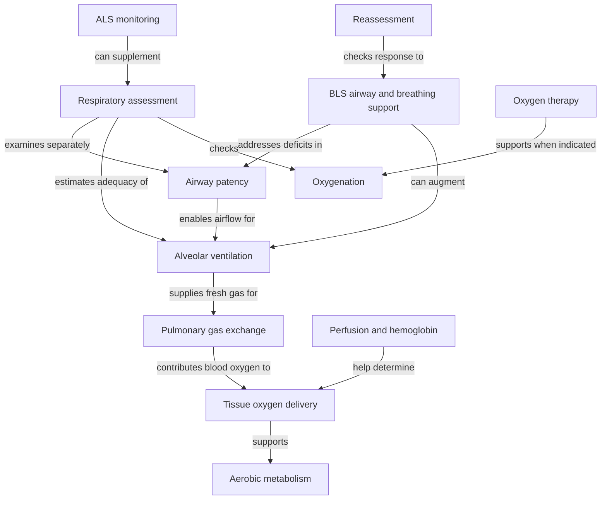

### Airway structure, resistance, and protection

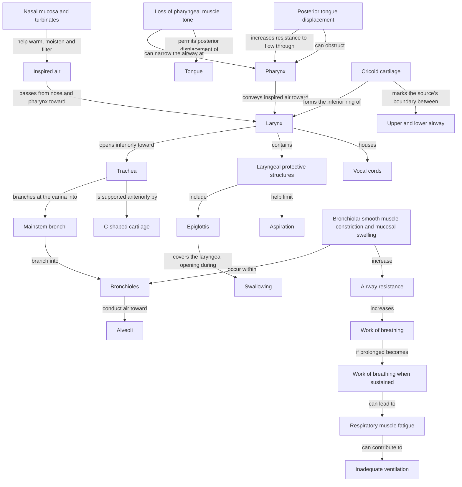

### Pleura and breathing mechanics

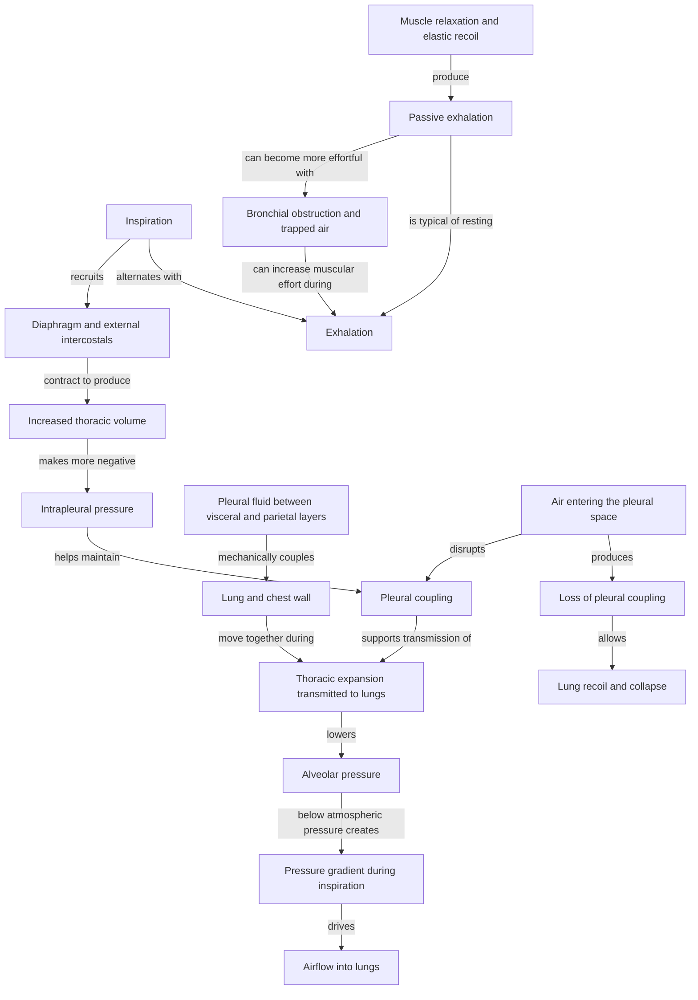

### Gas exchange and oxygen delivery

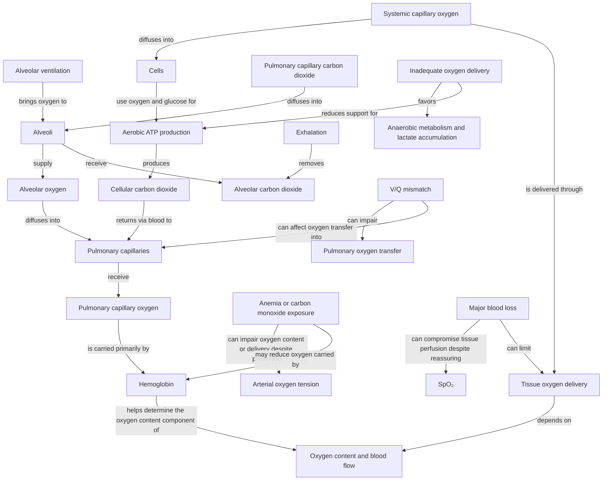

### Respiratory control and COPD

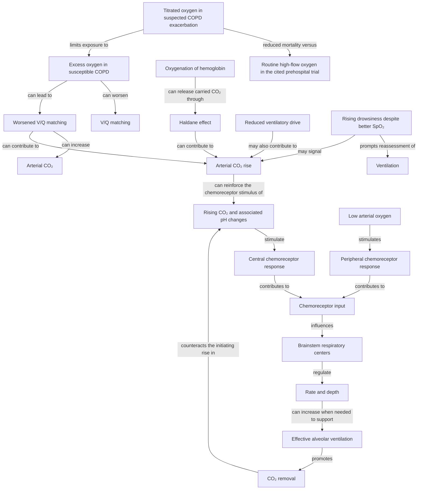

The prehospital COPD trial used 88–92% as its titration target. Correct hypoxemia promptly, use the applicable protocol, and support inadequate ventilation. The chapter’s older hypoxic-drive explanation is incomplete.

### Failure mechanisms, compensation, and reserve

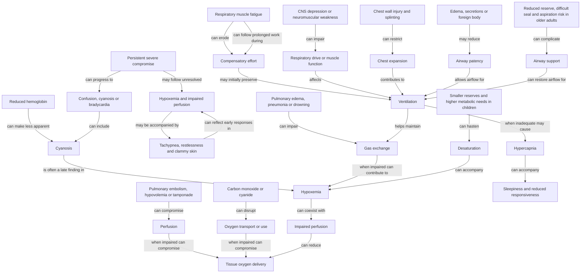

## Airway assessment and BLS management

### Airway sounds, patency, and protection

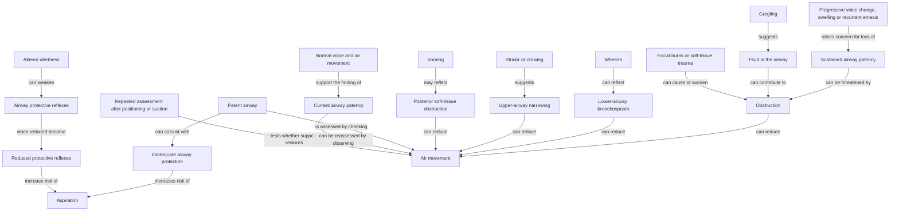

### Positioning, adjuncts, and aspiration

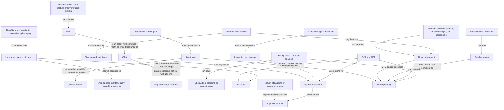

### Suction equipment, selection, and harm

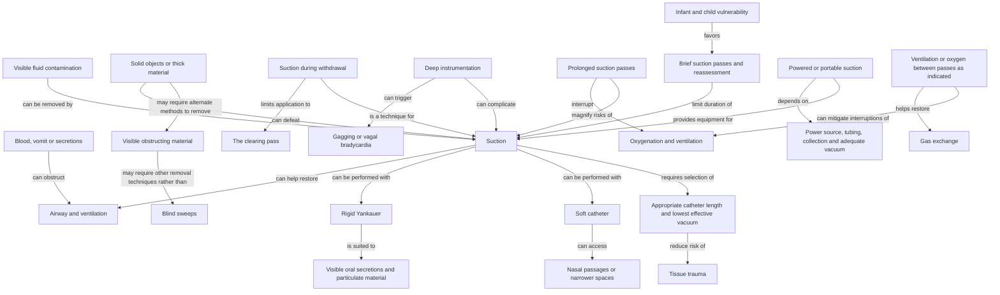

The source’s prolonged suction and preoxygenation examples are contextual. Its explanation that suction removes residual volume remains uncertain. Catheter depth and suction through advanced airways depend on device, training, and protocol.

### Differentiating obstruction and bronchospasm

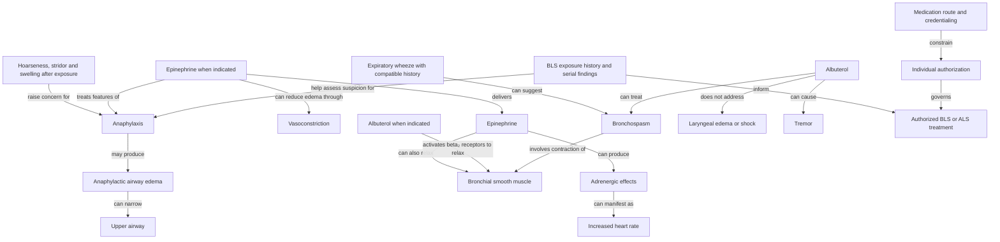

## Breathing assessment and monitoring

### Rate, tidal volume, and effective ventilation

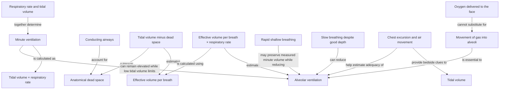

With a 200 mL breath and 150 mL dead space, only 50 mL reaches alveoli per breath. At 12/min, minute ventilation is 2.4 L/min and alveolar ventilation is 0.6 L/min. At 42/min, those values become 8.4 and 2.1 L/min respectively.

### Distress, fatigue, and inadequate breathing

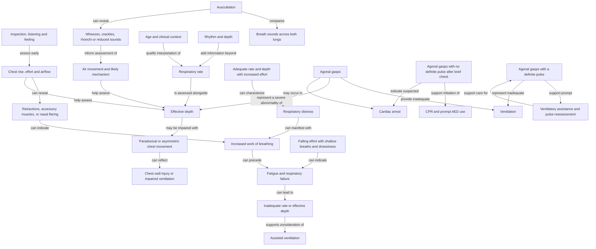

Rate alone, including tachypnea, does not determine the need to assist. Interpret effort, depth, air movement, rhythm, alertness, pulse, and context together. An organized monitor rhythm does not establish circulation.

### Pulse oximetry, capnography, and ECG

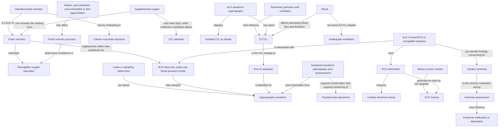

## Assisted ventilation and noninvasive support

### Positive pressure, preload, and overventilation

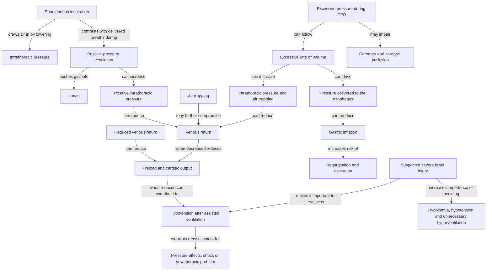

### Manual ventilation technique and reassessment

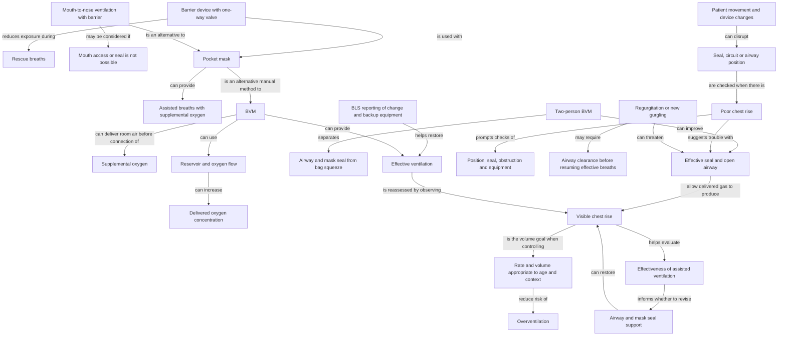

The source’s older volumes, rate tables, manual timing examples and delay before attaching oxygen have limits. Aim for the visible chest rise described in the current guidance and minimize interruptions. Select adjuncts when indicated and tolerated.

### Rate, airway status, and resuscitation context

```mermaid
flowchart TD
    n01["Adult with a pulse and inadequate breathing"]
    n02["10 breaths/min in AHA 2025 guidance"]
    n03["Adult cardiac arrest with an advanced airway"]
    n04["Pediatric pulse with inadequate breathing"]
    n05["20–30 breaths/min in AHA/AAP 2025 guidance"]
    n06["Pediatric CPR with an advanced airway"]
    n07["20–30 breaths/min"]
    n08["CPR before an advanced airway"]
    n09["Compressions and ventilation according to age and rescuer context"]
    n10["Newborn resuscitation at birth"]
    n11["30–60 inflations/min"]
    n12["Bag capacity"]
    n13["Delivered tidal volume"]
    n14["Ventilation in an actively breathing patient"]
    n15["Patient effort when feasible"]
    n16["Assisted ventilation"]

    n01 -->|is ventilated at| n02
    n03 -->|pairs continuous compressions with| n02
    n04 -->|uses| n05
    n06 -->|also uses| n07
    n08 -->|coordinates| n09
    n10 -->|uses a separate algorithm including when indicated| n11
    n12 -->|differs from| n13
    n14 -->|may be coordinated with| n15
    n01 -->|is an indication for| n16
    n04 -->|is an indication for| n16
    n06 -->|requires age-specific| n16
    n08 -->|changes how compressions are paired with| n16
    n10 -->|uses a distinct approach to| n16
    n12 -->|does not set delivery volume during| n16
    n14 -->|can be synchronized with patient effort during| n16
    n03 -->|requires continuous compressions alongside| n16
```

These examples distinguish resuscitation contexts. The source contains older pediatric rates and overlapping newborn bag-capacity descriptions. Equipment choice requires age- and device-specific verification.

### Mechanical ventilation and backup support

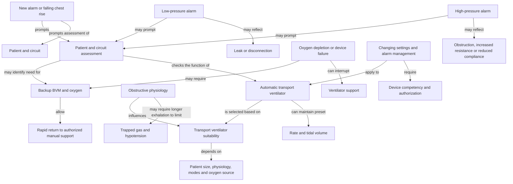

The outline’s ATV features and settings describe particular textbook equipment. Ventilator modes, limits, and consumption differ by device.

### CPAP, bilevel NIV, and high-flow oxygen

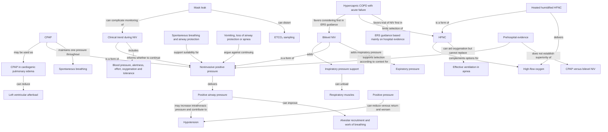

NAEMSP’s 2022 position includes both NIV options for selected patients. ERS/ATS prehospital support for cardiogenic pulmonary edema is conditional and low certainty. The cited CPAP trial improved dyspnea and respiratory rate without shortening hospital stay. Protocol, device, age, and clinical trajectory qualify application.

## Altered airways and obstruction

### Stoma anatomy, ventilation route, and tube failure

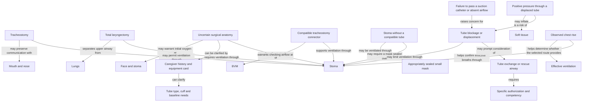

A mouth-and-nose fallback cannot ventilate a known total laryngectomy. Mouth-to-stoma carries exposure risk. A barrier is required in the source’s last-resort example.

### Foreign body obstruction and changing response

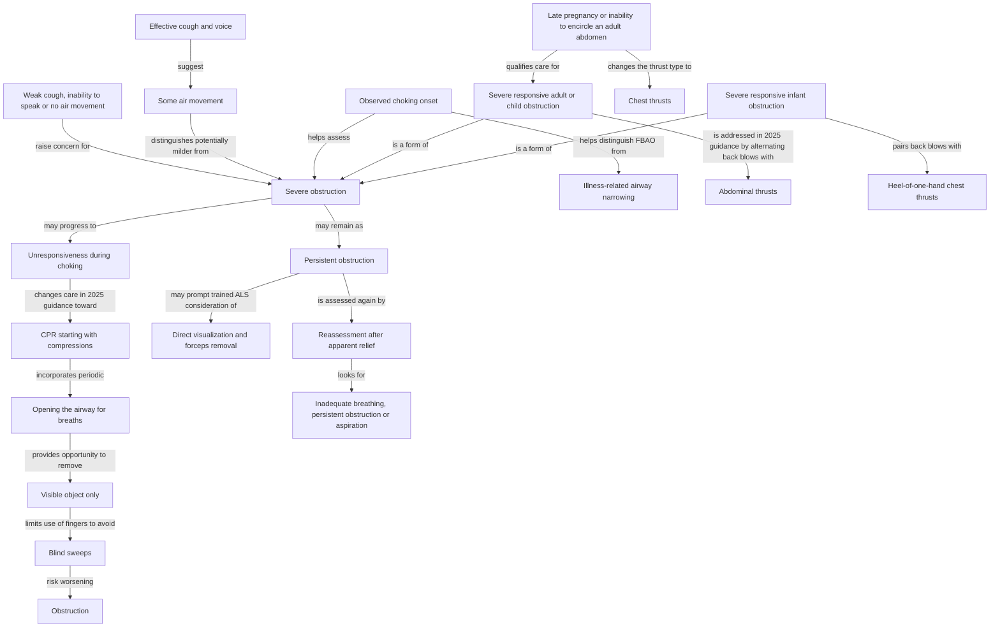

The source contains superseded thrust-only, breath-first, and two-finger infant techniques. Current AHA/AAP guidance distinguishes responsive infant chest thrusts from infant CPR compressions. Routine chest-compression technique uses heel of one hand or two-thumb encircling when applicable.

### Facial injury, bleeding, and equipment fit

```mermaid
flowchart TD
    n01["Facial deformity or swelling"]
    n02["Mask seal and airway patency"]
    n03["Pharyngeal bleeding"]
    n04["Repeated suction and reassessment"]
    n05["Visible broken teeth or loose dental appliances"]
    n06["Obstruction risk"]
    n07["Stable full dentures"]
    n08["Mask seal"]
    n09["Loose dentures"]
    n10["Airway and mask fit"]
    n11["Persistent poor ventilation"]
    n12["Authorized ALS"]
    n13["Poor mask seal and airway patency"]

    n01 -->|can impair| n02
    n03 -->|may require| n04
    n05 -->|can pose| n06
    n07 -->|may help maintain| n08
    n09 -->|may need stabilization or removal depending on| n10
    n11 -->|may prompt escalation and transport planning with| n12
    n02 -->|when impaired can contribute to| n11
    n01 -->|can compromise| n08
    n03 -->|can compromise| n02
    n05 -->|can compromise| n02
    n09 -->|can impair| n08
    n13 -->|can result in| n11
```

## Oxygen selection and equipment

### Oxygen decisions, disease context, and toxic exposure

```mermaid
flowchart TD
    n01["Adequate ventilation with hypoxemia"]
    n02["Supplemental oxygen"]
    n03["Ineffective ventilation"]
    n04["Assisted breaths in addition to oxygen"]
    n05["Suspected carbon monoxide exposure"]
    n06["Reassuring standard SpO₂"]
    n07["Exposure pattern and symptoms"]
    n08["Co-oximetry or specialty consultation"]
    n09["Confirmed ACS hypoxia below 90%"]
    n10["2025 multisociety ACS guidance"]
    n11["ACS saturation at or above 90%"]
    n12["Hypoxic ischemic stroke"]
    n13["2026 AHA/ASA guidance"]
    n14["Reduced consciousness or bulbar dysfunction"]
    n15["Suspected stroke"]
    n16["Suspected severe traumatic brain injury"]
    n17["Brain Trauma Foundation guidance"]
    n18["Normal maternal oxygenation with abnormal fetal tracing"]
    n19["2025 ACOG intrapartum guidance"]
    n20["Maternal medical or traumatic illness in EMS"]
    n21["Breathing, perfusion, oxygenation and exposure"]
    n22["Hyperoxia"]
    n23["Reperfusion oxidative stress or coronary vasoconstriction"]
    n24["Prolonged excess oxygen in premature newborns"]
    n25["Retinopathy of prematurity"]
    n26["Clinical context and oxygenation"]

    n01 -->|may respond to| n02
    n03 -->|requires assessment for| n04
    n05 -->|can warrant oxygen despite| n06
    n07 -->|inform need for| n08
    n09 -->|supports oxygen under| n10
    n11 -->|generally does not warrant routine oxygen under| n10
    n12 -->|has a goal above 94% in| n13
    n14 -->|can require airway or ventilation support in| n15
    n16 -->|warrants oxygen supplementation under| n17
    n18 -->|does not justify routine maternal oxygen under| n19
    n20 -->|requires evaluation of| n21
    n22 -->|can contribute to| n23
    n24 -->|can contribute to| n25
    n02 -->|is selected according to| n26
    n03 -->|may require more than| n02
    n05 -->|is assessed using| n07
    n05 -->|can change the threshold for| n02
    n09 -->|is one condition informing| n02
    n12 -->|is a condition informing| n02
    n14 -->|may occur in| n12
    n16 -->|is a condition informing| n02
    n20 -->|differs from the intrapartum context of| n18
    n20 -->|may require condition-specific| n02
    n22 -->|is a potential consequence of excessive| n02
    n24 -->|illustrates risks of| n22
```

General, trauma, and pediatric figures are source examples subject to condition-specific guidance. Severe TBI recommendations are not blanket trauma rules. Intrapartum guidance addresses fetal monitoring. Selected thrombectomy patients may enter a specialized hospital pathway.

### Delivery devices, oxygen concentration, and tolerance

```mermaid
flowchart TD
    n01["Nasal cannula"]
    n02["Ambient air"]
    n03["Low-flow oxygen delivery"]
    n04["Nonrebreather"]
    n05["High oxygen concentration"]
    n06["Collapsed reservoir during inhalation"]
    n07["Flow, seal and circuit"]
    n08["Simple mask"]
    n09["Rebreathing"]
    n10["Partial rebreather"]
    n11["Exhaled gas in reservoir"]
    n12["Venturi mask"]
    n13["Controlled oxygen concentration"]
    n14["Tracheostomy mask"]
    n15["Tracheostomy or stoma"]
    n16["Tracheostomy mask compared with T-tube"]
    n17["Tubing traction"]
    n18["Prolonged dry oxygen delivery"]
    n19["Compatible humidification"]
    n20["Mask intolerance in a child"]
    n21["Blow-by oxygen with caregiver assistance"]
    n22["Observable response and reliable saturation"]
    n23["Ongoing oxygen titration"]
    n24["Supplemental oxygen"]

    n01 -->|mixes oxygen with| n02
    n01 -->|can aid tolerance and communication during| n03
    n04 -->|depends on a filled reservoir and valves to support| n05
    n06 -->|signals need to check| n07
    n08 -->|needs minimum flow to limit| n09
    n10 -->|retains some| n11
    n12 -->|uses selected entrainment adapters to provide| n13
    n14 -->|delivers oxygen at| n15
    n16 -->|permits secretion escape and reduces| n17
    n18 -->|may motivate use of| n19
    n20 -->|may favor| n21
    n22 -->|inform| n23
    n01 -->|is a delivery option for| n24
    n04 -->|is a delivery option for| n24
    n06 -->|may occur with| n04
    n08 -->|is a delivery option for| n24
    n10 -->|is a delivery option for| n24
    n12 -->|is a delivery option for| n24
    n14 -->|is a delivery option for| n24
    n16 -->|highlights the secretion and traction advantages of| n14
    n18 -->|can occur with| n24
    n21 -->|is another route for| n24
    n23 -->|adjusts| n24
```

### Oxygen supply, duration, and device safety

```mermaid
flowchart TD
    n01["Cylinder size and pressure"]
    n02["Available oxygen volume"]
    n03["Higher flow"]
    n04["Supply duration"]
    n05["Usable gauge pressure"]
    n06["Safe residual pressure"]
    n07["Cylinder constant × usable pressure ÷ flow"]
    n08["Minutes of oxygen remaining"]
    n09["Device demand, leaks and driving gas"]
    n10["Constant-flow assumptions"]
    n11["Anticipated transport and handoff time"]
    n12["Reserve and backup supply"]
    n13["Gas-specific pin index and correct washer"]
    n14["Cylinder and regulator setup"]
    n15["High-pressure regulator"]
    n16["Working pressure for compatible devices"]
    n17["Therapy regulator"]
    n18["Patient oxygen flow"]
    n19["Securing cylinders and avoiding contamination or ignition"]
    n20["Compressed oxygen and accelerated combustion"]
    n21["Transfer between oxygen sources"]
    n22["Oxygen delivery"]
    n23["Shutoff and bleeding trapped oxygen"]
    n24["Zero"]

    n01 -->|together influence| n02
    n03 -->|reduces| n04
    n05 -->|equals gauge pressure minus| n06
    n07 -->|estimates| n08
    n09 -->|can invalidate| n10
    n11 -->|inform| n12
    n13 -->|support secure matching in| n14
    n15 -->|supplies| n16
    n17 -->|controls| n18
    n19 -->|reduces hazards from| n20
    n21 -->|requires assessing continuity of| n22
    n23 -->|brings regulator gauge toward| n24
    n02 -->|and flow together determine| n04
    n04 -->|is estimated as| n08
    n07 -->|uses| n05
    n09 -->|can shorten expected| n04
    n08 -->|inform| n12
    n15 -->|is one regulator type in the| n14
    n17 -->|is one regulator type in the| n14
    n14 -->|helps confirm supply and draw down| n02
    n19 -->|protect equipment during| n21
    n21 -->|makes use of| n12
    n23 -->|prepares equipment for disconnection from| n14
```

With an E-cylinder constant of 0.28, 2,000 psi, a 200 psi reserve and 15 L/min, the source estimates 33.6 minutes. Use service-specific reserve and device consumption guidance. Verify source valve-opening and cracking instructions against the device and agency policy.

### Oxygen setup, transfer, and interruption

```mermaid
flowchart TD
    n01["Cylinder identification"]
    n02["Gas supply"]
    n03["Regulator seal and pin alignment"]
    n04["Charging the regulator"]
    n05["Gauge check after charging"]
    n06["Cylinder pressure"]
    n07["Delivery tubing connection"]
    n08["Oxygen flow"]
    n09["Reservoir inflation"]
    n10["Reservoir mask"]
    n11["Reservoir deflation or disconnected tubing"]
    n12["Patient oxygen delivery"]
    n13["Oxygen source transfer"]
    n14["Flow before mask reapplication"]
    n15["Cylinder closure before regulator bleeding"]
    n16["Trapped regulator gas"]
    n17["Pressure gauge at zero"]
    n18["Protection from heat, grease and flame"]
    n19["Pressurized oxygen"]
    n20["Safe use of the gas supply"]
    n21["Preparing oxygen delivery"]

    n01 -->|verifies the correct| n02
    n03 -->|precede| n04
    n05 -->|confirms available| n06
    n07 -->|precedes adjustment of| n08
    n09 -->|precedes application of| n10
    n11 -->|prompts a check of| n12
    n13 -->|depends on restoring and verifying| n14
    n15 -->|isolates supply from| n16
    n17 -->|indicates the regulator has released| n16
    n18 -->|reduces risk with| n19
    n20 -->|depends on| n03
    n02 -->|requires verification for| n20
    n04 -->|precedes| n05
    n07 -->|occurs as part of| n21
    n09 -->|is part of| n21
    n21 -->|includes checking| n06
    n11 -->|can interrupt| n08
    n10 -->|receives oxygen from| n08
    n13 -->|can interrupt| n08
    n15 -->|produces the conditions for| n17
    n18 -->|applies while using| n02
    n15 -->|is part of terminating| n08
```

This diagram captures dependencies in the source device procedure. Cylinder valve handling and equipment-specific sequence require manufacturer instructions and local policy.

## Pediatric care and clinical integration

### Pediatric anatomy, ventilation, and oxygenation

```mermaid
flowchart TD
    n01["Large occiput"]
    n02["Supine infant"]
    n03["Shoulder padding and appropriate alignment"]
    n04["Patent airway"]
    n05["Excessive head extension or pressure under chin"]
    n06["Flexible pediatric airway"]
    n07["Smaller equipment and short suction passes"]
    n08["Trauma, hypoxemia and vagal bradycardia"]
    n09["Large adenoids and narrow nares"]
    n10["NPA placement and effectiveness"]
    n11["Absent gag in an unresponsive child"]
    n12["Size-appropriate OPA"]
    n13["Pediatric OPA insertion"]
    n14["Rotation"]
    n15["Short oxygen reserve and high consumption"]
    n16["Deterioration"]
    n17["Poor tone, reduced alertness, weak air entry or bradycardia"]
    n18["Decompensation"]
    n19["Fitted mask and gentle visible chest rise"]
    n20["Pediatric BVM"]
    n21["Pediatric supplemental oxygen"]
    n22["Trauma, medical illness, or newborn transition"]
    n23["Poor perfusion or persistent cyanosis despite oxygen"]
    n24["Ventilation, circulation and reading reliability"]
    n25["Position of comfort or caregiver support"]
    n26["Spontaneously breathing child"]
    n27["Transport decision"]
    n28["Pediatric receiving capability and patient needs"]

    n01 -->|may flex the neck in| n02
    n03 -->|can help maintain| n04
    n05 -->|can obstruct| n06
    n07 -->|help limit| n08
    n09 -->|may complicate| n10
    n11 -->|supports consideration of| n12
    n13 -->|uses a tongue depressor and avoids| n14
    n15 -->|can hasten| n16
    n17 -->|raise concern for| n18
    n19 -->|support| n20
    n21 -->|is titrated in context of| n22
    n23 -->|calls for reassessment of| n24
    n25 -->|can reduce distress when appropriate in| n26
    n27 -->|accounts for| n28
    n07 -->|can help maintain| n04
    n12 -->|helps maintain| n04
    n02 -->|may benefit from| n03
    n06 -->|requires attention to| n04
    n09 -->|are pediatric size considerations alongside| n07
    n12 -->|is placed using| n13
    n04 -->|supports| n20
    n20 -->|helps support ventilation during| n18
    n17 -->|can accompany| n16
    n23 -->|can occur during| n18
    n21 -->|is reassessed for effectiveness during| n16
    n25 -->|may support cooperation with| n21
    n27 -->|considers risk of| n16
```

### Basic support and advanced airway decisions

```mermaid
flowchart TD
    n01["Jaw support, suction and BVM"]
    n02["Ventilation"]
    n03["Reported response to basic interventions"]
    n04["Sustainability of basic support"]
    n05["Recurrent contamination or deteriorating airway protection"]
    n06["Advanced airway"]
    n07["Authorized placement of a supraglottic airway"]
    n08["A ventilation route"]
    n09["Supraglottic airway"]
    n10["Cuffed tracheal tube"]
    n11["Endotracheal intubation"]
    n12["Credentialed paramedics"]
    n13["Advanced airway attempts"]
    n14["Hypoxemia or hypotension"]
    n15["Effective basic support"]
    n16["Transport, especially in pediatric cases"]
    n17["Time-sensitive transport"]
    n18["Additional authorized resources"]
    n19["BLS pulse, chest rise and contamination checks"]
    n20["ALS monitoring during airway transition"]

    n01 -->|can restore or maintain| n02
    n03 -->|informs ALS assessment of| n04
    n05 -->|may prompt consideration of| n06
    n07 -->|can provide| n08
    n09 -->|provides less aspiration protection than| n10
    n11 -->|is generally a procedure of| n12
    n13 -->|may interrupt ventilation and worsen| n14
    n15 -->|may remain preferable during| n16
    n17 -->|can continue during coordination of| n18
    n19 -->|complement| n20
    n02 -->|is evaluated through| n03
    n15 -->|may be achievable with| n01
    n06 -->|may include| n09
    n06 -->|may include| n11
    n07 -->|provides one option for| n06
    n13 -->|are considered after evaluation of| n04
    n19 -->|inform| n03
    n17 -->|can continue with| n15
    n05 -->|can compromise| n02
```

### Neurologic deterioration and contaminated airway cases

```mermaid
flowchart TD
    n01["Sudden severe headache with progressive confusion and posturing"]
    n02["Concern for intracranial emergency"]
    n03["Snoring and minimal chest excursion at 5–6/min"]
    n04["Obstruction with inadequate ventilation"]
    n05["SpO₂ of 79% in the headache case"]
    n06["Severe desaturation"]
    n07["BLS in the headache case"]
    n08["Positioning and assisted breaths"]
    n09["Last known well, progression and anticoagulant history"]
    n10["Stroke-capable destination notification and handoff"]
    n11["Prone unresponsive patient in vomit"]
    n12["Recurrent contamination and aspiration"]
    n13["Six shallow breaths per minute and a weak pulse near 55"]
    n14["Witnessed alcohol use"]
    n15["Hypoglycemia and trauma"]
    n16["Opioid or mixed ingestion"]
    n17["BLS suction, jaw support and effective BVM"]
    n18["Contamination and depressed breathing"]
    n19["Recurrent vomiting during transport"]
    n20["Airway clearance and BVM"]
    n21["ALS glucose testing or capnography"]
    n22["Reversible causes or ventilation trend"]
    n23["Change in ventilation or oxygenation during a move"]
    n24["Clinical findings and monitoring equipment"]
    n25["Receiving team notification"]
    n26["Aspiration risk and ongoing ventilation requirements"]
    n27["Authorized naloxone for suspected opioid toxicity"]
    n28["Opioid receptor antagonism"]
    n29["Ongoing ventilation"]
    n30["Naloxone assessment and response"]
    n31["Recurrent depression, vomiting or agitation"]
    n32["Handoff and reassessment"]

    n01 -->|raises| n02
    n03 -->|support concern for| n04
    n05 -->|indicates| n06
    n07 -->|supports oxygenation and ventilation with| n08
    n09 -->|support| n10
    n11 -->|presents risk of| n12
    n11 -->|had BLS findings of| n13
    n14 -->|leaves open| n15
    n14 -->|also leaves open| n16
    n17 -->|help address| n18
    n13 -->|reinforced concern for| n18
    n19 -->|interrupts and prompts reassessment of| n20
    n21 -->|may help evaluate| n22
    n23 -->|should prompt correlation of| n24
    n25 -->|can flag| n26
    n27 -->|can restore breathing through| n28
    n29 -->|remains important during| n30
    n31 -->|should be communicated at| n32
    n02 -->|coexisted in the headache case with| n04
    n04 -->|helps explain need for| n07
    n06 -->|also supports| n07
    n09 -->|help communicate| n02
    n12 -->|was a concern addressed by| n17
    n19 -->|worsens risk of| n12
    n14 -->|is contextual history for| n11
    n21 -->|can supplement assessment of| n11
    n28 -->|addresses the opioid component of suspected| n16
    n27 -->|can be considered alongside| n29
    n31 -->|can affect need for| n29
    n25 -->|supports| n32
    n10 -->|is a form of| n25
    n23 -->|can affect| n32
```

These are case-specific relationships. Neither the symptom cluster nor the reported alcohol use establishes a diagnosis. Field support, examination, and findings before and after treatment inform communication with the receiving team.

### Scope, protocols, and evidence

```mermaid
flowchart TD
    n01["State law and licensure"]
    n02["EMS practice"]
    n03["National EMS Scope of Practice Model"]
    n04["EMT, AEMT and paramedic roles"]
    n05["EMT-level care"]
    n06["Positioning, suction, adjuncts, oxygen and BVM"]
    n07["National model EMT functions"]
    n08["CPAP"]
    n09["National model AEMT functions"]
    n10["Supraglottic airways, capnography, IV/IO and selected medications"]
    n11["Paramedic capability"]
    n12["Endotracheal intubation and broader airway pharmacology"]
    n13["State and local variation"]
    n14["Supraglottic airway or capnography at EMT level"]
    n15["Training, credentialing and agency protocols"]
    n16["Individual authorization"]
    n17["Medical direction"]
    n18["Consultation"]
    n19["Evidence and expert consensus"]
    n20["Recommendations and model guidelines"]
    n21["Model guidelines"]
    n22["Local protocols"]
    n23["Equipment preparation or data acquisition"]
    n24["Advanced interpretation or intervention"]
    n25["Out-of-routine assistance"]
    n26["Direct supervision"]

    n01 -->|define legal bounds of| n02
    n03 -->|describes a framework for| n04
    n05 -->|commonly includes| n06
    n07 -->|also include| n08
    n09 -->|include| n10
    n11 -->|generally includes| n12
    n13 -->|can change availability of| n14
    n15 -->|help determine| n16
    n17 -->|provides oversight and when required| n18
    n19 -->|can inform| n20
    n21 -->|can guide development of| n22
    n23 -->|is distinct from authorization for| n24
    n25 -->|may require state permission, approval and| n26
    n02 -->|is described by| n03
    n04 -->|define different model capabilities including| n05
    n07 -->|describe| n05
    n09 -->|describe one level within| n04
    n11 -->|describes one level within| n04
    n13 -->|affects| n16
    n02 -->|is subject to| n17
    n17 -->|contributes to implementation of| n22
    n20 -->|include| n21
    n22 -->|factor into| n16
    n16 -->|governs| n24
    n25 -->|is constrained by| n16
```